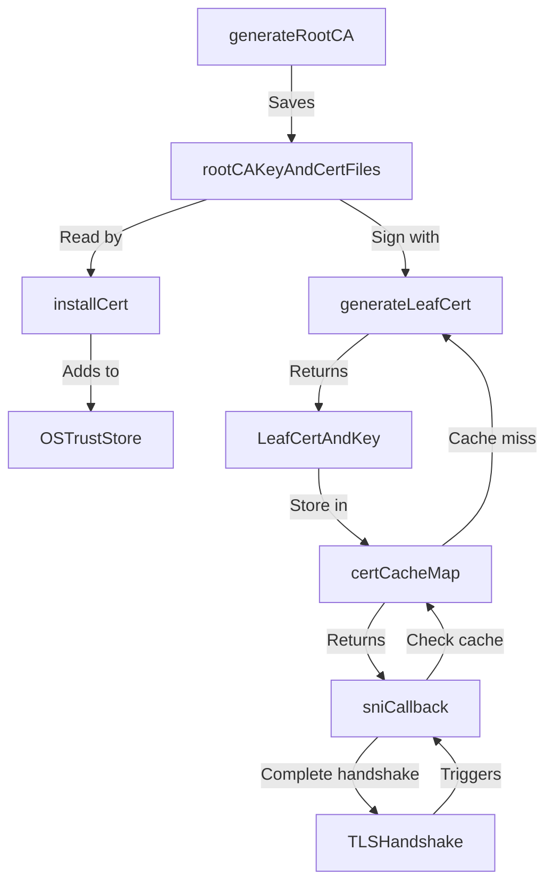
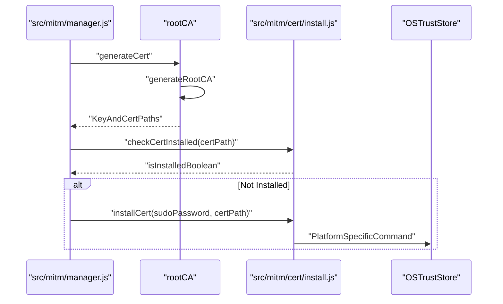

<!-- source: DeepWiki mcp.deepwiki.com · repo decolua/9router · page 6.2 Certificate Generation & Installation · fetched 2026-10-30 -->

# Certificate Generation & Installation

Relevant source files

The following files were used as context for generating this wiki page:

- [src/app/(dashboard)/dashboard/cli-tools/components/MitmServerCard.js](src/app/(dashboard)/dashboard/cli-tools/components/MitmServerCard.js)
- [src/app/(dashboard)/dashboard/cli-tools/components/MitmToolCard.js](src/app/(dashboard)/dashboard/cli-tools/components/MitmToolCard.js)
- [src/app/(dashboard)/dashboard/mitm/MitmPageClient.js](src/app/(dashboard)/dashboard/mitm/MitmPageClient.js)
- [src/app/api/cli-tools/antigravity-mitm/route.js](src/app/api/cli-tools/antigravity-mitm/route.js)
- [src/lib/dataDir.js](src/lib/dataDir.js)
- [src/mitm/cert/install.js](src/mitm/cert/install.js)
- [src/mitm/dns/dnsConfig.js](src/mitm/dns/dnsConfig.js)
- [src/mitm/manager.js](src/mitm/manager.js)
- [src/mitm/paths.js](src/mitm/paths.js)
- [src/mitm/server.js](src/mitm/server.js)
- [src/shared/constants/mitmToolHosts.js](src/shared/constants/mitmToolHosts.js)

This page documents 9Router's TLS certificate infrastructure for the MITM proxy subsystem. The system generates a self-signed Root CA certificate once, installs it into the OS trust store, and dynamically generates domain-specific leaf certificates on-demand during TLS handshakes. This enables transparent HTTPS interception for AI tools like Antigravity, GitHub Copilot, and Kiro without triggering browser or IDE security warnings.

For the overall MITM architecture and how these components integrate, see page 6.1. For DNS configuration, see page 6.3.

---

## Overview

The certificate infrastructure consists of four primary components spanning key generation, trust management, and runtime interception:

| Layer | Module | Purpose |
|---|---|---|
| **Root CA** | [src/mitm/cert/rootCA.js]() | Generates self-signed 10-year Root CA using `node-forge`. |
| **Leaf Certs** | [src/mitm/cert/rootCA.js]() | Generates domain-specific leaf certs signed by the Root CA on demand. |
| **Installation** | [src/mitm/cert/install.js:86-104]() | Installs Root CA to the OS trust store (`certutil`, macOS Keychain, or Linux ca-certificates). |
| **Dynamic Generation** | [src/mitm/cert/generate.js]() | Provides the `getCertForDomain` interface for `SNICallback` in `src/mitm/server.js:41-56](). |

### Certificate Architecture & Data Flow

Title: "MITM Certificate Lifecycle and SNI Flow"

Sources: [src/mitm/cert/install.js:1-180](), [src/mitm/server.js:38-56]()

---

## Root CA Generation

The Root CA certificate is generated once and stored in the directory specified by `MITM_DIR` [src/mitm/paths.js:30]().

### Generation Process

The function `generateRootCA()` creates a self-signed Root CA certificate using the `node-forge` cryptographic library:

1.  **Check Existence**: Verifies if `rootCA.key` and `rootCA.crt` exist on disk [src/mitm/server.js:60-63]().
2.  **Verify Expiry**: `isCertExpired()` checks if the existing certificate expires within 30 days.
3.  **Regeneration**: If expired or missing, stale files are unlinked and regenerated.
4.  **Certificate Attributes**:
    *   **Subject/Issuer**: `CN=9Router MITM Root CA, O=9Router, C=US` [src/mitm/cert/install.js:30]().
    *   **Validity**: 10 years.
    *   **Extensions**: `basicConstraints(cA: true)` and `keyUsage(keyCertSign, cRLSign)`.
5.  **Signing**: Self-signed using a 2048-bit RSA key pair and SHA-256.

Sources: [src/mitm/server.js:59-72](), [src/mitm/paths.js:30]()

### Lifecycle Management

The system orchestrates setup by ensuring the Root CA is available before starting the MITM server. Generation is triggered via `generateCert()` [src/mitm/manager.js:13]() which is invoked by the server manager logic.

Title: "Manager Setup Sequence"

Sources: [src/mitm/cert/install.js:86-104](), [src/mitm/manager.js:13-16]()

---

## Leaf Certificate Generation

Leaf certificates are generated on-demand for specific hostnames when a client initiates a TLS connection to the MITM server.

### Dynamic Generation via SNI Callback

The MITM proxy handles incoming client TLS handshakes through `sniCallback` in [src/mitm/server.js:41-56]():

1.  **Cache Lookup**: Checks `certCache` for an existing secure context [src/mitm/server.js:43]().
2.  **On-Demand Generation**: On a cache miss, calls `getCertForDomain(servername)` [src/mitm/server.js:44]().
3.  **Root Loading**: Loads the Root CA private key and certificate [src/mitm/server.js:65-68]().
4.  **Leaf Creation**: Creates a 1-year certificate with `subjectAltName` for both the exact domain and its wildcard variant (`*.domain`).
5.  **Signing**: Signed by the Root CA private key.
6.  **Context Caching**: Creates a TLS secure context combining the leaf certificate and Root CA PEM, then caches it [src/mitm/server.js:46-50]().

Sources: [src/mitm/server.js:38-56]()

---

## Installation to OS Trust Store

The Root CA must be trusted by the operating system so that intercepted client tools accept the dynamic leaf certificates.

### Checking Installation Status

`checkCertInstalled(certPath)` uses platform-specific utilities to verify trust:

| Platform | Implementation |
|---|---|
| **Windows** | `certutil -store Root <fingerprint>` verifies the SHA-1 thumbprint [src/mitm/cert/install.js:68-81](). |
| **macOS** | `security find-certificate` and `security verify-cert` check the system keychain [src/mitm/cert/install.js:48-66](). |
| **Linux** | Checks for file existence in standard anchor paths like `/usr/local/share/ca-certificates/` [src/mitm/cert/install.js:176-180](). |

Sources: [src/mitm/cert/install.js:33-81](), [src/mitm/cert/install.js:176-180]()

### Platform-Specific Installation

| Platform | Implementation Function | Execution Mechanism |
|---|---|---|
| **macOS** | `installCertMac` [src/mitm/cert/install.js:106-117]() | `security add-trusted-cert -d -r trustRoot` via `execWithPassword` |
| **Windows** | `installCertWindows` [src/mitm/cert/install.js:119-133]() | `certutil -addstore Root` via `runElevatedPowerShell` (UAC prompt if needed) |
| **Linux** | `installCertLinux` [src/mitm/cert/install.js:101]() | Copies to anchor directory and runs `update-ca-certificates` or `update-ca-trust` |

Sources: [src/mitm/cert/install.js:86-133]()

---

## DNS & Host Integration

For TLS interception to occur, tool traffic must resolve to the local MITM server (`127.0.0.1`).

The `addDNSEntry(tool, sudoPassword)` function appends tool-specific host entries to the system hosts file [src/mitm/dns/dnsConfig.js:146-180]().

### Atomic Writes & Rollback
On Windows, `atomicWriteHostsWin` ensures zero corruption of the system hosts file [src/mitm/dns/dnsConfig.js:14-32]():
1.  Writes modifications to a `.9router.new` temporary file [src/mitm/dns/dnsConfig.js:15]().
2.  Backs up the current file to `.9router.bak` [src/mitm/dns/dnsConfig.js:20]().
3.  Renames `.new` to the target path [src/mitm/dns/dnsConfig.js:22]().
4.  Restores from `.bak` if any failure occurs [src/mitm/dns/dnsConfig.js:24-26]().

After modifying host entries, DNS caches are flushed via `ipconfig /flushdns` on Windows or `dscacheutil`/`resolvectl` on Unix-like systems [src/mitm/dns/dnsConfig.js:104-111,164]().

Sources: [src/mitm/dns/dnsConfig.js:14-32](), [src/mitm/dns/dnsConfig.js:104-111](), [src/mitm/dns/dnsConfig.js:146-180]()

---

