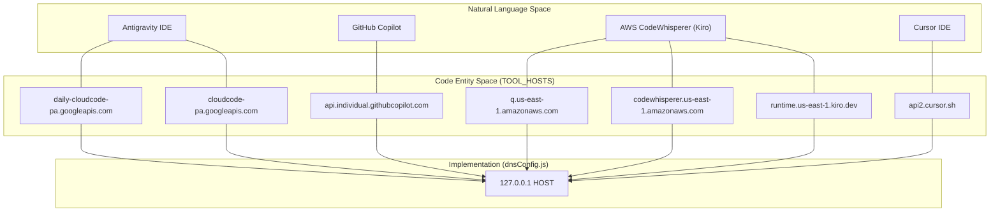
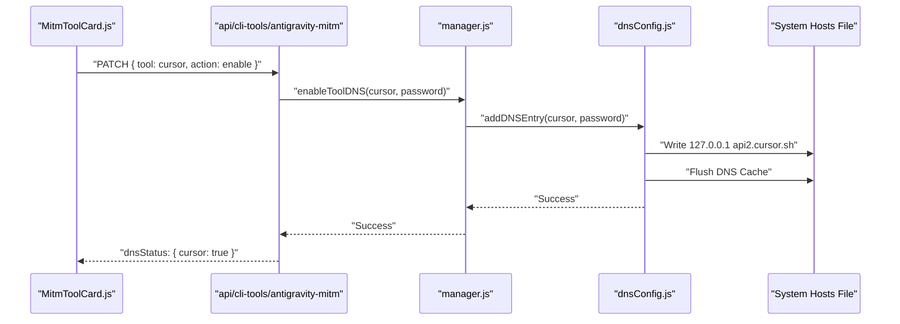

<!-- source: DeepWiki mcp.deepwiki.com · repo decolua/9router · page 6.3 DNS Configuration · fetched 2026-10-30 -->

# DNS Configuration

Relevant source files

The following files were used as context for generating this wiki page:

- [src/app/(dashboard)/dashboard/cli-tools/components/MitmServerCard.js](src/app/(dashboard)/dashboard/cli-tools/components/MitmServerCard.js)
- [src/app/(dashboard)/dashboard/cli-tools/components/MitmToolCard.js](src/app/(dashboard)/dashboard/cli-tools/components/MitmToolCard.js)
- [src/app/(dashboard)/dashboard/mitm/MitmPageClient.js](src/app/(dashboard)/dashboard/mitm/MitmPageClient.js)
- [src/app/api/cli-tools/antigravity-mitm/route.js](src/app/api/cli-tools/antigravity-mitm/route.js)
- [src/lib/dataDir.js](src/lib/dataDir.js)
- [src/mitm/cert/install.js](src/mitm/cert/install.js)
- [src/mitm/dns/dnsConfig.js](src/mitm/dns/dnsConfig.js)
- [src/mitm/manager.js](src/mitm/manager.js)
- [src/mitm/paths.js](src/mitm/paths.js)
- [src/mitm/server.js](src/mitm/server.js)
- [src/shared/constants/mitmToolHosts.js](src/shared/constants/mitmToolHosts.js)

This page documents the DNS configuration subsystem of the MITM proxy. DNS configuration modifies the system hosts file to redirect AI provider domains to `127.0.0.1`, enabling 9Router's MITM server to intercept traffic from tools like Antigravity, GitHub Copilot, Kiro (AWS CodeWhisperer), and Cursor.

For certificate management (Root CA generation and trust store installation), see [src/mitm/cert/install.js:1-104](). For the overall MITM architecture and server lifecycle, see [src/mitm/server.js:1-167](). For integration with specific tools, see [src/app/(dashboard)/dashboard/cli-tools/components/MitmToolCard.js:1-123]().

---

## Overview

The DNS configuration system provides per-tool control over hosts file entries. Each supported tool uses specific API domains that must be redirected to localhost for interception. The system handles platform-specific hosts file locations, elevated privilege requirements (UAC on Windows, sudo on Unix), and DNS cache flushing.

Sources: [src/mitm/dns/dnsConfig.js:1-8](), [src/mitm/manager.js:8-14]()

---

## Tool-to-Domain Mapping

### TOOL_HOSTS Structure

The `TOOL_HOSTS` constant defines the domain-to-tool mapping. Each tool has a set of domains that are intercepted by the MITM proxy.

| Tool ID | Tool Name | Intercepted Domains |
| :--- | :--- | :--- |
| `antigravity` | Antigravity | `daily-cloudcode-pa.googleapis.com`, `cloudcode-pa.googleapis.com` |
| `copilot` | GitHub Copilot | `api.individual.githubcopilot.com` |
| `kiro` | Kiro (AWS) | `runtime.us-east-1.kiro.dev`, `q.us-east-1.amazonaws.com`, `codewhisperer.us-east-1.amazonaws.com` |
| `cursor` | Cursor | `api2.cursor.sh` |

Sources: [src/shared/constants/mitmToolHosts.js:5-10](), [src/mitm/dns/dnsConfig.js:6-6]()

### DNS Mapping Logic

The following diagram maps the logical tool names to their specific domain entries in the system hosts file.

**Diagram: Tool to Host Entity Mapping**

Sources: [src/shared/constants/mitmToolHosts.js:5-10](), [src/mitm/dns/dnsConfig.js:161-169]()

---

## Platform-Specific Configuration

### Hosts File Locations

The `HOSTS_FILE` constant resolves based on the operating system:

| Platform | Path |
| :--- | :--- |
| **Windows** | `C:\Windows\System32\drivers\etc\hosts` |
| **macOS/Linux** | `/etc/hosts` |

Sources: [src/mitm/dns/dnsConfig.js:34-38]()

### Privilege Elevation

Modifying the hosts file requires administrative privileges. 9Router employs different strategies based on the OS:

1. **Windows**: Uses `runElevatedPowerShell` from `winElevated.js` to execute scripts with administrative rights [src/mitm/dns/dnsConfig.js:7-7](). This typically triggers a UAC prompt if the user is not already elevated.
2. **macOS/Linux**: Uses `execWithPassword` to run commands via `sudo -S`, passing the password through `stdin` [src/mitm/dns/dnsConfig.js:69-91](). If `sudo` is unavailable (checked via `isSudoAvailable`), it falls back to standard `sh` [src/mitm/dns/dnsConfig.js:41-49]().

Sources: [src/mitm/dns/dnsConfig.js:41-91](), [src/mitm/dns/dnsConfig.js:157-174]()

---

## DNS Entry Lifecycle

### Adding Entries (`addDNSEntry`)

When a tool is enabled via the dashboard, `addDNSEntry` is called to update the system configuration.

**Execution Flow**:
1. **Check Presence**: Filters domains to find those not already present via `checkDNSEntry` [src/mitm/dns/dnsConfig.js:116-125]().
2. **Windows Elevation**: Uses `atomicWriteHostsWin` to safely modify the file via atomic renames [src/mitm/dns/dnsConfig.js:14-32](), then runs `ipconfig /flushdns` via `runElevatedPowerShell` [src/mitm/dns/dnsConfig.js:164-164]().
3. **Unix Elevation**: Uses `tee` via `execWithPassword` to overwrite the file atomically [src/mitm/dns/dnsConfig.js:169-174]().

Sources: [src/mitm/dns/dnsConfig.js:146-180](), [src/mitm/dns/dnsConfig.js:14-32]()

### Removing Entries (`removeDNSEntry`)

Entries are removed when a tool is disabled or during cleanup via `removeAllDNSEntries`.

1. **Windows**: Reads the file, filters out lines containing the tool's hosts, and performs an atomic write back to `HOSTS_FILE` [src/mitm/dns/dnsConfig.js:14-32]().
2. **Unix**: Filters the file content in Node.js and uses `tee` to write the cleaned content back with sudo privileges [src/mitm/dns/dnsConfig.js:69-91]().

Sources: [src/mitm/dns/dnsConfig.js:185-214]()

---

## DNS Cache Flushing

Flushing ensures the OS recognizes hosts file changes immediately without requiring a system restart.

| OS | Command / Method |
| :--- | :--- |
| **Windows** | `ipconfig /flushdns` (via `runElevatedPowerShell`) [src/mitm/dns/dnsConfig.js:164-164]() |
| **macOS** | `dscacheutil -flushcache && killall -HUP mDNSResponder` [src/mitm/dns/dnsConfig.js:107-107]() |
| **Linux** | `resolvectl flush-caches` [src/mitm/dns/dnsConfig.js:109-109]() |

Sources: [src/mitm/dns/dnsConfig.js:104-111](), [src/mitm/dns/dnsConfig.js:164-164]()

---

## Data Flow and Manager Integration

The `manager.js` orchestrates the lifecycle of the MITM server and its DNS requirements. It exposes functions like `enableToolDNS` and `disableToolDNS` to the API layer.

**Diagram: DNS Management Data Flow**

Sources: [src/mitm/manager.js:8-8](), [src/app/api/cli-tools/antigravity-mitm/route.js:162-202](), [src/app/(dashboard)/dashboard/cli-tools/components/MitmToolCard.js:99-122]()

### Password Management
To facilitate these operations without constant prompts, 9Router implements a password caching and encryption system:
* **Encryption**: Passwords are encrypted using `aes-256-gcm` with a key derived from the machine ID [src/mitm/manager.js:154-171]().
* **Memory Cache**: Passwords can be held in `globalThis.__mitmSudoPassword` via `setCachedPassword` [src/mitm/manager.js:127-127]().
* **Decryption**: `decryptPassword` handles retrieving the stored credentials for background operations [src/mitm/manager.js:173-189]().

Sources: [src/mitm/manager.js:154-189](), [src/mitm/manager.js:126-127]()

---

## Status Monitoring

The system provides real-time status of the DNS configuration through `checkAllDNSStatus` [src/mitm/dns/dnsConfig.js:130-141](). This function reads the hosts file and verifies if all domains for a given tool are currently redirected to `127.0.0.1`. The dashboard UI uses this to display "Active" or "DNS off" badges [src/app/(dashboard)/dashboard/cli-tools/components/MitmToolCard.js:153-159]().

Sources: [src/mitm/dns/dnsConfig.js:130-141](), [src/app/(dashboard)/dashboard/cli-tools/components/MitmToolCard.js:153-159]()

---

