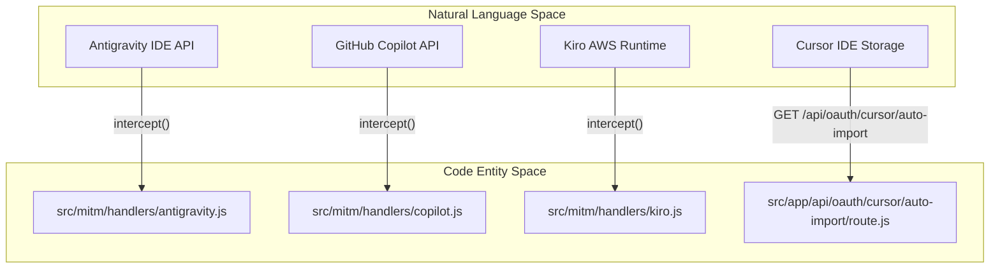
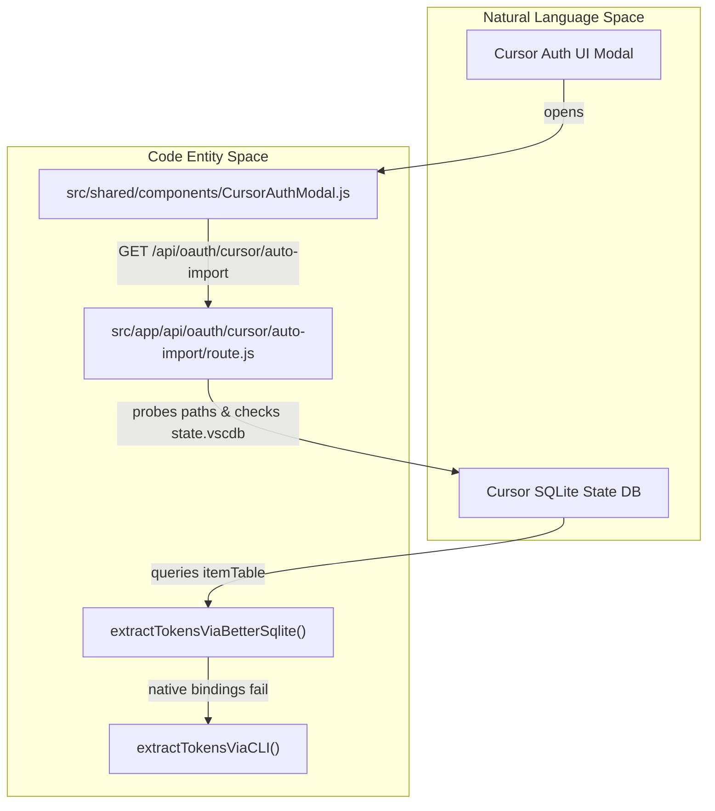

<!-- source: DeepWiki mcp.deepwiki.com · repo decolua/9router · page 6.4 Intercepted Tool Integration · fetched 2026-10-30 -->

# Intercepted Tool Integration

Relevant source files

The following files were used as context for generating this wiki page:

- [src/app/api/oauth/cursor/auto-import/route.js](src/app/api/oauth/cursor/auto-import/route.js)
- [src/mitm/handlers/antigravity.js](src/mitm/handlers/antigravity.js)
- [src/mitm/handlers/base.js](src/mitm/handlers/base.js)
- [src/mitm/handlers/copilot.js](src/mitm/handlers/copilot.js)
- [src/mitm/handlers/kiro.js](src/mitm/handlers/kiro.js)
- [src/mitm/logger.js](src/mitm/logger.js)
- [src/shared/components/CursorAuthModal.js](src/shared/components/CursorAuthModal.js)
- [tests/unit/kiro-image-forwarding.test.js](tests/unit/kiro-image-forwarding.test.js)
- [tests/unit/oauth-cursor-auto-import.test.js](tests/unit/oauth-cursor-auto-import.test.js)

## Purpose and Scope

This page documents how 9Router integrates with specific AI coding tools and CLI agents that require specialized network interception or automated credential ingestion. It covers three distinct integration architectures:

1. **MITM-based Interception**: Used for tools that lack native configuration options for custom API endpoints (such as Antigravity IDE, GitHub Copilot, and Kiro/AWS CodeWhisperer). Requests are intercepted at the network level by `src/mitm/server.js`, routed through handler modules, translated, and forwarded to 9Router. [src/mitm/handlers/antigravity.js:10-17]()
2. **Native Integration & Config Management**: Used for tools that support custom base URLs or environment variables. 9Router provides UI components and backend routes to manage their configuration files.
3. **Automated Credential Extraction**: Specialized logic for tools like Cursor that store session tokens and machine IDs in local SQLite databases, allowing 9Router to auto-detect and import them via `src/app/api/oauth/cursor/auto-import/route.js`. [src/app/api/oauth/cursor/auto-import/route.js:173-177]()

Sources: [src/mitm/handlers/antigravity.js:10-17](), [src/app/api/oauth/cursor/auto-import/route.js:173-177]()

---

## Supported Tools and Code Mappings

The MITM proxy intercepts traffic destined for specific hostnames and dispatches them to dedicated handler modules. The following mapping bridges natural language tool names to their underlying code implementations:

### Diagram: Tool-to-Handler Code Mapping

Sources: [src/mitm/handlers/antigravity.js:10-31](), [src/mitm/handlers/copilot.js:21-33](), [src/mitm/handlers/kiro.js:1-10](), [src/app/api/oauth/cursor/auto-import/route.js:173-177]()

| Tool Name | Intercepted Host / Target | Handler / Route Module | Core Functions |
| :--- | :--- | :--- | :--- |
| **Antigravity IDE** | `cloudcode-pa.googleapis.com` | `src/mitm/handlers/antigravity.js` | `intercept()` [src/mitm/handlers/antigravity.js:10-31]() |
| **GitHub Copilot** | `api.individual.githubcopilot.com` | `src/mitm/handlers/copilot.js` | `intercept()`, `resolveRouterPath()` [src/mitm/handlers/copilot.js:11-33]() |
| **Kiro (AWS)** | `runtime.us-east-1.kiro.dev` | `src/mitm/handlers/kiro.js` | `buildEventStreamFrame()`, `extractThinking()`, `initKiroState()` [src/mitm/handlers/kiro.js:38-161]() |
| **Cursor** | Local SQLite (`state.vscdb`) | `src/app/api/oauth/cursor/auto-import/route.js` | `GET()`, `extractTokensViaBetterSqlite()`, `extractTokensViaCLI()` [src/app/api/oauth/cursor/auto-import/route.js:79-177]() |

Sources: [src/mitm/handlers/antigravity.js:1-33](), [src/mitm/handlers/copilot.js:1-35](), [src/mitm/handlers/kiro.js:38-161](), [src/app/api/oauth/cursor/auto-import/route.js:79-177]()

---

## MITM Request Processing Pipeline

The MITM proxy relies on common utility functions in `src/mitm/handlers/base.js` to communicate with the core 9Router server (`http://localhost:20128` by default) and stream responses back to clients.

- **`fetchRouter(openaiBody, path, clientHeaders)`**: Strips hop-by-hop headers (`host`, `content-length`, `connection`, `transfer-encoding`, `content-type`, `authorization`), injects the `ROUTER_API_KEY` if configured, and sends a POST request to 9Router. [src/mitm/handlers/base.js:9-37]()
- **`pipeSSE(routerRes, res, dumper)`**: Forwards standard Server-Sent Events from 9Router to the client HTTP response object, optionally teeing the stream into a debug file via `createResponseDumper`. [src/mitm/handlers/base.js:43-66](), [src/mitm/logger.js:72-104]()
- **`pipeTransformedEventStream(routerRes, res, transformFn, state)`**: Parses incoming SSE chunks from 9Router, runs `transformFn(parsed, state)`, and writes binary AWS EventStream frames (`application/vnd.amazon.eventstream`) to the client. [src/mitm/handlers/base.js:157-196]()

Sources: [src/mitm/handlers/base.js:1-226](), [src/mitm/logger.js:72-104]()

---

## Tool-Specific Interception Handlers

### Antigravity Handler
`src/mitm/handlers/antigravity.js` handles requests originating from Antigravity IDE. It parses the incoming Gemini-format body, applies the mapped model name, and forwards the request to `/v1/chat/completions`. If errors occur during streaming endpoints (`:streamGenerateContent`), it writes an SSE error chunk so that client SDKs do not hang. [src/mitm/handlers/antigravity.js:10-31]()

Sources: [src/mitm/handlers/antigravity.js:1-33]()

### GitHub Copilot Handler
`src/mitm/handlers/copilot.js` maps Copilot endpoint URL patterns (`/chat/completions`, `/v1/messages`, `/responses`) to their corresponding 9Router paths using `resolveRouterPath()`, replaces the request model with the mapped model, and pipes the response. [src/mitm/handlers/copilot.js:5-33]()

Sources: [src/mitm/handlers/copilot.js:1-35]()

### Kiro Handler & AWS EventStream Translation
`src/mitm/handlers/kiro.js` bridges OpenAI/Claude completions with the AWS EventStream binary wire format required by Kiro/CodeWhisperer.
- **State Initialization**: `initKiroState(modelId)` sets up tracking for model IDs, tool calls, token usage, and thinking blocks. [src/mitm/handlers/kiro.js:38-49]()
- **Thinking Block Extraction**: `extractThinking(text, state)` parses `<thinking>`, `<think>` tags across chunk boundaries. [src/mitm/handlers/kiro.js:56-104]()
- **EventStream Binary Frames**: `buildEventStreamFrame(eventType, payload, contentType)` encodes Smithy system headers (`:message-type`, `:event-type`, `:content-type`), calculates prelude and message CRCs using standard polynomial `0xEDB88320`, and packages the payload into a big-endian binary buffer. [src/mitm/handlers/kiro.js:16-161]()
- **Initial Response Frame**: `buildInitialResponseFrame(conversationId)` generates the required initial response frame (`application/x-amz-json-1.0`) expected by the real Kiro runtime. [src/mitm/handlers/kiro.js:164-170]()

Sources: [src/mitm/handlers/kiro.js:1-193]()

---

## Cursor Auto-Import Integration

9Router automates the ingestion of Cursor session credentials by querying Cursor's local SQLite state database (`state.vscdb`).

### Diagram: Cursor Token Extraction Pipeline

Sources: [src/app/api/oauth/cursor/auto-import/route.js:79-170](), [src/shared/components/CursorAuthModal.js:11-50]()

### Extraction Workflow & Implementation
1. **Platform Probing**: `getCandidatePaths(platform)` determines candidate file locations for macOS (`Library/Application Support/Cursor/...`), Windows (`%APPDATA%/Cursor/...`), and Linux (`.config/Cursor/...`). [src/app/api/oauth/cursor/auto-import/route.js:18-63]()
2. **Primary Extraction (`better-sqlite3`)**: `extractTokensViaBetterSqlite(dbPath)` opens the database in read-only mode and queries `itemTable` for keys matching `ACCESS_TOKEN_KEYS` (`cursorAuth/accessToken`, `cursorAuth/token`) and `MACHINE_ID_KEYS` (`storage.serviceMachineId`, etc.). [src/app/api/oauth/cursor/auto-import/route.js:79-114]()
3. **CLI Fallback (`sqlite3`)**: If native `better-sqlite3` bindings fail or are unavailable, `extractTokensViaCLI(dbPath)` spawns the `sqlite3` command-line utility via `execFileAsync`. [src/app/api/oauth/cursor/auto-import/route.js:80-170]()
4. **UI Integration**: `CursorAuthModal` calls `/api/oauth/cursor/auto-import` on mount, auto-filling the access token and machine ID fields upon success. [src/shared/components/CursorAuthModal.js:20-50]()

Sources: [src/app/api/oauth/cursor/auto-import/route.js:1-177](), [src/shared/components/CursorAuthModal.js:1-90]()

---

