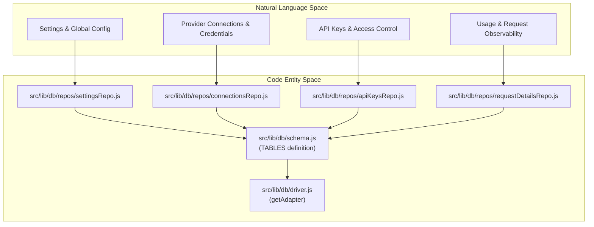
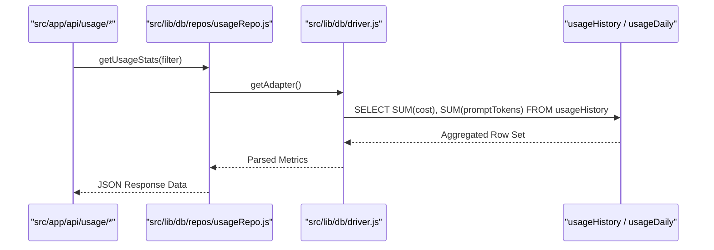

<!-- source: DeepWiki mcp.deepwiki.com · repo decolua/9router · page 7 Data & Storage · fetched 2026-10-30 -->

# Data & Storage

Relevant source files

The following files were used as context for generating this wiki page:

- [open-sse/services/capacityAdapter.js](open-sse/services/capacityAdapter.js)
- [src/app/(dashboard)/dashboard/providers/[id]/CustomConfigCard.js](src/app/(dashboard)/dashboard/providers/[id]/CustomConfigCard.js)
- [src/app/api/providers/[id]/overrides/route.js](src/app/api/providers/[id]/overrides/route.js)
- [src/lib/db/backup.js](src/lib/db/backup.js)
- [src/lib/db/migrate.js](src/lib/db/migrate.js)
- [src/lib/db/repos/requestDetailsRepo.js](src/lib/db/repos/requestDetailsRepo.js)
- [src/lib/db/repos/settingsRepo.js](src/lib/db/repos/settingsRepo.js)

This document covers 9Router's data persistence architecture, including its specialized database structure, SQLite-based storage systems, and observability mechanisms. 

9Router uses a unified SQLite backend managed via a repository pattern to improve concurrency, reliability, and performance across settings, credentials, model fallback chains, and metrics [docs/ARCHITECTURE.md:136-150]().

This is a parent page providing a high-level overview. For deep technical details, refer to the following child pages:
- [Database Architecture](#7.1) — SQLite layer in `src/lib/db`: driver, adapters, schema, migrations, backup, and shims [docs/ARCHITECTURE.md:136-150]().
- [Repositories & Collections](#7.2) — Entity record shapes in `src/lib/db/repos/`: `connectionsRepo`, `settingsRepo`, `aliasRepo`, `usageRepo`, and `requestDetailsRepo` [src/lib/db/index.js:7-71]().
- [Usage Database](#7.3) — Usage persistence, metrics collection, and daily/historical aggregation (`usageHistory`, `usageDaily`) [src/lib/db/schema.js:113-141]().
- [Request Details & Observability](#7.4) — Request-details storage, batching, sanitization, and console log buffer streaming (`requestDetails`) [src/lib/db/schema.js:142-158]().
- [Data Directory & Backup](#7.5) — `~/.9router` data directory resolution, file layout, export/import operations (`exportDb`, `importDb`), and backup formats [src/lib/db/index.js:73-150]().

---

## 1. Unified SQLite Architecture

9Router utilizes a declarative SQLite schema defined in `src/lib/db/schema.js` [src/lib/db/schema.js:1-165]() and exposed through repository modules in `src/lib/db/index.js` [src/lib/db/index.js:1-96](). The persistence layer replaces legacy separate JSON files with robust transactional tables supporting WAL mode and connection pooling. Migrations are handled via versioned scripts in `src/lib/db/migrate.js` [src/lib/db/migrate.js:57-76](), alongside additive schema synchronization [src/lib/db/migrate.js:79-109]().

### System Architecture to Code Entities

Sources: [src/lib/db/index.js:1-96](), [src/lib/db/schema.js:1-165](), [src/lib/db/migrate.js:57-109]()

---

## 2. Repositories & Collections

All state modifications and queries are structured around domain-specific repositories. These modules abstract SQL queries into clean asynchronous functions and enforce atomic transactions where necessary.

- **Settings (`settingsRepo.js`)**: Manages global configuration parameters, default settings fallback, atomic updates, provider overrides, and capacity adapters [src/lib/db/repos/settingsRepo.js:7-123]().
- **Connections (`connectionsRepo.js`)**: Handles provider connection CRUD operations, priorities, and activation statuses [src/lib/db/index.js:13-18]().
- **API Keys (`apiKeysRepo.js`)**: Manages inbound authentication keys, machine IDs, and per-key access restrictions [src/lib/db/repos/apiKeysRepo.js:6-89]().
- **Combos & Aliases (`combosRepo.js`, `aliasRepo.js`)**: Stores model fallback sequences, custom models, and provider model mappings [src/lib/db/index.js:37-48]().

For detailed record shapes and repository methods, see [Repositories & Collections](#7.2).

Sources: [src/lib/db/index.js:7-71](), [src/lib/db/repos/settingsRepo.js:7-123](), [src/lib/db/repos/apiKeysRepo.js:6-89]()

---

## 3. Usage Database

Token consumption, costs, and historical request metrics are persisted across `usageHistory` and `usageDaily` tables [src/lib/db/schema.js:113-141](). The usage tracking system aggregates statistics for analytics dashboards and connection quota tracking.

### Usage Aggregation Flow

For implementation details on token aggregation and persistence, see [Usage Database](#7.3).

Sources: [src/lib/db/index.js:60-65](), [src/lib/db/schema.js:113-141]()

---

## 4. Request Details & Observability

To support debugging and transparent tool inspection, 9Router logs comprehensive request and response metadata into the `requestDetails` table [src/lib/db/schema.js:142-158](). 

- **Batching & Sanitization:** High-throughput logging via `requestDetailsRepo.js` utilizes write buffers, automated flush timers, and header sanitization to strip sensitive authorization tokens before committing records to storage [src/lib/db/repos/requestDetailsRepo.js:61-160]().
- **Size Limits & Pruning:** Large payloads are constrained by maximum JSON size rules, and overall table growth is bounded by automatic record pruning [src/lib/db/repos/requestDetailsRepo.js:114-133]().

For further information on observability buffers and console log streaming, see [Request Details & Observability](#7.4).

Sources: [docs/ARCHITECTURE.md:136-150](), [src/lib/db/schema.js:142-158](), [src/lib/db/repos/requestDetailsRepo.js:61-160]()

---

## 5. Data Directory & Backup

9Router resolves its data directory dynamically (defaulting to `~/.9router`), managing database files, backups, and exports [docs/ARCHITECTURE.md:136-150](). 

- **Export/Import:** The database engine provides full system export and transaction-safe import functions (`exportDb`, `importDb`) which serialize settings, connections, nodes, proxy pools, API keys, and custom model definitions [src/lib/db/index.js:73-150]().
- **Safety Backups:** Schema migrations are preceded by lightweight backups generated via `backupDbLite` in `src/lib/db/backup.js` [src/lib/db/backup.js:39-63](). These backups intentionally exclude the high-volume `requestDetails` table to maintain compact backup sizes [src/lib/db/backup.js:16-17]().

For details on file layout, directory resolution, and backup restoration procedures, see [Data Directory & Backup](#7.5).

Sources: [docs/ARCHITECTURE.md:136-150](), [src/lib/db/index.js:73-150](), [src/lib/db/backup.js:16-63]()

---

