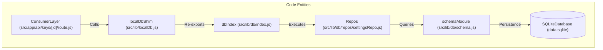
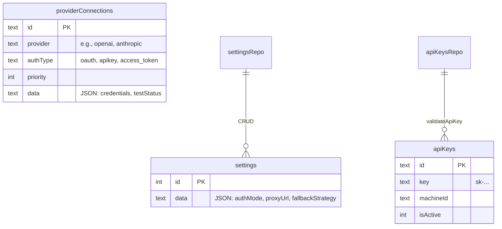

<!-- source: DeepWiki mcp.deepwiki.com · repo decolua/9router · page 7.1 Database Architecture · fetched 2026-10-30 -->

# Database Architecture

<details>
<summary>Relevant source files</summary>

The following files were used as context for generating this wiki page:

- [open-sse/services/capacityAdapter.js](open-sse/services/capacityAdapter.js)
- [src/app/(dashboard)/dashboard/providers/[id]/CustomConfigCard.js](src/app/(dashboard)/dashboard/providers/[id]/CustomConfigCard.js)
- [src/app/api/keys/[id]/route.js](src/app/api/keys/[id]/route.js)
- [src/app/api/providers/[id]/overrides/route.js](src/app/api/providers/[id]/overrides/route.js)
- [src/lib/db/backup.js](src/lib/db/backup.js)
- [src/lib/db/index.js](src/lib/db/index.js)
- [src/lib/db/migrate.js](src/lib/db/migrate.js)
- [src/lib/db/repos/apiKeysRepo.js](src/lib/db/repos/apiKeysRepo.js)
- [src/lib/db/repos/requestDetailsRepo.js](src/lib/db/repos/requestDetailsRepo.js)
- [src/lib/db/repos/settingsRepo.js](src/lib/db/repos/settingsRepo.js)
- [src/lib/db/schema.js](src/lib/db/schema.js)
- [src/sse/handlers/embeddings.js](src/sse/handlers/embeddings.js)
- [src/sse/handlers/stt.js](src/sse/handlers/stt.js)
- [src/sse/handlers/tts.js](src/sse/handlers/tts.js)
- [src/sse/services/keyAccess.js](src/sse/services/keyAccess.js)
- [tests/unit/embedding-usage-persistence.test.js](tests/unit/embedding-usage-persistence.test.js)
- [tests/unit/gemini-live-stt.test.js](tests/unit/gemini-live-stt.test.js)

</details>


## Purpose and Scope

The database architecture layer (`src/lib/db/`) provides a robust, SQLite-backed persistence engine for 9Router. It manages high-concurrency configuration access, provider connection state, telemetry logging, and usage analytics. This section details the driver implementation, table schemas, migration handling, repository abstractions, backup/restore routines, and the backward-compatibility shim (`src/lib/localDb.js`).

**Sources:** [src/lib/db/schema.js:1-165](), [src/lib/db/index.js:1-150]()

---

## The Three-Database Architecture

9Router partitions data based on its lifecycle, volume, and performance requirements. Since migrating to a unified SQLite backend, all logical stores reside inside a single SQLite database file while maintaining logical separation via distinct tables and repository modules (`src/lib/db/repos/`).

| Logical Database | Table(s) | Implementation | Primary Purpose |
|----------|------|----------------|-----------------|
| **Core Configuration** | `settings`, `providerConnections`, `providerNodes`, `combos`, `apiKeys`, `kv` | SQLite (`src/lib/db/`) | Stores providers, connections, combos, model aliases, and system settings. |
| **Usage & Analytics** | `usageHistory`, `usageDaily` | SQLite | Stores token consumption, costs, and request counts per provider/model. |
| **Request Details** | `requestDetails` | SQLite | High-volume observability data including full request/response payloads. |

**Sources:** [src/lib/db/schema.js:21-159](), [src/lib/db/index.js:70-96]()

---

## Core Database Implementation & Schema (`src/lib/db/schema.js`)

The core database layer initializes tables, runs automated migrations, and enforces relational constraints upon startup. The schema version (`SCHEMA_VERSION`) is set to `2`, driving pre-change safety backups [src/lib/db/schema.js:1-6](). Performance pragmas such as `WAL` journal mode, `synchronous = NORMAL`, and `foreign_keys = ON` are executed by `PRAGMA_SQL` [src/lib/db/schema.js:8-16]().

### Code Entity Space: Data Access Layer & Shim
This diagram maps how high-level components interact with the database drivers and repositories.



**Sources:** [src/lib/db/schema.js:1-165](), [src/lib/db/index.js:1-50](), [src/lib/db/repos/settingsRepo.js:1-73]()

---

## Repositories & Adapters (`src/lib/db/repos/`)

Data access is encapsulated within repository modules located in `src/lib/db/repos/`. These repositories handle atomic read-merge-write operations, connection deduplication, and JSON serialization/deserialization.

- **Settings Repository (`settingsRepo.js`)**: Manages global configuration, defaults, and atomic transactions via `updateSettings()` to prevent losing concurrent updates [src/lib/db/repos/settingsRepo.js:7-123]().
- **Connections Repository (`connectionsRepo.js`)**: Handles provider credential storage, OAuth identity deduplication, and priority ordering [src/lib/db/index.js:12-18]().
- **API Keys Repository (`apiKeysRepo.js`)**: Manages client-facing API keys, machine IDs, and permission matrices via `createApiKey()`, `updateApiKey()`, and `validateApiKey()` [src/lib/db/repos/apiKeysRepo.js:39-89]().

### Code Entity Space: Repository Relationships



**Sources:** [src/lib/db/repos/settingsRepo.js:104-123](), [src/lib/db/repos/apiKeysRepo.js:19-89]()

---

## The `localDb` Shim Layer (`src/lib/localDb.js`)

To ensure backward compatibility across the codebase while transitioning from legacy storage engines to SQLite, `src/lib/localDb.js` serves as a compatibility shim. It re-exports all database accessor methods directly from `src/lib/db/index.js`, allowing legacy import statements to function without modification.

```javascript
// src/lib/db/index.js
export {
  getSettings, updateSettings, isCloudEnabled, getCloudUrl, exportSettings,
} from "./repos/settingsRepo.js";
```

**Sources:** [src/lib/db/index.js:1-10]()

---

## Observability and Request Detail Logging (`src/lib/db/repos/requestDetailsRepo.js`)

The `requestDetailsRepo.js` module implements buffered batch writing for observability logs. It evaluates observability configuration via `getObservabilityConfig()`, sanitizes sensitive headers using `sanitizeHeaders()`, and buffers writes in memory before flushing them to the `requestDetails` SQLite table [src/lib/db/repos/requestDetailsRepo.js:13-160]().

**Sources:** [src/lib/db/repos/requestDetailsRepo.js:1-160]()

---

## Backup, Export & Import

Data persistence routines include database export, import, and backup formatting. The export/import functions (`exportDb`, `importDb`) serialize the underlying SQLite tables into portable JSON or binary database dumps [src/lib/db/index.js:73-150](). These are exposed via admin dashboard endpoints and CLI maintenance hooks.

- **Export Routine (`exportDb`)**: Dumps settings, provider connections, provider nodes, proxy pools, API keys, combos, model aliases, custom models, MITM aliases, and pricing profiles into a single JSON payload [src/lib/db/index.js:73-96]().
- **Import Routine (`importDb`)**: Validates schema integrity and merges or replaces existing records within a transaction boundary [src/lib/db/index.js:98-150]().

**Sources:** [src/lib/db/index.js:73-150]()

---

