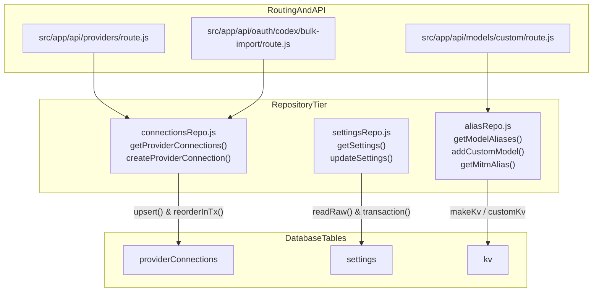
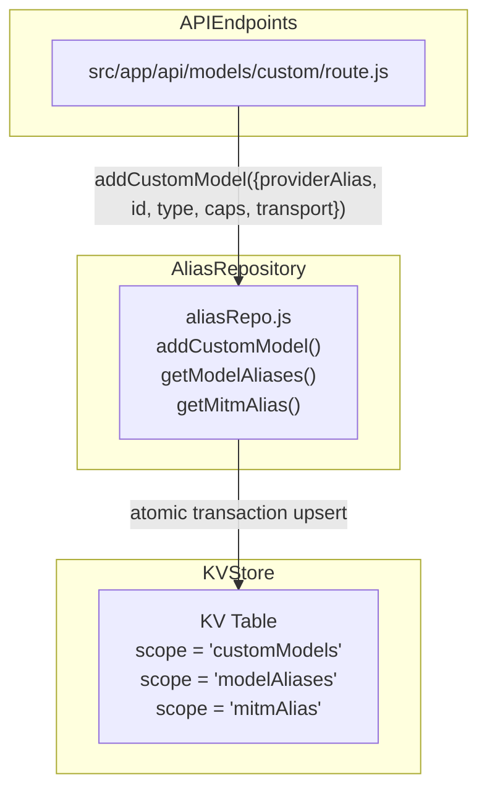

<!-- source: DeepWiki mcp.deepwiki.com · repo decolua/9router · page 7.2 Repositories & Collections · fetched 2026-10-30 -->

# Repositories & Collections

Relevant source files

The following files were used as context for generating this wiki page:

- [open-sse/handlers/geminiLiveStt.js](open-sse/handlers/geminiLiveStt.js)
- [src/app/(dashboard)/dashboard/providers/[id]/AddApiKeyModal.js](src/app/(dashboard)/dashboard/providers/[id]/AddApiKeyModal.js)
- [src/app/(dashboard)/dashboard/providers/[id]/AddCustomModelModal.js](src/app/(dashboard)/dashboard/providers/[id]/AddCustomModelModal.js)
- [src/app/(dashboard)/dashboard/providers/[id]/BulkImportCodexModal.js](src/app/(dashboard)/dashboard/providers/[id]/BulkImportCodexModal.js)
- [src/app/api/models/custom/route.js](src/app/api/models/custom/route.js)
- [src/app/api/oauth/codex/bulk-import/route.js](src/app/api/oauth/codex/bulk-import/route.js)
- [src/app/api/providers/route.js](src/app/api/providers/route.js)
- [src/lib/db/repos/aliasRepo.js](src/lib/db/repos/aliasRepo.js)
- [src/lib/db/repos/connectionsRepo.js](src/lib/db/repos/connectionsRepo.js)
- [src/shared/components/EditConnectionModal.js](src/shared/components/EditConnectionModal.js)
- [src/shared/constants/models.js](src/shared/constants/models.js)
- [tests/unit/db-sqlite-vs-lowdb.test.js](tests/unit/db-sqlite-vs-lowdb.test.js)

This page documents the repository modules and record shapes for 9Router's configuration and persistence layer (`src/lib/db/repos/`). Building on the database architecture, the codebase implements a repository pattern over SQLite (`data.sqlite`) via `src/lib/localDb.js` and dedicated repository files.

## Purpose and Scope

The repository tier abstracts direct SQL operations into strongly-typed domain interfaces. The primary repositories include:
- `connectionsRepo`: Manages AI provider connections, authentication grants, account health state, rate limits, and model routing locks [src/lib/db/repos/connectionsRepo.js:1-50]().
- `settingsRepo`: Persists global configuration, fallback strategies, security flags, proxy setups, and feature toggles [src/lib/db/repos/settingsRepo.js:7-67]().
- `aliasRepo`: Manages user-defined model aliases, custom model definitions, and MITM proxy mapping rules via key-value and table abstractions [src/lib/db/repos/aliasRepo.js:1-68]().
- Usage and Request Detail tracking records for telemetry and observability [src/lib/db/repos/settingsRepo.js:42-46]().

Sources: [src/lib/db/repos/connectionsRepo.js:1-50](), [src/lib/db/repos/settingsRepo.js:7-67](), [src/lib/db/repos/aliasRepo.js:1-68]()

## Repository Architecture & Code Entity Mapping

The following diagram bridges the logical storage concepts to their respective repository implementations and database tables, using exact code identifiers from the codebase.

**Repository Architecture and Code Entity Mapping**

Sources: [src/app/api/providers/route.js:1-11](), [src/lib/db/repos/connectionsRepo.js:68-133](), [src/lib/db/repos/aliasRepo.js:1-55](), [src/app/api/models/custom/route.js:27-53]()

## Provider Connections Record Shape (`connectionsRepo`)

Provider connections store API keys, OAuth tokens, and runtime health parameters. Each record is split between fixed table columns and a JSON `data` payload column [src/lib/db/repos/connectionsRepo.js:35-66]().

### Record Shape Specification

| Column / Field | Type | Description |
|:---|:---|:---|
| `id` | String (UUID) | Unique identifier for the provider connection [src/lib/db/repos/connectionsRepo.js:1-2]() |
| `provider` | String | Provider identifier (e.g. `openai`, `codex`, `anthropic`, `ollama-local`) [src/lib/db/repos/connectionsRepo.js:41]() |
| `authType` | String | Authentication scheme: `apikey`, `oauth`, or `cookie` [src/lib/db/repos/connectionsRepo.js:42]() |
| `name` | String | User-facing display name for the connection [src/lib/db/repos/connectionsRepo.js:43]() |
| `email` | String | Associated account email (primarily for OAuth grants) [src/lib/db/repos/connectionsRepo.js:44]() |
| `priority` | Integer | Fallback order index (lower numbers take precedence) [src/lib/db/repos/connectionsRepo.js:45]() |
| `isActive` | Boolean | Whether the connection is enabled for routing [src/lib/db/repos/connectionsRepo.js:46]() |
| `data` (JSON) | Object | Flexible payload holding credentials and health states: `accessToken`, `refreshToken`, `expiresAt`, `apiKey`, `projectId`, `testStatus`, `lastError`, `rateLimitedUntil`, and `modelLock_*` keys [src/lib/db/repos/connectionsRepo.js:5-11,37]() |

When a connection's health is reset or updated to active (`testStatus: "active"`), `connectionsRepo` clears transient error states and model locks via `resetHealthStateOnActivation` [src/lib/db/repos/connectionsRepo.js:15-33]().

Sources: [src/lib/db/repos/connectionsRepo.js:5-66](), [src/lib/db/repos/connectionsRepo.js:15-33]()

## Settings Record Shape (`settingsRepo`)

Global settings control fallback behavior, security, outbound proxies, and token saver integrations (`rtk`, `headroom`, `caveman`, `ponytail`, `pxpipe`) [src/lib/db/repos/settingsRepo.js:7-67]().

### Record Shape Specification (`DEFAULT_SETTINGS`)

| Setting Key | Default Value | Description |
|:---|:---|:---|
| `cloudEnabled` | `false` | Enables cloud tunneling features [src/lib/db/repos/settingsRepo.js:8]() |
| `tunnelEnabled` | `false` | Activates remote access tunnels (Cloudflare/Tailscale) [src/lib/db/repos/settingsRepo.js:9-11]() |
| `stickyRoundRobinLimit` | `3` | Maximum consecutive turns before rotating accounts [src/lib/db/repos/settingsRepo.js:14]() |
| `comboStrategy` | `"fallback"` | Default strategy for combo model lists (`fallback`, `round-robin`, `fusion`) [src/lib/db/repos/settingsRepo.js:17]() |
| `capacityAdapter` | Object | Global fallback pools for modalities (`vision`, `pdf`, `audioInput`, `videoInput`) [src/lib/db/repos/settingsRepo.js:20-25]() |
| `requireLogin` / `requireApiKey` | `true` | Dashboard and API authentication requirements [src/lib/db/repos/settingsRepo.js:26-27]() |
| `authMode` | `"password"` | Authentication mode (`password`, `oidc`, `saml`) [src/lib/db/repos/settingsRepo.js:29]() |
| `rtkEnabled`, `headroomEnabled`, `cavemanEnabled`, `ponytailEnabled`, `pxpipeEnabled` | Booleans | Token saver and optimization pipeline toggles [src/lib/db/repos/settingsRepo.js:52-61]() |
| `providerOverrides` | `{}` | Per-provider user header overrides applied at dispatch [src/lib/db/repos/settingsRepo.js:65-66]() |

Settings are fetched via `getSettings()` which merges raw database JSON with `DEFAULT_SETTINGS` using `mergeWithDefaults()` [src/lib/db/repos/settingsRepo.js:76-107](). Concurrent updates are safeguarded using atomic transactions via `updateSettings()` [src/lib/db/repos/settingsRepo.js:110-123]().

Sources: [src/lib/db/repos/settingsRepo.js:7-123]()

## Model Aliases & Custom Models (`aliasRepo`)

Model aliasing maps custom strings to upstream target models, while custom models and MITM aliases provide extensions for tool integrations.

### Key-Value Scopes in `aliasRepo`
- `modelAliases`: Maps alias keys to model target strings [src/lib/db/repos/aliasRepo.js:5-16]().
- `customModels`: Stores serialized records keyed by `${providerAlias}|${id}|${type}` containing capability flags (`caps`) and realtime transports (e.g. `gemini-live`) [src/lib/db/repos/aliasRepo.js:22-55](), governed by `sanitizeCaps` and `sanitizeTransport` validators [src/app/api/models/custom/route.js:7-25]().
- `mitmAlias`: Stores tool-specific request mappings [src/lib/db/repos/aliasRepo.js:7,57-68]().

**Model Alias & Custom Model Data Flow**

Sources: [src/lib/db/repos/aliasRepo.js:1-68](), [src/app/api/models/custom/route.js:1-54]()

## Usage & Request Details Repositories

Telemetry, token counts, cost calculations, and observability logs are stored via dedicated database storage mechanisms [src/lib/db/repos/settingsRepo.js:42-46](). 

### Telemetry Record Shapes

- **Usage Records**: Aggregate token consumption, prompt tokens, completion tokens, and estimated cost per provider/model per time window.
- **Request Details Records**: Store serialized request payloads, response snippets, latency metrics, sanitised headers, and error codes when `enableObservability` is active in `settingsRepo` [src/lib/db/repos/settingsRepo.js:42-46](). Records are flushed in batches based on `observabilityBatchSize` and `observabilityFlushIntervalMs` [src/lib/db/repos/settingsRepo.js:44-45]().

Sources: [src/lib/db/repos/settingsRepo.js:42-46]()

---

