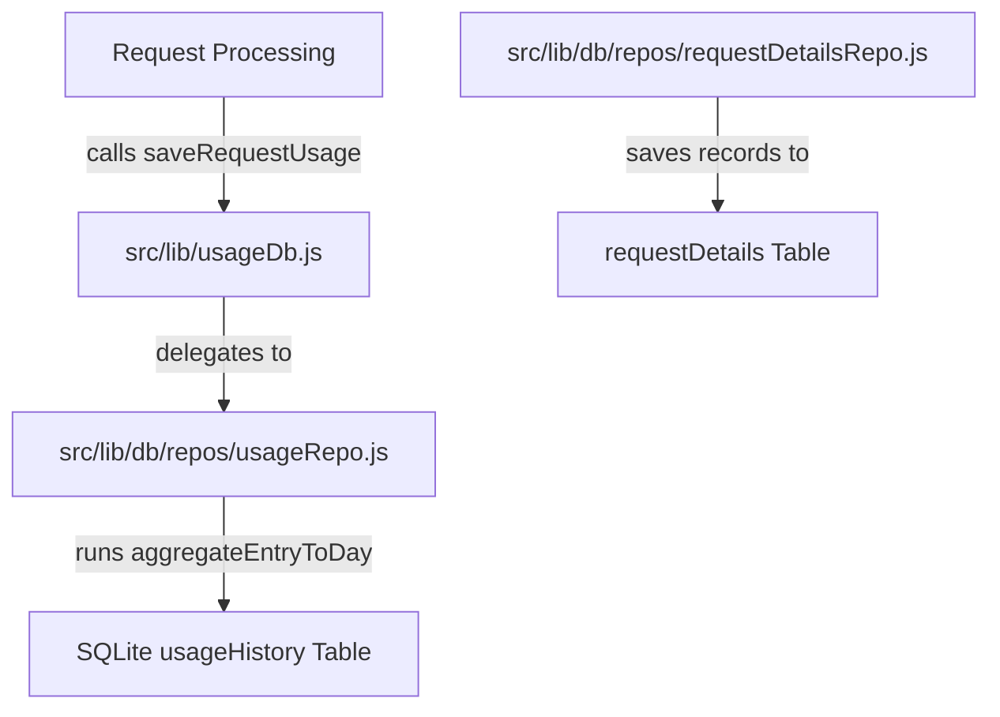
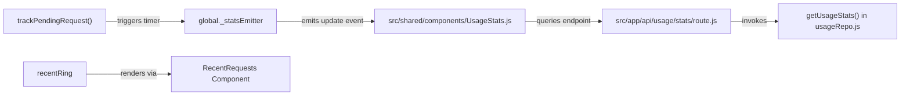

<!-- source: DeepWiki mcp.deepwiki.com · repo decolua/9router · page 7.3 Usage Database · fetched 2026-10-30 -->

# Usage Database

Relevant source files

The following files were used as context for generating this wiki page:

- [src/app/(dashboard)/dashboard/usage/components/OverviewCards.js](src/app/(dashboard)/dashboard/usage/components/OverviewCards.js)
- [src/app/(dashboard)/dashboard/usage/components/ProviderTopology.js](src/app/(dashboard)/dashboard/usage/components/ProviderTopology.js)
- [src/app/(dashboard)/dashboard/usage/page.js](src/app/(dashboard)/dashboard/usage/page.js)
- [src/app/api/keys/route.js](src/app/api/keys/route.js)
- [src/app/api/usage/chart/route.js](src/app/api/usage/chart/route.js)
- [src/app/api/usage/stats/route.js](src/app/api/usage/stats/route.js)
- [src/app/globals.css](src/app/globals.css)
- [src/app/layout.js](src/app/layout.js)
- [src/lib/db/repos/usageRepo.js](src/lib/db/repos/usageRepo.js)
- [src/lib/usageDb.js](src/lib/usageDb.js)
- [src/shared/components/Drawer.js](src/shared/components/Drawer.js)
- [src/shared/components/UsageStats.js](src/shared/components/UsageStats.js)

The Usage Database module handles persistence, metrics collection, and aggregation for all token consumption, costs, and request execution statuses across AI provider interactions [src/lib/usageDb.js:1-7](). It relies on a SQLite-based storage layer (`src/lib/db/`) to separate high-level analytical aggregation from granular request logs and details.

For detailed payload logging, see [7.4 Request Details & Observability](). For schema management and other repositories, see [7.2 Repositories & Collections]().

---

## Architecture Overview

The usage tracking subsystem exposes a unified facade via `src/lib/usageDb.js` [src/lib/usageDb.js:1-7]() which re-exports database adapters and repository functions from `src/lib/db/`. Data persistence is divided into three functional categories:
1. **Aggregated Historical Stats**: Token counts and estimated costs calculated and bucketed by `usageRepo.js` [src/lib/db/repos/usageRepo.js:65-100]().
2. **Real-time Ring Buffer**: A sliding window of recent request metadata (`recentRing`) maintained in memory for immediate dashboard display [src/lib/db/repos/usageRepo.js:19-37]().
3. **Request Details & Logs**: Persistent inspection logs managed through `requestDetailsRepo.js` [src/lib/usageDb.js:1-7]().

**Diagram: Usage Data Flow from Ingress to Persistence**

Sources: [src/lib/usageDb.js:1-7](), [src/lib/db/repos/usageRepo.js:19-37](), [src/lib/db/repos/usageRepo.js:65-100]()

---

## Metrics Collection and Normalization

Usage metadata is extracted from provider responses and normalized into internal structures through `aggregateEntryToDay` and related pricing helpers [src/lib/db/repos/usageRepo.js:65-100]().

### Token Mapping & Masking
To support team keys and machine-shared credentials without collision, API keys are securely masked while preserving key tail segments via `maskApiKey` [src/lib/db/repos/usageRepo.js:6-12](). Token metrics map various upstream naming conventions (such as `input_tokens` or `promptTokenCount`) to unified counters (`promptTokens`, `completionTokens`, `cachedTokens`) [src/lib/db/repos/usageRepo.js:65-76]().

### Cost Calculation
Cost tracking delegates calculations to `calculateCost`, which integrates model pricing catalogs via `pricingRepo.js` and `calculateCostFromTokens` [src/lib/db/repos/usageRepo.js:136-152]().

Sources: [src/lib/db/repos/usageRepo.js:6-12](), [src/lib/db/repos/usageRepo.js:65-76](), [src/lib/db/repos/usageRepo.js:136-152]()

---

## Real-time Tracking and Ring Buffer

Live dashboard metrics rely on an in-memory ring buffer (`recentRing`) configured with a default capacity (`RING_CAP = 50`) [src/lib/db/repos/usageRepo.js:14-37](). 

### Concurrency and Event Dispatch
* **Pending States**: Active requests update global counters via `trackPendingRequest` and emit updates across the Next.js boundary using `statsEmitter` [src/lib/db/repos/usageRepo.js:38-48]().
* **Ring Initialization**: `ensureRingInitialized` loads recent historical records from the database on initial startup to hydrate the UI buffer [src/lib/db/repos/usageRepo.js:122-134]().

**Diagram: Real-Time Event State and UI Integration**

Sources: [src/lib/db/repos/usageRepo.js:14-48](), [src/lib/db/repos/usageRepo.js:122-134](), [src/shared/components/UsageStats.js:33-88]()

---

## Aggregation & Dashboard API

Historical statistics and chart analytics are queried via dedicated Next.js API endpoints supporting selectable time periods (`today`, `24h`, `7d`, `30d`, `60d`, `all`) [src/app/api/usage/stats/route.js:4-23]().

The aggregation groups data along multiple orthogonal dimensions:
- `byProvider`: Summaries grouped by provider ID [src/lib/db/repos/usageRepo.js:84]()
- `byModel`: Summaries grouped by `model|provider` [src/lib/db/repos/usageRepo.js:86-87]()
- `byAccount`: Summaries grouped by `connectionId` [src/lib/db/repos/usageRepo.js:89-91]()
- `byApiKey`: Summaries grouped by masked API keys [src/lib/db/repos/usageRepo.js:93-95]()
- `byEndpoint`: Summaries grouped by API endpoints [src/lib/db/repos/usageRepo.js:97-99]()

Sources: [src/app/api/usage/stats/route.js:4-23](), [src/app/api/usage/chart/route.js:1-21](), [src/lib/db/repos/usageRepo.js:84-99]()

---

