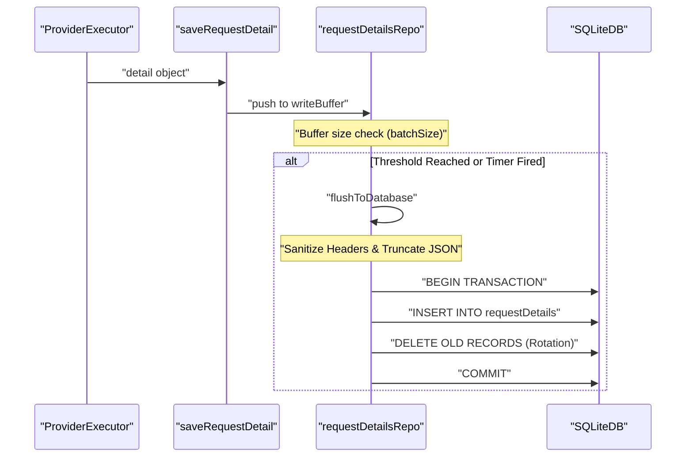
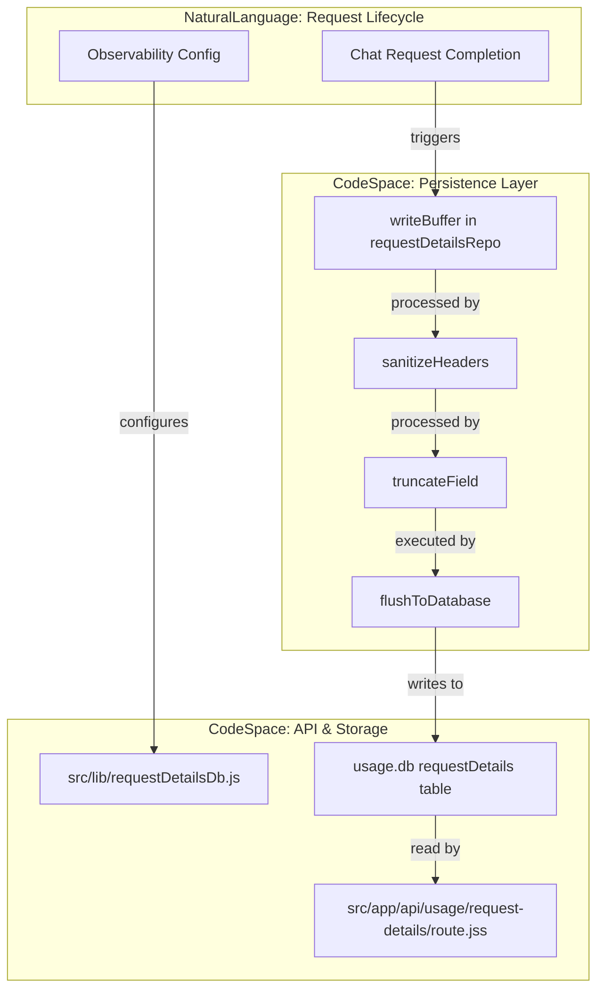
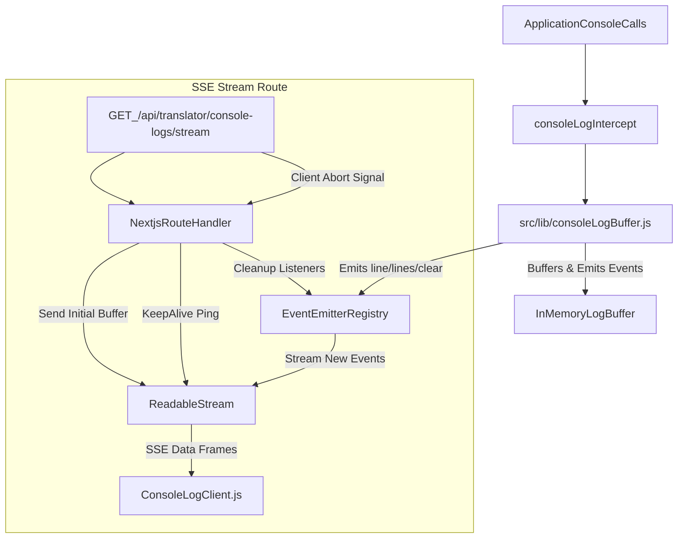

<!-- source: DeepWiki mcp.deepwiki.com · repo decolua/9router · page 7.4 Request Details & Observability · fetched 2026-10-30 -->

# Request Details & Observability

Relevant source files

The following files were used as context for generating this wiki page:

- [open-sse/providers/catalogOverride.js](open-sse/providers/catalogOverride.js)
- [open-sse/providers/visionPatterns.js](open-sse/providers/visionPatterns.js)
- [src/app/(dashboard)/dashboard/console-log/ConsoleLogClient.js](src/app/(dashboard)/dashboard/console-log/ConsoleLogClient.js)
- [src/app/(dashboard)/dashboard/usage/components/RequestDetailsTab.js](src/app/(dashboard)/dashboard/usage/components/RequestDetailsTab.js)
- [src/app/api/models/catalog-sync/route.js](src/app/api/models/catalog-sync/route.js)
- [src/app/api/translator/console-logs/stream/route.js](src/app/api/translator/console-logs/stream/route.js)
- [src/app/api/usage/providers/route.js](src/app/api/usage/providers/route.js)
- [src/app/api/usage/request-details/route.js](src/app/api/usage/request-details/route.js)
- [src/instrumentation.js](src/instrumentation.js)
- [src/lib/consoleLogBuffer.js](src/lib/consoleLogBuffer.js)
- [src/lib/modelCatalog/sync.js](src/lib/modelCatalog/sync.js)
- [src/lib/requestDetailsDb.js](src/lib/requestDetailsDb.js)
- [src/shared/components/Pagination.js](src/shared/components/Pagination.js)
- [tests/unit/gpt-6-context-window.test.js](tests/unit/gpt-6-context-window.test.js)
- [tests/unit/model-catalog-scope.test.js](tests/unit/model-catalog-scope.test.js)
- [tests/unit/v1-models-combo-context.test.js](tests/unit/v1-models-combo-context.test.js)

This page documents the observability system within 9Router, specifically focusing on the storage of detailed per-request snapshots, batching mechanisms, sanitization logic, and real-time console log buffer streaming. These components provide the technical foundation for the "Request Details" section of the web dashboard and developer tooling [src/lib/requestDetailsDb.js:1-4](), [src/app/api/usage/request-details/route.js:1-74](), [src/app/api/translator/console-logs/stream/route.js:1-91]().

---

## Overview

The observability system captures a complete audit trail of each AI request as it flows through 9Router: the original client request body, the translated provider request, the raw provider response, and the final client response. This enables deep debugging and transparency into how requests are transformed and routed.

The implementation relies on modular abstractions, re-exported through `requestDetailsDb.js` to target the underlying SQLite database layer (`src/lib/db/index.js`) [src/lib/requestDetailsDb.js:1-4]().

**Key Features:**
- **Batched Writes**: Records are buffered in memory and written in bulk transactions to minimize I/O overhead.
- **Automatic Rotation**: Keeps only the most recent records to prevent disk bloat.
- **Size Management**: Truncates large JSON payloads that exceed configured size thresholds.
- **Header Sanitization**: Strips sensitive authentication headers (`Authorization`, API Keys, Cookies) before persistence.

Sources: [src/lib/requestDetailsDb.js:1-4](), [src/lib/modelCatalog/sync.js:1-12]()

---

## Architecture

### Request Details Persistence Pipeline

The following diagram traces the path from request completion to physical storage, highlighting the batching and sanitization phases.

Title: "RequestDetailsPersistencePipeline"

Sources: [src/lib/requestDetailsDb.js:1-4](), [src/app/api/usage/request-details/route.js:49-49]()

### Module Relationships (Natural Language to Code Space)

The following diagram bridges high-level observability concepts to the concrete code entities that implement them.

Title: "ObservabilityCodeEntityMapping"

Sources: [src/lib/requestDetailsDb.js:1-4](), [src/app/api/usage/request-details/route.js:8-74]()

---

## Configuration & Size Management

The observability system is configurable via environment variables or runtime settings.

### Configuration Parameters
| Parameter | Env Variable | Default | Description |
|---|---|---|---|
| `enabled` | `ENABLE_REQUEST_LOGS` | `false` | Master toggle for request logging |
| `maxRecords` | `OBSERVABILITY_MAX_RECORDS` | 200 | Maximum number of rows to keep in the DB |
| `batchSize` | `OBSERVABILITY_BATCH_SIZE` | 20 | Number of records to buffer before a flush |
| `flushInterval` | `OBSERVABILITY_FLUSH_INTERVAL_MS` | 5000ms | Max time a record stays in buffer before flush |
| `maxJsonSize` | `OBSERVABILITY_MAX_JSON_SIZE` | 5KB | Truncation limit for individual JSON fields |

### Truncation Logic
To prevent massive prompts or responses from exhausting storage, the `truncateField` utility checks the stringified length of JSON payloads. If a payload exceeds the threshold, it replaces the content with a metadata preview object containing `_preview` and `_originalSize` keys.

Sources: [src/lib/requestDetailsDb.js:1-4]()

---

## Security & Sanitization

### Header Redaction
Before persistence, the system executes `sanitizeHeaders`. This function scans request objects to identify and remove sensitive credentials including `authorization`, `x-api-key`, `cookie`, and `token`.

### Dashboard API Redaction
When request details are fetched via the web dashboard endpoint `GET /api/usage/request-details`, full conversation payloads (such as user prompts and tool calls) are redacted. The API injects `{ redacted: true }` for fields like `request`, `providerRequest`, `providerResponse`, and `response`, preventing unauthorized disclosure of conversational history [src/app/api/usage/request-details/route.js:56-64]().

Sources: [src/app/api/usage/request-details/route.js:56-64]()

---

## Observability APIs

### Request Details Retrieval
The `GET /api/usage/request-details` endpoint provides paginated, filterable access to logs [src/app/api/usage/request-details/route.js:8-48]().

**Query Parameters:**
- `page`: Page number (default: `1`) [src/app/api/usage/request-details/route.js:12-13]().
- `pageSize`: Records per page, restricted between `1` and `100` [src/app/api/usage/request-details/route.js:14-15]().
- `provider` / `model` / `connectionId`: Filter attributes by routing metadata [src/app/api/usage/request-details/route.js:16-18]().
- `status`: Filter execution status [src/app/api/usage/request-details/route.js:19]().

### Provider Discovery
The `GET /api/usage/providers` endpoint scans existing database logs to return unique provider identifiers. It invokes `getDistinctProviders()` to query the distinct provider column directly, bypassing the overhead of parsing every row's JSON blob [src/app/api/usage/providers/route.js:10-14]().

Sources: [src/app/api/usage/request-details/route.js:8-48](), [src/app/api/usage/providers/route.js:10-14]()

---

## Console Log Buffer Streaming

9Router implements a real-time console log streaming feature, surfaced in the developer tools dashboard [src/app/(dashboard)/dashboard/console-log/ConsoleLogClient.js:1-1](), [src/app/api/translator/console-logs/stream/route.js:1-91]().

### Implementation Details
Console log capture is initialized via `initConsoleLogCapture()` (triggered during server startup in `src/instrumentation.js`), which intercepts standard console outputs (`console.log`, `console.warn`, `console.error`) and stores them in an in-memory buffer [src/instrumentation.js:1-14](), [src/app/api/translator/console-logs/stream/route.js:1-5]().

1. **Log Capture Buffer**: Intercepted logs are stored and emitted via an event emitter managed in `src/lib/consoleLogBuffer.js` [src/app/api/translator/console-logs/stream/route.js:1-9]().
2. **SSE Endpoint (`GET /api/translator/console-logs/stream`)**: 
   - Sends all currently buffered logs immediately upon client connection (`type: "init"`) [src/app/api/translator/console-logs/stream/route.js:28-32]().
   - Subscribes to `line`, `lines`, and `clear` events from the console emitter [src/app/api/translator/console-logs/stream/route.js:35-65]().
   - Sends keep-alive ping frames (`: ping\n\n`) every 25 seconds [src/app/api/translator/console-logs/stream/route.js:67-75]().
   - Automatically cleans up listener bindings on client disconnect or stream cancellation [src/app/api/translator/console-logs/stream/route.js:12-24]().

### Console Log Buffer Diagram

Title: "ConsoleLogBufferAndStreaming"

Sources: [src/app/api/translator/console-logs/stream/route.js:1-91](), [src/lib/consoleLogBuffer.js:1-1](), [src/instrumentation.js:1-14]()

---

