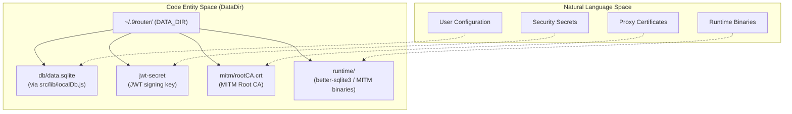
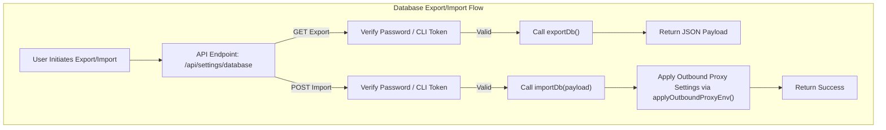

<!-- source: DeepWiki mcp.deepwiki.com · repo decolua/9router · page 7.5 Data Directory & Backup · fetched 2026-10-30 -->

# Data Directory & Backup

Relevant source files

The following files were used as context for generating this wiki page:

- [src/app/api/settings/database/route.js](src/app/api/settings/database/route.js)
- [src/app/api/settings/proxy-test/route.js](src/app/api/settings/proxy-test/route.js)
- [src/lib/dataDir.js](src/lib/dataDir.js)
- [src/lib/network/initOutboundProxy.js](src/lib/network/initOutboundProxy.js)
- [src/lib/network/outboundProxy.js](src/lib/network/outboundProxy.js)
- [src/mitm/paths.js](src/mitm/paths.js)
- [src/shared/constants/mitmToolHosts.js](src/shared/constants/mitmToolHosts.js)
- [src/shared/utils/ssrfGuard.js](src/shared/utils/ssrfGuard.js)
- [tests/unit/security-audit.test.js](tests/unit/security-audit.test.js)
- [tests/unit/ssrf-guard-hardening.test.js](tests/unit/ssrf-guard-hardening.test.js)

This page documents the `~/.9router` data directory, its resolution logic, file layout, and the mechanisms for database export, import, and backup.

## Purpose and Scope

The 9router data directory serves as the centralized persistence layer for runtime state, local SQLite databases, authentication secrets, outbound proxy configurations, and man-in-the-middle (MITM) proxy certificates. This page outlines how these directories are resolved across platforms, how data files are structured, and how administrators can safely export, import, and back up the system state.

Sources: [src/lib/dataDir.js:1-37](), [src/mitm/paths.js:1-32]()

## Data Directory Location

The data directory location is determined dynamically at runtime. It prioritizes environment variable overrides but defaults to standard user application paths based on the operating system.

### Platform-Specific Default Locations

| Platform | Default Location | Example Path |
|----------|------------------|--------------|
| macOS / Linux | `~/.9router` | `/Users/alice/.9router` or `/home/alice/.9router` |
| Windows | `%APPDATA%\9router` | `C:\Users\Alice\AppData\Roaming\9router` |

### Path Resolution Logic

The `getDataDir()` function [src/lib/dataDir.js:14-35]() resolves the data directory path. It first checks the `DATA_DIR` environment variable [src/lib/dataDir.js:15](). If not set, it defaults to `~/.9router` on Unix-like systems and `%APPDATA%\9router` on Windows [src/lib/dataDir.js:7-12]().

On Windows, if `DATA_DIR` is set to a Unix-style absolute path (e.g., starting with `/`), it issues a warning and falls back to the default Windows path [src/lib/dataDir.js:18-23](). The function also attempts to create the directory recursively and falls back to the default if there are permission errors (`EACCES` or `EPERM`) [src/lib/dataDir.js:25-34]().

The `DATA_DIR` constant is then exported for use throughout the application [src/lib/dataDir.js:37](). The `src/mitm/paths.js` module uses a similar resolution pattern to locate MITM certificate assets under `DATA_DIR/mitm` [src/mitm/paths.js:14-30]().

Sources: [src/lib/dataDir.js:1-37](), [src/mitm/paths.js:1-32]()

## Directory Structure Overview

The data directory serves as the root for primary categories of data: Core Persistence, Security/Auth, and MITM assets.

### Code-to-Entity Mapping (Data Storage)

Sources: [src/lib/dataDir.js:1-37](), [src/mitm/paths.js:30-32]()

## Core Data Files

### Identity and Authentication
9Router maintains a consistent identity across restarts to ensure that rate limits and model locks are applied correctly across different runtimes.

*   **`jwt-secret`**: This file stores a randomly generated secret used for signing and verifying JSON Web Tokens (JWTs) for dashboard authentication. If the `JWT_SECRET` environment variable is set, it takes precedence. If neither is found, a new secret is generated and saved to this file.

### Configuration & Usage Database
The primary database `db/data.sqlite` is managed via the repository pattern. The system uses a shim layer in `src/lib/localDb.js` to handle persistence operations.

**Key Collections (Tables) in SQLite**:
*   **`providerConnections`**: Stores account credentials, API keys, and metadata.
*   **`settings`**: Global configuration including `fallbackStrategy`, `outboundProxyUrl`, and auth modes.
*   **`combos`**: Definitions for multi-model fallback chains.
*   **`requestDetails`**: High-fidelity logs of intercepted requests, including latency and token usage.

Sources: [src/lib/dataDir.js:1-37]()

## Database Export and Import

The 9Router dashboard provides functionality to export and import the entire database, which includes all connections, settings, and other persistent data. This is crucial for backup, migration, and disaster recovery.

### Exporting the Database

The `GET /api/settings/database` endpoint [src/app/api/settings/database/route.js:14-25]() handles database export:
1. It verifies the dashboard password using `verifyDashboardPassword()` [src/app/api/settings/database/route.js:16](), unless the request originates from the CLI with a valid `x-9r-cli-token` header [src/app/api/settings/database/route.js:10-11]().
2. The `exportDb()` function is called to retrieve the database payload [src/app/api/settings/database/route.js:19]().
3. The payload is returned as a JSON response [src/app/api/settings/database/route.js:20]().

### Importing the Database

The `POST /api/settings/database` endpoint [src/app/api/settings/database/route.js:27-51]() handles database import:
1. It extracts the password and database payload from the request body [src/app/api/settings/database/route.js:29]().
2. It verifies the password or checks for a trusted CLI request [src/app/api/settings/database/route.js:30-32]().
3. The `importDb()` function is called with the payload to restore the database state [src/app/api/settings/database/route.js:33]().
4. After a successful import, `applyOutboundProxyEnv()` is executed using the imported settings to ensure any outbound proxy changes take effect immediately [src/app/api/settings/database/route.js:35-41](), leveraging `src/lib/network/outboundProxy.js` [src/lib/network/outboundProxy.js:20-85]().
5. A success response is returned [src/app/api/settings/database/route.js:43]().

### Backup Format

The `exportDb()` function serializes the entire database content into a JSON object. This JSON object represents a complete snapshot of the 9Router configuration and data, excluding sensitive runtime binaries or MITM certificates.

Sources: [src/app/api/settings/database/route.js:1-51](), [src/lib/network/outboundProxy.js:20-85]()

---

