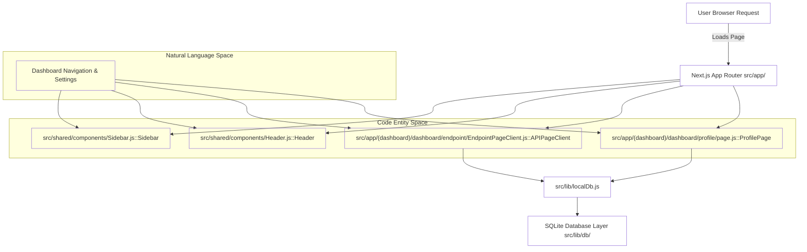
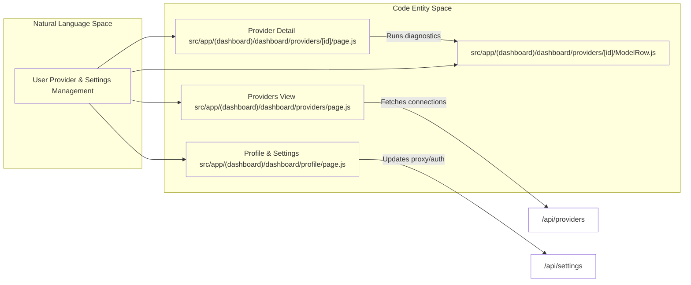

<!-- source: DeepWiki mcp.deepwiki.com · repo decolua/9router · page 8 Web Dashboard · fetched 2026-10-30 -->

# Web Dashboard

Relevant source files

The following files were used as context for generating this wiki page:

- [src/app/(dashboard)/dashboard/endpoint/EndpointPageClient.js](src/app/(dashboard)/dashboard/endpoint/EndpointPageClient.js)
- [src/app/(dashboard)/dashboard/profile/page.js](src/app/(dashboard)/dashboard/profile/page.js)
- [src/app/(dashboard)/dashboard/providers/[id]/ModelRow.js](src/app/(dashboard)/dashboard/providers/[id]/ModelRow.js)
- [src/app/(dashboard)/dashboard/providers/[id]/page.js](src/app/(dashboard)/dashboard/providers/[id]/page.js)
- [src/app/(dashboard)/dashboard/providers/page.js](src/app/(dashboard)/dashboard/providers/page.js)
- [src/app/api/settings/route.js](src/app/api/settings/route.js)
- [src/lib/localDb.js](src/lib/localDb.js)
- [src/shared/components/Header.js](src/shared/components/Header.js)
- [src/shared/components/Sidebar.js](src/shared/components/Sidebar.js)

The 9Router web dashboard serves as the primary Next.js-based management interface (`src/app/(dashboard)/`) for configuring AI providers, managing upstream connections, monitoring usage analytics, and controlling system operations [src/shared/components/Header.js:73-179](). It provides a centralized graphical interface backed by SQLite storage modules (`src/lib/localDb.js`) to handle everything from OAuth handshakes to real-time proxy and token optimization adjustments.

This page is a PARENT page providing a high-level architectural overview. For granular implementation details, refer to the following child pages:
- **[Dashboard Overview](#8.1)** — Structure, layout, sidebar/header navigation, shared UI components, and state stores. For details, see `src/shared/components/Sidebar.js` [src/shared/components/Sidebar.js:42-160]() and `src/shared/components/Header.js` [src/shared/components/Header.js:182-200]().
- **[Provider Management](#8.2)** — Provider connection CRUD, modals, bulk import, priority ranking, and proxy binding. For details, see `src/app/(dashboard)/dashboard/providers/page.js` [src/app/(dashboard)/dashboard/providers/page.js:99-170]() and `src/app/(dashboard)/dashboard/providers/[id]/page.js` [src/app/(dashboard)/dashboard/providers/[id]/page.js:39-129]().
- **[Connection Testing & Validation](#8.3)** — Individual and batch connection testing UI, status indicators, and error categorization [src/app/(dashboard)/dashboard/providers/page.js:30-95]().
- **[Model & Combo Management](#8.4)** — Model aliasing UI, custom models, combo/fusion model creation, and passthrough handling [src/lib/localDb.js:14-17]().
- **[Usage Statistics & Monitoring](#8.5)** — Usage dashboards, quota tables, topology graphs, and real-time Server-Sent Events (SSE) updates [src/app/(dashboard)/dashboard/usage/page.js:16-73]().
- **[Settings & Configuration](#8.6)** — Global preferences, fallback strategies, outbound proxy configuration, and database import/export [src/app/(dashboard)/dashboard/profile/page.js:22-131]().
- **[MITM Proxy Control](#8.7)** — Man-in-the-Middle server management interface, root CA certificate trust stores, and per-tool DNS configurations [src/shared/components/Header.js:109-115]().
- **[Agent Skills](#8.8)** — Skills dashboard page (`/dashboard/skills`), capability-based instructions, and `SKILL.md` system definitions [src/shared/components/Sidebar.js:37-41]().
- **[CLI Tools Configuration](#8.9)** — Per-tool config cards, endpoint presets, API key selectors, and automated settings-writing API routes [src/shared/components/Sidebar.js:29]().
- **[Proxy Pools](#8.10)** — Named proxy pools configuration, connection bindings, rotation policies, `strictProxy`, and relay worker deployments [src/shared/components/Sidebar.js:37-41]().
- **[Developer Tools](#8.11)** — Translator Debug interface (`/dashboard/translator`), Console Log live viewer (`/dashboard/console-log`), and built-in chat testing [src/shared/components/Header.js:158-171]().
- **[Token Saver & PXPipe Dashboard](#8.12)** — Token Saver management views, Headroom process APIs, and prompt-modifier controls [src/shared/components/Sidebar.js:27]().
- **[Media Providers Dashboard](#8.13)** — Sub-dashboards for alternative model kinds (embedding, image, TTS, STT, video, web search/fetch) [src/shared/components/Header.js:21-50]().

Sources: [src/shared/components/Header.js:21-179](), [src/shared/components/Sidebar.js:27-160](), [src/lib/localDb.js:1-21](), [src/app/(dashboard)/dashboard/providers/page.js:30-170]()

## Dashboard Architecture & Layout

The dashboard is structured around Next.js App Router conventions. Client-side state interacts with persistent storage through well-defined internal APIs, utilizing shared components exported via `src/shared/components/index.js` [src/shared/components/index.js:1-41]().

Diagram: Dashboard Architecture Mapping

Sources: [src/shared/components/Sidebar.js:1-160](), [src/shared/components/Header.js:1-180](), [src/app/(dashboard)/dashboard/endpoint/EndpointPageClient.js:1-22](), [src/lib/localDb.js:1-21]()

## Core Management Workflows

The web UI provides unified control over providers, connection testing, and security configurations. Users inspect model mappings, view real-time validation states, and modify system parameters through structured forms.

Diagram: Management Workflows Mapping

Sources: [src/app/(dashboard)/dashboard/providers/page.js:99-170](), [src/app/(dashboard)/dashboard/providers/[id]/page.js:39-85](), [src/app/(dashboard)/dashboard/profile/page.js:22-131](), [src/app/(dashboard)/dashboard/providers/[id]/ModelRow.js:4-85]()

---

