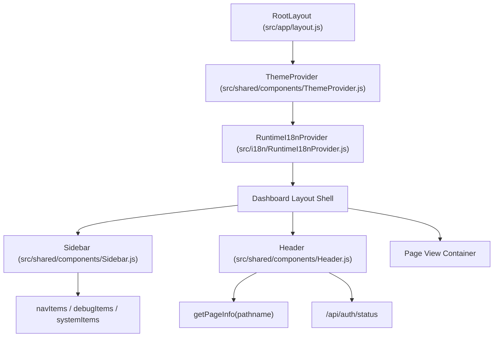
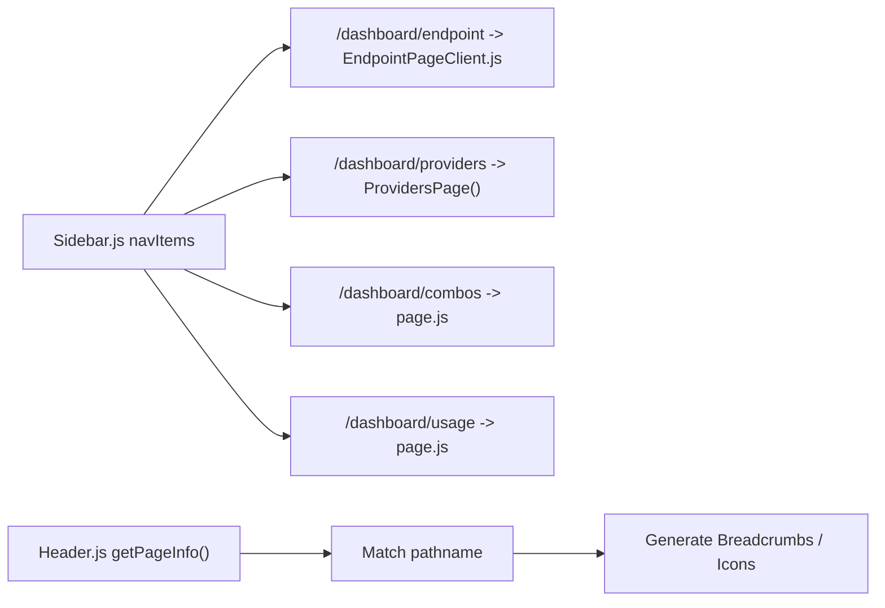

<!-- source: DeepWiki mcp.deepwiki.com · repo decolua/9router · page 8.1 Dashboard Overview · fetched 2026-10-30 -->

# Dashboard Overview

Relevant source files

The following files were used as context for generating this wiki page:

- [src/app/(dashboard)/dashboard/endpoint/EndpointPageClient.js](src/app/(dashboard)/dashboard/endpoint/EndpointPageClient.js)
- [src/app/(dashboard)/dashboard/profile/page.js](src/app/(dashboard)/dashboard/profile/page.js)
- [src/app/(dashboard)/dashboard/providers/[id]/ModelRow.js](src/app/(dashboard)/dashboard/providers/[id]/ModelRow.js)
- [src/app/(dashboard)/dashboard/providers/[id]/page.js](src/app/(dashboard)/dashboard/providers/[id]/page.js)
- [src/app/(dashboard)/dashboard/providers/page.js](src/app/(dashboard)/dashboard/providers/page.js)
- [src/app/api/settings/route.js](src/app/api/settings/route.js)
- [src/lib/localDb.js](src/lib/localDb.js)
- [src/shared/components/Header.js](src/shared/components/Header.js)
- [src/shared/components/Sidebar.js](src/shared/components/Sidebar.js)
- [src/shared/components/index.js](src/shared/components/index.js)

The Dashboard is 9Router's web-based management interface, providing a comprehensive graphical UI for configuring AI providers, managing API endpoints and keys, tracking quotas, inspecting request logs, and controlling runtime features. Built as a Next.js App Router application [package.json:37](), it communicates with the backend via REST APIs and Server-Sent Events (SSE).

This page details the dashboard structure, shell layout, navigation mechanics, shared component library, and state management layers.

---

## Application Shell & Layout Architecture

The dashboard UI is structured around a persistent shell layout defined in the root layout [src/app/layout.js:31-59]() and dashboard layout wrappers. It combines a fixed-width `Sidebar` providing global navigation with a dynamic `Header` that adapts titles, breadcrumbs, and controls based on the current Next.js `pathname` [src/shared/components/Header.js:18-180]().

### Diagram: Shell Component Hierarchy (Code Entity Space)

Sources: [src/app/layout.js:31-59](), [src/shared/components/Sidebar.js:20-41](), [src/shared/components/Header.js:18-180]()

---

## Navigation Structure & Routing

The navigation hierarchy is defined inside `Sidebar.js` [src/shared/components/Sidebar.js:20-41]() and categorized into primary operational links, debugging utilities, and system-level configurations.

| Route | Label | Icon | Code Reference / Purpose |
|-------|-------|------|-------------------------|
| `/dashboard/endpoint` | Endpoint & Key | `api` | API keys, Cloudflare Tunnels, Tailscale [src/shared/components/Sidebar.js:21]() |
| `/dashboard/providers` | Providers | `dns` | AI Provider connection management & health [src/shared/components/Sidebar.js:22]() |
| `/dashboard/combos` | Combo & Vision Adapter | `layers` | Multi-model fallback chains [src/shared/components/Sidebar.js:24]() |
| `/dashboard/usage` | Usage | `bar_chart` | Token analytics, costs, and request logs [src/shared/components/Sidebar.js:25]() |
| `/dashboard/quota` | Quota Tracker | `data_usage` | Upstream provider quota limits [src/shared/components/Sidebar.js:26]() |
| `/dashboard/token-saver` | Token Saver | `savings` | RTK and compression pipelines [src/shared/components/Sidebar.js:27]() |
| `/dashboard/cli-tools` | CLI Tools | `terminal` | CLI tool-specific endpoint configurations [src/shared/components/Sidebar.js:29]() |
| `/dashboard/proxy-pools` | Proxy Pools | `lan` | Outbound proxy rotation management [src/shared/components/Sidebar.js:38]() |
| `/dashboard/skills` | Agent Skills | `extension` | SKILL.md capability integration [src/shared/components/Sidebar.js:39]() |
| `/dashboard/console-log` | Console Log | `terminal` | Live server console output stream [src/shared/components/Sidebar.js:33]() |
| `/dashboard/translator` | Translator | `translate` | Format translation debugging interface [src/shared/components/Sidebar.js:34]() |

### Diagram: Navigation Mapping to Code Modules

Sources: [src/shared/components/Sidebar.js:20-41](), [src/shared/components/Header.js:18-180](), [src/app/(dashboard)/dashboard/endpoint/EndpointPageClient.js:22-22](), [src/app/(dashboard)/dashboard/providers/page.js:99-99]()

---

## State Management & Stores

The dashboard relies on lightweight state management through Zustand stores and React hooks to synchronize local UI components with backend REST endpoints and local storage.

- **`useSettingsStore`**: Fetches and caches global settings (such as `enableTranslator`, `fallbackStrategy`, and SSO configuration) [src/shared/components/Sidebar.js:56-59](), communicating with `/api/settings` [src/app/api/settings/route.js:17-36]().
- **`useHeaderSearchStore`**: Manages global search registration across pages like Providers and Quota Tracker, enabling instant client-side filtering via the header search bar [src/app/(dashboard)/dashboard/providers/page.js:111-118]().
- **`useNotificationStore`**: Handles toast notifications and alert states across CRUD operations [src/app/(dashboard)/dashboard/providers/page.js:110-110]().
- **`useCopyToClipboard`**: Custom clipboard utility providing transient state for copy-to-clipboard actions [src/app/(dashboard)/dashboard/providers/[id]/page.js:92-92]().

Sources: [src/shared/components/Sidebar.js:56-59](), [src/app/(dashboard)/dashboard/providers/page.js:110-118](), [src/app/api/settings/route.js:17-36](), [src/app/(dashboard)/dashboard/providers/[id]/page.js:92-92]()

---

## Shared Component Library & Design System

All dashboard views consume unified primitives exported from `src/shared/components/index.js` [src/shared/components/index.js:1-42]().

- **Layout & Containers**: `Card`, `Modal`, `ConfirmModal`, `CardSkeleton` [src/shared/components/index.js:5-7]()
- **Form Controls**: `Button`, `Input`, `Select`, `Toggle`, `SegmentedControl` [src/shared/components/index.js:2-10]()
- **Feedback & Badges**: `Badge`, `CapacityBadges`, `Loading`, `Spinner`, `Tooltip` [src/shared/components/index.js:7-10]()
- **Specialized Modals**: `OAuthModal`, `KiroAuthModal`, `CursorAuthModal`, `ModelSelectModal`, `McpMarketplaceModal` [src/shared/components/index.js:16-33]()

### Styling and Theming
The dashboard adopts a custom warm neutral palette with brand-aligned orange accents defined via CSS custom properties in `src/app/globals.css`. Support for dark and light mode is built directly into Tailwind CSS v4 via custom variants (`@custom-variant dark (&:where(.dark, .dark *))`).

Sources: [src/shared/components/index.js:1-42]()

---

## Key Dashboard Pages & Subsystems

### 1. Provider Management (`/dashboard/providers`)
The provider overview page lists connected AI providers, categorizing them by OAuth, API Key, Web Cookie, and Free tiers [src/app/(dashboard)/dashboard/providers/page.js:14-22](). It computes connection health stats (`connected` vs `error`) and sorts items based on priority rules [src/app/(dashboard)/dashboard/providers/page.js:126-150]().
- **Detailed Provider View**: `/dashboard/providers/[id]` manages individual connections (`ConnectionRow`), live model catalogs, custom model mappings (`ModelRow`), and automated ping health checks [src/app/(dashboard)/dashboard/providers/[id]/page.js:17-27]().

### 2. Endpoint & Key Management (`/dashboard/endpoint`)
Managed by `APIPageClient` in `EndpointPageClient.js`, this page exposes API key generation, Cloudflare Tunnel activation, and Tailscale Funnel configuration [src/app/(dashboard)/dashboard/endpoint/EndpointPageClient.js:22-62](). It features adaptive client-side ping probing (`clientPingAny`) to bypass backend DNS hiccups [src/app/(dashboard)/dashboard/endpoint/EndpointPageClient.js:127-145]().

### 3. Usage & Analytics Topology (`/dashboard/usage`)
The usage dashboard incorporates an interactive node graph via `ProviderTopology.js` powered by `@xyflow/react`. Custom React Flow nodes render active upstream connections routing through the central `9Router` core, featuring active connection states and health metrics.

Sources: [src/app/(dashboard)/dashboard/providers/page.js:14-150](), [src/app/(dashboard)/dashboard/providers/[id]/page.js:17-27](), [src/app/(dashboard)/dashboard/endpoint/EndpointPageClient.js:22-145]()

---

