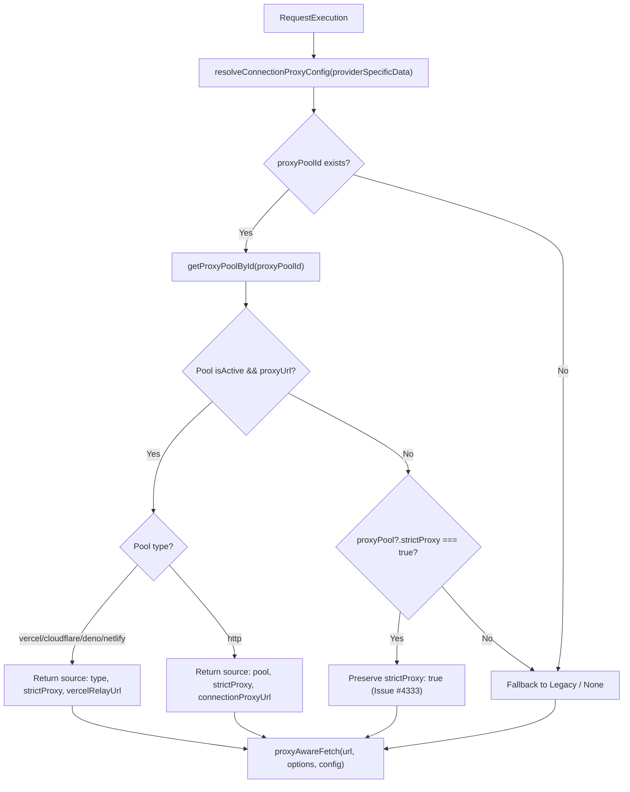
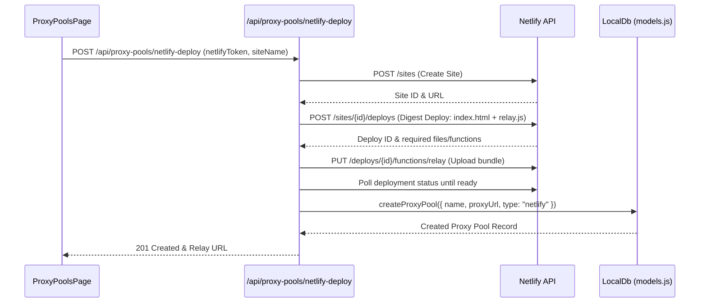

<!-- source: DeepWiki mcp.deepwiki.com · repo decolua/9router · page 8.10 Proxy Pools · fetched 2026-10-30 -->

# Proxy Pools

Relevant source files

The following files were used as context for generating this wiki page:

- [src/app/(dashboard)/dashboard/proxy-pools/page.js](src/app/(dashboard)/dashboard/proxy-pools/page.js)
- [src/app/api/proxy-pools/[id]/route.js](src/app/api/proxy-pools/[id]/route.js)
- [src/app/api/proxy-pools/[id]/test/route.js](src/app/api/proxy-pools/[id]/test/route.js)
- [src/app/api/proxy-pools/netlify-deploy/route.js](src/app/api/proxy-pools/netlify-deploy/route.js)
- [src/app/api/proxy-pools/route.js](src/app/api/proxy-pools/route.js)
- [src/lib/network/connectionProxy.js](src/lib/network/connectionProxy.js)
- [src/lib/network/netlifyRelay.js](src/lib/network/netlifyRelay.js)
- [tests/unit/netlify-relay.test.js](tests/unit/netlify-relay.test.js)

This page documents the Proxy Pools subsystem in 9Router, which provides centralized management for network egress, per-connection proxy binding, rotation strategies, strict proxy leak prevention, and serverless relay worker deployment.

## 1. Overview

The Proxy Pools system decouples egress network configuration from individual provider settings. By organizing proxies into named pools, administrators can enforce dedicated IP routing for high-traffic accounts or specific providers. The system supports standard HTTP/HTTPS proxies as well as serverless relay workers (Vercel, Cloudflare, Deno, and Netlify) that rewrite base URLs using unified header specifications [src/lib/network/connectionProxy.js:101-124](), [src/app/api/proxy-pools/route.js:10-18]().

Key features include:
- **Named Pools**: Group and manage proxies by region, purpose, or provider type [src/app/api/proxy-pools/route.js:10-18]().
- **Strict Proxying (`strictProxy`)**: Ensures that if a proxy pool is inactive or invalid, requests are blocked rather than leaking over the local IP [src/lib/network/connectionProxy.js:80-85]().
- **Serverless Relays**: Automated one-click deployment for Vercel, Cloudflare, Deno, and Netlify relay functions [src/app/(dashboard)/dashboard/proxy-pools/page.js:35-46](), [src/app/api/proxy-pools/netlify-deploy/route.js:27-141]().
- **Health Testing & Monitoring**: Built-in HTTP and relay endpoint test probes [src/app/api/proxy-pools/[id]/test/route.js:37-70]().
- **In-Memory Rotation**: Sequential round-robin and random load balancing across pool arrays [src/lib/network/connectionProxy.js:10-34]().

Sources: [src/lib/network/connectionProxy.js:101-124](), [src/app/api/proxy-pools/route.js:10-18](), [src/app/(dashboard)/dashboard/proxy-pools/page.js:35-46](), [src/app/api/proxy-pools/[id]/test/route.js:37-70]()

---

## 2. Proxy Resolution & Data Flow

When a connection executes a request, 9Router resolves the egress proxy configuration via `resolveConnectionProxyConfig` [src/lib/network/connectionProxy.js:66-68]().

### Resolution Priority
1. **Proxy Pool**: Evaluates `proxyPoolId` from `providerSpecificData`. If valid and active, it assigns either standard proxy parameters or serverless relay metadata (`vercelRelayUrl`) [src/lib/network/connectionProxy.js:91-142]().
2. **Legacy Proxy**: Falls back to direct legacy fields (`connectionProxyEnabled`, `connectionProxyUrl`) on the connection [src/lib/network/connectionProxy.js:149-163]().
3. **No Proxy**: Defaults to direct routing if neither pool nor legacy settings are present [src/lib/network/connectionProxy.js:170-179]().

### Code Entity Mapping: Resolution Flow

Sources: [src/lib/network/connectionProxy.js:66-199]()

---

## 3. Proxy Types & Serverless Relay Workers

9Router supports standard HTTP/HTTPS proxies as well as serverless relays designed to bypass regional restrictions or strict firewall rules.

### Serverless Relays
Relays deployed on Vercel, Cloudflare, Deno, or Netlify operate via base URL rewriting. Instead of an HTTP CONNECT handshake, they forward requests using custom headers (`x-relay-target` and `x-relay-path`) [src/lib/network/netlifyRelay.js:29-37]().

- **Netlify Relays**: Implemented via digest-deploy flows (`src/app/api/proxy-pools/netlify-deploy/route.js`) using a Lambda-compatible CommonJS handler (`exports.handler`) that buffers text, JSON, and Server-Sent Events (SSE) while encoding binary payloads as base64 [src/lib/network/netlifyRelay.js:29-85](), [src/app/api/proxy-pools/netlify-deploy/route.js:66-130]().

Sources: [src/lib/network/netlifyRelay.js:29-85](), [src/app/api/proxy-pools/netlify-deploy/route.js:66-130]()

---

## 4. Rotation Strategies

For unauthenticated or rotating pool scenarios, `pickProxyPoolId` distributes requests across multiple proxy pool identifiers [src/lib/network/connectionProxy.js:18-34]().

- **Round-robin**: Maintains an in-memory `rotateState` map per `providerId`, sequentially cycling through available pool IDs [src/lib/network/connectionProxy.js:10-27]().
- **Random**: Uniformly selects a random index from the pool array [src/lib/network/connectionProxy.js:29-31]().
- **None / Single**: Returns the single available pool ID or `null` [src/lib/network/connectionProxy.js:19-21](), [src/lib/network/connectionProxy.js:33]().

Sources: [src/lib/network/connectionProxy.js:10-34]()

---

## 5. Strict Proxy Enforcement (`strictProxy`)

The `strictProxy` flag prevents unproxied egress leaks (Issue #4333) [src/lib/network/connectionProxy.js:80-85](). 

When a strict proxy pool is misconfigured, disabled, or missing its URL, `resolveConnectionProxyConfig` retains `strictProxy: true` rather than silently reverting to `false`, ensuring that subsequent network calls abort rather than transmitting data over the direct host interface [src/lib/network/connectionProxy.js:80-85]().

Sources: [src/lib/network/connectionProxy.js:79-142]()

---

## 6. Dashboard & REST API Implementation

The web dashboard (`src/app/(dashboard)/dashboard/proxy-pools/page.js`) provides UI controls for managing proxy pools, executing health tests, and deploying serverless relays [src/app/(dashboard)/dashboard/proxy-pools/page.js:30-56]().

### REST API Endpoints
- `GET /api/proxy-pools`: Lists all proxy pools with optional `isActive` filtering and `includeUsage=true` enrichment (`boundConnectionCount`) [src/app/api/proxy-pools/route.js:45-75]().
- `POST /api/proxy-pools`: Creates a new proxy pool after validating input schema and required fields [src/app/api/proxy-pools/route.js:12-29](), [src/app/api/proxy-pools/route.js:78-93]().
- `PUT /api/proxy-pools/[id]`: Updates existing pool properties [src/app/api/proxy-pools/[id]/route.js:70-92]().
- `DELETE /api/proxy-pools/[id]`: Deletes a pool. If connections are actively bound (`boundConnectionCount > 0`), it returns a `409 Conflict` status [src/app/api/proxy-pools/[id]/route.js:95-116]().
- `POST /api/proxy-pools/[id]/test`: Tests connection health via standard proxy checks or relay ping tests (`httpbin.org`), updating `testStatus` and `lastTestedAt` upon completion [src/app/api/proxy-pools/[id]/test/route.js:6-70]().

### Deployment Sequence: Netlify Relay

Sources: [src/app/(dashboard)/dashboard/proxy-pools/page.js:30-56](), [src/app/api/proxy-pools/route.js:45-75](), [src/app/api/proxy-pools/[id]/route.js:95-116](), [src/app/api/proxy-pools/[id]/test/route.js:6-70](), [src/app/api/proxy-pools/netlify-deploy/route.js:27-146]()

---

