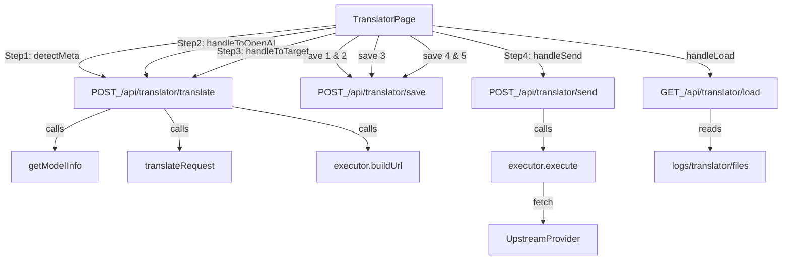
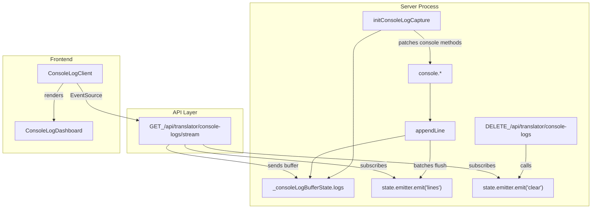
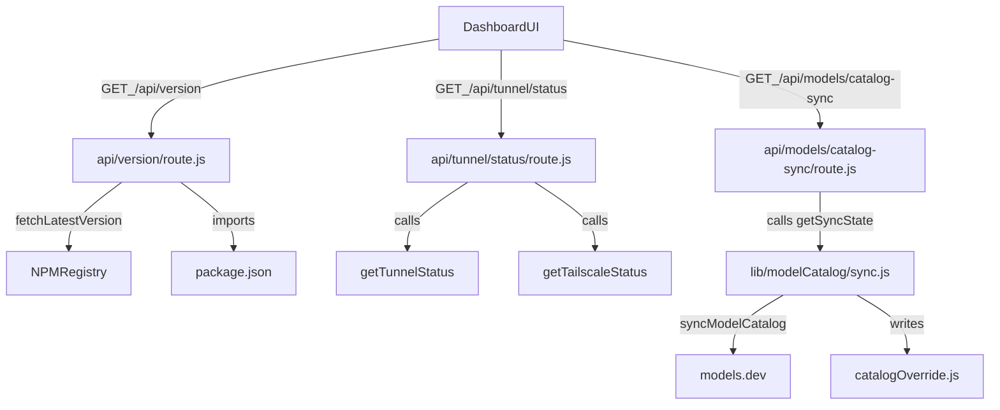

<!-- source: DeepWiki mcp.deepwiki.com · repo decolua/9router · page 8.11 Developer Tools · fetched 2026-10-30 -->

# Developer Tools

Relevant source files

The following files were used as context for generating this wiki page:

- [open-sse/providers/catalogOverride.js](open-sse/providers/catalogOverride.js)
- [open-sse/providers/visionPatterns.js](open-sse/providers/visionPatterns.js)
- [src/app/(dashboard)/dashboard/cli-tools/components/DefaultToolCard.js](src/app/(dashboard)/dashboard/cli-tools/components/DefaultToolCard.js)
- [src/app/(dashboard)/dashboard/console-log/ConsoleLogClient.js](src/app/(dashboard)/dashboard/console-log/ConsoleLogClient.js)
- [src/app/(dashboard)/dashboard/translator/page.js](src/app/(dashboard)/dashboard/translator/page.js)
- [src/app/api/models/catalog-sync/route.js](src/app/api/models/catalog-sync/route.js)
- [src/app/api/translator/console-logs/stream/route.js](src/app/api/translator/console-logs/stream/route.js)
- [src/app/api/translator/load/route.js](src/app/api/translator/load/route.js)
- [src/app/api/translator/save/route.js](src/app/api/translator/save/route.js)
- [src/app/api/translator/send/route.js](src/app/api/translator/send/route.js)
- [src/app/api/translator/translate/route.js](src/app/api/translator/translate/route.js)
- [src/app/landing/components/GetStarted.js](src/app/landing/components/GetStarted.js)
- [src/instrumentation.js](src/instrumentation.js)
- [src/lib/consoleLogBuffer.js](src/lib/consoleLogBuffer.js)
- [src/lib/modelCatalog/sync.js](src/lib/modelCatalog/sync.js)
- [src/shared/components/ManualConfigModal.js](src/shared/components/ManualConfigModal.js)
- [tests/unit/gpt-6-context-window.test.js](tests/unit/gpt-6-context-window.test.js)
- [tests/unit/model-catalog-scope.test.js](tests/unit/model-catalog-scope.test.js)
- [tests/unit/translator-custom-prefix.test.js](tests/unit/translator-custom-prefix.test.js)
- [tests/unit/v1-models-combo-context.test.js](tests/unit/v1-models-combo-context.test.js)

## Purpose and Scope

9Router provides a suite of built-in developer utilities designed to facilitate debugging the complex format translation pipeline, monitoring system internals in real-time, testing provider configurations without external clients, and tracking background status probes.

Sources: [src/app/(dashboard)/dashboard/translator/page.js:1](), [src/lib/consoleLogBuffer.js:1-104]()

## Translator Debugger

The Translator Debugger is a specialized diagnostic interface located at `/dashboard/translator` [src/app/(dashboard)/dashboard/translator/page.js:1](). It exposes the internal 7-step request replay pipeline, allowing developers to inspect how a raw client request is transformed through intermediate formats before reaching the final provider endpoint.

### The 7-Step Pipeline
The debugger tracks the lifecycle of a request across seven distinct stages, matching the files generated by the internal `requestLogger` [src/app/(dashboard)/dashboard/translator/page.js:11-19]().

| Step | Label | File Reference | Description |
|:---|:---|:---|:---|
| 1 | Client Request | `1_req_client.json` | The raw incoming POST body from the client [src/app/(dashboard)/dashboard/translator/page.js:12](). |
| 2 | Source Body | `2_req_source.json` | Initial conversion isolating the request body [src/app/(dashboard)/dashboard/translator/page.js:13](). |
| 3 | OpenAI Intermediate | `3_req_openai.json` | Result of `source` → `OpenAI` translation [src/app/(dashboard)/dashboard/translator/page.js:14](). |
| 4 | Target Request | `4_req_target.json` | Result of `OpenAI` → `target` translation including built URL and headers [src/app/(dashboard)/dashboard/translator/page.js:15](). |
| 5 | Provider Response | `5_res_provider.txt` | The raw SSE stream or JSON returned by the upstream provider [src/app/(dashboard)/dashboard/translator/page.js:16](). |
| 6 | OpenAI Response | `6_res_openai.txt` | Translated response: `target` → `OpenAI` format [src/app/(dashboard)/dashboard/translator/page.js:17](). |
| 7 | Client Response | `7_res_client.txt` | Final response sent back to the original client [src/app/(dashboard)/dashboard/translator/page.js:18](). |

Sources: [src/app/(dashboard)/dashboard/translator/page.js:11-19]()

### Data Flow & Implementation
The debugger interacts with several API routes to simulate the translation logic:
1.  **Metadata Detection**: `POST /api/translator/translate` (Step 1) uses `getModelInfo` to resolve the provider and model from the request body [src/app/api/translator/translate/route.js:18-25]().
2.  **Translation Logic**: `POST /api/translator/translate` (Steps 2 & 3) invokes `translateRequest` from the core translator engine [src/app/api/translator/translate/route.js:36-56]().
3.  **Execution**: `POST /api/translator/send` retrieves an active connection via `getProviderConnections` and uses the `executor.execute` pattern to perform the actual network call [src/app/api/translator/send/route.js:43-65]().
4.  **File Persistence**: The `save` function in `TranslatorPage` [src/app/(dashboard)/dashboard/translator/page.js:81-85]() calls `POST /api/translator/save` [src/app/api/translator/save/route.js:1-16]() to write the intermediate request/response bodies to files in the `logs/translator/` directory. Similarly, `handleLoad` [src/app/(dashboard)/dashboard/translator/page.js:49-65]() uses `GET /api/translator/load` [src/app/api/translator/load/route.js:1-15]() to retrieve these files.

Sources: [src/app/(dashboard)/dashboard/translator/page.js:49-189](), [src/app/api/translator/translate/route.js:9-85](), [src/app/api/translator/send/route.js:35-94]()

### Translator Logic Diagram

"Translator Debug Flow"

Sources: [src/app/(dashboard)/dashboard/translator/page.js:68-189](), [src/app/api/translator/translate/route.js:9-85](), [src/app/api/translator/send/route.js:35-94]()

## Console Log Viewer

The Console Log viewer provides a real-time, colorized stream of the server's internal logs directly in the dashboard at `/dashboard/console-log`.

### Implementation Details
*   **Log Capture**: The system patches the global `console` object using `initConsoleLogCapture` [src/lib/consoleLogBuffer.js:83-95](). This is initialized during the Next.js instrumentation phase [src/instrumentation.js:3-5]().
*   **Log Buffer**: Captured logs are stored in `global._consoleLogBufferState.logs` [src/lib/consoleLogBuffer.js:8](), with a maximum number of lines defined by `CONSOLE_LOG_CONFIG.maxLines` [src/lib/consoleLogBuffer.js:67]().
*   **SSE Stream**: The `GET /api/translator/console-logs/stream` route establishes a Server-Sent Events (SSE) connection. It immediately sends all buffered logs to the client [src/app/api/translator/console-logs/stream/route.js:28-32]() and then listens for new `line` or `lines` events from a shared `EventEmitter` [src/app/api/translator/console-logs/stream/route.js:35-57]().
*   **Batching**: To optimize SSE performance, new log lines are batched and flushed periodically or when a maximum batch size is reached [src/lib/consoleLogBuffer.js:30-42]().
*   **Cleanup**: The stream implementation uses `request.signal` to reliably clean up listeners when the client disconnects, preventing memory leaks in the Next.js runtime [src/app/api/translator/console-logs/stream/route.js:13-24]().

Sources: [src/lib/consoleLogBuffer.js:1-108](), [src/app/api/translator/console-logs/stream/route.js:7-91](), [src/instrumentation.js:1-6]()

### Real-time Log Architecture

"Console Log SSE Pipeline"

Sources: [src/lib/consoleLogBuffer.js:1-108](), [src/app/api/translator/console-logs/stream/route.js:7-91]()

## Basic Chat Interface

The Basic Chat interface (`/dashboard/basic-chat`) is a built-in multi-session chat client. It serves as a playground for testing configured providers and models without needing third-party software.

### Key Capabilities
*   **Multi-Session Management**: Sessions are persisted in `localStorage` under `basic-chat.sessions`.
*   **Dynamic Model Discovery**: The interface fetches available models per provider, supporting both static definitions and live model listing from compatible providers.
*   **Attachment Support**: Supports image uploads, converting files to Data URLs for inclusion in request content blocks.
*   **Token Refresh Integration**: Handles `401/403` errors by attempting credential refreshes via `executor.refreshCredentials` and persisting updated tokens.

Sources: [src/app/api/translator/send/route.js:68-75]()

## System Status Probes

The dashboard utilizes internal status probes to monitor background services like tunnels, version updates, and catalog synchronizations.

*   **Tunnel Status**: The `GET /api/tunnel/status` endpoint aggregates status from Cloudflare and Tailscale handlers.
*   **Version Checking**: The `GET /api/version` endpoint compares the local `package.json` version against the latest version on the NPM registry, caching results to prevent rate limiting.
*   **Model Catalog Sync**: The `GET /api/models/catalog-sync` endpoint provides the status of the background model catalog synchronization process. This process, initiated by `startModelCatalogSync` [src/instrumentation.js:12]() and implemented in `src/lib/modelCatalog/sync.js` [src/lib/modelCatalog/sync.js:1-247](), fetches model capabilities from `models.dev` [src/lib/modelCatalog/sync.js:11]() and updates local overrides.

Sources: [src/lib/modelCatalog/sync.js:1-247](), [src/instrumentation.js:12]()

### Status Monitoring Flow

"System Status and Update Flow"

Sources: [src/lib/modelCatalog/sync.js:1-247]()

---

