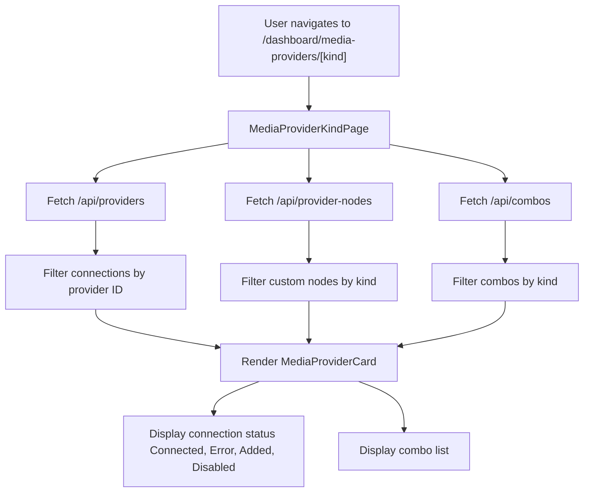
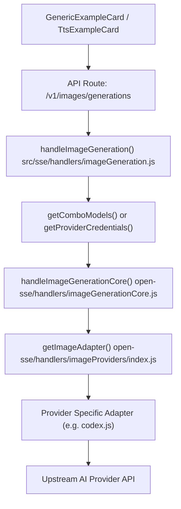

<!-- source: DeepWiki mcp.deepwiki.com · repo decolua/9router · page 8.13 Media Providers Dashboard · fetched 2026-10-30 -->

# Media Providers Dashboard

Relevant source files

The following files were used as context for generating this wiki page:

- [open-sse/config/googleTtsLanguages.js](open-sse/config/googleTtsLanguages.js)
- [open-sse/handlers/imageGenerationCore.js](open-sse/handlers/imageGenerationCore.js)
- [open-sse/handlers/ttsCore.js](open-sse/handlers/ttsCore.js)
- [open-sse/providers/index.js](open-sse/providers/index.js)
- [open-sse/providers/registry/opencode-zen.js](open-sse/providers/registry/opencode-zen.js)
- [open-sse/services/usage/opencode-zen.js](open-sse/services/usage/opencode-zen.js)
- [open-sse/utils/sse.js](open-sse/utils/sse.js)
- [src/app/(dashboard)/dashboard/media-providers/[kind]/[id]/components/GenericExampleCard.js](src/app/(dashboard)/dashboard/media-providers/[kind]/[id]/components/GenericExampleCard.js)
- [src/app/(dashboard)/dashboard/media-providers/[kind]/[id]/components/TtsExampleCard.js](src/app/(dashboard)/dashboard/media-providers/[kind]/[id]/components/TtsExampleCard.js)
- [src/app/(dashboard)/dashboard/media-providers/[kind]/[id]/components/exampleShared.js](src/app/(dashboard)/dashboard/media-providers/[kind]/[id]/components/exampleShared.js)
- [src/app/(dashboard)/dashboard/media-providers/[kind]/[id]/page.js](src/app/(dashboard)/dashboard/media-providers/[kind]/[id]/page.js)
- [src/app/(dashboard)/dashboard/media-providers/[kind]/page.js](src/app/(dashboard)/dashboard/media-providers/[kind]/page.js)
- [src/app/(dashboard)/dashboard/media-providers/web/page.js](src/app/(dashboard)/dashboard/media-providers/web/page.js)
- [src/app/(dashboard)/dashboard/providers/components/AddCompatibleModal.js](src/app/(dashboard)/dashboard/providers/components/AddCompatibleModal.js)
- [src/app/(dashboard)/dashboard/providers/components/ConnectionsCard.js](src/app/(dashboard)/dashboard/providers/components/ConnectionsCard.js)
- [src/app/(dashboard)/dashboard/providers/components/ModelsCard.js](src/app/(dashboard)/dashboard/providers/components/ModelsCard.js)
- [src/app/api/v1/systemone/route.js](src/app/api/v1/systemone/route.js)
- [src/shared/constants/ttsProviders.js](src/shared/constants/ttsProviders.js)
- [src/sse/handlers/imageGeneration.js](src/sse/handlers/imageGeneration.js)
- [src/sse/handlers/systemone.js](src/sse/handlers/systemone.js)
- [tests/unit/codex-image-usage-persistence.test.js](tests/unit/codex-image-usage-persistence.test.js)
- [tests/unit/opencode-zen-models.test.js](tests/unit/opencode-zen-models.test.js)

This technical documentation covers the Media Providers subsystem of the 9Router web management dashboard, accessible at `/dashboard/media-providers/[kind]` and `/dashboard/media-providers/[kind]/[id]`. This subsystem administers AI provider integrations for specialized media modalities including image generation, text-to-speech (TTS), speech-to-text (STT), embeddings, video generation, and web search/fetch tools.

---

## 1. Media Provider Kind Pages & Navigation

The dashboard organizes providers by media "kind" (`image`, `tts`, `stt`, `embedding`, `video`, `web`). The route parameter `kind` resolves via `MediaProviderKindPage` [src/app/(dashboard)/dashboard/media-providers/[kind]/page.js:140-290](), which fetches connection lists and custom nodes to render individual provider cards.

### Kind Page Data Flow

Sources: [src/app/(dashboard)/dashboard/media-providers/[kind]/page.js:140-290]()

### Provider Cards & Status Indicators

Each provider entry uses `MediaProviderCard` [src/app/(dashboard)/dashboard/media-providers/[kind]/page.js:22-97]() to surface operational statuses:
- **No-Auth Providers**: Providers like `sdwebui` and `comfyui` report `Ready` state without credentials [src/app/(dashboard)/dashboard/media-providers/[kind]/page.js:24-39]().
- **Credentialed Providers**: Summarize counts for `Connected`, `Error`, and `Disabled` states [src/app/(dashboard)/dashboard/media-providers/[kind]/page.js:26-30]().
- **Custom Embedding Nodes**: Render via `AddCustomEmbeddingModal` [src/app/(dashboard)/dashboard/media-providers/[kind]/page.js:146](), tagging nodes explicitly with their prefix [src/app/(dashboard)/dashboard/media-providers/[kind]/page.js:75]().
- **Web Providers Consolidation**: `webSearch` and `webFetch` redirect automatically into `/dashboard/media-providers/web` [src/app/(dashboard)/dashboard/media-providers/[kind]/page.js:149-152]().

Sources: [src/app/(dashboard)/dashboard/media-providers/[kind]/page.js:22-152]()

---

## 2. Media Provider Detail Page & Management

Selecting a provider card opens `MediaProviderDetailPage` [src/app/(dashboard)/dashboard/media-providers/[kind]/[id]/page.js:18-212](), providing granular CRUD operations for credentials and model mappings.

### Connections and Models UI

- **`ConnectionsCard`**: Renders a list of account connections via `ConnectionRow` [src/app/(dashboard)/dashboard/providers/components/ConnectionsCard.js:33-135](). Displays priority sequencing, proxy pool bindings, and active `modelLock_` cooldown timers (`CooldownTimer`) [src/app/(dashboard)/dashboard/providers/components/ConnectionsCard.js:9-30]().
- **`ModelsCard`**: Lists models scoped by `kindFilter` through `ModelRow` [src/app/(dashboard)/dashboard/providers/components/ModelsCard.js:11-120](). Allows adding custom models via `AddCustomModelModal` [src/app/(dashboard)/dashboard/providers/components/ModelsCard.js:70-106]() and running inline test pings.

Sources: 
[src/app/(dashboard)/dashboard/media-providers/[kind]/[id]/page.js:18-212](), 
[src/app/(dashboard)/dashboard/providers/components/ConnectionsCard.js:33-135](), 
[src/app/(dashboard)/dashboard/providers/components/ModelsCard.js:11-120]()

---

## 3. Interactive Example Cards

Interactive test harnesses provide copyable `cURL` snippets and real-time payload testing directly in the browser.

### TTS Example Card
`TtsExampleCard` [src/app/(dashboard)/dashboard/media-providers/[kind]/[id]/components/TtsExampleCard.js:21-112]() configures parameters for `/v1/audio/speech`. Voice selection is governed by `TTS_PROVIDER_CONFIG` [src/shared/constants/ttsProviders.js:5-156]`, supporting hardcoded voices, API language groups, and model-specific voice lists (`voicesPerModel`).

### STT and Generic Example Cards
- **`SttExampleCard`**: Interfaces with `/v1/audio/transcriptions` for speech file uploads and parameter tuning.
- **`GenericExampleCard`**: Handles `image`, `video`, and `imageToText` payloads. For image generation, it manages reference images and mask inputs (`edit` and `mask` capabilities) [src/app/(dashboard)/dashboard/media-providers/[kind]/[id]/components/GenericExampleCard.js:37-142]() along with binary output formatting (`response_format=binary`).

Sources: 
[src/app/(dashboard)/dashboard/media-providers/[kind]/[id]/components/TtsExampleCard.js:21-112](), 
[src/shared/constants/ttsProviders.js:5-156](), 
[src/app/(dashboard)/dashboard/media-providers/[kind]/[id]/components/GenericExampleCard.js:37-142]()

---

## 4. Backend Processing & API Routing

Media request processing bridges dashboard UI components to core routing handlers, credential managers, and upstream execution adapters.

### Request Flow to Code Entities

Sources: [src/sse/handlers/imageGeneration.js:46-94](), [open-sse/handlers/imageGenerationCore.js:30-53]()

### Backend Pipeline Components

- **Image Generation Handler (`handleImageGeneration`)**: Validates API keys [src/sse/handlers/imageGeneration.js:60-66](), evaluates key access policies [src/sse/handlers/imageGeneration.js:72-73](), expands combo models via `handleComboChat` [src/sse/handlers/imageGeneration.js:82-90](), and invokes `handleSingleModelImage` [src/sse/handlers/imageGeneration.js:96-170]().
- **Core Orchestrator (`handleImageGenerationCore`)**: Executes provider requests via `getImageAdapter` [open-sse/handlers/imageGenerationCore.js:47-53](), handles token refresh cycles on `401`/`403` errors [open-sse/handlers/imageGenerationCore.js:123-157](), and persists usage metrics via `saveRequestUsage` [src/sse/handlers/imageGeneration.js:31-39]().

Sources: [src/sse/handlers/imageGeneration.js:31-170](), [open-sse/handlers/imageGenerationCore.js:30-178]()

---

