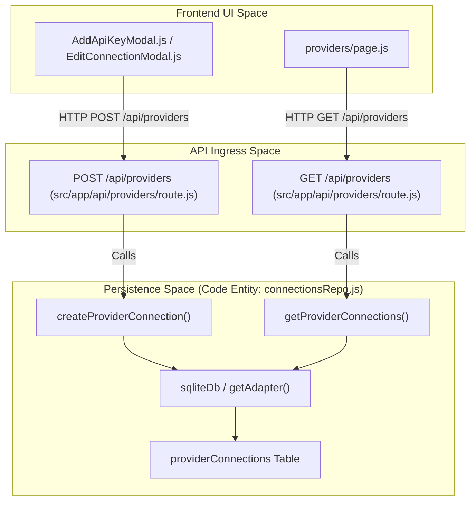
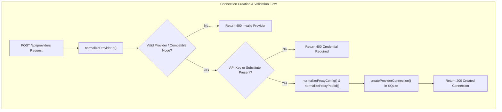
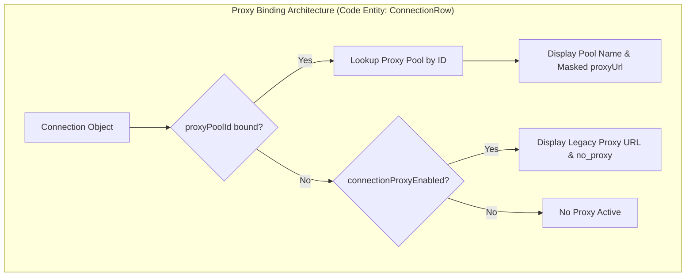

<!-- source: DeepWiki mcp.deepwiki.com · repo decolua/9router · page 8.2 Provider Management · fetched 2026-10-30 -->

# Provider Management

Relevant source files

The following files were used as context for generating this wiki page:

- [src/app/(dashboard)/dashboard/providers/[id]/AddApiKeyModal.js](src/app/(dashboard)/dashboard/providers/[id]/AddApiKeyModal.js)
- [src/app/(dashboard)/dashboard/providers/[id]/AutoPingScheduleModal.js](src/app/(dashboard)/dashboard/providers/[id]/AutoPingScheduleModal.js)
- [src/app/(dashboard)/dashboard/providers/[id]/BulkImportCodexModal.js](src/app/(dashboard)/dashboard/providers/[id]/BulkImportCodexModal.js)
- [src/app/(dashboard)/dashboard/providers/[id]/ConnectionRow.js](src/app/(dashboard)/dashboard/providers/[id]/ConnectionRow.js)
- [src/app/api/oauth/codex/bulk-import/route.js](src/app/api/oauth/codex/bulk-import/route.js)
- [src/app/api/providers/route.js](src/app/api/providers/route.js)
- [src/lib/db/repos/connectionsRepo.js](src/lib/db/repos/connectionsRepo.js)
- [src/shared/components/EditConnectionModal.js](src/shared/components/EditConnectionModal.js)
- [src/shared/components/Tooltip.js](src/shared/components/Tooltip.js)
- [src/shared/services/initializeApp.js](src/shared/services/initializeApp.js)
- [src/shared/services/quotaAutoPing.js](src/shared/services/quotaAutoPing.js)
- [src/shared/services/quotaPingSchedule.js](src/shared/services/quotaPingSchedule.js)
- [tests/unit/db-sqlite-vs-lowdb.test.js](tests/unit/db-sqlite-vs-lowdb.test.js)
- [tests/unit/quota-auto-ping.test.js](tests/unit/quota-auto-ping.test.js)
- [tests/unit/quota-ping-schedule.test.js](tests/unit/quota-ping-schedule.test.js)

## Purpose and Scope
This document describes the Provider Management subsystem in 9Router, focusing on provider connection CRUD operations, connection priority ordering, proxy binding, bulk importing, and modal management within the web dashboard (`src/app/(dashboard)/dashboard/providers`). It covers the interaction between the React-based frontend components, API endpoints (`src/app/api/providers`), and SQLite storage layer (`src/lib/db/repos/connectionsRepo.js`).

For authentication flows, token lifecycles, and background refresh, see [5.4 Token Refresh & Credential Management](). For execution logic, see [5.3 Provider Executors](). For model aliasing and routing, see [8.4 Model & Combo Management]().

---

## Overview
The Provider Management system allows administrators to configure, monitor, and scale AI provider credentials across multiple accounts, authentication methods, and network configurations. It is split between the **Providers List Page** (`/dashboard/providers`), which gives an aggregate overview and batch testing facilities, and the **Provider Detail Page** (`/dashboard/providers/[id]`), which administers connection pools, priorities, and model bindings.

| Component | Route / Path | Purpose |
|-----------|--------------|---------|
| **Providers List Page** | `src/app/(dashboard)/dashboard/providers/page.js` | View all providers, toggle connections, batch test health status |
| **Provider Detail Page** | `src/app/(dashboard)/dashboard/providers/[id]/page.js` | Manage connection pools, priorities, model lists, and quotas |
| **Add API Key Modal** | `src/app/(dashboard)/dashboard/providers/[id]/AddApiKeyModal.js` | Single/bulk creation of API keys, web cookies, or AWS profile credentials |
| **Edit Connection Modal** | `src/shared/components/EditConnectionModal.js` | Modify connection names, priorities, and update/test credentials |
| **Providers API** | `src/app/api/providers/route.js` | Backend CRUD endpoints for listing and creating provider connections |

Sources: [src/app/(dashboard)/dashboard/providers/page.js:1-97](), [src/app/(dashboard)/dashboard/providers/[id]/page.js:1-75](), [src/app/api/providers/route.js:1-54]()

---

## Provider Connection CRUD & Data Flow
Provider connections are persisted via the SQLite repository layer (`src/lib/db/repos/connectionsRepo.js`). Each connection holds metadata, an authentication type (`apikey`, `oauth`, `cookie`), and provider-specific parameters stored in a serialized JSON column (`data`).

Sources: [src/app/api/providers/route.js:51-125](), [src/lib/db/repos/connectionsRepo.js:68-103]()

### Connection Creation and Validation
When a new connection is submitted via `POST /api/providers`, the backend normalizes proxy parameters, validates the provider identifier against supported registries (`APIKEY_PROVIDERS`, `FREE_TIER_PROVIDERS`, `WEB_COOKIE_PROVIDERS`, or custom compatible nodes), and ensures required credentials (or API key substitutes like AWS `profile`) are present [src/app/api/providers/route.js:84-123]().

Sources: [src/app/api/providers/route.js:84-169](), [src/lib/db/repos/connectionsRepo.js:135-175]()

---

## Modals & Bulk Import
The dashboard provides specialised modal interfaces for single and bulk credential entry.

### Add API Key & Bulk Import Modal
`AddApiKeyModal` supports toggling between **single** and **bulk** entry modes [src/app/(dashboard)/dashboard/providers/[id]/AddApiKeyModal.js:64-66]. In bulk mode, users can paste newline-separated credentials using formats like `name|sk-key` or `name|sk-key|account_id` (for Cloudflare AI) [src/app/(dashboard)/dashboard/providers/[id]/AddApiKeyModal.js:58-62]. 

Special handling exists for providers requiring alternative credential forms:
* **AWS Bedrock / Compatible**: Gated by `AI_PROVIDERS[provider]?.credentialForm === "aws"`, presenting profile name, region, access key ID, and session token fields [src/app/(dashboard)/dashboard/providers/[id]/AddApiKeyModal.js:23-29, 48-53].
* **Azure OpenAI**: Captures custom `azureEndpoint`, `apiVersion`, `deployment`, and `organization` [src/app/(dashboard)/dashboard/providers/[id]/AddApiKeyModal.js:41-46].
* **Cloudflare Workers AI**: Captures account IDs [src/app/(dashboard)/dashboard/providers/[id]/AddApiKeyModal.js:47].

Sources: [src/app/(dashboard)/dashboard/providers/[id]/AddApiKeyModal.js:11-66, 68-97]()

---

## Priority Ordering & Reordering
Connections within a specific provider pool are sorted by their integer `priority` field [src/lib/db/repos/connectionsRepo.js:101]. 

* **Default Insertion**: New connections are appended with `MAX(priority) + 1`, ensuring O(1) insertion performance without scanning or rewriting the entire pool [src/lib/db/repos/connectionsRepo.js:116-119].
* **Reordering / Deletion**: When explicit reordering or deletion occurs, `reorderInTx` normalizes priorities to a contiguous `1..N` integer sequence within a database transaction [src/lib/db/repos/connectionsRepo.js:112-133].
* **UI Controls**: `ConnectionRow` components render up/down arrow buttons (`onMoveUp`, `onMoveDown`) to let users adjust execution order interactively [src/app/(dashboard)/dashboard/providers/[id]/ConnectionRow.js:10].

Sources: [src/lib/db/repos/connectionsRepo.js:101, 112-133](), [src/app/(dashboard)/dashboard/providers/[id]/ConnectionRow.js:1-10]()

---

## Proxy Binding & Network Configuration
Connections can be bound either to a named **Proxy Pool** (`proxyPoolId`) or configured with an isolated manual proxy URL (`connectionProxyUrl` and `connectionNoProxy`) [src/app/api/providers/route.js:16-29, 32-48].

### Proxy Selection and Resolution
The `ConnectionRow` component displays active proxy badges, masked proxy endpoints (stripping credentials for UI display), and `no_proxy` exception rules [src/app/(dashboard)/dashboard/providers/[id]/ConnectionRow.js:17-61].

Sources: [src/app/api/providers/route.js:16-48](), [src/app/(dashboard)/dashboard/providers/[id]/ConnectionRow.js:17-61]()

---

## Sources
- [src/app/(dashboard)/dashboard/providers/page.js]()
- [src/app/(dashboard)/dashboard/providers/[id]/page.js]()
- [src/app/(dashboard)/dashboard/providers/[id]/AddApiKeyModal.js]()
- [src/app/(dashboard)/dashboard/providers/[id]/ConnectionRow.js]()
- [src/app/api/providers/route.js]()
- [src/lib/db/repos/connectionsRepo.js]()
- [src/shared/components/EditConnectionModal.js]()

---

