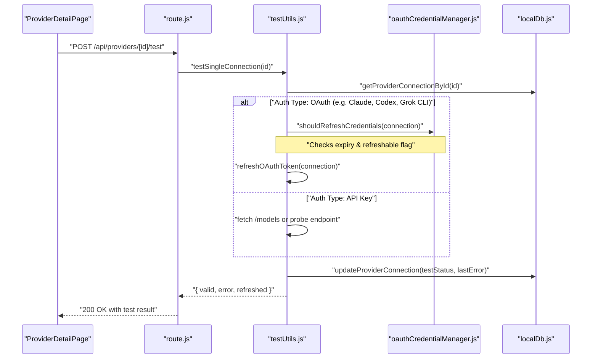
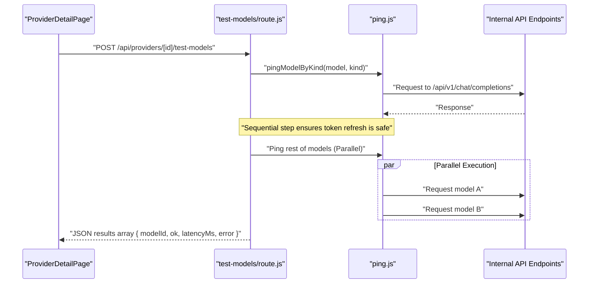
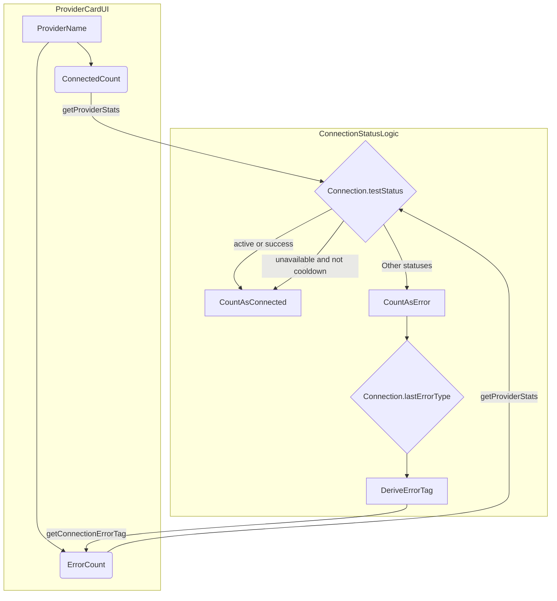

<!-- source: DeepWiki mcp.deepwiki.com · repo decolua/9router · page 8.3 Connection Testing & Validation · fetched 2026-10-30 -->

# Connection Testing & Validation

Relevant source files

The following files were used as context for generating this wiki page:

- [open-sse/providers/registry/index.js](open-sse/providers/registry/index.js)
- [open-sse/services/copilotModels.js](open-sse/services/copilotModels.js)
- [src/app/api/models/test/ping.js](src/app/api/models/test/ping.js)
- [src/app/api/models/test/route.js](src/app/api/models/test/route.js)
- [src/app/api/oauth/[provider]/[action]/route.js](src/app/api/oauth/[provider]/[action]/route.js)
- [src/app/api/providers/[id]/models/route.js](src/app/api/providers/[id]/models/route.js)
- [src/app/api/providers/[id]/test-models/route.js](src/app/api/providers/[id]/test-models/route.js)
- [src/app/api/providers/[id]/test/testUtils.js](src/app/api/providers/[id]/test/testUtils.js)
- [src/lib/oauth/constants/oauth.js](src/lib/oauth/constants/oauth.js)
- [src/lib/oauth/providers.js](src/lib/oauth/providers.js)
- [src/lib/oauth/providers/index.js](src/lib/oauth/providers/index.js)
- [src/shared/components/OAuthModal.js](src/shared/components/OAuthModal.js)
- [tests/__baseline__/alias-baseline.json](tests/__baseline__/alias-baseline.json)
- [tests/__baseline__/providers-baseline.json](tests/__baseline__/providers-baseline.json)
- [tests/__baseline__/verify-alias.mjs](tests/__baseline__/verify-alias.mjs)
- [tests/unit/fusion-strip-stream-options-3024.test.js](tests/unit/fusion-strip-stream-options-3024.test.js)
- [tests/unit/hf-model-routing.test.js](tests/unit/hf-model-routing.test.js)
- [tests/unit/model-test-routing.test.js](tests/unit/model-test-routing.test.js)
- [tests/unit/ping-reasoning-models-3010.test.js](tests/unit/ping-reasoning-models-3010.test.js)
- [tests/unit/provider-test-models-routing.test.js](tests/unit/provider-test-models-routing.test.js)

This document describes the connection testing and validation system in the 9Router web dashboard. Connection testing verifies that provider credentials (API keys, OAuth tokens) are valid and that endpoints are reachable. Validation confirms that OpenAI-compatible and Anthropic-compatible endpoints conform to expected API schemas.

For information about provider connection management and configuration, see [Provider Management](). For details about the underlying test execution logic and credential refresh mechanisms, see [Provider Validation & Testing]().

---

## Test Types Overview

9Router implements several distinct testing mechanisms to ensure the reliability of the routing fabric across different model modalities (Chat, Embedding, Image, STT, etc.).

| Test Type | Scope | Endpoint | Purpose |
|-----------|-------|----------|---------|
| **Credential Validation** | Raw credentials | `POST /api/providers/validate` | Verify an API key before saving a new connection [src/app/api/providers/validate/route.js:84-88]() |
| **Single Connection Test** | Individual connection | `POST /api/providers/[id]/test` | Verify an existing connection's credentials and token lifecycle [src/app/api/providers/[id]/test/route.js:5-9]() |
| **Model Connectivity Test** | Specific Model ID | `POST /api/models/test` | Ping a single model via internal completions, embeddings, or audio endpoints [src/app/api/models/test/ping.js:58]() |
| **Provider Model Probe** | All models in connection | `POST /api/providers/[id]/test-models` | Test all supported models for a specific connection in parallel [src/app/api/providers/[id]/test-models/route.js:13-16]() |

Sources: [src/app/api/providers/validate/route.js:84-114](), [src/app/api/providers/[id]/test/route.js:5-24](), [src/app/api/models/test/ping.js:58-192]()

---

## Pre-Save Validation

Before a provider connection is saved to the local database, the dashboard performs a "probe" to ensure the API key is valid. The `POST /api/providers/validate` endpoint handles this logic by attempting minimal requests to the provider's `/models` or specific inference endpoints.

### Validation Strategies by Kind

- **OpenAI/Anthropic Compatible:** Probes the `/models` endpoint of the custom `baseUrl` [src/app/api/providers/validate/route.js:100-114]().
- **Web Search/Fetch:** Probes using the provider's `searchConfig` or `fetchConfig`, typically sending a ping query [src/app/api/providers/validate/route.js:11-42]().
- **Media Providers (TTS/STT/Image):** Uses specialized configs to send a minimal request, accepting keys if the status is not 401 (Unauthorized) or 403 (Forbidden) [src/app/api/providers/validate/route.js:46-81]().
- **Custom Embedding Nodes:** Specifically probes `/models` first, falling back to a POST request to `/embeddings` with a test payload if `/models` is unavailable [src/app/api/providers/validate/route.js:117-144]().

Sources: [src/app/api/providers/validate/route.js:11-81](), [src/app/api/providers/validate/route.js:117-144]()

---

## Single Connection Testing & OAuth Probing

For existing connections, the testing process involves resolving proxy configurations, checking token lifecycles, and performing a network probe. The `testSingleConnection` utility and `OAUTH_TEST_CONFIG` manage this across diverse provider specs (e.g., Claude, Codex, Gemini CLI, Grok CLI, Kiro, Qoder) [src/app/api/providers/[id]/test/testUtils.js:33-173]().

**Diagram: Single Connection Test Execution Flow**
Sources: [src/app/api/providers/[id]/test/testUtils.js:33-173](), [src/app/api/providers/[id]/test/route.js:5-24]()

### Result Classification
The system distinguishes between hard failures and soft successes via `classifyOAuthProbeResult()`. A soft success (e.g., HTTP 402 on Grok CLI spending-limit or Codex 400 bad request verifying auth presence) indicates that authentication is valid even if a quota or spending limit prevents inference [src/app/api/providers/[id]/test/testUtils.js:41-47,142-148]().

Sources: [src/app/api/providers/[id]/test/testUtils.js:33-183]()

---

## Model Probing & Availability

9Router supports granular testing of specific models to verify that a provider account has access to certain capabilities. The system uses a `pingModelByKind` function to route tests to the appropriate internal endpoint based on the model's purpose.

### Model Connectivity Ping

The `pingModelByKind` function in `src/app/api/models/test/ping.js` handles specialized logic:

- **LLM (Chat):** Hits `/api/v1/chat/completions` with `max_tokens: 1024` and `stream: false` [src/app/api/models/test/ping.js:168-175]().
- **Embedding:** Hits `/api/v1/embeddings` with `"test"` input, validating the presence of the `embedding` array [src/app/api/models/test/ping.js:62-83]().
- **Image:** Hits `/api/v1/images/generations` with a test prompt [src/app/api/models/test/ping.js:85-107]().
- **STT (Speech-to-Text):** Hits `/api/v1/audio/transcriptions` using an in-memory generated silent WAV file [src/app/api/models/test/ping.js:109-136]().

### Dynamic Model Discovery
For providers like Codex, Gemini-CLI, Qoder, and Kiro, 9Router attempts to fetch available models dynamically from upstream via specialized resolvers before falling back to static catalogs [src/app/api/providers/[id]/models/route.js:90-168]().

**Diagram: Model Probing and Availability Flow**
Sources: [src/app/api/providers/[id]/test-models/route.js:1-60](), [src/app/api/models/test/ping.js:58-170](), [src/app/api/providers/[id]/models/route.js:90-168]()

---

## Quota Auto-Ping System

9Router implements background auto-ping routines to keep account quotas warm or detect rate limit window resets:
- **Claude:** Monitors rate limit windows and fires low-token upkeep requests on expiry detection [src/app/api/providers/[id]/test/testUtils.js:34]().
- **Codex:** Sends lightweight payload checks to maintain backend session sliding windows [src/app/api/providers/[id]/test/testUtils.js:35-46]().

Sources: [src/app/api/providers/[id]/test/testUtils.js:33-46]()

---

## Dashboard UI for Connection Testing

The dashboard provides status badges, one-by-one connection runners, and batch execution controllers.

### Connection Status Indicators
Each provider card displays connection metrics derived from `testStatus`:
- **Connected Badge:** Counts active or successful connections.
- **Error Badge:** Counts error states and classifies errors into tags (e.g., `AUTH`, `429`, `NET`, `RUNTIME`) via error categorization logic [src/app/(dashboard)/dashboard/providers/page.js:30-95]().

**Diagram: Provider Card Status Flow**
Sources: [src/app/(dashboard)/dashboard/providers/page.js:30-95]()

### One-by-One and Batch Connection Testing
On individual provider detail pages (`/dashboard/providers/[id]`), users can execute sequential or bulk tests:
- **One-by-One Testing:** Iterates through connections with delay spacing, allowing real-time status tracking and manual stop intervention [src/app/(dashboard)/dashboard/providers/[id]/page.js:27]().
- **Batch Testing:** Checkboxes enable multi-selection for concurrent test dispatch [src/app/(dashboard)/dashboard/providers/[id]/page.js:65]().

Sources: [src/app/(dashboard)/dashboard/providers/[id]/page.js:27](), [src/app/(dashboard)/dashboard/providers/[id]/page.js:65](), [src/app/(dashboard)/dashboard/providers/[id]/page.js:78-82]()

---

