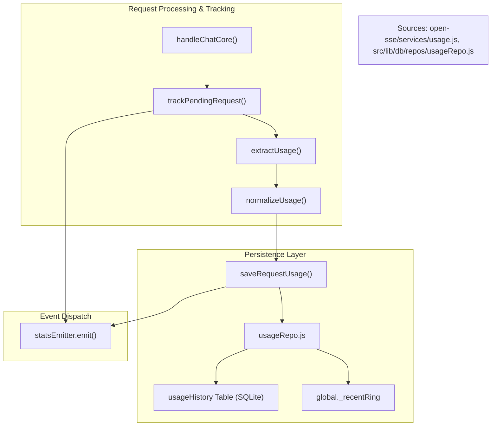
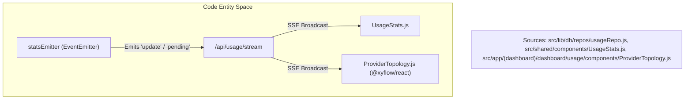

<!-- source: DeepWiki mcp.deepwiki.com · repo decolua/9router · page 8.5 Usage Statistics & Monitoring · fetched 2026-10-30 -->

# Usage Statistics & Monitoring

Relevant source files

The following files were used as context for generating this wiki page:

- [open-sse/services/usage.js](open-sse/services/usage.js)
- [open-sse/services/usage/claude.js](open-sse/services/usage/claude.js)
- [open-sse/services/usage/misc.js](open-sse/services/usage/misc.js)
- [src/app/(dashboard)/dashboard/usage/components/OverviewCards.js](src/app/(dashboard)/dashboard/usage/components/OverviewCards.js)
- [src/app/(dashboard)/dashboard/usage/components/ProviderLimits/ProviderLimitCard.js](src/app/(dashboard)/dashboard/usage/components/ProviderLimits/ProviderLimitCard.js)
- [src/app/(dashboard)/dashboard/usage/components/ProviderLimits/QuotaProgressBar.js](src/app/(dashboard)/dashboard/usage/components/ProviderLimits/QuotaProgressBar.js)
- [src/app/(dashboard)/dashboard/usage/components/ProviderLimits/QuotaTable.js](src/app/(dashboard)/dashboard/usage/components/ProviderLimits/QuotaTable.js)
- [src/app/(dashboard)/dashboard/usage/components/ProviderLimits/index.js](src/app/(dashboard)/dashboard/usage/components/ProviderLimits/index.js)
- [src/app/(dashboard)/dashboard/usage/components/ProviderLimits/utils.js](src/app/(dashboard)/dashboard/usage/components/ProviderLimits/utils.js)
- [src/app/(dashboard)/dashboard/usage/components/ProviderTopology.js](src/app/(dashboard)/dashboard/usage/components/ProviderTopology.js)
- [src/app/(dashboard)/dashboard/usage/page.js](src/app/(dashboard)/dashboard/usage/page.js)
- [src/app/api/keys/route.js](src/app/api/keys/route.js)
- [src/app/api/usage/[connectionId]/claude-reset/route.js](src/app/api/usage/[connectionId]/claude-reset/route.js)
- [src/app/api/usage/chart/route.js](src/app/api/usage/chart/route.js)
- [src/app/api/usage/stats/route.js](src/app/api/usage/stats/route.js)
- [src/app/globals.css](src/app/globals.css)
- [src/app/layout.js](src/app/layout.js)
- [src/lib/db/repos/usageRepo.js](src/lib/db/repos/usageRepo.js)
- [src/lib/usageDb.js](src/lib/usageDb.js)
- [src/shared/components/Drawer.js](src/shared/components/Drawer.js)
- [src/shared/components/UsageStats.js](src/shared/components/UsageStats.js)
- [tests/unit/claude-reset-grants.test.js](tests/unit/claude-reset-grants.test.js)
- [tests/unit/codebuddy-intl-quota-recurring.test.js](tests/unit/codebuddy-intl-quota-recurring.test.js)
- [tests/unit/glm-usage.test.js](tests/unit/glm-usage.test.js)
- [tests/unit/ollama-usage.test.js](tests/unit/ollama-usage.test.js)
- [tests/unit/usage-dispatch.test.js](tests/unit/usage-dispatch.test.js)

This page documents 9Router's comprehensive usage tracking and monitoring system, which captures token usage, costs, latency metrics, and request statistics across all providers and models. The system provides real-time monitoring through Server-Sent Events (SSE), historical analytics, quota table tracking, dynamic topology visualization, and interactive charts.

For information about request/response logging and observability, see [7.4 Request Details & Observability](). For cost calculation and pricing configuration, see [5.2 Provider Models & Pricing]().

---

## Data Collection Architecture

9Router collects usage statistics at multiple points during request processing, extracting token counts from provider responses and estimating when not provided.

### Collection Data Flow

**Title: Usage Collection & Persistence Data Flow**

The persistence pipeline uses SQLite-backed tables managed via `src/lib/db/repos/usageRepo.js` [src/lib/db/repos/usageRepo.js:1-5](). In-flight requests are tracked globally using `trackPendingRequest` [src/lib/db/repos/usageRepo.js:154-170](), while completed requests invoke `saveRequestUsage` to aggregate metrics by day, provider, model, account, and API key. Cost calculations leverage `calculateCost` which queries pricing metadata and invokes `calculateCostFromTokens` [src/lib/db/repos/usageRepo.js:136-152]().

**Sources:** `[open-sse/services/usage.js:1-98](), [src/lib/db/repos/usageRepo.js:1-170]()`

---

## Usage Extraction & Normalization

9Router extracts token usage from multiple provider formats (Claude, OpenAI, Gemini) and aggregates them into consistent metrics.

### Provider Quota & Usage Dispatchers

For accounts that support active quota checking, `getUsageForProvider` dispatches requests to provider-specific handlers defined in `USAGE_HANDLERS` [open-sse/services/usage.js:39-72]().

| Provider Identifier | Handler Function | Key Arguments Passed |
|--------------------|------------------|----------------------|
| `github` | `getGitHubUsage` | `accessToken`, `providerSpecificData`, `proxyOptions` [open-sse/services/usage.js:41-41]() |
| `gemini-cli` | `getGeminiUsage` | `accessToken`, `providerDataWithProjectId`, `proxyOptions` [open-sse/services/usage.js:42-42]() |
| `antigravity` | `getAntigravityUsage` | `accessToken`, `providerSpecificData`, `proxyOptions` [open-sse/services/usage.js:43-43]() |
| `claude` | `getClaudeUsage` | `accessToken`, `proxyOptions`, `{ force }` [open-sse/services/usage.js:44-44]() |
| `codex` | `getCodexUsage` | `accessToken`, `proxyOptions` [open-sse/services/usage.js:45-45]() |
| `kiro` | `getKiroUsage` | `accessToken`, `providerSpecificData`, `proxyOptions` [open-sse/services/usage.js:46-46]() |
| `qoder` / `qoder-cn` | `getQoderUsageFor` | Connection context `c` with region resolution [open-sse/services/usage.js:47-48]() |
| `minimax-code` | `getMiniMaxCodeUsage` | Connection context `c` [open-sse/services/usage.js:57-57]() |

**Sources:** `[open-sse/services/usage.js:34-100]()`

---

## Real-time Updates via SSE & Topology

### SSE Live Updates Architecture

**Title: Real-time SSE Live Updates Topology**

The dashboard maintains a real-time connection to the server via an SSE endpoint. The `statsEmitter` instance [src/lib/db/repos/usageRepo.js:38-38]() acts as the central event bus for real-time notifications (`pending` and `update` events), pushing structured metrics to both `UsageStats` [src/shared/components/UsageStats.js:1-42]() and `ProviderTopology` [src/app/(dashboard)/dashboard/usage/components/ProviderTopology.js:1-91]().

**Sources:** `[src/lib/db/repos/usageRepo.js:37-48](), [src/shared/components/UsageStats.js:1-42](), [src/app/(dashboard)/dashboard/usage/components/ProviderTopology.js:1-91]()`

---

## Dashboard Components & Charts

The web dashboard provides dedicated views for monitoring system usage, managing quotas, and analyzing request flows:

*   **Overview Cards (`OverviewCards.js`)**: Displays high-level metrics including total requests, input tokens, cached tokens, output tokens, and estimated cost [src/app/(dashboard)/dashboard/usage/components/OverviewCards.js:9-35]().
*   **Quota Table (`QuotaTable.js`)**: Renders connection quotas with remaining percentages, color-coded status badges (`🟢`, `🟡`, `🔴`, `💰`), and time-remaining countdowns [src/app/(dashboard)/dashboard/usage/components/ProviderLimits/QuotaTable.js:87-198]().
*   **Recent Requests (`RecentRequests`)**: A live-updating sidebar table showing recent model executions, prompt/completion token counts, and relative timestamps via `TimeAgo` [src/shared/components/UsageStats.js:44-89]().
*   **Period Selector (`UsagePage`)**: Allows filtering usage analytics across predefined timeframes (`today`, `24h`, `7d`, `30d`, `60d`, `all`) [src/app/(dashboard)/dashboard/usage/page.js:9-16]().
*   **Lazy-Loaded Charts**: To keep initial bundle sizes optimized, heavy UI libraries like `@xyflow/react` and `recharts` are dynamically imported for components such as `ProviderTopology`, `UsageChart`, `ProviderBarChart`, and `TopModelsChart` [src/shared/components/UsageStats.js:17-23]().

**Sources:** `[src/shared/components/UsageStats.js:1-89](), [src/app/(dashboard)/dashboard/usage/components/OverviewCards.js:9-35](), [src/app/(dashboard)/dashboard/usage/components/ProviderLimits/QuotaTable.js:87-198](), [src/app/(dashboard)/dashboard/usage/page.js:9-16]()`

---

## Quota Management & Caching

The quota tracking system relies on polling intervals and local caching mechanisms to avoid rate-limiting provider usage APIs.

*   **Polling Intervals**: Standard providers refresh quotas every `60,000ms` (`REFRESH_INTERVAL_MS`), while Claude quotas use an extended interval of `600,000ms` (`CLAUDE_REFRESH_INTERVAL_MS`) to respect rate-limiting thresholds [src/app/(dashboard)/dashboard/usage/components/ProviderLimits/utils.js:5-7]().
*   **Caching**: Quota payloads are persisted locally via `QUOTA_CACHE_KEY` to render instant states before background revalidation finishes [src/app/(dashboard)/dashboard/usage/components/ProviderLimits/utils.js:4-31]().

**Sources:** `[src/app/(dashboard)/dashboard/usage/components/ProviderLimits/utils.js:1-41]()`

---

