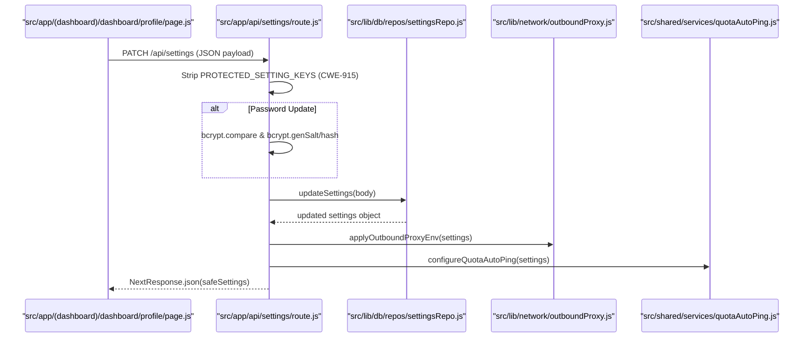

<!-- source: DeepWiki mcp.deepwiki.com · repo decolua/9router · page 8.6 Settings & Configuration · fetched 2026-10-30 -->

# Settings & Configuration

<details>
<summary>Relevant source files</summary>

The following files were used as context for generating this wiki page:

- [open-sse/services/capacityAdapter.js](open-sse/services/capacityAdapter.js)
- [src/app/(dashboard)/dashboard/endpoint/EndpointPageClient.js](src/app/(dashboard)/dashboard/endpoint/EndpointPageClient.js)
- [src/app/(dashboard)/dashboard/profile/page.js](src/app/(dashboard)/dashboard/profile/page.js)
- [src/app/(dashboard)/dashboard/providers/[id]/CustomConfigCard.js](src/app/(dashboard)/dashboard/providers/[id]/CustomConfigCard.js)
- [src/app/(dashboard)/dashboard/providers/[id]/ModelRow.js](src/app/(dashboard)/dashboard/providers/[id]/ModelRow.js)
- [src/app/(dashboard)/dashboard/providers/[id]/page.js](src/app/(dashboard)/dashboard/providers/[id]/page.js)
- [src/app/(dashboard)/dashboard/providers/page.js](src/app/(dashboard)/dashboard/providers/page.js)
- [src/app/api/providers/[id]/overrides/route.js](src/app/api/providers/[id]/overrides/route.js)
- [src/app/api/settings/route.js](src/app/api/settings/route.js)
- [src/lib/db/backup.js](src/lib/db/backup.js)
- [src/lib/db/migrate.js](src/lib/db/migrate.js)
- [src/lib/db/repos/requestDetailsRepo.js](src/lib/db/repos/requestDetailsRepo.js)
- [src/lib/db/repos/settingsRepo.js](src/lib/db/repos/settingsRepo.js)
- [src/lib/localDb.js](src/lib/localDb.js)
- [src/shared/components/Header.js](src/shared/components/Header.js)
- [src/shared/components/Sidebar.js](src/shared/components/Sidebar.js)

</details>


This page documents the global settings system in 9Router, covering the settings schema, UI configuration management (`src/app/(dashboard)/dashboard/profile/page.js`), fallback strategies, outbound proxy configuration, and database import/export mechanisms. Settings control application-wide behavior including routing strategies, security (Password, OIDC, and SAML), network proxy configuration, and observability.

For provider-specific configuration, see [Provider Configuration](#5.1). For proxy pool management (connection-specific proxies), see [Proxy Configuration](#10.1). For database structure details, see [Database Architecture](#7.1).

---

## Settings Schema & Storage

Settings are stored as a JSON payload in the `settings` table (row id = 1) within the SQLite-backed database layer. The schema and defaults are managed in `src/lib/db/repos/settingsRepo.js` and exposed via the `src/lib/localDb.js` compatibility shim [src/lib/localDb.js:1-21](). Default values, type normalization, and backward-compat transformations are defined by `DEFAULT_SETTINGS` and `mergeWithDefaults()` [src/lib/db/repos/settingsRepo.js:7-102]().

### Settings Architecture

```mermaid
graph TB
    subgraph "Code Entity Space"
        SettingsRoute["src/app/api/settings/route.js"]
        LocalDb["src/lib/localDb.js"]
        SettingsRepo["src/lib/db/repos/settingsRepo.js"]
        OutboundProxy["src/lib/network/outboundProxy.js"]
        ComboSvc["open-sse/services/combo.js"]
    end

    subgraph "Natural Language Space"
        Database["\"SQLite settings table (id=1)\""]
        ClientUI["\"Dashboard Settings Panel src/app/(dashboard)/dashboard/profile/page.js\""]
    end

    ClientUI -->|HTTP GET/PATCH| SettingsRoute
    SettingsRoute -->|getSettings/updateSettings| LocalDb
    LocalDb -->|queries ID=1| SettingsRepo
    SettingsRepo --> Database
    SettingsRoute -->|applyOutboundProxyEnv| OutboundProxy
    SettingsRoute -->|resetComboRotation| ComboSvc
```

**Sources:** [src/app/api/settings/route.js:1-118](), [src/lib/localDb.js:1-21](), [src/lib/db/repos/settingsRepo.js:7-102](), [src/app/(dashboard)/dashboard/profile/page.js:1-40]()

| Category | Settings Fields | Purpose |
|----------|-----------------|---------|
| **Routing & Fallback** | `fallbackStrategy`, `stickyRoundRobinLimit`, `comboStrategy` | Controls account selection and combo/fusion rotation strategies [src/lib/db/repos/settingsRepo.js:14-19]() |
| **Security & Auth** | `authMode`, `ssoType`, `password`, `oidcClientId`, `oidcClientSecret` | Configures dashboard access via Password, OIDC, or SAML SSO [src/lib/db/repos/settingsRepo.js:26-41]() |
| **Network Proxy** | `outboundProxyEnabled`, `outboundProxyUrl`, `outboundNoProxy` | Global proxy used for outbound provider requests and token refreshes [src/lib/db/repos/settingsRepo.js:47-49]() |
| **Observability** | `enableObservability`, `observabilityMaxRecords` | Configures request logging and retention limits [src/lib/db/repos/settingsRepo.js:42-46]() |
| **Auto-Ping** | `claudeAutoPing`, `codexAutoPing` | Background schedulers for warming provider quota windows [src/app/api/settings/route.js:100-109]() |

**Sources:** [src/app/api/settings/route.js:100-109](), [src/lib/db/repos/settingsRepo.js:7-67]()

---

## Settings API & Data Flow

Settings are retrieved and modified through `src/app/api/settings/route.js`. The `GET` endpoint retrieves current settings while scrubbing sensitive fields like `password` and `oidcClientSecret` [src/app/api/settings/route.js:17-36](). Secrets are protected from mass-assignment vulnerability (`CWE-915`) by stripping `PROTECTED_SETTING_KEYS` (`password`, `mitmSudoEncrypted`) from incoming payload bodies [src/app/api/settings/route.js:14-16]().

### Request Processing Flow



**Sources:** [src/app/api/settings/route.js:38-118]()

### Key Functions & Handlers

*   **`GET()`**: Returns the settings object with derived fields such as `oidcConfigured`, `enableRequestLogs`, `enableTranslator`, and `hasPassword` [src/app/api/settings/route.js:17-36]().
*   **`PATCH(request)`**: Validates passwords via `bcryptjs`, updates database records atomically via transactions (`updateSettings`), immediately applies outbound proxy environment modifications without restarting the process (`applyOutboundProxyEnv`), and reconfigures quota auto-ping jobs [src/app/api/settings/route.js:38-118]().

**Sources:** [src/app/api/settings/route.js:1-118](), [src/lib/db/repos/settingsRepo.js:109-123]()

---

## Fallback Strategies & Combo Configuration

9Router supports sophisticated account selection strategies and model combinations:

*   **Fallback Strategies**: Managed via `fallbackStrategy` (e.g., `'round-robin'`, `'fill-first'`, `'sticky-round-robin'`). When selection strategy settings change, combo rotation state is automatically invalidated via `resetComboRotation()` [src/app/api/settings/route.js:90-97]().
*   **Combo Strategies**: Defined by `comboStrategy` (`'fallback'` or `'fusion'`) combined with `comboStickyRoundRobinLimit` [src/lib/db/repos/settingsRepo.js:17-19]().
*   **Quota Auto-Ping**: When `claudeAutoPing` or `codexAutoPing` settings are modified, the background scheduler is dynamically updated via `configureQuotaAutoPing(settings)` [src/app/api/settings/route.js:99-109]().

**Sources:** [src/app/api/settings/route.js:90-109](), [src/lib/db/repos/settingsRepo.js:7-64]()

---

## Outbound Proxy Configuration

The global outbound proxy handles provider API calls and OAuth token refreshes.

*   **Immediate Application**: When outbound proxy settings (`outboundProxyEnabled`, `outboundProxyUrl`, `outboundNoProxy`) are updated, `applyOutboundProxyEnv(settings)` is invoked immediately to reconfigure global networking agents without requiring a server restart [src/app/api/settings/route.js:81-88]().
*   **Security & Guarding**: Outbound fetches respect these proxy settings while guarding against Server-Side Request Forgery (SSRF) and handling `NO_PROXY` exceptions.

**Sources:** [src/app/api/settings/route.js:81-88]()

---

## Database Import, Export & System Probes

The system provides robust mechanisms for database persistence and runtime introspection.

*   **Export/Import**: Full state serialization and restoration via database repository layers exposed through `src/lib/localDb.js` [src/lib/localDb.js:1-21]().
*   **Tunnel Status Probing**: Background tunnels (Cloudflare and Tailscale) are monitored via status route handlers, caching connection probes across requests while keeping live telemetry active [src/app/(dashboard)/dashboard/endpoint/EndpointPageClient.js:107-124]().
*   **Version Checking**: The `/api/version` endpoint checks available updates against `package.json` configurations.

**Sources:** [src/lib/localDb.js:1-21](), [src/app/(dashboard)/dashboard/endpoint/EndpointPageClient.js:107-124]()

---

