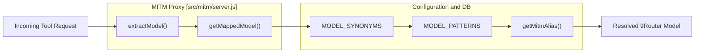

<!-- source: DeepWiki mcp.deepwiki.com · repo decolua/9router · page 8.7 MITM Proxy Control · fetched 2026-10-30 -->

# MITM Proxy Control

<details>
<summary>Relevant source files</summary>

The following files were used as context for generating this wiki page:

- [src/app/(dashboard)/dashboard/cli-tools/components/MitmServerCard.js](src/app/(dashboard)/dashboard/cli-tools/components/MitmServerCard.js)
- [src/app/(dashboard)/dashboard/cli-tools/components/MitmToolCard.js](src/app/(dashboard)/dashboard/cli-tools/components/MitmToolCard.js)
- [src/app/(dashboard)/dashboard/mitm/MitmPageClient.js](src/app/(dashboard)/dashboard/mitm/MitmPageClient.js)
- [src/app/api/cli-tools/antigravity-mitm/route.js](src/app/api/cli-tools/antigravity-mitm/route.js)
- [src/mitm/cert/install.js](src/mitm/cert/install.js)
- [src/mitm/dns/dnsConfig.js](src/mitm/dns/dnsConfig.js)
- [src/mitm/manager.js](src/mitm/manager.js)
- [src/mitm/server.js](src/mitm/server.js)

</details>


This page documents the web dashboard interface and management logic for the MITM (Man-in-the-Middle) proxy system. The interface provides centralized control for the proxy server lifecycle, SSL certificate trust management, and per-tool DNS redirection.

---

## Component Architecture

The MITM control system is built as a set of React components that interact with Next.js API routes, which in turn orchestrate the low-level Node.js process and system configuration logic.

**Component Hierarchy & Data Flow**

Title: "MITM UI to Logic Mapping"
```mermaid
graph TB
    subgraph "Frontend [React Space]"
        MitmServerCard["MitmServerCard.js"]
        MitmToolCard["MitmToolCard.js"]
        MitmPageClient["MitmPageClient.js"]
    end

    subgraph "API Layer [Route Space]"
        RouteJs["route.js"]
        AliasRouteJs["alias/route.js"]
    end

    subgraph "System Logic [Code Entity Space]"
        ManagerJs["manager.js"]
        DnsConfigJs["dnsConfig.js"]
        InstallJs["install.js"]
    end

    MitmPageClient --> MitmServerCard
    MitmPageClient --> MitmToolCard
    
    MitmServerCard -->| "POST / DELETE / PATCH" | RouteJs
    MitmToolCard -->| "PATCH [DNS toggle]" | RouteJs
    MitmToolCard -->| "PUT / GET [Aliases]" | AliasRouteJs

    RouteJs --> ManagerJs
    ManagerJs --> DnsConfigJs
    ManagerJs --> InstallJs
```

Sources: [src/app/(dashboard)/dashboard/cli-tools/components/MitmServerCard.js:12-21](), [src/app/(dashboard)/dashboard/cli-tools/components/MitmToolCard.js:14-29](), [src/app/(dashboard)/dashboard/mitm/MitmPageClient.js:87-114](), [src/app/api/cli-tools/antigravity-mitm/route.js:2-15]()

---

## MITM Server Management

The `MitmServerCard` component acts as the primary control for the global proxy infrastructure. It handles the server process lifecycle and the installation of the Root CA [src/app/(dashboard)/dashboard/cli-tools/components/MitmServerCard.js:9-12]().

### Server Lifecycle Control
The server can be started via a `POST` request to the MITM route [src/app/api/cli-tools/antigravity-mitm/route.js:94-139](). On startup, the system ensures a self-contained version of the server script is copied to the `DATA_DIR` via `ensureRuntimeServer` to prevent file locking during package updates [src/mitm/manager.js:67-94]().

| Action | Logic Entity | Description |
| :--- | :--- | :--- |
| **Start** | `startServer` | Spawns the MITM process on port 443 (or 8443 on Windows) [src/mitm/manager.js:41-42](). |
| **Stop** | `stopServer` | Disables all active DNS entries and kills the process using the PID file [src/mitm/manager.js:141-152](). |
| **Trust Cert** | `trustCert` | Installs the Root CA into the OS-specific system trust store [src/mitm/cert/install.js:86-104](). |

### Port Conflict Handling
If port 443 is occupied, `MitmServerCard` identifies the owning process using `getProcessUsingPort443` [src/mitm/manager.js:100-121](). The UI offers a "Kill and Start" option which triggers `doAction` with `forceKillPort443` set to true [src/app/(dashboard)/dashboard/cli-tools/components/MitmServerCard.js:99-103](), [src/app/(dashboard)/dashboard/cli-tools/components/MitmServerCard.js:119-122]().

Sources: [src/app/api/cli-tools/antigravity-mitm/route.js:94-139](), [src/mitm/manager.js:40-42](), [src/app/(dashboard)/dashboard/cli-tools/components/MitmServerCard.js:65-117](), [src/mitm/manager.js:100-121]()

---

## Certificate Trust Management

The proxy requires a Root CA to be trusted by the host OS to intercept HTTPS traffic. The `install` module handles the complexities of different operating systems [src/mitm/cert/install.js:1-104]().

### OS-Specific Installation
The dashboard tracks certificate trust status by checking the system store for the 9Router Root CA fingerprint via `checkCertInstalled` [src/mitm/cert/install.js:42-46]().

*   **Windows:** Uses `certutil -addstore Root` via an elevated PowerShell script `runElevatedPowerShell` [src/mitm/cert/install.js:119-133]().
*   **macOS:** Uses `security add-trusted-cert` targeting the System keychain [src/mitm/cert/install.js:106-117]().
*   **Linux:** Detects the distribution and copies the certificate to the appropriate anchors directory before running `update-ca-certificates` or `update-ca-trust` [src/mitm/cert/install.js:10-29]().

Sources: [src/mitm/cert/install.js:42-133](), [src/app/api/cli-tools/antigravity-mitm/route.js:70-86]()

---

## Per-Tool DNS Configuration

The `MitmToolCard` component allows users to enable or disable interception for specific tools by modifying the system `hosts` file via `addDNSEntry` and `removeDNSEntry` [src/app/(dashboard)/dashboard/cli-tools/components/MitmToolCard.js:14-29](), [src/mitm/dns/dnsConfig.js:146-215]().

### DNS Redirection Logic
When a tool is enabled, the entries defined in `TOOL_HOSTS` are pointed to `127.0.0.1` [src/mitm/dns/dnsConfig.js:6](), [src/mitm/dns/dnsConfig.js:146-154]().

| Tool ID | Target Domains |
| :--- | :--- |
| `antigravity` | `daily-cloudcode-pa.googleapis.com`, `cloudcode-pa.googleapis.com` [src/mitm/server.js:26-27]() |
| `copilot` | `api.githubcopilot.com` [src/shared/constants/mitmToolHosts.js:10]() |
| `kiro` | `runtime.us-east-1.kiro.dev` [src/shared/constants/mitmToolHosts.js:11]() |

Sources: [src/mitm/dns/dnsConfig.js:6-7](), [src/mitm/dns/dnsConfig.js:146-180](), [src/mitm/server.js:26-27]()

### Atomic Hosts Modification
To prevent corruption, the system uses `atomicWriteHostsWin` on Windows [src/mitm/dns/dnsConfig.js:14-32](). On Unix-like systems, it uses `tee` with `sudo` to overwrite the file [src/mitm/dns/dnsConfig.js:171-172](). After modification, the DNS cache is flushed using `flushDNS` [src/mitm/dns/dnsConfig.js:104-111]().

Sources: [src/mitm/dns/dnsConfig.js:14-32](), [src/mitm/dns/dnsConfig.js:171-172](), [src/mitm/dns/dnsConfig.js:104-111]()

---

## Model Mapping and Aliases

The MITM proxy intercepts requests and maps the tool's requested model to a 9Router model via configured aliases [src/mitm/server.js:99-118]().

**Model Resolution Flow**

Title: "Model Translation Logic"


1.  **Extraction:** The proxy extracts the model ID from the request using `extractModel` [src/mitm/server.js:10]().
2.  **Normalization:** The ID is normalized using `MODEL_SYNONYMS` and `MODEL_PATTERNS` to handle tool-specific variants [src/mitm/server.js:10]().
3.  **Alias Lookup:** The final target model is retrieved from the local database using `getMitmAlias` [src/mitm/server.js:13]().

Users manage these mappings in the `MitmToolCard` UI, which saves changes via `saveMappings` [src/app/(dashboard)/dashboard/cli-tools/components/MitmToolCard.js:14](), [src/app/(dashboard)/dashboard/cli-tools/components/MitmToolCard.js:57-65]().

Sources: [src/mitm/server.js:99-118](), [src/mitm/server.js:10](), [src/mitm/server.js:13](), [src/app/(dashboard)/dashboard/cli-tools/components/MitmToolCard.js:57-85]()

---

## Privilege and Security

MITM operations require administrative privileges. The system manages this through several layers:

1.  **Admin Check:** On Windows, it verifies administrative status via `net session`. On Unix, it checks `process.getuid()` [src/app/api/cli-tools/antigravity-mitm/route.js:48-58]().
2.  **Sudo Orchestration:** For macOS/Linux, the UI prompts for a sudo password which is passed to `execWithPassword` [src/mitm/dns/dnsConfig.js:69-91]().
3.  **Password Encryption:** Sudo passwords can be persisted securely using `encryptPassword` (AES-256-GCM), with keys derived from the machine ID [src/mitm/manager.js:154-184]().

Sources: [src/app/api/cli-tools/antigravity-mitm/route.js:60-65](), [src/mitm/manager.js:154-184](), [src/mitm/dns/dnsConfig.js:69-91]()

---

