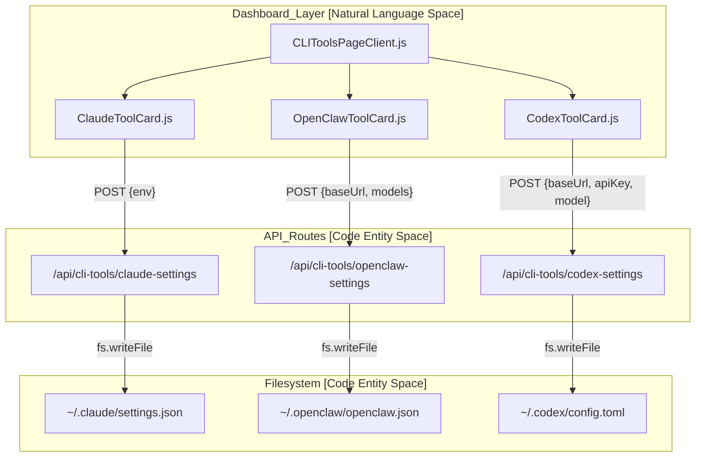
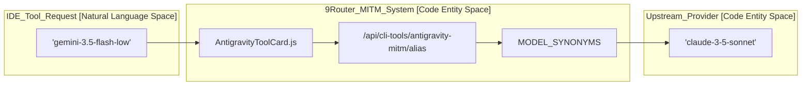

<!-- source: DeepWiki mcp.deepwiki.com · repo decolua/9router · page 8.9 CLI Tools Configuration · fetched 2026-10-30 -->

# CLI Tools Configuration

Relevant source files

The following files were used as context for generating this wiki page:

- [cli/src/cli/api/client.js](cli/src/cli/api/client.js)
- [cli/src/cli/menus/cliTools.js](cli/src/cli/menus/cliTools.js)
- [src/app/(dashboard)/dashboard/cli-tools/CLIToolsPageClient.js](src/app/(dashboard)/dashboard/cli-tools/CLIToolsPageClient.js)
- [src/app/(dashboard)/dashboard/cli-tools/[toolId]/ToolDetailClient.js](src/app/(dashboard)/dashboard/cli-tools/[toolId]/ToolDetailClient.js)
- [src/app/(dashboard)/dashboard/cli-tools/components/AntigravityToolCard.js](src/app/(dashboard)/dashboard/cli-tools/components/AntigravityToolCard.js)
- [src/app/(dashboard)/dashboard/cli-tools/components/BaseUrlSelect.js](src/app/(dashboard)/dashboard/cli-tools/components/BaseUrlSelect.js)
- [src/app/(dashboard)/dashboard/cli-tools/components/ClaudeToolCard.js](src/app/(dashboard)/dashboard/cli-tools/components/ClaudeToolCard.js)
- [src/app/(dashboard)/dashboard/cli-tools/components/CodexToolCard.js](src/app/(dashboard)/dashboard/cli-tools/components/CodexToolCard.js)
- [src/app/(dashboard)/dashboard/cli-tools/components/CopilotToolCard.js](src/app/(dashboard)/dashboard/cli-tools/components/CopilotToolCard.js)
- [src/app/(dashboard)/dashboard/cli-tools/components/DroidToolCard.js](src/app/(dashboard)/dashboard/cli-tools/components/DroidToolCard.js)
- [src/app/(dashboard)/dashboard/cli-tools/components/GrokBuildToolCard.js](src/app/(dashboard)/dashboard/cli-tools/components/GrokBuildToolCard.js)
- [src/app/(dashboard)/dashboard/cli-tools/components/HermesToolCard.js](src/app/(dashboard)/dashboard/cli-tools/components/HermesToolCard.js)
- [src/app/(dashboard)/dashboard/cli-tools/components/OpenClawToolCard.js](src/app/(dashboard)/dashboard/cli-tools/components/OpenClawToolCard.js)
- [src/app/(dashboard)/dashboard/cli-tools/components/OpenCodeToolCard.js](src/app/(dashboard)/dashboard/cli-tools/components/OpenCodeToolCard.js)
- [src/app/(dashboard)/dashboard/cli-tools/components/ToolSummaryCard.js](src/app/(dashboard)/dashboard/cli-tools/components/ToolSummaryCard.js)
- [src/app/(dashboard)/dashboard/cli-tools/components/codexConfig.js](src/app/(dashboard)/dashboard/cli-tools/components/codexConfig.js)
- [src/app/(dashboard)/dashboard/cli-tools/components/index.js](src/app/(dashboard)/dashboard/cli-tools/components/index.js)
- [src/app/api/cli-tools/all-statuses/route.js](src/app/api/cli-tools/all-statuses/route.js)
- [src/app/api/cli-tools/claude-settings/route.js](src/app/api/cli-tools/claude-settings/route.js)
- [src/app/api/cli-tools/cline-settings/route.js](src/app/api/cli-tools/cline-settings/route.js)
- [src/app/api/cli-tools/codewhale-settings/route.js](src/app/api/cli-tools/codewhale-settings/route.js)
- [src/app/api/cli-tools/codex-profiles/route.js](src/app/api/cli-tools/codex-profiles/route.js)
- [src/app/api/cli-tools/codex-settings/route.js](src/app/api/cli-tools/codex-settings/route.js)
- [src/app/api/cli-tools/copilot-settings/route.js](src/app/api/cli-tools/copilot-settings/route.js)
- [src/app/api/cli-tools/crush-settings/route.js](src/app/api/cli-tools/crush-settings/route.js)
- [src/app/api/cli-tools/deepseek-tui-settings/route.js](src/app/api/cli-tools/deepseek-tui-settings/route.js)
- [src/app/api/cli-tools/droid-settings/route.js](src/app/api/cli-tools/droid-settings/route.js)
- [src/app/api/cli-tools/forge-settings/route.js](src/app/api/cli-tools/forge-settings/route.js)
- [src/app/api/cli-tools/grok-build-settings/route.js](src/app/api/cli-tools/grok-build-settings/route.js)
- [src/app/api/cli-tools/hermes-profiles/route.js](src/app/api/cli-tools/hermes-profiles/route.js)
- [src/app/api/cli-tools/hermes-settings/hermesProfiles.js](src/app/api/cli-tools/hermes-settings/hermesProfiles.js)
- [src/app/api/cli-tools/hermes-settings/hermesYaml.js](src/app/api/cli-tools/hermes-settings/hermesYaml.js)
- [src/app/api/cli-tools/hermes-settings/route.js](src/app/api/cli-tools/hermes-settings/route.js)
- [src/app/api/cli-tools/kilo-settings/route.js](src/app/api/cli-tools/kilo-settings/route.js)
- [src/app/api/cli-tools/omp-settings/route.js](src/app/api/cli-tools/omp-settings/route.js)
- [src/app/api/cli-tools/openclaw-settings/route.js](src/app/api/cli-tools/openclaw-settings/route.js)
- [src/app/api/cli-tools/opencode-settings/route.js](src/app/api/cli-tools/opencode-settings/route.js)
- [src/app/api/cli-tools/pi-settings/route.js](src/app/api/cli-tools/pi-settings/route.js)
- [src/app/api/cli-tools/resolveApiKey.js](src/app/api/cli-tools/resolveApiKey.js)
- [src/app/api/cli-tools/smelt-settings/route.js](src/app/api/cli-tools/smelt-settings/route.js)
- [tests/unit/codex-current-provider-base-url.test.js](tests/unit/codex-current-provider-base-url.test.js)
- [tests/unit/codex-profiles.test.js](tests/unit/codex-profiles.test.js)
- [tests/unit/codex-settings-refresh.test.js](tests/unit/codex-settings-refresh.test.js)
- [tests/unit/hermes-profiles.test.js](tests/unit/hermes-profiles.test.js)
- [tests/unit/hermes-yaml.test.js](tests/unit/hermes-yaml.test.js)

The CLI Tools configuration subsystem serves as a centralized management hub within the 9Router web dashboard (`src/app/(dashboard)/dashboard/cli-tools/CLIToolsPageClient.js`) [src/app/(dashboard)/dashboard/cli-tools/CLIToolsPageClient.js:11-28](). It automates the process of configuring AI-powered command-line interfaces, terminal apps, and IDE extensions to point to 9Router's endpoints, managing per-tool config cards, endpoint presets, API key selection, and settings-writing API routes.

For details on the Cowork tool card, `cowork-settings` route, MCP plugin marketplace, and `stdio↔SSE` bridge, see [Cowork & MCP Bridge](#8.9.1).

---

## 1. Overview and Tool Categories

The dashboard organizes supported tools into two primary categories:
1. **Environment & Configuration File Tools**: Tools like Claude Code, Codex, OpenClaw, OpenCode, Hermes, and Droid that consume custom base URLs, API keys, and model mappings via configuration files or environment variables.
2. **MITM Proxy Tools**: Tools with hardcoded endpoints (such as Google Antigravity and GitHub Copilot) that require intercepting local traffic via the MITM proxy subsystem.

The client component `CLIToolsPageClient` fetches active tool statuses from `/api/cli-tools/all-statuses` and renders summary cards and detailed control interfaces [src/app/(dashboard)/dashboard/cli-tools/CLIToolsPageClient.js:13-26]().

### Data Flow: Dashboard to Tool Config
The following diagram illustrates how dashboard interactions flow through API routes to update local configuration files on disk.

**CLI Configuration Data Flow**

Sources: [src/app/(dashboard)/dashboard/cli-tools/CLIToolsPageClient.js:11-28](), [src/app/api/cli-tools/claude-settings/route.js:124-184](), [src/app/api/cli-tools/openclaw-settings/route.js:140-164](), [src/app/api/cli-tools/codex-settings/route.js:110-153]()

---

## 2. Per-Tool Configuration Cards and Settings-Writing API Routes

Each CLI tool has a dedicated React component card and a corresponding API route responsible for reading and writing tool-specific configuration formats (JSON, TOML, YAML, or environment files).

### Claude Code (`ClaudeToolCard`)
* **UI Component**: `ClaudeToolCard` manages environment variables like `ANTHROPIC_BASE_URL` and model mappings [src/app/(dashboard)/dashboard/cli-tools/components/ClaudeToolCard.js:29-80](). It includes controls for context window presets (`CLAUDE_CODE_AUTO_COMPACT_WINDOW`) [src/app/(dashboard)/dashboard/cli-tools/components/ClaudeToolCard.js:14-23]() and the 1M token context marker helper (`withContextMarker`) [src/app/(dashboard)/dashboard/cli-tools/components/ClaudeToolCard.js:67-70]().
* **API Route**: `/api/cli-tools/claude-settings` reads and writes `~/.claude/settings.json` and updates `~/.claude.json` for MCP plugins [src/app/api/cli-tools/claude-settings/route.js:21-53]().

### Codex (`CodexToolCard`)
* **UI Component**: `CodexToolCard` manages TOML-based configurations, allowing users to select default models, subagent models, and profile aliases [src/app/(dashboard)/dashboard/cli-tools/components/CodexToolCard.js:13-34]().
* **API Route**: `/api/cli-tools/codex-settings` parses and updates `~/.codex/config.toml` using `confbox` while handling separate authentication storage in `auth.json` [src/app/api/cli-tools/codex-settings/route.js:7-152]().

### OpenClaw and OpenCode (`OpenClawToolCard`, `OpenCodeToolCard`)
* **OpenClaw**: Supports multi-agent model assignment via `/api/cli-tools/openclaw-settings` [src/app/api/cli-tools/openclaw-settings/route.js:140-149]().
* **OpenCode**: Manages provider configurations and sub-agent explorer roles through `/api/cli-tools/opencode-settings` [src/app/(dashboard)/dashboard/cli-tools/components/OpenCodeToolCard.js:76-92]().

### Hermes & Droid (`HermesToolCard`, `DroidToolCard`)
* **Hermes**: Utilizes `hermesYaml.js` and `hermesProfiles.js` to manage multi-profile `config.yaml` and `.env` files via `/api/cli-tools/hermes-settings` [src/app/api/cli-tools/hermes-settings/route.js:30-88]().
* **Droid**: Supports multi-model array registration under custom model entries in Droid's configuration [src/app/(dashboard)/dashboard/cli-tools/components/DroidToolCard.js:83-100]().

Sources: [src/app/(dashboard)/dashboard/cli-tools/components/ClaudeToolCard.js:29-80](), [src/app/api/cli-tools/claude-settings/route.js:21-53](), [src/app/(dashboard)/dashboard/cli-tools/components/CodexToolCard.js:13-34](), [src/app/api/cli-tools/codex-settings/route.js:7-152](), [src/app/api/cli-tools/hermes-settings/route.js:30-88]()

---

## 3. Endpoint Presets and API Key Selection

To streamline configuration across local, tunnel, and cloud environments, tool cards share unified selection components:
* **BaseUrlSelect & EndpointPresetControl**: Allows users to pick between local loops (e.g., `http://127.0.0.1:20128/v1`), active Cloudflare Tunnels (`tunnelPublicUrl`), Tailscale URLs (`tailscaleUrl`), or cloud deployments [src/app/(dashboard)/dashboard/cli-tools/components/BaseUrlSelect.js](). The `rememberEndpoint` utility caches user selections [src/app/(dashboard)/dashboard/cli-tools/components/ClaudeToolCard.js:7]().
* **ApiKeySelect**: Provides a dropdown to select among configured 9Router API keys, automatically injecting the chosen key into the tool's settings payload [src/app/(dashboard)/dashboard/cli-tools/components/ApiKeySelect.js]().
* **Endpoint Matching**: The `matchKnownEndpoint` function evaluates whether a tool's currently written base URL matches known local or remote active endpoints, displaying status indicators (Connected, Other endpoint, Not configured) [src/app/(dashboard)/dashboard/cli-tools/components/ClaudeToolCard.js:84-90]().

Sources: [src/app/(dashboard)/dashboard/cli-tools/components/BaseUrlSelect.js](), [src/app/(dashboard)/dashboard/cli-tools/components/ApiKeySelect.js](), [src/app/(dashboard)/dashboard/cli-tools/components/ClaudeToolCard.js:84-90]()

---

## 4. MITM Tool Integration

For tools with hardcoded upstream endpoints (such as Google Antigravity and GitHub Copilot), the dashboard provides control cards to manage the MITM proxy lifecycle and model mappings.

### MITM Model Mapping
Because intercepted tools often pass internal or proprietary model IDs, 9Router maps them to canonical aliases through backend translation handlers and UI configuration tables [src/app/(dashboard)/dashboard/cli-tools/components/AntigravityToolCard.js:47-61]().

**MITM Model Alias Mapping**

Sources: [src/app/(dashboard)/dashboard/cli-tools/components/AntigravityToolCard.js:47-61](), [src/shared/constants/cliTools.js]()

---

## 5. Cowork & MCP Bridge

Cowork tools integrate via specialized cards and MCP marketplace registries. For complete implementation details, see [Cowork & MCP Bridge](#8.9.1).

Sources: [src/app/(dashboard)/dashboard/cli-tools/components/CoworkToolCard.js]()

---

