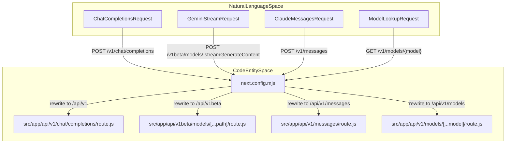
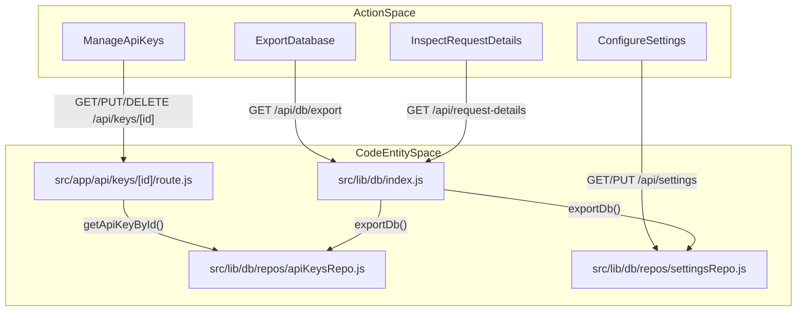

<!-- source: DeepWiki mcp.deepwiki.com · repo decolua/9router · page 9 API Reference · fetched 2026-10-30 -->

# API Reference

Relevant source files

The following files were used as context for generating this wiki page:

- [CHANGELOG.md](CHANGELOG.md)
- [cli/package.json](cli/package.json)
- [cli/scripts/build-cli.js](cli/scripts/build-cli.js)
- [cli/scripts/buildMitm.js](cli/scripts/buildMitm.js)
- [cli/src/cli/terminalUI.js](cli/src/cli/terminalUI.js)
- [cli/src/cli/utils/input.js](cli/src/cli/utils/input.js)
- [next.config.mjs](next.config.mjs)
- [package.json](package.json)
- [tests/unit/cli-build-artifacts.test.js](tests/unit/cli-build-artifacts.test.js)
- [tests/unit/open-package-external.test.js](tests/unit/open-package-external.test.js)

This document provides a high-level overview of 9Router's REST API surface. The gateway exposes two primary API tiers: **Inference Endpoints** (`/v1/*`, `/v1beta/*`, `/codex/*`) offering drop-in compatibility for OpenAI, Anthropic, Gemini, and Codex clients [next.config.mjs:63-102](), and **Management & Administration Endpoints** (`/api/*`) powering the web dashboard and administrative operations.

As a parent page, this section introduces the high-level routing architecture and categorizes the API groups. For comprehensive technical details, request schemas, and parameter references, consult the dedicated child pages below:
- **Chat Completions & Messages**: For `/v1/chat/completions`, `/v1/messages`, `/v1/responses`, `/codex/*`, and Gemini native streaming, see [Chat Completions & Messages Endpoints](#9.1).
- **Embeddings & Media**: For vectors, image generation, audio speech, transcriptions, video generation, and web search/fetch, see [Embeddings & Media Endpoints](#9.2).
- **Provider Management**: For connection CRUD, provider-nodes, validation, and batch tests, see [Provider Management API](#9.3).
- **Usage & Analytics**: For usage metrics, quota routes, real-time SSE streams, and charts, see [Usage & Analytics API](#9.4).
- **Settings, Auth & Database**: For global configuration, auth routes, tunnels, locale, and database export/import, see [Settings, Auth & Database API](#9.5).
- **Models & Pricing**: For model listing, aliases, custom models, catalog sync, and pricing config, see [Models & Pricing API](#9.6).
- **OAuth Integration**: For `/api/oauth` flows, provider-specific services, and auto-import routes, see [OAuth Endpoints](#9.7).

## API Architecture & Request Flow

9Router acts as a protocol-aware HTTP proxy. Ingress requests hit Next.js API route handlers defined under `src/app/api/*` and mapped via Next.js rewrites, where they are normalized, authenticated, resolved against model aliases or combos, and handed off to the core execution engine [next.config.mjs:63-102]().

### Natural Language to Code Entity Mapping: Inference API

The following diagram maps external API intents (natural language space) to the concrete route handlers and core execution modules in the codebase.

Title: InferenceRoutingEntityMap

Sources: [next.config.mjs:63-102](), [cli/scripts/build-cli.js:133-149]()

## Inference Endpoints Overview

Inference routes emulate standard provider APIs so developer tools and agent frameworks (such as Claude Code, Codex CLI, and Cline) can interact with 9Router without modification [next.config.mjs:63-102]().

| Route Pattern | Target Protocol | Core Handler / Module | Description |
|---------------|-----------------|----------------------|-------------|
| `/v1/chat/completions` | OpenAI | `src/app/api/v1/chat/completions` | Primary chat completion and streaming endpoint. |
| `/v1/messages` | Anthropic | `src/app/api/v1/messages` | Claude Messages API compatibility layer. |
| `/v1beta/models/*` | Gemini | `src/app/api/v1beta/[...path]` | Native Gemini API endpoints, tool use, and streaming SSE [next.config.mjs:86-92](). |
| `/v1/models/{kind}` | OpenAI | `src/app/api/v1/models/[...model]` | Capability-filtered model listing (`image`, `tts`, `embedding`, etc.). |

For implementation details, see [Chat Completions & Messages Endpoints](#9.1) and [Embeddings & Media Endpoints](#9.2).

Sources: [next.config.mjs:63-102](), [cli/scripts/build-cli.js:133-149]()

## Management Endpoints Overview

Administrative APIs allow the web dashboard and programmatic scripts to control provider rotation, api keys, usage monitoring, and system configuration.

### Natural Language to Code Entity Mapping: Management API

The diagram below connects administrative dashboard actions to their backing repository functions and persistence drivers.

Title: ManagementRoutingEntityMap

Sources: [package.json:1-68](), [cli/package.json:1-51]()

Management features are organized across the following functional domains:
- **Provider & Connection CRUD**: Manage credentials, priority ordering, and validation checks. For details, see [Provider Management API](#9.3).
- **API Keys & Access Control**: Generate keys with machine IDs and per-key combo/model restrictions. For details, see [Provider Management API](#9.3).
- **Usage & Observability**: Query aggregated metrics and raw request logs. For details, see [Usage & Analytics API](#9.4).
- **Settings & Database**: Configure system parameters and execute database migrations. For details, see [Settings, Auth & Database API](#9.5).
- **Models & Pricing**: Maintain custom model definitions, pricing overrides, and alias mappings. For details, see [Models & Pricing API](#9.6).
- **OAuth Workflows**: Handle token exchanges, auto-imports, and callback services. For details, see [OAuth Endpoints](#9.7).

Sources: [package.json:1-68](), [cli/package.json:1-51]()

---

