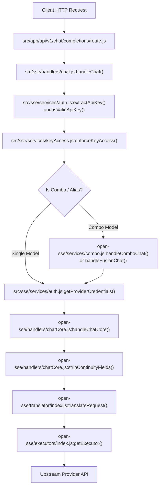
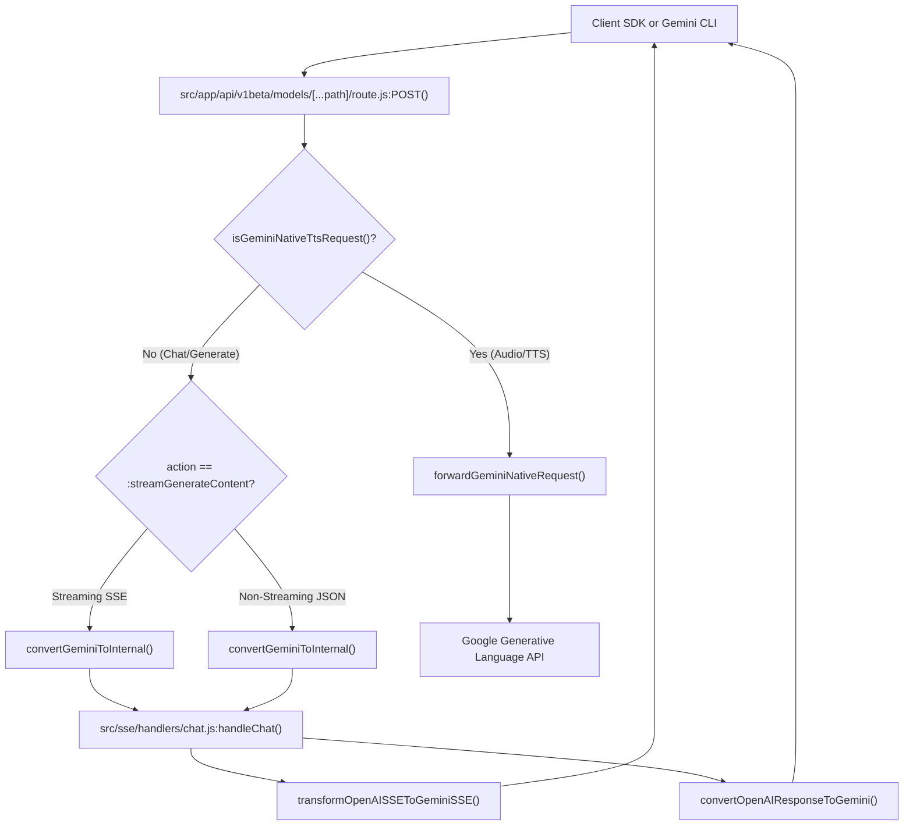

<!-- source: DeepWiki mcp.deepwiki.com · repo decolua/9router · page 9.1 Chat Completions & Messages Endpoints · fetched 2026-10-30 -->

# Chat Completions & Messages Endpoints

Relevant source files

The following files were used as context for generating this wiki page:

- [images/fusion-combo-ui.png](images/fusion-combo-ui.png)
- [open-sse/handlers/chatCore.js](open-sse/handlers/chatCore.js)
- [open-sse/services/combo.js](open-sse/services/combo.js)
- [open-sse/services/provider.js](open-sse/services/provider.js)
- [open-sse/shared/clineAuth.js](open-sse/shared/clineAuth.js)
- [open-sse/shared/machineId.js](open-sse/shared/machineId.js)
- [open-sse/translator/concerns/modality.js](open-sse/translator/concerns/modality.js)
- [open-sse/translator/formats.js](open-sse/translator/formats.js)
- [open-sse/translator/request/claude-to-openai.js](open-sse/translator/request/claude-to-openai.js)
- [open-sse/translator/request/gemini-to-openai.js](open-sse/translator/request/gemini-to-openai.js)
- [open-sse/translator/request/openai-responses.js](open-sse/translator/request/openai-responses.js)
- [src/shared/utils/clineAuth.js](src/shared/utils/clineAuth.js)
- [src/sse/handlers/chat.js](src/sse/handlers/chat.js)
- [src/sse/services/auth.js](src/sse/services/auth.js)
- [tests/translator/bugs-codexCli-responses.test.js](tests/translator/bugs-codexCli-responses.test.js)
- [tests/unit/claude-cache-budget-single-object.test.js](tests/unit/claude-cache-budget-single-object.test.js)
- [tests/unit/cline-auth.test.js](tests/unit/cline-auth.test.js)
- [tests/unit/combo-fusion.test.js](tests/unit/combo-fusion.test.js)
- [tests/unit/fetch-success-clears-account.test.js](tests/unit/fetch-success-clears-account.test.js)
- [tests/unit/hermes-vision-detection.test.js](tests/unit/hermes-vision-detection.test.js)

The Chat Completions endpoint (`/v1/chat/completions`) and its companion compatibility endpoints (`/v1/messages`, `/v1/responses`, `/codex/*`, and `/v1beta/*`) form the primary API gateway for AI model interactions in 9Router [docs/ARCHITECTURE.md:103-109](). These endpoints accept requests in multiple client formats, automatically translate them to target provider formats, manage credential selection and background token refresh, execute robust account fallback with rate-limit tracking, and stream responses back via Server-Sent Events (SSE) or standard JSON [docs/ARCHITECTURE.md:8-15]().

This page provides full technical documentation of the ingress handlers, format adapters, routing logic, streaming processors, and persistence integrations supporting these endpoints.

Related pages: Embeddings Endpoint (9.2), Provider Management API (9.3), Chat Request Flow (4.1), Format Translation (3.4), Account Fallback & Rate Limiting (3.5).

---

## 1. Endpoint Architecture & URL Routing

Incoming client requests arrive at Next.js API route handlers under `src/app/api/v1/` and `src/app/api/v1beta/`, which act as compatibility gateways mapping standard third-party tool protocols onto 9Router's core routing engine [docs/ARCHITECTURE.md:97-109]().

### Supported Endpoint Patterns

| Endpoint Path | Source Protocol / Key Format | Key Implementation Handler |
|---|---|---|
| `POST /v1/chat/completions` | OpenAI Chat Completions | `handleChat()` in `src/sse/handlers/chat.js:35-161` [src/app/api/v1/chat/completions/route.js:1-34]() |
| `POST /v1/messages` | Anthropic Messages API | `handleChat()` in `src/sse/handlers/chat.js:35-161` [src/app/api/v1/messages/route.js:1-1]() |
| `POST /v1/responses` | GitHub Copilot / OpenAI Responses | `handleChat()` in `src/sse/handlers/chat.js:35-161` [src/app/api/v1/responses/route.js:1-1]() |
| `POST /v1/api/chat` | Ollama-compatible Chat API | `handleChat()` in `src/sse/handlers/chat.js:35-161` [src/app/api/v1/api/chat/route.js:24-36]() |
| `POST /v1beta/models/{model}:generateContent` | Gemini Native (Non-Streaming) | `POST()` in `src/app/api/v1beta/models/[...path]/route.js:54-125` [src/app/api/v1beta/models/[...path]/route.js:54-125]() |
| `POST /v1beta/models/{model}:streamGenerateContent` | Gemini Native (Streaming SSE) | `POST()` in `src/app/api/v1beta/models/[...path]/route.js:54-125` [src/app/api/v1beta/models/[...path]:54-125]() |
| `GET /v1beta/models` | Gemini Native Model Catalog | `GET()` in `src/app/api/v1beta/models/route.js:20-62` [src/app/api/v1beta/models/route.js:20-62]() |

Sources: [src/app/api/v1/chat/completions/route.js:1-34](), [src/app/api/v1/api/chat/route.js:24-36](), [src/app/api/v1beta/models/[...path]/route.js:54-125](), [src/app/api/v1beta/models/route.js:20-62](), [src/sse/handlers/chat.js:35-161]()

---

## 2. Ingress Request Flow & Code Entity Mapping

When a client sends a completion request, it passes through authentication, key access control, model and combo resolution, credential selection, and format translation before reaching the upstream provider executor [docs/ARCHITECTURE.md:165-203]().

### Diagram: Request Processing Pipeline (Natural Language to Code Entity Space)

Sources: [src/app/api/v1/chat/completions/route.js:1-34](), [src/sse/handlers/chat.js:35-153](), [src/sse/services/auth.js:1-114](), [src/sse/services/keyAccess.js:1-28](), [open-sse/handlers/chatCore.js:52-110](), [open-sse/executors/index.js:1-1]()

---

## 3. Authentication & Key Access Controls

API requests can be guarded globally by password settings or per-key permissions [src/sse/handlers/chat.js:71-83]().

- **API Key Extraction:** `extractApiKey(request)` parses the `Authorization: Bearer <token>` header or custom client headers [src/sse/services/auth.js:1-9]() [src/sse/handlers/chat.js:62-63]().
- **Global Gating:** If `settings.requireApiKey` is enabled, missing or invalid keys immediately abort the request with `401 Unauthorized` [src/sse/handlers/chat.js:71-83]().
- **Fine-Grained Key Access:** `getKeyAccessContext(request)` and `enforceKeyAccess()` verify whether a specific API key is permitted to call the requested model, alias, or combo [src/sse/handlers/chat.js:93-95]() [src/app/api/v1/models/[...model]/route.js:47-47]().

Sources: [src/sse/handlers/chat.js:62-95](), [src/app/api/v1/models/[...model]/route.js:47-47](), [src/sse/services/auth.js:1-9]()

---

## 4. Model Resolution & Combo Strategies

The incoming `model` parameter undergoes several resolution passes in `handleChat()` [src/sse/handlers/chat.js:56-148]().

1. **Context Marker Stripping:** Claude Code marks 1M-context requests with suffixes like `[1m]`; `stripModelContextMarker()` extracts this marker while preserving the underlying model ID [src/sse/handlers/chat.js:56-57]().
2. **Combo & Fusion Expansion:** If `getComboModels(modelStr)` matches a configured combo, 9Router applies capability adapters via `augmentModelsWithCapacityAdapter()` and dispatches to either `handleFusionChat()` (parallel panel generation synthesized by a judge model) or `handleComboChat()` (sequential account/model fallback with sticky rate limits) [src/sse/handlers/chat.js:104-147]() [open-sse/services/combo.js:1-149]().
3. **Single Model Resolution:** Non-combo models resolve to specific provider connections via `getProviderCredentials()` [src/sse/services/auth.js:28-79]().

Sources: [src/sse/handlers/chat.js:56-148](), [src/sse/services/model.js:1-12](), [open-sse/services/combo.js:1-149]()

---

## 5. Format Translation & Transport Routing

Once credentials and targets are locked, `handleChatCore()` takes over execution in `open-sse/handlers/chatCore.js` [open-sse/handlers/chatCore.js:63-110]().

- **Format Detection:** `detectFormat(body)` or `sourceFormatOverride` identifies whether the incoming wire format is OpenAI, Claude, or Responses API [open-sse/handlers/chatCore.js:76-76]() [open-sse/services/provider.js:34-111]().
- **Continuity Stripping:** `stripContinuityFields(body)` removes translator-internal staging fields (such as reasoning `encrypted_content`) from assistant message histories before sending payloads to upstream providers that reject unknown fields [open-sse/handlers/chatCore.js:52-61]().
- **Transport Resolution:** `resolveTransport(provider, sourceFormat)` maps the request to the correct upstream URL and protocol handler, preserving lossless transport when supported by the model definition [open-sse/handlers/chatCore.js:84-110]() [open-sse/services/provider.js:148-153]().

Sources: [open-sse/handlers/chatCore.js:1-110](), [open-sse/services/provider.js:34-153]()

---

## 6. Streaming, SSE Processing & Usage Extraction

Responses are handled by specialized streaming and non-streaming modules [open-sse/handlers/chatCore.js:20-21]().

- **Streaming SSE:** `handleStreamingResponse()` processes upstream SSE events, translating chunk formats on the fly [open-sse/handlers/chatCore.js:21-21]().
- **Usage Tracking:** Token consumption and cost metrics are extracted via unified usage utilities and persisted asynchronously via `usageDb.js` [open-sse/handlers/chatCore.js:15-15]().

Sources: [open-sse/handlers/chatCore.js:15-21]()

---

## 7. Gemini Native Endpoints (`/v1beta/models/*`)

The route `src/app/api/v1beta/models/[...path]/route.js` implements Gemini's native API spec, bridging Google's `@google/genai` SDK and Gemini CLI directly into 9Router's core [src/app/api/v1beta/models/[...path]/route.js:54-125]().

### Diagram: Gemini Native Routing Pipeline (Natural Language to Code Entity Space)

Sources: [src/app/api/v1beta/models/[...path]/route.js:54-125]()

---

## 8. Error Handling & Account Fallback

When upstream providers return errors (such as `429 Rate Limit` or `403 Forbidden`), 9Router executes structured error classification and fallback logic [open-sse/services/accountFallback.js:23-47]().

- **Error Rules:** `checkFallbackError(status, errorText, backoffLevel, provider)` evaluates error substrings and status codes against defined rules to determine backoff durations and whether to rotate to the next account [open-sse/services/accountFallback.js:23-47]().
- **Antigravity Quota Caching:** For Google Antigravity accounts, `handleAntigravityQuotaError()` caches exact upstream model reset timestamps and applies strike-based circuit breakers to prevent rate-limit retry storms [src/sse/services/antigravityQuota.js:1-156]() [tests/unit/antigravity-quota-routing.test.js:44-61]().
- **Model Locks:** Exhausted accounts receive per-model locks (`modelLock_${model}`) in local storage, skipping them during subsequent credential selections until their cool-down expires [src/sse/services/auth.js:86-134]() [open-sse/services/accountFallback.js:121-165]().

Sources: [open-sse/services/accountFallback.js:23-165](), [src/sse/services/auth.js:86-134](), [src/sse/services/antigravityQuota.js:1-156]()

---

