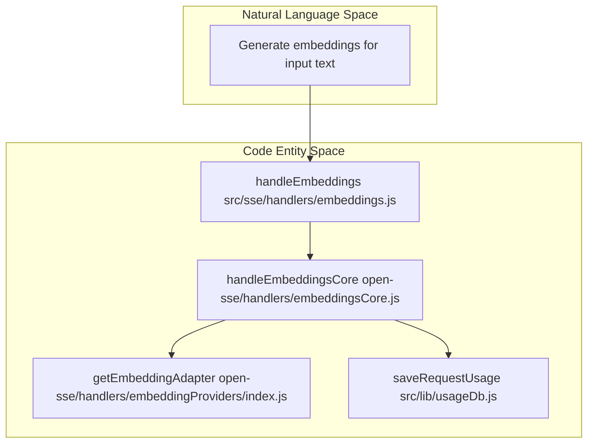
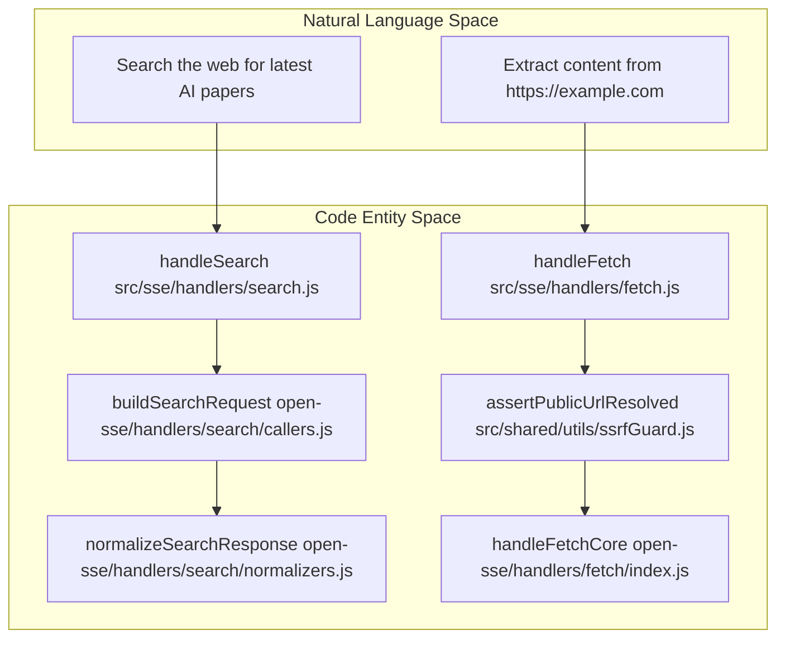

<!-- source: DeepWiki mcp.deepwiki.com · repo decolua/9router · page 9.2 Embeddings & Media Endpoints · fetched 2026-10-30 -->

# Embeddings & Media Endpoints

Relevant source files

The following files were used as context for generating this wiki page:

- [open-sse/handlers/embeddingProviders/selfhostedEmbedding.js](open-sse/handlers/embeddingProviders/selfhostedEmbedding.js)
- [open-sse/handlers/embeddingsCore.js](open-sse/handlers/embeddingsCore.js)
- [open-sse/handlers/fetch/index.js](open-sse/handlers/fetch/index.js)
- [open-sse/handlers/search/callers.js](open-sse/handlers/search/callers.js)
- [open-sse/handlers/search/index.js](open-sse/handlers/search/index.js)
- [open-sse/handlers/search/normalizers.js](open-sse/handlers/search/normalizers.js)
- [open-sse/handlers/sttCore.js](open-sse/handlers/sttCore.js)
- [open-sse/handlers/systemoneCore.js](open-sse/handlers/systemoneCore.js)
- [open-sse/handlers/ttsProviders/index.js](open-sse/handlers/ttsProviders/index.js)
- [open-sse/handlers/ttsProviders/selfhostedTts.js](open-sse/handlers/ttsProviders/selfhostedTts.js)
- [open-sse/providers/registry/cloudflare-ai.js](open-sse/providers/registry/cloudflare-ai.js)
- [open-sse/providers/registry/elevenlabs.js](open-sse/providers/registry/elevenlabs.js)
- [open-sse/providers/registry/iflow.js](open-sse/providers/registry/iflow.js)
- [open-sse/providers/registry/nanobanana.js](open-sse/providers/registry/nanobanana.js)
- [open-sse/providers/registry/ollama-search.js](open-sse/providers/registry/ollama-search.js)
- [open-sse/providers/registry/selfhosted-embedding.js](open-sse/providers/registry/selfhosted-embedding.js)
- [open-sse/providers/registry/selfhosted-stt.js](open-sse/providers/registry/selfhosted-stt.js)
- [open-sse/providers/registry/tinyfish.js](open-sse/providers/registry/tinyfish.js)
- [open-sse/providers/registry/v1m.js](open-sse/providers/registry/v1m.js)
- [public/providers/tinyfish.png](public/providers/tinyfish.png)
- [public/providers/v1m.png](public/providers/v1m.png)
- [skills/9router-stt/SKILL.md](skills/9router-stt/SKILL.md)
- [src/app/(dashboard)/dashboard/media-providers/[kind]/[id]/components/SttExampleCard.js](src/app/(dashboard)/dashboard/media-providers/[kind]/[id]/components/SttExampleCard.js)
- [src/app/api/keys/[id]/route.js](src/app/api/keys/[id]/route.js)
- [src/lib/db/index.js](src/lib/db/index.js)
- [src/lib/db/repos/apiKeysRepo.js](src/lib/db/repos/apiKeysRepo.js)
- [src/lib/db/schema.js](src/lib/db/schema.js)
- [src/shared/utils/providerIcon.js](src/shared/utils/providerIcon.js)
- [src/sse/handlers/embeddings.js](src/sse/handlers/embeddings.js)
- [src/sse/handlers/fetch.js](src/sse/handlers/fetch.js)
- [src/sse/handlers/search.js](src/sse/handlers/search.js)
- [src/sse/handlers/stt.js](src/sse/handlers/stt.js)
- [src/sse/handlers/tts.js](src/sse/handlers/tts.js)
- [src/sse/services/keyAccess.js](src/sse/services/keyAccess.js)
- [tests/unit/elevenlabs-stt.test.js](tests/unit/elevenlabs-stt.test.js)
- [tests/unit/embedding-usage-persistence.test.js](tests/unit/embedding-usage-persistence.test.js)
- [tests/unit/gemini-live-stt.test.js](tests/unit/gemini-live-stt.test.js)
- [tests/unit/provider-display-split.test.js](tests/unit/provider-display-split.test.js)
- [tests/unit/tinyfish-web-provider.test.js](tests/unit/tinyfish-web-provider.test.js)
- [tests/unit/v1m-systemone-provider.test.js](tests/unit/v1m-systemone-provider.test.js)

## Purpose & Scope
This page documents 9Router's non-chat endpoints (`/v1/embeddings`, image generation, audio speech and transcriptions, video generation, system-one/decision payloads, and web search/fetch). It details how incoming requests flow from Next.js HTTP handlers (`src/sse/handlers/`) through core execution logic (`open-sse/handlers/`), credential fallback loops, format normalization, and token usage persistence.

---

## 1. Embeddings Endpoint (`/v1/embeddings`)

The embeddings endpoint generates vector representations of text, implementing the OpenAI `/v1/embeddings` specification for RAG integrations.

### Implementation Details & Flow
- **Local Handler**: `handleEmbeddings` in `src/sse/handlers/embeddings.js` [src/sse/handlers/embeddings.js:33-170]() validates incoming JSON bodies, enforces `requireApiKey` checks, checks per-key access via `enforceKeyAccessResolved`, and manages the provider credential fallback loop.
- **Core Logic**: `handleEmbeddingsCore` in `open-sse/handlers/embeddingsCore.js` [open-sse/handlers/embeddingsCore.js:13-141]() handles request validation, adapter lookup via `getEmbeddingAdapter`, URL/header/body construction, and upstream `fetch` execution [open-sse/handlers/embeddingsCore.js:23-76]().
- **Token Refresh & Fallback**: Automatically retries with refreshed credentials on 401/403 errors [open-sse/handlers/embeddingsCore.js:78-110]() and marks accounts unavailable (`markAccountUnavailable`) to trigger multi-account fallback rotation [src/sse/handlers/embeddings.js:102-169]().

### Exact Usage Tracking
Token consumption for embeddings is verified using `exactEmbeddingUsage` [src/sse/handlers/embeddings.js:18-25]() to ensure safe integer prompt tokens with zero completion tokens before saving metrics via `saveRequestUsage` [src/sse/handlers/embeddings.js:142-155](), as tested in `tests/unit/embedding-usage-persistence.test.js` [tests/unit/embedding-usage-persistence.test.js:41-91]().

### Embeddings Entity Flow

*Diagram: Embeddings Request Mapping* - Traces requests from the SSE handler to the core adapter and usage persistence layer.

Sources: [src/sse/handlers/embeddings.js:1-170](), [open-sse/handlers/embeddingsCore.js:1-141](), [tests/unit/embedding-usage-persistence.test.js:1-91]()

---

## 2. Image Generation (`/v1/images/generations`)

The image generation subsystem supports OpenAI (DALL-E), Google (Imagen), Minimax, local SD WebUI, and Cloudflare Workers AI models [open-sse/providers/registry/cloudflare-ai.js:44-54]().

### Supported Formats & Normalization
- **Adapters**: Provider-specific response schemas are normalized into OpenAI-compatible image objects (`b64_json` or `url` arrays) [open-sse/handlers/imageProviders/index.js:1-43]().
- **Polling & Async**: Complex backends handle task polling or inline multipart payload generation (e.g., SD WebUI `txt2img`, Gemini inline data) [tests/unit/image-generation.test.js:89-215]().

Sources: [open-sse/providers/registry/cloudflare-ai.js:1-63](), [open-sse/handlers/imageProviders/index.js:1-43](), [tests/unit/image-generation.test.js:1-220]()

---

## 3. Audio Endpoints (TTS & STT)

### Text-to-Speech (`/v1/audio/speech`)
- **Handler**: `handleTts` in `src/sse/handlers/tts.js` [src/sse/handlers/tts.js:22-71]() validates parameters, performs combo expansion [src/sse/handlers/tts.js:53-68](), and dispatches single-model synthesis via `handleSingleModelTts` [src/sse/handlers/tts.js:73-120]().
- **Core Dispatcher**: `handleTtsCore` in `open-sse/handlers/ttsProviders/index.js` routes requests to generic format handlers or provider-specific modules (`minimax.js`, `selfhostedTts.js`) [open-sse/handlers/ttsProviders/genericFormats.js:176-189]().

### Speech-to-Text (`/v1/audio/transcriptions`)
- **Handler**: `handleStt` in `src/sse/handlers/stt.js` [src/sse/handlers/stt.js:38-113]() processes multipart form data (`file`, `model`, `language`), resolves custom model transports (`resolveCustomModelTransport`) [src/sse/handlers/stt.js:26-36](), and delegates to `handleSttCore` [src/sse/handlers/sttCore.js:1-328]().
- **Providers**: Supports Deepgram (raw binary with `smart_format` and `punctuate`) [src/sse/handlers/sttCore.js:39-58](), AssemblyAI (upload-submit-poll with 120s timeout) [src/sse/handlers/sttCore.js:61-88](), Nvidia NIM, Gemini live/inline audio [src/sse/handlers/sttCore.js:102-125](), and ElevenLabs Scribe [src/sse/handlers/sttCore.js:127-155]().

Sources: [src/sse/handlers/tts.js:1-120](), [src/sse/handlers/stt.js:1-113](), [open-sse/handlers/sttCore.js:1-155]()

---

## 4. Video Generation (`/v1/videos/generations`)

9Router proxies video generation, editing, and extension jobs via asynchronous polling adapters.
- **Core**: `handleVideoProxyCore` in `open-sse/handlers/videoCore.js` forwards raw body bytes, supports token refresh retry on 401/403 responses [open-sse/handlers/videoCore.js:149-162](), and handles provider polling [open-sse/handlers/videoCore.js:15-60]().
- **Adapters**: OpenRouter [open-sse/handlers/videoProviders/openrouter.js]() and Vertex (`predictLongRunning` operations) [open-sse/handlers/videoProviders/vertex.js:1-110]().

Sources: [open-sse/handlers/videoCore.js:1-209](), [open-sse/handlers/videoProviders/vertex.js:1-152]()

---

## 5. System One & Decision Endpoints

Native decision payload execution is handled via specialized system-one runners (e.g. Cloudflare AI Jev/Clef models) [open-sse/providers/registry/cloudflare-ai.js:30-30]().
- **Core Handler**: `handleSystemoneCore` in `open-sse/handlers/systemoneCore.js` validates `state` and `questions` payload fields, injects upstream headers such as `x-opencode-session`, and passes through native decision JSON responses [open-sse/handlers/systemoneCore.js:14-112]().

Sources: [open-sse/handlers/systemoneCore.js:1-112](), [open-sse/providers/registry/cloudflare-ai.js:1-63]()

---

## 6. Web Search & Fetch Endpoints (`/v1/web/search`, `/v1/web/fetch`)

### Web Fetch (`/v1/web/fetch`)
- **Handler**: `handleFetch` in `src/sse/handlers/fetch.js` [src/sse/handlers/fetch.js:25-117]() validates targets and enforces SSRF safeguards via `assertPublicUrlResolved` [src/sse/handlers/fetch.js:83-90]().
- **Scoring & Scope**: Web fetch failures are isolated under the `webfetch` capability lock so that fetch errors do not invalidate upstream LLM provider accounts [src/sse/handlers/fetch.js:169-174]().

### Web Search (`/v1/web/search`)
- **Callers**: `buildSearchRequest` in `open-sse/handlers/search/callers.js` constructs HTTP requests for 10 distinct search providers (Serper, Brave, Perplexity, Exa, Tavily, Google PSE, Linkup, SearchApi, YouCom, TinyFish) with SSRF hardening via `resolveBaseUrl` [open-sse/handlers/search/callers.js:1-195]().
- **Normalizers**: `normalizeSearchResponse` maps raw upstream search results into a unified `SearchResult` schema [open-sse/handlers/search/normalizers.js:1-177]().

### Web Search & Fetch Entity Flow

*Diagram: Web Search & Fetch Data Flow* - Maps search query and URL extraction requests to their respective callers, SSRF guards, and normalizers.

Sources: [src/sse/handlers/fetch.js:1-238](), [open-sse/handlers/search/callers.js:1-195](), [open-sse/handlers/search/normalizers.js:1-177](), [src/shared/utils/ssrfGuard.js:1-162]()

---

