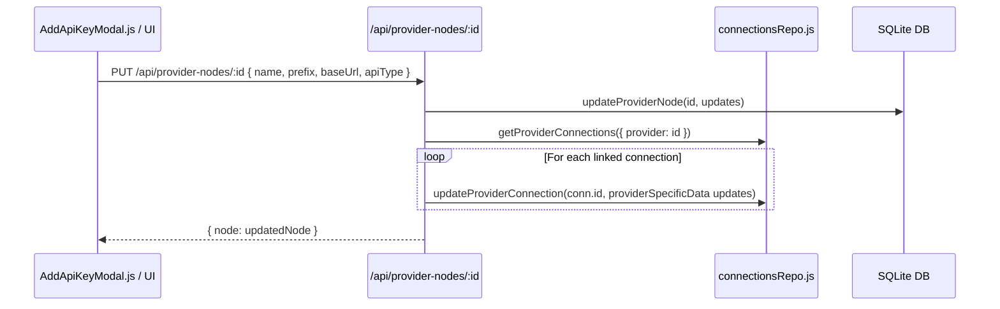

<!-- source: DeepWiki mcp.deepwiki.com · repo decolua/9router · page 9.3 Provider Management API · fetched 2026-10-30 -->

# Provider Management API

<details>
<summary>Relevant source files</summary>

The following files were used as context for generating this wiki page:

- [src/app/(dashboard)/dashboard/providers/[id]/AddApiKeyModal.js](src/app/(dashboard)/dashboard/providers/[id]/AddApiKeyModal.js)
- [src/app/(dashboard)/dashboard/providers/[id]/BulkImportCodexModal.js](src/app/(dashboard)/dashboard/providers/[id]/BulkImportCodexModal.js)
- [src/app/api/oauth/codex/bulk-import/route.js](src/app/api/oauth/codex/bulk-import/route.js)
- [src/app/api/provider-nodes/[id]/route.js](src/app/api/provider-nodes/[id]/route.js)
- [src/app/api/provider-nodes/route.js](src/app/api/provider-nodes/route.js)
- [src/app/api/provider-nodes/validate/route.js](src/app/api/provider-nodes/validate/route.js)
- [src/app/api/providers/route.js](src/app/api/providers/route.js)
- [src/lib/db/repos/connectionsRepo.js](src/lib/db/repos/connectionsRepo.js)
- [src/shared/components/EditConnectionModal.js](src/shared/components/EditConnectionModal.js)
- [src/sse/services/model.js](src/sse/services/model.js)
- [tests/unit/db-sqlite-vs-lowdb.test.js](tests/unit/db-sqlite-vs-lowdb.test.js)
- [tests/unit/model-routing.test.js](tests/unit/model-routing.test.js)
- [tests/unit/provider-validation.test.js](tests/unit/provider-validation.test.js)

</details>


This page documents the REST API endpoints and backend logic for managing AI provider connections, configuring provider nodes, validating credentials, running batch tests, and performing model discovery. These APIs power the provider management subsystem, supporting OAuth flows, API keys, web cookies, and custom OpenAI/Anthropic-compatible endpoints.

---

## Endpoints Overview

The Provider Management API comprises several distinct REST endpoint groups handling CRUD operations, credential verification, and custom node routing:

| Endpoint Group | Base Path | Key Methods | Purpose |
|---------------|-----------|-------------|---------|
| **Provider Connections** | `/api/providers` | `GET`, `POST` | Manage provider connection records and pools |
| **Connection Modification** | `/api/providers/:id` | `PUT`, `DELETE` | Update or remove individual connections |
| **Credential Validation** | `/api/providers/validate` | `POST` | Pre-flight validation of API keys and tokens |
| **Provider Nodes** | `/api/provider-nodes` | `GET`, `POST` | Configure custom OpenAI/Anthropic-compatible nodes |
| **Node Modification** | `/api/provider-nodes/:id` | `PUT`, `DELETE` | Update custom nodes and propagate changes to connections |
| **Node Validation** | `/api/provider-nodes/validate` | `POST` | Test custom node connectivity and base URLs |
| **Model Discovery** | `/api/providers/:id/models` | `GET` | Fetch dynamic model lists from upstream providers |
| **Connection Testing** | `/api/providers/:id/test` | `POST` | Trigger active health probes on a connection |
| **Bulk Import** | `/api/oauth/codex/bulk-import` | `POST` | Bulk import OAuth credential tokens (e.g. Codex) |

### System Architecture: Natural Language to Code Entity Space

This diagram maps user-facing provider management operations to their corresponding codebase implementations and data layers.

```mermaid
graph TB
    subgraph "NaturalLanguageSpace"
        UI_CRUD[""ProviderConnectionCRUD""]
        UI_Nodes[""CustomProviderNodes""]
        UI_Validate[""CredentialValidation""]
        UI_Bulk[""OAuthBulkImport""]
    end

    subgraph "CodeEntitySpace"
        RouteProviders[""src/app/api/providers/route.js""]
        RouteNodes[""src/app/api/provider-nodes/route.js""]
        RouteNodeId[""src/app/api/provider-nodes/[id]/route.js""]
        RouteValidate[""src/app/api/provider-nodes/validate/route.js""]
        RouteBulk[""src/app/api/oauth/codex/bulk-import/route.js""]
        RepoConn[""src/lib/db/repos/connectionsRepo.js""]
        ModelService[""src/sse/services/model.js""]
        DBDriver[""src/lib/db/driver.js""]
    end

    UI_CRUD --> RouteProviders
    UI_Nodes --> RouteNodes
    UI_Nodes --> RouteNodeId
    UI_Validate --> RouteValidate
    UI_Bulk --> RouteBulk

    RouteProviders --> RepoConn
    RouteNodeId --> RepoConn
    RouteNodes --> DBDriver
    RouteValidate --> ModelService
    RouteBulk --> RepoConn

    RepoConn --> DBDriver
```

Sources: [src/app/api/providers/route.js:1-12]() [src/app/api/provider-nodes/route.js:1-5]() [src/app/api/provider-nodes/[id]/route.js:1-4]() [src/app/api/oauth/codex/bulk-import/route.js:1-4]() [src/lib/db/repos/connectionsRepo.js:1-3]()

---

## Provider Connections API

### List All Connections

**Endpoint:** `GET /api/providers`

Retrieves all stored provider connections by invoking `getProviderConnections()` from the persistence layer [src/app/api/providers/route.js:52-53](). It builds a `nodeNameMap` from custom provider nodes to resolve user-friendly display names for compatible endpoints [src/app/api/providers/route.js:55-61](). Sensitive credentials (`apiKey`, `accessToken`, etc.) are stripped or masked via `toProviderConnectionResponse()` before returning [src/app/api/providers/route.js:70-74]().

### Create Connection

**Endpoint:** `POST /api/providers`

Creates a new API Key, Web Cookie, or compatible provider connection [src/app/api/providers/route.js:84-111]().

**Request Payload Processing:**
- **Proxy Configuration:** `normalizeProxyConfig()` validates connection-specific proxies and egress settings [src/app/api/providers/route.js:16-30]().
- **Proxy Pools:** `normalizeProxyPoolId()` verifies existence against `getProxyPoolById()` [src/app/api/providers/route.js:32-48]().
- **Compatible Node Binding:** If the provider type is OpenAI-compatible, Anthropic-compatible, or a custom embedding, the backend fetches the node record (`getProviderNodeById`) and embeds its `prefix`, `baseUrl`, `apiType`, and `nodeName` directly into `providerSpecificData` [src/app/api/providers/route.js:133-164]().
- **Credential Validation & Substitutes:** Supports dual-auth providers via `AI_PROVIDERS[provider].authModes` and handles API key optional substitutes (`apiKeyOptionalWith` such as Bedrock `profile`) [src/app/api/providers/route.js:104-123]().

Sources: [src/app/api/providers/route.js:1-207]() [src/lib/db/repos/connectionsRepo.js:92-103]() [src/app/(dashboard)/dashboard/providers/[id]/AddApiKeyModal.js:1-109]()

---

## Provider Nodes API

Provider nodes allow users to define custom endpoints conforming to OpenAI (`openai-compatible`), Anthropic (`anthropic-compatible`), or embedding (`custom-embedding`) protocols [src/app/api/provider-nodes/route.js:46-97]().

### Data Flow: Node CRUD and Cascading Updates



When a custom provider node is updated via `PUT /api/provider-nodes/[id]`, the API automatically iterates through all provider connections bound to that node ID and updates their `providerSpecificData` (such as `prefix`, `baseUrl`, and `nodeName`) to maintain synchronization [src/app/api/provider-nodes/[id]/route.js:5-75](). Deleting a node via `DELETE /api/provider-nodes/[id]` cascades deletion to all associated connections [src/app/api/provider-nodes/[id]/route.js:83-100]().

Sources: [src/app/api/provider-nodes/route.js:1-104]() [src/app/api/provider-nodes/[id]/route.js:1-102]()

---

## Model Discovery & Routing

Model routing and discovery combine built-in provider registry definitions with dynamically created compatible nodes from the database [src/sse/services/model.js:1-79]().

### Model Routing Architecture

```mermaid
graph TD
    subgraph "NaturalLanguageSpace"
        RequestModel[""getModelInfo(modelStr)""]
    end

    subgraph "CodeEntitySpace"
        ParseCore[""open-sse/services/model.js: parseModelCore""]
        LocalModel[""src/sse/services/model.js: parseModel""]
        RegistryCheck[""RESERVED_PROVIDER_PREFIXES""]
        NodeLookup[""getProviderNodes({ type })""]
        AliasLookup[""getModelAliases()""]
    end

    RequestModel --> LocalModel
    LocalModel --> ParseCore
    ParseCore --> RegistryCheck
    RegistryCheck -- "Not Reserved" --> NodeLookup
    RegistryCheck -- "Reserved Built-In" --> AliasLookup
    NodeLookup --> Match[""Match OpenAI/Anthropic/Embedding Node""]
```

The `getModelInfo` function parses incoming model strings [src/sse/services/model.js:38-39](). If the provider prefix is not in `RESERVED_PROVIDER_PREFIXES`, it queries local database provider nodes to resolve custom base URLs and model identifiers [src/sse/services/model.js:44-62]().

Sources: [src/sse/services/model.js:1-94]() [tests/unit/model-routing.test.js:1-80]()

---

## Validation & Testing APIs

### Connection Validation

**Endpoint:** `POST /api/providers/validate`

Performs dry-run authentication checks against upstream provider APIs or custom nodes before persisting credentials [src/app/api/provider-nodes/validate/route.js:55-178]().

### Provider Node Validation

**Endpoint:** `POST /api/provider-nodes/validate`

Validates connectivity, SSL certificates, and authentication keys for custom provider endpoints [src/app/api/provider-nodes/validate/route.js:55-58]().
- **SSRF Guarding:** Non-local requests pass through `assertPublicUrl(baseUrl)` to prevent internal network scanning [src/app/api/provider-nodes/validate/route.js:70-76]().
- **Timeouts:** Requests are wrapped with `fetchWithTimeout` (default 10s limit) to handle unresponsive nodes gracefully [src/app/api/provider-nodes/validate/route.js:6-13]().
- **Error Classification:** Translates raw network errors (`ECONNREFUSED`, `ENOTFOUND`, `CERT_HAS_EXPIRED`) into user-friendly status messages [src/app/api/provider-nodes/validate/route.js:26-35]().

Sources: [src/app/api/provider-nodes/validate/route.js:1-212]() [src/app/api/providers/route.js:84-154]()

---

## Bulk Import APIs

### Codex OAuth Bulk Import

**Endpoint:** `POST /api/oauth/codex/bulk-import`

Allows bulk importing of multiple OAuth account JSON objects in a single API call [src/app/api/oauth/codex/bulk-import/route.js:6-18]().

- **Input Normalization:** Accepts arrays, wrapped objects (`{ accounts: [...] }`), or single JSON payloads [src/app/api/oauth/codex/bulk-import/route.js:31-40]().
- **JWT Claim Backfilling:** Automatically extracts missing email, ChatGPT account ID (`chatgptAccountId`), and plan type (`chatgptPlanType`) from `idToken` or `accessToken` JWT payloads via `extractCodexAccountInfo()` [src/app/api/oauth/codex/bulk-import/route.js:76-91]().
- **Sequential Transaction Processing:** Loops serially over accounts, executing `createProviderConnection()` within safe transaction boundaries to prevent priority race conditions [src/app/api/oauth/codex/bulk-import/route.js:53-110]().

Sources: [src/app/api/oauth/codex/bulk-import/route.js:1-121]() [src/app/(dashboard)/dashboard/providers/[id]/BulkImportCodexModal.js:1-151]()

---

