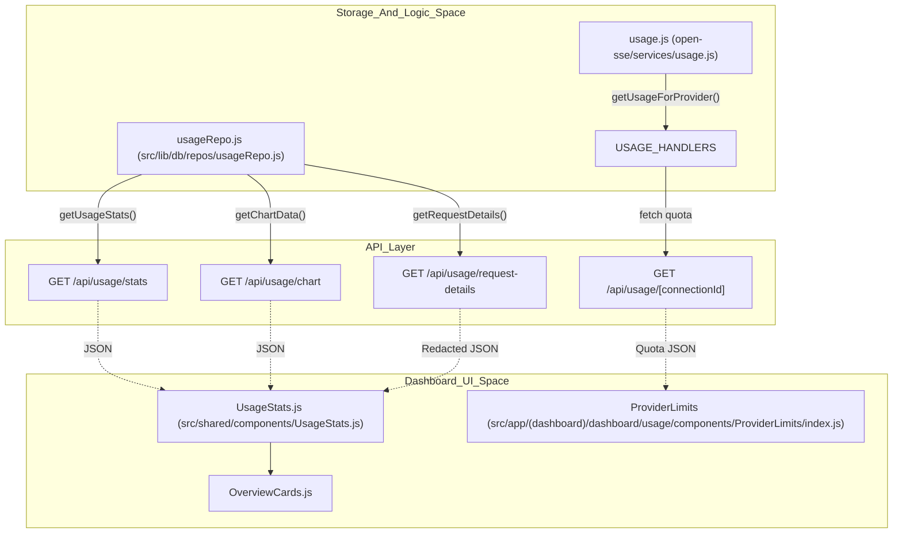
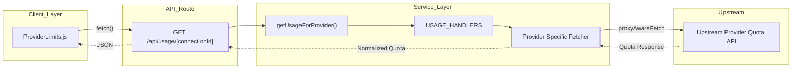

<!-- source: DeepWiki mcp.deepwiki.com · repo decolua/9router · page 9.4 Usage & Analytics API · fetched 2026-10-30 -->

# Usage & Analytics API

<details>
<summary>Relevant source files</summary>

The following files were used as context for generating this wiki page:

- [open-sse/services/usage.js](open-sse/services/usage.js)
- [open-sse/services/usage/claude.js](open-sse/services/usage/claude.js)
- [open-sse/services/usage/misc.js](open-sse/services/usage/misc.js)
- [src/app/(dashboard)/dashboard/usage/components/OverviewCards.js](src/app/(dashboard)/dashboard/usage/components/OverviewCards.js)
- [src/app/(dashboard)/dashboard/usage/components/ProviderLimits/ProviderLimitCard.js](src/app/(dashboard)/dashboard/usage/components/ProviderLimits/ProviderLimitCard.js)
- [src/app/(dashboard)/dashboard/usage/components/ProviderLimits/QuotaProgressBar.js](src/app/(dashboard)/dashboard/usage/components/ProviderLimits/QuotaProgressBar.js)
- [src/app/(dashboard)/dashboard/usage/components/ProviderLimits/QuotaTable.js](src/app/(dashboard)/dashboard/usage/components/ProviderLimits/QuotaTable.js)
- [src/app/(dashboard)/dashboard/usage/components/ProviderLimits/index.js](src/app/(dashboard)/dashboard/usage/components/ProviderLimits/index.js)
- [src/app/(dashboard)/dashboard/usage/components/ProviderLimits/utils.js](src/app/(dashboard)/dashboard/usage/components/ProviderLimits/utils.js)
- [src/app/(dashboard)/dashboard/usage/components/ProviderTopology.js](src/app/(dashboard)/dashboard/usage/components/ProviderTopology.js)
- [src/app/(dashboard)/dashboard/usage/page.js](src/app/(dashboard)/dashboard/usage/page.js)
- [src/app/api/keys/route.js](src/app/api/keys/route.js)
- [src/app/api/usage/[connectionId]/claude-reset/route.js](src/app/api/usage/[connectionId]/claude-reset/route.js)
- [src/app/api/usage/chart/route.js](src/app/api/usage/chart/route.js)
- [src/app/api/usage/stats/route.js](src/app/api/usage/stats/route.js)
- [src/app/globals.css](src/app/globals.css)
- [src/app/layout.js](src/app/layout.js)
- [src/lib/db/repos/usageRepo.js](src/lib/db/repos/usageRepo.js)
- [src/lib/usageDb.js](src/lib/usageDb.js)
- [src/shared/components/Drawer.js](src/shared/components/Drawer.js)
- [src/shared/components/UsageStats.js](src/shared/components/UsageStats.js)
- [tests/unit/claude-reset-grants.test.js](tests/unit/claude-reset-grants.test.js)
- [tests/unit/codebuddy-intl-quota-recurring.test.js](tests/unit/codebuddy-intl-quota-recurring.test.js)
- [tests/unit/glm-usage.test.js](tests/unit/glm-usage.test.js)
- [tests/unit/ollama-usage.test.js](tests/unit/ollama-usage.test.js)
- [tests/unit/usage-dispatch.test.js](tests/unit/usage-dispatch.test.js)

</details>


The Usage & Analytics API provides REST endpoints, real-time event streams, and background dispatchers for querying usage statistics, token consumption, costs, request history, and external provider quotas across connection profiles. This API powers the web dashboard's monitoring features, topological charts, and quota management panels.

**Scope**: This page documents the HTTP API endpoints and service routers for retrieving usage data, provider quotas, and live telemetry. For details on how usage data is tracked, counted, and extracted from execution streams, see [Usage Tracking & Analytics](4.4). For the underlying SQLite storage layer, see [Database Architecture](7.1).

---

## Overview

The Usage & Analytics API exposes aggregated metrics, chronological chart data, request logs, and real-time provider telemetry through specialized endpoints and service handlers.

| Capability | Description | Primary Endpoint / Module |
|------------|-------------|------------------|
| **Usage Stats** | Aggregated token counts, request totals, and estimated costs | `/api/usage/stats` [src/app/api/usage/stats/route.js]() |
| **Chart Data** | Time-series data points for token and request visualization | `/api/usage/chart` [src/app/api/usage/chart/route.js]() |
| **Request Details** | Paginated history of individual inference executions with redaction | `/api/usage/request-details` [src/app/api/usage/request-details/route.js:8-74]() |
| **Provider Quotas** | Real-time external quota fetching and normalized limit dispatch | `/api/usage/[connectionId]` [src/app/api/usage/[connectionId]/route.js:131-174]() / `open-sse/services/usage.js` [open-sse/services/usage.js:40-72]() |
| **Live Telemetry** | Server-Sent Events (SSE) stats emitter for dashboard updates | `statsEmitter` [src/lib/db/repos/usageRepo.js:38]() |

Sources: [src/app/api/usage/stats/route.js](), [src/app/api/usage/chart/route.js](), [src/app/api/usage/request-details/route.js:8-74](), [src/app/api/usage/[connectionId]/route.js:131-174](), [open-sse/services/usage.js:40-72](), [src/lib/db/repos/usageRepo.js:38]()

---

## Data Flow & Architecture

The following diagram illustrates how usage metrics flow from upstream provider APIs and local tracking repositories through the API layer to the dashboard components.

### Usage Data Ingress and Dispatch



Sources: [open-sse/services/usage.js:40-100](), [src/lib/db/repos/usageRepo.js:1-150](), [src/app/(dashboard)/dashboard/usage/components/ProviderLimits/index.js:1-180](), [src/shared/components/UsageStats.js:1-45]()

---

## Analytics & History Endpoints

### Usage Statistics & Chart Data
*   **`/api/usage/stats`**: Aggregates token counts (input, output, cached), request totals, and cost estimations across preset periods (`today`, `24h`, `7d`, `30d`, `60d`, `all`). This route delegates to `getUsageStats` in `src/lib/db/repos/usageRepo.js` [src/lib/usageDb.js:4]().
*   **`/api/usage/chart`**: Returns chronological data points tracking token usage and request frequency over time using `getChartData` [src/lib/usageDb.js:4]().

### Request Details & Privacy Redaction
The `/api/usage/request-details` endpoint provides paginated inspection of individual requests [src/app/api/usage/request-details/route.js:8-74]().
*   **Query Parameters**: Accepts `page`, `pageSize` (capped at 100), `provider`, `model`, `connectionId`, `status`, `startDate`, and `endDate`.
*   **Redaction**: Request and response payloads are redacted into `{ redacted: true }` to protect user data while preserving token counts, latency metrics, and status codes [src/app/api/usage/request-details/route.js:56-64]().

### Real-Time SSE Stream & Emitter
Live updates are driven by `statsEmitter`, an event emitter defined in `src/lib/db/repos/usageRepo.js` [src/lib/db/repos/usageRepo.js:38](). It emits `pending` and `update` events, throttled via `scheduleStatsEvent`, allowing backend operations to push state changes to connected dashboard clients without polling overhead [src/lib/db/repos/usageRepo.js:40-48]().

Sources: [src/lib/usageDb.js:3-7](), [src/lib/db/repos/usageRepo.js:38-48](), [src/app/api/usage/request-details/route.js:8-74]()

---

## Per-Connection Quota Routing

Real-time quota tracking for authenticated upstream accounts is mediated by `open-sse/services/usage.js`, which maps provider identifiers to specific usage extraction handlers [open-sse/services/usage.js:40-72]().

### Quota Dispatcher Implementation
The `USAGE_HANDLERS` dictionary routes incoming connection objects to provider-specific fetchers, passing normalized credentials and proxy options [open-sse/services/usage.js:40-100]():

```javascript
const USAGE_HANDLERS = {
  github: (c) => getGitHubUsage(c.accessToken, c.providerSpecificData, c.proxyOptions),
  "gemini-cli": (c) => getGeminiUsage(c.accessToken, c.providerDataWithProjectId, c.proxyOptions),
  antigravity: (c) => getAntigravityUsage(c.accessToken, c.providerSpecificData, c.proxyOptions),
  claude: (c) => getClaudeUsage(c.accessToken, c.proxyOptions, { force: c.force }),
  codex: (c) => getCodexUsage(c.accessToken, c.proxyOptions),
  kiro: (c) => getKiroUsage(c.accessToken, c.providerSpecificData, c.proxyOptions),
  qoder: (c) => getQoderUsageFor(c),
  ollama: (c) => getOllamaUsage(c.apiKey, c.providerSpecificData, c.proxyOptions),
  // ... additional handlers for minimax, glm, deepseek, groq, cursor, etc.
};
```
[open-sse/services/usage.js:40-72]()

### Quota Fetching Architecture



Sources: [open-sse/services/usage.js:40-100](), [src/app/api/usage/[connectionId]/route.js:131-174](), [src/app/(dashboard)/dashboard/usage/components/ProviderLimits/index.js:1-180]()

---

## Proxy & Network Integration

Quota fetchers and analytics background tasks rely on `proxyAwareFetch` for reliable egress handling [open-sse/utils/proxyFetch.js:5-6]():
*   **Proxy Routing**: Automatically applies configured proxy options (`proxyOptions`) per connection profile.
*   **SSRF Protection & DNS Resolution**: Bypasses local MITM rewrites for trusted external quota endpoints using `shouldBypassMitmDns` [open-sse/utils/proxyFetch.js:116-164]().

Sources: [open-sse/utils/proxyFetch.js:5-164]()

---

