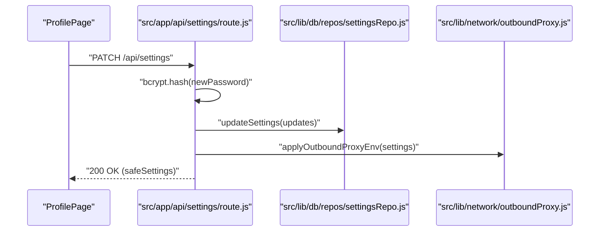
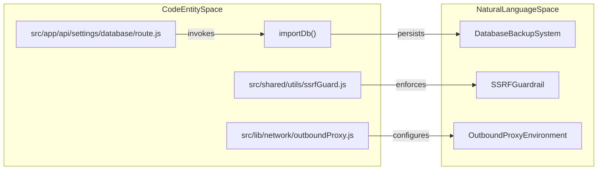

<!-- source: DeepWiki mcp.deepwiki.com · repo decolua/9router · page 9.5 Settings, Auth & Database API · fetched 2026-10-30 -->

# Settings, Auth & Database API

<details>
<summary>Relevant source files</summary>

The following files were used as context for generating this wiki page:

- [src/app/(dashboard)/dashboard/console-log/page.js](src/app/(dashboard)/dashboard/console-log/page.js)
- [src/app/api/auth/login/route.js](src/app/api/auth/login/route.js)
- [src/app/api/auth/logout/route.js](src/app/api/auth/logout/route.js)
- [src/app/api/auth/oidc/callback/route.js](src/app/api/auth/oidc/callback/route.js)
- [src/app/api/auth/oidc/start/route.js](src/app/api/auth/oidc/start/route.js)
- [src/app/api/auth/oidc/test/route.js](src/app/api/auth/oidc/test/route.js)
- [src/app/api/auth/status/route.js](src/app/api/auth/status/route.js)
- [src/app/api/settings/database/route.js](src/app/api/settings/database/route.js)
- [src/app/api/settings/proxy-test/route.js](src/app/api/settings/proxy-test/route.js)
- [src/app/api/translator/console-logs/route.js](src/app/api/translator/console-logs/route.js)
- [src/app/api/tunnel/disable/route.js](src/app/api/tunnel/disable/route.js)
- [src/app/api/tunnel/enable/route.js](src/app/api/tunnel/enable/route.js)
- [src/app/api/tunnel/status/route.js](src/app/api/tunnel/status/route.js)
- [src/app/api/tunnel/tailscale-disable/route.js](src/app/api/tunnel/tailscale-disable/route.js)
- [src/app/api/tunnel/tailscale-enable/route.js](src/app/api/tunnel/tailscale-enable/route.js)
- [src/app/api/version/route.js](src/app/api/version/route.js)
- [src/app/login/page.js](src/app/login/page.js)
- [src/lib/network/initOutboundProxy.js](src/lib/network/initOutboundProxy.js)
- [src/lib/network/outboundProxy.js](src/lib/network/outboundProxy.js)
- [src/shared/utils/ssrfGuard.js](src/shared/utils/ssrfGuard.js)
- [tests/unit/auth-status.test.js](tests/unit/auth-status.test.js)
- [tests/unit/security-audit.test.js](tests/unit/security-audit.test.js)
- [tests/unit/ssrf-guard-hardening.test.js](tests/unit/ssrf-guard-hardening.test.js)

</details>


This page documents the REST API endpoints and backend services responsible for managing 9Router's global settings, performing database backup and restore operations, handling user authentication and session lifecycles, and managing remote access tunnels, version checking, and security guardrails.

---

## Settings Management Endpoints

### GET /api/settings

Retrieves the current global settings configuration. Sensitive information such as plaintext passwords and OIDC client secrets are sanitized prior to response transmission.

**Request:**
```
GET /api/settings
```

**Response:**
```json
{
  "cloudEnabled": false,
  "tunnelEnabled": false,
  "stickyRoundRobinLimit": 3,
  "comboStrategy": "fallback",
  "requireLogin": true,
  "enableObservability": false,
  "outboundProxyEnabled": false,
  "outboundProxyUrl": "",
  "outboundNoProxy": "",
  "enableRequestLogs": true,
  "enableTranslator": true,
  "hasPassword": true,
  "oidcConfigured": false
}
```

**Implementation Details:**
- Fetches configuration records via `getSettings()` [src/app/api/settings/route.js:19]().
- Excludes sensitive fields like `password` and `oidcClientSecret` [src/app/api/settings/route.js:20]().
- Computes `oidcConfigured` dynamically based on configuration parameters [src/app/api/settings/route.js:21]().

Sources: [src/app/api/settings/route.js:17-36]()

---

### PATCH /api/settings

Updates global settings, handles secure password hashing, OIDC adjustments, cache invalidation, and network proxy updates.

**Password Update Logic:**
- Verifies `currentPassword` using `bcrypt.compare` against stored hashes [src/app/api/settings/route.js:55]().
- If setting a password for the first time, default values are permitted [src/app/api/settings/route.js:62]().
- Secures new credentials via `bcrypt.hash` [src/app/api/settings/route.js:67-68]().

**Proxy Application & Cache Invalidation:**
- Network proxy modifications immediately trigger `applyOutboundProxyEnv(settings)` [src/app/api/settings/route.js:87]().
- Combo rotation state is reset when strategy configurations are altered [src/app/api/settings/route.js:96]().

Sources: [src/app/api/settings/route.js:38-118]()

---

## Settings & Security Flow

The following sequence diagram illustrates the request lifecycle for settings updates and proxy re-configurations.

Settings Update and Proxy Application Flow


Sources: [src/app/api/settings/route.js:38-118](), [src/lib/auth/dashboardSession.js:1-82]()

---

## Database Export/Import

9Router provides full database lifecycle management via dedicated SQLite-backed API routes.

### GET /api/settings/database
Exports the entire database payload. Requires either a dashboard password passed via `x-9r-password` or a local CLI token via `x-9r-cli-token` [src/app/api/settings/database/route.js:6-18](). Calls `exportDb()` [src/app/api/settings/database/route.js:19]().

### POST /api/settings/database
Overwrites the current database state with the incoming JSON payload after validating credentials [src/app/api/settings/database/route.js:27-32](). Executes `importDb(payload)` and reapplies proxy environment variables [src/app/api/settings/database/route.js:33-41]().

Sources: [src/app/api/settings/database/route.js:1-51]()

---

## SSRF Protection & Web Fetch Security

The `ssrfGuard` module protects server-side outbound requests from Server-Side Request Forgery (SSRF) attacks targeting internal metadata or loopback networks [src/shared/utils/ssrfGuard.js:1-13]().

**Implementation Layers:**
1. `assertPublicUrl`: Synchronous literal IP/hostname evaluation [src/shared/utils/ssrfGuard.js:6-7]().
2. `assertPublicUrlResolved`: Resolves DNS records to catch wildcard DNS domains (e.g., `nip.io`) targeting private endpoints [src/shared/utils/ssrfGuard.js:8-10]().
3. `fetchPublic`: Wraps `fetch()` with explicit 30x redirect interception and validation [src/shared/utils/ssrfGuard.js:11-13]().

Data-Flow & Entity Architecture Mapping


Sources: [src/shared/utils/ssrfGuard.js:1-162](), [src/app/api/settings/database/route.js:1-51]()

---

## Authentication & Session Management

Dashboard security relies on session cookies, rate-limited login attempts, and multi-mode authentication support (Password, OIDC, SAML).

### POST /api/auth/login

Authenticates dashboard users against stored credentials or fallback environment settings.

**Implementation Details:**
- **Rate Limiting:** IP-based tracking via `checkLock()` and `recordFail()` in `src/lib/auth/loginLimiter.js` [src/app/api/auth/login/route.js:23-30]().
- **Tunnel Restrictions:** Blocks remote login via tunnels if `tunnelDashboardAccess` is disabled [src/app/api/auth/login/route.js:36-38]().
- **SSO Enforcement:** Rejects password login if `authMode` is configured exclusively for OIDC or SAML [src/app/api/auth/login/route.js:43-51]().
- **Password Verification:** Compares hashes with `bcrypt.compare()` or falls back to `process.env.INITIAL_PASSWORD` / `"123456"` [src/app/api/auth/login/route.js:54-60]().
- **Forced Password Rotation:** Requires changing default passwords on remote instances prior to session issuance [src/app/api/auth/login/route.js:65-88]().
- **Session Issuance:** Issues secure cookies via `setDashboardAuthCookie()` [src/app/api/auth/login/route.js:90-91]().

Sources: [src/app/api/auth/login/route.js:21-111]()

### GET /api/auth/status

Reports current authentication state, active login method (`Password`, `OIDC`, `SAML`), user display name, and OIDC/SAML configuration flags [src/app/api/auth/status/route.js:8-48](). Fails closed to safe defaults if storage layers fail [src/app/api/auth/status/route.js:49-70]().

Sources: [src/app/api/auth/status/route.js:1-70]()

### POST /api/auth/logout

Terminates the user session by clearing auth cookies and associated OIDC state parameters [src/app/api/auth/logout/route.js:5-11]().

Sources: [src/app/api/auth/logout/route.js:1-12]()

---

## Tunnel Routes

Tunnel management endpoints control external exposure via Cloudflare Tunnel and Tailscale Funnel.

### GET /api/tunnel/status
Retrieves cached tunnel status, Tailscale status, and download progress for binary dependencies [src/app/api/tunnel/status/route.js:10-25]().

### POST /api/tunnel/enable & POST /api/tunnel/tailscale-enable
Triggers tunnel initialization, configures process monitoring via `configureTunnelMonitoring`, and handles edge DNS warmup delays [src/app/api/tunnel/enable/route.js:8-20](), [src/app/api/tunnel/tailscale-enable/route.js:6-17]().

Sources: [src/app/api/tunnel/status/route.js:1-25](), [src/app/api/tunnel/enable/route.js:1-21](), [src/app/api/tunnel/tailscale-enable/route.js:1-17]()

---

## Version & Proxy Testing Endpoints

### GET /api/version
Polls the npm registry (with a 1-hour in-memory cache) to check if a newer version of `9router` is available compared to `package.json` [src/app/api/version/route.js:1-61]().

Sources: [src/app/api/version/route.js:1-61]()

---

