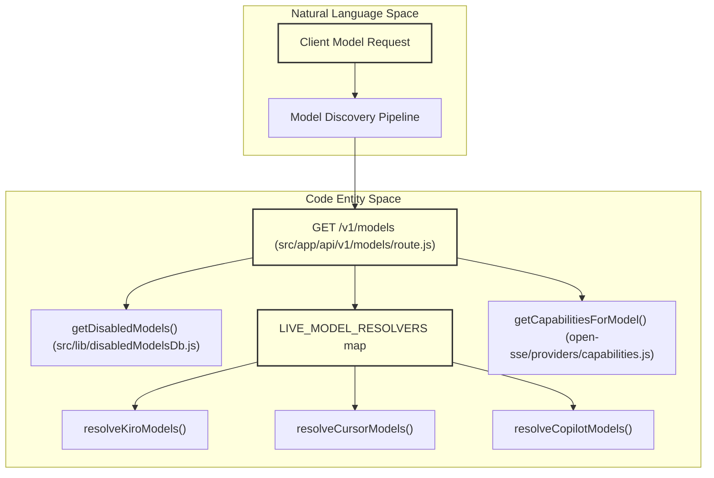
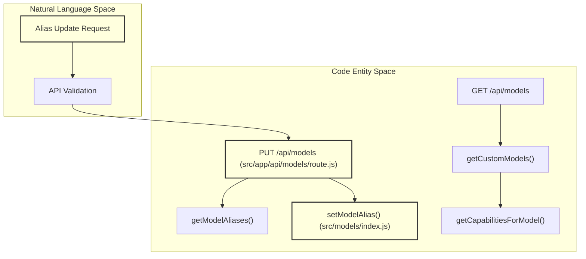
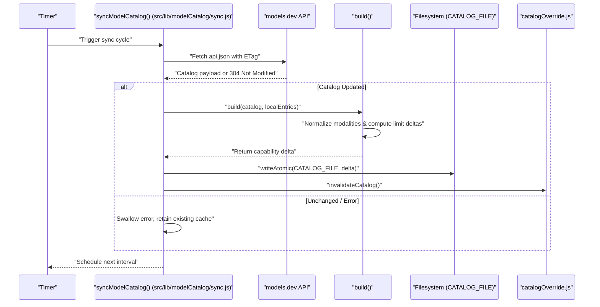

<!-- source: DeepWiki mcp.deepwiki.com · repo decolua/9router · page 9.6 Models & Pricing API · fetched 2026-10-30 -->

# Models & Pricing API

Relevant source files

The following files were used as context for generating this wiki page:

- [open-sse/providers/catalogOverride.js](open-sse/providers/catalogOverride.js)
- [open-sse/providers/visionPatterns.js](open-sse/providers/visionPatterns.js)
- [open-sse/translator/formats/claude.js](open-sse/translator/formats/claude.js)
- [open-sse/translator/schema/blocks.js](open-sse/translator/schema/blocks.js)
- [src/app/(dashboard)/dashboard/combos/page.js](src/app/(dashboard)/dashboard/combos/page.js)
- [src/app/(dashboard)/dashboard/console-log/ConsoleLogClient.js](src/app/(dashboard)/dashboard/console-log/ConsoleLogClient.js)
- [src/app/(dashboard)/dashboard/media-providers/combo/[id]/page.js](src/app/(dashboard)/dashboard/media-providers/combo/[id]/page.js)
- [src/app/api/models/catalog-sync/route.js](src/app/api/models/catalog-sync/route.js)
- [src/app/api/models/route.js](src/app/api/models/route.js)
- [src/app/api/translator/console-logs/stream/route.js](src/app/api/translator/console-logs/stream/route.js)
- [src/app/api/v1/models/route.js](src/app/api/v1/models/route.js)
- [src/instrumentation.js](src/instrumentation.js)
- [src/lib/consoleLogBuffer.js](src/lib/consoleLogBuffer.js)
- [src/lib/db/repos/nodesRepo.js](src/lib/db/repos/nodesRepo.js)
- [src/lib/modelCatalog/sync.js](src/lib/modelCatalog/sync.js)
- [src/shared/components/Button.js](src/shared/components/Button.js)
- [src/shared/components/ComboFormModal.js](src/shared/components/ComboFormModal.js)
- [src/shared/components/ModelSelectModal.js](src/shared/components/ModelSelectModal.js)
- [src/shared/hooks/useModelCaps.js](src/shared/hooks/useModelCaps.js)
- [src/shared/utils/connectionStatus.js](src/shared/utils/connectionStatus.js)
- [src/shared/utils/index.js](src/shared/utils/index.js)
- [src/shared/utils/modelSearchFilter.js](src/shared/utils/modelSearchFilter.js)
- [tests/unit/capabilities.test.js](tests/unit/capabilities.test.js)
- [tests/unit/claude-container-upload.test.js](tests/unit/claude-container-upload.test.js)
- [tests/unit/claude-context-management-field.test.js](tests/unit/claude-context-management-field.test.js)
- [tests/unit/claude-empty-thinking-block.test.js](tests/unit/claude-empty-thinking-block.test.js)
- [tests/unit/claude-foreign-server-tool-use.test.js](tests/unit/claude-foreign-server-tool-use.test.js)
- [tests/unit/combo-caps-resolver.test.js](tests/unit/combo-caps-resolver.test.js)
- [tests/unit/gpt-6-context-window.test.js](tests/unit/gpt-6-context-window.test.js)
- [tests/unit/model-catalog-scope.test.js](tests/unit/model-catalog-scope.test.js)
- [tests/unit/model-search-filter.test.js](tests/unit/model-search-filter.test.js)
- [tests/unit/model-select-deactivated-provider.test.js](tests/unit/model-select-deactivated-provider.test.js)
- [tests/unit/models-route-shadow-dedupe.test.js](tests/unit/models-route-shadow-dedupe.test.js)
- [tests/unit/opencode-go-claude-haiku-55-thinking.test.js](tests/unit/opencode-go-claude-haiku-55-thinking.test.js)
- [tests/unit/v1-models-combo-context.test.js](tests/unit/v1-models-combo-context.test.js)

This page documents the technical implementation, API endpoints, and data structures for managing AI model listings, model aliasing, custom models, disabled models, catalog synchronization, and pricing configuration within 9Router.

---

## 1. Model Listing & Discovery API (`GET /v1/models`)

The `/v1/models` endpoint provides an OpenAI-compatible model listing that dynamically aggregates models from active provider connections, user-defined combos, custom model overrides, and live upstream catalogs [src/app/api/v1/models/route.js:1-160]().

### Implementation Logic & Resolution Flow
1. **Model Aliases & Disabled Check**: Retrieves model aliases via `getModelAliases()` and excluded models via `getDisabledModels()` [src/app/api/v1/models/route.js:11-12]().
2. **Static Registry Filtering**: Filters static models (`AI_MODELS`) against disabled rules and attaches capability metrics computed via `getCapabilitiesForModel()` [src/app/api/v1/models/route.js:14-38]().
3. **Active Connections & Live Resolvers**: Iterates through active provider connections. For specialized providers (such as Kiro, Qoder, Kimchi, GitHub Copilot, Cline, Grok CLI, Cursor, and Zed), 9Router invokes real-time upstream catalog resolvers [src/app/api/v1/models/route.js:64-160]().

Sources: [src/app/api/v1/models/route.js:1-160](), [src/lib/localDb.js:1-21]()

---

## 2. Model Aliases & Custom Models

Model aliasing and custom model registration allow users to map custom identifiers to upstream models and attach capability metadata or specialized execution transports.

### Custom Model Management
Custom models are managed via API routes and persisted through database repositories [src/app/api/models/route.js:85-114](). 

* **Aliasing (`PUT /api/models`)**: Associates a custom alias to an existing model identifier, ensuring uniqueness across the alias registry [src/app/api/models/route.js:86-114]().
* **Custom Model Injection**: Custom models ride along with the standard model list, merging stored capabilities with fallback heuristics from `getCapabilitiesForModel()` [src/app/api/v1/models/route.js:40-76]().

Sources: [src/app/api/models/route.js:1-114](), [src/shared/hooks/useModelCaps.js:1-95]()

---

## 3. Disabled Models Management

Users can exclude specific models from being routed or listed via the disabled models database interface.

* **Storage**: Managed in `src/lib/disabledModelsDb.js` and retrieved via `getDisabledModels()` [src/app/api/v1/models/route.js:12]().
* **Filtering**: The `/v1/models` aggregation pipeline filters out any model ID present in the disabled map before returning the response payload [src/app/api/v1/models/route.js:14-19]().

Sources: [src/app/api/v1/models/route.js:10-19](), [src/lib/disabledModelsDb.js:1-4]()

---

## 4. Pricing Configuration & Cost Calculation

Pricing parameters determine token-level usage costs for analytics and budget gating.

### Pricing Fallback Order
When calculating costs per 1 million tokens, 9Router evaluates pricing sources in a strict tiered sequence:
1. **Provider-Specific Override**: `PROVIDER_PRICING[provider][model]`
2. **Canonical Model Price**: `MODEL_PRICING[model]` (provider-agnostic rates)
3. **Pattern Match**: `PATTERN_PRICING` using wildcard glob patterns

### Tracked Token Dimensions
* `input`: Standard prompt token cost
* `output`: Generated completion token cost
* `cached`: Cached read token cost (e.g., Anthropic Prompt Caching)
* `reasoning`: Chain-of-thought / thinking token cost (e.g., OpenAI o1, Claude Thinking)
* `cache_creation`: One-time cache write token cost

Sources: [open-sse/providers/pricing.js:1-100](), [open-sse/services/usage/google.js:158-210]()

---

## 5. Combo Models & Execution Strategies

Combo models wrap multiple underlying model seats into a single virtual identifier. Capabilities are aggregated conservatively across members using `aggregateComboCapabilities()` [tests/unit/combo-caps-resolver.test.js:1-83]().

### Execution Strategies
* **Fallback**: Tries models sequentially in the defined order until a non-error response is received.
* **Round Robin**: Distributes requests across connection seats to balance traffic.
* **Capacity Auto-switch**: Automatically routes requests based on required runtime modalities (e.g., `vision`, `audioInput`) [src/app/(dashboard)/dashboard/combos/page.js:19-31]().

Sources: [src/app/(dashboard)/dashboard/combos/page.js:1-192](), [tests/unit/combo-caps-resolver.test.js:1-83]()

---

## 6. Model Catalog Synchronization (`models.dev`)

9Router periodically queries `models.dev` to keep model capability limits (`contextWindow`, `maxOutput`) and supported modalities synchronized with upstream metadata [src/lib/modelCatalog/sync.js:1-161]().

### Synchronization Workflow
1. **Startup & Timer**: Runs an initial sync after `STARTUP_DELAY_MS` (60s), then repeats at `SYNC_INTERVAL_MS` (24 hours) [src/lib/modelCatalog/sync.js:14-15]().
2. **ETag Fetch**: Requests `https://models.dev/api.json` using conditional `If-None-Match` headers to minimize network overhead [src/lib/modelCatalog/sync.js:11-12, 174]().
3. **Delta Compilation**: The `build()` function evaluates upstream capabilities against local registry snapshots using `PROVIDER_ALIASES` mapping [src/lib/modelCatalog/sync.js:26-40, 80-156](). Limits differing below `LIMIT_TOLERANCE` (10%) are ignored to prevent gateway-rounding noise [src/lib/modelCatalog/sync.js:20]().
4. **Atomic Write & Invalidation**: Writes the compiled catalog via `writeAtomic()` to `CATALOG_FILE` and invalidates the memory cache via `invalidateCatalog()` [src/lib/modelCatalog/sync.js:9, 55-59, 200]().

Sources: [src/lib/modelCatalog/sync.js:1-269](), [open-sse/providers/catalogOverride.js:1-10]()

---

## 7. Model Ping & Testing Utilities

The dashboard uses model testing endpoints to verify connectivity and validate configuration parameters before routing live traffic.

* **Endpoint Routing**: `pingModelByKind()` dispatches test payloads depending on the model's service kind (`embedding`, `image`, `stt`, or `llm`) [src/app/api/models/test/ping.js:55-148]().
* **Execution**: Makes internal HTTP loopback calls to `9router` instance routes (`/v1/chat/completions`, `/v1/audio/transcriptions`, etc.) with a 15-second timeout, measuring response latency and returning structured error payloads on failure [src/app/api/models/test/ping.js:49-171]().

Sources: [src/app/api/models/test/ping.js:1-217](), [src/app/(dashboard)/dashboard/providers/[id]/AddCustomModelModal.js:30-48]()

---

