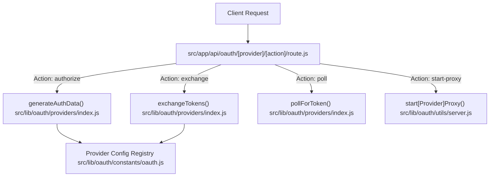
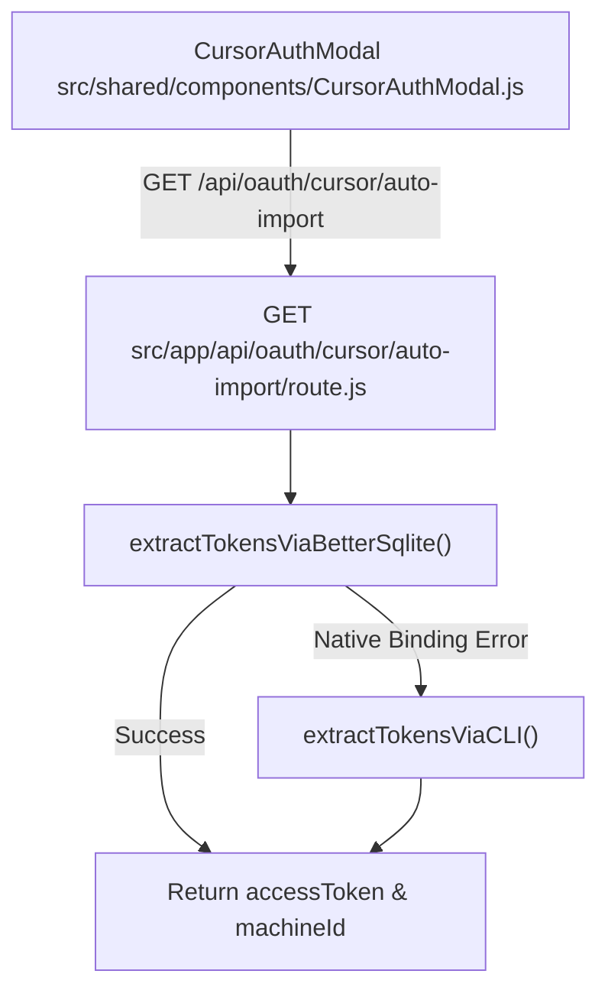

<!-- source: DeepWiki mcp.deepwiki.com · repo decolua/9router · page 9.7 OAuth Endpoints · fetched 2026-10-30 -->

# OAuth Endpoints

Relevant source files

The following files were used as context for generating this wiki page:

- [open-sse/providers/registry/index.js](open-sse/providers/registry/index.js)
- [open-sse/services/usage/kiro.js](open-sse/services/usage/kiro.js)
- [open-sse/translator/response/cursor-to-openai.js](open-sse/translator/response/cursor-to-openai.js)
- [src/app/api/oauth/[provider]/[action]/route.js](src/app/api/oauth/[provider]/[action]/route.js)
- [src/app/api/oauth/cursor/auto-import/route.js](src/app/api/oauth/cursor/auto-import/route.js)
- [src/app/api/oauth/kiro/auto-import/route.js](src/app/api/oauth/kiro/auto-import/route.js)
- [src/app/api/oauth/kiro/import-cli-proxy/route.js](src/app/api/oauth/kiro/import-cli-proxy/route.js)
- [src/app/api/oauth/kiro/import/route.js](src/app/api/oauth/kiro/import/route.js)
- [src/app/api/oauth/kiro/social-exchange/route.js](src/app/api/oauth/kiro/social-exchange/route.js)
- [src/app/api/providers/[id]/models/route.js](src/app/api/providers/[id]/models/route.js)
- [src/app/api/providers/[id]/test/testUtils.js](src/app/api/providers/[id]/test/testUtils.js)
- [src/lib/oauth/constants/oauth.js](src/lib/oauth/constants/oauth.js)
- [src/lib/oauth/kiroExternalIdp.js](src/lib/oauth/kiroExternalIdp.js)
- [src/lib/oauth/providers.js](src/lib/oauth/providers.js)
- [src/lib/oauth/providers/index.js](src/lib/oauth/providers/index.js)
- [src/shared/components/CursorAuthModal.js](src/shared/components/CursorAuthModal.js)
- [src/shared/components/KiroAuthModal.js](src/shared/components/KiroAuthModal.js)
- [src/shared/components/OAuthModal.js](src/shared/components/OAuthModal.js)
- [tests/__baseline__/alias-baseline.json](tests/__baseline__/alias-baseline.json)
- [tests/__baseline__/providers-baseline.json](tests/__baseline__/providers-baseline.json)
- [tests/__baseline__/verify-alias.mjs](tests/__baseline__/verify-alias.mjs)
- [tests/unit/kiro-external-idp.test.js](tests/unit/kiro-external-idp.test.js)
- [tests/unit/oauth-cursor-auto-import.test.js](tests/unit/oauth-cursor-auto-import.test.js)

This page documents the `/api/oauth/[provider]/[action]` REST API routes and accompanying frontend components (`src/shared/components/OAuthModal.js` [src/shared/components/OAuthModal.js:38](), `src/shared/components/CursorAuthModal.js` [src/shared/components/CursorAuthModal.js:11](), `src/shared/components/KiroAuthModal.js` [src/shared/components/KiroAuthModal.js:11]()) which facilitate OAuth authentication flows, provider-specific auth services (Kiro, Antigravity, Cursor, Xiaomi MiMo, xAI, Codex, Zed, etc.), local callback proxy servers, and automated credential auto-import/bulk-import operations across 9Router.

---

## 1. OAuth Flow Architecture & Dynamic Routing

The primary entry point for all OAuth operations is the dynamic Next.js API route located at `src/app/api/oauth/[provider]/[action]/route.js` [src/app/api/oauth/[provider]/[action]/route.js:87](). This route inspects the `[provider]` path segment (e.g., `codex`, `kiro`, `cursor`, `xiaomi-mimo`, `zed`, `xai`, `trae`) and the `[action]` path segment (e.g., `authorize`, `exchange`, `device-code`, `poll`, `start-proxy`, `poll-status`) to dispatch requests into the core OAuth registry library `src/lib/oauth/providers/index.js` [src/lib/oauth/providers/index.js:74]().

Diagram: OAuth API Request Dispatching (Code Entity Space)

Sources:
* `src/app/api/oauth/[provider]/[action]/route.js:87-180`()
* `src/lib/oauth/providers/index.js:74-133`()

Supported actions handled by the routing tier include:
* **`authorize`**: Generates PKCE challenges, state tokens, and provider authorization endpoints (`src/app/api/oauth/[provider]/[action]/route.js:98-137`() / `src/lib/oauth/providers/index.js:97-133`()).
* **`exchange`**: Trades an authorization code for upstream tokens and persists the connection (`src/app/api/oauth/[provider]/[action]/route.js:55-78`() / `src/lib/oauth/providers/index.js:139-153`()).
* **`device-code`**: Requests initialization payloads for device-code grant types (`src/app/api/oauth/[provider]/[action]/route.js:93()` / `src/lib/oauth/providers/index.js:158-164`()).
* **`poll`**: Queries device code completion state asynchronously (`src/app/api/oauth/[provider]/[action]/route.js:162-166()` / `src/lib/oauth/providers/index.js:173-195`()).
* **`start-proxy`**: Spawns local ephemeral HTTP servers to intercept fixed-port localhost redirects (`src/app/api/oauth/[provider]/[action]/route.js:139-180`()).

Sources:
* `src/app/api/oauth/[provider]/[action]/route.js:87-184`()
* `src/lib/oauth/providers/index.js:73-195`()

---

## 2. OAuth Configuration Constants & Registry

Static configuration parameters, endpoints, grant types, and scopes for each supported provider are defined within `src/lib/oauth/constants/oauth.js` [src/lib/oauth/constants/oauth.js:1]() and re-exported via `src/lib/oauth/providers/index.js` [src/lib/oauth/providers/index.js:1]().

| Constant | Provider ID | Flow Type | Key Characteristics / Metadata |
| :--- | :--- | :--- | :--- |
| `CLAUDE_CONFIG` | `claude` | `authorization_code_pkce` | Standard PKCE authorization code flow (`src/lib/oauth/constants/oauth.js:22`()). |
| `CODEX_CONFIG` | `codex` | `authorization_code_pkce` | OpenAI Codex OAuth integration with local proxy support (`src/lib/oauth/constants/oauth.js:25`() / `src/app/api/oauth/[provider]/[action]/route.js:172`()). |
| `ANTIGRAVITY_CONFIG` | `antigravity` | `authorization_code` | Dynamically injects OS-specific `loadCodeAssistClientMetadata` (`src/lib/oauth/constants/oauth.js:47-51`()). |
| `QODER_CONFIG` | `qoder` | `device_code` | Device Token Flow with PKCE (~30 day access tokens) (`src/lib/oauth/constants/oauth.js:31-36`()). |
| `KIRO_CONFIG` | `kiro` | Multi-method | AWS Builder ID, IDC, Social login, or Import Token (`src/lib/oauth/constants/oauth.js:68`()). |
| `CURSOR_CONFIG` | `cursor` | Import Token | Reads local SQLite DB state (`state.vscdb`) (`src/lib/oauth/constants/oauth.js:83-90`()). |
| `XIAOMI_MIMO_CONFIG` | `xiaomi-mimo` | ECDH Encrypted | Custom ECDH keypair generation & AES-256-GCM callback decryption (`src/lib/oauth/constants/oauth.js:147-151`()). |

Sources:
* `src/lib/oauth/constants/oauth.js:21-151`()

---

## 3. Provider-Specific OAuth & Custom Flows

### Kiro (AWS CodeWhisperer)
Kiro supports multiple authentication paths orchestrated by `KiroAuthModal` (`src/shared/components/KiroAuthModal.js` [src/shared/components/KiroAuthModal.js:11]()) and backed by `/api/oauth/kiro/*` routes:
1. **AWS Builder ID**: Standard device code grant.
2. **AWS IAM Identity Center (IDC)**: Requires an IDC start URL and region, registering client metadata (`src/shared/components/KiroAuthModal.js:139-145`()).
3. **Auto-Import**: Reads refresh tokens from `~/.aws/sso/cache/` via `GET /api/oauth/kiro/auto-import` (`src/shared/components/KiroAuthModal.js:36()` / `src/app/api/oauth/kiro/auto-import/route.js:7-14`()), resolving `clientId` and `clientSecret` from linked client registration files.

Sources:
* `src/shared/components/KiroAuthModal.js:11-145`()
* `src/app/api/oauth/kiro/auto-import/route.js:7-113`()

### Cursor IDE Token Extraction
Cursor relies on direct local database reads rather than browser redirects. The frontend component `src/shared/components/CursorAuthModal.js` [src/shared/components/CursorAuthModal.js:11]() queries `GET /api/oauth/cursor/auto-import` (`src/app/api/oauth/cursor/auto-import/route.js:177`()).

Diagram: Cursor Token Extraction Pipeline (Code Entity Space)

Sources:
* `src/shared/components/CursorAuthModal.js:11-30`()
* `src/app/api/oauth/cursor/auto-import/route.js:79-170`()
* `src/app/api/oauth/cursor/auto-import/route.js:177-237`()

### Xiaomi MiMo ECDH Flow
Xiaomi MiMo implements an encrypted callback mechanism bypassing standard OAuth redirect query parameters:
1. The client generates an X25519 keypair (`generateKeyPair()`) (`src/app/api/oauth/[provider]/[action]/route.js:101`()).
2. The browser opens an authorization URL containing the public key (`buildAuthorizeUrl`) (`src/app/api/oauth/[provider]/[action]/route.js:115`()).
3. The local proxy receives an encrypted payload `u` (`src/lib/oauth/constants/oauth.js:143`()).
4. Decryption uses ECDH shared secret derivation, SHA256 hashing, and AES-256-GCM extraction (`[12-byte nonce][32-byte ephemeral pubkey][ciphertext][16-byte GCM tag]`) (`src/lib/oauth/constants/oauth.js:143-145`()).

Sources:
* `src/app/api/oauth/[provider]/[action]/route.js:99-123`()
* `src/lib/oauth/constants/oauth.js:141-146`()

---

## 4. Local Callback Proxies & Session Management

For providers enforcing rigid redirect URIs (e.g., fixed local ports or custom URL schemes), 9Router spins up local HTTP callback listeners via server utilities (`src/lib/oauth/utils/server.js`).

The `start-proxy` endpoint initializes ephemeral listeners for providers such as `codex`, `xai`, `trae`, `windsurf`, `zed`, and `xiaomi-mimo` (`src/app/api/oauth/[provider]/[action]/route.js:139-160`()). Sessions are registered in memory using state identifiers (`registerCodexSession`, `registerXaiSession`, `registerTraeSession`, `registerZedSession`, `registerXiaomiMimoSession`) (`src/app/api/oauth/[provider]/[action]/route.js:175-177`()), allowing the UI to poll `poll-status` until authorization completes.

Sources:
* `src/app/api/oauth/[provider]/[action]/route.js:139-184`()
* `src/lib/oauth/utils/server.js:1-43`()

---

## 5. Auto-Import and Bulk-Import Endpoints

To streamline onboarding without manual token generation, specialized ingestion routes extract credentials directly from standard desktop development environments:
* **Cursor Auto-Import (`/api/oauth/cursor/auto-import`)**: Scans platform-specific paths (e.g., `~/Library/Application Support/Cursor/User/globalStorage/state.vscdb` on macOS) (`src/app/api/oauth/cursor/auto-import/route.js:21-32`()) and queries `itemTable` for `cursorAuth/accessToken` and `storage.serviceMachineId` (`src/app/api/oauth/cursor/auto-import/route.js:10-15`()).
* **Kiro Auto-Import (`/api/oauth/kiro/auto-import`)**: Inspects `~/.aws/sso/cache/` for valid refresh tokens (`src/app/api/oauth/kiro/auto-import/route.js:14-36`()) and extracts profile ARNs.

Sources:
* `src/app/api/oauth/cursor/auto-import/route.js:10-63`()
* `src/app/api/oauth/kiro/auto-import/route.js:14-113`()

---

