# Page: Overview

# Overview

<details>
<summary>Relevant source files</summary>

The following files were used as context for generating this wiki page:

- [.github/dependabot.yml](.github/dependabot.yml)
- [.github/workflows/docker-publish.yml](.github/workflows/docker-publish.yml)
- [.gitignore](.gitignore)
- [.npmignore](.npmignore)
- [CHANGELOG.md](CHANGELOG.md)
- [DOCKER.md](DOCKER.md)
- [Dockerfile](Dockerfile)
- [README.md](README.md)
- [cli/package.json](cli/package.json)
- [cli/scripts/build-cli.js](cli/scripts/build-cli.js)
- [cli/scripts/buildMitm.js](cli/scripts/buildMitm.js)
- [cli/src/cli/terminalUI.js](cli/src/cli/terminalUI.js)
- [cli/src/cli/utils/input.js](cli/src/cli/utils/input.js)
- [next.config.mjs](next.config.mjs)
- [open-sse/config/runtimeConfig.js](open-sse/config/runtimeConfig.js)
- [open-sse/executors/base.js](open-sse/executors/base.js)
- [package.json](package.json)
- [src/app/api/usage/stream/route.js](src/app/api/usage/stream/route.js)
- [tests/unit/cli-build-artifacts.test.js](tests/unit/cli-build-artifacts.test.js)
- [tests/unit/open-package-external.test.js](tests/unit/open-package-external.test.js)

</details>


## Purpose and Scope

9Router (`9router-app`) is a smart AI request router and token optimization engine designed to maximize developer subscription efficiency, reduce operational costs, and maintain zero-downtime availability across 40+ AI providers [README.md:4-9](), [package.json:2-4](). It provides OpenAI-compatible API endpoints (`/v1/chat/completions`, `/v1/messages`), Man-in-the-Middle (MITM) proxy capabilities, and a 3-tier automatic fallback mechanism.

The system allows AI coding assistants (such as Claude Code, Cursor, Cline, and Codex) to transparently route requests through paid subscriptions, cheap pay-as-you-go providers, and free tiers without manual intervention [README.md:6-8](), [README.md:39-42](). 

For detailed system component mapping, see [System Architecture](#1.1). For an inventory of support directories and assets, see [Repository Layout & Assets](#1.2).

Sources: [README.md:4-9](), [package.json:2-4]()

---

## System Architecture & Layout

9Router is structured as a modular Next.js application accompanied by an underlying execution engine (`open-sse`), a MITM proxy subsystem (`src/mitm`), and a companion CLI package (`cli/`) [package.json:31-37](), [next.config.mjs:12-15](), [cli/package.json:5-10](). 

### Diagram: System Architecture and Code Entity Mapping
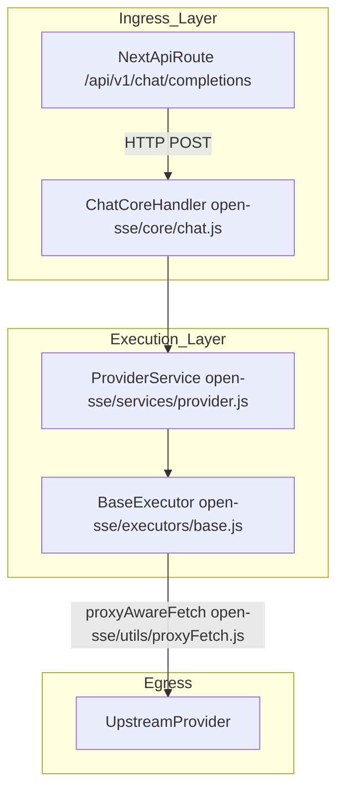
Sources: [next.config.mjs:60-102](), [open-sse/executors/base.js:11-16](), [cli/package.json:5-10]()

For high-level module boundaries, Next.js app routes, and request flows, see [System Architecture](#1.1). For non-code and support directories (`public/`, `skills/`, `docs/`, `scripts/`), see [Repository Layout & Assets](#1.2).

---

## Getting Started & Core Concepts

Users can deploy 9Router via npm globally, Docker, or directly from source code [README.md:79-115](). Core configuration revolves around providers, models, authentication methods, and fusion/combo configurations [README.md:85-96]().

### Diagram: 3-Tier Fallback and Executor Routing
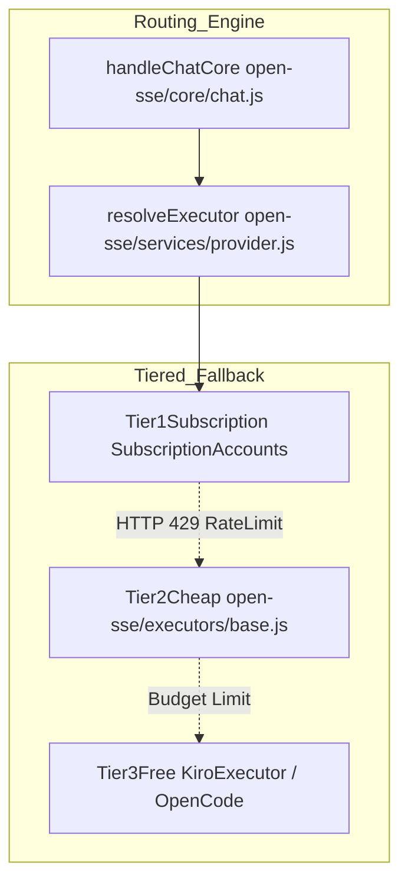
Sources: [README.md:62-69](), [open-sse/executors/base.js:100-125]()

For setup procedures, quick starts, configuration basics, and the terminal CLI application (`cli/`), see Getting Started (Section 2). For deep dives into routing strategies, provider authentication types, format translation, and account fallback mechanisms, see Core Concepts (Section 3).

---

## Request Processing, Providers, & MITM Proxy

Requests flow through an ingestion pipeline that executes token optimization (RTK Token Saver), format translation (OpenAI, Claude, Gemini, Codex, etc.), and upstream dispatch via provider executors [README.md:38](), [CHANGELOG.md:70-73]().

- **Request Processing**: Traces chat flows, streaming Server-Sent Events (SSE), format translation pipelines, usage tracking, and token savers (`RTK`, `Caveman`, `Ponytail`, `PXPipe`) [README.md:38](), [CHANGELOG.md:105-106](). For details, see Request Processing (Section 4).
- **Provider System**: Manages provider registry mappings, pricing structures, token refresh lifecycles, account selection strategies, and per-provider quota fetchers [CHANGELOG.md:31-32](), [open-sse/executors/base.js:88-94](). For details, see Provider System (Section 5).
- **MITM Proxy System**: Intercepts AI tool traffic requiring TLS interception, local Root CA generation, and custom DNS bypass [cli/package.json:32](). For details, see MITM Proxy System (Section 6).

Sources: [README.md:38](), [open-sse/executors/base.js:88-94](), [cli/package.json:32]()

---

## Data Storage, Dashboard, API, & Deployment

9Router persists operational data, usage metrics, and settings in a SQLite database layer (`better-sqlite3` with `sql.js` fallback) [package.json:49-57](). 

- **Data & Storage**: Covers schema migrations, repositories (`settingsRepo`, `usageRepo`), and the `~/.9router` backup directory [package.json:49-57](). For details, see Data & Storage (Section 7).
- **Web Dashboard**: Documents management interfaces for connections, token savers, proxy pools, and agent skills [package.json:20-23](). For details, see Web Dashboard (Section 8).
- **API Reference**: Details endpoints for chat completions, embeddings, media, provider management, and OAuth flows [next.config.mjs:60-95](). For details, see API Reference (Section 9).
- **Network & Proxy**: Explains proxy configurations, remote access tunnels (Cloudflare Tunnel, Tailscale Funnel), and MITM DNS bypass [open-sse/config/runtimeConfig.js:31-32](). For details, see Network & Proxy (Section 10).
- **Security & Access Control**: Covers dashboard password authentication, OIDC/SAML enterprise SSO, and request guarding (`dashboardGuard.js`) [package.json:26-28](). For details, see Security & Access Control (Section 11).
- **Deployment & Development**: Guides running 9Router locally, via Docker, environment variables setup, extension guides, testing suites, and localization [Dockerfile:1-59](), [package.json:6-18](). For details, see Deployment (Section 12) and Development (Section 13).
- **Troubleshooting & Glossary**: Addresses common authentication, provider connection, and MITM proxy errors alongside a complete codebase-specific glossary [CHANGELOG.md:25-26](). For details, see Troubleshooting (Section 14) and Glossary (Section 15).

Sources: [package.json:6-57](), [Dockerfile:1-59]()

---

# Page: System Architecture

# System Architecture

<details>
<summary>Relevant source files</summary>

The following files were used as context for generating this wiki page:

- [.github/dependabot.yml](.github/dependabot.yml)
- [.github/workflows/docker-publish.yml](.github/workflows/docker-publish.yml)
- [.gitignore](.gitignore)
- [.npmignore](.npmignore)
- [DOCKER.md](DOCKER.md)
- [Dockerfile](Dockerfile)
- [README.md](README.md)
- [images/fusion-combo-ui.png](images/fusion-combo-ui.png)
- [open-sse/config/runtimeConfig.js](open-sse/config/runtimeConfig.js)
- [open-sse/executors/base.js](open-sse/executors/base.js)
- [open-sse/handlers/chatCore.js](open-sse/handlers/chatCore.js)
- [open-sse/services/combo.js](open-sse/services/combo.js)
- [open-sse/translator/concerns/modality.js](open-sse/translator/concerns/modality.js)
- [src/app/api/usage/stream/route.js](src/app/api/usage/stream/route.js)
- [src/sse/handlers/chat.js](src/sse/handlers/chat.js)
- [src/sse/services/auth.js](src/sse/services/auth.js)
- [tests/unit/combo-fusion.test.js](tests/unit/combo-fusion.test.js)
- [tests/unit/fetch-success-clears-account.test.js](tests/unit/fetch-success-clears-account.test.js)
- [tests/unit/hermes-vision-detection.test.js](tests/unit/hermes-vision-detection.test.js)

</details>


## Purpose and Scope
This page maps the major structural layers of 9Router, detailing module boundaries, inter-module communication, security boundaries, and high-level request flows. It bridges natural language concepts to precise codebase implementations across `src/app`, `open-sse`, `src/sse`, `src/mitm`, `cli/`, and gitbook documentation.

Sources: [README.md:46-70](), [src/sse/handlers/chat.js:33-161](), [custom-server.js:52-126]()

---

## 1. Major System Layers & Code Entity Mapping

9Router combines a Next.js web dashboard (`src/app`), a decoupled routing and translation engine (`open-sse`), specialized SSE/chat handlers (`src/sse`), a Man-in-the-Middle (MITM) proxy subsystem (`src/mitm`), a CLI companion package (`cli/`), and documentation assets.

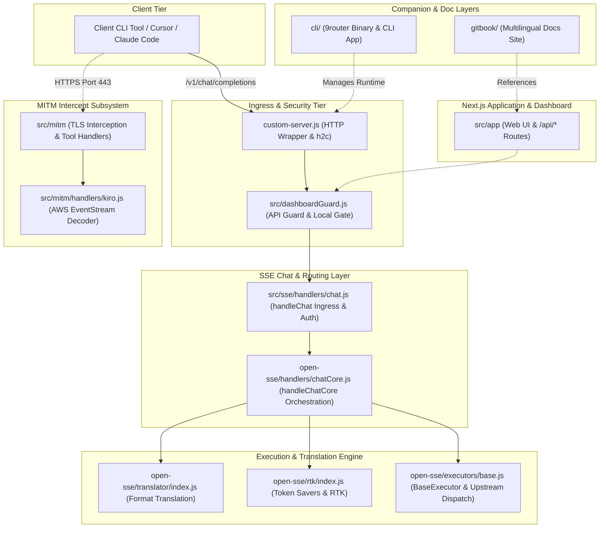
*Diagram 1: High-level System Architecture mapping layers to codebase entities.*

Sources: [src/sse/handlers/chat.js:33-161](), [open-sse/handlers/chatCore.js:61-112](), [src/dashboardGuard.js:202-279](), [custom-server.js:52-126](), [Dockerfile:30-46]()

---

## 2. Ingress & Request Guarding Layer

All network requests enter through a custom Node.js HTTP server wrapper (`custom-server.js`), decoupling underlying transport sockets from Next.js middleware.

### Ingress Sanitization & `h2c` Downgrading
* **HTTP Wrapper (`custom-server.js`)**: Intercepts `http.createServer`, extracts remote socket address (`req.socket.remoteAddress`), evaluates loopback proxy status (`isLoopbackProxy`), and injects unspoofable headers (`x-9r-real-ip`, `x-9r-peer-token`) [custom-server.js:9-14]().
* **HTTP/2 Cleartext (`h2c`) Support**: Intercepts `upgrade` events for `h2c` streams, buffers payloads, and replays them into standard `IncomingMessage` streams [custom-server.js:80-124]().

### Request Guarding (`src/dashboardGuard.js`)
* **Route Classification**: Distinguishes between public LLM endpoints (`PUBLIC_PREFIXES`: `/v1`, `/v1beta`, `/codex`, `/responses`) [src/dashboardGuard.js:38](), protected dashboard routes (`PROTECTED_API_PATHS`) [src/dashboardGuard.js:51-69](), and local-only routes (`LOCAL_ONLY_PATHS`) [src/dashboardGuard.js:72-88]().
* **Local Peer Trust**: Validates local loopback requests using `isLocalRequest(request)`, protecting administrative operations [src/dashboardGuard.js:121-133]().

Sources: [custom-server.js:1-126](), [src/dashboardGuard.js:1-279]()

---

## 3. Request Processing & Core Routing Flow

When an AI coding tool issues a chat request (`/v1/chat/completions`), it traverses `src/sse/handlers/chat.js`, resolves credentials, applies optimization, translates formats, and executes upstream calls via `open-sse`.

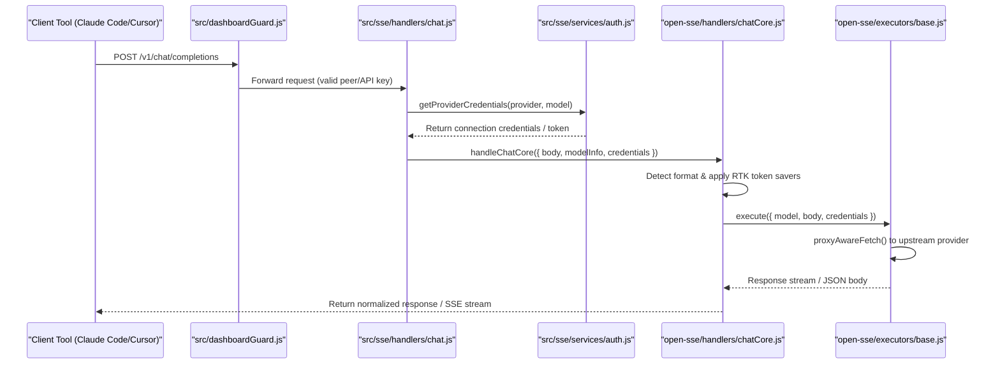
*Diagram 2: Request Processing Sequence from Ingress to Upstream Execution linking exact file functions.*

### Execution Pipeline Breakdown
1. **Chat Ingress (`src/sse/handlers/chat.js`)**: Parses JSON payloads, strips model context markers (`<model>[1m]`), enforces API key checks if `requireApiKey` is active, and detects required capabilities [src/sse/handlers/chat.js:33-93]().
2. **Combo & Fusion Resolution**: If requested model is a combo alias, `handleComboChat` or `handleFusionChat` orchestrates fallback chains and round-robin logic [src/sse/handlers/chat.js:95-139]().
3. **Core Orchestration (`open-sse/handlers/chatCore.js`)**: Determines format via `detectFormat` and `getTargetFormat`, applies RTK token compression (`compressMessages`, `injectCaveman`), and routes response [open-sse/handlers/chatCore.js:61-112]().
4. **Executor Dispatch (`open-sse/executors/base.js`)**: `BaseExecutor` builds headers, constructs upstream URL, and executes requests via `proxyAwareFetch` with automated retry management for rate limits (`429`) and gateway errors (`502`, `503`, `504`) [open-sse/executors/base.js:100-164]().

Sources: [src/sse/handlers/chat.js:33-161](), [open-sse/handlers/chatCore.js:61-112](), [open-sse/executors/base.js:100-164](), [src/sse/services/auth.js:28-140]()

---

## 4. Account Fallback, Rate Limiting, & Credentials

Account management and resilience are handled by `src/sse/services/auth.js` in conjunction with `open-sse/services/accountFallback.js`.

* **Credential Selection & Concurrency**: `getProviderCredentials` uses a selection mutex to prevent race conditions during account rotation [src/sse/services/auth.js:9-41](). It filters out unavailable, excluded, or model-locked connections using flat fields like `modelLock_${model}` [src/sse/services/auth.js:85-112](), [open-sse/services/accountFallback.js:121-140]().
* **Error Classification & Fallback**: `checkFallbackError` inspects error text and status codes against `ERROR_RULES` to determine whether an error should trigger an immediate fallback or backoff cooldown [open-sse/services/accountFallback.js:16-65]().

Sources: [src/sse/services/auth.js:28-140](), [open-sse/services/accountFallback.js:1-174]()

---

## 5. Specialized Subsystems: MITM Proxy, CLI, & Standalone Packaging

### Man-in-the-Middle (MITM) Intercept Subsystem (`src/mitm`)
* **Purpose**: Intercepts hardcoded or native TLS traffic from desktop coding tools (Antigravity, Kiro, GitHub Copilot) and redirects them through the local 9Router proxy.
* **Implementation**: Operates an HTTPS intercept server using dynamically generated Root CA and leaf certificates. Specialized handlers (e.g., `src/mitm/handlers/kiro.js`) decode binary AWS EventStream frames and parse nested thinking blocks [src/mitm/handlers/kiro.js:27-179]().

### CLI Package (`cli/`)
* **Purpose**: Provides the companion command-line interface (`9router` binary) wrapping local daemon startup, tray integration, SQLite runtime hooks, and terminal UI menus.

### Documentation Site (`gitbook/`)
* **Purpose**: Houses the multilingual GitBook documentation site containing navigation structures, content pages, and translation assets.

### Standalone Packaging (`Dockerfile`)
* **Container Build**: Multi-stage Docker build (`Dockerfile`) that compiles Next.js standalone output, copies sibling runtime scripts (`custom-server.js`), prunes unnecessary modules while preserving vital runtimes like `node-forge`, `sql.js`, and `node-machine-id`, and configures root-to-non-root execution via `su-exec` [Dockerfile:1-84]().

Sources: [src/mitm/handlers/kiro.js:1-179](), [Dockerfile:1-84]()

---

# Page: Repository Layout & Assets

# Repository Layout & Assets

<details>
<summary>Relevant source files</summary>

The following files were used as context for generating this wiki page:

- [README.zh-CN.md](README.zh-CN.md)
- [i18n/README.ja-JP.md](i18n/README.ja-JP.md)
- [i18n/README.vi.md](i18n/README.vi.md)
- [i18n/README.zh-CN.md](i18n/README.zh-CN.md)
- [skills/9router-chat/SKILL.md](skills/9router-chat/SKILL.md)
- [skills/9router-embeddings/SKILL.md](skills/9router-embeddings/SKILL.md)
- [skills/9router-image/SKILL.md](skills/9router-image/SKILL.md)
- [skills/9router-tts/SKILL.md](skills/9router-tts/SKILL.md)
- [skills/9router-web-fetch/SKILL.md](skills/9router-web-fetch/SKILL.md)
- [skills/9router-web-search/SKILL.md](skills/9router-web-search/SKILL.md)
- [skills/9router/SKILL.md](skills/9router/SKILL.md)
- [skills/README.md](skills/README.md)
- [src/app/(dashboard)/dashboard/skills/page.js](src/app/(dashboard)/dashboard/skills/page.js)
- [src/app/api/v1/embeddings/route.js](src/app/api/v1/embeddings/route.js)
- [src/lib/auth/dashboardSession.js](src/lib/auth/dashboardSession.js)
- [src/shared/constants/skills.js](src/shared/constants/skills.js)
- [tests/.gitignore](tests/.gitignore)
- [tests/README.md](tests/README.md)
- [tests/package.json](tests/package.json)
- [tests/unit/embeddings.cloud.test.js](tests/unit/embeddings.cloud.test.js)

</details>


## Purpose and Scope
This page documents the non-code and support directories of the 9Router repository. It covers the organization and runtime role of static assets (`public/`, `images/`), drop-in AI agent instructions (`skills/`), multilingual documentation and localized READMEs (`docs/`, `gitbook/`, `i18n/`), utility scripts (`scripts/`), and CI/CD automation workflows (`.github/`).

---

## 1. Public Assets & Provider Branding (`public/` & `images/`)

The `public/` directory stores static assets served directly by Next.js, including brand icons for over 40 supported AI providers and media kinds. Provider icon mapping is defined in registry modules such as `[src/shared/constants/skills.js:1-11]()`, where icon definitions and display metadata bind runtime capabilities to UI badges stored under `[skills/9router-web-search/SKILL.md:1-4]()`.

Similarly, core branding and dashboard preview images (such as `9router.png`) reside in the root `images/` directory, referenced by both localized READMEs (`[i18n/README.zh-CN.md:1-20]()`, `[i18n/README.vi.md:1-15]()`) and the web application interface.

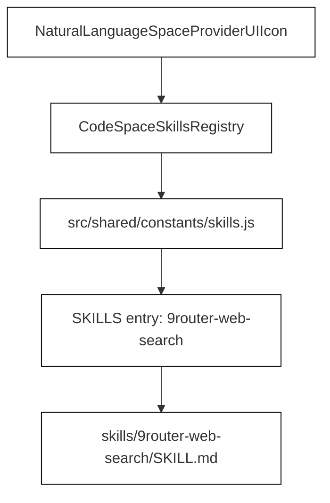
*Sources: `src/shared/constants/skills.js:1-11`, `skills/9router-web-search/SKILL.md:1-4`, `i18n/README.zh-CN.md:1-20`*

---

## 2. Drop-in AI Agent Skills (`skills/`)

The `skills/` directory houses self-contained `SKILL.md` instruction files designed to be ingested directly by autonomous AI agents (e.g., Claude Code, Cline, OpenCode). Each subdirectory represents a discrete capability domain (such as web search, image generation, text-to-speech, or embeddings). 

Metadata for these skills is centralized in `[src/shared/constants/skills.js:1-11]`, which exports the `SKILLS` registry array, endpoint mappings, and raw GitHub content URLs (`[src/shared/constants/skills.js:72-78]()`). Individual skill files like `[skills/9router-web-search/SKILL.md:1-4]()` describe how agents should query 9Router endpoints (`/v1/search`, `/v1/chat/completions`) and handle pagination or provider-specific transport requirements.

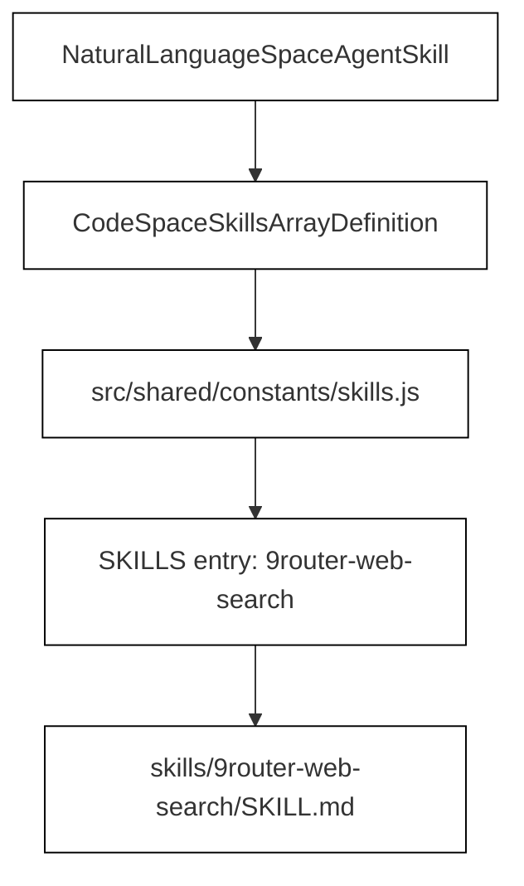
*Sources: `src/shared/constants/skills.js:1-11`, `src/shared/constants/skills.js:72-78`, `skills/9router-web-search/SKILL.md:1-4`*

---

## 3. Documentation & Internationalization (`docs/`, `gitbook/`, `i18n/`)

9Router maintains extensive multi-language documentation to support global developers:
- **Root & i18n READMEs**: Multilingual entries such as `[README.zh-CN.md:1-20]()`, `[i18n/README.zh-CN.md:1-20]()`, and `[i18n/README.vi.md:1-15]()` provide quick start guides, architecture overviews, and installation instructions in Chinese, Vietnamese, Japanese, and English.
- **GitBook Site (`gitbook/`)**: Houses the structured Next.js-based documentation portal covering navigation trees, multilingual content pages, and deployment configs.
- **Support Documentation (`docs/`)**: Supplementary technical notes and architecture diagrams.

*Sources: `README.zh-CN.md:1-20`, `i18n/README.zh-CN.md:1-20`, `i18n/README.vi.md:1-15`*

---

## 4. Scripts & CI/CD Automation (`scripts/`, `.github/`)

Operational tasks, packaging, and integration tests are organized outside the core application runtime:
- **Scripts (`scripts/`)**: Shell and Node.js utilities that handle build-time asset copying, database seeding, native module pruning, and CLI binary compilation.
- **GitHub Workflows (`.github/workflows/`)**: Continuous integration pipelines governing automated testing, container image publishing (`docker-publish`), and release staging.

*Sources: `tests/package.json:1-17`, `tests/README.md:1-20`*

---

# Page: Getting Started

# Getting Started

<details>
<summary>Relevant source files</summary>

The following files were used as context for generating this wiki page:

- [.github/dependabot.yml](.github/dependabot.yml)
- [.github/workflows/docker-publish.yml](.github/workflows/docker-publish.yml)
- [.gitignore](.gitignore)
- [.npmignore](.npmignore)
- [DOCKER.md](DOCKER.md)
- [Dockerfile](Dockerfile)
- [README.md](README.md)
- [open-sse/config/runtimeConfig.js](open-sse/config/runtimeConfig.js)
- [open-sse/executors/base.js](open-sse/executors/base.js)
- [src/app/api/usage/stream/route.js](src/app/api/usage/stream/route.js)

</details>


This page serves as a parent guide for initializing, configuring, and deploying **9Router**. It provides a high-level overview of the setup workflow, installation routes, server initialization, core configuration paradigms, and the terminal application.

**Scope:** This page summarizes initial setup. For detailed installation guides, see [Installation](#2.1). For initial configuration and first requests, see [Quick Start](#2.2). For deep dives into system options, see [Configuration Basics](#2.3). For information on the command-line interface and terminal UI menus, see [CLI Terminal App](#2.4).

Sources: `[README.md:74-98]()`, `[Dockerfile:1-56]()`

---

## 1. Installation Overview

9Router can be set up through several deployment vectors depending on the host environment. The primary distribution channels include global Node.js packages via npm, containerized images via Docker `[Dockerfile:1-85]`, `[DOCKER.md:1-50]()`, or directly running from source code for local development `[README.md:100-130]()`.

For server-grade environments or isolated containers, the Docker image handles runtime execution and volume mapping. Contributors typically clone the repository, configure environment variables, and run the development or production build scripts.

For details on installation options, system prerequisites, and platform-specific steps, see [Installation](#2.1).

### Installation Channels to Implementation Mappings
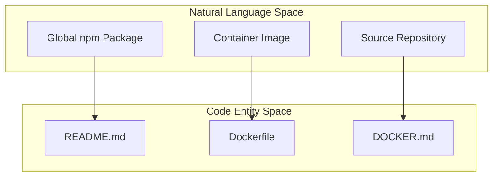
Sources: `[README.md:74-130]()`, `[Dockerfile:1-85]`, `[DOCKER.md:1-50]()`

---

## 2. Quick Start Overview

Once installed, 9Router launches an interactive web dashboard and exposes an OpenAI-compatible API gateway `[README.md:74-98]()`. Users can connect free providers (such as Kiro AI or OpenCode Free) directly through the dashboard interface without complex initial authentication `[README.md:85-88]()`.

CLI coding tools such as Claude Code, Cursor, and Cline can then target the local proxy endpoint `http://localhost:20128/v1` using generated API keys `[README.md:90-96]()`.

For a step-by-step walkthrough of your first provider connection and making initial requests, see [Quick Start](#2.2).

Sources: `[README.md:74-98]()`

---

## 3. Configuration Basics Overview

9Router manages runtime settings, cache TTLs, and retry parameters through centralized configuration modules `[open-sse/config/runtimeConfig.js:1-50]()`. Fundamental configuration concepts include **Providers** (upstream AI services), **Connections** (authenticated instances), **Model Aliases** (mapping short names to downstream models), and **Combos** (fusion chains executing automatic fallback across tiers) `[README.md:38-44]()`.

Settings management covers endpoint security, proxy behaviors, and usage quotas. For an introduction to core configuration entities and settings schemas, see [Configuration Basics](#2.3).

Sources: `[open-sse/config/runtimeConfig.js:1-50]`, `[README.md:38-44]()`

---

## 4. CLI Terminal App & Runtime Architecture

The terminal utility and deployment scripts facilitate local administration and binary distribution `[README.md:74-85]()`. It manages runtime execution hooks, environment bootstrapping, and container entrypoints `[Dockerfile:75-84]()` to ensure clean process separation and reliable daemon execution.

For comprehensive documentation on the terminal binary, interactive menus, system tray support, and sqlite runtime hooks, see [CLI Terminal App](#2.4).

### Terminal and Runtime Entity Mappings
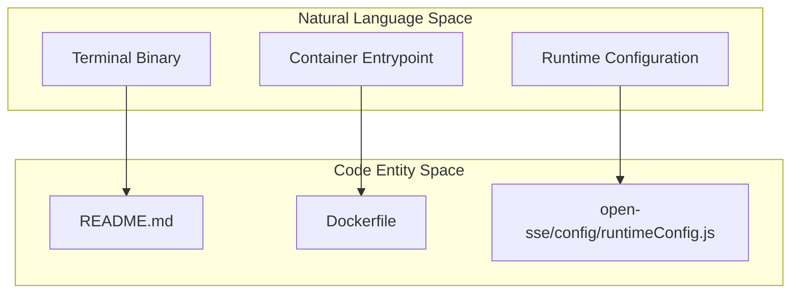
Sources: `[README.md:74-85]`, `[Dockerfile:75-84]`, `[open-sse/config/runtimeConfig.js:1-50]()`

---

## Next Steps

1. **Installation**: Review environment requirements and methods in [Installation](#2.1).
2. **Quick Start**: Complete initial setup and test requests via [Quick Start](#2.2).
3. **Configuration Basics**: Understand providers, aliases, and combos in [Configuration Basics](#2.3).
4. **CLI Terminal App**: Explore terminal administration via [CLI Terminal App](#2.4).

Sources: `[README.md:18-18]`, `[README.md:74-98]()`

---

# Page: Installation

# Installation

<details>
<summary>Relevant source files</summary>

The following files were used as context for generating this wiki page:

- [.github/dependabot.yml](.github/dependabot.yml)
- [.github/workflows/docker-publish.yml](.github/workflows/docker-publish.yml)
- [.gitignore](.gitignore)
- [.npmignore](.npmignore)
- [DOCKER.md](DOCKER.md)
- [Dockerfile](Dockerfile)
- [README.md](README.md)
- [cli/README.md](cli/README.md)
- [cli/cli.js](cli/cli.js)
- [cli/hooks/postinstall.js](cli/hooks/postinstall.js)
- [cli/src/cli/commands/connect.js](cli/src/cli/commands/connect.js)
- [cli/src/cli/commands/connectTools.js](cli/src/cli/commands/connectTools.js)
- [cli/src/cli/commands/show.js](cli/src/cli/commands/show.js)
- [open-sse/config/runtimeConfig.js](open-sse/config/runtimeConfig.js)
- [open-sse/executors/base.js](open-sse/executors/base.js)
- [src/app/api/usage/stream/route.js](src/app/api/usage/stream/route.js)
- [tests/unit/cli-connect.test.js](tests/unit/cli-connect.test.js)
- [tests/unit/cli-show.test.js](tests/unit/cli-show.test.js)

</details>


This page covers how to install and run 9Router using three primary methods: global npm installation, running from source, and Docker. It also documents the containerization strategy, runtime self-healing for native dependencies, and the environment variables required to start the server.

---

## Prerequisites

| Requirement | Minimum Version | Notes |
|---|---|---|
| Node.js | `>=18.0.0` | CLI and server runtime [cli/package.json:36-38]() |
| npm | Bundled with Node.js | Used for global install and source builds |
| Docker | Any recent | Required only for the Docker container deployment [DOCKER.md:1-4]() |

The system requires a persistent data directory for its SQLite databases and configuration files. In Docker, this defaults to `/app/data`, while on local machines it resides in `~/.9router` (or `%APPDATA%\9router` on Windows) managed by the CLI hooks and data directory resolver.

**Installation Method Overview:**

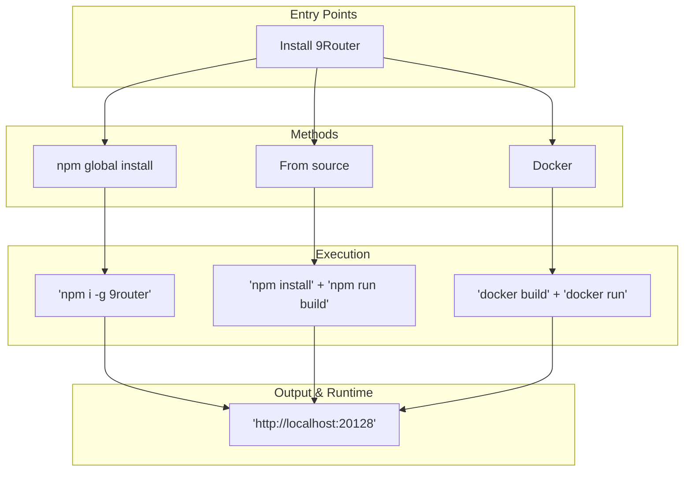
Sources: [cli/package.json:1-48](), [README.md:76-83]()

---

## Method 1: npm Global Install

Global installation via npm provides the `9router` binary CLI tool, which handles process supervision, interactive menus, and automatic runtime self-healing [cli/package.json:5-7]().

### CLI & Runtime Self-Healing Implementation
When installed globally, native modules like `better-sqlite3` and system tray integrations are decoupled from the locked npm global install path to prevent file lock errors (such as `EBUSY` on Windows) [cli/package.json:33-35](). 
1. **SQLite Runtime Bootstrap:** `cli/hooks/sqliteRuntime.js` provisions `sql.js` and `better-sqlite3` inside user-writable `~/.9router/runtime/node_modules` at startup [cli/cli.js:66]().
2. **Tray Runtime Bootstrap:** `cli/hooks/trayRuntime.js` provisions `systray2` on macOS and Linux, while Windows uses PowerShell `NotifyIcon` without external binaries [cli/cli.js:67]().
3. **CLI Launcher:** `cli/cli.js` executes runtime checks before spawning the Next.js server instance [cli/cli.js:66-103]().

Sources: [cli/package.json:31-38](), [cli/cli.js:66-103](), [README.md:76-83]()

---

## Method 2: From Source

Source execution is designed for local development, debugging, and deep customization [package.json:6-18]().

### Development Mode
```bash
cp .env.example .env
npm install
PORT=20127 NEXT_PUBLIC_BASE_URL=http://localhost:20127 npm run dev
```
The development server starts with hot-reloading enabled using Next.js development server bindings [package.json:7]().

### Production Mode
```bash
npm run build
PORT=20128 HOSTNAME=0.0.0.0 NEXT_PUBLIC_BASE_URL=http://localhost:20128 npm run start
```
The production build compiles a standalone Next.js server managed by `custom-server.js` [package.json:9-15](), [Dockerfile:84]().

### Default URLs After Startup
| Path | Description |
|---|---|
| `http://localhost:20128/dashboard` | Web management dashboard [README.md:134]() |
| `http://localhost:20128/v1` | OpenAI-compatible API gateway [README.md:135]() |

Sources: [package.json:6-18](), [Dockerfile:84](), [README.md:132-136]()

---

## Method 3: Docker

The containerized deployment utilizes a multi-stage build pattern defined in `Dockerfile` [Dockerfile:1-84]() and documented in `DOCKER.md` [DOCKER.md:1-187]().

### Quick Start with Persistence
```bash
docker run -d \
  -p 20128:20128 \
  -v "$HOME/.9router:/app/data" \
  -e DATA_DIR=/app/data \
  --name 9router \
  decolua/9router:latest
```

### Docker & Standalone Configuration Mapping

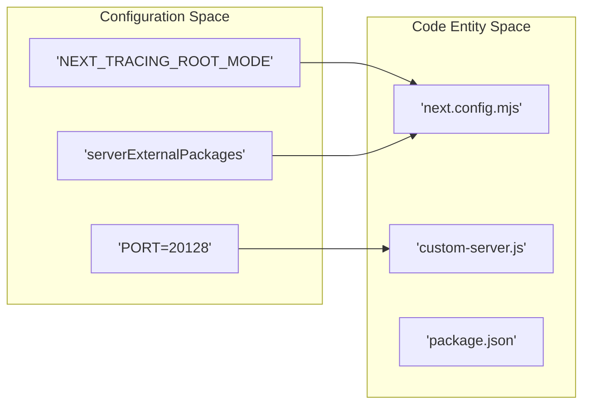

Sources: [package.json:1-68](), [Dockerfile:1-84](), [DOCKER.md:1-52]()

---

## Environment Variables

These variables control server binding, data persistence, and runtime behavior.

| Variable | Default | Description |
|---|---|---|
| `DATA_DIR` | `~/.9router` (Local) / `/app/data` (Docker) | Persistent storage path for SQLite databases and auth tokens [Dockerfile:52](), [DOCKER.md:38]() |
| `PORT` | `20128` | HTTP listen port for web dashboard and API endpoints [Dockerfile:49](), [package.json:7]() |
| `HOSTNAME` | `0.0.0.0` | Network interface binding address [Dockerfile:50]() |
| `NEXT_TELEMETRY_DISABLED` | `1` | Disables Next.js anonymous usage reporting [Dockerfile:51]() |

Sources: [package.json:6-12](), [Dockerfile:48-53]()

---

## Data Flow & Storage Layout

9Router initializes runtime data structures inside the designated data directory.

**Runtime Storage Architecture:**

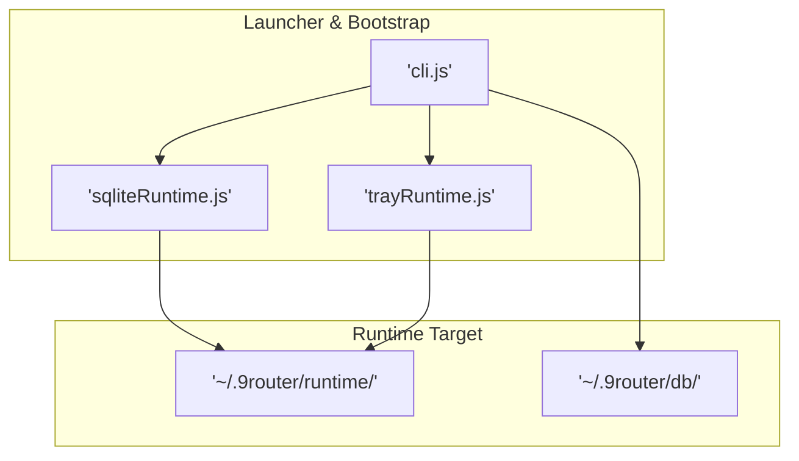

| Path | Content |
|---|---|
| `${DATA_DIR}/db/data.sqlite` | Main SQLite persistence database [DOCKER.md:45]() |
| `${DATA_DIR}/runtime/node_modules/` | User-writable runtime native binaries (`better-sqlite3`, `systray2`) [cli/package.json:33-34]() |
| `${DATA_DIR}/auth/cli-secret` | Shared cryptographic token secret for CLI-to-server API communication |

Sources: [cli/package.json:33-35](), [cli/cli.js:66-103](), [DOCKER.md:40-51]()

---

# Page: Quick Start

# Quick Start

<details>
<summary>Relevant source files</summary>

The following files were used as context for generating this wiki page:

- [.github/dependabot.yml](.github/dependabot.yml)
- [.github/workflows/docker-publish.yml](.github/workflows/docker-publish.yml)
- [.gitignore](.gitignore)
- [.npmignore](.npmignore)
- [DOCKER.md](DOCKER.md)
- [Dockerfile](Dockerfile)
- [README.md](README.md)
- [open-sse/config/runtimeConfig.js](open-sse/config/runtimeConfig.js)
- [open-sse/executors/base.js](open-sse/executors/base.js)
- [src/app/(dashboard)/dashboard/endpoint/EndpointPageClient.js](src/app/(dashboard)/dashboard/endpoint/EndpointPageClient.js)
- [src/app/(dashboard)/dashboard/profile/page.js](src/app/(dashboard)/dashboard/profile/page.js)
- [src/app/(dashboard)/dashboard/providers/[id]/ModelRow.js](src/app/(dashboard)/dashboard/providers/[id]/ModelRow.js)
- [src/app/(dashboard)/dashboard/providers/[id]/page.js](src/app/(dashboard)/dashboard/providers/[id]/page.js)
- [src/app/(dashboard)/dashboard/providers/page.js](src/app/(dashboard)/dashboard/providers/page.js)
- [src/app/api/settings/route.js](src/app/api/settings/route.js)
- [src/app/api/usage/stream/route.js](src/app/api/usage/stream/route.js)
- [src/lib/localDb.js](src/lib/localDb.js)
- [src/shared/components/Header.js](src/shared/components/Header.js)
- [src/shared/components/Sidebar.js](src/shared/components/Sidebar.js)

</details>


## Purpose and Scope
This page walks through the minimum technical steps to initialize a 9Router instance, configure and authenticate an AI provider, understand the model aliasing and prefix convention, and execute a fully resolved API request through the backend routing engine.

---

## Start the Server

9Router can be deployed globally via npm, run directly from source for local development, or containerized using Docker. The application defaults to port `20128` for client ingress and API endpoints [README.md:117-121](), [Dockerfile:48-52]().

### Deployment Methods

* **Global npm Package:**
  ```bash
  npm install -g 9router
  9router
  ```
  [README.md:78-81]()

* **Local Development (Source):**
  9Router utilizes a Next.js framework core [README.md:104-108](). Environment variables such as `PORT` and `NEXT_PUBLIC_BASE_URL` govern local binding.
  ```bash
  cp .env.example .env
  npm install
  PORT=20128 NEXT_PUBLIC_BASE_URL=http://localhost:20128 npm run dev
  ```
  [README.md:104-108]()

* **Docker Container:**
  The container image is multi-platform and executes via a custom entrypoint script to resolve SQLite volume write permissions [Dockerfile:1-84]().
  ```bash
  docker run -d \
    -p 20128:20128 \
    -v "$HOME/.9router:/app/data" \
    -e DATA_DIR=/app/data \
    --name 9router \
    decolua/9router:latest
  ```
  [Dockerfile:48-84]()

Once operational, the dashboard interface is exposed at `http://localhost:20128/dashboard` and the OpenAI-compatible proxy interface at `http://localhost:20128/v1` [README.md:132-136]().

Sources: [README.md:78-136](), [Dockerfile:1-84]()

---

## Add a Provider

Providers encapsulate upstream AI services, managing authentication types (API keys, OAuth tokens, web cookies, and unauthenticated free tiers) [README.md:85-88](), [src/app/(dashboard)/dashboard/providers/[id]/page.js:8-10]().

### Connection Mechanics

When configuring an API key or token via the UI modal, the system initiates a validation probe against validation endpoints prior to persisting the record [src/app/(dashboard)/dashboard/providers/[id]/page.js:114-121]().

**Code Entity Space: Provider Connection & Validation Flow**
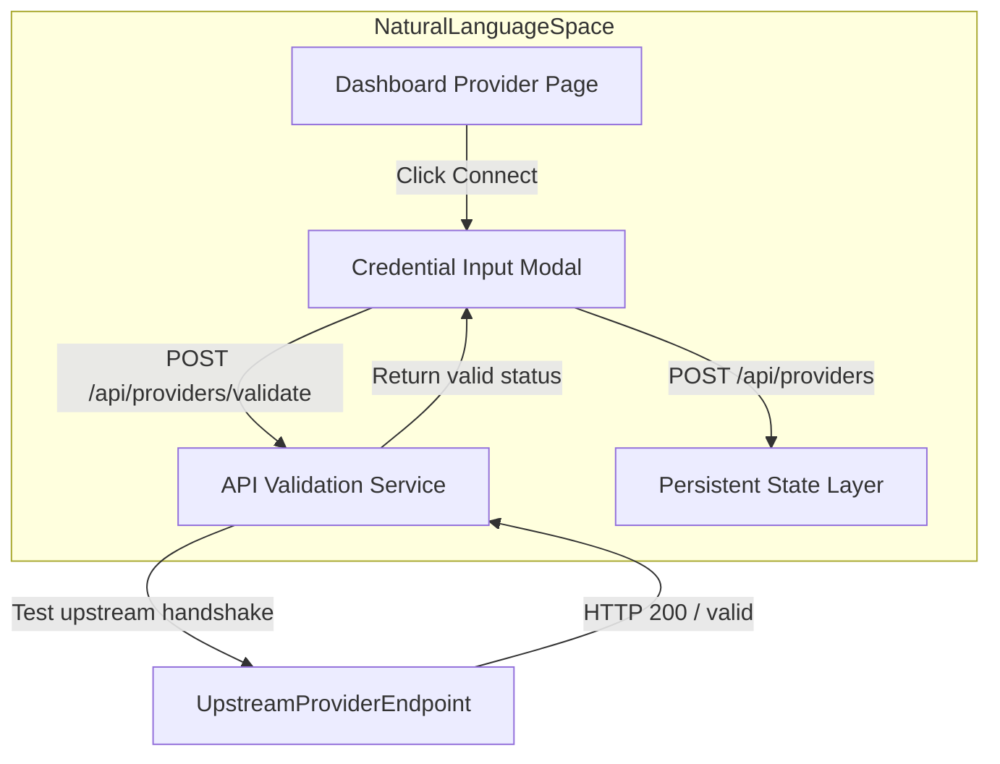
Sources: [src/app/(dashboard)/dashboard/providers/[id]/page.js:93-129]()

Sources: [README.md:85-88](), [src/app/(dashboard)/dashboard/providers/[id]/page.js:93-129]()

---

## Model Name Format & Prefixes

To route incoming requests to specific provider connections, 9Router employs a prefix-based model routing syntax. Every target model must be prefixed to declare its routing family [README.md:95-95]().

| Prefix | Provider Family | Example Model Identifier |
| :--- | :--- | :--- |
| `kr` | Kiro AI | `kr/claude-sonnet-4.5` [README.md:95-95]() |
| `oc` | OpenCode Free | `oc/mimo-v2.5-free` |
| `gh` | GitHub Copilot | `gh/gpt-4o` |
| `ag` | Antigravity | `ag/gemini-2.0-flash-exp` |

Sources: [README.md:95-95]()

---

## Make Your First Request

With the server running and a provider connected, you can submit an OpenAI-compatible completion request to `http://localhost:20128/v1/chat/completions` [README.md:135-135]().

**Example cURL Request:**
```bash
curl http://localhost:20128/v1/chat/completions \
  -H "Content-Type: application/json" \
  -H "Authorization: Bearer [Default Key]" \
  -d '{
    "model": "kr/claude-sonnet-4.5",
    "messages": [{"role": "user", "content": "Hello!"}],
    "stream": false
  }'
```
[README.md:91-96]()

### Request Execution Pipeline

When the request reaches the routing engine, it is processed by the `BaseExecutor` class [open-sse/executors/base.js:11-16]():

1. **Request Transformation:** `transformRequest()` modifies the payload to match the target provider's expected schema [open-sse/executors/base.js:78-81]().
2. **Header Construction:** `buildHeaders()` attaches authentication tokens (`Authorization: Bearer ...` or `x-api-key`) and stream declarations [open-sse/executors/base.js:46-76]().
3. **Dispatch & Proxying:** `proxyAwareFetch()` routes the request to the upstream target, respecting proxy configurations [open-sse/executors/base.js:146-151]().
4. **Retry & Backoff Handling:** If upstream returns a retryable status code, `tryRetry()` evaluates parameters and attempts re-transmission before triggering connection fallback [open-sse/executors/base.js:109-125]().

**Code Entity Space: Request Processing Sequence**
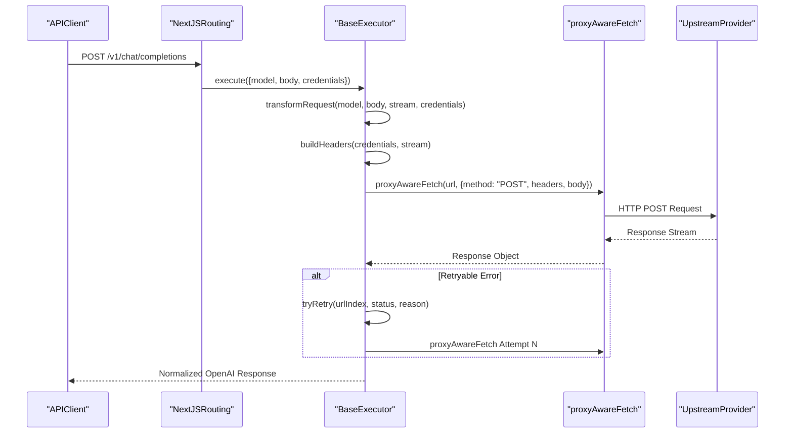
Sources: [open-sse/executors/base.js:10-164]()

Sources: [open-sse/executors/base.js:10-164]()

---

# Page: Configuration Basics

# Configuration Basics

<details>
<summary>Relevant source files</summary>

The following files were used as context for generating this wiki page:

- [open-sse/config/constants.js](open-sse/config/constants.js)
- [open-sse/config/providerModels.js](open-sse/config/providerModels.js)
- [open-sse/config/providers.js](open-sse/config/providers.js)
- [open-sse/executors/index.js](open-sse/executors/index.js)
- [open-sse/services/capacityAdapter.js](open-sse/services/capacityAdapter.js)
- [open-sse/services/model.js](open-sse/services/model.js)
- [src/app/(dashboard)/dashboard/providers/[id]/CustomConfigCard.js](src/app/(dashboard)/dashboard/providers/[id]/CustomConfigCard.js)
- [src/app/api/providers/[id]/overrides/route.js](src/app/api/providers/[id]/overrides/route.js)
- [src/app/api/providers/[id]/test/route.js](src/app/api/providers/[id]/test/route.js)
- [src/app/api/providers/validate/route.js](src/app/api/providers/validate/route.js)
- [src/lib/db/backup.js](src/lib/db/backup.js)
- [src/lib/db/migrate.js](src/lib/db/migrate.js)
- [src/lib/db/repos/requestDetailsRepo.js](src/lib/db/repos/requestDetailsRepo.js)
- [src/lib/db/repos/settingsRepo.js](src/lib/db/repos/settingsRepo.js)
- [src/shared/constants/config.js](src/shared/constants/config.js)
- [src/shared/constants/providers.js](src/shared/constants/providers.js)

</details>


## Purpose and Scope

This page introduces the core configuration architecture in 9Router: provider registries, model resolution, combos, capacity adapters, and global settings. These entities compose the backend configuration plane that enables 9Router to route, translate, and optimize AI traffic across multiple upstream providers with fault tolerance and low latency.

---

## 1. Configuration Entity Architecture & Database Layer

All runtime state, settings, and provider connections are persisted through a SQLite database abstraction layer located in `src/lib/db/` and exposed via `src/lib/localDb.js`. Configuration values are read and updated through dedicated repository modules such as `settingsRepo.js`.

### Configuration to Code Entity Mapping

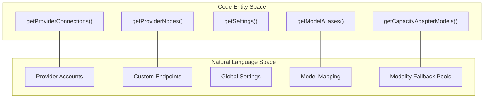
*Sources: [src/lib/db/repos/settingsRepo.js:7-67](), [src/lib/localDb.js:3-21]()*

---

## 2. Provider Registry & Authentication Categories

Providers are defined in the registry (`open-sse/providers/registry/index.js`) and surfaced via `src/shared/constants/providers.js`. 9Router categorizes providers into distinct operational classes based on their authentication mechanics.

### Provider Classifications

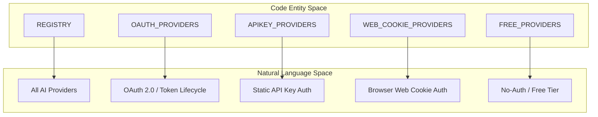
*Sources: [src/shared/constants/providers.js:43-71](), [open-sse/config/providerModels.js:1-7]*

Providers define metadata schemas including service kinds (`serviceKinds`), credential requirements, and fallback options. Custom headers can be injected per provider and are validated against security constraints before being saved to the `providerOverrides` store in `settingsRepo.js` [src/lib/db/repos/settingsRepo.js:65-66]().

*Sources: [src/shared/constants/providers.js:1-41](), [src/lib/db/repos/settingsRepo.js:65-66]*

---

## 3. Models, Aliases, and Capacity Adapters

Models serve as execution units. 9Router parses and resolves model strings (e.g., `provider/model` or alias lookups) via helper functions in `open-sse/services/model.js` [open-sse/services/model.js:27-55]().

### Model Resolution & Capacity Augmentation

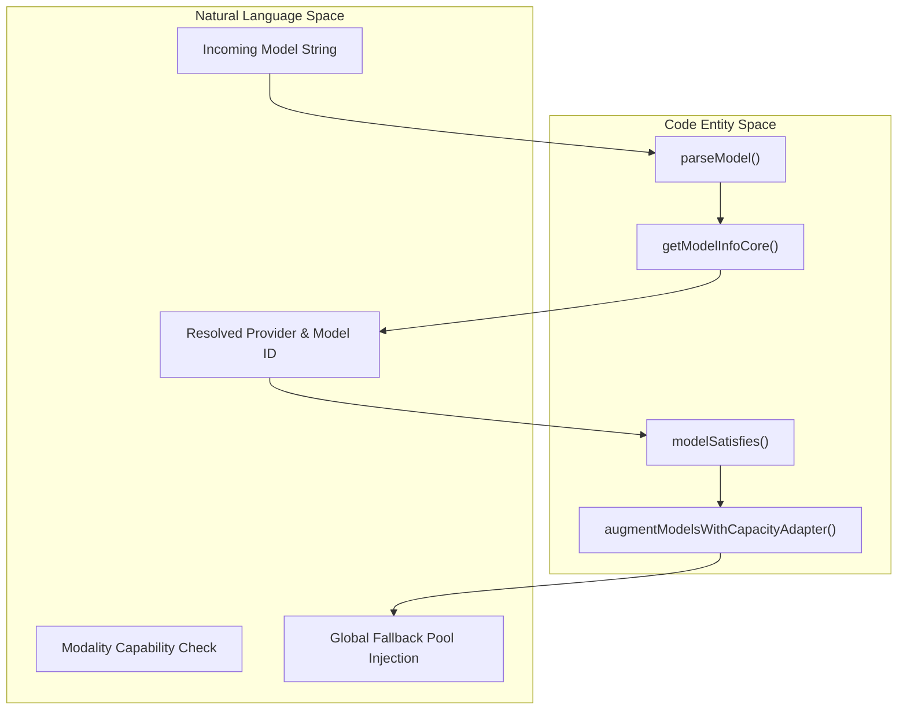
*Sources: [open-sse/services/model.js:27-123](), [open-sse/services/capacityAdapter.js:79-101]()*

### Capacity Adapters
When a request requires a specific modality (such as `vision`, `pdf`, `audioInput`, or `videoInput`) and the primary model lacks support, `augmentModelsWithCapacityAdapter()` injects fallback models from global capacity pools [open-sse/services/capacityAdapter.js:69-101]().

*Sources: [open-sse/services/capacityAdapter.js:1-101](), [open-sse/config/providerModels.js:14-48]*

---

## 4. Global Settings and Authentication

Global behavior is managed through `settingsRepo.js`, combining default configurations with persisted database rows [src/lib/db/repos/settingsRepo.js:7-102]().

### Core Settings Structure
* **Authentication Modes:** Configurable via `authMode` (`password`, `oidc`, or `saml`) [src/lib/db/repos/settingsRepo.js:29-41]().
* **Observability & Request Logging:** Controlled via `enableObservability`, `observabilityMaxRecords`, and `observabilityBatchSize` [src/lib/db/repos/settingsRepo.js:42-46]().
* **Outbound Proxies:** Managed through `outboundProxyEnabled`, `outboundProxyUrl`, and `outboundNoProxy` [src/lib/db/repos/settingsRepo.js:47-49]().

Atomic writes are enforced using database transactions to prevent race conditions during concurrent updates [src/lib/db/repos/settingsRepo.js:109-123]().

*Sources: [src/lib/db/repos/settingsRepo.js:7-123]()*

---

## 5. Network Egress and Token Optimization Flags

The configuration layer exposes toggles for network proxying, remote tunnels, and prompt optimization subsystems ("Token Savers").

| Configuration Flag | Default Value | Purpose | Key Code Reference |
| :--- | :--- | :--- | :--- |
| `rtkEnabled` | `true` | Real-time prompt compression pipeline | `src/lib/db/repos/settingsRepo.js:52` |
| `headroomEnabled` | `false` | External headroom compression integration | `src/lib/db/repos/settingsRepo.js:53` |
| `cavemanEnabled` | `false` | Prompt modifier for token reduction | `src/lib/db/repos/settingsRepo.js:57` |
| `ponytailEnabled` | `false` | Structured message trimming | `src/lib/db/repos/settingsRepo.js:59` |
| `pxpipeEnabled` | `false` | Multimodal prompt compression pipe | `src/lib/db/repos/settingsRepo.js:61` |

*Sources: [src/lib/db/repos/settingsRepo.js:50-67]*

---

# Page: CLI Terminal App

# CLI Terminal App

<details>
<summary>Relevant source files</summary>

The following files were used as context for generating this wiki page:

- [.github/workflows/tray-binaries.yml](.github/workflows/tray-binaries.yml)
- [CHANGELOG.md](CHANGELOG.md)
- [cli/.gitignore](cli/.gitignore)
- [cli/.npmignore](cli/.npmignore)
- [cli/LICENSE](cli/LICENSE)
- [cli/README.md](cli/README.md)
- [cli/cli.js](cli/cli.js)
- [cli/hooks/postinstall.js](cli/hooks/postinstall.js)
- [cli/hooks/sqliteRuntime.js](cli/hooks/sqliteRuntime.js)
- [cli/hooks/trayRuntime.js](cli/hooks/trayRuntime.js)
- [cli/package.json](cli/package.json)
- [cli/scripts/build-cli.js](cli/scripts/build-cli.js)
- [cli/scripts/buildMitm.js](cli/scripts/buildMitm.js)
- [cli/scripts/buildTrayArm64.js](cli/scripts/buildTrayArm64.js)
- [cli/src/cli/commands/connect.js](cli/src/cli/commands/connect.js)
- [cli/src/cli/commands/connectTools.js](cli/src/cli/commands/connectTools.js)
- [cli/src/cli/commands/show.js](cli/src/cli/commands/show.js)
- [cli/src/cli/terminalUI.js](cli/src/cli/terminalUI.js)
- [cli/src/cli/tray/tray.js](cli/src/cli/tray/tray.js)
- [cli/src/cli/utils/input.js](cli/src/cli/utils/input.js)
- [next.config.mjs](next.config.mjs)
- [open-sse/utils/claudeSignature.js](open-sse/utils/claudeSignature.js)
- [package.json](package.json)
- [tests/unit/cli-build-artifacts.test.js](tests/unit/cli-build-artifacts.test.js)
- [tests/unit/cli-connect.test.js](tests/unit/cli-connect.test.js)
- [tests/unit/cli-show.test.js](tests/unit/cli-show.test.js)
- [tests/unit/open-package-external.test.js](tests/unit/open-package-external.test.js)

</details>


This leaf page documents the `cli/` package, which provides the standalone `9router` binary, the underlying runtime self-healing hooks for native dependencies, system tray integration across platforms, remote tool configuration commands (`connect` and `show`), and the build/packaging pipeline used to distribute the CLI via npm.

---

## 1. The `9router` Binary & Launcher Architecture

The primary entry point for the CLI package is `cli/cli.js`, executed via the `9router` binary declaration in `cli/package.json`. When invoked from the terminal, the script parses configuration flags, initializes runtime environments, manages background processes, and launches the Next.js standalone server or delegates to administrative/remote subcommands [cli/cli.js:1-184](), [cli/package.json:1-7]().

### Launcher Workflow & Argument Parsing

The launcher processes command-line flags to configure network binding, browser automation, logging visibility, and background modes:
- `--port`, `-p`: Specifies the TCP port (default: `20128`) [cli/cli.js:109,141-143]().
- `--host`, `-H`: Specifies the network interface to bind (default: `0.0.0.0`) [cli/cli.js:110,144-146]().
- `--tray`, `-t`: Forces execution into background system tray mode (`TRAY_MODE=1`) [cli/cli.js:153-156]().
- Subcommands (e.g., `9router xai video`, `9router connect`, `9router show`) bypass the launcher server spawn flow and execute dedicated command handlers [cli/cli.js:70-95]().

```mermaid
graph TD
  A["CLIInvocation[\"cli/cli.js\"]"] --> B{SubcommandCheck}
  B -- "xai video" --> C["ExecuteXaiVideo[\"src/cli/commands/xaiVideo.js\"]"]
  B -- "connect / show" --> D["ExecuteConnectOrShow[\"src/cli/commands/connect.js\"]"]
  B -- "Standard Launch" --> E["EnsureSqliteRuntime[\"cli/hooks/sqliteRuntime.js\"]"]
  E --> F["EnsureTrayRuntime[\"cli/hooks/trayRuntime.js\"]"]
  F --> G["ParseArgs[\"--port --host --tray\"]"]
  G --> H["SpawnNextStandaloneServer[\"custom-server.js\"]"]
  H --> I["WaitServerReady[\"TCP Probe\"]"]
  I --> J{TrayModeEnabled?}
  J -- "Yes" --> K["InitTray[\"cli/src/cli/tray/tray.js\"]"]
  J -- "No" --> L["OpenBrowser[\"Dashboard URL\"]"]
```
Sources: `cli/cli.js`, `cli/package.json`, `cli/hooks/sqliteRuntime.js`, `cli/hooks/trayRuntime.js`, `cli/src/cli/tray/tray.js`

---

## 2. SQLite and Tray Runtime Self-Healing Hooks

To prevent Windows `EBUSY` file locking errors during global npm updates (`npm i -g 9router@latest`) and to avoid packaging unsigned binary executables that trigger antivirus false positives, native modules are dynamically provisioned into a user-writable runtime directory (`~/.9router/runtime` or `%APPDATA%\9router\runtime`) [cli/package.json:33-34](), [cli/hooks/sqliteRuntime.js:1-24]().

### SQLite Runtime Isolation (`sqliteRuntime.js`)

`cli/hooks/sqliteRuntime.js` inspects the active Node.js major version to select the appropriate SQLite driver [cli/hooks/sqliteRuntime.js:9-16]():
- **Node >= 22**: Uses `better-sqlite3` version `13.0.3` (N-API build with precompiled platform binaries, skipping build tool requirements) [cli/hooks/sqliteRuntime.js:14]().
- **Node < 22**: Uses `better-sqlite3` version `12.6.2` fetched via `prebuild-install` [cli/hooks/sqliteRuntime.js:12]().
- **sql.js**: Ensures the WebAssembly asset (`sql-wasm.wasm`) is present and valid in the runtime dependency tree [cli/hooks/sqliteRuntime.js:131-136]().

### Tray Runtime Isolation (`trayRuntime.js`)

`cli/hooks/trayRuntime.js` manages system tray binaries [cli/package.json:34-35]():
- **Windows**: Bypasses external binaries entirely, utilizing PowerShell `NotifyIcon` scripts for zero binary footprint [cli/package.json:34]().
- **macOS / Linux**: Lazy-installs `systray2` version `2.1.4` into the runtime node modules directory and applies `chmod +x` permissions on the unpacked Go helper binary (`tray_darwin_release` or `tray_linux_release`) [cli/package.json:34](), [cli/src/cli/tray/tray.js:174-189](). It also automatically overlays native Apple Silicon ARM64 binaries from pinned GitHub releases [cli/package.json:34]().

```mermaid
graph TD
  A["EnsureRuntimeDir[\"~/.9router/runtime\"]"] --> B{CheckSqlJsWasm}
  B -- "Missing" --> C["InstallSqlJs[\"sql.js@1.14.1\"]"]
  B -- "Valid" --> D{CheckBetterSqlite3}
  C --> D
  D -- "Missing / Invalid Binary" --> E["InstallBetterSqlite3[\"Version based on Node Major\"]"]
  D -- "Valid Binary" --> F["SQLiteEngineReady"]
  E --> F
  F --> G{Platform = Windows?}
  G -- "Yes" --> H["UsePowerShellNotifyIcon[\"Zero Binary\"]"]
  G -- "No" --> I["EnsureSystray2[\"systray2@2.1.4\"]"]
  I --> J["ChmodTrayBin[\"+x on traybin release\"]"]
```
Sources: `cli/package.json`, `cli/hooks/sqliteRuntime.js`, `cli/src/cli/tray/tray.js`

---

## 3. System Tray Integration

The system tray module (`cli/src/cli/tray/tray.js`) provides a cross-platform background control interface [cli/src/cli/tray/tray.js:1-54]().

### Platform Implementations & Menu Actions

- **Windows (`trayWin.js`)**: Executes a background PowerShell script invoking `.NET NotifyIcon` APIs, communicating via standard input/output pipes [cli/src/cli/tray/tray.js:114-135]().
- **Unix (`systray2`)**: Spawns the compiled Go tray helper binary, passing base64-encoded PNG icons and menu structures [cli/src/cli/tray/tray.js:191-202]().

The tray menu exposes four primary options [cli/src/cli/tray/tray.js:59-73]:
1. **Status**: Displays server running state and bound port (disabled/informational) [cli/src/cli/tray/tray.js:61]().
2. **Open Dashboard**: Opens `http://localhost:<port>/dashboard` in the default system browser [cli/src/cli/tray/tray.js:62,92-94]().
3. **Auto-start**: Toggles operating system login item persistence via `autostart.js` [cli/src/cli/tray/tray.js:63-67,95-102]().
4. **Quit**: Terminates child processes, cleans up tray instances, and exits [cli/src/cli/tray/tray.js:68,103-108]().

```mermaid
graph TD
  A["InitTray[\"tray.js\"]"] --> B{Platform Check}
  B -- "win32" --> C["InitWindowsTray[\"trayWin.js\"]"]
  B -- "darwin/linux" --> D["InitUnixTray[\"systray2\"]"]
  C --> E["NotifyIcon[\"PowerShell Runtime\"]"]
  D --> F["tray_darwin_release / tray_linux_release"]
  E --> G["Menu Click Event"]
  F --> G
  G --> H{Menu Action Index}
  H -- "DASHBOARD (1)" --> I["OpenBrowser[\"http://localhost:port/dashboard\"]"]
  H -- "AUTOSTART (2)" --> J["Toggle OS Startup Persistence"]
  H -- "QUIT (3)" --> K["Kill Gateway & Exit Process"]
```
Sources: `cli/src/cli/tray/tray.js`

---

## 4. Remote Connect & CLI Tools Configuration

The `9router connect` command (`cli/src/cli/commands/connect.js`) and its associated tool configuration writers (`cli/src/cli/commands/connectTools.js`) allow local developer tools (such as Claude Code, Codex CLI, OpenCode, and Droid) to target a remote 9Router server without running a local gateway instance [cli/src/cli/commands/connect.js:1-50](), [cli/src/cli/commands/connectTools.js:1-10]().

### Authentication & Config Writing Flow

1. **Password Authentication**: Prompts for the dashboard password (or loads it from `~/.9router/connect.env` if saved with `--save`) and authenticates against the remote server [cli/src/cli/commands/connect.js:105-136]().
2. **API Key Provisioning**: Reuses or provisions an API key named `cli-<hostname>` on the remote server [cli/src/cli/commands/connect.js:33]().
3. **Per-Tool Writers**: `connectTools.js` implements specific settings parsers and writers for each supported tool (e.g., updating `~/.claude/settings.json`, `~/.codex/config.toml`, or `~/.factory/settings.json`) while backing up original files as `.bak-9router` [cli/src/cli/commands/connectTools.js:43-52,71-144]().

```mermaid
graph TD
  A["ParseArgs[\"connect.js\"]"] --> B["LoadSavedPassword[\"connect.env\"]"]
  B --> C{Password Present?}
  C -- "No" --> D["PromptPassword[\"enquirer Password\"]"]
  C -- "Yes" --> E["AuthenticateWithRemoteServer[\"POST /api/auth/login\"]"]
  D --> E
  E --> F["ProvisionApiKey[\"cli-<hostname>\"]"]
  F --> G["ResolveTools[\"connectTools.js\"]"]
  G --> H["ApplyToolConfig[\"claude / codex / droid / opencode\"]"]
  H --> I["BackupOriginalFile[\"*.bak-9router\"]"]
  I --> J["WriteUpdatedSettings[\"mode 0600\"]"]
```
Sources: `cli/src/cli/commands/connect.js`, `cli/src/cli/commands/connectTools.js`

---

## 5. Packaging Script & Build Pipeline

The CLI packaging script (`cli/scripts/build-cli.js`) automates the compilation and bundling of the application into an npm-publishable tarball (`cli/`) [cli/scripts/build-cli.js:1-152]().

### Build Steps

1. **Version Synchronization**: Syncs the version field from `cli/package.json` to the root `package.json` [cli/scripts/build-cli.js:158-170]().
2. **Next.js Standalone Build**: Executes `npm run build` with `NEXT_TRACING_ROOT_MODE=workspace` to generate a slim standalone bundle containing traced dependencies [cli/scripts/build-cli.js:171-188]().
3. **Asset & Artifact Merging**: Copies standalone app output, traced `node_modules`, and server route artifacts into `cli/app/` while excluding heavy non-source elements (e.g., Sharp image processing binaries, log files, and environment templates) [cli/scripts/build-cli.js:16-36,113-150]().
4. **Tarball Packing**: Runs `npm pack` inside the `cli/` directory to output the distributable `.tgz` artifact [cli/package.json:20]().

```mermaid
graph TD
  A["NpmRunCliPack[\"package.json\"]"] --> B["BuildCliScript[\"cli/scripts/build-cli.js\"]"]
  B --> C["SyncVersion[\"cli/package.json -> root package.json\"]"]
  C --> D["BuildNextApp[\"Workspace Tracing Mode\"]"]
  D --> E["ResolveStandaloneOutput[\".next/standalone\"]"]
  E --> F["CopyTracedFiles[\"Exclude Heavy Assets\"]"]
  F --> G["MergeServerApiArtifacts[\".next-cli-build/server\"]"]
  G --> H["NpmPack[\"pack-destination ..\"]"]
  H --> I["DistributableTarball[\"9router-*.tgz\"]"]
```
Sources: `package.json`, `cli/package.json`, `cli/scripts/build-cli.js`

---

# Page: Core Concepts

# Core Concepts

<details>
<summary>Relevant source files</summary>

The following files were used as context for generating this wiki page:

- [images/fusion-combo-ui.png](images/fusion-combo-ui.png)
- [open-sse/handlers/chatCore.js](open-sse/handlers/chatCore.js)
- [open-sse/services/combo.js](open-sse/services/combo.js)
- [open-sse/translator/concerns/modality.js](open-sse/translator/concerns/modality.js)
- [src/sse/handlers/chat.js](src/sse/handlers/chat.js)
- [src/sse/services/auth.js](src/sse/services/auth.js)
- [tests/unit/combo-fusion.test.js](tests/unit/combo-fusion.test.js)
- [tests/unit/fetch-success-clears-account.test.js](tests/unit/fetch-success-clears-account.test.js)
- [tests/unit/hermes-vision-detection.test.js](tests/unit/hermes-vision-detection.test.js)

</details>


This page explains the fundamental architectural concepts that underpin 9Router's operation. These principles form the foundation for how 9Router routes requests, manages providers, resolves models, translates API formats, and executes multi-tier fallbacks.

**Scope**: This is a high-level overview page. For deep technical implementation details, refer to the child sections linked below.

---

## 3.1 Smart Router & 3-Tier Fallback

9Router acts as an intelligent smart router that intercepts requests from AI coding tools (such as Claude Code, Cursor, and Cline) and routes them through a tiered fallback strategy: **Subscription → Cheap → Free** [open-sse/handlers/chatCore.js:63-110](). When a primary subscription quota is exhausted or rate-limited, the system automatically degrades execution to affordable models or free endpoints without disrupting the user session.

For details on the tiered fallback strategy and routing logic, see [Smart Router & 3-Tier Fallback](#3.1).

Sources: [open-sse/handlers/chatCore.js:63-110](), [src/sse/handlers/chat.js:35-148]()

---

## 3.2 Provider Types & Authentication

9Router categorizes upstream AI services into distinct provider types based on their authentication models and integration pathways: OAuth, API Key, Web-cookie, and Free providers [src/sse/services/auth.js:47-72](). Authentication is managed via registry-driven credentials, token refresh cycles, and connection testing routines [src/sse/services/auth.js:28-134]().

For details on provider classification and credential handling, see [Provider Types & Authentication](#3.2).

Sources: [src/sse/services/auth.js:28-134]()

---

## 3.3 Model Aliases & Combos

To simplify model management, 9Router provides a mapping layer that translates human-friendly aliases and multi-model fusion/fallback combos into concrete provider endpoints [open-sse/handlers/chatCore.js:82-83](), [src/sse/handlers/chat.js:104-148](). Users can define custom aliases or reference built-in provider prefixes [src/sse/handlers/chat.js:56-57]().

Title: Natural Language Space to Code Entity Space (Models & Aliases)
```mermaid
graph LR
    subgraph "NaturalLanguageSpace"
        NL1[""my-claude-alias""]
        NL2[""fallback-fusion-chain""]
    end

    subgraph "CodeEntitySpace"
        CE1["aliasRepo (db.json)"]
        CE2["combos (db.json)"]
        CE3["PROVIDER_MODELS (providerModels.js)"]
    end

    subgraph "ResolvedEntities"
        RE1["cc/claude-3-5-sonnet"]
        RE2["['cc/claude-opus', 'kr/claude-sonnet-4-5']"]
    end

    NL1 --> CE1
    CE1 --> RE1
    NL2 --> CE2
    CE2 --> RE2
    RE1 --> CE3
```
Sources: [open-sse/handlers/chatCore.js:82-83](), [src/sse/handlers/chat.js:104-148]()

For details on model aliasing and combo chains, see [Model Aliases & Combos](#3.3).

Sources: [open-sse/handlers/chatCore.js:82-83](), [src/sse/handlers/chat.js:104-148]()

---

## 3.4 Format Translation

Because different AI tools and upstream providers utilize incompatible API schemas (OpenAI, Anthropic Claude, Google Gemini, Responses API, Kiro, Ollama), 9Router features a comprehensive format translation pipeline [open-sse/handlers/chatCore.js:76-110](). It dynamically converts request bodies, headers, tool definitions, and streaming Server-Sent Events (SSE) bidirectionally between client tools and providers [open-sse/handlers/chatCore.js:1-35]().

For details on translator modules and format mappings, see [Format Translation](#3.4).

Sources: [open-sse/handlers/chatCore.js:1-110]()

---

## 3.5 Account Fallback & Rate Limiting

When hitting rate limits (`429`) or provider errors, 9Router automatically rotates accounts and applies model locks to isolate failing nodes [src/sse/services/auth.js:86-114](). Selection strategies such as round-robin, fill-first, and sticky round-robin distribute load across active connections while respecting quota boundaries [src/sse/services/auth.js:28-40]().

For details on error classification, rate limiting, and automatic rotation, see [Account Fallback & Rate Limiting](#3.5).

Sources: [src/sse/services/auth.js:28-134]()

---

## 3.6 Model Capabilities & Thinking Levels

9Router tracks individual model capabilities—such as vision support, context window limits, parameter gating, and extended reasoning/thinking configurations [open-sse/services/combo.js:63-82](). Capability adapters and modality filters ensure that unsupported parameters or missing modalities (like vision or document inputs) are stripped or transformed before reaching upstream executors [open-sse/translator/concerns/modality.js:135-168]().

Title: Natural Language Space to Code Entity Space (Capabilities & Thinking)
```mermaid
graph LR
    subgraph "NaturalLanguageSpace"
        NC1[""Extended Thinking Mode""]
        NC2[""Vision & Context Gating""]
    end

    subgraph "CodeEntitySpace"
        CC1["detectRequiredCapabilities (combo.js)"]
        CC2["getCapabilitiesForModel (capabilities.js)"]
        CC3["stripUnsupportedModalities (modality.js)"]
    end

    subgraph "ResolvedExecution"
        RC1["thinking: { type: enabled, budget_tokens }"]
        RC2["modality filtering & placeholders"]
    end

    NC1 --> CC1
    CC1 --> RC1
    NC2 --> CC2
    CC2 --> CC3
    CC3 --> RC2
```
Sources: [open-sse/services/combo.js:63-149](), [open-sse/translator/concerns/modality.js:135-168]()

For details on capability adapters and thinking configurations, see [Model Capabilities & Thinking Levels](#3.6).

Sources: [open-sse/services/combo.js:63-149](), [open-sse/translator/concerns/modality.js:135-168]()

---

# Page: Smart Router & 3-Tier Fallback

# Smart Router & 3-Tier Fallback

<details>
<summary>Relevant source files</summary>

The following files were used as context for generating this wiki page:

- [images/fusion-combo-ui.png](images/fusion-combo-ui.png)
- [open-sse/config/errorConfig.js](open-sse/config/errorConfig.js)
- [open-sse/handlers/chatCore.js](open-sse/handlers/chatCore.js)
- [open-sse/services/accountFallback.js](open-sse/services/accountFallback.js)
- [open-sse/services/combo.js](open-sse/services/combo.js)
- [open-sse/translator/concerns/modality.js](open-sse/translator/concerns/modality.js)
- [src/sse/handlers/chat.js](src/sse/handlers/chat.js)
- [src/sse/services/auth.js](src/sse/services/auth.js)
- [tests/unit/account-fallback-4xx.test.js](tests/unit/account-fallback-4xx.test.js)
- [tests/unit/codex-extended-context.mjs](tests/unit/codex-extended-context.mjs)
- [tests/unit/combo-fusion.test.js](tests/unit/combo-fusion.test.js)
- [tests/unit/fetch-success-clears-account.test.js](tests/unit/fetch-success-clears-account.test.js)
- [tests/unit/hermes-vision-detection.test.js](tests/unit/hermes-vision-detection.test.js)

</details>


**Purpose and Scope:** This page details 9Router's smart routing engine and tiered fallback architecture. It covers the strategy of moving from subscriptions to cheap providers to free accounts (Subscription → Cheap → Free), request routing flow through `src/sse/handlers/chat.js` and `open-sse/handlers/chatCore.js`, account selection strategies via `src/sse/services/auth.js`, per-model rate limiting via model locks, fusion execution, and error classification.

---

## 1. Overview & Tier Classification

The Smart Router automatically selects the best available AI provider account for each request, maximizing return on investment from paid subscriptions while ensuring zero downtime through intelligent fallback.

The 3-tier fallback strategy organizes providers into three priority levels:
1. **Tier 1: Subscription** — Uses paid subscriptions first (Claude Code, Codex, GitHub Copilot) to maximize monthly quotas before expiration.
2. **Tier 2: Cheap** — Falls back to low-cost pay-per-token providers (GLM, MiniMax) when subscriptions are exhausted or rate-limited.
3. **Tier 3: Free** — Acts as a final resort using unlimited or free-tier providers (`FREE_PROVIDERS` in `src/shared/constants/providers.js`) to maintain continuous execution.

| Tier | Type | Examples | Cost Structure | Key Code Entity |
| :--- | :--- | :--- | :--- | :--- |
| **Tier 1** | Subscription | Claude Code, GitHub Copilot | Fixed monthly fee | `SUBSCRIPTION` [src/sse/services/auth.js:28-74]() |
| **Tier 2** | Pay-per-token | GLM, MiniMax | Usage-based per token | `CHEAP` [src/sse/services/auth.js:28-74]() |
| **Tier 3** | Free unlimited | Kiro, OpenCode Free | Free / No Auth | `FREE_PROVIDERS` [src/sse/services/auth.js:47-72]() |

Sources: [src/sse/services/auth.js:28-74]()

---

## 2. Request Routing Architecture

The routing engine inspects incoming request models (such as combos or explicit provider-model pairs) in `src/sse/handlers/chat.js` and dispatches them through executor pipelines with automatic retry and error escalation in `open-sse/handlers/chatCore.js`.

Title: Request Routing and Fallback Flow bridging Natural Language and Code
```mermaid
graph TB
    subgraph NaturalLanguageSpace["Natural Language Space"]
        ClientRequest["Client Chat Request<br/>(model: combo-name or provider/model)"]
    end

    subgraph CodeEntitySpace["Code Entity Space"]
        HandleChat["handleChat()<br/>src/sse/handlers/chat.js:35-153"]
        HandleCombo["handleComboChat()<br/>open-sse/services/combo.js"]
        HandleFusion["handleFusionChat()<br/>open-sse/services/combo.js"]
        HandleSingle["handleSingleModelChat()<br/>src/sse/handlers/chat.js"]
        ChatCore["handleChatCore()<br/>open-sse/handlers/chatCore.js:63-110"]
        CheckError["checkFallbackError()<br/>open-sse/services/accountFallback.js:23-65"]
        GetCreds["getProviderCredentials()<br/>src/sse/services/auth.js:28-102"]
    end
    
    ClientRequest --> HandleChat
    HandleChat -->|Combo Strategy| HandleCombo
    HandleChat -->|Fusion Strategy| HandleFusion
    HandleChat -->|Single Model| HandleSingle
    
    HandleCombo --> GetCreds
    HandleFusion --> GetCreds
    HandleSingle --> GetCreds
    
    GetCreds --> ChatCore
    ChatCore --> CheckError
    CheckError -->|Failure/Rate Limit| GetCreds
```

Sources: [src/sse/handlers/chat.js:35-153](), [open-sse/handlers/chatCore.js:63-110](), [open-sse/services/accountFallback.js:23-65]()

---

## 3. Account Selection Strategies & Concurrency Control

9Router supports multiple strategies for distributing requests across accounts or models within a combo, protected by a selection mutex to avoid race conditions during account rotation.

* **Selection Mutex:** Account selection uses a promise-based `selectionMutex` in `src/sse/services/auth.js` to ensure thread-safe credential leasing across concurrent requests [src/sse/services/auth.js:9-41]().
* **Fallback Strategy (`fill-first`):** Evaluates accounts in strict priority order via `getProviderCredentials` [src/sse/services/auth.js:28-102](). Requests only move to subsequent accounts if the primary account fails or encounters rate limits.
* **Round-Robin Strategy:** Distributes load across healthy accounts using a sticky rotation mechanism governed by a `comboStickyLimit` or connection-level rotation hooks [src/sse/handlers/chat.js:134-147]().

Sources: [src/sse/services/auth.js:9-102](), [src/sse/handlers/chat.js:134-147]()

---

## 4. Model Lock Mechanism

To prevent cascading failures when a specific model hits rate limits while other models on the same account remain healthy, 9Router implements per-model rate limiting using flat `modelLock_*` fields on connection records [open-sse/services/accountFallback.js:121-140]().

Title: Model Lock Entity Association
```mermaid
graph LR
    subgraph DataSpace["Data Storage Space"]
        ConnectionRecord["Connection Record<br/>(localDb / sqlite)"]
        ModelLockKey["modelLock_claude-3-5-sonnet"]
        AllLockKey["modelLock___all"]
    end

    subgraph LogicSpace["open-sse/services/accountFallback.js"]
        IsModelLockActive["isModelLockActive()<br/>open-sse/services/accountFallback.js:135-140"]
        BuildModelLockUpdate["buildModelLockUpdate()<br/>open-sse/services/accountFallback.js:162-165"]
        GetEarliestModelLockUntil["getEarliestModelLockUntil()<br/>open-sse/services/accountFallback.js:146-157"]
    end
    
    ConnectionRecord --- ModelLockKey
    ConnectionRecord --- AllLockKey
    ModelLockKey --> IsModelLockActive
    AllLockKey --> IsModelLockActive
    IsModelLockActive --> BuildModelLockUpdate
    BuildModelLockUpdate --> GetEarliestModelLockUntil
```

| Function | File:Line | Description |
| :--- | :--- | :--- |
| `isModelLockActive` | [open-sse/services/accountFallback.js:135-140]() | Checks if a connection is currently locked for a specific model. |
| `getEarliestModelLockUntil` | [open-sse/services/accountFallback.js:146-157]() | Finds the earliest active lock expiry across all model fields for UI display. |
| `checkFallbackError` | [open-sse/services/accountFallback.js:23-47]() | Determines if an error response should trigger a model lock and computes duration. |
| `getQuotaCooldown` | [open-sse/services/accountFallback.js:9-13]() | Calculates exponential backoff duration for rate-limited accounts. |

Sources: [open-sse/services/accountFallback.js:9-174]()

---

## 5. Fusion Strategy & Tool Flattening

The `fusion` strategy fans out requests simultaneously to multiple panel models via `handleFusionChat` (`open-sse/services/combo.js`), synthesizing their outputs via a designated judge model.

Title: Fusion Combo Execution Flow
```mermaid
graph TD
    In["handleFusionChat()<br/>open-sse/services/combo.js"]
    Flatten["flattenToolHistory()<br/>open-sse/services/combo.js:21-59"]
    FanOut["Fan-out to Panel Models<br/>(handleSingleModelChat)"]
    Quorum["Quorum Check<br/>(minPanel / stragglerGraceMs)"]
    Judge["Judge Model Synthesis"]
    Out["Final Response"]

    In --> Flatten
    Flatten --> FanOut
    FanOut --> Quorum
    Quorum --> Judge
    Judge --> Out
```

* **Tool Flattening:** Tool calls and results are flattened into plain text assistant prose via `flattenToolHistory` to ensure compatibility across panel models [open-sse/services/combo.js:21-59]().
* **Capability Reordering:** Models are dynamically reordered via `reorderByCapabilities` to prioritize models matching the required input modalities (vision, pdf, audio) [open-sse/services/combo.js:63-82]().
* **Quorum & Stragglers:** Proceeds as soon as the minimum quorum (`minPanel`) responds or after a `stragglerGraceMs` window expires.

Sources: [src/sse/handlers/chat.js:114-131](), [open-sse/services/combo.js:21-82]()

---

## 6. Error Classification & Fallback

The `checkFallbackError` function categorizes upstream errors to decide whether to trigger an immediate fallback, apply exponential backoff, or bubble up terminal failures [open-sse/services/accountFallback.js:23-65](). Configuration rules are defined in `open-sse/config/errorConfig.js`.

| Error Category | Indicators | Resulting Behavior |
| :--- | :--- | :--- |
| **Rate Limit** | HTTP 429 / Quota text | Triggers fallback + exponential backoff [open-sse/services/accountFallback.js:31-35]() |
| **Transient Network** | HTTP 502, 503, 504 | Retries, then falls back [open-sse/config/errorConfig.js:10-13]() |
| **Request-Scoped Error** | HTTP 400 (context overflow) | Bypasses account fallback to prevent false lockouts [open-sse/services/accountFallback.js:49-61]() |
| **Generic Error** | Unmatched status | Applies transient cooldown and rotates [open-sse/services/accountFallback.js:63-65]() |

Sources: [open-sse/services/accountFallback.js:23-65](), [open-sse/config/errorConfig.js:1-77]()

---

# Page: Provider Types & Authentication

# Provider Types & Authentication

<details>
<summary>Relevant source files</summary>

The following files were used as context for generating this wiki page:

- [open-sse/config/constants.js](open-sse/config/constants.js)
- [open-sse/config/providerModels.js](open-sse/config/providerModels.js)
- [open-sse/config/providers.js](open-sse/config/providers.js)
- [open-sse/executors/index.js](open-sse/executors/index.js)
- [open-sse/providers/registry/index.js](open-sse/providers/registry/index.js)
- [open-sse/services/model.js](open-sse/services/model.js)
- [src/app/api/oauth/[provider]/[action]/route.js](src/app/api/oauth/[provider]/[action]/route.js)
- [src/app/api/providers/[id]/models/route.js](src/app/api/providers/[id]/models/route.js)
- [src/app/api/providers/[id]/test/route.js](src/app/api/providers/[id]/test/route.js)
- [src/app/api/providers/[id]/test/testUtils.js](src/app/api/providers/[id]/test/testUtils.js)
- [src/app/api/providers/validate/route.js](src/app/api/providers/validate/route.js)
- [src/lib/oauth/constants/oauth.js](src/lib/oauth/constants/oauth.js)
- [src/lib/oauth/providers.js](src/lib/oauth/providers.js)
- [src/lib/oauth/providers/index.js](src/lib/oauth/providers/index.js)
- [src/shared/components/OAuthModal.js](src/shared/components/OAuthModal.js)
- [src/shared/constants/config.js](src/shared/constants/config.js)
- [src/shared/constants/providers.js](src/shared/constants/providers.js)
- [tests/__baseline__/alias-baseline.json](tests/__baseline__/alias-baseline.json)
- [tests/__baseline__/providers-baseline.json](tests/__baseline__/providers-baseline.json)
- [tests/__baseline__/verify-alias.mjs](tests/__baseline__/verify-alias.mjs)

</details>


## Purpose and Scope

This document details the primary provider types supported in 9Router—**Free**, **OAuth**, **API Key**, and **Web Cookie**—and their respective authentication and token lifecycle mechanisms. It covers how credentials are exchanged, stored, validated, and mapped to backend executors (`open-sse/executors/index.js`) and registries (`open-sse/providers/registry/`).

For lifecycle management of credentials, see [Token Refresh & Credential Management](5.4). For routing logic, see [Smart Router & 3-Tier Fallback](3.1).

Sources: [src/shared/constants/providers.js:1-105](), [open-sse/config/providerModels.js:1-15]()

---

## Provider Type Taxonomy

9Router categorizes providers into distinct authentication classifications defined in the central provider registry and exported via `AI_PROVIDERS` [src/shared/constants/providers.js:103-104]().

### Provider Type Hierarchy

```mermaid
graph TB
    AI_PROVIDERS["AI_PROVIDERS"] --> FREE_PROVIDERS["FREE_PROVIDERS"]
    AI_PROVIDERS --> FREE_TIER_PROVIDERS["FREE_TIER_PROVIDERS"]
    AI_PROVIDERS --> OAUTH_PROVIDERS["OAUTH_PROVIDERS"]
    AI_PROVIDERS --> APIKEY_PROVIDERS["APIKEY_PROVIDERS"]
    AI_PROVIDERS --> WEB_COOKIE_PROVIDERS["WEB_COOKIE_PROVIDERS"]

    subgraph "Code Entities Space"
        FREE_PROVIDERS --> FP_BUILD["buildProviderEntry(r)<br/>src/shared/constants/providers.js:13"]
        OAUTH_PROVIDERS --> OP_CAT["REGISTRY category: 'oauth'<br/>src/shared/constants/providers.js:43-67"]
        APIKEY_PROVIDERS --> AK_CAT["REGISTRY category: 'apikey'<br/>src/shared/constants/providers.js:43-68"]
        WEB_COOKIE_PROVIDERS --> WC_CAT["REGISTRY category: 'webCookie'<br/>src/shared/constants/providers.js:71"]
    end
```
Sources: [src/shared/constants/providers.js:13-71](), [src/shared/constants/providers.js:103-104]()

### Provider Type Comparison

| Type | Authentication Method | Implementation Variable | Use Case |
|------|-----------------------|-------------------------|----------|
| **Free** | No Auth / Public Handshake | `FREE_PROVIDERS` [src/shared/constants/providers.js:47-47]() | Publicly available free models or limited tiers. |
| **Free Tier** | API Key (Free Quota) | `FREE_TIER_PROVIDERS` [src/shared/constants/providers.js:48-48]() | Commercial providers offering generous free tiers. |
| **OAuth** | OAuth 2.0 (PKCE/Device/Proxy) | `OAUTH_PROVIDERS` [src/shared/constants/providers.js:67-67]() | Subscription-based accounts (Claude Pro, Copilot, Codex, Trae). |
| **API Key** | Standard API Key | `APIKEY_PROVIDERS` [src/shared/constants/providers.js:68-68]() | Commercial paid-as-you-go providers. |
| **Web Cookie**| Browser Session Cookie | `WEB_COOKIE_PROVIDERS` [src/shared/constants/providers.js:71-71]() | Providers requiring browser session cookies (e.g., ChatGPT Web). |

Sources: [src/shared/constants/providers.js:43-71]()

---

## OAuth Providers

OAuth providers represent the subscription tier. They require an exchange handshake to obtain access and refresh tokens. 9Router implements these flows via backend route handlers (`src/app/api/oauth/[provider]/[action]/route.js`), UI modal components (`src/shared/components/OAuthModal.js`), and registry-defined configurations (`src/lib/oauth/constants/oauth.js`).

### OAuth Flow Architecture

```mermaid
sequenceDiagram
    participant User
    participant UI as "OAuthModal.js<br/>src/shared/components/OAuthModal.js"
    participant API as "OAuthRoute<br/>src/app/api/oauth/[provider]/[action]/route.js"
    participant Conf as "OAuthConfig<br/>src/lib/oauth/constants/oauth.js"
    participant Ext as "External Provider"

    User->>UI: "Click Connect"
    UI->>API: "GET /authorize"
    API->>Conf: "generateAuthData()"
    Conf-->>API: "Return PKCE / State / URL"
    API-->>UI: "Auth URL"
    UI->>Ext: "User Authorizes"
    Ext-->>UI: "Callback with code"
    UI->>API: "POST /exchange (code)"
    API->>Ext: "exchangeTokens()"
    Ext-->>API: "accessToken, refreshToken"
    API-->>UI: "Save to SQLite (connectionsRepo)"
```
Sources: [src/lib/oauth/constants/oauth.js:1-65](), [src/app/api/oauth/[provider]/[action]/route.js:93-137](), [src/shared/components/OAuthModal.js:86-113]()

### Supported OAuth Flavors and Configuration

1. **Authorization Code with PKCE**: Configured for providers like `claude`, `codex`, `openai`, and `xai` [src/app/api/providers/[id]/test/testUtils.js:33-173]().
2. **Standard OAuth2**: Managed via specific config objects like `GEMINI_CONFIG` and `ANTIGRAVITY_CONFIG` [src/app/api/providers/[id]/test/testUtils.js:22-29]().
3. **Device Code Flow**: Utilized by `github` and `grok-cli` [src/app/api/providers/[id]/test/testUtils.js:61-67](), [src/app/api/providers/[id]/test/testUtils.js:127-148]().
4. **Device Token / Poll**: Custom flow used by `qoder` where tokens are long-lived and expiration requires re-login [src/app/api/providers/[id]/test/testUtils.js:75-93]().
5. **Dynamic-Port Local Proxy / Import Token Flows**: Used by IDE-integrated tooling (`trae`, `windsurf`, `zed`, `xiaomi-mimo`) via specialized proxy handlers in `src/app/api/oauth/[provider]/[action]/route.js` and fallback paste-token modes [src/app/api/providers/[id]/models/route.js:1-18]().

Sources: [src/app/api/providers/[id]/test/testUtils.js:33-173](), [src/app/api/providers/[id]/models/route.js:1-18]()

---

## API Key & Free Tier Providers

API Key providers require a static key stored securely in the local connection database. These are defined under `APIKEY_PROVIDERS` and `FREE_TIER_PROVIDERS` [src/shared/constants/providers.js:48](), [src/shared/constants/providers.js:68]().

### Validation and Probing Pipeline

When a connection is created or tested, the system routes requests to `POST /api/providers/validate` [src/app/api/providers/validate/route.js:90-95]() which runs specialized probes:

- **LLM Probing**: Standard providers are validated by fetching model lists or verifying 401/403 status codes [src/app/api/providers/validate/route.js:111-125]().
- **Web Provider Probing**: `probeWebProvider` verifies `searchConfig` or `fetchConfig` for `webSearch`/`webFetch` providers [src/app/api/providers/validate/route.js:18-49]().
- **Media Provider Probing**: `probeMediaProvider` validates `tts`, `embedding`, `stt`, `image`, or `video` providers by sending a ping request to their configured base URL [src/app/api/providers/validate/route.js:53-88]().
- **Compatible Nodes**: For `isOpenAICompatibleProvider` or `isAnthropicCompatibleProvider`, the system validates against the `/models` endpoint of the provided `baseUrl` [src/app/api/providers/validate/route.js:111-125]().

Sources: [src/app/api/providers/validate/route.js:18-125](), [src/shared/constants/providers.js:87-101]()

---

## Web Cookie Providers & Free/No-Auth Providers

### Web Cookie Providers
Web Cookie providers (`WEB_COOKIE_PROVIDERS` [src/shared/constants/providers.js:71-71]()) bypass traditional API keys by injecting session cookies (e.g., browser authentication state) into proxied requests. These are managed via specialized web executors.

### Free and No-Auth Providers
Providers marked with `noAuth: true` or categorized under `FREE_PROVIDERS` [src/shared/constants/providers.js:47-47]() skip API key generation or token exchange entirely. Executors handle execution directly without credential gating [open-sse/config/providers.js:1-10]().

Sources: [src/shared/constants/providers.js:29-71](), [open-sse/config/providers.js:1-10]()

---

## Model & Alias Mapping

Authentication is tightly bound to the `PROVIDER_MODELS` registry, which maps provider aliases to their supported model IDs, target formats, and capability flags [open-sse/config/providerModels.js:1-16]().

### Model Resolution Flow

```mermaid
graph LR
    Input["modelStr: cc/claude-3-5-sonnet"] --> Parse["parseModel(modelStr)<br/>open-sse/services/model.js:34"]
    Parse --> Resolve["resolveProviderAlias(providerOrAlias)<br/>open-sse/services/model.js:27"]
    Resolve --> Models["getProviderModels(aliasOrId)<br/>open-sse/config/providerModels.js:14"]
    Models --> Target["getModelTargetFormat(aliasOrId, modelId)<br/>open-sse/config/providerModels.js:57"]
```
Sources: [open-sse/services/model.js:27-55](), [open-sse/config/providerModels.js:14-68]()

### Key Resolution Functions

- **`resolveProviderAlias(aliasOrId)`**: Maps short aliases (e.g., `cc` -> `claude`, `cx` -> `codex`) or full provider IDs using `ALIAS_TO_PROVIDER_ID` [open-sse/services/model.js:27-29]().
- **`parseModel(modelStr)`**: Parses strings formatted as `provider/model` or `alias/model` into structured objects containing provider, model name, and alias flags [open-sse/services/model.js:34-55]().
- **`isValidModel(aliasOrId, modelId, passthroughProviders)`**: Checks whether a model belongs to a provider's catalog, handling special version dot/dash normalization for providers like `kiro` [open-sse/config/providerModels.js:43-48]().
- **`getModelTargetFormat(aliasOrId, modelId)`**: Determines the required target translation format (e.g., `FORMATS.OPENAI_RESPONSES`) for model families [open-sse/config/providerModels.js:57-68]().

Sources: [open-sse/services/model.js:13-55](), [open-sse/config/providerModels.js:14-68]()

---

# Page: Model Aliases & Combos

# Model Aliases & Combos

<details>
<summary>Relevant source files</summary>

The following files were used as context for generating this wiki page:

- [open-sse/handlers/geminiLiveStt.js](open-sse/handlers/geminiLiveStt.js)
- [src/app/(dashboard)/dashboard/combos/page.js](src/app/(dashboard)/dashboard/combos/page.js)
- [src/app/(dashboard)/dashboard/media-providers/combo/[id]/page.js](src/app/(dashboard)/dashboard/media-providers/combo/[id]/page.js)
- [src/app/(dashboard)/dashboard/providers/[id]/AddCustomModelModal.js](src/app/(dashboard)/dashboard/providers/[id]/AddCustomModelModal.js)
- [src/app/api/models/custom/route.js](src/app/api/models/custom/route.js)
- [src/app/api/v1/models/route.js](src/app/api/v1/models/route.js)
- [src/lib/db/repos/aliasRepo.js](src/lib/db/repos/aliasRepo.js)
- [src/lib/db/repos/nodesRepo.js](src/lib/db/repos/nodesRepo.js)
- [src/shared/components/Button.js](src/shared/components/Button.js)
- [src/shared/components/ComboFormModal.js](src/shared/components/ComboFormModal.js)
- [src/shared/components/ModelSelectModal.js](src/shared/components/ModelSelectModal.js)
- [src/shared/constants/models.js](src/shared/constants/models.js)
- [src/shared/utils/connectionStatus.js](src/shared/utils/connectionStatus.js)
- [src/shared/utils/index.js](src/shared/utils/index.js)
- [src/shared/utils/modelSearchFilter.js](src/shared/utils/modelSearchFilter.js)
- [tests/unit/model-search-filter.test.js](tests/unit/model-search-filter.test.js)
- [tests/unit/model-select-deactivated-provider.test.js](tests/unit/model-select-deactivated-provider.test.js)

</details>


This page documents 9Router's model aliasing system and combo/fusion models, which allow users to create custom model names and multi-model fallback chains. Model aliases enable simple name mappings, while combos define ordered lists of models to try sequentially with advanced strategies like round-robin rotation, capacity-aware switching, and judge-based fusion.

Sources: [src/app/api/v1/models/route.js:1-20](), [src/shared/components/ModelSelectModal.js:1-45](), [open-sse/services/combo.js:1-10]()

---

## Model Aliases

Model aliases provide custom name mappings that resolve to specific provider/model combinations. This allows users to reference models using memorable names rather than provider-specific identifiers.

**Storage & Resolution**: Model aliases are stored in the local database and accessed via `getModelAliases` [src/app/api/v1/models/route.js:8](). When a request arrives, 9Router checks if the requested model matches a defined alias. If matched, the alias value replaces the requested model name. The resolved value typically follows the `{provider}/{model}` format.

**UI Implementation**: The `ModelSelectModal` component dynamically resolves these aliases for the user interface. It groups models by provider and includes any aliases mapping to that provider's models [src/shared/components/ModelSelectModal.js:10-35](). For custom providers (OpenAI/Anthropic compatible), it specifically filters aliases starting with the provider's alias prefix. Live account catalogs are fetched via `LIVE_CATALOG_PROVIDERS` for providers like `cursor`, `cline`, `clinepass`, and `zed` [src/shared/components/ModelSelectModal.js:27-71]().

Sources: [src/app/api/v1/models/route.js:1-20](), [src/shared/components/ModelSelectModal.js:1-71]()

---

## Combo Models & Strategies

Combo models define multi-model fallback chains. Unlike simple aliases, combos contain ordered lists of models, enabling tier-based fallback strategies (e.g., trying a subscription-based model first, then falling back to a free provider).

**Storage**: Combos are stored in the `combos` collection in the local database. Each combo includes a unique ID, a name, an ordered array of model strings, and an optional `kind` field for specialized models like `webSearch`, `webFetch`, `image`, or `tts` [src/app/(dashboard)/dashboard/combos/page.js:43]() [src/lib/db/repos/settingsRepo.js:17-19]().

**Validation**: Combo names are restricted to alphanumeric characters, hyphens, underscores, and dots via `VALID_NAME_REGEX` [src/app/(dashboard)/dashboard/combos/page.js:14]().

### Combo Strategies
9Router supports several execution strategies for combos, managed through the dashboard and stored in global settings (`settingsRepo.js`) [src/lib/db/repos/settingsRepo.js:17-19]():

| Strategy | Behavior |
| :--- | :--- |
| **Fallback** | Tries models in order; moves to the next only on failure [open-sse/services/combo.js:158](). |
| **Round Robin** | Rotates starting models across requests to spread load using `comboRotationState` [open-sse/services/combo.js:84-88](). |
| **Fusion** | Queries all models in parallel; a "Judge" model synthesizes the final answer [tests/unit/combo-fusion.test.js:33-47](). |
| **Capacity auto-switch** | Reorders models based on request content (e.g., prioritizes vision for images) via `reorderByCapabilities` [open-sse/services/combo.js:63-82](). |

Sources: [src/app/(dashboard)/dashboard/combos/page.js:1-165](), [open-sse/services/combo.js:1-161](), [src/lib/db/repos/settingsRepo.js:1-25](), [tests/unit/combo-fusion.test.js:20-72]()

---

## Execution Logic & Capability-Aware Routing

The execution of a combo is handled by engine services that manage the lifecycle of requests across multiple models.

### Capability-Aware Routing
The system reorders model lists based on the request's needs using `detectRequiredCapabilities` [open-sse/services/combo.js:105-133](). It scans for modalities (`vision`, `pdf`, `audioInput`, `videoInput`) on the current user turn [open-sse/services/combo.js:94-100](). Hard capabilities like `vision` or `pdf` are prioritized via `reorderByCapabilities` to prevent request failure [open-sse/services/combo.js:12-13](), [open-sse/services/combo.js:63-82]().

### Fallback Decision Engine
The system distinguishes between errors that should trigger a fallback (e.g., 429 Rate Limit, 5xx Server Error) and those that should be returned to the client immediately, governed by `checkFallbackError` [open-sse/services/combo.js:5]().

### Natural Language to Code Entity Mapping (Execution)

Title: "Combo Execution & Capability Flow"
```mermaid
graph TD
    subgraph "NaturalLanguageSpace"
        Request["Incoming Chat Request with Image"]
        Detect["Detect Required Caps"]
        Strategy["Apply Strategy / Reorder"]
        Fail["Model Fails with 429"]
    end

    subgraph "CodeEntitySpace"
        DRC["detectRequiredCapabilities()"]
        HCC["handleFusionChat()"]
        RBC["reorderByCapabilities()"]
        CFE["checkFallbackError()"]
    end

    Request --> DRC
    DRC -- "required: Set('vision')" --> RBC
    RBC --> HCC
    HCC --> CFE
    CFE -- "shouldFallback: true" --> HCC
```
Sources: [open-sse/services/combo.js:63-133](), [open-sse/services/combo.js:5](), [tests/unit/combo-fusion.test.js:20-143]()

---

## Fusion Strategy

The Fusion strategy allows for high-quality synthesis by fanning out a request to multiple "Panel" models simultaneously.

**Workflow**:
1. **Parallel Execution**: The system initiates requests to all panel models defined in the combo via `handleFusionChat` [tests/unit/combo-fusion.test.js:33-47]().
2. **History Flattening**: Previous tool history and assistant `tool_calls` are flattened into prose for panel models via `flattenToolHistory` to prevent panel models from attempting tool loops [open-sse/services/combo.js:21-59](), [tests/unit/combo-fusion.test.js:145-170]().
3. **Quorum & Grace Window**: The engine respects quorum rules and a straggler grace window (`stragglerGraceMs`, `minPanel`) to avoid waiting indefinitely for slow providers [tests/unit/combo-fusion.test.js:87-113]().
4. **Synthesis**: Responses are bundled and sent to a designated `judgeModel` (or defaults to the first panel model) to produce the final answer [tests/unit/combo-fusion.test.js:61-70](), [tests/unit/combo-fusion.test.js:74-85]().

Sources: [open-sse/services/combo.js:21-82](), [tests/unit/combo-fusion.test.js:1-170]()

---

## Capacity Adapter Subsystem

The capacity adapter acts as a global fallback pool of models per input-modality capability (`vision`, `pdf`, `audioInput`, `videoInput`) configured in global settings [open-sse/services/capacityAdapter.js:1-174](), [src/lib/db/repos/settingsRepo.js:20-25]().

**Execution Flow**: When a request requires a specific modality that the target model or combo lacks, `augmentModelsWithCapacityAdapter` prepends enabled pool models as high-priority fallback candidates [open-sse/services/capacityAdapter.js:93-101](). History is dynamically trimmed using `stripHistoryForContext` to fit smaller context windows when switching models [open-sse/services/capacityAdapter.js:118-174]().

Sources: [open-sse/services/capacityAdapter.js:1-174](), [src/lib/db/repos/settingsRepo.js:20-25]()

---

## Management Interface

The dashboard provides a dedicated interface for managing aliases and combos, allowing for real-time configuration of fallback chains and strategies.

### Natural Language to Code Entity Mapping (Configuration)

Title: "Combo Management Data Flow"
```mermaid
graph TD
    subgraph "NaturalLanguageSpace"
        UserAction["User creates Smart Chain"]
        Logic["Set Strategy = Round Robin"]
        Update["Add model via selector"]
    end

    subgraph "CodeEntitySpace"
        UI_C["CombosPage.js"]
        API_C["/api/combos"]
        API_S["/api/settings"]
        MSM["ModelSelectModal.js"]
    end

    UserAction --> UI_C
    Logic --> UI_C
    Update --> MSM
    UI_C --> API_C
    UI_C --> API_S
    MSM --> UI_C
```
Sources: [src/app/(dashboard)/dashboard/combos/page.js:1-177](), [src/shared/components/ModelSelectModal.js:71-150]()

### Management Features
The management interface allows users to:
* **Reorder**: Adjust fallback priority using drag-and-drop via `@dnd-kit` [src/app/(dashboard)/dashboard/combos/page.js:4-7]().
* **Specialized Kind Selection**: Create combos specifically for `llm`, `webSearch`, `webFetch`, `image`, or `tts`.
* **Strategy & Capacity Adapters**: Configure combo strategies and global capacity adapter fallback pools (`capacityAdapter`) [src/app/(dashboard)/dashboard/combos/page.js:79-85]().
* **Provider Filtering**: The `ModelSelectModal` filters available models by `kindFilter` and capabilities to prevent invalid configurations [src/shared/components/ModelSelectModal.js:85-93](), [src/shared/components/ModelSelectModal.js:71-84]().

Sources: [src/app/(dashboard)/dashboard/combos/page.js:1-177](), [src/shared/components/ModelSelectModal.js:71-180]()

---

# Page: Format Translation

# Format Translation

<details>
<summary>Relevant source files</summary>

The following files were used as context for generating this wiki page:

- [open-sse/executors/antigravity.js](open-sse/executors/antigravity.js)
- [open-sse/translator/formats/claude.js](open-sse/translator/formats/claude.js)
- [open-sse/translator/index.js](open-sse/translator/index.js)
- [open-sse/translator/request/openai-to-gemini.js](open-sse/translator/request/openai-to-gemini.js)
- [open-sse/translator/response/claude-to-openai.js](open-sse/translator/response/claude-to-openai.js)
- [open-sse/translator/response/gemini-to-openai.js](open-sse/translator/response/gemini-to-openai.js)
- [open-sse/translator/response/kiro-to-openai.js](open-sse/translator/response/kiro-to-openai.js)
- [open-sse/translator/response/ollama-to-openai.js](open-sse/translator/response/ollama-to-openai.js)
- [open-sse/translator/response/openai-responses.js](open-sse/translator/response/openai-responses.js)
- [open-sse/translator/response/openai-to-claude.js](open-sse/translator/response/openai-to-claude.js)
- [open-sse/translator/schema/blocks.js](open-sse/translator/schema/blocks.js)
- [open-sse/utils/stream.js](open-sse/utils/stream.js)
- [src/app/api/models/route.js](src/app/api/models/route.js)
- [src/shared/hooks/useModelCaps.js](src/shared/hooks/useModelCaps.js)
- [tests/unit/capabilities.test.js](tests/unit/capabilities.test.js)
- [tests/unit/claude-container-upload.test.js](tests/unit/claude-container-upload.test.js)
- [tests/unit/claude-context-management-field.test.js](tests/unit/claude-context-management-field.test.js)
- [tests/unit/claude-empty-thinking-block.test.js](tests/unit/claude-empty-thinking-block.test.js)
- [tests/unit/claude-foreign-server-tool-use.test.js](tests/unit/claude-foreign-server-tool-use.test.js)
- [tests/unit/combo-caps-resolver.test.js](tests/unit/combo-caps-resolver.test.js)
- [tests/unit/gemini-duplicate-tool-call-ids.test.js](tests/unit/gemini-duplicate-tool-call-ids.test.js)
- [tests/unit/models-route-shadow-dedupe.test.js](tests/unit/models-route-shadow-dedupe.test.js)
- [tests/unit/opencode-go-claude-haiku-55-thinking.test.js](tests/unit/opencode-go-claude-haiku-55-thinking.test.js)

</details>


## Purpose and Scope

The Format Translation System converts AI request and response payloads between different provider schemas. It enables a client using one format (e.g., OpenAI Chat Completions) to communicate with a backend provider using another (e.g., Anthropic Messages, Google Gemini, or OpenAI Responses API) transparently. The system is implemented as a runtime registry of translator functions keyed by format pairs, using OpenAI format as the universal intermediate hub for cross-format conversions.

Key components include the `FORMATS` enum [open-sse/translator/formats.js:1-16](), the `register()` function [open-sse/translator/index.js:21-31](), `requestRegistry`, `responseRegistry` [open-sse/translator/index.js:17-18](), and the primary orchestrators `translateRequest()` [open-sse/translator/index.js:68-146]() and `translateResponse()` [open-sse/translator/index.js:1-1]().

Sources: [open-sse/translator/index.js:1-31](), [open-sse/translator/formats.js:1-16]()

---

## Translator Registry & Registry Bridge

Translators are stored in two module-level `Map` instances: `requestRegistry` and `responseRegistry`. Each translator module self-registers via the `register()` function during import initialization.

Title: Translator Request Dispatch & Registry Bridge
```mermaid
graph TD
    subgraph "NaturalLanguageSpace"
        UserChatRequest["User Chat Or Tool Request"]
    end

    subgraph "CodeEntitySpace"
        TranslateReq["translateRequest()"]
        DetectFormat["detectClientLastRole()"]
        ReqReg["requestRegistry.get()"]
        OpenAiHub["filterToOpenAIFormat()"]
    end

    UserChatRequest --> DetectFormat
    DetectFormat --> TranslateReq
    TranslateReq --> ReqReg
    ReqReg --> OpenAiHub
```
Sources: [open-sse/translator/index.js:15-31](), [open-sse/translator/index.js:59-65]()

---

## Supported Formats

The `FORMATS` object defines the string identifiers for every supported API schema:

| Constant | String Value | Description |
|---|---|---|
| `FORMATS.OPENAI` | `"openai"` | Standard Chat Completions API. |
| `FORMATS.OPENAI_RESPONSES` | `"openai-responses"` | OpenAI Responses API (used by GitHub Codex and Claude Code). |
| `FORMATS.CLAUDE` | `"claude"` | Anthropic Messages API. |
| `FORMATS.GEMINI` | `"gemini"` | Google Gemini `generateContent` API. |
| `FORMATS.ANTIGRAVITY` | `"antigravity"` | Google-internal agent format used by Cloud Code/Antigravity. |
| `FORMATS.KIRO` | `"kiro"` | AWS EventStream binary format used by Kiro. |
| `FORMATS.COMMANDCODE` | `"commandcode"` | NDJSON-style AI SDK v5 stream events. |
| `FORMATS.CURSOR` | `"cursor"` | Protobuf/ConnectRPC format used by Cursor IDE. |

Sources: [open-sse/translator/formats.js:1-16]()

---

## The Translation Pipeline

The translation engine operates across requests and responses using structured helper transformations.

### Request Transformation (`translateRequest`)
The `translateRequest()` function transforms client payloads. If source and target formats differ, it checks for a direct registered pair or pivots through OpenAI (`sourceFormat -> openai -> targetFormat`).

Title: Request Translation Pipeline & Flow
```mermaid
flowchart TD
    subgraph "NaturalLanguageSpace"
        ClientPayload["IncomingClientPayload"]
    end

    subgraph "CodeEntitySpace"
        START["translateRequest()"]
        STRIP["stripContentTypes()"]
        NORM_THINK["normalizeThinkingConfig()"]
        TOOL_IDS["ensureToolCallIds()"]
        FIX_RESP["fixMissingToolResponses()"]
        CHECK_SAME{"Source == Target?"}
        DIRECT{"Direct Pair Registered?"}
        DIRECT_FN["Execute directFn()"]
        TO_OPENAI["Step 1: src -> openai"]
        FROM_OPENAI["Step 2: openai -> target"]
        THINK["applyThinking()"]
        EXIT["Final Translated Body"]
    end

    ClientPayload --> START
    START --> STRIP
    STRIP --> NORM_THINK
    NORM_THINK --> TOOL_IDS
    TOOL_IDS --> FIX_RESP
    FIX_RESP --> CHECK_SAME
    
    CHECK_SAME -- "No" --> DIRECT
    DIRECT -- "Yes" --> DIRECT_FN
    DIRECT -- "No" --> TO_OPENAI
    TO_OPENAI --> FROM_OPENAI
    
    DIRECT_FN --> THINK
    FROM_OPENAI --> THINK
    CHECK_SAME -- "Yes" --> THINK
    
    THINK --> EXIT
```
Sources: [open-sse/translator/index.js:68-146](), [open-sse/translator/request/openai-to-claude.js:16-28]()

### Response Transformation & Stream State Management
Response translation is managed by `createSSEStream()`, which initializes format state via `initState()` and iteratively invokes `translateResponse()` on incoming Server-Sent Event chunks.

Title: Response Stream & Translator Bridge
```mermaid
graph LR
    subgraph "NaturalLanguageSpace"
        UpstreamStream["UpstreamProviderSSEStream"]
    end

    subgraph "CodeEntitySpace"
        CreateStream["createSSEStream()"]
        InitState["initState()"]
        TransResp["translateResponse()"]
        FinalStream["finalizeStream()"]
    end

    UpstreamStream --> CreateStream
    CreateStream --> InitState
    InitState --> TransResp
    TransResp --> FinalStream
```
Sources: [open-sse/utils/stream.js:44-75](), [open-sse/translator/index.js:1-1]()

---

## Format-Specific Implementation Details

### Claude (Anthropic)
- **Tool Ordering**: Ensures assistant messages place tool uses correctly and handles missing tool responses via `fixToolUseOrdering()` [open-sse/translator/formats/claude.js:116-144]().
- **Max Tokens & Caching**: Manages model output ceilings and prompt caching marker limits [open-sse/translator/formats/claude.js:73-111]().

Sources: [open-sse/translator/formats/claude.js:73-144](), [open-sse/translator/response/claude-to-openai.js:19-50]()

### OpenAI Responses API (`openai-responses`)
- **Responses to Chat**: Maps Responses API inputs (`input`, `instructions`) into chat completion message sequences, while `openaiToOpenAIResponsesResponse()` converts standard chat completion chunks into Responses API events [open-sse/translator/response/openai-responses.js:50-103]().

Sources: [open-sse/translator/response/openai-responses.js:50-103]()

### Gemini and Antigravity
- **Content Parts & Function Sanitization**: Converts OpenAI messages into Gemini `contents` arrays with safety settings, sanitizing function names (`sanitizeGeminiFunctionName`) and handling multi-turn tool call ID uniqueness via `createToolCallIdUniquifier()` [open-sse/translator/request/openai-to-gemini.js:28-74]().

Sources: [open-sse/translator/request/openai-to-gemini.js:28-129](), [open-sse/translator/response/gemini-to-openai.js:41-60]()

---

## Token and Usage Translation

Translators normalize provider-specific usage fields into standard token metrics:
- **Claude**: Merges `input_tokens` and cache metadata from `message_start` with `output_tokens` from `message_delta` [open-sse/translator/response/claude-to-openai.js:30-48]().
- **OpenAI Responses**: Extracts integer counts for input, output, cached, and reasoning tokens via `toResponsesUsage()` to ensure downstream context meters update correctly [open-sse/translator/response/openai-responses.js:27-48]().

Sources: [open-sse/translator/response/claude-to-openai.js:30-48](), [open-sse/translator/response/openai-responses.js:27-48]()

---

# Page: Account Fallback & Rate Limiting

# Account Fallback & Rate Limiting

<details>
<summary>Relevant source files</summary>

The following files were used as context for generating this wiki page:

- [images/fusion-combo-ui.png](images/fusion-combo-ui.png)
- [open-sse/config/errorConfig.js](open-sse/config/errorConfig.js)
- [open-sse/handlers/chatCore.js](open-sse/handlers/chatCore.js)
- [open-sse/services/accountFallback.js](open-sse/services/accountFallback.js)
- [open-sse/services/combo.js](open-sse/services/combo.js)
- [open-sse/translator/concerns/modality.js](open-sse/translator/concerns/modality.js)
- [src/sse/handlers/chat.js](src/sse/handlers/chat.js)
- [src/sse/services/auth.js](src/sse/services/auth.js)
- [tests/unit/account-fallback-4xx.test.js](tests/unit/account-fallback-4xx.test.js)
- [tests/unit/codex-extended-context.mjs](tests/unit/codex-extended-context.mjs)
- [tests/unit/combo-fusion.test.js](tests/unit/combo-fusion.test.js)
- [tests/unit/fetch-success-clears-account.test.js](tests/unit/fetch-success-clears-account.test.js)
- [tests/unit/hermes-vision-detection.test.js](tests/unit/hermes-vision-detection.test.js)

</details>


## Purpose and Scope
This page details 9Router's account fallback, rate-limiting, and error-handling systems. It covers automatic failover across provider accounts when encountering HTTP 429 rate limits, quota exhaustions, or upstream errors. The core implementation relies on model-specific account locks, exponential backoff, request-scoped versus account-scoped error differentiation, and concurrent account selection safeguarding.

Sources: `[open-sse/services/accountFallback.js:1-175]`, `[src/sse/services/auth.js:1-134]`, `[open-sse/config/errorConfig.js:1-87]`

---

## 1. Architecture Overview
The routing engine isolates failure states per model to prevent cascade failures across healthy models on the same account connection. When an upstream error occurs, `checkFallbackError()` evaluates the status and response text to determine whether an account fallback should be triggered and calculates a corresponding cooldown duration `[open-sse/services/accountFallback.js:23-47]`.

Sources: `[open-sse/services/accountFallback.js:23-47]`

---

## 2. Model Lock & Quota Storage Schema
Provider connection records maintain state flags directly within the SQLite database. Model locks and rate limits are isolated per model to ensure an account locked out of a specific model (e.g., due to a capacity limit) can still serve other models.

| Field Name | Type | Purpose / Code Reference |
| :--- | :--- | :--- |
| `modelLock_${model}` | ISO Date String | Expiry timestamp for a specific model lock on a connection `[open-sse/services/accountFallback.js:127-129]()` |
| `modelLock___all` | ISO Date String | Account-level lock covering all models `[open-sse/services/accountFallback.js:124]()` |
| `backoffLevel` | Number | Current backoff tier index used for exponential cooldown calculation `[open-sse/services/accountFallback.js:33]()` |
| `rateLimitedUntil` | ISO Date String | Legacy global account cooldown timestamp `[open-sse/services/accountFallback.js:91]()` |
| `lastError` | String | Recorded message from the last upstream failure `[src/sse/services/auth.js:134]()` |

Sources: `[open-sse/services/accountFallback.js:121-129]`, `[src/sse/services/auth.js:134]`

---

## 3. Account Selection and Filtering Flow
Account selection is coordinated by `getProviderCredentials()` in `src/sse/services/auth.js`. Concurrency is managed via `selectionMutex` to prevent race conditions when multiple requests select provider credentials simultaneously `[src/sse/services/auth.js:9-41]`.

Title: "Account Selection and Mutex Code Entity Mapping"
```mermaid
flowchart TD
    subgraph "Code Entity Space"
        A["handleChat(request)<br/>src/sse/handlers/chat.js:35"] --> B["getProviderCredentials(provider, excludeSet, model, options)<br/>src/sse/services/auth.js:28"]
        B --> C["selectionMutex<br/>src/sse/services/auth.js:10"]
        C --> D["resolveProviderId(provider)<br/>shared/constants/providers.js:5"]
        D --> E["getProviderConnections({provider, isActive: true})<br/>lib/localDb.js:1"]
        E --> F["isModelLockActive(c, model)<br/>open-sse/services/accountFallback.js:135"]
        F --> G["getAntigravityQuotaCache()<br/>sse/services/antigravityQuota.js:11"]
    end
    
    style A fill:#fff,stroke:#333,stroke-width:2px
    style B fill:#fff,stroke:#333,stroke-width:2px
    style C fill:#fff,stroke:#333,stroke-width:2px
    style D fill:#fff,stroke:#333,stroke-width:2px
    style E fill:#fff,stroke:#333,stroke-width:2px
    style F fill:#fff,stroke:#333,stroke-width:2px
    style G fill:#fff,stroke:#333,stroke-width:2px
```
Sources: `[src/sse/handlers/chat.js:35-153]`, `[src/sse/services/auth.js:9-102]`, `[open-sse/services/accountFallback.js:135-140]`

---

## 4. Error Classification Rules
Upstream errors are classified by `checkFallbackError()` using `ERROR_RULES` defined in `open-sse/config/errorConfig.js`. Rules are evaluated top-to-bottom: text-based substring matches take precedence, followed by HTTP status code matches `[open-sse/config/errorConfig.js:51-77]`.

| Error Condition | Match Type | Action | Cooldown Source |
| :--- | :--- | :--- | :--- |
| `"rate limit"` / `"too many requests"` / `"quota exceeded"` | Text Substring | Fallback | Exponential Backoff `[open-sse/config/errorConfig.js:65-67]()` |
| HTTP 429 | Status Code | Fallback | Exponential Backoff `[open-sse/config/errorConfig.js:76]()` |
| HTTP 401 / 402 / 403 / 404 | Status Code | Fallback | Long Cooldown (`COOLDOWN.long`) `[open-sse/config/errorConfig.js:72-75]()` |
| HTTP 400 (Request-Scoped) | Status Code | No Fallboard | `cooldownMs: 0` `[open-sse/services/accountFallback.js:49-61]()` |
| Unmatched Server Errors (e.g. 503) | Status Code | Fallback | `TRANSIENT_COOLDOWN_MS` (30s) `[open-sse/config/errorConfig.js:39]()` |

Sources: `[open-sse/services/accountFallback.js:23-65]`, `[open-sse/config/errorConfig.js:39-77]`

---

## 5. Exponential Backoff Implementation
When rate limits or capacity faults occur, backoff levels compound cooldown durations via `getQuotaCooldown()` `[open-sse/services/accountFallback.js:9-13]`.

```javascript
export function getQuotaCooldown(backoffLevel = 0) {
  const level = Math.max(0, backoffLevel - 1);
  const cooldown = BACKOFF_CONFIG.base * Math.pow(2, level);
  return Math.min(cooldown, BACKOFF_CONFIG.max);
}
```

Title: "Exponential Backoff State Machine Entity Mapping"
```mermaid
stateDiagram-v2
    subgraph "Code Entity Space"
        State0["checkFallbackError()<br/>open-sse/services/accountFallback.js:23"] --> State1["getQuotaCooldown(backoffLevel = 1)<br/>open-sse/services/accountFallback.js:9"]
        State1 --> State2["BACKOFF_CONFIG.base * Math.pow(2, level)<br/>open-sse/config/errorConfig.js:32"]
        State2 --> State3["buildModelLockUpdate(model, cooldownMs)<br/>open-sse/services/accountFallback.js:161"]
    end

    style State0 fill:#fff,stroke:#333,stroke-width:2px
    style State1 fill:#fff,stroke:#333,stroke-width:2px
    style State2 fill:#fff,stroke:#333,stroke-width:2px
    style State3 fill:#fff,stroke:#333,stroke-width:2px
```
Sources: `[open-sse/services/accountFallback.js:9-13]`, `[open-sse/services/accountFallback.js:161-165]`, `[open-sse/config/errorConfig.js:31-36]`

---

## 6. Request-Scoped vs. Account-Scoped Error Guarding
Client-caused 4xx errors (such as context window length overflows or malformed bodies) do not indicate credential failure. `checkFallbackError()` intercepts these codes (except 401, 402, 403, and 429) to return `shouldFallback: false` and `cooldownMs: 0`, preventing healthy connections from being removed from rotation due to invalid request payloads `[open-sse/services/accountFallback.js:49-61]`.

Sources: `[open-sse/services/accountFallback.js:49-61]`

---

## 7. Lock Management and Recovery
1. **Lock Application**: Upstream failures trigger `checkFallbackError()`, generating model-specific lock structures via `buildModelLockUpdate()` `[open-sse/services/accountFallback.js:161-165]`.
2. **Model Isolation**: Granular keys isolate failures so rate limits on one model do not block other healthy models on the same account `[open-sse/services/accountFallback.js:127-140]`.
3. **Clearing Locks**: Successful requests clear account errors and stale locks via `buildClearModelLocksUpdate()` or `clearAccountError()` `[open-sse/services/accountFallback.js:168-175]`, `[tests/unit/fetch-success-clears-account.test.js:74-96]`.

Sources: `[open-sse/services/accountFallback.js:127-175]`, `[tests/unit/fetch-success-clears-account.test.js:74-96]`

---

# Page: Model Capabilities & Thinking Levels

# Model Capabilities & Thinking Levels

<details>
<summary>Relevant source files</summary>

The following files were used as context for generating this wiki page:

- [open-sse/executors/xiaomi-mimo.js](open-sse/executors/xiaomi-mimo.js)
- [open-sse/providers/capabilities.js](open-sse/providers/capabilities.js)
- [open-sse/providers/registry/codebuddy-cn.js](open-sse/providers/registry/codebuddy-cn.js)
- [open-sse/providers/registry/xiaomi-mimo.js](open-sse/providers/registry/xiaomi-mimo.js)
- [open-sse/providers/thinkingLevels.js](open-sse/providers/thinkingLevels.js)
- [open-sse/shared/mimoAccount.js](open-sse/shared/mimoAccount.js)
- [open-sse/translator/concerns/paramSupport.js](open-sse/translator/concerns/paramSupport.js)
- [open-sse/translator/concerns/thinkingUnified.js](open-sse/translator/concerns/thinkingUnified.js)
- [public/i18n/literals/vi.json](public/i18n/literals/vi.json)
- [public/i18n/literals/zh-CN.json](public/i18n/literals/zh-CN.json)
- [src/app/api/oauth/xiaomi-mimo/api-key/route.js](src/app/api/oauth/xiaomi-mimo/api-key/route.js)
- [src/app/api/oauth/xiaomi-mimo/login/start/route.js](src/app/api/oauth/xiaomi-mimo/login/start/route.js)
- [src/app/api/oauth/xiaomi-mimo/login/status/route.js](src/app/api/oauth/xiaomi-mimo/login/status/route.js)
- [src/i18n/runtime.js](src/i18n/runtime.js)
- [src/shared/components/XiaomiMimoAuthModal.js](src/shared/components/XiaomiMimoAuthModal.js)
- [tests/translator/__snapshots__/golden-request.test.js.snap](tests/translator/__snapshots__/golden-request.test.js.snap)
- [tests/translator/golden-request.test.js](tests/translator/golden-request.test.js)
- [tests/translator/golden-url-header.test.js](tests/translator/golden-url-header.test.js)
- [tests/translator/openai-thinking-display.test.js](tests/translator/openai-thinking-display.test.js)
- [tests/translator/thinking-unified.test.js](tests/translator/thinking-unified.test.js)
- [tests/unit/claude-cache-final-tool-results.test.js](tests/unit/claude-cache-final-tool-results.test.js)
- [tests/unit/param-support.test.js](tests/unit/param-support.test.js)
- [tests/unit/xiaomi-mimo-executor.test.js](tests/unit/xiaomi-mimo-executor.test.js)

</details>


This page details how 9Router manages and applies model capabilities and thinking levels. It covers the core logic in `open-sse/providers/capabilities.js` and `open-sse/providers/thinkingLevels.js`, explains how parameter support is gated via `open-sse/translator/concerns/paramSupport.js`, discusses vision patterns and context windows, and clarifies how capability adapters facilitate model substitution across providers like Kiro, Codex, and CodeBuddy.

## Model Capabilities

Model capabilities define what each model can understand (input modalities) and generate (output modalities), as well as supported features like tool calling, web search, and reasoning. These capabilities are crucial for routing requests to appropriate models and for adapting request parameters to what a target model can handle.

The `getCapabilitiesForModel` function is the central entry point for retrieving a model's capabilities [open-sse/providers/capabilities.js:1-67](). It follows a strict fallback order to determine the final set of capabilities:

1. **Provider-specific override**: `PROVIDER_CAPABILITIES[provider][model]` [open-sse/providers/capabilities.js:4-4]() allows a provider to define unique capabilities for a specific model.
2. **Canonical exact ID**: `MODEL_CAPABILITIES[model]` [open-sse/providers/capabilities.js:5-5]() provides exact capability definitions for specific model IDs, handling exceptions where patterns might mis-match.
3. **Pattern match**: `PATTERN_CAPABILITIES` [open-sse/providers/capabilities.js:6-6]() uses glob-style patterns to match model IDs and apply capabilities, ordered from specific to generic.
4. **Default capabilities**: `DEFAULT_CAPABILITIES` [open-sse/providers/capabilities.js:45-67]() serves as a safe baseline floor that all modern LLMs are expected to meet.

Two additional layers refine the result by turning capabilities **on** or overlaying limits:
* **Synced Catalog**: Modalities and limits (such as `contextWindow` and `maxOutput`) are refreshed from `models.dev` in the background and overlay the canonical exact entries [open-sse/providers/capabilities.js:10-13]().
* **Vision Patterns**: `looksLikeVisionModel` [open-sse/providers/capabilities.js:39-39]() in `open-sse/providers/visionPatterns.js` uses name-based detection as a last resort so uncataloged models still accept images [open-sse/providers/capabilities.js:14-15]().

User-added model metadata can also carry dashboard service kinds (e.g., `imageToText`, `image`, `stt`, `tts`, `embedding`). The `capabilitiesFromServiceKind` function [open-sse/providers/capabilities.js:80-82]() maps these into input/output capabilities [open-sse/providers/capabilities.js:72-78]().

Sources:
* [open-sse/providers/capabilities.js]()
* [tests/unit/capabilities.test.js]()

### Vision Patterns & Context Windows

Vision patterns evaluate model names using heuristic matching in `visionPatterns.js`, ensuring models like `gpt-4o`, `claude-3-opus`, or `deepseek-v4.1-flash` are correctly identified as vision-capable [tests/unit/capabilities.test.js:6-22](). 

The `contextWindow` and `maxOutput` fields define token limits [open-sse/providers/capabilities.js:65-66](). For instance, Claude Opus 5/5.5 variants and Fable 5.1 are configured with 1M context windows and adaptive thinking [open-sse/providers/capabilities.js:90-104](), while Kiro's GPT-5.6 models and Codex GPT-6 variants feature expanded context limits (e.g., 272k) [tests/unit/capabilities.test.js:76-93]().

Sources:
* [open-sse/providers/capabilities.js]()
* [tests/unit/capabilities.test.js]()

## Thinking Levels

Thinking levels refer to a model's ability to perform internal reasoning before generating a response. The `open-sse/providers/thinkingLevels.js` module resolves valid thinking levels for a given model and provider by reusing capability declarations from `capabilities.js` [open-sse/providers/thinkingLevels.js:1-6]().

The `getThinkingLevels(provider, model)` function returns an array of supported thinking levels (such as `"none"`, `"low"`, `"medium"`, `"high"`, `"xhigh"`, `"max"`, `"ultra"`) [open-sse/providers/thinkingLevels.js:46-74](). Resolution follows these steps:

1. **Provider-specific guards**: For Kiro, if `resolveKiroEffortPath(model)` is `null`, reasoning is disabled [open-sse/providers/thinkingLevels.js:88-89]().
2. **Capability check**: If `caps.reasoning` is false, `getThinkingLevels` returns `null` [open-sse/providers/thinkingLevels.js:90-91]().
3. **Model & Pattern Overrides**: `PATTERN_THINKING` provides model-name pattern overrides (e.g., Codex GPT-6 models supporting `["low", "medium", "high", "xhigh", "max"]`) [open-sse/providers/thinkingLevels.js:42-50]().
4. **Format-based defaults**: `FORMAT_LEVELS` maps transport formats (like `"openai"`, `"claude-adaptive"`, `"deepseek"`, `"qwen"`) to standard level sets [open-sse/providers/thinkingLevels.js:20-34]().
5. **Disabling check**: If `caps.thinkingCanDisable` is `false`, the `"none"` level is filtered out [open-sse/providers/thinkingLevels.js:100-100]().

Sources:
* [open-sse/providers/thinkingLevels.js]()
* [open-sse/providers/registry/codex.js]()

## Parameter Support Gating

The `open-sse/translator/concerns/paramSupport.js` module strips or clamps request parameters that upstream providers or specific models reject (preventing HTTP 400 errors) [open-sse/translator/concerns/paramSupport.js:1-4]().

The `stripUnsupportedParams(provider, model, body)` function iterates through `STRIP_RULES` [open-sse/translator/concerns/paramSupport.js:8-33]() which define:
* Provider and model regex filters [open-sse/translator/concerns/paramSupport.js:8-14]().
* Parameters to drop (`drop: ["temperature"]`, `dropMessageFields: ["reasoning_content", ...]`) [open-sse/translator/concerns/paramSupport.js:10-32]().
* Content flattening for providers like Cloudflare Workers AI (`flattenContent: true`) [open-sse/translator/concerns/paramSupport.js:16-16]().
* Output token clamping via `clampToModelMaxOutput` and `maxOutputCap` [open-sse/translator/concerns/paramSupport.js:17-23]().

Sources:
* [open-sse/translator/concerns/paramSupport.js]()
* [tests/unit/param-support.test.js]()

## Architecture & Data Flow

### Diagram: Model Capability & Thinking Resolution Flow
```mermaid
graph TD
    subgraph "Natural Language & Request Space"
        A["ClientRequestWithModel"] --> B["getCapabilitiesForModel(provider, model)"];
    end

    subgraph "Code Entity Space: capabilities.js"
        B --> C["PROVIDER_CAPABILITIES[provider][model]"];
        C --> D["MODEL_CAPABILITIES[model]"];
        D --> E["PATTERN_CAPABILITIES"];
        E --> F["DEFAULT_CAPABILITIES"];
        F --> G["looksLikeVisionModel(model)"];
        G --> H["ResolvedCapabilitiesObject"];
    end

    subgraph "Code Entity Space: thinkingLevels.js"
        H --> I["getThinkingLevels(provider, model)"];
        I --> J["PATTERN_THINKING"];
        J --> K["FORMAT_LEVELS[caps.thinkingFormat]"];
        K --> L["SupportedThinkingLevelsArray"];
    end

    subgraph "Code Entity Space: paramSupport.js"
        H --> M["stripUnsupportedParams(provider, model, body)"];
        M --> N["STRIP_RULES"];
        N --> O["SanitizedRequestBody"];
    end

    Sources: open-sse/providers/capabilities.js, open-sse/providers/thinkingLevels.js, open-sse/translator/concerns/paramSupport.js
```

### Diagram: Provider Gateway Substitution & Gating
```mermaid
graph TD
    subgraph "Client Ingress"
        AA["IncomingChatCompletionRequest"] --> BB["CodexExecutor / KiroExecutor / CodeBuddyExecutor"];
    end

    subgraph "Execution & Capability Gating"
        BB --> CC["getCapabilitiesForModel()"];
        BB --> DD["getThinkingLevels()"];
        BB --> EE["stripUnsupportedParams()"];
    end

    subgraph "Upstream Transport"
        EE --> FF["proxyAwareFetch()"];
        FF --> GG["UpstreamAIProviderAPI"];
    end

    Sources: open-sse/executors/codex.js, open-sse/providers/registry/codex.js, open-sse/translator/concerns/paramSupport.js
```

Sources:
* [open-sse/providers/capabilities.js]()
* [open-sse/providers/thinkingLevels.js]()
* [open-sse/translator/concerns/paramSupport.js]()
* [open-sse/executors/codex.js]()
* [open-sse/providers/registry/codex.js]()

---

# Page: Request Processing

# Request Processing

<details>
<summary>Relevant source files</summary>

The following files were used as context for generating this wiki page:

- [images/fusion-combo-ui.png](images/fusion-combo-ui.png)
- [open-sse/handlers/chatCore.js](open-sse/handlers/chatCore.js)
- [open-sse/services/combo.js](open-sse/services/combo.js)
- [open-sse/translator/concerns/modality.js](open-sse/translator/concerns/modality.js)
- [src/sse/handlers/chat.js](src/sse/handlers/chat.js)
- [src/sse/services/auth.js](src/sse/services/auth.js)
- [tests/unit/combo-fusion.test.js](tests/unit/combo-fusion.test.js)
- [tests/unit/fetch-success-clears-account.test.js](tests/unit/fetch-success-clears-account.test.js)
- [tests/unit/hermes-vision-detection.test.js](tests/unit/hermes-vision-detection.test.js)

</details>


This page documents how 9Router processes incoming AI chat and embeddings requests from ingress through provider execution to response delivery. It serves as a high-level overview of the request lifecycle, authentication, account selection, format translation, streaming response processing, and usage tracking.

For deep technical details, refer to the child pages:
- [Chat Request Flow](#4.1) — Trace a chat request from ingress through provider selection and execution.
- [Streaming & SSE Processing](#4.2) — Explain SSE handling, stream-to-JSON conversion, usage extraction.
- [Format Translation Pipeline](#4.3) — Detail request/response translation modules, concerns, state management.
- [Usage Tracking & Analytics](#4.4) — Token counting, cost calculation, request detail logging.
- [Token Savers (RTK, Headroom, Caveman, Ponytail, PXPipe)](#4.5) — Document the open-sse/rtk pipeline and compression/prompt-modifier subsystems.

---

## 4.1 Chat Request Flow

Requests enter 9Router via ingress endpoints like `/v1/chat/completions` handled by `handleChat()` in `src/sse/handlers/chat.js` [src/sse/handlers/chat.js:35-35](). The system validates API keys, resolves model aliases or combo chains, and delegates the payload to `handleChatCore()` located in `open-sse/handlers/chatCore.js` [open-sse/handlers/chatCore.js:63-63](). 

During execution, `getProviderCredentials()` in `src/sse/services/auth.js` selects an available account while respecting rate limits, model locks, and provider-specific quotas [src/sse/services/auth.js:28-28](). If a transient error occurs, `checkFallbackError()` in `open-sse/services/accountFallback.js` determines whether to trigger an account fallback [open-sse/services/accountFallback.js:23-23]().

Diagram: Request Routing and Execution Lifecycle (Code Entity Space)
```mermaid
graph TD
    Client[""Client Request Ingress""] --> HandleChat[""src/sse/handlers/chat.js:handleChat()""]
    HandleChat --> Auth[""src/sse/services/auth.js:getProviderCredentials()""]
    Auth --> ChatCore[""open-sse/handlers/chatCore.js:handleChatCore()""]
    ChatCore --> Translator[""open-sse/translator/index.js:translateRequest()""]
    Translator --> Executor[""open-sse/executors/index.js:getExecutor()""]
    Executor --> Upstream[""Upstream AI Provider""]
```

For details, see [Chat Request Flow](#4.1).

Sources:
- [src/sse/handlers/chat.js:35-153]()
- [open-sse/handlers/chatCore.js:63-110]()
- [src/sse/services/auth.js:28-102]()
- [open-sse/services/accountFallback.js:23-47]()

---

## 4.2 Streaming & SSE Processing

Server-Sent Events (SSE) and streaming responses are managed via stream controllers and handlers. When an upstream provider returns a streaming response, `createStreamController()` in `open-sse/utils/streamHandler.js` handles chunk parsing, event dispatching, and stream-to-JSON conversion [open-sse/utils/streamHandler.js:6-6](). 

Depending on whether the source and target formats match, the system operates in either translation or passthrough mode, extracting token usage metrics on-the-fly. For details, see [Streaming & SSE Processing](#4.2).

Sources:
- [open-sse/handlers/chatCore.js:21-21]()
- [open-sse/utils/streamHandler.js:6-6]()

---

## 4.3 Format Translation Pipeline

9Router translates requests and responses between disparate provider schemas (such as OpenAI, Claude, Gemini, and OpenAI Responses API formats). The core transformation logic resides in `open-sse/translator/index.js`, where `translateRequest()` maps input payloads to the target provider's expected schema [open-sse/handlers/chatCore.js:2-2](). 

Concerns such as reasoning block extraction via `extractThinking()`, modality stripping via `stripUnsupportedModalities()`, and prompt prefetching are handled as modular pipeline steps [open-sse/handlers/chatCore.js:3-32](). For details, see [Format Translation Pipeline](#4.3).

Sources:
- [open-sse/handlers/chatCore.js:2-35]()
- [open-sse/translator/index.js:1-50]()

---

## 4.4 Usage Tracking & Analytics

As requests are processed and completed, usage data is recorded for monitoring and cost calculation. The system tracks pending requests via `trackPendingRequest()` and persists completed request logs and detailed metrics through `appendRequestLog()` and `saveRequestDetail()` in `src/lib/usageDb.js` [src/lib/usageDb.js:7](). 

Aggregated metrics and real-time statistics are emitted to the web dashboard via event emitters and queryable logs. For details, see [Usage Tracking & Analytics](#4.4).

Sources:
- [open-sse/handlers/chatCore.js:15-21]()
- [src/lib/usageDb.js:7]()

---

## 4.5 Token Savers (RTK, Headroom, Caveman, Ponytail, PXPipe)

To optimize token usage, latency, and costs, requests can pass through an optional token-saving pipeline prior to upstream translation. This includes real-time tokenization compression via `compressMessages()` (`open-sse/rtk/index.js`), remote compression proxies via `compressWithHeadroom()` (`open-sse/rtk/headroom.js`), and prompt modifiers like `injectCaveman()` and `injectPonytail()` [open-sse/handlers/chatCore.js:25-29]().

Diagram: Token Saver Execution Pipeline (Code Entity Space)
```mermaid
graph TD
    Incoming[""Incoming Messages Body""] --> RTK[""open-sse/rtk/index.js:compressMessages()""]
    RTK --> Headroom[""open-sse/rtk/headroom.js:compressWithHeadroom()""]
    Headroom --> Caveman[""open-sse/rtk/caveman.js:injectCaveman()""]
    Caveman --> Ponytail[""open-sse/rtk/ponytail.js:injectPonytail()""]
    Ponytail --> PXPipe[""open-sse/rtk/pxpipe.js:compressWithPxpipe()""]
    PXPipe --> Translated[""Translated Outbound Payload""]
```

For details, see [Token Savers (RTK, Headroom, Caveman, Ponytail, PXPipe)](#4.5).

Sources:
- [open-sse/handlers/chatCore.js:25-29]()
- [open-sse/rtk/index.js:1-30]()
- [open-sse/rtk/headroom.js:1-25]()

---

# Page: Chat Request Flow

# Chat Request Flow

<details>
<summary>Relevant source files</summary>

The following files were used as context for generating this wiki page:

- [images/fusion-combo-ui.png](images/fusion-combo-ui.png)
- [open-sse/handlers/chatCore.js](open-sse/handlers/chatCore.js)
- [open-sse/services/combo.js](open-sse/services/combo.js)
- [open-sse/translator/concerns/modality.js](open-sse/translator/concerns/modality.js)
- [src/app/api/provider-nodes/[id]/route.js](src/app/api/provider-nodes/[id]/route.js)
- [src/app/api/provider-nodes/route.js](src/app/api/provider-nodes/route.js)
- [src/app/api/provider-nodes/validate/route.js](src/app/api/provider-nodes/validate/route.js)
- [src/sse/handlers/chat.js](src/sse/handlers/chat.js)
- [src/sse/services/auth.js](src/sse/services/auth.js)
- [src/sse/services/model.js](src/sse/services/model.js)
- [tests/unit/combo-fusion.test.js](tests/unit/combo-fusion.test.js)
- [tests/unit/fetch-success-clears-account.test.js](tests/unit/fetch-success-clears-account.test.js)
- [tests/unit/hermes-vision-detection.test.js](tests/unit/hermes-vision-detection.test.js)
- [tests/unit/model-routing.test.js](tests/unit/model-routing.test.js)
- [tests/unit/provider-validation.test.js](tests/unit/provider-validation.test.js)

</details>


## Purpose and Scope

This page documents the complete lifecycle of a chat completion request through 9Router, tracking execution from initial ingress via API routes or MITM proxy handlers, through API key validation, model resolution, combo routing, modality capability adaptation, account credential selection, core chat execution, format translation, token-saver injection, upstream dispatch, and error fallback handling.

For related details, see:
- Format translation mechanics: [4.3. Format Translation Pipeline]()
- Streaming response processing: [4.2. Streaming & SSE Processing]()
- Usage metrics collection: [4.4. Usage Tracking & Analytics]()
- Account lock behavior: [3.5. Account Fallback & Rate Limiting]()
- Provider-specific execution: [5.3. Provider Executors]()

---

## Request Entry Points

Chat requests enter the system through standard API completion endpoints or intercepted tool traffic, converging on the unified `handleChat()` function.

| Entry Point | Path / Source | Handler Function | Code Reference |
|-------------|---------------|------------------|----------------|
| **Direct API** | `/v1/chat/completions`, `/v1/messages`, `/v1/responses` | `handleChat()` | [src/sse/handlers/chat.js:35-38]() |
| **MITM Proxy** | Intercepted tool traffic | `handleChat()` via proxy | [src/sse/handlers/chat.js:35-38]() |

Sources: [src/sse/handlers/chat.js:35-38]()

---

## High-Level Request Flow & Code Entity Mapping

The diagram below maps the conceptual execution path of a chat request to the concrete code entities (`src/sse/handlers/chat.js`, `src/sse/services/auth.js`, `open-sse/handlers/chatCore.js`) responsible for processing.

### Architecture-to-Code Mapping Diagram

```mermaid
graph TB
    subgraph "Ingress_Space"
        Client["Client_Application"] -->|POST /v1/chat/completions| HandleChat["handleChat(request) [src/sse/handlers/chat.js:35]"]
    end

    subgraph "Validation_And_Routing"
        HandleChat --> Parse["Parse JSON & Strip Markers [src/sse/handlers/chat.js:38-56]"]
        Parse --> KeyAuth["extractApiKey() & isValidApiKey() [src/sse/handlers/chat.js:62-83]"]
        KeyAuth --> ComboCheck{"getComboModels() [src/sse/handlers/chat.js:105]"}
        ComboCheck -->|Combo| ComboHandler["handleComboChat() / handleFusionChat() [src/sse/handlers/chat.js:116-136]"]
        ComboCheck -->|Single| SoloModel["handleSingleModelChat() [src/sse/handlers/chat.js:152]"]
    end

    subgraph "Credential_Selection"
        ComboHandler --> AuthLoop["getProviderCredentials() [src/sse/services/auth.js:28]"]
        SoloModel --> AuthLoop
        AuthLoop -->|Model Locks / Quotas| CredResult{"Valid_Credentials?"}
        CredResult -->|None Available| Fail503["503 Service Unavailable [src/sse/services/auth.js:130]"]
        CredResult -->|Active Account| TokenRefresh["checkAndRefreshToken() [src/sse/handlers/chat.js:25]"]
    end

    subgraph "Core_Execution"
        TokenRefresh --> ChatCore["handleChatCore() [open-sse/handlers/chatCore.js:63]"]
        ChatCore --> DetectFmt["detectFormat() & resolveTransport() [open-sse/handlers/chatCore.js:76-104]"]
        DetectFmt --> Modality["stripUnsupportedModalities() [open-sse/translator/concerns/modality.js:135]"]
        Modality --> Translate["translateRequest() [open-sse/handlers/chatCore.js:2]"]
        Translate --> Executor["getExecutor(provider).execute() [open-sse/handlers/chatCore.js:16]"]
    end

    subgraph "Upstream_And_Analytics"
        Executor --> Upstream["AI_Provider_Upstream_Endpoint"]
        Upstream -->|"Response / Error"| ErrorCheck{"checkFallbackError() [open-sse/services/accountFallback.js:23]"}
        ErrorCheck -->|429 / 5xx| MarkUnavail["markAccountUnavailable() [src/sse/services/auth.js:5]"]
        MarkUnavail --> AuthLoop
        ErrorCheck -->|Success| SaveUsage["saveRequestDetail() & trackPendingRequest() [open-sse/handlers/chatCore.js:15]"]
    end
```

Sources: [src/sse/handlers/chat.js:35-152](), [src/sse/services/auth.js:28-130](), [open-sse/handlers/chatCore.js:2-104](), [open-sse/translator/concerns/modality.js:135]()

---

## Request Ingress & Validation: `handleChat()`

The ingress function `handleChat()` parses incoming JSON, strips context markers (such as Claude Code's `[1m]` context tags) [src/sse/handlers/chat.js:56](), evaluates API key authorization if `requireApiKey` is enabled [src/sse/handlers/chat.js:73-83](), and inspects per-key access rules [src/sse/handlers/chat.js:93-94]().

```mermaid
graph TB
    req["Request_Object"] --> json["request.json() [src/sse/handlers/chat.js:38]"]
    json --> marker["stripModelContextMarker() [src/sse/handlers/chat.js:56]"]
    marker --> auth["extractApiKey() / isValidApiKey() [src/sse/handlers/chat.js:63-80]"]
    auth --> keyAccess["getKeyAccessContext() / enforceKeyAccess() [src/sse/handlers/chat.js:93-94]"]
    keyAccess --> bypass["handleBypassRequest() [src/sse/handlers/chat.js:99]"]
    bypass --> combo{"getComboModels() [src/sse/handlers/chat.js:105]"}
    combo -->|Found| comboRouter["handleComboChat() / handleFusionChat() [src/sse/handlers/chat.js:116-136]"]
    combo -->|Not Found| soloRouter["handleSingleModelChat() [src/sse/handlers/chat.js:152]"]
```

Sources: [src/sse/handlers/chat.js:35-152]()

---

## Model Resolution & Account Fallback Selection

When executing single-model requests or iterating through combo fallback members, `getProviderCredentials()` queries the SQLite database [src/sse/services/auth.js:74](), filtering out model-locked accounts, excluded connection IDs, and live rate-limited credentials [src/sse/services/auth.js:87-103]().

### Account Selection Sequence

```mermaid
sequenceDiagram
    participant Chat as "handleSingleModelChat()"
    participant Auth as "getProviderCredentials() [src/sse/services/auth.js:28]"
    participant DB as "localDb (SQLite)"
    participant QuotaCache as "Antigravity Quota Cache"

    Chat->>Auth: "getProviderCredentials(provider, excludeSet, model, options)"
    Auth->>DB: "getProviderConnections({ provider, isActive: true })"
    DB-->>Auth: "List of connection records"
    
    Note over Auth: "Filter out connection IDs in excludeSet<br/>Filter out active model locks (isModelLockActive)"
    
    alt "Antigravity Provider"
        Auth->>QuotaCache: "Check live remainingPercentage for model"
        QuotaCache-->>Auth: "0% quota remaining? Skip connection"
    end

    alt "No Available Connections"
        Auth-->>Chat: "{allRateLimited: true, retryAfter: earliest}"
        Chat-->>Client: "503 Service Unavailable (Retry-After)"
    else "Connection Selected"
        Auth-->>Chat: "Selected connection credentials object"
        Chat->>Chat: "checkAndRefreshToken()"
        Chat->>Chat: "handleChatCore()"
    end
```

Sources: [src/sse/services/auth.js:28-140](), [src/sse/services/antigravityQuota.js:72-150]()

---

## Modality Adaptation & Capability Guard

Before translation, 9Router analyzes request requirements (`detectRequiredCapabilities`) [open-sse/services/combo.js:105]() and adjusts modal blocks via `stripUnsupportedModalities()` when a target model lacks support for vision, PDF documents, or audio input [open-sse/translator/concerns/modality.js:135]().

```mermaid
graph TB
    reqBody["Incoming Request Body"] --> detectCaps["detectRequiredCapabilities() [open-sse/services/combo.js:105]"]
    detectCaps --> getCaps["getCapabilitiesForModel() [open-sse/providers/capabilities.js]"]
    getCaps --> comp{"Model Supports Modality?"}
    comp -->|Yes| pass["Proceed with lossless request"]
    comp -->|No| strip["stripUnsupportedModalities() [open-sse/translator/concerns/modality.js:135]"]
    strip --> placeholder["Inject Text Placeholder('[image omitted]') [open-sse/translator/concerns/modality.js:56]"]
    placeholder --> translate["translateRequest()"]
```

Sources: [open-sse/services/combo.js:105-149](), [open-sse/translator/concerns/modality.js:1-168]()

---

## Core Chat Execution: `handleChatCore()`

Once credentials and capabilities are resolved, execution reaches `handleChatCore()`, which manages format detection, transport resolution [open-sse/handlers/chatCore.js:76-104](), token-saver middleware (RTK, Headroom, Caveman, Ponytail, PXPipe) [open-sse/handlers/chatCore.js:25-29](), and executor dispatch [open-sse/handlers/chatCore.js:16]().

### Execution Pipeline

```mermaid
graph TB
    start["handleChatCore() [open-sse/handlers/chatCore.js:63]"] --> detect["detectFormat(body) [open-sse/handlers/chatCore.js:76]"]
    detect --> transport["resolveTransport(provider, sourceFormat) [open-sse/handlers/chatCore.js:93]"]
    transport --> rtk["RTK Token Savers: injectCaveman() / Headroom [open-sse/handlers/chatCore.js:25-29]"]
    
    rtk --> translate["translateRequest(sourceFormat, targetFormat, body) [open-sse/handlers/chatCore.js:2]"]
    translate --> continuity["stripContinuityFields(body) [open-sse/handlers/chatCore.js:52]"]
    continuity --> exec["getExecutor(provider).execute() [open-sse/handlers/chatCore.js:16]"]
    
    exec --> status{"Response OK?"}
    status -->|No| error["parseUpstreamError() / checkFallbackError() [open-sse/handlers/chatCore.js:11]"]
    status -->|Yes| mode{"Stream Mode?"}
    
    error --> failLog["saveRequestDetail() & trackPendingRequest(false, true) [open-sse/handlers/chatCore.js:15]"]
    mode -->|Streaming| streamHandler["handleStreamingResponse() [open-sse/handlers/chatCore.js:21]"]
    mode -->|Non-Streaming| nonStream["handleNonStreamingResponse() [open-sse/handlers/chatCore.js:20]"]
```

Sources: [open-sse/handlers/chatCore.js:1-110]()

---

## Error Classification & Account Fallback Mechanics

When upstream errors occur, `checkFallbackError()` evaluates response status codes and error bodies against provider rules to determine whether to trigger immediate account rotation or return a terminal error response.

```mermaid
graph TB
    err["Upstream Error (status, errorText)"] --> ruleCheck["checkFallbackError(status, errorText, backoffLevel, provider) [open-sse/services/accountFallback.js:23]"]
    
    ruleCheck --> textMatch{"Matches ERROR_RULES text rule?"}
    textMatch -->|Yes| applyBackoff["Apply exponential backoff or fixed cooldown [open-sse/services/accountFallback.js:31-36]"]
    
    textMatch -->|No| statusMatch{"Matches status rule?"}
    statusMatch -->|Yes| statusCooldown["Apply rule cooldown / backoff [open-sse/services/accountFallback.js:40-46]"]
    
    statusMatch -->|No| requestScoped{"4xx client error<br/>(except 401/402/403/429)?"}
    requestScoped -->|Yes| noFallback["shouldFallback: false, cooldownMs: 0 [open-sse/services/accountFallback.js:59-60]"]
    requestScoped -->|No| transient["Default transient cooldown (30s) [open-sse/services/accountFallback.js:64]"]
```

Sources: [open-sse/services/accountFallback.js:23-65](), [open-sse/config/errorConfig.js:59-77]()

---

# Page: Streaming & SSE Processing

# Streaming & SSE Processing

<details>
<summary>Relevant source files</summary>

The following files were used as context for generating this wiki page:

- [open-sse/executors/antigravity.js](open-sse/executors/antigravity.js)
- [open-sse/handlers/chatCore/nonStreamingHandler.js](open-sse/handlers/chatCore/nonStreamingHandler.js)
- [open-sse/handlers/chatCore/sseToJsonHandler.js](open-sse/handlers/chatCore/sseToJsonHandler.js)
- [open-sse/handlers/chatCore/streamingHandler.js](open-sse/handlers/chatCore/streamingHandler.js)
- [open-sse/translator/concerns/claudeMessage.js](open-sse/translator/concerns/claudeMessage.js)
- [open-sse/translator/index.js](open-sse/translator/index.js)
- [open-sse/translator/request/openai-to-gemini.js](open-sse/translator/request/openai-to-gemini.js)
- [open-sse/translator/response/claude-to-openai.js](open-sse/translator/response/claude-to-openai.js)
- [open-sse/translator/response/gemini-to-openai.js](open-sse/translator/response/gemini-to-openai.js)
- [open-sse/translator/response/kiro-to-openai.js](open-sse/translator/response/kiro-to-openai.js)
- [open-sse/translator/response/ollama-to-openai.js](open-sse/translator/response/ollama-to-openai.js)
- [open-sse/translator/response/openai-responses.js](open-sse/translator/response/openai-responses.js)
- [open-sse/translator/response/openai-to-claude.js](open-sse/translator/response/openai-to-claude.js)
- [open-sse/utils/stream.js](open-sse/utils/stream.js)
- [open-sse/utils/streamHandler.js](open-sse/utils/streamHandler.js)
- [open-sse/utils/streamHelpers.js](open-sse/utils/streamHelpers.js)
- [tests/unit/claude-forced-sse-json.test.js](tests/unit/claude-forced-sse-json.test.js)
- [tests/unit/gemini-duplicate-tool-call-ids.test.js](tests/unit/gemini-duplicate-tool-call-ids.test.js)
- [tests/unit/responses-abort-terminal.test.js](tests/unit/responses-abort-terminal.test.js)

</details>


This page documents 9Router's Server-Sent Events (SSE) streaming infrastructure, which handles real-time token-by-token responses from AI providers. The system transforms streaming responses between different provider formats (OpenAI ↔ Claude ↔ Gemini ↔ Ollama), extracts usage metadata, converts streams to JSON when requested, and forwards translated chunks to clients.

For the overall request flow that initiates streaming, see [Chat Request Flow](4.1). For details on format translation logic, see [Format Translation Pipeline](4.3). For usage data storage and analytics, see [Usage Tracking & Analytics](4.4).

---

## Stream Processing Architecture

9Router implements a `TransformStream`-based architecture for processing SSE responses located in `open-sse/utils/stream.js`. The system operates in two modes: **translate mode** (`STREAM_MODE.TRANSLATE`) and **passthrough mode** (`STREAM_MODE.PASSTHROUGH`) [open-sse/utils/stream.js:20-23]().

### Architecture Overview

```mermaid
graph TB
    subgraph "Natural Language Space"
        direction TB
        "Provider Stream" --> "SSE Transform Stream"
    end
    
    subgraph "Code Entity Space: open-sse/utils/stream.js"
        direction TB
        
        createSSEStream["createSSEStream()"]
        
        subgraph "Transform Stage"
            TextDecoder["TextDecoder (utf-8)"] --> LineBuffer["LineBuffer (buffer)"]
            LineBuffer --> parseSSELine["parseSSELine()"]
        end
        
        subgraph "Logic Branch"
            ModeCheck["STREAM_MODE Check"] --> TranslateMode["translateResponse()"]
            ModeCheck --> PassthroughMode["passthroughNormalization()"]
        end
        
        subgraph "Metadata Extraction"
            ExtractUsage["extractUsage()"] --> EstimateUsage["estimateUsage()"]
            EstimateUsage --> formatSSE["formatSSE()"]
        end
    end
    
    subgraph "Side Effects & Persistence"
        UsageDb["src/lib/usageDb.js: trackPendingRequest"]
        ReqLogger["open-sse/utils/stream.js: reqLogger.appendProviderChunk"]
        StreamHandler["open-sse/utils/streamHandler.js: createStreamController"]
    end
    
    "Provider Stream" --> createSSEStream
    createSSEStream --> TextDecoder
    TextDecoder --> LineBuffer
    LineBuffer --> parseSSELine
    parseSSELine --> ModeCheck
    
    ModeCheck -->|translate| TranslateMode
    ModeCheck -->|passthrough| PassthroughMode
    
    TranslateMode --> ExtractUsage
    PassthroughMode --> ExtractUsage
    
    ExtractUsage --> EstimateUsage
    EstimateUsage --> formatSSE
    
    createSSEStream -.-> UsageDb
    createSSEStream -.-> ReqLogger
    createSSEStream -.-> StreamHandler
```

Sources: [open-sse/utils/stream.js:39-75](), [open-sse/handlers/chatCore/streamingHandler.js:48-84](), [src/lib/usageDb.js:3-4]()

---

## Stream Modes & Transformation

The `createSSEStream` function (`[open-sse/utils/stream.js:44]`) selects a mode based on the relationship between the client tool and the provider.

| Mode | Code Identifier | Behavior |
|------|-----------------|----------|
| **Translate** | `STREAM_MODE.TRANSLATE` | Full cross-format translation (e.g., Claude → OpenAI). Uses `initState` to track message IDs and tool call indices across chunks [open-sse/utils/stream.js:20-21](), [open-sse/utils/stream.js:67-75](). |
| **Passthrough** | `STREAM_MODE.PASSTHROUGH` | Used for native passthrough where client and provider share ecosystems. Performs normalization and usage extraction without changing schema [open-sse/utils/stream.js:22-22](), [open-sse/utils/stream.js:100-112](). |

### Passthrough Normalization
In passthrough mode, the system normalizes output streams to maintain compatibility:
- **ID Fixing:** Calls `fixInvalidId` to ensure chunks have valid identifiers [open-sse/utils/stream.js:5-5]().
- **Field Injection:** Injects missing metadata objects and standardizes event envelopes.

Sources: [open-sse/utils/stream.js:20-75](), [open-sse/utils/streamHelpers.js:5-5]()

---

## Stream-to-JSON Conversion

When a provider forces streaming (or when streaming is negotiated) but a client requests a non-streaming response (`stream: false`), 9Router intercepts the raw SSE stream and aggregates it into a single JSON object using `parseSSEToOpenAIResponse` (`[open-sse/handlers/chatCore/sseToJsonHandler.js:114]`).

### Conversion Flow

```mermaid
graph TD
    subgraph "Natural Language Space"
        direction TB
        "Raw SSE Stream" --> "SSE JSON Converter"
    end

    subgraph "Code Entity Space: open-sse/handlers/chatCore/sseToJsonHandler.js"
        direction TB
        
        parseSSEToOpenAIResponse["parseSSEToOpenAIResponse()"]
        
        subgraph "Line Parsing"
            SplitLines["Split by newline"] --> CheckPrefix["Check 'data:' prefix"]
            CheckPrefix --> ParseJSON["JSON.parse(payload)"]
        end
        
        subgraph "Aggregation"
            ParseJSON --> AccumulateContent["Accumulate text & reasoning"]
            ParseJSON --> AccumulateTools["Accumulate tool_calls by index"]
            ParseJSON --> ExtractUsageMeta["Extract chunk.usage"]
        end
        
        subgraph "Completion"
            AccumulateContent --> BuildResponse["Construct ChatCompletion / Responses JSON"]
            AccumulateTools --> BuildResponse
            ExtractUsageMeta --> BuildResponse
        end
    end

    "Raw SSE Stream" --> parseSSEToOpenAIResponse
    parseSSEToOpenAIResponse --> SplitLines
    SplitLines --> CheckPrefix
    CheckPrefix --> ParseJSON
    ParseJSON --> AccumulateContent
    ParseJSON --> AccumulateTools
    ParseJSON --> ExtractUsageMeta
    AccumulateContent --> BuildResponse
```

Sources: [open-sse/handlers/chatCore/sseToJsonHandler.js:114-162]()

---

## Usage Extraction & Estimation

A core responsibility of the stream processor is extracting token usage for the [Usage Tracking & Analytics](4.4) system.

### Extraction Logic
The `extractUsage` function normalizes provider-specific metadata into a standard format (`[open-sse/utils/usageTracking.js:4]`).

| Provider Format | Extraction Path |
|-----------------|-----------------|
| **Claude** | `message_delta` event, `usage` object [open-sse/translator/response/claude-to-openai.js:118-142](). |
| **OpenAI** | `chunk.usage` attached to final chunks [open-sse/utils/stream.js:55-58](). |
| **Gemini / Antigravity** | `usageMetadata` fields (promptTokenCount, candidatesTokenCount) [open-sse/translator/response/gemini-to-openai.js:133-136](). |

### Canonicalization & Buffering
9Router canonicalizes token counts:
1. **Prompt Tokens:** Includes total input (cache read + cache creation).
2. **Safety Buffer:** A fallback estimation or buffer via `estimateUsage` or `addBufferToUsage` prevents context limit errors in strict client tools [open-sse/utils/usageTracking.js:4](), [open-sse/utils/stream.js:103-106]().

Sources: [open-sse/utils/usageTracking.js:4](), [open-sse/utils/stream.js:100-120](), [open-sse/translator/response/claude-to-openai.js:118-142]()

---

## Disconnect & Stall Handling

The system implements logic to handle network interruptions and stalled streams, critical for reasoning models.

### Stream Control Logic
The `createStreamController` function (`[open-sse/utils/streamHandler.js:18]`) manages the lifecycle and abort signals for a request.

- **Stall Detection:** `handleStreamingResponse` uses `pipeWithDisconnect`. If no bytes arrive for `stallTimeoutMs` (default `STREAM_STALL_TIMEOUT_MS`), the stream is aborted [open-sse/handlers/chatCore/streamingHandler.js:94-95](), [open-sse/utils/streamHandler.js:2-2]().
- **HTML Block:** If an upstream provider returns HTML (e.g., Cloudflare 5xx page) instead of SSE, the system blocks the pipe and returns a clean JSON error [open-sse/handlers/chatCore/streamingHandler.js:64-81]().

Sources: [open-sse/handlers/chatCore/streamingHandler.js:48-95](), [open-sse/utils/streamHandler.js:18-88]()

---

## Real-Time Dashboard Visibility

The web dashboard provides real-time visibility into active and completed streams:
- **Active Tracking:** Streams are tracked via `trackPendingRequest` which updates internal databases and emits events [src/lib/usageDb.js:3]().
- **Live Logs:** Logs are appended via `appendRequestLog` [src/lib/usageDb.js:3](), [open-sse/utils/stream.js:109-111]().
- **Detailed Inspection:** `saveRequestDetail` captures latency (TTFT) and token counts for observability [open-sse/handlers/chatCore/streamingHandler.js:97-109]().

Sources: [src/lib/usageDb.js:3-4](), [open-sse/handlers/chatCore/streamingHandler.js:97-109]()

---

## Format Specific Implementation Notes

### Unified Thinking Normalization
9Router implements thinking extraction and application layers, parsing client intent (`reasoning_effort` or thinking budgets) and mapping them to provider-native formats like Claude's `thinking` block or Gemini's thought parts [open-sse/translator/index.js:77-138]().

### Codex & Responses API
For the OpenAI Responses API, 9Router provides deep translation support:
- **Framing:** Captures `event:` lines to preserve framing in passthrough mode [open-sse/utils/stream.js:156-159]().
- **Forced JSON:** `parseSSEToOpenAIResponse` converts a Responses SSE stream into a single JSON object when clients request non-streaming [open-sse/handlers/chatCore/sseToJsonHandler.js:113-162]().
- **Aborted Streams:** Uses `buildAbortedResponsesTerminalBytes` to synthesize terminal events if streams abort early [open-sse/handlers/chatCore/streamingHandler.js:90-93]().

Sources: [open-sse/translator/index.js:77-138](), [open-sse/utils/stream.js:156-159](), [open-sse/handlers/chatCore/sseToJsonHandler.js:113-162](), [open-sse/handlers/chatCore/streamingHandler.js:90-93]()

---

# Page: Format Translation Pipeline

# Format Translation Pipeline

<details>
<summary>Relevant source files</summary>

The following files were used as context for generating this wiki page:

- [open-sse/services/provider.js](open-sse/services/provider.js)
- [open-sse/shared/clineAuth.js](open-sse/shared/clineAuth.js)
- [open-sse/shared/machineId.js](open-sse/shared/machineId.js)
- [open-sse/translator/formats.js](open-sse/translator/formats.js)
- [open-sse/translator/formats/gemini.js](open-sse/translator/formats/gemini.js)
- [open-sse/translator/request/antigravity-to-openai.js](open-sse/translator/request/antigravity-to-openai.js)
- [open-sse/translator/request/claude-to-openai.js](open-sse/translator/request/claude-to-openai.js)
- [open-sse/translator/request/gemini-to-openai.js](open-sse/translator/request/gemini-to-openai.js)
- [open-sse/translator/request/openai-responses.js](open-sse/translator/request/openai-responses.js)
- [open-sse/utils/toolDeduper.js](open-sse/utils/toolDeduper.js)
- [src/shared/utils/clineAuth.js](src/shared/utils/clineAuth.js)
- [tests/translator/bugs-antigravity.test.js](tests/translator/bugs-antigravity.test.js)
- [tests/translator/bugs-codexCli-responses.test.js](tests/translator/bugs-codexCli-responses.test.js)
- [tests/translator/real/deepseek-official-responses.real.test.js](tests/translator/real/deepseek-official-responses.real.test.js)
- [tests/translator/real/opencode-go-deepseek.real.test.js](tests/translator/real/opencode-go-deepseek.real.test.js)
- [tests/translator/real/opencode-go-thinking-passthrough.real.test.js](tests/translator/real/opencode-go-thinking-passthrough.real.test.js)
- [tests/translator/real/opencode-go-thinking-placeholder.real.test.js](tests/translator/real/opencode-go-thinking-placeholder.real.test.js)
- [tests/translator/real/opencode-go-tool-session.real.test.js](tests/translator/real/opencode-go-tool-session.real.test.js)
- [tests/translator/real/opencode-zen-free-responses.real.test.js](tests/translator/real/opencode-zen-free-responses.real.test.js)
- [tests/unit/claude-cache-budget-single-object.test.js](tests/unit/claude-cache-budget-single-object.test.js)
- [tests/unit/cline-auth.test.js](tests/unit/cline-auth.test.js)
- [tests/unit/gemini-contents-normalization.test.js](tests/unit/gemini-contents-normalization.test.js)
- [tests/unit/gemini-unknown-schema-fields.test.js](tests/unit/gemini-unknown-schema-fields.test.js)
- [tests/unit/opencode-go-deepseek-thinking-injection.test.js](tests/unit/opencode-go-deepseek-thinking-injection.test.js)
- [tests/unit/tool-deduper.test.js](tests/unit/tool-deduper.test.js)

</details>


The Format Translation Pipeline is the core engine that enables 9Router to act as a universal bridge between disparate AI provider APIs. It handles the structural conversion of request bodies, streaming response chunks, and stateful metadata (like token usage and tool calls) between formats such as OpenAI, Anthropic Claude, Google Gemini, and specialized formats like Kiro (AWS CodeWhisperer), Antigravity, and OpenAI Responses.

Sources: [open-sse/translator/index.js:1-103](), [open-sse/services/provider.js:34-111]()

---

## Purpose and Architecture

9Router utilizes a **hub-and-spoke model** for translation. To avoid the complexity of $N \times M$ translators, the system uses **OpenAI Chat Completions** as the common intermediate format. Any source format is first detected via `detectFormat()` [open-sse/services/provider.js:34-111](), converted to OpenAI, and then translated from OpenAI to the target provider format [open-sse/translator/index.js:86-103]().

Direct Routes (e.g., `claude:kiro`) are also supported to bypass the "double-hop" through OpenAI when a lossless direct mapping exists [open-sse/translator/index.js:82-84]().

### Format Identifiers (`FORMATS`)

| Key | String Value | Description |
|:---|:---|:---|
| `OPENAI` | `"openai"` | Standard Chat Completions (the "Hub" format) [open-sse/translator/formats.js:3]() |
| `OPENAI_RESPONSES` | `"openai-responses"` | OpenAI Responses API used by Cursor/Droid [open-sse/translator/formats.js:4]() |
| `CLAUDE` | `"claude"` | Anthropic Messages API [open-sse/translator/formats.js:6]() |
| `GEMINI` | `"gemini"` | Google Gemini `generateContent` API [open-sse/translator/formats.js:7]() |
| `ANTIGRAVITY` | `"antigravity"` | Google Cloud Code / Antigravity internal API [open-sse/translator/formats.js:11]() |
| `KIRO` | `"kiro"` | AWS CodeWhisperer / Kiro format [open-sse/translator/formats.js:12]() |
| `COMMANDCODE` | `"commandcode"` | CommandCode internal AI SDK v5 format [open-sse/translator/formats.js:15]() |
| `OLLAMA` | `"ollama"` | Ollama local LLM API [open-sse/translator/formats.js:16]() |

Sources: [open-sse/translator/formats.js:1-16](), [open-sse/translator/index.js:86-103](), [open-sse/services/provider.js:34-111]()

---

## Request Translation Flow

The `translateRequest` function orchestrates the transformation of an incoming request body before it is dispatched by a Provider Executor [open-sse/translator/index.js:52]().

### Translation Stages

1.  **Format Detection**: `detectFormat(body)` inspects keys like `input`, `contents`, `request`, or OpenAI-specific fields (`stream_options`, `response_format`) to classify the incoming payload [open-sse/services/provider.js:34-111](). Endpoint overrides are handled by `detectFormatByEndpoint()` [open-sse/translator/formats.js:22-35]().
2.  **Normalization & Tool Deduplication**: Universal fixes like `ensureToolCallIds` [open-sse/translator/index.js:63]() are applied, alongside `dedupeTools()` which filters out duplicate MCP tools for Claude clients or exact same-name tool collisions for DeepSeek upstream compatibility [open-sse/utils/toolDeduper.js:46-80]().
3.  **Source to OpenAI**: If the source is not OpenAI, a registered request translator (e.g., `openaiResponsesToOpenAIRequest` [open-sse/translator/request/openai-responses.js:22](), `claudeToOpenAIRequest` [open-sse/translator/request/claude-to-openai.js:14](), or `antigravityToOpenAIRequest` [open-sse/translator/request/antigravity-to-openai.js:11]()) converts the payload into the hub format.
4.  **OpenAI to Target**: Converts the intermediate OpenAI format into the target provider's native schema.
5.  **Thinking Application & Parameter Stripping**: Maps thinking configuration via `applyThinking` [open-sse/translator/concerns/thinkingUnified.js:13]() and strips unsupported parameters via `stripUnsupportedParams` [open-sse/translator/concerns/paramSupport.js:8-24]().

### Request Translation Data Flow (Natural Language to Code Entity Space)

Title: "Request Translation Pipeline Flow"
```mermaid
graph TD
    INCOMING["Incoming Request Body"] --> DETECT["detectFormat() / open-sse/services/provider.js"]
    DETECT --> ENDPOINT["detectFormatByEndpoint() / open-sse/translator/formats.js"]
    ENDPOINT --> NORM["ensureToolCallIds() / open-sse/translator/index.js"]
    NORM --> DEDUP["dedupeTools() / open-sse/utils/toolDeduper.js"]
    DEDUP --> SOURCE_TRANS["translateRequest() / open-sse/translator/index.js"]
    
    subgraph "Hub Conversion"
        SOURCE_TRANS --> |"Responses API"| R2O["openaiResponsesToOpenAIRequest() / open-sse/translator/request/openai-responses.js"]
        SOURCE_TRANS --> |"Claude API"| C2O["claudeToOpenAIRequest() / open-sse/translator/request/claude-to-openai.js"]
        SOURCE_TRANS --> |"Antigravity API"| A2O["antigravityToOpenAIRequest() / open-sse/translator/request/antigravity-to-openai.js"]
    end
    
    R2O --> OAI["OpenAI Intermediate Format"]
    C2O --> OAI
    A2O --> OAI
    
    OAI --> TARGET["Target Provider Executor"]
```

Sources: [open-sse/services/provider.js:34-111](), [open-sse/translator/formats.js:22-35](), [open-sse/utils/toolDeduper.js:46-80](), [open-sse/translator/request/openai-responses.js:22](), [open-sse/translator/request/claude-to-openai.js:14](), [open-sse/translator/request/antigravity-to-openai.js:11]()

---

## Response Translation & State Management

Response translation is **stateful**, tracking tool call arguments, token accumulation, and reasoning blocks across streaming chunks [open-sse/translator/index.js:149-194]().

### The `State` Object

The translation `State` object tracks execution context across SSE iterations:
*   `toolCalls`: A `Map` storing partial tool arguments and metadata [open-sse/translator/response/openai-to-claude.js:193]()
*   `usage`: Accumulates token counts normalized to OpenAI format [open-sse/translator/response/openai-to-claude.js:79-110]()
*   `inThinkingBlock`: Tracks active reasoning output [open-sse/translator/response/claude-to-openai.js:63]()
*   `toolNameMap`: Mapping used to decloak tool names in responses [open-sse/translator/response/gemini-to-openai.js:19]()

### Specialized Response Handling

-   **Claude to OpenAI**: Merges `message_start` usage with `message_delta` usage and maps `content_block_start` / `content_block_delta` blocks [open-sse/translator/response/claude-to-openai.js:53-148]().
-   **Kiro (AWS)**: Processes `assistantResponseEvent`, `reasoningContentEvent`, and `toolUseEvent` [open-sse/translator/response/kiro-to-openai.js:94-152]().
-   **Gemini**: Maps `thoughtSignature` and `thought: true` response parts to OpenAI `reasoning_content` [open-sse/translator/response/gemini-to-openai.js:59-91]().
-   **OpenAI Responses**: Transforms Chat Completion chunks into `response.output_item.added` and `response.output_text.delta` events [open-sse/translator/response/openai-responses.js:17-119]().

Sources: [open-sse/translator/response/openai-to-claude.js:71-200](), [open-sse/translator/response/claude-to-openai.js:53-148](), [open-sse/translator/response/kiro-to-openai.js:94-152](), [open-sse/translator/response/gemini-to-openai.js:59-91](), [open-sse/translator/response/openai-responses.js:17-119]()

---

## Provider-Specific Adaptations

### Claude (Anthropic) Adaptation
-   **Missing Tool Responses**: `fixMissingToolResponsesOpenAI` scans message lists and injects `[No response received]` for unresponded tool calls [open-sse/translator/request/claude-to-openai.js:97-130]().
-   **Billing Header Stripping**: `stripAnthropicBillingHeader` removes metering metadata from system instructions [open-sse/translator/request/claude-to-openai.js:8-11]().

### Gemini Adaptation
-   **Schema Cleaning**: `UNSUPPORTED_SCHEMA_CONSTRAINTS` defines schema keywords (including non-standard annotation keys like `errorMessage`, `errorMessages`, `markdownDescription`, `minProperties`, and `maxProperties` per `#4283`) that are recursively scrubbed from tool schemas to prevent Gemini upstream validation errors [open-sse/translator/formats/gemini.js:7-44]().
-   **Content Conversion**: `convertOpenAIContentToParts` maps text, base64 images, audio payloads, and file blobs into Gemini `parts` [open-sse/translator/formats/gemini.js:55-110]().

### OpenAI Responses Adaptation
-   **Instruction Mapping**: Converts Responses API `instructions` fields into standard system messages [open-sse/translator/request/openai-responses.js:28-31]().
-   **Reasoning Buffering**: Buffers reasoning elements (`summary[].text`) and attaches them to assistant turns [open-sse/translator/request/openai-responses.js:45-62]().

Sources: [open-sse/translator/request/claude-to-openai.js:8-130](), [open-sse/translator/formats/gemini.js:7-110](), [open-sse/translator/request/openai-responses.js:28-62]()

---

## Code Entity Mapping

Title: "Translation System Architecture and Modules"
```mermaid
classDiagram
    class ProviderService {
        <<open-sse/services/provider.js>>
        +detectFormat()
        +getTargetFormat()
        +resolveTransport()
    }

    class TranslatorIndex {
        <<open-sse/translator/index.js>>
        +translateRequest()
        +translateResponse()
        +initState()
    }

    class ToolDeduper {
        <<open-sse/utils/toolDeduper.js>>
        +dedupeTools()
    }

    class GeminiFormat {
        <<open-sse/translator/formats/gemini.js>>
        +convertOpenAIContentToParts()
        +UNSUPPORTED_SCHEMA_CONSTRAINTS
    }

    class ClaudeToOpenAI {
        <<open-sse/translator/request/claude-to-openai.js>>
        +claudeToOpenAIRequest()
        +fixMissingToolResponsesOpenAI()
    }

    class OpenAIResponses {
        <<open-sse/translator/request/openai-responses.js>>
        +openaiResponsesToOpenAIRequest()
    }

    ProviderService --> TranslatorIndex : "routes body format"
    TranslatorIndex --> ToolDeduper : "cleans tool lists"
    TranslatorIndex --> ClaudeToOpenAI : "translates Claude request"
    TranslatorIndex --> OpenAIResponses : "translates Responses request"
    TranslatorIndex --> GeminiFormat : "prepares Gemini parts/schemas"
```

Sources: [open-sse/services/provider.js:34-153](), [open-sse/translator/index.js:52-194](), [open-sse/utils/toolDeduper.js:46-80](), [open-sse/translator/formats/gemini.js:7-110](), [open-sse/translator/request/claude-to-openai.js:14-130](), [open-sse/translator/request/openai-responses.js:22-164]()

---

# Page: Usage Tracking & Analytics

# Usage Tracking & Analytics

<details>
<summary>Relevant source files</summary>

The following files were used as context for generating this wiki page:

- [open-sse/handlers/chatCore/requestDetail.js](open-sse/handlers/chatCore/requestDetail.js)
- [open-sse/translator/concerns/usage.js](open-sse/translator/concerns/usage.js)
- [open-sse/utils/usageTracking.js](open-sse/utils/usageTracking.js)
- [src/app/(dashboard)/dashboard/usage/components/RequestDetailsTab.js](src/app/(dashboard)/dashboard/usage/components/RequestDetailsTab.js)
- [src/app/api/usage/providers/route.js](src/app/api/usage/providers/route.js)
- [src/app/api/usage/request-details/route.js](src/app/api/usage/request-details/route.js)
- [src/lib/requestDetailsDb.js](src/lib/requestDetailsDb.js)
- [src/shared/components/Pagination.js](src/shared/components/Pagination.js)
- [tests/unit/antigravity-nonstream-usage-3260.test.js](tests/unit/antigravity-nonstream-usage-3260.test.js)
- [tests/unit/cached-token-usage.test.js](tests/unit/cached-token-usage.test.js)
- [tests/unit/extract-usage-cache-shapes.test.js](tests/unit/extract-usage-cache-shapes.test.js)
- [tests/unit/usage-concern.test.js](tests/unit/usage-concern.test.js)

</details>


This page documents 9Router's comprehensive usage tracking and analytics system, which monitors token consumption, calculates exact costs, logs detailed request execution metadata across all upstream AI providers, and buffers token counts against context limits. The system maintains persistent SQLite-backed stores for usage history, chronological activity logs, and full request-response payloads, while streaming real-time statistics to the management dashboard via Server-Sent Events (SSE).

For related information regarding request/response body interception and observability, see **7.4 Request Details & Observability**. For the web dashboard UI that consumes these analytics endpoints, see **8.5 Usage Statistics & Monitoring**.

---

## 1. Token Extraction & Normalization

When completions or chat streams finish executing, 9Router normalizes provider-native token metrics into a unified canonical structure via `extractUsageFromResponse` [open-sse/handlers/chatCore/requestDetail.js:24-80]() and `toOpenAIUsage` [open-sse/translator/concerns/usage.js:69-73]().

### Token Extraction & Canonicalization Pipeline

```mermaid
graph TB
    subgraph "Provider-Native Response"
        ClaudeRaw["raw.input_tokens / cache_read_input_tokens<br/>open-sse/translator/concerns/usage.js"]
        GeminiRaw["raw.promptTokenCount / candidatesTokenCount<br/>open-sse/translator/concerns/usage.js"]
        OpenAIRaw["raw.prompt_tokens / completion_tokens<br/>open-sse/handlers/chatCore/requestDetail.js"]
        OllamaRaw["raw.prompt_eval_count / eval_count<br/>open-sse/handlers/chatCore/requestDetail.js"]
    end

    subgraph "Extraction Functions"
        ExtractResp["extractUsageFromResponse()<br/>open-sse/handlers/chatCore/requestDetail.js"]
        ToOpenAI["toOpenAIUsage()<br/>open-sse/translator/concerns/usage.js"]
        Canonicalize["canonicalizeUsage()<br/>open-sse/utils/usageTracking.js"]
        AddBuffer["addBufferToUsage()<br/>open-sse/utils/usageTracking.js"]
    end

    subgraph "Canonical Storage"
        NormalizedUsage["Normalized Usage Object<br/>prompt_tokens, completion_tokens, cached_tokens, reasoning_tokens"]
    end

    ClaudeRaw --> ToOpenAI
    GeminiRaw --> ToOpenAI
    OpenAIRaw --> ExtractResp
    OllamaRaw --> ExtractResp
    
    ToOpenAI --> Canonicalize
    ExtractResp --> Canonicalize
    Canonicalize --> AddBuffer
    AddBuffer --> NormalizedUsage
```

**Sources:**
- [open-sse/handlers/chatCore/requestDetail.js:24-80]()
- [open-sse/translator/concerns/usage.js:20-73]()
- [open-sse/utils/usageTracking.js:33-57]()
- [open-sse/utils/usageTracking.js:164-183]()

### Canonicalization and Buffer Mechanics

Because upstream providers handle cache token counts differently (e.g., Anthropic reports prompt tokens exclusive of cache reads, whereas OpenAI and Gemini report prompt tokens cache-inclusive), 9Router enforces a single storage convention via `canonicalizeUsage` [open-sse/utils/usageTracking.js:164-183]():

- **Cache-Inclusive Prompt**: `prompt_tokens` represents the total input tokens, including any cache read and cache write components [open-sse/utils/usageTracking.js:148-154]().
- **Cache Subsets**: `cached_tokens` and `cache_creation_input_tokens` are stored as subsets of `prompt_tokens` [open-sse/utils/usageTracking.js:148-154]().
- **Claude Folding**: For Claude models where `input_tokens` excludes cache reads, `cache_read_input_tokens` and `cache_creation_input_tokens` are folded into the aggregate `prompt_tokens` count during canonicalization [open-sse/utils/usageTracking.js:179-195]().
- **Context Buffering**: `addBufferToUsage` optionally appends safety margin buffer tokens (`BUFFER_TOKENS = 2000`) to prevent context window truncation errors [open-sse/utils/usageTracking.js:20-57]().

**Sources:**
- [open-sse/utils/usageTracking.js:20-183]()
- [open-sse/handlers/chatCore/requestDetail.js:33-51]()

---

## 2. Cost Calculation

Once token counts are canonicalized, 9Router evaluates the financial cost of the request against the provider pricing catalog using `calculateCostFromTokens` [tests/unit/cached-token-usage.test.js:105-133]().

### Cost Calculation Data Flow

```mermaid
graph LR
    subgraph "Execution Pipeline"
        StreamDone["Stream Complete<br/>open-sse/utils/stream.js"]
        TokenUsage["Canonical Tokens<br/>open-sse/utils/usageTracking.js"]
    end

    subgraph "Database Repositories"
        GetPricing["getPricingForModel()<br/>src/lib/db/repos/pricingRepo.js"]
        CalcRepo["calculateCost()<br/>src/lib/db/repos/usageRepo.js"]
    end

    subgraph "Pricing Engine"
        CalcMath["calculateCostFromTokens()<br/>open-sse/providers/pricing.js"]
    end

    StreamDone --> TokenUsage
    TokenUsage --> CalcRepo
    CalcRepo -->|"provider, model"| GetPricing
    GetPricing --> CalcRepo
    CalcRepo -->|"tokens, pricing"| CalcMath
    CalcMath -->|"numeric cost"| CalcRepo
```

**Sources:**
- [src/lib/db/repos/usageRepo.js:135-151]()
- [open-sse/providers/pricing.js:1-57]()
- [tests/unit/cached-token-usage.test.js:105-133]()

---

## 3. Request Detail Logging & Persistence Architecture

Data is persisted through repositories located in `src/lib/db/repos/usageRepo.js` and exposed via the shim at `src/lib/usageDb.js` [src/lib/usageDb.js:1-7](). Request logging handles end-to-end telemetry capture, including latency breakdowns (`ttft`, `total`), request configuration parameters, and payloads.

### Core Storage Functions

| Function Name | Code Location | Description |
| :--- | :--- | :--- |
| `saveRequestUsage` | `src/lib/db/repos/usageRepo.js` | Persists aggregated token counts and calculated costs into the `usageHistory` SQLite table [src/lib/db/repos/usageRepo.js:125-132]() |
| `appendRequestLog` | `src/lib/db/repos/usageRepo.js` | Appends chronological request events to the ring buffer and persistent log store [src/lib/db/repos/usageRepo.js:101-106]() |
| `saveRequestDetail` | `src/lib/db/repos/usageRepo.js` | Stores full request and response payloads, latency, and status in request details storage [src/lib/db/repos/usageRepo.js:64-98]() |
| `trackPendingRequest` | `src/lib/db/repos/usageRepo.js` | Maintains in-flight request counters by model and account connection [src/lib/db/repos/usageRepo.js:152-174]() |

### API Routes & Payload Redaction

Request details are exposed via `/api/usage/request-details` [src/app/api/usage/request-details/route.js:8-74]() and `/api/usage/providers` [src/app/api/usage/providers/route.js:10-41](). To protect sensitive user conversation content, the API redacts message prompts and response payloads while preserving performance telemetry and token metrics [src/app/api/usage/request-details/route.js:56-64]().

**Sources:**
- [src/lib/usageDb.js:1-7]()
- [src/lib/db/repos/usageRepo.js:64-174]()
- [src/app/api/usage/request-details/route.js:8-74]()
- [src/app/api/usage/providers/route.js:10-41]()

---

## 4. Dashboard Analytics & Integration

The web dashboard renders usage statistics, historical charts, and granular request audit logs using dedicated React components and pagination controls.

### Overview and UI Components

- **Overview Cards**: Renders aggregate metrics including Total Requests, Input Tokens, Cached Tokens, Output Tokens, and Estimated Cost [src/app/(dashboard)/dashboard/usage/components/OverviewCards.js:9-35]().
- **Request Details Drawer & Table**: `RequestDetailsTab.js` provides searchable, filterable logs of historical requests by provider, status, and date range, backed by the `Pagination` component [src/app/(dashboard)/dashboard/usage/components/RequestDetailsTab.js:102-181]() [src/shared/components/Pagination.js:6-37]().
- **Time-Series Charts**: Queries time-series data via `/api/usage/chart` [src/app/api/usage/chart/route.js:1-21]() to plot usage across selectable periods (`today`, `24h`, `7d`, `30d`, `60d`, `all`) [src/app/api/usage/chart/route.js:4-15]().
- **Real-Time Stream**: `statsEmitter` broadcasts updates whenever requests complete or pending status changes, driving live UI counters [src/lib/db/repos/usageRepo.js:21-47]().

**Sources:**
- [src/shared/components/UsageStats.js:1-147]()
- [src/app/(dashboard)/dashboard/usage/components/OverviewCards.js:1-39]()
- [src/app/(dashboard)/dashboard/usage/components/RequestDetailsTab.js:102-181]()
- [src/shared/components/Pagination.js:6-37]()
- [src/app/api/usage/chart/route.js:1-21]()

---

# Page: Token Savers (RTK, Headroom, Caveman, Ponytail, PXPipe)

# Token Savers (RTK, Headroom, Caveman, Ponytail, PXPipe)

<details>
<summary>Relevant source files</summary>

The following files were used as context for generating this wiki page:

- [open-sse/rtk/headroom.js](open-sse/rtk/headroom.js)
- [open-sse/rtk/systemInject.js](open-sse/rtk/systemInject.js)
- [tests/unit/headroom-chat-core.test.js](tests/unit/headroom-chat-core.test.js)
- [tests/unit/headroom-responses-format.test.js](tests/unit/headroom-responses-format.test.js)
- [tests/unit/headroom.test.js](tests/unit/headroom.test.js)
- [tests/unit/kiro-nonstream-error.test.js](tests/unit/kiro-nonstream-error.test.js)
- [tests/unit/kiro-terminal-integrity.test.js](tests/unit/kiro-terminal-integrity.test.js)
- [tests/unit/kiro-thinking-strip.test.js](tests/unit/kiro-thinking-strip.test.js)
- [tests/unit/system-inject.test.js](tests/unit/system-inject.test.js)

</details>


This section details the token-saving mechanisms implemented in 9Router, focusing on the `open-sse/rtk` pipeline. These mechanisms include automatic output filtering (RTK), external compression via Headroom, prompt modification (Caveman and Ponytail), and image compression (PXPipe). The objective is to reduce token consumption and improve bandwidth/latency efficiency for AI model interactions.

Sources: [open-sse/rtk/headroom.js:1-77](), [open-sse/rtk/systemInject.js:11-60]()

---

## RTK (Response Toolkit) Autodetect and Output Filters

The Response Toolkit (RTK) provides a set of filters that automatically detect and summarize common types of verbose CLI or tool output, such as `git` logs, build outputs, or file listings. The `autoDetectFilter` function serves as the core dispatcher, inspecting the input text head and matching regex signatures to select the appropriate condensation strategy.

Each filter condenses specific payload shapes, grouping file paths by parent directory, converting backslashes to forward slashes for cross-platform compatibility, and capping entries per directory to prevent context bloat.

Title: "RTK Autodetection and Filtering Pipeline"
```mermaid
graph TD
    subgraph "NaturalLanguageSpace"
    A["RawToolOutputText"] --> B["autoDetectFilter(text)"];
    end

    subgraph "CodeEntitySpace"
    B --> C{"RE_GIT_LOG.test(head)"};
    C -- "Yes" --> D["gitLog()"];
    C -- "No" --> E{"RE_GIT_DIFF.test(head)"};
    E -- "Yes" --> F["gitDiff()"];
    E -- "No" --> G{"RE_BUILD_OUTPUT.test(head)"};
    G -- "Yes" --> H["buildOutput()"];
    G -- "No" --> I{"isPathLike() & >=3 lines"};
    I -- "Yes" --> J["find()"];
    I -- "No" --> K["smartTruncate() / null"];
    end
```
Sources: [open-sse/rtk/systemInject.js:11-60]()

---

## Headroom External Compression Proxy

Headroom is an external compression proxy service that evaluates chat messages and reduces token volume prior to upstream dispatch.

### Headroom Integration and Data Flow

The `compressWithHeadroom` module manages payload extraction, format translation, and communication with the Headroom `/v1/compress` endpoint [open-sse/rtk/headroom.js:24-77]().

1. **Payload Extraction**: `messagePayload()` inspects the request body for standard `messages`, Responses API `input`, or Kiro `conversationState` arrays [open-sse/rtk/headroom.js:24-30]().
2. **Format Normalization**: Requests in Claude or Responses format are translated to OpenAI shape using `claudeToOpenAIRequest` [open-sse/rtk/headroom.js:1]() or `openaiResponsesToOpenAIRequest` [open-sse/rtk/headroom.js:4]() before hitting Headroom.
3. **Proxy Execution**: A `fetch` POST request [tests/unit/headroom.test.js:33]() is sent to `buildCompressEndpoint()` [open-sse/rtk/headroom.js:65-77]() with a strict timeout (`DEFAULT_TIMEOUT_MS`) [open-sse/rtk/headroom.js:8]().
4. **Safety & Format Guardrails**: Skips unsafe tool/reasoning history blocks in `openai-responses` format to prevent schema corruption [tests/unit/headroom-responses-format.test.js:51-107]().
5. **In-place Re-injection**: Returned compressed messages are mapped back to the original request schema using `openaiToClaudeRequest` [open-sse/rtk/headroom.js:2]() or `openaiToOpenAIResponsesRequest` [open-sse/rtk/headroom.js:5]().

Title: "Headroom Compression Execution Flow"
```mermaid
graph TD
    subgraph "NaturalLanguageSpace"
    A["RawClientChatBody"] --> B["handleChatCore()"];
    end

    subgraph "CodeEntitySpace"
    B --> C{"headroomEnabled?"};
    C -- "Yes" --> D["compressWithHeadroom(body, config)"];
    D --> E["messagePayload(body)"];
    E --> F["buildCompressEndpoint(url)"];
    F --> G["proxyAwareFetch('/v1/compress')"];
    G -- "Success" --> H["Update Body In-Place"];
    G -- "Failure" --> I["Fail-Open / Diagnostic Log"];
    end
```
Sources: [open-sse/rtk/headroom.js:1-77](), [tests/unit/headroom.test.js:33](), [tests/unit/headroom-responses-format.test.js:51-107]()

---

## Caveman and Ponytail Prompt Modifiers

Caveman and Ponytail modify system-level instructions to mandate concise responses from LLMs, reducing output token counts.

### Caveman Prompt Levels

The `CAVEMAN_PROMPTS` registry defines multiple intensity tiers ranging from `LITE` and `FULL` to `ULTRA`, alongside classical Chinese variants. These prompts enforce strict boundaries on code blocks, file paths, and syntax while stripping conversational filler.

### System Prompt Injection Architecture

Both Caveman and Ponytail utilize the shared `injectSystemPrompt` utility [open-sse/rtk/systemInject.js:11-60]() to insert modifier strings into the correct target location based on wire format (`FORMATS.OPENAI`, `FORMATS.CLAUDE`, `FORMATS.KIRO`, or Responses API `input`). It enforces exact full-prompt idempotency to prevent duplicated prompt segments across retries [open-sse/rtk/systemInject.js:75-85]().

Title: "Prompt Modifier Injection Architecture"
```mermaid
graph TD
    subgraph "NaturalLanguageSpace"
    A["ModifierPromptString"] --> B["injectSystemPrompt(body, format, prompt)"];
    end

    subgraph "CodeEntitySpace"
    B --> C{"isKiroBody(body)?"};
    C -- "Yes" --> D["injectKiroSystem()"];
    C -- "No" --> E{"format === CLAUDE?"};
    E -- "Yes" --> F["injectClaudeSystem()"];
    E -- "No" --> G{"body.messages[]?"};
    G -- "Yes" --> H["injectChatSystem()"];
    G -- "No" --> I["injectResponsesInputSystem()"];
    end
```
Sources: [open-sse/rtk/systemInject.js:11-174](), [tests/unit/system-inject.test.js:1-76]()

---

## PXPipe Image Compression

PXPipe provides multimodal optimization by intercepting and scaling down oversized image attachments within incoming requests before they reach vision-capable provider executors. Settings such as `pxpipeEnabled` and `pxpipeMinChars` govern activation thresholds across connection profiles.

Sources: [open-sse/rtk/headroom.js:1-46]()

---

# Page: Provider System

# Provider System

<details>
<summary>Relevant source files</summary>

The following files were used as context for generating this wiki page:

- [open-sse/config/constants.js](open-sse/config/constants.js)
- [open-sse/config/providerModels.js](open-sse/config/providerModels.js)
- [open-sse/config/providers.js](open-sse/config/providers.js)
- [open-sse/executors/index.js](open-sse/executors/index.js)
- [open-sse/services/model.js](open-sse/services/model.js)
- [src/app/api/providers/[id]/test/route.js](src/app/api/providers/[id]/test/route.js)
- [src/app/api/providers/validate/route.js](src/app/api/providers/validate/route.js)
- [src/shared/constants/config.js](src/shared/constants/config.js)
- [src/shared/constants/providers.js](src/shared/constants/providers.js)

</details>


The Provider System is 9Router's comprehensive infrastructure for managing AI provider integrations. It encompasses provider registration, configuration, execution, credential management, and validation. The system supports over 130 providers across multiple authentication types (OAuth, API Key, Free, Web Cookie) and handles all aspects of provider interaction from request building to token refresh.

This is a parent page providing a high-level overview. For deep technical details, refer to the child pages:
- **5.1 Provider Configuration** — Document provider registry, configuration schema, supported providers. See [Provider Configuration](#5.1).
- **5.2 Provider Models & Pricing** — `PROVIDER_MODELS` structure, pricing tables, catalog sync, cost calculation. See [Provider Models & Pricing](#5.2).
- **5.3 Provider Executors** — `BaseExecutor` pattern, request building, URL fallbacks, default executor, and specialized executors (Kiro, Antigravity, Gemini, Codex, Copilot, Cursor, etc.). See [Provider Executors](#5.3).
- **5.4 Token Refresh & Credential Management** — OAuth token lifecycle, background refresh, deduplication, project IDs, and credential storage. See [Token Refresh & Credential Management](#5.4).
- **5.5 Account Selection Strategies** — Round-robin, fill-first, sticky limits, selection mutex, and account rotation. See [Account Selection Strategies](#5.5).
- **5.6 Provider Validation & Testing** — Connection testing, API key validation via `POST /api/providers/validate`, model ping/test routing, and endpoint probing. See [Provider Validation & Testing](#5.6).
- **5.7 Provider Quotas & Usage Limits** — Per-provider quota fetchers and normalization/dispatch. See [Provider Quotas & Usage Limits](#5.7).

## System Architecture

The Provider System coordinates provider metadata, dynamic model lookups, credential resolution, and transport execution through specialized executor modules and registry constants.

Diagram: Provider System Architecture
```mermaid
graph TB
    subgraph "Request_Processing"
        A["handleChatCore"] --> B["getExecutor (open-sse/executors/index.js)"]
    end

    subgraph "Provider_Registry"
        C["REGISTRY (open-sse/providers/registry/index.js)"] --> D["AI_PROVIDERS (src/shared/constants/providers.js)"]
        C --> E["PROVIDER_MODELS (open-sse/config/providerModels.js)"]
    end

    subgraph "Execution_Layer"
        B --> F["BaseExecutor (open-sse/executors/base.js)"]
        F --> G["DefaultExecutor (open-sse/executors/default.js)"]
        F --> H["SpecializedExecutors"]
    end

    subgraph "Validation_Services"
        I["POST /api/providers/validate (src/app/api/providers/validate/route.js)"] --> J["probeWebProvider"]
        I --> K["probeMediaProvider"]
    end

    Sources: [open-sse/config/providerModels.js:1-8](), [src/shared/constants/providers.js:1-45](), [open-sse/executors/index.js:81-89](), [src/app/api/providers/validate/route.js:18-88]()
```

**Core Component Responsibilities:**

| Component | File Path | Purpose |
|-----------|---------|---------|
| `AI_PROVIDERS` | [src/shared/constants/providers.js:104]() | Combined dictionary of all configured providers built via `buildProviderEntry` [src/shared/constants/providers.js:13-41](). |
| `PROVIDER_MODELS` | [open-sse/config/providerModels.js:3]() | Co-located model and transport configurations per provider alias. |
| `getExecutor` | [open-sse/executors/index.js:81-85]() | Resolves specialized or `DefaultExecutor` instances based on provider id. |
| `resolveProviderAlias` | [open-sse/services/model.js:27-29]() | Resolves provider aliases or shortcodes to canonical provider IDs. |

Sources: [src/shared/constants/providers.js:13-104](), [open-sse/config/providerModels.js:1-7](), [open-sse/executors/index.js:81-85](), [open-sse/services/model.js:27-29]()

## Provider Types & Registry Integration

Providers are categorized by their category attribute in the master registry (`REGISTRY`), distinguishing between free providers (`FREE_PROVIDERS`), free-tier services (`FREE_TIER_PROVIDERS`), OAuth-backed systems (`OAUTH_PROVIDERS`), API key providers (`APIKEY_PROVIDERS`), and web cookie sessions (`WEB_COOKIE_PROVIDERS`) [src/shared/constants/providers.js:43-71](). 

Model identification handles provider-specific nuances such as dot-version tolerances (`DOT_VERSION_PROVIDERS` for Kiro/Claude version parsing) and dynamic upstream model resolution (`getModelUpstreamId`) [open-sse/config/providerModels.js:23-26,90-109]().

Sources: [src/shared/constants/providers.js:43-71](), [open-sse/config/providerModels.js:23-109]()

## Provider Executors

When an outgoing request targets a specific provider, 9Router delegates request building, URL formatting, and response parsing to the appropriate executor subclass extending `BaseExecutor` [open-sse/executors/index.js:81-89](). Specialized executors manage complex platforms (such as Kiro, Antigravity, Gemini CLI, Codex, Cursor, and Bedrock), while standard OpenAI-compatible endpoints fall back to `DefaultExecutor` [open-sse/executors/index.js:83]().

Diagram: Executor Resolution Flow
```mermaid
graph LR
    A["RequestTarget"] --> B["getExecutor (open-sse/executors/index.js)"]
    B --> C{"Has Specialized?"}
    C -->|Yes| D["SpecializedExecutor (e.g. CodexExecutor, KiroExecutor)"]
    C -->|No| E["DefaultExecutor (open-sse/executors/default.js)"]

    Sources: [open-sse/executors/index.js:81-89]()
```

For detailed documentation on specific executors, request transformation pipelines, and stream processing, see [Provider Executors](#5.3).

Sources: [open-sse/executors/index.js:1-121]()

## Credential Management & Validation

Credential handling integrates token generation, secure storage, and active probing:
- **Validation**: The validation route `POST /api/providers/validate` [src/app/api/providers/validate/route.js:91-104]() checks API keys against provider endpoints, utilizing helper probes like `probeWebProvider` [src/app/api/providers/validate/route.js:18-49]() and `probeMediaProvider` [src/app/api/providers/validate/route.js:53-88]() for specialized service kinds.
- **Refresh & Storage**: OAuth credentials undergo automatic background checks and token refreshes to ensure uninterrupted connection lifecycles.

For details on credential persistence and token lifecycles, see [Token Refresh & Credential Management](#5.4). For connection testing and health checks, see [Provider Validation & Testing](#5.6).

Sources: [src/app/api/providers/validate/route.js:18-104]()

---

# Page: Provider Configuration

# Provider Configuration

<details>
<summary>Relevant source files</summary>

The following files were used as context for generating this wiki page:

- [open-sse/config/constants.js](open-sse/config/constants.js)
- [open-sse/config/providerModels.js](open-sse/config/providerModels.js)
- [open-sse/config/providers.js](open-sse/config/providers.js)
- [open-sse/executors/index.js](open-sse/executors/index.js)
- [open-sse/handlers/imageProviders/huggingface.js](open-sse/handlers/imageProviders/huggingface.js)
- [open-sse/providers/models/schema.js](open-sse/providers/models/schema.js)
- [open-sse/providers/registry/agnes.js](open-sse/providers/registry/agnes.js)
- [open-sse/providers/registry/atria.js](open-sse/providers/registry/atria.js)
- [open-sse/providers/registry/bai.js](open-sse/providers/registry/bai.js)
- [open-sse/providers/registry/black-forest-labs.js](open-sse/providers/registry/black-forest-labs.js)
- [open-sse/providers/registry/comfyui.js](open-sse/providers/registry/comfyui.js)
- [open-sse/providers/registry/dahl.js](open-sse/providers/registry/dahl.js)
- [open-sse/providers/registry/fal-ai.js](open-sse/providers/registry/fal-ai.js)
- [open-sse/providers/registry/huggingface.js](open-sse/providers/registry/huggingface.js)
- [open-sse/providers/registry/perplexity.js](open-sse/providers/registry/perplexity.js)
- [open-sse/providers/schema.js](open-sse/providers/schema.js)
- [open-sse/services/model.js](open-sse/services/model.js)
- [public/providers/agnes.png](public/providers/agnes.png)
- [public/providers/atria.png](public/providers/atria.png)
- [public/providers/bai.png](public/providers/bai.png)
- [public/providers/dahl.png](public/providers/dahl.png)
- [src/app/api/providers/[id]/test/route.js](src/app/api/providers/[id]/test/route.js)
- [src/app/api/providers/validate/route.js](src/app/api/providers/validate/route.js)
- [src/shared/constants/config.js](src/shared/constants/config.js)
- [src/shared/constants/providers.js](src/shared/constants/providers.js)
- [tests/unit/agnes-model-seeds.test.js](tests/unit/agnes-model-seeds.test.js)
- [tests/unit/huggingface-image-end-to-end.test.js](tests/unit/huggingface-image-end-to-end.test.js)
- [tests/unit/huggingface-router-migration.test.js](tests/unit/huggingface-router-migration.test.js)

</details>


This document covers the provider registry structure (aggregating over 137 individual provider definition files), configuration schemas, categorization strategies, and validation mechanisms in 9Router. It outlines how providers are loaded, normalized, categorized into authentication methods (Free, OAuth, API Key, Web-cookie), and mapped to runtime executors and model catalogues.

For provider-specific model definitions and pricing, see section 5.2. For provider executor implementations, see section 5.3.

---

## Provider Registry Architecture

9Router employs a decentralized provider registry located under `open-sse/providers/registry/` where individual files (such as `open-sse/providers/registry/agnes.js`) define provider metadata, authentication types, and transport layers. These files are aggregated in `open-sse/providers/registry/index.js` and consumed by `src/shared/constants/providers.js` to build categorized runtime objects.

```mermaid
graph TD
    subgraph "NaturalLanguageSpace ["Provider Definitions & Categories"]"
        NL_REG["Individual Provider Files (137 files)"]
        NL_CAT["Authentication Categories (Free, OAuth, API Key, Web Cookie)"]
    end

    subgraph "CodeEntitySpace ["Registry & Constants Modules"]"
        CE_IND["open-sse/providers/registry/index.js"]
        CE_BUILD["src/shared/constants/providers.js:buildProviderEntry()"]
        CE_CAT["src/shared/constants/providers.js:byCategory()"]
        CE_MAP["src/shared/constants/providers.js:AI_PROVIDERS"]
    end

    NL_REG --> CE_IND
    CE_IND --> CE_CAT
    CE_CAT --> CE_BUILD
    CE_BUILD --> CE_MAP
    NL_CAT --> CE_CAT
```

**Sources:** [open-sse/providers/registry/agnes.js:1-38](), [src/shared/constants/providers.js:13-45](), [src/shared/constants/providers.js:103-105]()

---

## Configuration Schema & Normalization

Each registry entry defines metadata used by both the backend routing engine and the web dashboard. The schema accommodates core transport rules, media capabilities, and model definitions.

### Core Metadata Fields
- `id`: Unique string identifier for the provider (e.g., `agnes` [open-sse/providers/registry/agnes.js:2]()).
- `alias`: Short string descriptor used in routing [src/shared/constants/providers.js:24]().
- `category`: Classification determining auth requirements (`free`, `freeTier`, `oauth`, `apikey`, `webCookie`) [src/shared/constants/providers.js:43-71]().
- `transport`: Object defining `baseUrl`, `validateUrl`, and request headers [open-sse/providers/registry/agnes.js:22-25]().
- `models`: Initial array of supported model identifiers and display names [open-sse/providers/registry/agnes.js:31-36]().
- `passthroughModels`: Boolean flag indicating whether unknown model IDs submitted by clients are accepted [open-sse/providers/registry/agnes.js:37]().

Model entries are normalized via `normalizeModel(raw)` and `normalizeModelId(modelId)` in `open-sse/providers/models/schema.js`, which standardizes version separators (e.g., converting digit-hyphen-digit like `claude-sonnet-4-5` to `claude-sonnet-4.5`) [open-sse/providers/models/schema.js:7-26]().

**Sources:** [open-sse/providers/registry/agnes.js:1-38](), [src/shared/constants/providers.js:13-71](), [open-sse/providers/models/schema.js:7-26]()

---

## Model Resolution & Aliasing

Model strings submitted via API requests or CLI tools are parsed and mapped to upstream providers using helper functions in `open-sse/services/model.js` and `open-sse/config/providerModels.js`.

- `parseModel(modelStr)`: Splits input strings of format `provider/model` or `alias/model` into distinct components [open-sse/services/model.js:34-55]().
- `resolveProviderAlias(aliasOrId)`: Translates short aliases into canonical provider IDs using `ALIAS_TO_PROVIDER_ID` [open-sse/services/model.js:13-29]().
- `inferProviderFromModelName(modelName)`: Fallback prefix-matching mechanism (`MODEL_PREFIX_PROVIDERS`) that assigns providers based on slug patterns (e.g., `claude-` to `anthropic`, `gemini-` to `gemini`) [open-sse/services/model.js:126-159]().
- `getModelUpstreamId(aliasOrId, modelId)`: Resolves actual IDs sent to upstreams while preserving thinking level suffixes like `(level)` [open-sse/config/providerModels.js:90-114]().

**Sources:** [open-sse/services/model.js:13-159](), [open-sse/config/providerModels.js:90-114]()

---

## Validation & Probing Subsystem

The API route `POST /api/providers/validate` validates credentials before saving them to persistence stores by invoking specialized probe handlers depending on provider configuration.

```mermaid
graph TD
    subgraph "NaturalLanguageSpace ["API Validation & Probing Requests"]"
        NL_REQ["POST /api/providers/validate"]
        NL_PROBE["Credential Probe & Endpoint Connectivity"]
    end

    subgraph "CodeEntitySpace ["Validation Route & Probing Functions"]"
        CE_ROUTE["src/app/api/providers/validate/route.js:POST()"]
        CE_NORM["src/lib/providerNormalization.js:normalizeProviderId()"]
        CE_WEB["src/app/api/providers/validate/route.js:probeWebProvider()"]
        CE_MED["src/app/api/providers/validate/route.js:probeMediaProvider()"]
    end

    NL_REQ --> CE_ROUTE
    CE_ROUTE --> CE_NORM
    CE_NORM -- "webSearch only" --> CE_WEB
    CE_NORM -- "media types" --> CE_MED
```

**Sources:** [src/app/api/providers/validate/route.js:14-88](), [src/app/api/providers/validate/route.js:91-104]()

### Probe Methods
- `probeWebProvider(provider, apiKey)`: Tests web search or fetch endpoints using configuration flags in `searchConfig` or `fetchConfig` [src/app/api/providers/validate/route.js:18-49]().
- `probeMediaProvider(provider, apiKey)`: Validates media endpoints (`tts`, `embedding`, `stt`, `image`, `video`) using associated configuration fields [src/app/api/providers/validate/route.js:53-88]().
- **OpenAI Compatible / Custom Embedding**: Performs test requests against `/models` or generation routes using Bearer authentication [src/app/api/providers/validate/route.js:111-143]().

**Sources:** [src/app/api/providers/validate/route.js:18-143]()

---

## Thinking & Reasoning Configuration

9Router standardizes reasoning model capabilities across providers through `THINKING_CONFIG` in `src/shared/constants/providers.js`, categorizing configuration into extended budgets and effort levels.

| Mode | Options | Default | Description |
| :--- | :--- | :--- | :--- |
| `extended` | `auto`, `on`, `off` | `auto` | Claude-style thinking configuration utilizing `budget_tokens` [src/shared/constants/providers.js:56-60](). |
| `effort` | `auto`, `none`, `low`, `medium`, `high` | `auto` | OpenAI-style reasoning effort configuration [src/shared/constants/providers.js:61-64](). |

**Sources:** [src/shared/constants/providers.js:55-65]()

---

## Provider Executors Mapping

Each provider identifier maps to an execution class responsible for payload building and upstream communication via `open-sse/executors/index.js`.

| Provider Identifier / Alias | Executor Class | Implementation Source |
| :--- | :--- | :--- |
| `antigravity` | `AntigravityExecutor` | [open-sse/executors/index.js:34]() |
| `codex`, `cx` | `CodexExecutor` | [open-sse/executors/index.js:43]() |
| `cursor`, `cu` | `CursorExecutor` | [open-sse/executors/index.js:44-45]() |
| `kiro`, `kr` | `KiroExecutor` | [open-sse/executors/index.js:41]() |
| `bedrock`, `br` | `BedrockExecutor` | [open-sse/executors/index.js:70-71]() |

The helper function `getExecutor(provider)` retrieves the specialized executor or falls back to `DefaultExecutor` [open-sse/executors/index.js:81-85]().

**Sources:** [open-sse/executors/index.js:33-85]()

---

# Page: Provider Models & Pricing

# Provider Models & Pricing

<details>
<summary>Relevant source files</summary>

The following files were used as context for generating this wiki page:

- [gitbook/content/en/providers/subscription.md](gitbook/content/en/providers/subscription.md)
- [open-sse/executors/codex.js](open-sse/executors/codex.js)
- [open-sse/handlers/imageProviders/codex.js](open-sse/handlers/imageProviders/codex.js)
- [open-sse/providers/catalogOverride.js](open-sse/providers/catalogOverride.js)
- [open-sse/providers/pricing.js](open-sse/providers/pricing.js)
- [open-sse/providers/registry/codex.js](open-sse/providers/registry/codex.js)
- [open-sse/providers/visionPatterns.js](open-sse/providers/visionPatterns.js)
- [src/app/(dashboard)/dashboard/console-log/ConsoleLogClient.js](src/app/(dashboard)/dashboard/console-log/ConsoleLogClient.js)
- [src/app/api/models/catalog-sync/route.js](src/app/api/models/catalog-sync/route.js)
- [src/app/api/translator/console-logs/stream/route.js](src/app/api/translator/console-logs/stream/route.js)
- [src/instrumentation.js](src/instrumentation.js)
- [src/lib/consoleLogBuffer.js](src/lib/consoleLogBuffer.js)
- [src/lib/modelCatalog/sync.js](src/lib/modelCatalog/sync.js)
- [tests/unit/codex-fast-capacity.test.js](tests/unit/codex-fast-capacity.test.js)
- [tests/unit/codex-gpt6-lite.test.js](tests/unit/codex-gpt6-lite.test.js)
- [tests/unit/codex-image-models.test.js](tests/unit/codex-image-models.test.js)
- [tests/unit/codex-registry-model-routing.test.js](tests/unit/codex-registry-model-routing.test.js)
- [tests/unit/codex-tool-normalization.test.js](tests/unit/codex-tool-normalization.test.js)
- [tests/unit/gpt-6-context-window.test.js](tests/unit/gpt-6-context-window.test.js)
- [tests/unit/image-generation.test.js](tests/unit/image-generation.test.js)
- [tests/unit/model-catalog-scope.test.js](tests/unit/model-catalog-scope.test.js)
- [tests/unit/thinking-levels-gpt56-sol.test.js](tests/unit/thinking-levels-gpt56-sol.test.js)
- [tests/unit/v1-models-combo-context.test.js](tests/unit/v1-models-combo-context.test.js)

</details>


This document describes the model registry (`PROVIDER_MODELS`), pricing configuration system, catalog synchronization, and capabilities/thinking resolution logic that define which models are available per provider and how usage costs are calculated.

## Purpose and Scope

The provider models and pricing system serves three primary functions:
1. **Model Registry & Dynamic Resolution**: Defines static catalogs of models per provider and supports real-time synchronization with external sources like `models.dev` and provider-native discovery APIs (`[src/app/api/v1/models/route.js]()`, `[src/lib/modelCatalog/sync.js]()`).
2. **Capabilities & Thinking Configuration**: Computes modality support, context/output limits, and thinking effort levels (`[open-sse/providers/capabilities.js]()`, `[open-sse/providers/thinkingLevels.js]()`).
3. **Cost Calculation**: Maintains multi-dimensional per-token pricing rates (`[open-sse/providers/pricing.js]()`).

---

## 1. PROVIDER_MODELS Structure & Organization

The `PROVIDER_MODELS` registry is assembled from co-located provider definitions and model helpers.

```mermaid
graph TB
    subgraph "Natural Language Space"
        NL_REG["Provider Registry Configuration"]
        NL_MOD["Model ID & Metadata Lookup"]
    end

    subgraph "Code Entity Space"
        direction TB
        REG["open-sse/providers/registry/*.js"] --> PM["getProviderModels"]
        PM --> GUM["getModelUpstreamId"]
        PM --> GQF["getModelQuotaFamily"]
        REG --> AP["AI_PROVIDERS"]
    end

    NL_REG --> REG
    NL_MOD --> PM
```
Sources: [open-sse/config/providerModels.js:1-8](), [open-sse/config/providerModels.js:72-96](), [open-sse/providers/registry/codex.js:8-53]()

### Model Entry Metadata

Registry items carry structural attributes that govern request translation and quota scoping:

| Field | Description | Code Reference |
| :--- | :--- | :--- |
| `id` | Canonical model identifier used in routing and requests. | [open-sse/config/providerModels.js:29]() |
| `name` | Human-readable UI presentation string. | [open-sse/config/providerModels.js:48]() |
| `kind` / `type` | Service categorization (`llm`, `image`, `tts`, `stt`, `embedding`). | [open-sse/config/providerModels.js:65-70]() |
| `upstreamModelId` | Target model ID dispatched to the upstream vendor gateway. | [open-sse/config/providerModels.js:80]() |
| `quotaFamily` | Grouping key for shared rate limits (e.g., `review` namespaces). | [open-sse/config/providerModels.js:93-96]() |
| `responsesLite` | Flag for Codex Responses Lite transport handling. | [open-sse/providers/registry/codex.js:55-61]() |

Sources: [open-sse/config/providerModels.js:29-96](), [open-sse/providers/registry/codex.js:55-61]()

---

## 2. Capabilities & Thinking Levels Resolution

Model capabilities (modality, token windows, reasoning support) and thinking effort tiers are determined via a deterministic fallback and layering pipeline.

```mermaid
graph TD
    subgraph "Natural Language Space"
        NL_CAP["Resolve Model Capabilities & Reasoning Limits"]
    end

    subgraph "Code Entity Space"
        direction TB
        REQ["getCapabilitiesForModel"] --> C1["PROVIDER_CAPABILITIES"]
        C1 --> C2["MODEL_CAPABILITIES"]
        C2 --> C3["PATTERN_CAPABILITIES"]
        C3 --> C4["DEFAULT_CAPABILITIES"]
        C4 --> SYNC["Catalog Sync Overlay"]
        
        REQ_THINK["getThinkingLevels"] --> TH["Pattern and Format Maps"]
    end

    NL_CAP --> REQ
    NL_CAP --> REQ_THINK
```
Sources: [open-sse/providers/capabilities.js:3-20](), [open-sse/providers/thinkingLevels.js:88-102]()

### Capabilities Fallback Order
1. **`PROVIDER_CAPABILITIES[provider][model]`**: Provider-specific explicit overrides (e.g., gateway-specific truncation).
2. **`MODEL_CAPABILITIES[model]`**: Canonical exact ID exception mapping.
3. **`PATTERN_CAPABILITIES`**: Glob pattern matching (specific-to-generic).
4. **`DEFAULT_CAPABILITIES`**: Safe floor fallback ensuring non-null properties (`[open-sse/providers/capabilities.js:3-67]()`).

### Thinking Formats & Levels
Supported thinking wire formats include `openai`, `claude-adaptive`, `claude-budget`, `gemini-level`, `gemini-budget`, `zai`, `qwen`, `deepseek`, `kimi`, `minimax`, `hunyuan`, and `step` (`[open-sse/providers/capabilities.js:58-60]()`). `getThinkingLevels(provider, model)` inspects capability flags, model metadata overrides (such as Codex Sol/Luna configurations), and pattern tables (`[open-sse/providers/thinkingLevels.js:88-102]()`).

Sources: [open-sse/providers/capabilities.js:3-67](), [open-sse/providers/thinkingLevels.js:88-102]()

---

## 3. Pricing Configuration & Cost Calculation

Pricing rates are tracked in **dollars per million tokens ($/1M)** across multiple token consumption dimensions (`[open-sse/providers/pricing.js:1-19]()`).

### Pricing Fallback Chain
1. **`PROVIDER_PRICING[provider][model]`**: Provider-specific rate override.
2. **`FREE_MODEL_NAMESPACES`**: Namespaces billed at `$0` (e.g., `cline-free/`), checked prior to fallback to prevent paid inheritance (`[open-sse/providers/pricing.js:10-26]()`).
3. **`MODEL_PRICING[model]`**: Canonical provider-agnostic price dictionary (`[open-sse/providers/pricing.js:28-84]()`).
4. **`PATTERN_PRICING`**: Glob pattern match fallback.

### Cost Dimensions
* `input`: Standard prompt token rate.
* `output`: Generated completion token rate.
* `cached`: Tokens served from provider cache (discounted rate).
* `reasoning`: Tokens allocated to internal reasoning/thinking blocks.
* `cache_creation`: Cost overhead for establishing cache entries.

Sources: [open-sse/providers/pricing.js:1-19](), [open-sse/providers/pricing.js:28-84]()

---

## 4. Catalog Synchronization & Live Model Resolution

9Router supports daily background synchronization of capabilities from `models.dev`, alongside dynamic upstream model enumeration (`[src/lib/modelCatalog/sync.js:1-161]()`, `[src/app/api/v1/models/route.js:64-160]()`).

### Catalog Sync Pipeline
The background sync fetches `https://models.dev/api.json`, filters out delta rules using `build()`, and installs capability overlays atomically (`[src/lib/modelCatalog/sync.js:10-156]()`).

### Live Model Resolvers
The `/v1/models` endpoint checks provider-specific live resolvers when available, falling back to static registry entries if network calls fail or tokens are missing:

| Provider / Service | Resolver Implementation | Source |
| :--- | :--- | :--- |
| **Kiro** | `resolveKiroModels` | [src/app/api/v1/models/route.js:65-72]() |
| **Qoder / Qoder-CN** | `resolveQoderModels` / `routableQoderModels` | [src/app/api/v1/models/route.js:73-74]() |
| **Kimchi** | `resolveKimchiModels` | [src/app/api/v1/models/route.js:75-82]() |
| **GitHub Copilot** | `resolveCopilotModels` with credential refresh hook | [src/app/api/v1/models/route.js:83-99]() |
| **Grok CLI** | `resolveGrokCliModels` | [src/app/api/v1/models/route.js:114-136]() |
| **Cursor** | `resolveCursorModels` | [src/app/api/v1/models/route.js:137-143]() |

Sources: [src/app/api/v1/models/route.js:64-160](), [src/lib/modelCatalog/sync.js:1-156]()

---

## 5. Tool Normalization & Specialized Provider Rules

Certain providers apply strict validation constraints on model parameters, tool schemas, and duplicate naming.

### Codex Executor & Tool Schema Sanitization
`CodexExecutor` normalizes chat completion tools into OpenAI Responses API format, filters out unsupported tool types, strips regex patterns carrying Unicode property escapes (`\p{...}`) that cause HTTP 400 errors, and handles responses-lite flags (`[open-sse/executors/codex.js:78-132]()`).

### Tool Deduping
`dedupeTools` enforces strict naming uniqueness for DeepSeek models (upstream rejects duplicate tool names with HTTP 400) and strips redundant built-in tool definitions when advanced MCP extensions are attached (`[open-sse/utils/toolDeduper.js:46-80]()`).

Sources: [open-sse/executors/codex.js:78-132](), [open-sse/utils/toolDeduper.js:46-80]()

---

# Page: Provider Executors

# Provider Executors

<details>
<summary>Relevant source files</summary>

The following files were used as context for generating this wiki page:

- [.github/dependabot.yml](.github/dependabot.yml)
- [.github/workflows/docker-publish.yml](.github/workflows/docker-publish.yml)
- [.gitignore](.gitignore)
- [.npmignore](.npmignore)
- [DOCKER.md](DOCKER.md)
- [Dockerfile](Dockerfile)
- [README.md](README.md)
- [open-sse/config/runtimeConfig.js](open-sse/config/runtimeConfig.js)
- [open-sse/executors/base.js](open-sse/executors/base.js)
- [open-sse/executors/default.js](open-sse/executors/default.js)
- [open-sse/utils/claudeCloaking.js](open-sse/utils/claudeCloaking.js)
- [src/app/api/usage/stream/route.js](src/app/api/usage/stream/route.js)
- [tests/translator/claude-claude-stream-decloak.test.js](tests/translator/claude-claude-stream-decloak.test.js)
- [tests/unit/claude-cloaking.test.js](tests/unit/claude-cloaking.test.js)
- [tests/unit/claude-header-forwarding.test.js](tests/unit/claude-header-forwarding.test.js)

</details>


Purpose: BaseExecutor pattern, request building, URL fallbacks, default executor.

This section covers the executor layer—the component responsible for translating a prepared AI request into a real HTTP call against a specific provider's API. Each executor encapsulates the HTTP mechanics for one provider: URL construction, header generation, request body transformation, retry logic, and credential refresh.

As a parent page, this section provides a high-level overview of the executor architecture and base contracts. For detailed implementations of specialized provider executors, refer to the child pages linked below:
- **Kiro / CodeWhisperer Executor** ([Kiro / CodeWhisperer Executor](#5.3.1)) — Kiro translation, conversationState, AWS EventStream, integrity gate, session replay.
- **Antigravity & Gemini Executors** ([Antigravity & Gemini Executors](#5.3.2)) — Antigravity executor, Gemini translation, quota routing, retry hooks.
- **Codex, GitHub Copilot & Cursor Executors** ([Codex, GitHub Copilot & Cursor Executors](#5.3.3)) — Codex Responses API executor, Copilot routing, Cursor protobuf/checksum executor.
- **Other Specialized Executors** ([Other Specialized Executors](#5.3.4)) — Qoder, OpenCode/OpenCode-Go, CommandCode, Kimchi, Devin CLI, Grok, Xiaomi MiMo, Zed, CodeBuddy, Vertex.

---

## Executor Registry

All executors are retrieved via a registry interface that maps provider identifiers to their respective executor classes. When a request is dispatched, the system resolves the correct executor instance to manage transport-level details.

**Executor Registry — Provider-to-Class Map**

```mermaid
flowchart LR
    subgraph "ExecutorsModule [open-sse/executors/index.js]"
        A["\"antigravity\""] --> B["AntigravityExecutor"]
        C["\"gemini-cli\""] --> D["GeminiCLIExecutor"]
        E["\"github\""] --> F["GithubExecutor"]
        G["\"kiro\""] --> J["KiroExecutor"]
        K["\"codex\""] --> L["CodexExecutor"]
        M["\"cursor\""] --> N["CursorExecutor"]
        O["\"vertex\""] --> P["VertexExecutor"]
        Q["\"qoder\""] --> R["QoderExecutor"]
        S["(any other)"] --> T["DefaultExecutor"]
    end
    U["getExecutor(provider)"] --> A & C & E & G & K & M & O & Q & S
```
Sources: [open-sse/executors/base.js:11-175]()

---

## BaseExecutor Contract

`BaseExecutor` ([open-sse/executors/base.js:11-175]()) is the abstract base class all executors extend. Subclasses override selected methods; the `execute()` method orchestrates the full HTTP call and is generally not overridden.

### Methods

| Method | Default Behaviour | Overridable |
|---|---|---|
| `buildUrl(model, stream, urlIndex, credentials)` | Picks from `config.baseUrls[urlIndex]`; handles `openai-compatible-*` and `anthropic-compatible-*` dynamically [open-sse/executors/base.js:30-44]() | Yes |
| `buildHeaders(credentials, stream)` | Merges `config.headers` with `Authorization: Bearer` or `x-api-key` [open-sse/executors/base.js:46-76]() | Yes |
| `transformRequest(model, body, stream, credentials)` | Returns `body` unchanged [open-sse/executors/base.js:79-81]() | Yes |
| `shouldRetry(status, urlIndex)` | Returns `true` on 429 when more fallback URLs remain [open-sse/executors/base.js:83-85]() | Yes |
| `refreshCredentials(credentials, log)` | Returns `null` (no-op) [open-sse/executors/base.js:88-90]() | Yes |
| `needsRefresh(credentials)` | Checks `shouldRefreshCredentials` for the provider [open-sse/executors/base.js:92-94]() | No |
| `execute(options)` | Runs URL fallback loop, handles retries based on `retryConfig`, calls `proxyAwareFetch` [open-sse/executors/base.js:100-174]() | No |

### execute() Fallback and Retry Loop

The `execute()` method iterates over all base URLs (determined by `getFallbackCount()`). It merges `DEFAULT_RETRY_CONFIG` with provider-specific overrides [open-sse/executors/base.js:107](). If a response status matches a retry rule, it waits `delayMs` before re-attempting the same URL [open-sse/executors/base.js:111-125](). It also enforces a connection timeout using `FETCH_CONNECT_TIMEOUT_MS` [open-sse/config/runtimeConfig.js:59]().

**BaseExecutor.execute() Control Flow**

```mermaid
flowchart TD
    A["execute(options)"] --> B["for urlIndex in 0..getFallbackCount()"]
    B --> C["buildUrl() & buildHeaders()"]
    C --> D["transformRequest()"]
    D --> E["proxyAwareFetch(url, headers, body)"]
    E --> F{"tryRetry status match?"}
    F -->|"yes & attempts < max"| G["Wait delayMs"]
    G --> B
    F -->|"no"| H{"shouldRetry (429)?"}
    H -->|"yes & more URLs"| B
    H -->|"no"| I["return response, url, headers, transformedBody"]
```
Sources: [open-sse/executors/base.js:100-174](), [open-sse/config/runtimeConfig.js:59-83]()

---

## Concrete Executor Implementations

### DefaultExecutor

The `DefaultExecutor` ([open-sse/executors/default.js:78-139]()) is the base implementation used for most standard OpenAI and Anthropic compatible providers. It handles common request building, URL resolution, and authentication.

*   **Request Transformation**: The `transformRequest` method ([open-sse/executors/default.js:83-95]()) applies JSON schema fallbacks and strips unsupported parameters based on the provider's capabilities.
*   **JSON Schema Fallback**: For `openai-compatible-*` providers that do not natively support `json_schema` response formats, `applyJsonSchemaFallback` ([open-sse/executors/default.js:121-138]()) converts the request to use `json_object` with an injected system prompt.
*   **URL Building**: Inherited from `BaseExecutor` ([open-sse/executors/base.js:30-44]()), resolving target endpoints for standard model endpoints.
*   **Header Construction**: `buildHeaders` (inherited from `BaseExecutor` [open-sse/executors/base.js:46-76]()) sets `Content-Type`, `Accept` for streaming, and authentication headers. Provider-specific header quirks are handled via `HEADER_HOOKS` [open-sse/executors/default.js:42-58]().

Sources: [open-sse/executors/default.js:1-139](), [open-sse/executors/base.js:1-76]()

### Specialized Executors Overview

For providers requiring non-standard payloads, protocol translation (such as gRPC or AWS EventStreams), custom encryption, or specialized auth lifecycles, dedicated executor classes extend `BaseExecutor`. 

- For Kiro and CodeWhisperer integration details, see [Kiro / CodeWhisperer Executor](#5.3.1).
- For Antigravity and Gemini specific routing and fallback hooks, see [Antigravity & Gemini Executors](#5.3.2).
- For Codex, GitHub Copilot, and Cursor protocol executors, see [Codex, GitHub Copilot & Cursor Executors](#5.3.3).
- For all other specialized providers (Qoder, OpenCode, Devin, etc.), see [Other Specialized Executors](#5.3.4).

Sources: [open-sse/executors/base.js:11-175]()

---

## Class Hierarchy

**Executor Class Hierarchy**

```mermaid
classDiagram
    class BaseExecutor {
        +provider: string
        +config: object
        +buildUrl()
        +buildHeaders()
        +transformRequest()
        +execute()
    }
    class DefaultExecutor {
        +applyJsonSchemaFallback()
        +transformRequest()
        +buildUrl()
    }
    class AntigravityExecutor {
        +buildIdeRequestId()
        +parseImageConfig()
    }
    class CodexExecutor {
        +normalizeCodexTools()
        +stripStoredItemReferences()
    }
    class QoderExecutor {
        +buildQoderRequestBody()
        +stableChatRecordId()
    }
    class KiroExecutor {
        +transformRequest()
        +buildHeaders()
        +buildUrl()
    }
    class GeminiCLIExecutor {
        +transformRequest()
        +buildHeaders()
    }
    class GithubExecutor {
        +transformRequest()
        +buildHeaders()
    }
    class CursorExecutor {
        +transformRequest()
        +buildHeaders()
    }
    BaseExecutor <|-- DefaultExecutor
    BaseExecutor <|-- AntigravityExecutor
    BaseExecutor <|-- CodexExecutor
    BaseExecutor <|-- QoderExecutor
    BaseExecutor <|-- KiroExecutor
    BaseExecutor <|-- GeminiCLIExecutor
    BaseExecutor <|-- GithubExecutor
    BaseExecutor <|-- CursorExecutor
```
Sources: [open-sse/executors/base.js:11-175](), [open-sse/executors/default.js:78-139]()

---

# Page: Kiro / CodeWhisperer Executor

# Kiro / CodeWhisperer Executor

<details>
<summary>Relevant source files</summary>

The following files were used as context for generating this wiki page:

- [open-sse/config/kiroConstants.js](open-sse/config/kiroConstants.js)
- [open-sse/executors/kiro.js](open-sse/executors/kiro.js)
- [open-sse/providers/registry/kiro.js](open-sse/providers/registry/kiro.js)
- [open-sse/translator/concerns/kiroConversation.js](open-sse/translator/concerns/kiroConversation.js)
- [open-sse/translator/request/claude-to-kiro.js](open-sse/translator/request/claude-to-kiro.js)
- [open-sse/translator/request/openai-to-kiro.js](open-sse/translator/request/openai-to-kiro.js)
- [open-sse/translator/response/kiro-to-claude.js](open-sse/translator/response/kiro-to-claude.js)
- [open-sse/utils/kiroSessionReplay.js](open-sse/utils/kiroSessionReplay.js)
- [tests/translator/agent-client-fixes.test.js](tests/translator/agent-client-fixes.test.js)
- [tests/translator/claude-kiro-direct.test.js](tests/translator/claude-kiro-direct.test.js)
- [tests/translator/kiro-tool-name-roundtrip.test.js](tests/translator/kiro-tool-name-roundtrip.test.js)
- [tests/unit/capabilities-opus-context.test.js](tests/unit/capabilities-opus-context.test.js)
- [tests/unit/kiro-api-key-endpoint-routing.test.js](tests/unit/kiro-api-key-endpoint-routing.test.js)
- [tests/unit/kiro-claude-opus-5-5.test.js](tests/unit/kiro-claude-opus-5-5.test.js)
- [tests/unit/kiro-minimal-wire-payload.test.js](tests/unit/kiro-minimal-wire-payload.test.js)
- [tests/unit/kiro-model-slots.test.js](tests/unit/kiro-model-slots.test.js)
- [tests/unit/kiro-tool-result-placeholder.test.js](tests/unit/kiro-tool-result-placeholder.test.js)
- [tests/unit/openai-to-kiro.test.js](tests/unit/openai-to-kiro.test.js)
- [tests/unit/thinking-levels-kiro.test.js](tests/unit/thinking-levels-kiro.test.js)

</details>


This page provides a detailed technical overview of the Kiro / CodeWhisperer executor within 9Router (`open-sse/executors/kiro.js`). It covers the translation mechanisms for converting OpenAI and Claude API requests into Kiro's native format, conversation state and canonicalization (`kiroConversation.js`), AWS EventStream binary parsing, the integrity gate and repair loop, session replay, and authentication / profile ARN configuration constants.

## Kiro Request Translation

9Router supports direct translation of both OpenAI (`openai-to-kiro.js`) and Claude (`claude-to-kiro.js`) API requests into Kiro/AWS CodeWhisperer `GenerateAssistantResponse` payloads [open-sse/translator/request/openai-to-kiro.js](), [open-sse/translator/request/claude-to-kiro.js]().

### OpenAI to Kiro Translation

The `openaiToKiroRequest` function in `open-sse/translator/request/openai-to-kiro.js` converts OpenAI Chat Completions requests into Kiro format. The message parsing relies on `convertMessages`, which normalizes roles, merges consecutive same-role turns, handles image payloads, and transforms tool calls and results [open-sse/translator/request/openai-to-kiro.js:43-90]().

* **Role Normalization**: OpenAI `system` and `tool` roles are normalized to `user` roles in Kiro history [open-sse/translator/request/openai-to-kiro.js:96-100]().
* **Content Merging**: Consecutive messages sharing a role are merged to satisfy Kiro's strict alternating turn requirements [open-sse/translator/request/openai-to-kiro.js:102-106]().
* **Image Handling**: Base64 data URIs from `image_url` blocks are mapped to Kiro's `userInputMessage.images` format (`{ format, source: { bytes } }`), while HTTP/HTTPS image URLs fall back to text placeholders [open-sse/translator/request/openai-to-kiro.js:118-128]().
* **Tool Call/Result Handling**: OpenAI `tool_calls` map to Kiro `toolUses`, and tool result messages map to `userInputMessageContext.toolResults` [open-sse/translator/request/openai-to-kiro.js:141-154]().

#### Natural Language to Code Entity: Request Translation Pipeline

```mermaid
graph TD
    subgraph "Natural Language Space"
        NL_REQ[""Client Chat Request (OpenAI/Claude)""] --> NL_TRANS[""Request Translation & Normalization""]
        NL_TRANS --> NL_CANON[""Conversation State Canonicalization""]
    end

    subgraph "Code Entity Space"
        NL_REQ --> O2K[""openaiToKiroRequest(model, body, stream, credentials)""]
        O2K --> C2K[""claudeToKiroRequest(model, body, stream, credentials)""]
        O2K --> CONV_MSG[""convertMessages(messages, model)""]
        C2K --> CONV_CLAUDE[""convertClaudeMessagesToKiro(messages, model)""]
        CONV_MSG & CONV_CLAUDE --> CANON[""canonicalizeKiroConversation(history, currentMessage, modelId)""]
        CANON --> REPLAY[""applyKiroSessionReplay(conversationState, credentials)""]
        REPLAY --> INTENT[""resolveKiroModelIntent(model)""]
        INTENT --> OVERRIDE[""applyKiroThinkingOverride(body, override)""]
        OVERRIDE --> FIELDS[""buildKiroAdditionalModelRequestFieldsForModel(body, model)""]
    end
```
Sources:
- [open-sse/translator/request/openai-to-kiro.js]()
- [open-sse/translator/request/openai-to-kiro.js:43-90]()
- [open-sse/translator/request/openai-to-kiro.js:96-100]()
- [open-sse/translator/request/openai-to-kiro.js:102-106]()
- [open-sse/translator/request/openai-to-kiro.js:118-128]()
- [open-sse/translator/request/openai-to-kiro.js:141-154]()
- [open-sse/translator/request/claude-to-kiro.js]()

### Claude to Kiro Translation

The `claude-to-kiro.js` module implements a direct translation pipeline from Anthropic Messages API requests to Kiro payloads, avoiding any intermediary OpenAI format pivot [open-sse/translator/request/claude-to-kiro.js:1-17].

* **Role Alternation**: `convertClaudeMessagesToKiro` aggregates consecutive user or assistant messages [open-sse/translator/request/claude-to-kiro.js:45-84]().
* **Tool Results and Tool Uses**: Claude `tool_result` blocks are transformed into Kiro `toolResults`, and `tool_use` blocks populate `assistantResponseMessage.toolUses` [open-sse/translator/request/claude-to-kiro.js:98-143]().
* **Orphan Protection**: If a `tool_result` references an unknown `tool_use_id`, it is gracefully folded into user text to prevent upstream 400 validation failures [tests/translator/claude-kiro-direct.test.js:58-71]().

Sources:
- [open-sse/translator/request/claude-to-kiro.js]()
- [open-sse/translator/request/claude-to-kiro.js:1-17]
- [open-sse/translator/request/claude-to-kiro.js:45-84]
- [open-sse/translator/request/claude-to-kiro.js:98-143]
- [tests/translator/claude-kiro-direct.test.js:58-71]

## Conversation State (`conversationState`) & Canonicalization

Kiro requires structured conversation payloads containing `conversationId`, `history`, and `currentMessage`. The shared canonicalizer in `open-sse/translator/concerns/kiroConversation.js` enforces structural rules [open-sse/translator/concerns/kiroConversation.js:158-190]():

* **Turn Validation**: Eliminates malformed turns where user and assistant presence conflict.
* **Placeholder Management**: Inserts `KIRO_EMPTY_USER_PLACEHOLDER` (`"continue"`) or `KIRO_TOOL_RESULTS_PLACEHOLDER` (`"Tool results provided."`) when user turns lack text content, preventing model rejection [open-sse/translator/concerns/kiroConversation.js:15-21]().
* **Tool Spec Normalization**: `normalizeKiroToolSpecs` cleans tool names against `KIRO_TOOL_NAME_MAX_LENGTH` (64 characters) and strips unsupported schema attributes like `additionalProperties` [open-sse/translator/concerns/kiroConversation.js:92-123]().

Sources:
- [open-sse/translator/concerns/kiroConversation.js:15-21]()
- [open-sse/translator/concerns/kiroConversation.js:92-123]()
- [open-sse/translator/concerns/kiroConversation.js:158-190]()

## AWS EventStream Processing

Kiro upstream responses arrive via AWS EventStream (`application/vnd.amazon.eventstream`), which is a binary framing protocol [open-sse/providers/registry/kiro.js:31](). The `KiroExecutor` (`open-sse/executors/kiro.js`) decodes this binary stream into standard Server-Sent Events [open-sse/executors/kiro.js:1-15].

* **Event Frame Parsing**: Uses `parseEventFrame` and `crc32` validation to verify frame integrity (`open-sse/utils/awsEventStream.js`) [open-sse/executors/kiro.js:14]().
* **Recognized Event Types**: Filters events via `KIRO_EVENT_TYPES` including `assistantResponseEvent`, `reasoningContentEvent`, `codeEvent`, `toolUseEvent`, and `messageStopEvent` [open-sse/executors/kiro.js:21-32]().

#### Natural Language to Code Entity: Execution and Stream Processing

```mermaid
graph TD
    subgraph "Natural Language Space"
        NL_EXEC[""Upstream AWS Streaming Execution""] --> NL_PARSE[""Binary Frame Decoding & CRC Check""]
        NL_PARSE --> NL_INTEGRITY[""Integrity Gate & Retry Evaluation""]
    end

    subgraph "Code Entity Space"
        NL_EXEC --> EXEC[""KiroExecutor.execute(connection, body, signal)""]
        EXEC --> TIMEOUT[""readWithTimeout(reader, signal, timeoutMs, message)""]
        TIMEOUT --> FRAME[""parseEventFrame(chunk)""]
        FRAME --> CRC[""crc32(headerAndPayloadBytes)""]
        CRC --> TYPES[""KIRO_EVENT_TYPES.has(eventType)""]
        TYPES --> REPAIR[""appendRepairInstruction(body, kind)""]
    end
```
Sources:
- [open-sse/executors/kiro.js]()
- [open-sse/executors/kiro.js:1-15]()
- [open-sse/executors/kiro.js:14]()
- [open-sse/executors/kiro.js:21-32]()
- [open-sse/executors/kiro.js:73-90]()

## Integrity Gate & Repair Subsystem

The Kiro executor incorporates an integrity gate that monitors response completion and tool wrapper formatting. If a tool call wrapper is malformed or a response terminates prematurely with ellipsis or incomplete action clauses, the executor triggers an automated retry loop [open-sse/executors/kiro.js:35-50]().

* **Repair Instructions**: `appendRepairInstruction` injects targeted prompts into the user turn (`REPAIR_INSTRUCTIONS` such as `tool`, `ellipsis`, or `short_final`) to guide the model toward correct completion [open-sse/executors/kiro.js:122-131]().

Sources:
- [open-sse/executors/kiro.js:35-50]()
- [open-sse/executors/kiro.js:122-131]()

## Session Replay & Session Management

Kiro maintains context continuity via `applyKiroSessionReplay` (`open-sse/utils/kiroSessionReplay.js`), which injects frozen initial message turns when session identifiers are present in request headers [tests/translator/claude-kiro-direct.test.js:19-37](). Session identities and continuation tokens are resolved via `resolveSessionIdentity` and `resolveContinuationId` [open-sse/translator/request/openai-to-kiro.js:9]().

Sources:
- [open-sse/translator/request/openai-to-kiro.js:9]()
- [open-sse/utils/kiroSessionReplay.js]()
- [tests/translator/claude-kiro-direct.test.js:19-37]()

## Authentication, Profile ARNs & Constants

Kiro configuration constants (`open-sse/config/kiroConstants.js`) and registry settings (`open-sse/providers/registry/kiro.js`) define target endpoints and profile mapping rules.

* **Profile ARNs**: `KIRO_DEFAULT_PROFILE_ARNS` and `resolveDefaultProfileArn(authMethod)` resolve default profile ARNs (us-east-1) for Builder ID, social sign-ins (Google/GitHub), and IAM Identity Center [open-sse/config/kiroConstants.js:33-45]().
* **Model Intents & Thinking Overrides**: `resolveKiroModelIntent` strips suffixes like `-agentic` or `-thinking` and applies thinking budgets or native effort configurations (`applyKiroThinkingOverride`, `resolveKiroThinkingBudget`) [open-sse/config/kiroConstants.js:53-80]().

Sources:
- [open-sse/config/kiroConstants.js:33-45]()
- [open-sse/config/kiroConstants.js:53-80]()
- [open-sse/providers/registry/kiro.js]()

---

# Page: Antigravity & Gemini Executors

# Antigravity & Gemini Executors

<details>
<summary>Relevant source files</summary>

The following files were used as context for generating this wiki page:

- [open-sse/executors/antigravity.js](open-sse/executors/antigravity.js)
- [open-sse/executors/vertex.js](open-sse/executors/vertex.js)
- [open-sse/providers/registry/gemini.js](open-sse/providers/registry/gemini.js)
- [open-sse/providers/registry/vertex.js](open-sse/providers/registry/vertex.js)
- [open-sse/translator/index.js](open-sse/translator/index.js)
- [open-sse/translator/request/openai-to-gemini.js](open-sse/translator/request/openai-to-gemini.js)
- [open-sse/translator/response/claude-to-openai.js](open-sse/translator/response/claude-to-openai.js)
- [open-sse/translator/response/gemini-to-openai.js](open-sse/translator/response/gemini-to-openai.js)
- [open-sse/translator/response/kiro-to-openai.js](open-sse/translator/response/kiro-to-openai.js)
- [open-sse/translator/response/ollama-to-openai.js](open-sse/translator/response/ollama-to-openai.js)
- [open-sse/translator/response/openai-responses.js](open-sse/translator/response/openai-responses.js)
- [open-sse/translator/response/openai-to-claude.js](open-sse/translator/response/openai-to-claude.js)
- [open-sse/utils/stream.js](open-sse/utils/stream.js)
- [src/sse/services/antigravityQuota.js](src/sse/services/antigravityQuota.js)
- [tests/unit/antigravity-quota-routing.test.js](tests/unit/antigravity-quota-routing.test.js)
- [tests/unit/gemini-4-argon.test.js](tests/unit/gemini-4-argon.test.js)
- [tests/unit/gemini-duplicate-tool-call-ids.test.js](tests/unit/gemini-duplicate-tool-call-ids.test.js)
- [tests/unit/vertex-location.test.js](tests/unit/vertex-location.test.js)

</details>


This page details the `AntigravityExecutor`, `VertexExecutor`, and their roles in handling requests for Google's Antigravity, Gemini, and Vertex AI models within the 9Router system. It covers executor implementations, translation pipelines between OpenAI and Gemini formats, quota routing mechanisms, and transient error/retry hooks.

## Antigravity Executor Implementation

The `AntigravityExecutor` is a specialized subclass of `BaseExecutor` responsible for interfacing with Google's Antigravity API. It handles unique request/response formats, IDE-specific tracing headers, image generation model parameters, and authentication.

The executor initializes with the provider ID `"antigravity"` and configuration from `PROVIDERS.antigravity` [open-sse/executors/antigravity.js:113-116]().

```mermaid
graph TD
    sub532_Client[""Client Request""] -->|"POST /v1/chat/completions"| sub532_Router[""Router Engine""];
    sub532_Router -->|"execute()"| sub532_AntigravityExecutor[""AntigravityExecutor (open-sse/executors/antigravity.js)""];
    sub532_AntigravityExecutor -->|"transformRequest()"| sub532_OpenaiToGemini[""openaiToGeminiBase (open-sse/translator/request/openai-to-gemini.js)""];
    sub532_AntigravityExecutor -->|"buildUrl()"| sub532_ApiEndpoint[""Antigravity /v1internal API""];
    sub532_ApiEndpoint -->|"Response Stream"| sub532_GeminiToOpenAI[""geminiToOpenAIResponse (open-sse/translator/response/gemini-to-openai.js)""];
    sub532_GeminiToOpenAI -->|"OpenAI Chunks"| sub532_Client;
```
**Title: Antigravity Executor Natural Language to Code Entity Flow**
Sources: [open-sse/executors/antigravity.js:113-116](), [open-sse/translator/request/openai-to-gemini.js:76](), [open-sse/translator/response/gemini-to-openai.js:41]()

### Key Methods & Request Transformation

The `transformRequest` method prepares payloads for the Antigravity backend [open-sse/executors/antigravity.js:172]() through several normalization steps:

1.  **Project ID Generation**: Resolves or generates a `projectId` using credentials [open-sse/executors/antigravity.js:173]().
2.  **Image Model Parsing**: Detects image generation models using `isImageModel` and configures aspect ratios via `parseImageConfig` [open-sse/executors/antigravity.js:66-90]().
3.  **IDE Request ID Construction**: Generates an `ideRequestId` via `buildIdeRequestId` matching the pattern `agent/<conversationId>/<timestamp>/<trajectoryId>/<step>` to emulate official Google IDE clients [open-sse/executors/antigravity.js:100-111]().
4.  **Blacklisted Field Stripping**: Strips fields unsupported by Gemini (e.g., `output_config`, `thinking`, `reasoning_effort`, `enable_thinking`) via `stripBlacklisted` [open-sse/executors/antigravity.js:43-56]().
5.  **Tool Name Sanitization**: Cleans function names using `sanitizeFunctionName` to ensure compliance with Gemini's naming restrictions [open-sse/executors/antigravity.js:13-18]().

The `buildUrl` method conditionally appends `streamGenerateContent?alt=sse` or `generateContent` depending on whether streaming is enabled and whether the model is an image generator [open-sse/executors/antigravity.js:153-160](). The `buildHeaders` method applies authorization Bearer tokens and required user agents [open-sse/executors/antigravity.js:164-170]().

Sources: [open-sse/executors/antigravity.js:1-175]()

## Gemini Request & Response Translation Pipeline

Translating requests and responses between OpenAI and Gemini formats involves dedicated core utility modules in the translation pipeline.

```mermaid
graph TD
    sub532_Req[""OpenAI Request Body""] --> sub532_Translator[""openaiToGeminiBase (open-sse/translator/request/openai-to-gemini.js)""];
    sub532_Translator --> sub532_Uniquifier[""createToolCallIdUniquifier (open-sse/translator/request/openai-to-gemini.js)""];
    sub532_Uniquifier --> sub532_GeminiPayload[""Gemini Contents & Generation Config""];
    
    sub532_Resp[""Gemini SSE Chunk""] --> sub532_GeminiParser[""geminiToOpenAIResponse (open-sse/translator/response/gemini-to-openai.js)""];
    sub532_GeminiParser --> sub532_Signatures[""storeGeminiThoughtSignature (open-sse/services/thoughtSignatureStore.js)""];
    sub532_Signatures --> sub532_OpenAIChunks[""OpenAI SSE Chunks""];
```
**Title: Gemini Translation Pipeline Code Entities**
Sources: [open-sse/translator/request/openai-to-gemini.js:57-76](), [open-sse/translator/response/gemini-to-openai.js:9-41]()

### Request Translation (`openaiToGeminiBase`)

The `openaiToGeminiBase` function converts OpenAI chat completion structures into Gemini-compatible payloads [open-sse/translator/request/openai-to-gemini.js:76](). Key operations include:
*   Extracting sampling parameters (`temperature`, `top_p`, `top_k`) when permitted by model capabilities [open-sse/translator/request/openai-to-gemini.js:85-95]().
*   Converting system messages into `systemInstruction` objects and user/assistant turns into Gemini `contents` parts [open-sse/translator/request/openai-to-gemini.js:140-190]().
*   Using `createToolCallIdUniquifier` to guarantee that function call IDs remain unique across long agent histories, preventing upstream `400 INVALID_ARGUMENT` rejections [open-sse/translator/request/openai-to-gemini.js:57-74]().

### Response Translation (`geminiToOpenAIResponse`)

The `geminiToOpenAIResponse` function processes inbound Gemini or Antigravity streaming chunks and maps them to OpenAI chat completion deltas [open-sse/translator/response/gemini-to-openai.js:41](). 
*   It handles thought signatures using `storeGeminiThoughtSignature` to preserve thinking states for subsequent tool execution turns [open-sse/translator/response/gemini-to-openai.js:9-26]().
*   It transforms Gemini `functionCall` structures into OpenAI `tool_calls` via `emitFunctionCall` [open-sse/translator/response/gemini-to-openai.js:17-38]().

Sources: [open-sse/translator/request/openai-to-gemini.js:1-531](), [open-sse/translator/response/gemini-to-openai.js:1-163]()

## Vertex AI Executor (`VertexExecutor`)

The `VertexExecutor` manages Google Cloud Vertex AI integrations, distinguishing between Gemini models via regional/global endpoints and partner models (such as Llama or Mistral) via global OpenAI-compatible endpoints [open-sse/executors/vertex.js:62-84]().

*   **Authentication & Token Minting**: Supports Service Account (SA) JSON parsing (`parseVertexSaJson`), Application Default Credentials (ADC) user credentials (`parseVertexAdcJson`), and explicit bearer tokens [open-sse/executors/vertex.js:14-30, 68-70]().
*   **Project Resolution**: Automatically probes endpoints to resolve missing `project_id` values from raw API keys or ADC metadata [open-sse/executors/vertex.js:36-50, 163-164]().
*   **Location Routing**: Adheres to configured regions or defaults global-only models (e.g., Gemini Argon) to global infrastructure [open-sse/executors/vertex.js:95-98]().

Sources: [open-sse/executors/vertex.js:1-185](), [tests/unit/vertex-location.test.js:1-70]()

## Retry Hooks & Quota Error Handling

The `AntigravityExecutor` implements `parseError` to inspect failed API responses and extract precise quota reset timings [open-sse/executors/antigravity.js:119]().

1.  **Quota Reset Parsing**: Evaluates HTTP `429` and `409` responses, parsing `quotaResetTimeStamp` or `retryDelay` from error details to determine exact backoff windows [open-sse/executors/antigravity.js:120-147]().
2.  **Transient Error Patterns**: Matches error bodies against `ANTIGRAVITY_TRANSIENT_ERROR_PATTERNS` (detecting high traffic, agent termination errors, capacity warnings, or timeouts) [open-sse/executors/antigravity.js:25-33]().
3.  **Transient Status Codes**: Evaluates standard server error statuses (`ANTIGRAVITY_TRANSIENT_STATUSES`) including `500`, `502`, `503`, and `504` to trigger automatic provider-level failovers [open-sse/executors/antigravity.js:35-40]().

Sources: [open-sse/executors/antigravity.js:20-56](), [open-sse/executors/antigravity.js:119-151]()

---

# Page: Codex, GitHub Copilot & Cursor Executors

# Codex, GitHub Copilot & Cursor Executors

<details>
<summary>Relevant source files</summary>

The following files were used as context for generating this wiki page:

- [gitbook/content/en/providers/subscription.md](gitbook/content/en/providers/subscription.md)
- [images/9router.png](images/9router.png)
- [open-sse/AGENTS.md](open-sse/AGENTS.md)
- [open-sse/executors/codex.js](open-sse/executors/codex.js)
- [open-sse/executors/cursor.js](open-sse/executors/cursor.js)
- [open-sse/executors/github.js](open-sse/executors/github.js)
- [open-sse/handlers/imageProviders/codex.js](open-sse/handlers/imageProviders/codex.js)
- [open-sse/providers/pricing.js](open-sse/providers/pricing.js)
- [open-sse/providers/registry/codex.js](open-sse/providers/registry/codex.js)
- [open-sse/rtk/index.js](open-sse/rtk/index.js)
- [open-sse/services/cursorModels.js](open-sse/services/cursorModels.js)
- [open-sse/transformer/responsesTransformer.js](open-sse/transformer/responsesTransformer.js)
- [open-sse/translator/request/openai-to-claude.js](open-sse/translator/request/openai-to-claude.js)
- [open-sse/translator/request/openai-to-cursor.js](open-sse/translator/request/openai-to-cursor.js)
- [open-sse/utils/cursorChecksum.js](open-sse/utils/cursorChecksum.js)
- [open-sse/utils/cursorProtobuf.js](open-sse/utils/cursorProtobuf.js)
- [tests/translator/__snapshots__/golden-response-stream.test.js.snap](tests/translator/__snapshots__/golden-response-stream.test.js.snap)
- [tests/translator/golden-response-stream.test.js](tests/translator/golden-response-stream.test.js)
- [tests/unit/claude-thinking-stream-boundaries.test.js](tests/unit/claude-thinking-stream-boundaries.test.js)
- [tests/unit/codex-fast-capacity.test.js](tests/unit/codex-fast-capacity.test.js)
- [tests/unit/codex-gpt6-lite.test.js](tests/unit/codex-gpt6-lite.test.js)
- [tests/unit/codex-image-models.test.js](tests/unit/codex-image-models.test.js)
- [tests/unit/codex-registry-model-routing.test.js](tests/unit/codex-registry-model-routing.test.js)
- [tests/unit/codex-tool-normalization.test.js](tests/unit/codex-tool-normalization.test.js)
- [tests/unit/cursor-agent-exec-request.test.js](tests/unit/cursor-agent-exec-request.test.js)
- [tests/unit/cursor-agent-proto.test.js](tests/unit/cursor-agent-proto.test.js)
- [tests/unit/cursor-agent-strict-proxy.test.js](tests/unit/cursor-agent-strict-proxy.test.js)
- [tests/unit/cursor-auto-model.test.js](tests/unit/cursor-auto-model.test.js)
- [tests/unit/github-responses-routing.test.js](tests/unit/github-responses-routing.test.js)
- [tests/unit/image-generation.test.js](tests/unit/image-generation.test.js)
- [tests/unit/openai-to-claude-tools-no-type.test.js](tests/unit/openai-to-claude-tools-no-type.test.js)
- [tests/unit/openai-to-claude.test.js](tests/unit/openai-to-claude.test.js)
- [tests/unit/rtk-cursor-pretranslate.test.js](tests/unit/rtk-cursor-pretranslate.test.js)
- [tests/unit/rtkKiro.test.js](tests/unit/rtkKiro.test.js)
- [tests/unit/thinking-levels-gpt56-sol.test.js](tests/unit/thinking-levels-gpt56-sol.test.js)

</details>


This page details the implementation of specialized executors for Codex (Responses API), GitHub Copilot, and Cursor within the 9Router codebase. It covers how each executor handles request/response translation, tool normalization, authentication, session management, and routing logic.

## Codex (Responses API) Executor

The `CodexExecutor` class is responsible for communicating with the OpenAI Responses API (`open-sse/executors/codex.js:1-16`). It handles schema adjustments, tool normalization, and specific error patterns.

### Request Normalization Pipeline

The Responses API imposes strict requirements on request payloads. `CodexExecutor.transformRequest` executes several steps:
1. **System to Developer Role Conversion**: `convertSystemToDeveloperRole` transforms `role: "system"` messages into `role: "developer"` to maintain cacheable prefixes [open-sse/executors/codex.js:54-61]().
2. **Stored Item Reference Stripping**: `stripStoredItemReferences` removes server-generated ID prefixes (`rs_`, `fc_`, `resp_`, `msg_`) when `store=false` to prevent upstream 404 errors [open-sse/executors/codex.js:33-75]().
3. **Tool Normalization**: `normalizeCodexTools` flattens OpenAI Chat Completions tool structures into the Responses API flat format [open-sse/executors/codex.js:78-132](). Hosted tool types (e.g., `web_search`, `image_generation`, `code_interpreter`) are preserved [open-sse/executors/codex.js:37-41](), while unsupported Unicode property escapes in tool schemas are stripped via `stripCodexUnsupportedPatterns` [open-sse/executors/codex.js:92-94]().
4. **Allowlist Filtering**: Only fields present in `RESPONSES_API_ALLOWLIST` are retained in the outgoing payload [open-sse/executors/codex.js:47-51]().

### Diagram: Codex Request Normalization (Code Entity Mapping)

```mermaid
graph TD
    A["IncomingClientRequest"] --> B["CodexExecutor.transformRequest"]
    B --> C["convertSystemToDeveloperRole"]
    C --> D["stripStoredItemReferences"]
    D --> E["normalizeCodexTools"]
    E --> F["stripCodexUnsupportedPatterns"]
    F --> G["ResponsesApiPayload"]

    style A fill:#fff,stroke:#333,stroke-width:2px
    style G fill:#fff,stroke:#333,stroke-width:2px
```
Sources:
* [open-sse/executors/codex.js:1-139]()
* [open-sse/utils/codexToolSchema.js:1-80]()

## GitHub Copilot Executor

The `GithubExecutor` routes requests across multiple underlying vendor models accessed through GitHub Copilot credentials [open-sse/executors/github.js:16-20]().

### Routing Logic

The `execute` method inspects the model and selects the correct transport endpoint [open-sse/executors/github.js:123-150]():
- **Claude Models**: Identified via `isClaudeModel(model)` [open-sse/executors/github.js:28-30](), requests are dispatched to Copilot's Anthropic-native `/v1/messages` shim (`executeWithMessagesEndpoint`) [open-sse/executors/github.js:130-133]().
- **Codex / Responses Models**: Identified via `knownCodexModels` and `supportsResponsesEndpoint(model)` [open-sse/executors/github.js:118-121](), requests go to Copilot's `/responses` endpoint (`executeWithResponsesEndpoint`) [open-sse/executors/github.js:137-140](). Gemini and Claude models are explicitly excluded from `/responses` [open-sse/executors/github.js:118-121]().
- **Chat Completions Models**: GPT, Gemini, and Grok models utilize Copilot's `/chat/completions` endpoint. Messages undergo sanitization via `sanitizeMessagesForChatCompletions` to ensure content part compatibility [open-sse/executors/github.js:56-91]().

### Diagram: GitHub Copilot Routing (Code Entity Mapping)

```mermaid
graph TD
    A["IncomingRequest"] --> B["GithubExecutor.execute"]
    B --> C{isClaudeModel}
    C -- "True" --> D["executeWithMessagesEndpoint"]
    C -- "False" --> E{supportsResponsesEndpoint}
    E -- "True" --> F["executeWithResponsesEndpoint"]
    E -- "False" --> G["sanitizeMessagesForChatCompletions"]
    G --> H["super.execute"]

    style A fill:#fff,stroke:#333,stroke-width:2px
    style D fill:#fff,stroke:#333,stroke-width:2px
    style F fill:#fff,stroke:#333,stroke-width:2px
    style H fill:#fff,stroke:#333,stroke-width:2px
```
Sources:
* [open-sse/executors/github.js:16-150]()

## Cursor Executor

The `CursorExecutor` handles communication with Cursor's proprietary ConnectRPC protobuf API [open-sse/executors/cursor.js:1-50]().

### Protobuf & Agent Service

- **Request Encoding**: `generateCursorBody` and `buildAgentRunFrame` construct nested protobuf byte structures representing conversational state, model parameters, and MCP tool declarations [open-sse/executors/cursor.js:114-176]().
- **Frame Wrapping**: Outgoing messages are wrapped using `wrapConnectRPCFrame` with length prefixes and compression headers [open-sse/executors/cursor.js:7-7]().
- **Checksum Authentication**: Headers are generated using `buildCursorHeaders`, which injects dynamic cryptographic checksums (`x-cursor-checksum`) required by Cursor's gateway [open-sse/utils/cursorChecksum.js:1-142]().

Sources:
* [open-sse/executors/cursor.js:1-177]()
* [open-sse/utils/cursorChecksum.js:1-142]()

---

# Page: Other Specialized Executors

# Other Specialized Executors

<details>
<summary>Relevant source files</summary>

The following files were used as context for generating this wiki page:

- [open-sse/executors/codebuddy-cn.js](open-sse/executors/codebuddy-cn.js)
- [open-sse/executors/codebuddy-intl.js](open-sse/executors/codebuddy-intl.js)
- [open-sse/executors/commandcode.js](open-sse/executors/commandcode.js)
- [open-sse/executors/devin-cli.js](open-sse/executors/devin-cli.js)
- [open-sse/executors/grok-web.js](open-sse/executors/grok-web.js)
- [open-sse/executors/kimchi.js](open-sse/executors/kimchi.js)
- [open-sse/executors/mimo-free.js](open-sse/executors/mimo-free.js)
- [open-sse/executors/opencode-zen.js](open-sse/executors/opencode-zen.js)
- [open-sse/executors/opencode.js](open-sse/executors/opencode.js)
- [open-sse/executors/perplexity-web.js](open-sse/executors/perplexity-web.js)
- [open-sse/executors/qoder.js](open-sse/executors/qoder.js)
- [open-sse/handlers/responsesHandler.js](open-sse/handlers/responsesHandler.js)
- [open-sse/providers/models/helpers.js](open-sse/providers/models/helpers.js)
- [open-sse/providers/registry/devin-cli.js](open-sse/providers/registry/devin-cli.js)
- [open-sse/providers/registry/kimchi.js](open-sse/providers/registry/kimchi.js)
- [open-sse/providers/registry/opencode.js](open-sse/providers/registry/opencode.js)
- [open-sse/providers/registry/poolside.js](open-sse/providers/registry/poolside.js)
- [open-sse/providers/registry/qoder.js](open-sse/providers/registry/qoder.js)
- [open-sse/services/kimchiModels.js](open-sse/services/kimchiModels.js)
- [open-sse/services/qoderModels.js](open-sse/services/qoderModels.js)
- [open-sse/services/usage/codebuddy-cn.js](open-sse/services/usage/codebuddy-cn.js)
- [open-sse/shared/qoder/constants.js](open-sse/shared/qoder/constants.js)
- [open-sse/translator/request/openai-to-commandcode.js](open-sse/translator/request/openai-to-commandcode.js)
- [open-sse/translator/response/commandcode-to-openai.js](open-sse/translator/response/commandcode-to-openai.js)
- [open-sse/utils/opencodeFingerprint.js](open-sse/utils/opencodeFingerprint.js)
- [open-sse/utils/sessionManager.js](open-sse/utils/sessionManager.js)
- [open-sse/utils/sseConstants.js](open-sse/utils/sseConstants.js)
- [public/providers/kimchi.png](public/providers/kimchi.png)
- [public/providers/kimchi.svg](public/providers/kimchi.svg)
- [public/providers/mimo-free.png](public/providers/mimo-free.png)
- [public/providers/poolside.png](public/providers/poolside.png)
- [src/app/api/cli-tools/devin-settings/route.js](src/app/api/cli-tools/devin-settings/route.js)
- [src/lib/oauth/services/kimchi.js](src/lib/oauth/services/kimchi.js)
- [src/lib/qoder/constants.js](src/lib/qoder/constants.js)
- [tests/unit/codebuddy-parse-error.test.js](tests/unit/codebuddy-parse-error.test.js)
- [tests/unit/codebuddy-reasoning-optin.test.js](tests/unit/codebuddy-reasoning-optin.test.js)
- [tests/unit/commandcode-executor.test.js](tests/unit/commandcode-executor.test.js)
- [tests/unit/devin-cli-executor.test.js](tests/unit/devin-cli-executor.test.js)
- [tests/unit/executor-const-guard.test.js](tests/unit/executor-const-guard.test.js)
- [tests/unit/kimchi-strip-reasoning.test.js](tests/unit/kimchi-strip-reasoning.test.js)
- [tests/unit/kimchi.test.js](tests/unit/kimchi.test.js)
- [tests/unit/mimo-free.live.test.js](tests/unit/mimo-free.live.test.js)
- [tests/unit/mimo-free.test.js](tests/unit/mimo-free.test.js)
- [tests/unit/openai-to-commandcode.test.js](tests/unit/openai-to-commandcode.test.js)
- [tests/unit/opencode-fingerprint.test.js](tests/unit/opencode-fingerprint.test.js)
- [tests/unit/opencode-free-tool-choice.test.js](tests/unit/opencode-free-tool-choice.test.js)
- [tests/unit/opencode-muse-spark-thinking.test.js](tests/unit/opencode-muse-spark-thinking.test.js)
- [tests/unit/opencode-session.test.js](tests/unit/opencode-session.test.js)
- [tests/unit/opencode-zen-free-tier.test.js](tests/unit/opencode-zen-free-tier.test.js)
- [tests/unit/qoder-billing.test.js](tests/unit/qoder-billing.test.js)
- [tests/unit/qoder-proxy-replay.test.js](tests/unit/qoder-proxy-replay.test.js)
- [tests/unit/qoder-stream-errors.test.js](tests/unit/qoder-stream-errors.test.js)
- [tests/unit/qoder.test.js](tests/unit/qoder.test.js)
- [tests/unit/session-manager.test.js](tests/unit/session-manager.test.js)

</details>


This page details various specialized executors within the 9Router system, focusing on their unique implementations, data flows, and key functionalities. These executors handle specific AI providers or tools, often requiring custom request/response transformations, authentication mechanisms, or session management.

## Qoder Executor

The `QoderExecutor` [open-sse/executors/qoder.js:28-28]() is designed to interact with Qoder's COSY-signed inference endpoint. It translates OpenAI-format chat requests into Qoder's specific request shape and unwraps Qoder's `{statusCodeValue, body}` SSE envelope back into plain OpenAI SSE.

### Implementation Details

The Qoder executor handles several complexities:
*   **COSY Authentication**: Qoder uses a proprietary COSY (RSA + AES + MD5 + ~17 Cosy-\* headers) authentication scheme, not a static HMAC [open-sse/executors/qoder.js:10-11](). The `buildCosyHeaders` function [open-sse/shared/qoder/cosy.js:1-1]() is responsible for generating these headers.
*   **Request Shape**: Qoder expects a non-trivial request body, including `chat_context` with mirrored `modelConfig`, a `business` block with stable IDs, and `system` text hoisted out of the messages array [open-sse/executors/qoder.js:13-15](). The `normalizeMessages` function [open-sse/executors/qoder.js:50-68]() handles this transformation, extracting system messages and normalizing content.
*   **Model Configuration**: Per-model `model_config` is fetched live from `/algo/api/v2/model/list` and cached [open-sse/executors/qoder.js:18-19](). A missing entry is a hard error, as sending the wrong block silently downgrades to a different model upstream. The `getQoderModelConfig` function [open-sse/services/qoderModels.js:190-377]() manages this.
*   **Model Identifiers**: The executor strips the "qoder/" prefix from model identifiers [open-sse/executors/qoder.js:16-17]().
*   **Context Tiers**: Qoder supports context tiers (e.g., 200K/400K/1M). The executor can auto-escalate the context tier based on estimated prompt size and headroom [open-sse/shared/qoder/contextTier.js:1-1](). The `resolveQoderContextTier` and `applyQoderContextTier` functions [open-sse/executors/qoder.js:43-43]() manage this.
*   **Attachments**: The `rewriteQoderMessageAttachments` function [open-sse/shared/qoder/attachments.js:1-1]() handles image uploads. Instead of inlining base64, it uploads images to `/api/v2/image/upload` and then sends the OSS URL [open-sse/executors/qoder.js:76-78]().

### Data Flow

Diagram: Qoder Request and Response Data Flow
```mermaid
graph TD
    A["OpenAI-format Chat Request"] --> B["QoderExecutor.execute()"];
    B --> C["prepareRequestCredentials()"];
    C --> D["resolveQoderCredentials()"];
    D --> E["PAT check"];
    E -- Yes --> F["exchangeJobToken()"];
    E -- No --> G["Use existing credentials"];
    F --> H["Job Token"];
    G --> I["COSY Credentials"];
    I --> J["getQoderModelConfig()"];
    J --> K["Cached Model Config"];
    K --> L["normalizeMessages()"];
    L --> M["rewriteQoderMessageAttachments()"];
    M --> N["Qoder-specific Request Body"];
    N --> O["buildCosyHeaders()"];
    O --> P["COSY Headers"];
    P --> Q["proxyAwareFetch()"];
    Q --> R["Qoder API api3.qoder.sh"];
    R --> S["Qoder SSE Envelope"];
    S --> T["createQoderSseCoalescer()"];
    T --> U["Plain OpenAI SSE"];
    U --> V["Response to Client"];
```
Sources: [open-sse/executors/qoder.js:1-758](), [open-sse/shared/qoder/encoding.js:1-1](), [open-sse/shared/qoder/cosy.js:1-1](), [open-sse/shared/qoder/constants.js:1-108](), [open-sse/services/qoderModels.js:1-377](), [open-sse/shared/qoder/attachments.js:1-1](), [open-sse/shared/qoder/sse.js:1-1](), [open-sse/shared/qoder/contextTier.js:1-1](), [open-sse/providers/registry/qoder.js:1-61](), [tests/unit/qoder.test.js:1-747]()

## OpenCode / OpenCode-Go Executors

The `OpenCodeExecutor` [open-sse/executors/opencode.js:68-116]() and `OpenCodeGoExecutor` [open-sse/executors/opencode-go.js:113-186]() handle requests for the OpenCode and OpenCode Go platforms, respectively. Both manage session IDs and adapt request formats.

### OpenCode Executor

The `OpenCodeExecutor` [open-sse/executors/opencode.js:68-116]() handles requests for the OpenCode platform.
*   **Session Management**: It resolves session IDs using `stableSessionId` and `generateSessionId` [open-sse/executors/opencode.js:54-161](), which maintain long-lived canonical sessions per downstream identity to avoid triggering 429 quota limits on rapid session churning.
*   **Request Transformation**: For models served by `/zen/v1/responses`, it formats responses input and handles clamping call IDs [open-sse/executors/opencode.js:12-16]().
*   **Headers**: It sets specific `x-opencode-*` headers, including `x-opencode-session` and `x-opencode-request` [open-sse/executors/opencode.js:21-25]().

### OpenCode-Go Executor

The `OpenCodeGoExecutor` [open-sse/executors/opencode-go.js:113-186]() is a specialized executor for OpenCode Go.
*   **Multi-Endpoint Support**: OpenCode Go supports multiple endpoints (`/v1/chat/completions`, `/v1/messages`, `/v1/responses`) depending on the model and `sourceFormat` [open-sse/providers/registry/opencode-go.js:28-35](). The `buildUrl` method [open-sse/executors/opencode-go.js:118-122]() dynamically selects the appropriate URL (such as `https://opencode.ai/zen/go/v1/responses` for Muse Spark models).
*   **Session Management**: It prepares request credentials by resolving session IDs from native headers or generating a translated session hash [open-sse/executors/opencode-go.js:124-138]().
*   **Responses API Adaptation**: For models like Muse Spark and Grok variants that use the Responses API, it transforms request tools via `normalizeResponsesTools` and sanitizes response items via `sanitizeResponsesItems` [open-sse/executors/opencode-go.js:52-111]().

### Data Flow & Code Entity Mapping (OpenCode-Go)

Diagram: OpenCode-Go Request Flow and Endpoint Routing
```mermaid
graph TD
    A["Client Request sourceFormat"] --> B["OpenCodeGoExecutor.execute()"];
    B --> C["OpenCodeGoExecutor.prepareRequestCredentials()"];
    C --> D["resolveSessionId()"];
    D --> E["Session ID string"];
    E --> F["OpenCodeGoExecutor.buildUrl()"];
    F -- isResponsesModel --> G["https://opencode.ai/zen/go/v1/responses"];
    F -- default --> H["Default Chat/Messages URL"];
    G --> I["OpenCodeGoExecutor.transformRequest()"];
    H --> I;
    I --> J["normalizeResponsesInput()"];
    J --> K["Transformed Body"];
    K --> L["OpenCodeGoExecutor.buildHeaders()"];
    L --> M["Header x-opencode-session"];
    M --> N["proxyAwareFetch()"];
    N --> O["OpenCode Go API Endpoint"];
```
Sources: [open-sse/executors/opencode.js:1-184](), [open-sse/executors/opencode-go.js:1-186](), [open-sse/providers/registry/opencode.js:1-43](), [open-sse/providers/registry/opencode-go.js:1-92](), [tests/unit/opencode-go-models.test.js:1-149](), [tests/unit/opencode-session.test.js:1-328]()

## CommandCode Executor

The `CommandCodeExecutor` [open-sse/executors/commandcode.js:18-78]() interacts with `https://api.commandcode.ai/alpha/generate`.

### Implementation Details
*   **Authentication & Session**: Uses Bearer tokens (`apiKey` or `accessToken`) and supplies an `x-session-id` header generated via `randomUUID()` [open-sse/executors/commandcode.js:28-40]().
*   **NDJSON Streaming**: Upstream returns AI SDK v5 NDJSON (one JSON event per line without `data:` prefixes) [open-sse/executors/commandcode.js:13-17](). The `inspectAndWrapCommandCodeResponse` function [open-sse/executors/commandcode.js:140-320]() and `commandCodeToOpenAIResponse` translator [open-sse/translator/response/commandcode-to-openai.js:52-183]() consume raw line chunks, map events (`text-delta`, `reasoning-delta`, `tool-call`, `finish`), and convert them into OpenAI `chat.completion.chunk` SSE payloads.

### Data Flow & Code Entity Mapping (CommandCode)

Diagram: CommandCode NDJSON Stream Translation
```mermaid
graph TD
    A["Incoming Client Request"] --> B["CommandCodeExecutor.execute()"];
    B --> C["CommandCodeExecutor.buildHeaders()"];
    C --> D["Authorization & x-session-id"];
    D --> E["proxyAwareFetch()"];
    E --> F["api.commandcode.ai/alpha/generate"];
    F --> G["inspectAndWrapCommandCodeResponse()"];
    G --> H["commandCodeToOpenAIResponse()"];
    H --> I["OpenAI SSE chat.completion.chunk"];
    I --> J["Downstream Client Consumer"];
```
Sources: [open-sse/executors/commandcode.js:1-320](), [open-sse/translator/response/commandcode-to-openai.js:1-183](), [tests/unit/commandcode-executor.test.js:1-1]()

## Kimchi Executor

The `KimchiExecutor` handles requests for the Kimchi platform.
*   **Authentication**: Supports both OAuth and API Key authentication [open-sse/providers/registry/kimchi.js:17-18]().
*   **Model Catalog**: Fetches live model metadata from `https://llm.kimchi.dev/v1/models/metadata` to keep supported models synchronized [open-sse/providers/registry/kimchi.js:45-45]().
*   **Reasoning Stripping**: Strips incompatible reasoning content blocks when targeting models lacking reasoning support [tests/unit/kimchi-strip-reasoning.test.js:1-1]().

Sources: [open-sse/executors/kimchi.js:1-1](), [open-sse/providers/registry/kimchi.js:1-49](), [tests/unit/kimchi-strip-reasoning.test.js:1-1]()

## Devin CLI Executor

The `DevinCLIExecutor` routes requests to local or remote Devin CLI instances.
*   **Endpoint**: Connects to `http://127.0.0.1:3000/v1/chat/completions` [open-sse/providers/registry/devin-cli.js:20-20]().
*   **Headers & Session**: Injects `User-Agent: Devin/1.0` and resolves persistent session IDs using `resolveSessionId` [open-sse/executors/devin-cli.js:1-30]().

Sources: [open-sse/executors/devin-cli.js:1-1](), [open-sse/providers/registry/devin-cli.js:1-30](), [tests/unit/devin-cli-executor.test.js:1-1]()

## Grok CLI/Web Executors

Grok models (such as `grok-4.6` and `grok-4.7`) are accessed via dedicated executors or multi-endpoint providers like OpenCode-Go [open-sse/providers/registry/opencode-go.js:76-78]() and through Grok CLI usage tracking services [open-sse/services/usage/grok-cli.js:1-1](). They handle specific OAuth flows, request signatures, and streaming transforms tailored to xAI/Grok infrastructure.

Sources: [open-sse/providers/registry/opencode-go.js:1-92](), [open-sse/services/usage/grok-cli.js:1-1](), [tests/unit/grok-cli-executor.test.js:1-1]()

## Xiaomi MiMo / MiMo-Free Executors

MiMo models (`mimo-v2.5`, `mimo-v2.6-pro`, etc.) are supported either natively via `mimo-free` executors or through OpenCode Go catalog mappings [open-sse/providers/registry/opencode-go.js:53-58](). They configure custom MiMo user agents and endpoint routing [open-sse/executors/mimo-free.js:1-1]().

Sources: [open-sse/executors/mimo-free.js:1-1](), [open-sse/providers/registry/opencode-go.js:1-92](), [tests/unit/mimo-free.test.js:1-1]()

## Zed Executor

The `ZedExecutor` handles integration with the Zed editor's AI endpoint (`https://api.zed.dev/v1/chat/completions`). It attaches Zed-specific headers (`Zed/1.0`), manages session persistence, and performs format adaptation.

Sources: [open-sse/executors/zed.js:1-1](), [open-sse/providers/registry/zed.js:1-30](), [open-sse/shared/zedAuth.js:1-1]()

## CodeBuddy Executors

CodeBuddy provides regional executors: `CodeBuddyIntlExecutor` and `CodeBuddyCNExecutor` [open-sse/executors/codebuddy-intl.js:1-1](), [open-sse/executors/codebuddy-cn.js:1-1]().
*   **Reasoning Opt-in**: Supports flexible client-controlled reasoning toggles [tests/unit/codebuddy-reasoning-optin.test.js:1-1]().
*   **Session Management**: Resolves conversation identifiers via `resolveSessionId` [open-sse/executors/codebuddy-intl.js:1-1]() to preserve context across multi-turn exchanges.

Sources: [open-sse/executors/codebuddy-cn.js:1-1](), [open-sse/executors/codebuddy-intl.js:1-1](), [open-sse/providers/registry/codebuddy-intl.js:1-30](), [tests/unit/codebuddy-reasoning-optin.test.js:1-1]()

## Vertex Executor

The `VertexExecutor` [open-sse/executors/vertex.js:61-64]() manages requests to Google Cloud Vertex AI for both native Gemini models (regional/global endpoints) and partner models (Llama, Mistral, GLM, DeepSeek, Qwen) via global OpenAI-compatible endpoints.

### Implementation Details
*   **Authentication**: Supports Service Account (SA) JSON and Application Default Credentials (ADC). SA JSON is parsed to mint JWT assertions, while ADC uses refresh tokens and client secrets [open-sse/executors/vertex.js:58-60, 122-152]().
*   **Project ID Resolution**: For partner models using raw API keys, it dynamically discovers the GCP `project_id` via probe error messages [open-sse/executors/vertex.js:32-49, 154-160]().
*   **Token Lifecycle**: Integrates with `refreshVertexToken` and `refreshGoogleToken` [open-sse/services/tokenRefresh.js:1-1]() for background token renewal.

Sources: [open-sse/executors/vertex.js:1-177](), [open-sse/providers/registry/vertex.js:1-1](), [open-sse/providers/registry/vertex-partner.js:1-1](), [open-sse/services/tokenRefresh.js:1-1]()

---

# Page: Token Refresh & Credential Management

# Token Refresh & Credential Management

<details>
<summary>Relevant source files</summary>

The following files were used as context for generating this wiki page:

- [open-sse/providers/registry/index.js](open-sse/providers/registry/index.js)
- [open-sse/services/projectId.js](open-sse/services/projectId.js)
- [open-sse/services/tokenRefresh.js](open-sse/services/tokenRefresh.js)
- [open-sse/services/tokenRefresh/providers.js](open-sse/services/tokenRefresh/providers.js)
- [open-sse/utils/proxyFetch.js](open-sse/utils/proxyFetch.js)
- [src/app/api/oauth/[provider]/[action]/route.js](src/app/api/oauth/[provider]/[action]/route.js)
- [src/app/api/providers/[id]/models/route.js](src/app/api/providers/[id]/models/route.js)
- [src/app/api/providers/[id]/test/testUtils.js](src/app/api/providers/[id]/test/testUtils.js)
- [src/app/api/proxy-pools/vercel-deploy/route.js](src/app/api/proxy-pools/vercel-deploy/route.js)
- [src/app/api/usage/[connectionId]/route.js](src/app/api/usage/[connectionId]/route.js)
- [src/lib/oauth/constants/oauth.js](src/lib/oauth/constants/oauth.js)
- [src/lib/oauth/providers.js](src/lib/oauth/providers.js)
- [src/lib/oauth/providers/antigravity.js](src/lib/oauth/providers/antigravity.js)
- [src/lib/oauth/providers/index.js](src/lib/oauth/providers/index.js)
- [src/lib/oauth/services/antigravity.js](src/lib/oauth/services/antigravity.js)
- [src/shared/components/OAuthModal.js](src/shared/components/OAuthModal.js)
- [src/sse/services/backgroundTokenRefresh.js](src/sse/services/backgroundTokenRefresh.js)
- [src/sse/services/tokenRefresh.js](src/sse/services/tokenRefresh.js)
- [tests/__baseline__/alias-baseline.json](tests/__baseline__/alias-baseline.json)
- [tests/__baseline__/providers-baseline.json](tests/__baseline__/providers-baseline.json)
- [tests/__baseline__/verify-alias.mjs](tests/__baseline__/verify-alias.mjs)
- [tests/unit/background-token-refresh.test.js](tests/unit/background-token-refresh.test.js)
- [tests/unit/strict-proxy-enforcement.test.js](tests/unit/strict-proxy-enforcement.test.js)
- [tests/unit/token-refresh-generic.test.js](tests/unit/token-refresh-generic.test.js)

</details>


This page details how 9Router manages the lifecycle of OAuth tokens and API credentials. It covers the automatic proactive refresh mechanism, provider-specific implementation details, deduplication, project ID resolution, and the persistence of credentials to ensure uninterrupted service.

## Overview & Key Components

9Router supports a wide range of OAuth-based providers (e.g., `antigravity`, `gemini-cli`, `claude`, `codex`, `github`, `kiro`, `xai`). These providers issue short-lived access tokens that require periodic renewal using a refresh token. 9Router implements a proactive refresh strategy, checking token validity before every request and performing background updates to prevent mid-request authentication failures.

| Component | File Path | Responsibility |
|-----------|-----------|----------------|
| `shouldRefreshCredentials` | [src/sse/services/tokenRefresh.js:70-71]() | Proactive expiry detection re-exported from `open-sse`. |
| `updateProviderCredentials` | [src/app/api/providers/[id]/models/route.js:111-115]() | Persists updated tokens and expiry metadata to the local database. |
| `refreshTokenByProvider` | [open-sse/services/tokenRefresh.js:171-177]() | Dispatches refresh requests to the correct provider-specific handler. |
| `getRefreshLeadMs` | [open-sse/services/tokenRefresh.js:60-65]() | Determines how early a token should be refreshed based on provider type. |
| `REFRESH_HANDLERS` | [open-sse/services/tokenRefresh.js:139-169]() | Registry of provider-specific token renewal logic. |

Sources: [src/sse/services/tokenRefresh.js:70-211](), [open-sse/services/tokenRefresh.js:60-169](), [src/app/api/providers/[id]/models/route.js:111-115]()

---

## Token Lifecycle and Expiry Logic

9Router uses a configurable buffer to determine if a token is "expiring soon." By default, this is 5 minutes (`TOKEN_EXPIRY_BUFFER_MS` [open-sse/services/tokenRefresh.js:47]()), but specific providers can define custom lead times via `REFRESH_LEAD_MS` [open-sse/services/tokenRefresh.js:60-65]() in application constants.

### Code Entity Mapping: Refresh Flow

The following diagram bridges the natural language "Refresh Process" to specific functions and constants in the codebase (`open-sse` and `src/sse` layers).

```mermaid
sequenceDiagram
    participant U as "UsageService"
    participant TR_SSE as "refreshAndUpdateCredentials"
    participant TR_OSSE as "refreshTokenByProvider"
    participant DB as "updateProviderConnection"

    U->>TR_SSE: "refreshAndUpdateCredentials(connection, force)"
    Note over TR_SSE: "Check shouldRefreshCredentials via Executor"
    
    alt "Token Valid & No Force"
        TR_SSE-->>U: "Return current connection"
    else "Token Expiring or Force"
        TR_SSE->>TR_OSSE: "refreshTokenByProvider(provider, credentials, log)"
        TR_OSSE->>TR_OSSE: "Invoke REFRESH_HANDLERS[provider]"
        Note right of TR_OSSE: "e.g. refreshGoogleToken, refreshClaudeOAuthToken"
        TR_OSSE-->>TR_SSE: "{ accessToken, refreshToken, expiresIn }"
        
        TR_SSE->>DB: "updateProviderConnection(connection.id, updateData)"
        Note over TR_SSE: "Calculate expiresAt using expiresIn"
        TR_SSE-->>U: "Return updated connection"
    end
```
Sources: [open-sse/services/tokenRefresh.js:139-169](), [src/app/api/usage/[connectionId]/route.js:24-128](), [open-sse/services/tokenRefresh.js:47]()

---

## Proactive & Background Refresh Implementation

The core logic for deciding when to refresh resides in connection executors and token refresh handlers.

### Expiry Detection & Provider Handlers
The system calculates the remaining life of a token by comparing `Date.now()` with stored expiration timestamps. Lead times vary significantly across services (e.g., `kimi`, `claude`, `codex`). 

Refresh logic is centralized in `open-sse/services/tokenRefresh.js` via the `REFRESH_HANDLERS` map [open-sse/services/tokenRefresh.js:139-169]():
*   **Claude:** Uses `refreshClaudeOAuthToken` [open-sse/services/tokenRefresh.js:142]().
*   **Google (`gemini-cli`, `antigravity`):** Uses `refreshGoogleToken` with configured `clientId` and `clientSecret` [open-sse/services/tokenRefresh.js:140-141]().
*   **Vertex AI:** Uses `vertexRefreshHandler` to parse Service Account JSON and mint JWT assertions [open-sse/services/tokenRefresh.js:167-168]().
*   **GitHub Copilot:** Uses `refreshGitHubToken` and `refreshCopilotToken` [open-sse/services/tokenRefresh.js:13-14]().
*   **Kiro & IDE Providers:** Uses specialized handlers like `refreshKiroToken`, `refreshTraeToken`, and `refreshWindsurfToken` [open-sse/services/tokenRefresh.js:146-158]().

Sources: [open-sse/services/tokenRefresh.js:139-169](), [src/lib/oauth/constants/oauth.js:21-125]()

---

## Credential Storage, Persistence & Project ID Resolution

Credentials and metadata are persisted in the local SQLite database.

### Schema Mapping (Code to Data)

| Code Field | Database Key | Description |
|------------|--------------|-------------|
| `accessToken` | `accessToken` | Active bearer token for upstream API requests. |
| `refreshToken` | `refreshToken` | Long-lived token used to generate new access tokens. |
| `expiresIn` | `expiresIn` | Relative seconds until expiry returned by provider. |
| `expiresAt` | `expiresAt` | ISO 8601 timestamp calculated at refresh time [src/app/api/usage/[connectionId]/route.js:94-98](). |
| `providerSpecificData` | `providerSpecificData` | Provider metadata such as `copilotToken` or auth hooks. |

### Component Interaction: Credential & Project ID Management

```mermaid
classDiagram
    class ProviderConnection {
        +String id
        +String accessToken
        +String refreshToken
        +String expiresAt
        +Object providerSpecificData
    }
    class TokenRefreshRoute {
        +refreshAndUpdateCredentials()
        +GET()
    }
    class TokenRefreshService {
        +refreshTokenByProvider()
        +refreshGoogleToken()
        +refreshCodexToken()
    }
    class LocalDatabase {
        +getProviderConnectionById()
        +updateProviderConnection()
    }
    ProviderConnection <-- LocalDatabase : "Loaded from DB"
    TokenRefreshRoute --> TokenRefreshService : "Invokes refresh"
    TokenRefreshRoute --> LocalDatabase : "Persists updates"
    TokenRefreshService --> ProviderConnection : "Returns tokens"
```

Sources: [src/app/api/usage/[connectionId]/route.js:24-128](), [open-sse/services/tokenRefresh.js:1-46]()

---

## Error Handling & Recovery

9Router distinguishes between transient network issues and unrecoverable authentication failures.

*   **Unrecoverable Errors:** Errors such as `invalid_grant`, `refresh_token_reused`, or `invalid_request` are flagged via `isUnrecoverableRefreshError` [open-sse/services/tokenRefresh.js:49-58]().
*   **Proxy Awareness:** Credential refresh attempts are routed through connection proxies using `resolveConnectionProxyConfig` [src/app/api/usage/[connectionId]/route.js:160-167](). `strictProxy` is set to `false` during refresh to permit fallback to direct connections if the proxy fails.
*   **OAuth Modal & Flow Cleanup:** Interactive flows in `OAuthModal.js` and `route.js` ensure that sessions and temporary servers are properly cleaned up upon failure or completion [src/app/api/oauth/[provider]/[action]/route.js:47-84]().

Sources: [open-sse/services/tokenRefresh.js:49-58](), [src/app/api/usage/[connectionId]/route.js:160-167](), [src/app/api/oauth/[provider]/[action]/route.js:47-84]()

---

# Page: Account Selection Strategies

# Account Selection Strategies

<details>
<summary>Relevant source files</summary>

The following files were used as context for generating this wiki page:

- [images/fusion-combo-ui.png](images/fusion-combo-ui.png)
- [open-sse/handlers/chatCore.js](open-sse/handlers/chatCore.js)
- [open-sse/services/combo.js](open-sse/services/combo.js)
- [open-sse/translator/concerns/modality.js](open-sse/translator/concerns/modality.js)
- [src/app/(dashboard)/dashboard/providers/[id]/AddApiKeyModal.js](src/app/(dashboard)/dashboard/providers/[id]/AddApiKeyModal.js)
- [src/app/(dashboard)/dashboard/providers/[id]/BulkImportCodexModal.js](src/app/(dashboard)/dashboard/providers/[id]/BulkImportCodexModal.js)
- [src/app/api/oauth/codex/bulk-import/route.js](src/app/api/oauth/codex/bulk-import/route.js)
- [src/app/api/providers/route.js](src/app/api/providers/route.js)
- [src/lib/db/repos/connectionsRepo.js](src/lib/db/repos/connectionsRepo.js)
- [src/shared/components/EditConnectionModal.js](src/shared/components/EditConnectionModal.js)
- [src/sse/handlers/chat.js](src/sse/handlers/chat.js)
- [src/sse/services/auth.js](src/sse/services/auth.js)
- [tests/unit/combo-fusion.test.js](tests/unit/combo-fusion.test.js)
- [tests/unit/db-sqlite-vs-lowdb.test.js](tests/unit/db-sqlite-vs-lowdb.test.js)
- [tests/unit/fetch-success-clears-account.test.js](tests/unit/fetch-success-clears-account.test.js)
- [tests/unit/hermes-vision-detection.test.js](tests/unit/hermes-vision-detection.test.js)

</details>


## Purpose and Scope

This document details how 9Router handles multi-account selection, load distribution, and credential pooling when multiple active connections exist for a single provider. It covers the core selection strategies (fill-first, round-robin, and sticky limits), the concurrency controls safeguarding the account pool via a selection mutex, and upstream error/rate-limit filtering mechanisms.

For failure handling, model-specific locking, and cool-down logic, see [Account Fallback & Rate Limiting (3.5)](). For credential refreshing and token lifecycle management, see [Token Refresh & Credential Management (5.4)](). For connection CRUD operations and persistence, see [Provider Configuration (5.1)]().

Sources: [src/sse/services/auth.js:28-102]()

---

## Selection Strategies Overview

9Router supports three primary account selection strategies to distribute outbound requests across available credentials. These strategies are evaluated inside `getProviderCredentials()` [src/sse/services/auth.js:28-102]() within the authentication service layer.

### Fill-First Strategy

The **fill-first** strategy (default) prioritizes accounts based on their numerical priority rank in the database. It exhausts the quota and capacity of higher-priority accounts before falling back to lower-priority ones.

**Implementation Details:**
- The engine fetches all active connections for a given provider via `getProviderConnections()` [src/sse/services/auth.js:74-74]().
- It consults provider-specific override rules or global settings (`settings.fallbackStrategy`) [src/sse/services/auth.js:48-50]().
- In `fill-first` mode, the connection pool is sorted by priority, and the system selects the first available connection from `availableConnections` [src/sse/services/auth.js:86-102]().

**Use Case:** Ideal for subscription tiers or metered accounts where you want to fully utilize a primary paid subscription before spilling over into free or secondary keys.

Sources: [src/sse/services/auth.js:48-102](), [src/lib/db/repos/connectionsRepo.js:101-101]()

### Round-Robin Strategy

The **round-robin** strategy distributes request volume evenly across all healthy accounts by rotating through the available pool on every invocation.

**Implementation Details:**
- The connection set is filtered for availability and rotated based on usage timestamps or internal rotation indexes.
- The `lastUsedAt` timestamp is updated upon selection, pushing the used account to the back of the rotation queue for subsequent requests [src/sse/services/auth.js:28-35]().

**Use Case:** Best suited for providers enforcing strict per-account rate limits or concurrency ceilings where spreading request load prevents throttling.

Sources: [src/sse/services/auth.js:28-35]()

### Sticky Round-Robin Strategy

The **sticky round-robin** strategy is a hybrid configuration that combines round-robin load distribution with request batching ("stickiness"). Instead of rotating accounts on every single request, the router pins a connection for a defined number of consecutive requests.

**Implementation Details:**
- The system evaluates the `consecutiveUseCount` property on the candidate connection object [src/sse/services/auth.js:28-35]().
- It compares this count against the configured sticky limit (e.g., `comboStickyRoundRobinLimit` or global limits) [src/sse/services/auth.js:28-35]().
- If the count remains under the limit, the connection is retained, reducing cache invalidation and overhead from frequent credential switching. Once the limit is breached, the rotation index advances.

**Use Case:** Minimizes connection churn and session overhead when interacting with services that benefit from prompt caching or stable connection context.

Sources: [src/sse/services/auth.js:28-35]()

---

## Account Filtering & Availability Pipeline

Before any selection strategy is applied, the candidate connection pool undergoes rigorous filtering to discard rate-limited, locked, or excluded accounts. This entire filtering sequence is protected by a `selectionMutex` promise chain to prevent race conditions during concurrent request bursts [src/sse/services/auth.js:9-39]().

```mermaid
graph TD
    A["callGetProviderCredentials"] --> B["selectionMutexChain"]
    B --> C["resolveProviderId"]
    C --> D{"isNoAuthFreeProvider"}
    D -- Yes --> E["resolveConnectionProxyConfig & ReturnVirtualConn"]
    D -- No --> F["getProviderConnections"]
    F --> G["filterAvailableConnections"]
    G --> H["checkExcludeSet"]
    G --> I["isModelLockActive"]
    G --> J["checkAntigravityQuotaCache"]
    H --> K{"availableCount === 0?"}
    I --> K
    J --> K
    K -- Yes --> L["collectEarliestExpiries & ReturnRateLimited"]
    K -- No --> M["applySelectionStrategy"]
    M --> N["releaseMutex & ReturnConnection"]
    E --> N

    style A fill:#fff,stroke:#333,stroke-width:2px
    style B fill:#fff,stroke:#333,stroke-width:2px
    style F fill:#fff,stroke:#333,stroke-width:2px
    style G fill:#fff,stroke:#333,stroke-width:2px
    style K fill:#fff,stroke:#333,stroke-width:2px
    style M fill:#fff,stroke:#333,stroke-width:2px
```
**Diagram: Account Selection and Filtering Architecture (Natural Language to Code Entities)**

Sources: [src/sse/services/auth.js:9-134]()

### Filtering Stages

1. **Active State Verification:** Only connections where `isActive === true` are loaded from the database layer [src/sse/services/auth.js:74-74]().
2. **Exclusion Set Filtering:** Connections present in `excludeConnectionIds` (passed down during upstream retry flows) are omitted [src/sse/services/auth.js:88-88]().
3. **Model Lock Evaluation:** The function `isModelLockActive(c, model)` inspects the connection metadata to determine if a specific model or a global lock (`__all`) is currently cooling down due to a prior rate-limit or error response [src/sse/services/auth.js:89-89]().
4. **Antigravity Quota Inspection:** For the `antigravity` provider, the in-memory `antigravityQuotaCache` is queried. If quota statistics indicate zero remaining percentage for the requested model with a future `resetAt` timestamp, the account is bypassed [src/sse/services/auth.js:93-100]().

Sources: [src/sse/services/auth.js:73-102]()

---

## Special Selection Cases

### GitHub Monthly Usage Limit
GitHub API connections enforce a specialized monthly usage boundary. If an upstream error payload matches the monthly limit string (`"you've reached your additional usage limit for your plan"`), `githubMonthlyResetMs()` calculates an expiration lock extending until the first day of the subsequent UTC month [src/sse/services/auth.js:12-19]().

### Free Provider Proxy Pool Rotation
For anonymous free-tier providers (`noAuth`), credential lookup bypasses database connections. Instead, it reads global proxy settings, picks a proxy pool ID using `pickProxyPoolId()`, resolves proxy configurations via `resolveConnectionProxyConfig()`, and returns a virtual public connection object [src/sse/services/auth.js:47-70]().

Sources: [src/sse/services/auth.js:12-70]()

---

## Combo & Capability-Based Selection

When requests target model "Combos" (virtual models combining multiple upstream engines), selection strategy interacts with capability matching and fusion pipelines.

```mermaid
graph TD
    A["handleChatRequest"] --> B["detectRequiredCapabilities"]
    B --> C["getComboModels"]
    C --> D["filterAdapterModels"]
    D --> E{"comboStrategy"}
    E -- Fallback --> F["reorderByCapabilities & FallbackChain"]
    E -- Fusion --> G["handleFusionChat Fan-Out"]
    F --> H["handleSingleModelChat"]
    G --> H
    H --> I["getProviderCredentials"]

    style A fill:#fff,stroke:#333,stroke-width:2px
    style B fill:#fff,stroke:#333,stroke-width:2px
    style E fill:#fff,stroke:#333,stroke-width:2px
    style G fill:#fff,stroke:#333,stroke-width:2px
    style H fill:#fff,stroke:#333,stroke-width:2px
    style I fill:#fff,stroke:#333,stroke-width:2px
```
**Diagram: Combo and Capability Resolution Flow**

Sources: [src/sse/handlers/chat.js:93-148](), [src/sse/services/auth.js:28-102]()

- **Capability Reordering:** Models within a combo are reordered prior to execution using `reorderByCapabilities()` to prioritize entries supporting hard modalities (vision, PDF, audio) [open-sse/services/combo.js:63-82]().
- **Fusion Routing:** Under the `fusion` strategy, requests fan out simultaneously to multiple panel models, and responses are synthesized via a judge model [src/sse/handlers/chat.js:114-131]().

Sources: [src/sse/handlers/chat.js:93-148](), [open-sse/services/combo.js:63-82]()

---

## Strategy Configuration Reference

The following runtime settings govern account selection behavior across the system:

| Setting Key | Type | Default | Code Entity & Description |
|-------------|------|---------|---------------------------|
| `fallbackStrategy` | string | `"fill-first"` | Global account selection strategy resolved in `getProviderCredentials` [src/sse/services/auth.js:48-50]() |
| `stickyRoundRobinLimit` | number | `3` | Maximum consecutive requests assigned to a single connection before round-robin rotation |
| `comboStrategy` | string | `"fallback"` | Execution strategy for model combos (`fallback`, `fusion`, `round-robin`) [src/sse/handlers/chat.js:108-110]() |
| `comboStickyRoundRobinLimit` | number | `1` | Consecutive request threshold for combo members before rotation [src/sse/handlers/chat.js:134-136]() |

Sources: [src/sse/services/auth.js:48-50](), [src/sse/handlers/chat.js:108-136]()

---

# Page: Provider Validation & Testing

# Provider Validation & Testing

<details>
<summary>Relevant source files</summary>

The following files were used as context for generating this wiki page:

- [open-sse/providers/registry/index.js](open-sse/providers/registry/index.js)
- [open-sse/services/copilotModels.js](open-sse/services/copilotModels.js)
- [src/app/api/models/test/ping.js](src/app/api/models/test/ping.js)
- [src/app/api/models/test/route.js](src/app/api/models/test/route.js)
- [src/app/api/oauth/[provider]/[action]/route.js](src/app/api/oauth/[provider]/[action]/route.js)
- [src/app/api/providers/[id]/models/route.js](src/app/api/providers/[id]/models/route.js)
- [src/app/api/providers/[id]/test-models/route.js](src/app/api/providers/[id]/test-models/route.js)
- [src/app/api/providers/[id]/test/testUtils.js](src/app/api/providers/[id]/test/testUtils.js)
- [src/app/api/providers/suggested-models/filters.js](src/app/api/providers/suggested-models/filters.js)
- [src/app/api/providers/suggested-models/route.js](src/app/api/providers/suggested-models/route.js)
- [src/lib/oauth/constants/oauth.js](src/lib/oauth/constants/oauth.js)
- [src/lib/oauth/providers.js](src/lib/oauth/providers.js)
- [src/lib/oauth/providers/index.js](src/lib/oauth/providers/index.js)
- [src/shared/components/OAuthModal.js](src/shared/components/OAuthModal.js)
- [tests/__baseline__/alias-baseline.json](tests/__baseline__/alias-baseline.json)
- [tests/__baseline__/providers-baseline.json](tests/__baseline__/providers-baseline.json)
- [tests/__baseline__/verify-alias.mjs](tests/__baseline__/verify-alias.mjs)
- [tests/unit/fusion-strip-stream-options-3024.test.js](tests/unit/fusion-strip-stream-options-3024.test.js)
- [tests/unit/hf-model-routing.test.js](tests/unit/hf-model-routing.test.js)
- [tests/unit/model-test-routing.test.js](tests/unit/model-test-routing.test.js)
- [tests/unit/ping-reasoning-models-3010.test.js](tests/unit/ping-reasoning-models-3010.test.js)
- [tests/unit/provider-test-models-routing.test.js](tests/unit/provider-test-models-routing.test.js)

</details>


This document covers the provider connection validation and testing system in 9Router. This includes single connection testing, API key validation, model availability probing, OAuth token refresh, and provider node endpoint validation.

---

## Overview

The validation and testing system ensures that provider connections are functional and credentials remain valid. It spans from UI-triggered manual tests to automated background checks during request routing.

**Key Responsibilities:**
1. **Connection Verification**: Validates stored credentials (API keys or OAuth tokens) by hitting provider-specific "probe" endpoints `[src/app/api/providers/[id]/test/testUtils.js:32-173]()`.
2. **OAuth Lifecycle**: Checks token expiry and proactively refreshes tokens using `refreshProviderCredentials` `[src/app/api/providers/[id]/test/testUtils.js:18-20]()`.
3. **Node Validation**: Verifies base URLs and keys for OpenAI/Anthropic compatible nodes using `/models` or specialized probes `[src/app/api/providers/[id]/models/route.js:73-80]`.
4. **Proxy Health**: Tests connection-specific proxy configurations via `resolveConnectionProxyConfig` and `testProxyUrl` before attempting provider communication `[src/app/api/providers/[id]/test/testUtils.js:2-3]()`.
5. **Model-Specific Pinging**: Validates individual model availability and measures latency via internal completion/embedding/audio loops `[src/app/api/models/test/ping.js:58-170]()`.

**Validation System Architecture**

```mermaid
graph TD
    subgraph "NaturalLanguageSpace"
        A["Provider Validation"]
        B["Connection Testing"]
        C["OAuth Token Management"]
        D["Proxy Validation"]
        E["Model Latency Probing"]
    end

    subgraph "CodeEntitySpace"
        subgraph "API Routes"
            TestConnectionRoute["POST /api/providers/[id]/test<br/>(src/app/api/providers/[id]/test/testUtils.js)"]
            TestModelPingRoute["POST /api/models/test/ping<br/>(src/app/api/models/test/ping.js)"]
            ModelRoute["GET /api/providers/[id]/models<br/>(src/app/api/providers/[id]/models/route.js)"]
        end

        subgraph "Utility Functions"
            TestUtils["classifyOAuthProbeResult()<br/>(src/app/api/providers/[id]/test/testUtils.js)"]
            RefreshFunc["refreshProviderCredentials()<br/>(open-sse/services/oauthCredentialManager.js)"]
            PingModel["pingModelByKind()<br/>(src/app/api/models/test/ping.js)"]
            ResolveProxy["resolveConnectionProxyConfig()<br/>(src/lib/network/connectionProxy.js)"]
            TestProxy["testProxyUrl()<br/>(src/lib/network/proxyTest.js)"]
        end

        subgraph "External Services"
            UpstreamAPI["Upstream Provider API"]
            RouterAPI["9Router Internal API<br/>(/v1/chat/completions, /v1/embeddings, etc.)"]
        end
    end

    A --> TestConnectionRoute
    B --> TestConnectionRoute
    C --> RefreshFunc
    D --> ResolveProxy
    D --> TestProxy
    E --> TestModelPingRoute

    TestConnectionRoute --> TestUtils
    TestUtils --> ResolveProxy
    TestUtils --> TestProxy
    TestUtils --> RefreshFunc
    TestConnectionRoute --> UpstreamAPI
    TestModelPingRoute --> PingModel
    PingModel --> RouterAPI

    style TestConnectionRoute fill:#fff,stroke:#333,stroke-width:2px
    style TestModelPingRoute fill:#fff,stroke:#333,stroke-width:2px
    style ModelRoute fill:#fff,stroke:#333,stroke-width:2px
```
Sources: [src/app/api/providers/[id]/test/testUtils.js:1-183](), [src/app/api/models/test/ping.js:58-170](), [src/app/api/providers/[id]/models/route.js:1-168]()

---

## Connection Testing Logic & Proxy Verification

Connection testing is orchestrated by utility functions that handle proxy resolution, authentication testing, and status updates.

### Proxy Validation
If a connection is bound to a proxy pool, the system first resolves the configuration via `resolveConnectionProxyConfig` `[src/app/api/providers/[id]/test/testUtils.js:2-2]()`. It then performs a `testProxyUrl` check `[src/app/api/providers/[id]/test/testUtils.js:3-3]()`. If the proxy is unreachable, the test fails immediately with a proxy-specific error.

### Authentication Probing
The system branches based on the connection's provider type and authentication method defined in `OAUTH_TEST_CONFIG` `[src/app/api/providers/[id]/test/testUtils.js:33-173]()`.

**Authentication Probe Flow**

```mermaid
sequenceDiagram
    participant WebUI as "DashboardUI"
    participant TestConnectionRoute as "POST /api/providers/[id]/test"
    participant TestUtils as "testSingleConnection()"
    participant RefreshFunc as "refreshProviderCredentials()"
    participant UpstreamAPI as "UpstreamProviderAPI"
    
    WebUI->>TestConnectionRoute: "Test Connection"
    TestConnectionRoute->>TestUtils: testSingleConnection(connectionId)
    
    TestUtils->>TestUtils: resolveConnectionProxyConfig()
    TestUtils->>TestUtils: testProxyUrl()
    
    alt Proxy Test Failed
        TestUtils-->>TestConnectionRoute: { valid: false, error: "Proxy unreachable" }
    else Proxy Test Succeeded
        alt Connection is OAuth
            TestUtils->>TestUtils: Check OAUTH_TEST_CONFIG
            alt Token Expired / Needs Refresh
                TestUtils->>RefreshFunc: refreshProviderCredentials()
                RefreshFunc-->>TestUtils: New Tokens
            end
            TestUtils->>UpstreamAPI: Probe OAuth Endpoint (e.g., /userinfo)
            UpstreamAPI-->>TestUtils: HTTP Response
            TestUtils->>TestUtils: classifyOAuthProbeResult()
        else Connection is API Key
            TestUtils->>UpstreamAPI: Probe API Key Endpoint (/models)
            UpstreamAPI-->>TestUtils: HTTP Response
        end
        TestUtils-->>TestConnectionRoute: { valid: boolean, error: string }
    end
    TestConnectionRoute-->>WebUI: Test Result
```
Sources: [src/app/api/providers/[id]/test/testUtils.js:1-183]()

---

## OAuth Provider Testing & Credential Lifecycles

OAuth providers use the `OAUTH_TEST_CONFIG` map to define validation endpoints and strategies `[src/app/api/providers/[id]/test/testUtils.js:33-173]()`.

### Specialized Probes
*   **Codex**: Sends a minimal invalid JSON body to `https://chatgpt.com/backend-api/codex/responses`. A `400` status is accepted as "valid auth" because it implies the token was accepted but the request was malformed `[src/app/api/providers/[id]/test/testUtils.js:35-46]()`.
*   **Gemini/Antigravity**: Hits `https://www.googleapis.com/oauth2/v1/userinfo?alt=json` `[src/app/api/providers/[id]/test/testUtils.js:47-60]()`.
*   **Grok CLI**: Probes `https://cli-chat-proxy.grok.com/v1/user`. It uses `classifyOAuthProbeResult` to handle `402` (spending limit) as a "soft success" — the connection remains active with a warning message `[src/app/api/providers/[id]/test/testUtils.js:127-148]`, `[src/app/api/providers/[id]/test/testUtils.js:181-183]()`.
*   **iFlow**: Requires the token as a query parameter via `buildUrl` rather than an Authorization header `[src/app/api/providers/[id]/test/testUtils.js:68-73]()`.
*   **Kimchi**: Probes the validation URL specified in `KIMCHI_CONFIG` with bearer authentication `[src/app/api/providers/[id]/test/testUtils.js:115-125]()`.

### Token Refresh
The system uses `shouldRefreshCredentials` and `refreshProviderCredentials` to manage the OAuth lifecycle `[src/app/api/providers/[id]/test/testUtils.js:18-20]()`. The `buildOAuthResolver` function similarly incorporates refresh-on-401 logic for dynamic model fetching `[src/app/api/providers/[id]/models/route.js:100-135]()`.

Sources: [src/app/api/providers/[id]/test/testUtils.js:33-173](), [src/app/api/providers/[id]/models/route.js:100-135]()

---

## Dynamic Model Discovery & Batch Pinging (`pingModelByKind`)

The system provides endpoints to fetch live model lists and ping specific models to verify availability and latency.

### Dynamic Model Fetching
The system dynamically fetches available models via `GET /api/providers/[id]/models` `[src/app/api/providers/[id]/models/route.js:1-168]()`. This route utilizes parsers such as `parseOpenAIStyleModels`, `parseGeminiCliModels`, and `parseCodexModels` to normalize provider responses `[src/app/api/providers/[id]/models/route.js:24-71]()`.

### Model Pinging (`pingModelByKind`)
The `pingModelByKind` function performs a live test of a specific model by dispatching a minimal query against internal router endpoints (`/api/v1/embeddings`, `/api/v1/images/generations`, `/api/v1/audio/transcriptions`, `/api/v1/systemone`, or `/api/v1/chat/completions`) `[src/app/api/models/test/ping.js:58-170]()`.

1.  **Kind-Specific Payloads**:
    *   **Embedding**: Sends `"test"` input to `/api/v1/embeddings` `[src/app/api/models/test/ping.js:62-83]()`.
    *   **Image**: Sends `"test"` prompt to `/api/v1/images/generations` `[src/app/api/models/test/ping.js:85-107]()`.
    *   **STT**: Uploads a generated silent WAV blob to `/api/v1/audio/transcriptions` `[src/app/api/models/test/ping.js:109-136]()`.
    *   **SystemOne**: Sends a classification prompt to `/api/v1/systemone` `[src/app/api/models/test/ping.js:138-166]()`.
    *   **Chat**: Sends a standard user message with `max_tokens: 16` to `/api/v1/chat/completions` `[src/app/api/models/test/ping.js:168-170]()`.
2.  **Internal Loop & Latency**: Requests are executed against the local router port (`UPDATER_CONFIG.appPort`), ensuring the entire translation and routing pipeline is verified and latency (`latencyMs`) is accurately tracked `[src/app/api/models/test/ping.js:58-69]()`.

Sources: [src/app/api/models/test/ping.js:58-170](), [src/app/api/providers/[id]/models/route.js:1-168]()

---

# Page: Provider Quotas & Usage Limits

# Provider Quotas & Usage Limits

<details>
<summary>Relevant source files</summary>

The following files were used as context for generating this wiki page:

- [open-sse/config/grokCli.js](open-sse/config/grokCli.js)
- [open-sse/executors/grok-cli.js](open-sse/executors/grok-cli.js)
- [open-sse/providers/registry/grok-cli.js](open-sse/providers/registry/grok-cli.js)
- [open-sse/services/grokCliModels.js](open-sse/services/grokCliModels.js)
- [open-sse/services/usage.js](open-sse/services/usage.js)
- [open-sse/services/usage/claude.js](open-sse/services/usage/claude.js)
- [open-sse/services/usage/codex.js](open-sse/services/usage/codex.js)
- [open-sse/services/usage/grok-cli.js](open-sse/services/usage/grok-cli.js)
- [open-sse/services/usage/grokCliQuotaFrame.js](open-sse/services/usage/grokCliQuotaFrame.js)
- [open-sse/services/usage/misc.js](open-sse/services/usage/misc.js)
- [src/app/(dashboard)/dashboard/usage/components/ProviderLimits/ProviderLimitCard.js](src/app/(dashboard)/dashboard/usage/components/ProviderLimits/ProviderLimitCard.js)
- [src/app/(dashboard)/dashboard/usage/components/ProviderLimits/QuotaProgressBar.js](src/app/(dashboard)/dashboard/usage/components/ProviderLimits/QuotaProgressBar.js)
- [src/app/(dashboard)/dashboard/usage/components/ProviderLimits/QuotaTable.js](src/app/(dashboard)/dashboard/usage/components/ProviderLimits/QuotaTable.js)
- [src/app/(dashboard)/dashboard/usage/components/ProviderLimits/index.js](src/app/(dashboard)/dashboard/usage/components/ProviderLimits/index.js)
- [src/app/(dashboard)/dashboard/usage/components/ProviderLimits/utils.js](src/app/(dashboard)/dashboard/usage/components/ProviderLimits/utils.js)
- [src/app/api/usage/[connectionId]/claude-reset/route.js](src/app/api/usage/[connectionId]/claude-reset/route.js)
- [src/app/api/usage/[connectionId]/codex-reset-credits/route.js](src/app/api/usage/[connectionId]/codex-reset-credits/route.js)
- [src/lib/oauth/providers/grok-cli.js](src/lib/oauth/providers/grok-cli.js)
- [tests/unit/claude-reset-grants.test.js](tests/unit/claude-reset-grants.test.js)
- [tests/unit/codebuddy-intl-quota-recurring.test.js](tests/unit/codebuddy-intl-quota-recurring.test.js)
- [tests/unit/codex-reset-credits.test.js](tests/unit/codex-reset-credits.test.js)
- [tests/unit/codex-spark-quota-tracking.test.js](tests/unit/codex-spark-quota-tracking.test.js)
- [tests/unit/glm-usage.test.js](tests/unit/glm-usage.test.js)
- [tests/unit/grok-cli-executor.test.js](tests/unit/grok-cli-executor.test.js)
- [tests/unit/grok-cli-models.test.js](tests/unit/grok-cli-models.test.js)
- [tests/unit/grok-cli-quota-frame.test.js](tests/unit/grok-cli-quota-frame.test.js)
- [tests/unit/grok-cli-usage.test.js](tests/unit/grok-cli-usage.test.js)
- [tests/unit/ollama-usage.test.js](tests/unit/ollama-usage.test.js)
- [tests/unit/openai-responses-multiturn.test.js](tests/unit/openai-responses-multiturn.test.js)
- [tests/unit/usage-dispatch.test.js](tests/unit/usage-dispatch.test.js)

</details>


This page details how 9Router fetches, normalizes, and manages provider-specific quotas and usage limits. It covers the core dispatcher module located in `open-sse/services/usage.js`, individual provider quota fetchers under `open-sse/services/usage/*`, and the normalization pipeline that powers the dashboard's quota visualization interface under `src/app/(dashboard)/dashboard/usage/components/ProviderLimits/`.

---

## Quota Fetching & Dispatch Architecture

The primary entry point for retrieving quota data across all supported upstream providers is `getUsageForProvider` [open-sse/services/usage.js:82-100](). This function evaluates a provider connection object, combines specific identifiers (such as `projectId` or `providerSpecificData`), and routes the call through the `USAGE_HANDLERS` dictionary [open-sse/services/usage.js:40-72]().

If a provider does not have a registered usage handler, the dispatcher returns a standard fallback object indicating lack of implementation [open-sse/services/usage.js:89-90]().

### Diagram: Quota Dispatch Flow
The following diagram maps user-facing quota retrieval requests to code entities in the backend service layer:

```mermaid
graph TD
    ClientReq[""Client Usage Request GET /api/usage/[connectionId]""] --> RouteHandler[""src/app/api/usage/[connectionId]/route.js::GET""];
    RouteHandler --> LoadConn[""Load Connection from SQLite DB""];
    LoadConn --> CheckRefresh[""Check/Refresh Expired OAuth Tokens""];
    CheckRefresh --> ProxySetup[""Resolve proxyOptions & providerDataWithProjectId""];
    ProxySetup --> Dispatcher[""open-sse/services/usage.js::getUsageForProvider""];
    
    Dispatcher --> LookupTable[""Lookup USAGE_HANDLERS[provider]""];
    
    LookupTable -->|github| GitHubFetcher[""open-sse/services/usage/github.js::getGitHubUsage""];
    LookupTable -->|claude| ClaudeFetcher[""open-sse/services/usage/claude.js::getClaudeUsage""];
    LookupTable -->|codex| CodexFetcher[""open-sse/services/usage/codex.js::getCodexUsage""];
    LookupTable -->|grok-cli| GrokFetcher[""open-sse/services/usage/grok-cli.js::getGrokCliUsage""];
    LookupTable -->|ollama| MiscFetcher[""open-sse/services/usage/misc.js::getOllamaUsage""];
    LookupTable -->|Missing| Unimplemented[""Return Unimplemented Message Object""];
    
    GitHubFetcher --> Normalize[""Normalize Usage & Quotas Object""];
    ClaudeFetcher --> Normalize;
    CodexFetcher --> Normalize;
    GrokFetcher --> Normalize;
    MiscFetcher --> Normalize;
    
    Normalize --> ClientResponse[""Return Normalized Quota Payload to Dashboard""];

    subgraph "Request Ingress & Dispatch"
        RouteHandler; LoadConn; CheckRefresh; ProxySetup; Dispatcher; LookupTable;
    end

    subgraph "Provider-Specific Executioners"
        GitHubFetcher; ClaudeFetcher; CodexFetcher; GrokFetcher; MiscFetcher;
    end
```
Sources:
- [open-sse/services/usage.js:40-100]()
- [src/app/api/usage/[connectionId]/route.js:122-178]()

---

## Provider-Specific Quota Fetcher Implementation Details

Each supported provider implements a dedicated quota fetcher that handles provider-specific API schemas, rate limits, headers, and error states.

### Claude
The Claude usage handler is implemented in `open-sse/services/usage/claude.js`. It utilizes an in-memory cache (`usageCache`) with a 5-minute TTL (`USAGE_CACHE_TTL_MS`) and a per-token 429 cooldown mechanism (`oauthCooldown`) to prevent hammering Anthropic's endpoints [open-sse/services/usage/claude.js:21-60]().

`getClaudeUsage` calls the upstream OAuth usage endpoint with `cedar_ember=1` to query utilization metrics such as `five_hour` and `seven_day` windows, along with model-specific weekly limits [open-sse/services/usage/claude.js:71-133](). It also parses free limit reset grants (`parseClaudeResetGrants`) [open-sse/services/usage/claude.js:158-170]().

Sources:
- [open-sse/services/usage/claude.js:21-170]()

### Codex (OpenAI)
Codex usage tracking is managed via `getCodexUsage` in `open-sse/services/usage/codex.js` [open-sse/services/usage/codex.js:107-143](). It queries the Codex usage API, extracts primary (session) and secondary (weekly) rate limit windows using `appendCodexQuotaWindows` [open-sse/services/usage/codex.js:53-71](), and checks specialized meters such as code review and GPT-5.3 Codex spark limits [open-sse/services/usage/codex.js:73-105]().

Additionally, Codex connections support resetting rate limits using reset credits via `getCodexRateLimitResetCredits` [open-sse/services/usage/codex.js:145-182]().

Sources:
- [open-sse/services/usage/codex.js:53-143]()
- [open-sse/services/usage/codex.js:145-182]()

### Grok CLI / Grok Build
The Grok CLI usage fetcher (`open-sse/services/usage/grok-cli.js`) interacts with `cli-chat-proxy.grok.com` endpoints (`/v1/billing?format=credits` and `/v1/user?include=subscription`) [open-sse/services/usage/grok-cli.js:35-36](). 

The `parseGrokCliBilling` function transforms incoming protobuf-json billing payloads into dashboard-ready quotas, handling on-demand caps, prepaid balances, and monthly included limits [open-sse/services/usage/grok-cli.js:141-191]().

Sources:
- [open-sse/services/usage/grok-cli.js:25-191]()

### Miscellaneous Providers (Ollama, Vercel AI Gateway, iFlow, GLM, Qoder)
Miscellaneous providers are grouped under `open-sse/services/usage/misc.js`. For instance:
- `getOllamaUsage` polls `https://ollama.com/api/usage` and `/api/me` to compute session, weekly, and derived monthly reset windows based on the account creation date [open-sse/services/usage/misc.js:66-144]().
- `getVercelAiGatewayUsage` queries `GET /v1/credits` to calculate credit balances and remaining usage percentages against a $5 monthly free credit allotment [open-sse/services/usage/misc.js:161-195]().

Sources:
- [open-sse/services/usage/misc.js:18-195]()

---

## Usage Data Normalization & Dashboard UI Pipeline

Once normalized by provider handlers, usage payloads are consumed by the dashboard components in `src/app/(dashboard)/dashboard/usage/components/ProviderLimits/`.

### Diagram: Quota Normalization & Rendering Pipeline
The following diagram connects backend normalization routines to frontend UI components:

```mermaid
graph TD
    RawData[""Raw Provider API Response JSON""] --> FetcherNorm[""Provider Fetcher (e.g., getClaudeUsage / parseGrokCliBilling)""];
    FetcherNorm --> NormalizedObject[""Normalized Quota Dictionary { plan, quotas, resetCredits }""];
    
    NormalizedObject --> ProviderLimitsComp[""src/app/(dashboard)/dashboard/usage/components/ProviderLimits/index.js::ProviderLimits""];
    
    ProviderLimitsComp --> LocalCache[""Cache in localStorage via QUOTA_CACHE_KEY""];
    ProviderLimitsComp --> SortFilter[""sortVisibleConnections & filterQuotasByVisibility""];
    
    SortFilter --> QuotaTableComp[""src/app/(dashboard)/dashboard/usage/components/ProviderLimits/QuotaTable.js::QuotaTable""];
    SortFilter --> LimitCardComp[""src/app/(dashboard)/dashboard/usage/components/ProviderLimits/ProviderLimitCard.js::ProviderLimitCard""];
    
    QuotaTableComp --> RenderTable[""Render Table Rows with Remaining Bars & getColorClasses""];
    LimitCardComp --> RenderCards[""Render Progress Bars with QuotaProgressBar""];

    subgraph "Frontend Dashboard State & UI Layer"
        ProviderLimitsComp; LocalCache; SortFilter; QuotaTableComp; LimitCardComp; RenderTable; RenderCards;
    end
```
Sources:
- [src/app/(dashboard)/dashboard/usage/components/ProviderLimits/index.js:1-185]()
- [src/app/(dashboard)/dashboard/usage/components/ProviderLimits/utils.js:1-95]()
- [src/app/(dashboard)/dashboard/usage/components/ProviderLimits/QuotaTable.js:87-138]()
- [src/app/(dashboard)/dashboard/usage/components/ProviderLimits/ProviderLimitCard.js:17-187]()

### Caching and Polling Strategy
The dashboard automatically refreshes limits at configurable intervals governed by `REFRESH_INTERVAL_MS` (default 60 seconds) [src/app/(dashboard)/dashboard/usage/components/ProviderLimits/utils.js:5](). Claude quotas use an extended interval (`CLAUDE_REFRESH_INTERVAL_MS` = 10 minutes) to respect Anthropic rate limits [src/app/(dashboard)/dashboard/usage/components/ProviderLimits/utils.js:7](). Responses are cached locally under `QUOTA_CACHE_KEY` to accelerate initial page loads [src/app/(dashboard)/dashboard/usage/components/ProviderLimits/utils.js:4]().

Sources:
- [src/app/(dashboard)/dashboard/usage/components/ProviderLimits/utils.js:3-9]()

---

# Page: MITM Proxy System

# MITM Proxy System

<details>
<summary>Relevant source files</summary>

The following files were used as context for generating this wiki page:

- [src/app/(dashboard)/dashboard/cli-tools/components/MitmServerCard.js](src/app/(dashboard)/dashboard/cli-tools/components/MitmServerCard.js)
- [src/app/(dashboard)/dashboard/cli-tools/components/MitmToolCard.js](src/app/(dashboard)/dashboard/cli-tools/components/MitmToolCard.js)
- [src/app/(dashboard)/dashboard/mitm/MitmPageClient.js](src/app/(dashboard)/dashboard/mitm/MitmPageClient.js)
- [src/app/api/cli-tools/antigravity-mitm/route.js](src/app/api/cli-tools/antigravity-mitm/route.js)
- [src/mitm/cert/install.js](src/mitm/cert/install.js)
- [src/mitm/dns/dnsConfig.js](src/mitm/dns/dnsConfig.js)
- [src/mitm/manager.js](src/mitm/manager.js)
- [src/mitm/server.js](src/mitm/server.js)

</details>


## Purpose and Scope

The MITM (Man-in-the-Middle) Proxy System enables transparent interception and routing of HTTPS traffic from AI coding tools that do not support custom API endpoint configuration. This system allows tools like Antigravity IDE, GitHub Copilot, Kiro, and Cursor to use 9Router's smart provider routing without requiring any configuration changes in the client tools themselves [src/app/(dashboard)/dashboard/cli-tools/components/MitmServerCard.js:167-171]().

This page provides a high-level overview of the MITM proxy architecture, components, and operational flow. As a parent page, it introduces each sub-topic briefly and links to detailed child pages. For details, see:
- MITM Architecture & Use Cases: [MITM Architecture & Use Cases](#6.1)
- Certificate Generation & Installation: [Certificate Generation & Installation](#6.2)
- DNS Configuration: [DNS Configuration](#6.3)
- Intercepted Tool Integration: [Intercepted Tool Integration](#6.4)

The MITM system operates alongside the main 9Router API by listening on port 443 and selectively intercepting traffic based on DNS configuration [src/mitm/server.js:15](), [src/mitm/manager.js:41-42]().

Sources: `[src/mitm/server.js:1-15]`, `[src/mitm/manager.js:1-42]`, `[src/app/(dashboard)/dashboard/cli-tools/components/MitmServerCard.js:167-171]`

---

## Architecture & Overview

The MITM proxy architecture consists of four primary operational layers: the control plane manager (`src/mitm/manager.js`), the certificate generation and installation module (`src/mitm/cert/generate.js`, `src/mitm/cert/install.js`), the DNS configuration module (`src/mitm/dns/dnsConfig.js`), and the high-performance data plane proxy server (`src/mitm/server.js`).

### System Overview Diagram
```mermaid
graph TB
    subgraph "Control Plane [manager.js]"
        Manager["manager.js<br/>startServer()<br/>stopServer()"]
        SudoCache["globalThis.__mitmSudoPassword"]
    end
    
    subgraph "Certificate Subsystem"
        RootCA["cert/generate.js<br/>generateCert()"]
        LeafGen["cert/generate.js<br/>getCertForDomain()"]
        CertInstall["cert/install.js<br/>installCert()"]
    end
    
    subgraph "DNS Subsystem"
        DNSConfig["dns/dnsConfig.js<br/>TOOL_HOSTS<br/>addDNSEntry()"]
        HostsFile["/etc/hosts or<br/>C:\\Windows\\System32\\drivers\\etc\\hosts"]
    end
    
    subgraph "Data Plane [server.js]"
        MITMServer["server.js<br/>Port 443 HTTPS<br/>sniCallback<br/>certCache Map"]
        Handlers["Tool Handlers<br/>handlers/antigravity.js<br/>handlers/copilot.js<br/>handlers/kiro.js"]
        MainAPI["9Router API<br/>localhost:20128<br/>/v1/chat/completions"]
    end
    
    subgraph "Storage"
        MITM_DIR["~/.9router/mitm/<br/>rootCA.crt<br/>rootCA.key<br/>.mitm.pid"]
        DB["db.json<br/>mitmAlias collection"]
    end
    
    Manager -->|"1. Generate if missing"| RootCA
    Manager -->|"2. Install to OS"| CertInstall
    Manager -->|"3. Configure per-tool"| DNSConfig
    Manager -->|"4. Spawn process"| MITMServer
    
    CertInstall -->|"Platform-specific"| TrustStore["OS Trust Store<br/>macOS Keychain<br/>Windows certutil<br/>Linux ca-certificates"]
    
    DNSConfig --> HostsFile
    DNSConfig -->|"Read mapping"| TOOL_HOSTS_Const["TOOL_HOSTS constant<br/>antigravity: googleapis.com<br/>copilot: githubcopilot.com<br/>kiro: amazonaws.com"]
    
    MITMServer -->|"SNI callback"| LeafGen
    LeafGen -->|"Cache in memory"| MITMServer
    
    MITMServer -->|"Route requests"| Handlers
    Handlers -->|"Read mitmAlias"| DB
    Handlers -->|"Forward with x-request-source:local"| MainAPI
```

Sources: `[src/mitm/manager.js:12-62]`, `[src/mitm/server.js:29-56]`, `[src/mitm/dns/dnsConfig.js:34-38]`, `[src/shared/constants/mitmToolHosts.js:1-10]`

For details on the design principles, routing modes, and tool use cases, see [MITM Architecture & Use Cases](#6.1).

---

## Certificate Generation & Installation

To intercept HTTPS traffic without throwing security exceptions in host applications, 9Router generates a local Root Certificate Authority (CA) and dynamically signs leaf certificates for target domains on demand via SNI [src/mitm/server.js:41-56](). 

The certificate generation engine stores keys in `~/.9router/mitm/` [src/mitm/server.js:11-12](), while the installer module integrates the Root CA into the operating system's trust store (`security` for macOS, `certutil` for Windows, and `update-ca-certificates` or `update-ca-trust` for Linux) [src/mitm/cert/install.js:10-19, 48-81]().

For detailed instructions on root CA generation, leaf certificate caching, fingerprint verification, and OS trust store integration, see [Certificate Generation & Installation](#6.2).

Sources: `[src/mitm/server.js:11-56]`, `[src/mitm/cert/install.js:10-81]`

---

## DNS Configuration

The MITM proxy redirects target tool domains to `127.0.0.1` by modifying the system hosts file [src/mitm/dns/dnsConfig.js:36-38](). The mapping of domains to intercept per tool is defined in `TOOL_HOSTS` [src/shared/constants/mitmToolHosts.js:1-10]().

When enabling or disabling tool DNS via the dashboard UI (`MitmToolCard.js`) or API routes, 9Router performs atomic file writes (with backups on Windows) and automatically flushes the local DNS cache (`dscacheutil`, `mDNSResponder`, `resolvectl`, or `ipconfig`) [src/mitm/dns/dnsConfig.js:14-32, 104-111, 146-174]().

For details on hosts file modification routines, tool domain mappings, and DNS cache flushing mechanisms, see [DNS Configuration](#6.3).

Sources: `[src/mitm/dns/dnsConfig.js:14-174]`, `[src/shared/constants/mitmToolHosts.js:1-10]`

---

## Intercepted Tool Integration

Once traffic reaches port 443 on the local machine and is decrypted via the dynamic SNI callback, requests are classified and routed to specialized tool handlers:

| Handler Module | Target Tool | Supported Interception Strategy |
|----------------|-------------|----------------------------------|
| `src/mitm/handlers/antigravity.js` | Antigravity IDE | Intercepts Gemini-formatted requests, applies IDE version overrides, and maps models to 9Router endpoints [src/mitm/server.js:14, 30](). |
| `src/mitm/handlers/copilot.js` | GitHub Copilot | Intercepts Copilot completion and chat endpoints, translating formats to OpenAI-compatible payloads [src/mitm/server.js:31](). |
| `src/mitm/handlers/kiro.js` | Kiro (Claude Code / Amazon Q) | Handles state extraction, thinking block parsing, and AWS EventStream frame building [src/mitm/server.js:32](), [src/mitm/handlers/kiro.js:38-160](). |
| `src/mitm/handlers/cursor.js` | Cursor | Manages protocol translation for Cursor's custom proxy streams via auto-import configurations [src/mitm/server.js:33](). |

For implementation details regarding intercept handlers, request mapping, and auto-import integration, see [Intercepted Tool Integration](#6.4).

Sources: `[src/mitm/server.js:30-33]`, `[src/mitm/handlers/kiro.js:38-160]`

---

# Page: MITM Architecture & Use Cases

# MITM Architecture & Use Cases

<details>
<summary>Relevant source files</summary>

The following files were used as context for generating this wiki page:

- [cli/src/cli/menus/providers.js](cli/src/cli/menus/providers.js)
- [open-sse/providers/registry/antigravity.js](open-sse/providers/registry/antigravity.js)
- [open-sse/services/usage/google.js](open-sse/services/usage/google.js)
- [src/app/(dashboard)/dashboard/cli-tools/components/MitmServerCard.js](src/app/(dashboard)/dashboard/cli-tools/components/MitmServerCard.js)
- [src/app/(dashboard)/dashboard/cli-tools/components/MitmToolCard.js](src/app/(dashboard)/dashboard/cli-tools/components/MitmToolCard.js)
- [src/app/(dashboard)/dashboard/mitm/MitmPageClient.js](src/app/(dashboard)/dashboard/mitm/MitmPageClient.js)
- [src/app/api/cli-tools/antigravity-mitm/route.js](src/app/api/cli-tools/antigravity-mitm/route.js)
- [src/mitm/cert/install.js](src/mitm/cert/install.js)
- [src/mitm/config.js](src/mitm/config.js)
- [src/mitm/dns/dnsConfig.js](src/mitm/dns/dnsConfig.js)
- [src/mitm/manager.js](src/mitm/manager.js)
- [src/mitm/server.js](src/mitm/server.js)
- [src/shared/constants/cliTools.js](src/shared/constants/cliTools.js)

</details>


This page describes the Man-in-the-Middle (MITM) proxy subsystem architecture, explaining why it exists, which tools require it, and how the components work together to enable transparent traffic interception.

For certificate generation and installation details, see [6.2](). For DNS configuration mechanics, see [6.3](). For specific tool integration patterns, see [6.4]().

## Purpose and Scope

The MITM proxy enables 9Router to intercept HTTPS traffic from AI coding tools that do not support custom API endpoint configuration. By operating as a transparent proxy on port 443 with system-level certificate trust and DNS redirection, the MITM subsystem allows tools like Antigravity, GitHub Copilot, and Kiro to route through 9Router's smart fallback system without requiring modifications to the tool itself [src/mitm/server.js:1-35](), [src/shared/constants/cliTools.js:1-78]().

This document covers:
- Use cases requiring MITM vs direct API integration
- System architecture and component interactions
- Request interception, ALPN negotiation, and forwarding mechanics
- Tool-specific handler patterns and latency guards
- Platform-specific implementation and lifecycle management

Sources: [src/mitm/server.js:1-35](), [src/shared/constants/cliTools.js:1-78]()

## Why MITM is Required

### Tools Requiring MITM vs Direct Integration

Not all AI coding tools support custom API endpoint configuration. The table below categorizes tools by integration method:

| Tool | Integration Method | Reason |
|------|-------------------|---------|
| **Cursor IDE** | Direct API | Supports custom OpenAI-compatible base URL [src/mitm/config.js:23](). |
| **Cline, Continue, Roo** | Direct API | VSCode extensions with configurable endpoints. |
| **Antigravity** | **MITM Required** | Hardcoded Google API endpoints [src/mitm/config.js:17-18](). |
| **GitHub Copilot** | **MITM Required** | Proprietary endpoints [src/mitm/config.js:19](). |
| **Kiro (AWS Builder)** | **MITM Required** | AWS/Kiro endpoints [src/mitm/config.js:20-22](). |

The fundamental constraint is architectural: tools using MITM have their API endpoints hardcoded or use proprietary authentication schemes that cannot be redirected via configuration alone [src/mitm/config.js:16-24]().

Sources: [src/mitm/config.js:16-24](), [src/shared/constants/cliTools.js:1-78]()

### MITM Use Case Pattern

```mermaid
graph LR
    subgraph "NaturalLanguageSpace"
        Tool1["StandardClient"]
        Tool2["HardcodedIDETool"]
    end
    
    subgraph "CodeEntitySpace"
        Tool1 -->|"DirectAPIConfig"| RouterAPI["fetchRouter()"]
        Tool2 -->|"HardcodedDomain"| DNSRedirect["addDNSEntry()"]
        DNSRedirect --> MitmServer["server.js"]
        MitmServer -->|"passthrough()"| RouterAPI
    end
    
    RouterAPI --> AIProviders["AI_Providers"]
```

**MITM enables:**
1. **No client modification** - Tool code remains unchanged.
2. **Transparent interception** - System-level DNS + certificate trust [src/mitm/dns/dnsConfig.js:146-180]().
3. **Model aliasing** - Map proprietary model names to 9Router models via `getMappedModel()` [src/mitm/server.js:99-118]().
4. **Unified routing** - All tools benefit from smart fallback.

Sources: [src/mitm/server.js:99-118](), [src/mitm/dns/dnsConfig.js:146-180]()

## System Architecture Overview

### Component Layer Diagram

```mermaid
graph TB
    subgraph "SystemLevel"
        DNS["/etc/hosts or Windows hosts"]
        TrustStore["OS Trust Store"]
    end
    
    subgraph "CodeEntitySpace"
        MitmManager["src/mitm/manager.js"]
        CertGen["src/mitm/cert/generate.js"]
        CertInstall["src/mitm/cert/install.js"]
        DnsConfig["src/mitm/dns/dnsConfig.js"]
        MitmServer["src/mitm/server.js"]
        Handlers["src/mitm/handlers/"]
        MainAPI["open-sse Router"]
    end
    
    MitmManager --> CertGen
    MitmManager --> CertInstall
    MitmManager --> DnsConfig
    MitmManager --> MitmServer
    
    CertGen --> MitmDir["MITM_DIR"]
    CertInstall --> TrustStore
    DnsConfig --> DNS
    
    MitmServer --> Handlers
    MitmServer --> CertGen
    Handlers --> MainAPI
```

**Key architectural principles:**

1. **Separation of concerns** - Certificate generation, DNS modification, and server proxying are isolated across dedicated modules [src/mitm/manager.js:1-19]().
2. **Platform abstraction** - `manager.js` coordinates platform-specific operations using `IS_WIN` and `IS_MAC` flags [src/mitm/manager.js:11-12]().
3. **Process isolation** - MITM server runs as a separate process (tracked via `.mitm.pid`) often with elevated privileges via `sudo` or `runElevatedPowerShell` [src/mitm/manager.js:41-43](), [src/mitm/dns/dnsConfig.js:69-91]().
4. **Runtime Protection** - The server script is copied to a runtime directory via `ensureRuntimeServer()` to prevent file locking (`EBUSY`) during updates [src/mitm/manager.js:67-94]().

Sources: [src/mitm/manager.js:11-94](), [src/mitm/dns/dnsConfig.js:69-91]()

### Tool-Specific Host Mappings

The `TARGET_HOSTS` array and `getToolForHost()` logic define which domains each tool uses [src/mitm/config.js:16-24](), [src/mitm/config.js:140-145]():

| Tool | Domain(s) | Source |
|------|-----------|--------|
| Antigravity | `daily-cloudcode-pa.googleapis.com`, `cloudcode-pa.googleapis.com` | [src/mitm/config.js:17-18]() |
| Copilot | `api.individual.githubcopilot.com` | [src/mitm/config.js:19]() |
| Kiro | `runtime.us-east-1.kiro.dev`, `codewhisperer.us-east-1.amazonaws.com` | [src/mitm/config.js:20-22]() |
| Cursor | `api2.cursor.sh` | [src/mitm/config.js:23]() |

This mapping enables per-tool DNS control via `addDNSEntry(tool)` and `removeDNSEntry(tool)` [src/mitm/dns/dnsConfig.js:146-180](), as well as status tracking via `checkAllDNSStatus()` [src/mitm/dns/dnsConfig.js:130-141]().

Sources: [src/mitm/config.js:16-24](), [src/mitm/dns/dnsConfig.js:130-180]()

## MITM Server Architecture

### Server Initialization and TLS Termination

```mermaid
graph TB
    ServerInit["src/mitm/server.js"] --> LoadSSL["Load Root CA Key/Cert"]
    LoadSSL --> CreateServer["https.createServer()"]
    CreateServer --> SNI["sniCallback(servername, cb)"]
    
    SNI --> CacheCheck["certCache.has(servername)"]
    CacheCheck -->|"Cache miss"| GenLeaf["getCertForDomain()"]
    GenLeaf --> SecureCtx["tls.createSecureContext()"]
    SecureCtx --> CacheSet["certCache.set()"]
    CacheSet --> ReturnCtx["cb(null, ctx)"]
    CacheCheck -->|"Cache hit"| ReturnCtx
```

The server uses a **Server Name Indication (SNI)** callback to dynamically generate domain-specific certificates [src/mitm/server.js:41-56]():

| Step | Code | Purpose |
|------|------|---------|
| 1. Load Root CA | [src/mitm/server.js:60-68]() | Load or generate self-signed root certificate for the HTTPS server. |
| 2. SNI callback registration | [src/mitm/server.js:41-56]() | Handle TLS handshake per domain dynamically using `sniCallback`. |
| 3. Certificate caching | [src/mitm/server.js:38]() | Use `certCache` (Map) to avoid regenerating certificates repeatedly. |
| 4. Leaf cert generation | [src/mitm/server.js:44]() | Call `getCertForDomain` to sign domain cert with Root CA. |

Why SNI is necessary: AI tools connect to specific pinned domains. The SNI callback generates and caches these on-demand so the tool sees a valid certificate signed by the trusted Root CA.

Sources: [src/mitm/server.js:38-68]()

### Request Processing and ALPN Flow

```mermaid
sequenceDiagram
    participant Client as "AI Tool"
    participant DNS as "dnsConfig.js"
    participant Server as "server.js"
    participant Passthrough as "passthrough()"
    participant Upstream as "Upstream API"
    
    Client->>DNS: "Resolve target domain"
    DNS-->>Client: "127.0.0.1"
    
    Client->>Server: "HTTPS Request (TLS handshake)"
    Note over Server: "sniCallback() supplies cert"
    
    Server->>Server: "collectBodyRaw()"
    
    alt "Is Chat Request"
        Server->>Server: "isChatRequest() & getMappedModel()"
        alt "Has Mapping"
            Server->>Server: "Route to handlers/"
        else "No Mapping / Passthrough"
            Server->>Passthrough: "passthrough()"
        end
    else "Non-Chat Request"
        Server->>Passthrough: "passthrough()"
    end
    
    Passthrough->>Passthrough: "negotiateAlpn() -> h2 or http/1.1"
    Passthrough->>Upstream: "Forward request (with HOST_REWRITE)"
    Upstream-->>Passthrough: "Response stream"
    Passthrough-->>Client: "Return response"
```

**Key decision points:**

1. **Anti-loop detection** (`x-request-source: local`) - Identifies requests originating from 9Router [src/mitm/server.js:21]().
2. **URL pattern matching** via `isChatRequest()` - Only intercept endpoints defined in `URL_PATTERNS` [src/mitm/config.js:26-49]().
3. **Host Rewriting** (`HOST_REWRITE`) - Rewrites `cloudcode-pa.googleapis.com` to `daily-cloudcode-pa.googleapis.com` for chat endpoints to avoid rate limits [src/mitm/server.js:25-27]().
4. **ALPN Negotiation** (`negotiateAlpn()`) - Attempts HTTP/2 (`h2`) first, falling back to HTTP/1.1 for upstream forwarding [src/mitm/server.js:144-167]().
5. **Latency Protection** (`MODEL_NO_MAP`) - Models matching regular expressions (such as Antigravity tab-autocomplete `tab_` patterns) bypass interception to prevent typing lag and quota exhaustion [src/mitm/config.js:121-129]().

Sources: [src/mitm/server.js:21-167](), [src/mitm/config.js:26-130]()

## Manager Orchestration

### Server Lifecycle State Machine

```mermaid
stateDiagram-v2
    [*] --> Stopped
    
    Stopped --> Starting: "startServer()"
    
    state Starting {
        [*] --> CheckCert: "Check Root CA"
        CheckCert --> GenCert: "generateCert()"
        GenCert --> InstallCert: "installCert()"
        CheckCert --> InstallCert: "Already exists"
        InstallCert --> SpawnServer: "ensureRuntimeServer() & spawn"
    }
    
    Starting --> Running: "Server online"
    Starting --> Stopped: "Failure"
    
    Running --> Stopping: "stopServer()"
    Running --> Crashed: "Process error"
    
    Crashed --> Restarting: "Backoff retry"
    Restarting --> Running: "Success"
```

**State persistence and coordination:**
- **Runtime Copy** - `ensureRuntimeServer()` copies `server.js` into `DATA_DIR/runtime/mitm/server.js` to prevent `EBUSY` file-locking issues when updating npm packages while the MITM server runs [src/mitm/manager.js:67-94]().
- **PID tracking** - Written to `.mitm.pid` file in `MITM_DIR` [src/mitm/manager.js:43]().
- **Port Conflict Handling** - `getProcessUsingPort443()` detects processes occupying port 443 on Windows or Unix [src/mitm/manager.js:100-121]().

Sources: [src/mitm/manager.js:41-123](), [src/app/api/cli-tools/antigravity-mitm/route.js:94-139]()

### Password Encryption and Caching

Sudo passwords (required for port 443 and DNS on Unix systems) are securely encrypted using `aes-256-gcm` [src/mitm/manager.js:97-99]():

```javascript
// Encryption logic in src/mitm/manager.js:164-171
function encryptPassword(plaintext) {
  const key = deriveKey();
  const iv = crypto.randomBytes(12);
  const cipher = crypto.createCipheriv(ENCRYPT_ALGO, key, iv);
  const encrypted = Buffer.concat([cipher.update(plaintext, "utf8"), cipher.final()]);
  const tag = cipher.getAuthTag();
  return `${iv.toString("hex")}:${tag.toString("hex")}:${encrypted.toString("hex")}`;
}
```

Key derivation (`deriveKey()`) binds encryption to machine IDs via `node-machine-id` with a fixed salt `9router-mitm-pwd` [src/mitm/manager.js:154-162]().

Sources: [src/mitm/manager.js:154-184](), [src/mitm/manager.js:97-99]()

## Use Case: Kiro IDE & Antigravity Interception

Specialized handlers parse and re-map requests for target AI IDEs:

1. **Antigravity Handler** (`src/mitm/handlers/antigravity.js`) - Translates Google Cloud Code Assist requests and handles IDE version headers (`applyAntigravityIdeVersionOverride`) [src/mitm/server.js:134-136]().
2. **Kiro Handler** (`src/mitm/handlers/kiro.js`) - Re-wraps responses into the AWS EventStream binary protocol format with CRC32 checksums, initial response frames, and thought block extraction.
3. **Dashboard Control** - Managed via `MitmServerCard.js` for infrastructure state and `MitmToolCard.js` for per-tool DNS toggling and model alias configuration [src/app/(dashboard)/dashboard/cli-tools/components/MitmServerCard.js:8-12](), [src/app/(dashboard)/dashboard/cli-tools/components/MitmToolCard.js:8-13]().

Sources: [src/mitm/server.js:29-34](), [src/app/(dashboard)/dashboard/cli-tools/components/MitmServerCard.js:1-40](), [src/app/(dashboard)/dashboard/cli-tools/components/MitmToolCard.js:1-30]()

---

# Page: Certificate Generation & Installation

# Certificate Generation & Installation

<details>
<summary>Relevant source files</summary>

The following files were used as context for generating this wiki page:

- [src/app/(dashboard)/dashboard/cli-tools/components/MitmServerCard.js](src/app/(dashboard)/dashboard/cli-tools/components/MitmServerCard.js)
- [src/app/(dashboard)/dashboard/cli-tools/components/MitmToolCard.js](src/app/(dashboard)/dashboard/cli-tools/components/MitmToolCard.js)
- [src/app/(dashboard)/dashboard/mitm/MitmPageClient.js](src/app/(dashboard)/dashboard/mitm/MitmPageClient.js)
- [src/app/api/cli-tools/antigravity-mitm/route.js](src/app/api/cli-tools/antigravity-mitm/route.js)
- [src/lib/dataDir.js](src/lib/dataDir.js)
- [src/mitm/cert/install.js](src/mitm/cert/install.js)
- [src/mitm/dns/dnsConfig.js](src/mitm/dns/dnsConfig.js)
- [src/mitm/manager.js](src/mitm/manager.js)
- [src/mitm/paths.js](src/mitm/paths.js)
- [src/mitm/server.js](src/mitm/server.js)
- [src/shared/constants/mitmToolHosts.js](src/shared/constants/mitmToolHosts.js)

</details>


This page documents 9Router's TLS certificate infrastructure for the MITM proxy subsystem. The system generates a self-signed Root CA certificate once, installs it into the OS trust store, and dynamically generates domain-specific leaf certificates on-demand during TLS handshakes. This enables transparent HTTPS interception for AI tools like Antigravity, GitHub Copilot, and Kiro without triggering browser or IDE security warnings.

For the overall MITM architecture and how these components integrate, see page 6.1. For DNS configuration, see page 6.3.

---

## Overview

The certificate infrastructure consists of four primary components spanning key generation, trust management, and runtime interception:

| Layer | Module | Purpose |
|---|---|---|
| **Root CA** | [src/mitm/cert/rootCA.js]() | Generates self-signed 10-year Root CA using `node-forge`. |
| **Leaf Certs** | [src/mitm/cert/rootCA.js]() | Generates domain-specific leaf certs signed by the Root CA on demand. |
| **Installation** | [src/mitm/cert/install.js:86-104]() | Installs Root CA to the OS trust store (`certutil`, macOS Keychain, or Linux ca-certificates). |
| **Dynamic Generation** | [src/mitm/cert/generate.js]() | Provides the `getCertForDomain` interface for `SNICallback` in `src/mitm/server.js:41-56](). |

### Certificate Architecture & Data Flow

Title: "MITM Certificate Lifecycle and SNI Flow"
```mermaid
flowchart TD
    RootCAGen["generateRootCA"]
    RootCAFiles["rootCAKeyAndCertFiles"]
    Install["installCert"]
    TrustStore["OSTrustStore"]
    
    SNICallback["sniCallback"]
    CertCache["certCacheMap"]
    LeafCertGen["generateLeafCert"]
    LeafCert["LeafCertAndKey"]
    
    TLSHandshake["TLSHandshake"]
    
    RootCAGen -->|"Saves"| RootCAFiles
    RootCAFiles -->|"Read by"| Install
    Install -->|"Adds to"| TrustStore
    
    TLSHandshake -->|"Triggers"| SNICallback
    SNICallback -->|"Check cache"| CertCache
    CertCache -->|"Cache miss"| LeafCertGen
    RootCAFiles -->|"Sign with"| LeafCertGen
    LeafCertGen -->|"Returns"| LeafCert
    LeafCert -->|"Store in"| CertCache
    CertCache -->|"Returns"| SNICallback
    SNICallback -->|"Complete handshake"| TLSHandshake
```

Sources: [src/mitm/cert/install.js:1-180](), [src/mitm/server.js:38-56]()

---

## Root CA Generation

The Root CA certificate is generated once and stored in the directory specified by `MITM_DIR` [src/mitm/paths.js:30]().

### Generation Process

The function `generateRootCA()` creates a self-signed Root CA certificate using the `node-forge` cryptographic library:

1.  **Check Existence**: Verifies if `rootCA.key` and `rootCA.crt` exist on disk [src/mitm/server.js:60-63]().
2.  **Verify Expiry**: `isCertExpired()` checks if the existing certificate expires within 30 days.
3.  **Regeneration**: If expired or missing, stale files are unlinked and regenerated.
4.  **Certificate Attributes**:
    *   **Subject/Issuer**: `CN=9Router MITM Root CA, O=9Router, C=US` [src/mitm/cert/install.js:30]().
    *   **Validity**: 10 years.
    *   **Extensions**: `basicConstraints(cA: true)` and `keyUsage(keyCertSign, cRLSign)`.
5.  **Signing**: Self-signed using a 2048-bit RSA key pair and SHA-256.

Sources: [src/mitm/server.js:59-72](), [src/mitm/paths.js:30]()

### Lifecycle Management

The system orchestrates setup by ensuring the Root CA is available before starting the MITM server. Generation is triggered via `generateCert()` [src/mitm/manager.js:13]() which is invoked by the server manager logic.

Title: "Manager Setup Sequence"
```mermaid
sequenceDiagram
    participant App as "src/mitm/manager.js"
    participant RootCA as "rootCA"
    participant Install as "src/mitm/cert/install.js"
    participant OS as "OSTrustStore"
    
    App->>RootCA: "generateCert"
    RootCA->>RootCA: "generateRootCA"
    RootCA-->>App: "KeyAndCertPaths"
    
    App->>Install: "checkCertInstalled(certPath)"
    Install-->>App: "isInstalledBoolean"
    
    alt Not Installed
        App->>Install: "installCert(sudoPassword, certPath)"
        Install->>OS: "PlatformSpecificCommand"
    end
```

Sources: [src/mitm/cert/install.js:86-104](), [src/mitm/manager.js:13-16]()

---

## Leaf Certificate Generation

Leaf certificates are generated on-demand for specific hostnames when a client initiates a TLS connection to the MITM server.

### Dynamic Generation via SNI Callback

The MITM proxy handles incoming client TLS handshakes through `sniCallback` in [src/mitm/server.js:41-56]():

1.  **Cache Lookup**: Checks `certCache` for an existing secure context [src/mitm/server.js:43]().
2.  **On-Demand Generation**: On a cache miss, calls `getCertForDomain(servername)` [src/mitm/server.js:44]().
3.  **Root Loading**: Loads the Root CA private key and certificate [src/mitm/server.js:65-68]().
4.  **Leaf Creation**: Creates a 1-year certificate with `subjectAltName` for both the exact domain and its wildcard variant (`*.domain`).
5.  **Signing**: Signed by the Root CA private key.
6.  **Context Caching**: Creates a TLS secure context combining the leaf certificate and Root CA PEM, then caches it [src/mitm/server.js:46-50]().

Sources: [src/mitm/server.js:38-56]()

---

## Installation to OS Trust Store

The Root CA must be trusted by the operating system so that intercepted client tools accept the dynamic leaf certificates.

### Checking Installation Status

`checkCertInstalled(certPath)` uses platform-specific utilities to verify trust:

| Platform | Implementation |
|---|---|
| **Windows** | `certutil -store Root <fingerprint>` verifies the SHA-1 thumbprint [src/mitm/cert/install.js:68-81](). |
| **macOS** | `security find-certificate` and `security verify-cert` check the system keychain [src/mitm/cert/install.js:48-66](). |
| **Linux** | Checks for file existence in standard anchor paths like `/usr/local/share/ca-certificates/` [src/mitm/cert/install.js:176-180](). |

Sources: [src/mitm/cert/install.js:33-81](), [src/mitm/cert/install.js:176-180]()

### Platform-Specific Installation

| Platform | Implementation Function | Execution Mechanism |
|---|---|---|
| **macOS** | `installCertMac` [src/mitm/cert/install.js:106-117]() | `security add-trusted-cert -d -r trustRoot` via `execWithPassword` |
| **Windows** | `installCertWindows` [src/mitm/cert/install.js:119-133]() | `certutil -addstore Root` via `runElevatedPowerShell` (UAC prompt if needed) |
| **Linux** | `installCertLinux` [src/mitm/cert/install.js:101]() | Copies to anchor directory and runs `update-ca-certificates` or `update-ca-trust` |

Sources: [src/mitm/cert/install.js:86-133]()

---

## DNS & Host Integration

For TLS interception to occur, tool traffic must resolve to the local MITM server (`127.0.0.1`).

The `addDNSEntry(tool, sudoPassword)` function appends tool-specific host entries to the system hosts file [src/mitm/dns/dnsConfig.js:146-180]().

### Atomic Writes & Rollback
On Windows, `atomicWriteHostsWin` ensures zero corruption of the system hosts file [src/mitm/dns/dnsConfig.js:14-32]():
1.  Writes modifications to a `.9router.new` temporary file [src/mitm/dns/dnsConfig.js:15]().
2.  Backs up the current file to `.9router.bak` [src/mitm/dns/dnsConfig.js:20]().
3.  Renames `.new` to the target path [src/mitm/dns/dnsConfig.js:22]().
4.  Restores from `.bak` if any failure occurs [src/mitm/dns/dnsConfig.js:24-26]().

After modifying host entries, DNS caches are flushed via `ipconfig /flushdns` on Windows or `dscacheutil`/`resolvectl` on Unix-like systems [src/mitm/dns/dnsConfig.js:104-111,164]().

Sources: [src/mitm/dns/dnsConfig.js:14-32](), [src/mitm/dns/dnsConfig.js:104-111](), [src/mitm/dns/dnsConfig.js:146-180]()

---

# Page: DNS Configuration

# DNS Configuration

<details>
<summary>Relevant source files</summary>

The following files were used as context for generating this wiki page:

- [src/app/(dashboard)/dashboard/cli-tools/components/MitmServerCard.js](src/app/(dashboard)/dashboard/cli-tools/components/MitmServerCard.js)
- [src/app/(dashboard)/dashboard/cli-tools/components/MitmToolCard.js](src/app/(dashboard)/dashboard/cli-tools/components/MitmToolCard.js)
- [src/app/(dashboard)/dashboard/mitm/MitmPageClient.js](src/app/(dashboard)/dashboard/mitm/MitmPageClient.js)
- [src/app/api/cli-tools/antigravity-mitm/route.js](src/app/api/cli-tools/antigravity-mitm/route.js)
- [src/lib/dataDir.js](src/lib/dataDir.js)
- [src/mitm/cert/install.js](src/mitm/cert/install.js)
- [src/mitm/dns/dnsConfig.js](src/mitm/dns/dnsConfig.js)
- [src/mitm/manager.js](src/mitm/manager.js)
- [src/mitm/paths.js](src/mitm/paths.js)
- [src/mitm/server.js](src/mitm/server.js)
- [src/shared/constants/mitmToolHosts.js](src/shared/constants/mitmToolHosts.js)

</details>


This page documents the DNS configuration subsystem of the MITM proxy. DNS configuration modifies the system hosts file to redirect AI provider domains to `127.0.0.1`, enabling 9Router's MITM server to intercept traffic from tools like Antigravity, GitHub Copilot, Kiro (AWS CodeWhisperer), and Cursor.

For certificate management (Root CA generation and trust store installation), see [src/mitm/cert/install.js:1-104](). For the overall MITM architecture and server lifecycle, see [src/mitm/server.js:1-167](). For integration with specific tools, see [src/app/(dashboard)/dashboard/cli-tools/components/MitmToolCard.js:1-123]().

---

## Overview

The DNS configuration system provides per-tool control over hosts file entries. Each supported tool uses specific API domains that must be redirected to localhost for interception. The system handles platform-specific hosts file locations, elevated privilege requirements (UAC on Windows, sudo on Unix), and DNS cache flushing.

Sources: [src/mitm/dns/dnsConfig.js:1-8](), [src/mitm/manager.js:8-14]()

---

## Tool-to-Domain Mapping

### TOOL_HOSTS Structure

The `TOOL_HOSTS` constant defines the domain-to-tool mapping. Each tool has a set of domains that are intercepted by the MITM proxy.

| Tool ID | Tool Name | Intercepted Domains |
| :--- | :--- | :--- |
| `antigravity` | Antigravity | `daily-cloudcode-pa.googleapis.com`, `cloudcode-pa.googleapis.com` |
| `copilot` | GitHub Copilot | `api.individual.githubcopilot.com` |
| `kiro` | Kiro (AWS) | `runtime.us-east-1.kiro.dev`, `q.us-east-1.amazonaws.com`, `codewhisperer.us-east-1.amazonaws.com` |
| `cursor` | Cursor | `api2.cursor.sh` |

Sources: [src/shared/constants/mitmToolHosts.js:5-10](), [src/mitm/dns/dnsConfig.js:6-6]()

### DNS Mapping Logic

The following diagram maps the logical tool names to their specific domain entries in the system hosts file.

**Diagram: Tool to Host Entity Mapping**
```mermaid
graph TD
    subgraph "Natural Language Space"
        NL1["Antigravity IDE"]
        NL2["GitHub Copilot"]
        NL3["AWS CodeWhisperer (Kiro)"]
        NL4["Cursor IDE"]
    end

    subgraph "Code Entity Space (TOOL_HOSTS)"
        H1["daily-cloudcode-pa.googleapis.com"]
        H2["cloudcode-pa.googleapis.com"]
        H3["api.individual.githubcopilot.com"]
        H4["q.us-east-1.amazonaws.com"]
        H5["codewhisperer.us-east-1.amazonaws.com"]
        H6["runtime.us-east-1.kiro.dev"]
        H7["api2.cursor.sh"]
    end

    NL1 --- H1
    NL1 --- H2
    NL2 --- H3
    NL3 --- H4
    NL3 --- H5
    NL3 --- H6
    NL4 --- H7

    subgraph "Implementation (dnsConfig.js)"
        ENTRY["127.0.0.1 HOST"]
    end

    H1 & H2 & H3 & H4 & H5 & H6 & H7 --> ENTRY
```
Sources: [src/shared/constants/mitmToolHosts.js:5-10](), [src/mitm/dns/dnsConfig.js:161-169]()

---

## Platform-Specific Configuration

### Hosts File Locations

The `HOSTS_FILE` constant resolves based on the operating system:

| Platform | Path |
| :--- | :--- |
| **Windows** | `C:\Windows\System32\drivers\etc\hosts` |
| **macOS/Linux** | `/etc/hosts` |

Sources: [src/mitm/dns/dnsConfig.js:34-38]()

### Privilege Elevation

Modifying the hosts file requires administrative privileges. 9Router employs different strategies based on the OS:

1. **Windows**: Uses `runElevatedPowerShell` from `winElevated.js` to execute scripts with administrative rights [src/mitm/dns/dnsConfig.js:7-7](). This typically triggers a UAC prompt if the user is not already elevated.
2. **macOS/Linux**: Uses `execWithPassword` to run commands via `sudo -S`, passing the password through `stdin` [src/mitm/dns/dnsConfig.js:69-91](). If `sudo` is unavailable (checked via `isSudoAvailable`), it falls back to standard `sh` [src/mitm/dns/dnsConfig.js:41-49]().

Sources: [src/mitm/dns/dnsConfig.js:41-91](), [src/mitm/dns/dnsConfig.js:157-174]()

---

## DNS Entry Lifecycle

### Adding Entries (`addDNSEntry`)

When a tool is enabled via the dashboard, `addDNSEntry` is called to update the system configuration.

**Execution Flow**:
1. **Check Presence**: Filters domains to find those not already present via `checkDNSEntry` [src/mitm/dns/dnsConfig.js:116-125]().
2. **Windows Elevation**: Uses `atomicWriteHostsWin` to safely modify the file via atomic renames [src/mitm/dns/dnsConfig.js:14-32](), then runs `ipconfig /flushdns` via `runElevatedPowerShell` [src/mitm/dns/dnsConfig.js:164-164]().
3. **Unix Elevation**: Uses `tee` via `execWithPassword` to overwrite the file atomically [src/mitm/dns/dnsConfig.js:169-174]().

Sources: [src/mitm/dns/dnsConfig.js:146-180](), [src/mitm/dns/dnsConfig.js:14-32]()

### Removing Entries (`removeDNSEntry`)

Entries are removed when a tool is disabled or during cleanup via `removeAllDNSEntries`.

1. **Windows**: Reads the file, filters out lines containing the tool's hosts, and performs an atomic write back to `HOSTS_FILE` [src/mitm/dns/dnsConfig.js:14-32]().
2. **Unix**: Filters the file content in Node.js and uses `tee` to write the cleaned content back with sudo privileges [src/mitm/dns/dnsConfig.js:69-91]().

Sources: [src/mitm/dns/dnsConfig.js:185-214]()

---

## DNS Cache Flushing

Flushing ensures the OS recognizes hosts file changes immediately without requiring a system restart.

| OS | Command / Method |
| :--- | :--- |
| **Windows** | `ipconfig /flushdns` (via `runElevatedPowerShell`) [src/mitm/dns/dnsConfig.js:164-164]() |
| **macOS** | `dscacheutil -flushcache && killall -HUP mDNSResponder` [src/mitm/dns/dnsConfig.js:107-107]() |
| **Linux** | `resolvectl flush-caches` [src/mitm/dns/dnsConfig.js:109-109]() |

Sources: [src/mitm/dns/dnsConfig.js:104-111](), [src/mitm/dns/dnsConfig.js:164-164]()

---

## Data Flow and Manager Integration

The `manager.js` orchestrates the lifecycle of the MITM server and its DNS requirements. It exposes functions like `enableToolDNS` and `disableToolDNS` to the API layer.

**Diagram: DNS Management Data Flow**
```mermaid
sequenceDiagram
    participant UI as "MitmToolCard.js"
    participant API as "api/cli-tools/antigravity-mitm"
    participant MGR as "manager.js"
    participant DNS as "dnsConfig.js"
    participant OS as "System Hosts File"

    UI->>API: "PATCH { tool: cursor, action: enable }"
    API->>MGR: "enableToolDNS(cursor, password)"
    MGR->>DNS: "addDNSEntry(cursor, password)"
    DNS->>OS: "Write 127.0.0.1 api2.cursor.sh"
    DNS->>OS: "Flush DNS Cache"
    DNS-->>MGR: "Success"
    MGR-->>API: "Success"
    API-->>UI: "dnsStatus: { cursor: true }"
```
Sources: [src/mitm/manager.js:8-8](), [src/app/api/cli-tools/antigravity-mitm/route.js:162-202](), [src/app/(dashboard)/dashboard/cli-tools/components/MitmToolCard.js:99-122]()

### Password Management
To facilitate these operations without constant prompts, 9Router implements a password caching and encryption system:
* **Encryption**: Passwords are encrypted using `aes-256-gcm` with a key derived from the machine ID [src/mitm/manager.js:154-171]().
* **Memory Cache**: Passwords can be held in `globalThis.__mitmSudoPassword` via `setCachedPassword` [src/mitm/manager.js:127-127]().
* **Decryption**: `decryptPassword` handles retrieving the stored credentials for background operations [src/mitm/manager.js:173-189]().

Sources: [src/mitm/manager.js:154-189](), [src/mitm/manager.js:126-127]()

---

## Status Monitoring

The system provides real-time status of the DNS configuration through `checkAllDNSStatus` [src/mitm/dns/dnsConfig.js:130-141](). This function reads the hosts file and verifies if all domains for a given tool are currently redirected to `127.0.0.1`. The dashboard UI uses this to display "Active" or "DNS off" badges [src/app/(dashboard)/dashboard/cli-tools/components/MitmToolCard.js:153-159]().

Sources: [src/mitm/dns/dnsConfig.js:130-141](), [src/app/(dashboard)/dashboard/cli-tools/components/MitmToolCard.js:153-159]()

---

# Page: Intercepted Tool Integration

# Intercepted Tool Integration

<details>
<summary>Relevant source files</summary>

The following files were used as context for generating this wiki page:

- [src/app/api/oauth/cursor/auto-import/route.js](src/app/api/oauth/cursor/auto-import/route.js)
- [src/mitm/handlers/antigravity.js](src/mitm/handlers/antigravity.js)
- [src/mitm/handlers/base.js](src/mitm/handlers/base.js)
- [src/mitm/handlers/copilot.js](src/mitm/handlers/copilot.js)
- [src/mitm/handlers/kiro.js](src/mitm/handlers/kiro.js)
- [src/mitm/logger.js](src/mitm/logger.js)
- [src/shared/components/CursorAuthModal.js](src/shared/components/CursorAuthModal.js)
- [tests/unit/kiro-image-forwarding.test.js](tests/unit/kiro-image-forwarding.test.js)
- [tests/unit/oauth-cursor-auto-import.test.js](tests/unit/oauth-cursor-auto-import.test.js)

</details>


## Purpose and Scope

This page documents how 9Router integrates with specific AI coding tools and CLI agents that require specialized network interception or automated credential ingestion. It covers three distinct integration architectures:

1. **MITM-based Interception**: Used for tools that lack native configuration options for custom API endpoints (such as Antigravity IDE, GitHub Copilot, and Kiro/AWS CodeWhisperer). Requests are intercepted at the network level by `src/mitm/server.js`, routed through handler modules, translated, and forwarded to 9Router. [src/mitm/handlers/antigravity.js:10-17]()
2. **Native Integration & Config Management**: Used for tools that support custom base URLs or environment variables. 9Router provides UI components and backend routes to manage their configuration files.
3. **Automated Credential Extraction**: Specialized logic for tools like Cursor that store session tokens and machine IDs in local SQLite databases, allowing 9Router to auto-detect and import them via `src/app/api/oauth/cursor/auto-import/route.js`. [src/app/api/oauth/cursor/auto-import/route.js:173-177]()

Sources: [src/mitm/handlers/antigravity.js:10-17](), [src/app/api/oauth/cursor/auto-import/route.js:173-177]()

---

## Supported Tools and Code Mappings

The MITM proxy intercepts traffic destined for specific hostnames and dispatches them to dedicated handler modules. The following mapping bridges natural language tool names to their underlying code implementations:

### Diagram: Tool-to-Handler Code Mapping
```mermaid
graph TD
    subgraph "Natural Language Space"
        Antigravity["Antigravity IDE API"]
        Copilot["GitHub Copilot API"]
        Kiro["Kiro AWS Runtime"]
        Cursor["Cursor IDE Storage"]
    end

    subgraph "Code Entity Space"
        AntigravityHandler["src/mitm/handlers/antigravity.js"]
        CopilotHandler["src/mitm/handlers/copilot.js"]
        KiroHandler["src/mitm/handlers/kiro.js"]
        CursorAutoImport["src/app/api/oauth/cursor/auto-import/route.js"]
    end

    Antigravity -->|"intercept()"| AntigravityHandler
    Copilot -->|"intercept()"| CopilotHandler
    Kiro -->|"intercept()"| KiroHandler
    Cursor -->|"GET /api/oauth/cursor/auto-import"| CursorAutoImport
```
Sources: [src/mitm/handlers/antigravity.js:10-31](), [src/mitm/handlers/copilot.js:21-33](), [src/mitm/handlers/kiro.js:1-10](), [src/app/api/oauth/cursor/auto-import/route.js:173-177]()

| Tool Name | Intercepted Host / Target | Handler / Route Module | Core Functions |
| :--- | :--- | :--- | :--- |
| **Antigravity IDE** | `cloudcode-pa.googleapis.com` | `src/mitm/handlers/antigravity.js` | `intercept()` [src/mitm/handlers/antigravity.js:10-31]() |
| **GitHub Copilot** | `api.individual.githubcopilot.com` | `src/mitm/handlers/copilot.js` | `intercept()`, `resolveRouterPath()` [src/mitm/handlers/copilot.js:11-33]() |
| **Kiro (AWS)** | `runtime.us-east-1.kiro.dev` | `src/mitm/handlers/kiro.js` | `buildEventStreamFrame()`, `extractThinking()`, `initKiroState()` [src/mitm/handlers/kiro.js:38-161]() |
| **Cursor** | Local SQLite (`state.vscdb`) | `src/app/api/oauth/cursor/auto-import/route.js` | `GET()`, `extractTokensViaBetterSqlite()`, `extractTokensViaCLI()` [src/app/api/oauth/cursor/auto-import/route.js:79-177]() |

Sources: [src/mitm/handlers/antigravity.js:1-33](), [src/mitm/handlers/copilot.js:1-35](), [src/mitm/handlers/kiro.js:38-161](), [src/app/api/oauth/cursor/auto-import/route.js:79-177]()

---

## MITM Request Processing Pipeline

The MITM proxy relies on common utility functions in `src/mitm/handlers/base.js` to communicate with the core 9Router server (`http://localhost:20128` by default) and stream responses back to clients.

- **`fetchRouter(openaiBody, path, clientHeaders)`**: Strips hop-by-hop headers (`host`, `content-length`, `connection`, `transfer-encoding`, `content-type`, `authorization`), injects the `ROUTER_API_KEY` if configured, and sends a POST request to 9Router. [src/mitm/handlers/base.js:9-37]()
- **`pipeSSE(routerRes, res, dumper)`**: Forwards standard Server-Sent Events from 9Router to the client HTTP response object, optionally teeing the stream into a debug file via `createResponseDumper`. [src/mitm/handlers/base.js:43-66](), [src/mitm/logger.js:72-104]()
- **`pipeTransformedEventStream(routerRes, res, transformFn, state)`**: Parses incoming SSE chunks from 9Router, runs `transformFn(parsed, state)`, and writes binary AWS EventStream frames (`application/vnd.amazon.eventstream`) to the client. [src/mitm/handlers/base.js:157-196]()

Sources: [src/mitm/handlers/base.js:1-226](), [src/mitm/logger.js:72-104]()

---

## Tool-Specific Interception Handlers

### Antigravity Handler
`src/mitm/handlers/antigravity.js` handles requests originating from Antigravity IDE. It parses the incoming Gemini-format body, applies the mapped model name, and forwards the request to `/v1/chat/completions`. If errors occur during streaming endpoints (`:streamGenerateContent`), it writes an SSE error chunk so that client SDKs do not hang. [src/mitm/handlers/antigravity.js:10-31]()

Sources: [src/mitm/handlers/antigravity.js:1-33]()

### GitHub Copilot Handler
`src/mitm/handlers/copilot.js` maps Copilot endpoint URL patterns (`/chat/completions`, `/v1/messages`, `/responses`) to their corresponding 9Router paths using `resolveRouterPath()`, replaces the request model with the mapped model, and pipes the response. [src/mitm/handlers/copilot.js:5-33]()

Sources: [src/mitm/handlers/copilot.js:1-35]()

### Kiro Handler & AWS EventStream Translation
`src/mitm/handlers/kiro.js` bridges OpenAI/Claude completions with the AWS EventStream binary wire format required by Kiro/CodeWhisperer.
- **State Initialization**: `initKiroState(modelId)` sets up tracking for model IDs, tool calls, token usage, and thinking blocks. [src/mitm/handlers/kiro.js:38-49]()
- **Thinking Block Extraction**: `extractThinking(text, state)` parses `<thinking>`, `<think>` tags across chunk boundaries. [src/mitm/handlers/kiro.js:56-104]()
- **EventStream Binary Frames**: `buildEventStreamFrame(eventType, payload, contentType)` encodes Smithy system headers (`:message-type`, `:event-type`, `:content-type`), calculates prelude and message CRCs using standard polynomial `0xEDB88320`, and packages the payload into a big-endian binary buffer. [src/mitm/handlers/kiro.js:16-161]()
- **Initial Response Frame**: `buildInitialResponseFrame(conversationId)` generates the required initial response frame (`application/x-amz-json-1.0`) expected by the real Kiro runtime. [src/mitm/handlers/kiro.js:164-170]()

Sources: [src/mitm/handlers/kiro.js:1-193]()

---

## Cursor Auto-Import Integration

9Router automates the ingestion of Cursor session credentials by querying Cursor's local SQLite state database (`state.vscdb`).

### Diagram: Cursor Token Extraction Pipeline
```mermaid
graph TD
    subgraph "Natural Language Space"
        ModalUI["Cursor Auth UI Modal"]
        SQLiteStore["Cursor SQLite State DB"]
    end

    subgraph "Code Entity Space"
        Frontend["src/shared/components/CursorAuthModal.js"]
        RouteAPI["src/app/api/oauth/cursor/auto-import/route.js"]
        BetterSqlite["extractTokensViaBetterSqlite()"]
        CliFallback["extractTokensViaCLI()"]
    end

    ModalUI -->|"opens"| Frontend
    Frontend -->|"GET /api/oauth/cursor/auto-import"| RouteAPI
    RouteAPI -->|"probes paths & checks state.vscdb"| SQLiteStore
    SQLiteStore -->|"queries itemTable"| BetterSqlite
    BetterSqlite -- "native bindings fail" --> CliFallback
```
Sources: [src/app/api/oauth/cursor/auto-import/route.js:79-170](), [src/shared/components/CursorAuthModal.js:11-50]()

### Extraction Workflow & Implementation
1. **Platform Probing**: `getCandidatePaths(platform)` determines candidate file locations for macOS (`Library/Application Support/Cursor/...`), Windows (`%APPDATA%/Cursor/...`), and Linux (`.config/Cursor/...`). [src/app/api/oauth/cursor/auto-import/route.js:18-63]()
2. **Primary Extraction (`better-sqlite3`)**: `extractTokensViaBetterSqlite(dbPath)` opens the database in read-only mode and queries `itemTable` for keys matching `ACCESS_TOKEN_KEYS` (`cursorAuth/accessToken`, `cursorAuth/token`) and `MACHINE_ID_KEYS` (`storage.serviceMachineId`, etc.). [src/app/api/oauth/cursor/auto-import/route.js:79-114]()
3. **CLI Fallback (`sqlite3`)**: If native `better-sqlite3` bindings fail or are unavailable, `extractTokensViaCLI(dbPath)` spawns the `sqlite3` command-line utility via `execFileAsync`. [src/app/api/oauth/cursor/auto-import/route.js:80-170]()
4. **UI Integration**: `CursorAuthModal` calls `/api/oauth/cursor/auto-import` on mount, auto-filling the access token and machine ID fields upon success. [src/shared/components/CursorAuthModal.js:20-50]()

Sources: [src/app/api/oauth/cursor/auto-import/route.js:1-177](), [src/shared/components/CursorAuthModal.js:1-90]()

---

# Page: Data & Storage

# Data & Storage

<details>
<summary>Relevant source files</summary>

The following files were used as context for generating this wiki page:

- [open-sse/services/capacityAdapter.js](open-sse/services/capacityAdapter.js)
- [src/app/(dashboard)/dashboard/providers/[id]/CustomConfigCard.js](src/app/(dashboard)/dashboard/providers/[id]/CustomConfigCard.js)
- [src/app/api/providers/[id]/overrides/route.js](src/app/api/providers/[id]/overrides/route.js)
- [src/lib/db/backup.js](src/lib/db/backup.js)
- [src/lib/db/migrate.js](src/lib/db/migrate.js)
- [src/lib/db/repos/requestDetailsRepo.js](src/lib/db/repos/requestDetailsRepo.js)
- [src/lib/db/repos/settingsRepo.js](src/lib/db/repos/settingsRepo.js)

</details>


This document covers 9Router's data persistence architecture, including its specialized database structure, SQLite-based storage systems, and observability mechanisms. 

9Router uses a unified SQLite backend managed via a repository pattern to improve concurrency, reliability, and performance across settings, credentials, model fallback chains, and metrics [docs/ARCHITECTURE.md:136-150]().

This is a parent page providing a high-level overview. For deep technical details, refer to the following child pages:
- [Database Architecture](#7.1) — SQLite layer in `src/lib/db`: driver, adapters, schema, migrations, backup, and shims [docs/ARCHITECTURE.md:136-150]().
- [Repositories & Collections](#7.2) — Entity record shapes in `src/lib/db/repos/`: `connectionsRepo`, `settingsRepo`, `aliasRepo`, `usageRepo`, and `requestDetailsRepo` [src/lib/db/index.js:7-71]().
- [Usage Database](#7.3) — Usage persistence, metrics collection, and daily/historical aggregation (`usageHistory`, `usageDaily`) [src/lib/db/schema.js:113-141]().
- [Request Details & Observability](#7.4) — Request-details storage, batching, sanitization, and console log buffer streaming (`requestDetails`) [src/lib/db/schema.js:142-158]().
- [Data Directory & Backup](#7.5) — `~/.9router` data directory resolution, file layout, export/import operations (`exportDb`, `importDb`), and backup formats [src/lib/db/index.js:73-150]().

---

## 1. Unified SQLite Architecture

9Router utilizes a declarative SQLite schema defined in `src/lib/db/schema.js` [src/lib/db/schema.js:1-165]() and exposed through repository modules in `src/lib/db/index.js` [src/lib/db/index.js:1-96](). The persistence layer replaces legacy separate JSON files with robust transactional tables supporting WAL mode and connection pooling. Migrations are handled via versioned scripts in `src/lib/db/migrate.js` [src/lib/db/migrate.js:57-76](), alongside additive schema synchronization [src/lib/db/migrate.js:79-109]().

### System Architecture to Code Entities

```mermaid
graph TD
    subgraph "Natural Language Space"
        A["Settings & Global Config"]
        B["Provider Connections & Credentials"]
        C["API Keys & Access Control"]
        D["Usage & Request Observability"]
    end

    subgraph "Code Entity Space"
        E["src/lib/db/repos/settingsRepo.js"]
        F["src/lib/db/repos/connectionsRepo.js"]
        G["src/lib/db/repos/apiKeysRepo.js"]
        H["src/lib/db/repos/requestDetailsRepo.js"]
        SCHEMA["src/lib/db/schema.js<br/>(TABLES definition)"]
        DRIVER["src/lib/db/driver.js<br/>(getAdapter)"]
    end

    A --> E
    B --> F
    C --> G
    D --> H
    
    E --> SCHEMA
    F --> SCHEMA
    G --> SCHEMA
    H --> SCHEMA
    
    SCHEMA --> DRIVER
```

Sources: [src/lib/db/index.js:1-96](), [src/lib/db/schema.js:1-165](), [src/lib/db/migrate.js:57-109]()

---

## 2. Repositories & Collections

All state modifications and queries are structured around domain-specific repositories. These modules abstract SQL queries into clean asynchronous functions and enforce atomic transactions where necessary.

- **Settings (`settingsRepo.js`)**: Manages global configuration parameters, default settings fallback, atomic updates, provider overrides, and capacity adapters [src/lib/db/repos/settingsRepo.js:7-123]().
- **Connections (`connectionsRepo.js`)**: Handles provider connection CRUD operations, priorities, and activation statuses [src/lib/db/index.js:13-18]().
- **API Keys (`apiKeysRepo.js`)**: Manages inbound authentication keys, machine IDs, and per-key access restrictions [src/lib/db/repos/apiKeysRepo.js:6-89]().
- **Combos & Aliases (`combosRepo.js`, `aliasRepo.js`)**: Stores model fallback sequences, custom models, and provider model mappings [src/lib/db/index.js:37-48]().

For detailed record shapes and repository methods, see [Repositories & Collections](#7.2).

Sources: [src/lib/db/index.js:7-71](), [src/lib/db/repos/settingsRepo.js:7-123](), [src/lib/db/repos/apiKeysRepo.js:6-89]()

---

## 3. Usage Database

Token consumption, costs, and historical request metrics are persisted across `usageHistory` and `usageDaily` tables [src/lib/db/schema.js:113-141](). The usage tracking system aggregates statistics for analytics dashboards and connection quota tracking.

### Usage Aggregation Flow

```mermaid
sequenceDiagram
    participant API as "src/app/api/usage/*"
    participant Repo as "src/lib/db/repos/usageRepo.js"
    participant Driver as "src/lib/db/driver.js"
    participant Table as "usageHistory / usageDaily"

    API->>Repo: getUsageStats(filter)
    Repo->>Driver: getAdapter()
    Driver->>Table: SELECT SUM(cost), SUM(promptTokens) FROM usageHistory
    Table-->>Driver: Aggregated Row Set
    Driver-->>Repo: Parsed Metrics
    Repo-->>API: JSON Response Data
```

For implementation details on token aggregation and persistence, see [Usage Database](#7.3).

Sources: [src/lib/db/index.js:60-65](), [src/lib/db/schema.js:113-141]()

---

## 4. Request Details & Observability

To support debugging and transparent tool inspection, 9Router logs comprehensive request and response metadata into the `requestDetails` table [src/lib/db/schema.js:142-158](). 

- **Batching & Sanitization:** High-throughput logging via `requestDetailsRepo.js` utilizes write buffers, automated flush timers, and header sanitization to strip sensitive authorization tokens before committing records to storage [src/lib/db/repos/requestDetailsRepo.js:61-160]().
- **Size Limits & Pruning:** Large payloads are constrained by maximum JSON size rules, and overall table growth is bounded by automatic record pruning [src/lib/db/repos/requestDetailsRepo.js:114-133]().

For further information on observability buffers and console log streaming, see [Request Details & Observability](#7.4).

Sources: [docs/ARCHITECTURE.md:136-150](), [src/lib/db/schema.js:142-158](), [src/lib/db/repos/requestDetailsRepo.js:61-160]()

---

## 5. Data Directory & Backup

9Router resolves its data directory dynamically (defaulting to `~/.9router`), managing database files, backups, and exports [docs/ARCHITECTURE.md:136-150](). 

- **Export/Import:** The database engine provides full system export and transaction-safe import functions (`exportDb`, `importDb`) which serialize settings, connections, nodes, proxy pools, API keys, and custom model definitions [src/lib/db/index.js:73-150]().
- **Safety Backups:** Schema migrations are preceded by lightweight backups generated via `backupDbLite` in `src/lib/db/backup.js` [src/lib/db/backup.js:39-63](). These backups intentionally exclude the high-volume `requestDetails` table to maintain compact backup sizes [src/lib/db/backup.js:16-17]().

For details on file layout, directory resolution, and backup restoration procedures, see [Data Directory & Backup](#7.5).

Sources: [docs/ARCHITECTURE.md:136-150](), [src/lib/db/index.js:73-150](), [src/lib/db/backup.js:16-63]()

---

# Page: Database Architecture

# Database Architecture

<details>
<summary>Relevant source files</summary>

The following files were used as context for generating this wiki page:

- [open-sse/services/capacityAdapter.js](open-sse/services/capacityAdapter.js)
- [src/app/(dashboard)/dashboard/providers/[id]/CustomConfigCard.js](src/app/(dashboard)/dashboard/providers/[id]/CustomConfigCard.js)
- [src/app/api/keys/[id]/route.js](src/app/api/keys/[id]/route.js)
- [src/app/api/providers/[id]/overrides/route.js](src/app/api/providers/[id]/overrides/route.js)
- [src/lib/db/backup.js](src/lib/db/backup.js)
- [src/lib/db/index.js](src/lib/db/index.js)
- [src/lib/db/migrate.js](src/lib/db/migrate.js)
- [src/lib/db/repos/apiKeysRepo.js](src/lib/db/repos/apiKeysRepo.js)
- [src/lib/db/repos/requestDetailsRepo.js](src/lib/db/repos/requestDetailsRepo.js)
- [src/lib/db/repos/settingsRepo.js](src/lib/db/repos/settingsRepo.js)
- [src/lib/db/schema.js](src/lib/db/schema.js)
- [src/sse/handlers/embeddings.js](src/sse/handlers/embeddings.js)
- [src/sse/handlers/stt.js](src/sse/handlers/stt.js)
- [src/sse/handlers/tts.js](src/sse/handlers/tts.js)
- [src/sse/services/keyAccess.js](src/sse/services/keyAccess.js)
- [tests/unit/embedding-usage-persistence.test.js](tests/unit/embedding-usage-persistence.test.js)
- [tests/unit/gemini-live-stt.test.js](tests/unit/gemini-live-stt.test.js)

</details>


## Purpose and Scope

The database architecture layer (`src/lib/db/`) provides a robust, SQLite-backed persistence engine for 9Router. It manages high-concurrency configuration access, provider connection state, telemetry logging, and usage analytics. This section details the driver implementation, table schemas, migration handling, repository abstractions, backup/restore routines, and the backward-compatibility shim (`src/lib/localDb.js`).

**Sources:** [src/lib/db/schema.js:1-165](), [src/lib/db/index.js:1-150]()

---

## The Three-Database Architecture

9Router partitions data based on its lifecycle, volume, and performance requirements. Since migrating to a unified SQLite backend, all logical stores reside inside a single SQLite database file while maintaining logical separation via distinct tables and repository modules (`src/lib/db/repos/`).

| Logical Database | Table(s) | Implementation | Primary Purpose |
|----------|------|----------------|-----------------|
| **Core Configuration** | `settings`, `providerConnections`, `providerNodes`, `combos`, `apiKeys`, `kv` | SQLite (`src/lib/db/`) | Stores providers, connections, combos, model aliases, and system settings. |
| **Usage & Analytics** | `usageHistory`, `usageDaily` | SQLite | Stores token consumption, costs, and request counts per provider/model. |
| **Request Details** | `requestDetails` | SQLite | High-volume observability data including full request/response payloads. |

**Sources:** [src/lib/db/schema.js:21-159](), [src/lib/db/index.js:70-96]()

---

## Core Database Implementation & Schema (`src/lib/db/schema.js`)

The core database layer initializes tables, runs automated migrations, and enforces relational constraints upon startup. The schema version (`SCHEMA_VERSION`) is set to `2`, driving pre-change safety backups [src/lib/db/schema.js:1-6](). Performance pragmas such as `WAL` journal mode, `synchronous = NORMAL`, and `foreign_keys = ON` are executed by `PRAGMA_SQL` [src/lib/db/schema.js:8-16]().

### Code Entity Space: Data Access Layer & Shim
This diagram maps how high-level components interact with the database drivers and repositories.

```mermaid
graph TD
    Consumer["ConsumerLayer (src/app/api/keys/[id]/route.js)"] -->|Calls| Shim["localDbShim (src/lib/localDb.js)"]
    Shim -->|Re-exports| DBIndex["dbIndex (src/lib/db/index.js)"]
    DBIndex -->|Executes| Repos["Repos (src/lib/db/repos/settingsRepo.js)"]
    Repos -->|Queries| Schema["schemaModule (src/lib/db/schema.js)"]
    Schema -->|Persistence| SQLiteFile[("SQLiteDatabase (data.sqlite)")]

    subgraph "Code Entities"
        Consumer
        Shim
        DBIndex
        Repos
        Schema
        SQLiteFile
    end
```

**Sources:** [src/lib/db/schema.js:1-165](), [src/lib/db/index.js:1-50](), [src/lib/db/repos/settingsRepo.js:1-73]()

---

## Repositories & Adapters (`src/lib/db/repos/`)

Data access is encapsulated within repository modules located in `src/lib/db/repos/`. These repositories handle atomic read-merge-write operations, connection deduplication, and JSON serialization/deserialization.

- **Settings Repository (`settingsRepo.js`)**: Manages global configuration, defaults, and atomic transactions via `updateSettings()` to prevent losing concurrent updates [src/lib/db/repos/settingsRepo.js:7-123]().
- **Connections Repository (`connectionsRepo.js`)**: Handles provider credential storage, OAuth identity deduplication, and priority ordering [src/lib/db/index.js:12-18]().
- **API Keys Repository (`apiKeysRepo.js`)**: Manages client-facing API keys, machine IDs, and permission matrices via `createApiKey()`, `updateApiKey()`, and `validateApiKey()` [src/lib/db/repos/apiKeysRepo.js:39-89]().

### Code Entity Space: Repository Relationships

```mermaid
erDiagram
    settings {
        int id PK
        text data "JSON: authMode, proxyUrl, fallbackStrategy"
    }
    providerConnections {
        text id PK
        text provider "e.g., openai, anthropic"
        text authType "oauth, apikey, access_token"
        int priority
        text data "JSON: credentials, testStatus"
    }
    apiKeys {
        text id PK
        text key "sk-..."
        text machineId
        int isActive
    }

    settingsRepo ||--o{ settings : "CRUD"
    apiKeysRepo ||--o{ apiKeys : "validateApiKey"
```

**Sources:** [src/lib/db/repos/settingsRepo.js:104-123](), [src/lib/db/repos/apiKeysRepo.js:19-89]()

---

## The `localDb` Shim Layer (`src/lib/localDb.js`)

To ensure backward compatibility across the codebase while transitioning from legacy storage engines to SQLite, `src/lib/localDb.js` serves as a compatibility shim. It re-exports all database accessor methods directly from `src/lib/db/index.js`, allowing legacy import statements to function without modification.

```javascript
// src/lib/db/index.js
export {
  getSettings, updateSettings, isCloudEnabled, getCloudUrl, exportSettings,
} from "./repos/settingsRepo.js";
```

**Sources:** [src/lib/db/index.js:1-10]()

---

## Observability and Request Detail Logging (`src/lib/db/repos/requestDetailsRepo.js`)

The `requestDetailsRepo.js` module implements buffered batch writing for observability logs. It evaluates observability configuration via `getObservabilityConfig()`, sanitizes sensitive headers using `sanitizeHeaders()`, and buffers writes in memory before flushing them to the `requestDetails` SQLite table [src/lib/db/repos/requestDetailsRepo.js:13-160]().

**Sources:** [src/lib/db/repos/requestDetailsRepo.js:1-160]()

---

## Backup, Export & Import

Data persistence routines include database export, import, and backup formatting. The export/import functions (`exportDb`, `importDb`) serialize the underlying SQLite tables into portable JSON or binary database dumps [src/lib/db/index.js:73-150](). These are exposed via admin dashboard endpoints and CLI maintenance hooks.

- **Export Routine (`exportDb`)**: Dumps settings, provider connections, provider nodes, proxy pools, API keys, combos, model aliases, custom models, MITM aliases, and pricing profiles into a single JSON payload [src/lib/db/index.js:73-96]().
- **Import Routine (`importDb`)**: Validates schema integrity and merges or replaces existing records within a transaction boundary [src/lib/db/index.js:98-150]().

**Sources:** [src/lib/db/index.js:73-150]()

---

# Page: Repositories & Collections

# Repositories & Collections

<details>
<summary>Relevant source files</summary>

The following files were used as context for generating this wiki page:

- [open-sse/handlers/geminiLiveStt.js](open-sse/handlers/geminiLiveStt.js)
- [src/app/(dashboard)/dashboard/providers/[id]/AddApiKeyModal.js](src/app/(dashboard)/dashboard/providers/[id]/AddApiKeyModal.js)
- [src/app/(dashboard)/dashboard/providers/[id]/AddCustomModelModal.js](src/app/(dashboard)/dashboard/providers/[id]/AddCustomModelModal.js)
- [src/app/(dashboard)/dashboard/providers/[id]/BulkImportCodexModal.js](src/app/(dashboard)/dashboard/providers/[id]/BulkImportCodexModal.js)
- [src/app/api/models/custom/route.js](src/app/api/models/custom/route.js)
- [src/app/api/oauth/codex/bulk-import/route.js](src/app/api/oauth/codex/bulk-import/route.js)
- [src/app/api/providers/route.js](src/app/api/providers/route.js)
- [src/lib/db/repos/aliasRepo.js](src/lib/db/repos/aliasRepo.js)
- [src/lib/db/repos/connectionsRepo.js](src/lib/db/repos/connectionsRepo.js)
- [src/shared/components/EditConnectionModal.js](src/shared/components/EditConnectionModal.js)
- [src/shared/constants/models.js](src/shared/constants/models.js)
- [tests/unit/db-sqlite-vs-lowdb.test.js](tests/unit/db-sqlite-vs-lowdb.test.js)

</details>


This page documents the repository modules and record shapes for 9Router's configuration and persistence layer (`src/lib/db/repos/`). Building on the database architecture, the codebase implements a repository pattern over SQLite (`data.sqlite`) via `src/lib/localDb.js` and dedicated repository files.

## Purpose and Scope

The repository tier abstracts direct SQL operations into strongly-typed domain interfaces. The primary repositories include:
- `connectionsRepo`: Manages AI provider connections, authentication grants, account health state, rate limits, and model routing locks [src/lib/db/repos/connectionsRepo.js:1-50]().
- `settingsRepo`: Persists global configuration, fallback strategies, security flags, proxy setups, and feature toggles [src/lib/db/repos/settingsRepo.js:7-67]().
- `aliasRepo`: Manages user-defined model aliases, custom model definitions, and MITM proxy mapping rules via key-value and table abstractions [src/lib/db/repos/aliasRepo.js:1-68]().
- Usage and Request Detail tracking records for telemetry and observability [src/lib/db/repos/settingsRepo.js:42-46]().

Sources: [src/lib/db/repos/connectionsRepo.js:1-50](), [src/lib/db/repos/settingsRepo.js:7-67](), [src/lib/db/repos/aliasRepo.js:1-68]()

## Repository Architecture & Code Entity Mapping

The following diagram bridges the logical storage concepts to their respective repository implementations and database tables, using exact code identifiers from the codebase.

**Repository Architecture and Code Entity Mapping**
```mermaid
flowchart TD
    subgraph "RoutingAndAPI"
        API["src/app/api/providers/route.js"]
        CMAPI["src/app/api/models/custom/route.js"]
        CBAPI["src/app/api/oauth/codex/bulk-import/route.js"]
    end

    subgraph "RepositoryTier"
        CR["connectionsRepo.js\ngetProviderConnections()\ncreateProviderConnection()"]
        SR["settingsRepo.js\ngetSettings()\nupdateSettings()"]
        AR["aliasRepo.js\ngetModelAliases()\naddCustomModel()\ngetMitmAlias()"]
    end

    subgraph "DatabaseTables"
        TC["providerConnections"]
        TS["settings"]
        KV["kv"]
    end

    API --> CR
    CMAPI --> AR
    CBAPI --> CR

    CR -->|"upsert() & reorderInTx()"| TC
    SR -->|"readRaw() & transaction()"| TS
    AR -->|"makeKv / customKv"| KV
```
Sources: [src/app/api/providers/route.js:1-11](), [src/lib/db/repos/connectionsRepo.js:68-133](), [src/lib/db/repos/aliasRepo.js:1-55](), [src/app/api/models/custom/route.js:27-53]()

## Provider Connections Record Shape (`connectionsRepo`)

Provider connections store API keys, OAuth tokens, and runtime health parameters. Each record is split between fixed table columns and a JSON `data` payload column [src/lib/db/repos/connectionsRepo.js:35-66]().

### Record Shape Specification

| Column / Field | Type | Description |
|:---|:---|:---|
| `id` | String (UUID) | Unique identifier for the provider connection [src/lib/db/repos/connectionsRepo.js:1-2]() |
| `provider` | String | Provider identifier (e.g. `openai`, `codex`, `anthropic`, `ollama-local`) [src/lib/db/repos/connectionsRepo.js:41]() |
| `authType` | String | Authentication scheme: `apikey`, `oauth`, or `cookie` [src/lib/db/repos/connectionsRepo.js:42]() |
| `name` | String | User-facing display name for the connection [src/lib/db/repos/connectionsRepo.js:43]() |
| `email` | String | Associated account email (primarily for OAuth grants) [src/lib/db/repos/connectionsRepo.js:44]() |
| `priority` | Integer | Fallback order index (lower numbers take precedence) [src/lib/db/repos/connectionsRepo.js:45]() |
| `isActive` | Boolean | Whether the connection is enabled for routing [src/lib/db/repos/connectionsRepo.js:46]() |
| `data` (JSON) | Object | Flexible payload holding credentials and health states: `accessToken`, `refreshToken`, `expiresAt`, `apiKey`, `projectId`, `testStatus`, `lastError`, `rateLimitedUntil`, and `modelLock_*` keys [src/lib/db/repos/connectionsRepo.js:5-11,37]() |

When a connection's health is reset or updated to active (`testStatus: "active"`), `connectionsRepo` clears transient error states and model locks via `resetHealthStateOnActivation` [src/lib/db/repos/connectionsRepo.js:15-33]().

Sources: [src/lib/db/repos/connectionsRepo.js:5-66](), [src/lib/db/repos/connectionsRepo.js:15-33]()

## Settings Record Shape (`settingsRepo`)

Global settings control fallback behavior, security, outbound proxies, and token saver integrations (`rtk`, `headroom`, `caveman`, `ponytail`, `pxpipe`) [src/lib/db/repos/settingsRepo.js:7-67]().

### Record Shape Specification (`DEFAULT_SETTINGS`)

| Setting Key | Default Value | Description |
|:---|:---|:---|
| `cloudEnabled` | `false` | Enables cloud tunneling features [src/lib/db/repos/settingsRepo.js:8]() |
| `tunnelEnabled` | `false` | Activates remote access tunnels (Cloudflare/Tailscale) [src/lib/db/repos/settingsRepo.js:9-11]() |
| `stickyRoundRobinLimit` | `3` | Maximum consecutive turns before rotating accounts [src/lib/db/repos/settingsRepo.js:14]() |
| `comboStrategy` | `"fallback"` | Default strategy for combo model lists (`fallback`, `round-robin`, `fusion`) [src/lib/db/repos/settingsRepo.js:17]() |
| `capacityAdapter` | Object | Global fallback pools for modalities (`vision`, `pdf`, `audioInput`, `videoInput`) [src/lib/db/repos/settingsRepo.js:20-25]() |
| `requireLogin` / `requireApiKey` | `true` | Dashboard and API authentication requirements [src/lib/db/repos/settingsRepo.js:26-27]() |
| `authMode` | `"password"` | Authentication mode (`password`, `oidc`, `saml`) [src/lib/db/repos/settingsRepo.js:29]() |
| `rtkEnabled`, `headroomEnabled`, `cavemanEnabled`, `ponytailEnabled`, `pxpipeEnabled` | Booleans | Token saver and optimization pipeline toggles [src/lib/db/repos/settingsRepo.js:52-61]() |
| `providerOverrides` | `{}` | Per-provider user header overrides applied at dispatch [src/lib/db/repos/settingsRepo.js:65-66]() |

Settings are fetched via `getSettings()` which merges raw database JSON with `DEFAULT_SETTINGS` using `mergeWithDefaults()` [src/lib/db/repos/settingsRepo.js:76-107](). Concurrent updates are safeguarded using atomic transactions via `updateSettings()` [src/lib/db/repos/settingsRepo.js:110-123]().

Sources: [src/lib/db/repos/settingsRepo.js:7-123]()

## Model Aliases & Custom Models (`aliasRepo`)

Model aliasing maps custom strings to upstream target models, while custom models and MITM aliases provide extensions for tool integrations.

### Key-Value Scopes in `aliasRepo`
- `modelAliases`: Maps alias keys to model target strings [src/lib/db/repos/aliasRepo.js:5-16]().
- `customModels`: Stores serialized records keyed by `${providerAlias}|${id}|${type}` containing capability flags (`caps`) and realtime transports (e.g. `gemini-live`) [src/lib/db/repos/aliasRepo.js:22-55](), governed by `sanitizeCaps` and `sanitizeTransport` validators [src/app/api/models/custom/route.js:7-25]().
- `mitmAlias`: Stores tool-specific request mappings [src/lib/db/repos/aliasRepo.js:7,57-68]().

**Model Alias & Custom Model Data Flow**
```mermaid
flowchart TD
    subgraph "APIEndpoints"
        CM["src/app/api/models/custom/route.js"]
    end

    subgraph "AliasRepository"
        AC["aliasRepo.js\naddCustomModel()\ngetModelAliases()\ngetMitmAlias()"]
    end

    subgraph "KVStore"
        KV["KV Table\nscope = 'customModels'\nscope = 'modelAliases'\nscope = 'mitmAlias'"]
    end

    CM -->|"addCustomModel({providerAlias, id, type, caps, transport})"| AC
    AC -->|"atomic transaction upsert"| KV
```
Sources: [src/lib/db/repos/aliasRepo.js:1-68](), [src/app/api/models/custom/route.js:1-54]()

## Usage & Request Details Repositories

Telemetry, token counts, cost calculations, and observability logs are stored via dedicated database storage mechanisms [src/lib/db/repos/settingsRepo.js:42-46](). 

### Telemetry Record Shapes

- **Usage Records**: Aggregate token consumption, prompt tokens, completion tokens, and estimated cost per provider/model per time window.
- **Request Details Records**: Store serialized request payloads, response snippets, latency metrics, sanitised headers, and error codes when `enableObservability` is active in `settingsRepo` [src/lib/db/repos/settingsRepo.js:42-46](). Records are flushed in batches based on `observabilityBatchSize` and `observabilityFlushIntervalMs` [src/lib/db/repos/settingsRepo.js:44-45]().

Sources: [src/lib/db/repos/settingsRepo.js:42-46]()

---

# Page: Usage Database

# Usage Database

<details>
<summary>Relevant source files</summary>

The following files were used as context for generating this wiki page:

- [src/app/(dashboard)/dashboard/usage/components/OverviewCards.js](src/app/(dashboard)/dashboard/usage/components/OverviewCards.js)
- [src/app/(dashboard)/dashboard/usage/components/ProviderTopology.js](src/app/(dashboard)/dashboard/usage/components/ProviderTopology.js)
- [src/app/(dashboard)/dashboard/usage/page.js](src/app/(dashboard)/dashboard/usage/page.js)
- [src/app/api/keys/route.js](src/app/api/keys/route.js)
- [src/app/api/usage/chart/route.js](src/app/api/usage/chart/route.js)
- [src/app/api/usage/stats/route.js](src/app/api/usage/stats/route.js)
- [src/app/globals.css](src/app/globals.css)
- [src/app/layout.js](src/app/layout.js)
- [src/lib/db/repos/usageRepo.js](src/lib/db/repos/usageRepo.js)
- [src/lib/usageDb.js](src/lib/usageDb.js)
- [src/shared/components/Drawer.js](src/shared/components/Drawer.js)
- [src/shared/components/UsageStats.js](src/shared/components/UsageStats.js)

</details>


The Usage Database module handles persistence, metrics collection, and aggregation for all token consumption, costs, and request execution statuses across AI provider interactions [src/lib/usageDb.js:1-7](). It relies on a SQLite-based storage layer (`src/lib/db/`) to separate high-level analytical aggregation from granular request logs and details.

For detailed payload logging, see [7.4 Request Details & Observability](). For schema management and other repositories, see [7.2 Repositories & Collections]().

---

## Architecture Overview

The usage tracking subsystem exposes a unified facade via `src/lib/usageDb.js` [src/lib/usageDb.js:1-7]() which re-exports database adapters and repository functions from `src/lib/db/`. Data persistence is divided into three functional categories:
1. **Aggregated Historical Stats**: Token counts and estimated costs calculated and bucketed by `usageRepo.js` [src/lib/db/repos/usageRepo.js:65-100]().
2. **Real-time Ring Buffer**: A sliding window of recent request metadata (`recentRing`) maintained in memory for immediate dashboard display [src/lib/db/repos/usageRepo.js:19-37]().
3. **Request Details & Logs**: Persistent inspection logs managed through `requestDetailsRepo.js` [src/lib/usageDb.js:1-7]().

**Diagram: Usage Data Flow from Ingress to Persistence**

```mermaid
graph TD
    ReqProc["Request Processing"] -->|calls saveRequestUsage| UsageDbFacade["src/lib/usageDb.js"]
    UsageDbFacade -->|delegates to| UsageRepo["src/lib/db/repos/usageRepo.js"]
    UsageRepo -->|runs aggregateEntryToDay| SQLiteStorage["SQLite usageHistory Table"]
    DetailRepo["src/lib/db/repos/requestDetailsRepo.js"] -->|saves records to| RDTab["requestDetails Table"]
```

Sources: [src/lib/usageDb.js:1-7](), [src/lib/db/repos/usageRepo.js:19-37](), [src/lib/db/repos/usageRepo.js:65-100]()

---

## Metrics Collection and Normalization

Usage metadata is extracted from provider responses and normalized into internal structures through `aggregateEntryToDay` and related pricing helpers [src/lib/db/repos/usageRepo.js:65-100]().

### Token Mapping & Masking
To support team keys and machine-shared credentials without collision, API keys are securely masked while preserving key tail segments via `maskApiKey` [src/lib/db/repos/usageRepo.js:6-12](). Token metrics map various upstream naming conventions (such as `input_tokens` or `promptTokenCount`) to unified counters (`promptTokens`, `completionTokens`, `cachedTokens`) [src/lib/db/repos/usageRepo.js:65-76]().

### Cost Calculation
Cost tracking delegates calculations to `calculateCost`, which integrates model pricing catalogs via `pricingRepo.js` and `calculateCostFromTokens` [src/lib/db/repos/usageRepo.js:136-152]().

Sources: [src/lib/db/repos/usageRepo.js:6-12](), [src/lib/db/repos/usageRepo.js:65-76](), [src/lib/db/repos/usageRepo.js:136-152]()

---

## Real-time Tracking and Ring Buffer

Live dashboard metrics rely on an in-memory ring buffer (`recentRing`) configured with a default capacity (`RING_CAP = 50`) [src/lib/db/repos/usageRepo.js:14-37](). 

### Concurrency and Event Dispatch
* **Pending States**: Active requests update global counters via `trackPendingRequest` and emit updates across the Next.js boundary using `statsEmitter` [src/lib/db/repos/usageRepo.js:38-48]().
* **Ring Initialization**: `ensureRingInitialized` loads recent historical records from the database on initial startup to hydrate the UI buffer [src/lib/db/repos/usageRepo.js:122-134]().

**Diagram: Real-Time Event State and UI Integration**

```mermaid
graph LR
    FrontendUI["src/shared/components/UsageStats.js"] -->|queries endpoint| StatsAPI["src/app/api/usage/stats/route.js"]
    StatsAPI -->|invokes| HistRepo["getUsageStats() in usageRepo.js"]
    PendingTracker["trackPendingRequest()"] -->|triggers timer| Emitter["global._statsEmitter"]
    Emitter -->|emits update event| FrontendUI
    RingBuffer["recentRing"] -->|renders via| RecentReq["RecentRequests Component"]
```

Sources: [src/lib/db/repos/usageRepo.js:14-48](), [src/lib/db/repos/usageRepo.js:122-134](), [src/shared/components/UsageStats.js:33-88]()

---

## Aggregation & Dashboard API

Historical statistics and chart analytics are queried via dedicated Next.js API endpoints supporting selectable time periods (`today`, `24h`, `7d`, `30d`, `60d`, `all`) [src/app/api/usage/stats/route.js:4-23]().

The aggregation groups data along multiple orthogonal dimensions:
- `byProvider`: Summaries grouped by provider ID [src/lib/db/repos/usageRepo.js:84]()
- `byModel`: Summaries grouped by `model|provider` [src/lib/db/repos/usageRepo.js:86-87]()
- `byAccount`: Summaries grouped by `connectionId` [src/lib/db/repos/usageRepo.js:89-91]()
- `byApiKey`: Summaries grouped by masked API keys [src/lib/db/repos/usageRepo.js:93-95]()
- `byEndpoint`: Summaries grouped by API endpoints [src/lib/db/repos/usageRepo.js:97-99]()

Sources: [src/app/api/usage/stats/route.js:4-23](), [src/app/api/usage/chart/route.js:1-21](), [src/lib/db/repos/usageRepo.js:84-99]()

---

# Page: Request Details & Observability

# Request Details & Observability

<details>
<summary>Relevant source files</summary>

The following files were used as context for generating this wiki page:

- [open-sse/providers/catalogOverride.js](open-sse/providers/catalogOverride.js)
- [open-sse/providers/visionPatterns.js](open-sse/providers/visionPatterns.js)
- [src/app/(dashboard)/dashboard/console-log/ConsoleLogClient.js](src/app/(dashboard)/dashboard/console-log/ConsoleLogClient.js)
- [src/app/(dashboard)/dashboard/usage/components/RequestDetailsTab.js](src/app/(dashboard)/dashboard/usage/components/RequestDetailsTab.js)
- [src/app/api/models/catalog-sync/route.js](src/app/api/models/catalog-sync/route.js)
- [src/app/api/translator/console-logs/stream/route.js](src/app/api/translator/console-logs/stream/route.js)
- [src/app/api/usage/providers/route.js](src/app/api/usage/providers/route.js)
- [src/app/api/usage/request-details/route.js](src/app/api/usage/request-details/route.js)
- [src/instrumentation.js](src/instrumentation.js)
- [src/lib/consoleLogBuffer.js](src/lib/consoleLogBuffer.js)
- [src/lib/modelCatalog/sync.js](src/lib/modelCatalog/sync.js)
- [src/lib/requestDetailsDb.js](src/lib/requestDetailsDb.js)
- [src/shared/components/Pagination.js](src/shared/components/Pagination.js)
- [tests/unit/gpt-6-context-window.test.js](tests/unit/gpt-6-context-window.test.js)
- [tests/unit/model-catalog-scope.test.js](tests/unit/model-catalog-scope.test.js)
- [tests/unit/v1-models-combo-context.test.js](tests/unit/v1-models-combo-context.test.js)

</details>


This page documents the observability system within 9Router, specifically focusing on the storage of detailed per-request snapshots, batching mechanisms, sanitization logic, and real-time console log buffer streaming. These components provide the technical foundation for the "Request Details" section of the web dashboard and developer tooling [src/lib/requestDetailsDb.js:1-4](), [src/app/api/usage/request-details/route.js:1-74](), [src/app/api/translator/console-logs/stream/route.js:1-91]().

---

## Overview

The observability system captures a complete audit trail of each AI request as it flows through 9Router: the original client request body, the translated provider request, the raw provider response, and the final client response. This enables deep debugging and transparency into how requests are transformed and routed.

The implementation relies on modular abstractions, re-exported through `requestDetailsDb.js` to target the underlying SQLite database layer (`src/lib/db/index.js`) [src/lib/requestDetailsDb.js:1-4]().

**Key Features:**
- **Batched Writes**: Records are buffered in memory and written in bulk transactions to minimize I/O overhead.
- **Automatic Rotation**: Keeps only the most recent records to prevent disk bloat.
- **Size Management**: Truncates large JSON payloads that exceed configured size thresholds.
- **Header Sanitization**: Strips sensitive authentication headers (`Authorization`, API Keys, Cookies) before persistence.

Sources: [src/lib/requestDetailsDb.js:1-4](), [src/lib/modelCatalog/sync.js:1-12]()

---

## Architecture

### Request Details Persistence Pipeline

The following diagram traces the path from request completion to physical storage, highlighting the batching and sanitization phases.

Title: "RequestDetailsPersistencePipeline"
```mermaid
sequenceDiagram
    participant Executor as "ProviderExecutor"
    participant Save as "saveRequestDetail"
    participant Repo as "requestDetailsRepo"
    participant SQLite as "SQLiteDB"
    
    Executor->>Save: "detail object"
    Save->>Repo: "push to writeBuffer"
    
    Note over Repo: "Buffer size check (batchSize)"
    
    alt Threshold Reached or Timer Fired
        Repo->>Repo: "flushToDatabase"
        Note over Repo: "Sanitize Headers & Truncate JSON"
        Repo->>SQLite: "BEGIN TRANSACTION"
        Repo->>SQLite: "INSERT INTO requestDetails"
        Repo->>SQLite: "DELETE OLD RECORDS (Rotation)"
        Repo->>SQLite: "COMMIT"
    end
```
Sources: [src/lib/requestDetailsDb.js:1-4](), [src/app/api/usage/request-details/route.js:49-49]()

### Module Relationships (Natural Language to Code Space)

The following diagram bridges high-level observability concepts to the concrete code entities that implement them.

Title: "ObservabilityCodeEntityMapping"
```mermaid
graph TB
    subgraph "NaturalLanguage: Request Lifecycle"
        Chat["Chat Request Completion"]
        Settings["Observability Config"]
    end
    
    subgraph "CodeSpace: Persistence Layer"
        Buffer["writeBuffer in requestDetailsRepo"]
        Sanitize["sanitizeHeaders"]
        Truncate["truncateField"]
        Flush["flushToDatabase"]
    end

    subgraph "CodeSpace: API & Storage"
        RepoAPI["src/lib/requestDetailsDb.js"]
        Route["src/app/api/usage/request-details/route.jss"]
        DB["usage.db requestDetails table"]
    end
    
    Chat -->|"triggers"| Buffer
    Settings -->|"configures"| RepoAPI
    Buffer -->|"processed by"| Sanitize
    Sanitize -->|"processed by"| Truncate
    Truncate -->|"executed by"| Flush
    Flush -->|"writes to"| DB
    DB -->|"read by"| Route
```
Sources: [src/lib/requestDetailsDb.js:1-4](), [src/app/api/usage/request-details/route.js:8-74]()

---

## Configuration & Size Management

The observability system is configurable via environment variables or runtime settings.

### Configuration Parameters
| Parameter | Env Variable | Default | Description |
|---|---|---|---|
| `enabled` | `ENABLE_REQUEST_LOGS` | `false` | Master toggle for request logging |
| `maxRecords` | `OBSERVABILITY_MAX_RECORDS` | 200 | Maximum number of rows to keep in the DB |
| `batchSize` | `OBSERVABILITY_BATCH_SIZE` | 20 | Number of records to buffer before a flush |
| `flushInterval` | `OBSERVABILITY_FLUSH_INTERVAL_MS` | 5000ms | Max time a record stays in buffer before flush |
| `maxJsonSize` | `OBSERVABILITY_MAX_JSON_SIZE` | 5KB | Truncation limit for individual JSON fields |

### Truncation Logic
To prevent massive prompts or responses from exhausting storage, the `truncateField` utility checks the stringified length of JSON payloads. If a payload exceeds the threshold, it replaces the content with a metadata preview object containing `_preview` and `_originalSize` keys.

Sources: [src/lib/requestDetailsDb.js:1-4]()

---

## Security & Sanitization

### Header Redaction
Before persistence, the system executes `sanitizeHeaders`. This function scans request objects to identify and remove sensitive credentials including `authorization`, `x-api-key`, `cookie`, and `token`.

### Dashboard API Redaction
When request details are fetched via the web dashboard endpoint `GET /api/usage/request-details`, full conversation payloads (such as user prompts and tool calls) are redacted. The API injects `{ redacted: true }` for fields like `request`, `providerRequest`, `providerResponse`, and `response`, preventing unauthorized disclosure of conversational history [src/app/api/usage/request-details/route.js:56-64]().

Sources: [src/app/api/usage/request-details/route.js:56-64]()

---

## Observability APIs

### Request Details Retrieval
The `GET /api/usage/request-details` endpoint provides paginated, filterable access to logs [src/app/api/usage/request-details/route.js:8-48]().

**Query Parameters:**
- `page`: Page number (default: `1`) [src/app/api/usage/request-details/route.js:12-13]().
- `pageSize`: Records per page, restricted between `1` and `100` [src/app/api/usage/request-details/route.js:14-15]().
- `provider` / `model` / `connectionId`: Filter attributes by routing metadata [src/app/api/usage/request-details/route.js:16-18]().
- `status`: Filter execution status [src/app/api/usage/request-details/route.js:19]().

### Provider Discovery
The `GET /api/usage/providers` endpoint scans existing database logs to return unique provider identifiers. It invokes `getDistinctProviders()` to query the distinct provider column directly, bypassing the overhead of parsing every row's JSON blob [src/app/api/usage/providers/route.js:10-14]().

Sources: [src/app/api/usage/request-details/route.js:8-48](), [src/app/api/usage/providers/route.js:10-14]()

---

## Console Log Buffer Streaming

9Router implements a real-time console log streaming feature, surfaced in the developer tools dashboard [src/app/(dashboard)/dashboard/console-log/ConsoleLogClient.js:1-1](), [src/app/api/translator/console-logs/stream/route.js:1-91]().

### Implementation Details
Console log capture is initialized via `initConsoleLogCapture()` (triggered during server startup in `src/instrumentation.js`), which intercepts standard console outputs (`console.log`, `console.warn`, `console.error`) and stores them in an in-memory buffer [src/instrumentation.js:1-14](), [src/app/api/translator/console-logs/stream/route.js:1-5]().

1. **Log Capture Buffer**: Intercepted logs are stored and emitted via an event emitter managed in `src/lib/consoleLogBuffer.js` [src/app/api/translator/console-logs/stream/route.js:1-9]().
2. **SSE Endpoint (`GET /api/translator/console-logs/stream`)**: 
   - Sends all currently buffered logs immediately upon client connection (`type: "init"`) [src/app/api/translator/console-logs/stream/route.js:28-32]().
   - Subscribes to `line`, `lines`, and `clear` events from the console emitter [src/app/api/translator/console-logs/stream/route.js:35-65]().
   - Sends keep-alive ping frames (`: ping\n\n`) every 25 seconds [src/app/api/translator/console-logs/stream/route.js:67-75]().
   - Automatically cleans up listener bindings on client disconnect or stream cancellation [src/app/api/translator/console-logs/stream/route.js:12-24]().

### Console Log Buffer Diagram

Title: "ConsoleLogBufferAndStreaming"
```mermaid
graph TD
    A["ApplicationConsoleCalls"] --> B["consoleLogIntercept"]
    B --> C["src/lib/consoleLogBuffer.js"]
    C -- "Buffers & Emits Events" --> D["InMemoryLogBuffer"]
    C -- "Emits line/lines/clear" --> E["EventEmitterRegistry"]
    
    subgraph "SSE Stream Route"
        F["GET_/api/translator/console-logs/stream"] --> G["NextjsRouteHandler"]
        G -- "Send Initial Buffer" --> H["ReadableStream"]
        E -- "Stream New Events" --> H
        H -- "SSE Data Frames" --> I["ConsoleLogClient.js"]
    end
    
    G -- "KeepAlive Ping" --> H
    F -- "Client Abort Signal" --> G
    G -- "Cleanup Listeners" --> E
```
Sources: [src/app/api/translator/console-logs/stream/route.js:1-91](), [src/lib/consoleLogBuffer.js:1-1](), [src/instrumentation.js:1-14]()

---

# Page: Data Directory & Backup

# Data Directory & Backup

<details>
<summary>Relevant source files</summary>

The following files were used as context for generating this wiki page:

- [src/app/api/settings/database/route.js](src/app/api/settings/database/route.js)
- [src/app/api/settings/proxy-test/route.js](src/app/api/settings/proxy-test/route.js)
- [src/lib/dataDir.js](src/lib/dataDir.js)
- [src/lib/network/initOutboundProxy.js](src/lib/network/initOutboundProxy.js)
- [src/lib/network/outboundProxy.js](src/lib/network/outboundProxy.js)
- [src/mitm/paths.js](src/mitm/paths.js)
- [src/shared/constants/mitmToolHosts.js](src/shared/constants/mitmToolHosts.js)
- [src/shared/utils/ssrfGuard.js](src/shared/utils/ssrfGuard.js)
- [tests/unit/security-audit.test.js](tests/unit/security-audit.test.js)
- [tests/unit/ssrf-guard-hardening.test.js](tests/unit/ssrf-guard-hardening.test.js)

</details>


This page documents the `~/.9router` data directory, its resolution logic, file layout, and the mechanisms for database export, import, and backup.

## Purpose and Scope

The 9router data directory serves as the centralized persistence layer for runtime state, local SQLite databases, authentication secrets, outbound proxy configurations, and man-in-the-middle (MITM) proxy certificates. This page outlines how these directories are resolved across platforms, how data files are structured, and how administrators can safely export, import, and back up the system state.

Sources: [src/lib/dataDir.js:1-37](), [src/mitm/paths.js:1-32]()

## Data Directory Location

The data directory location is determined dynamically at runtime. It prioritizes environment variable overrides but defaults to standard user application paths based on the operating system.

### Platform-Specific Default Locations

| Platform | Default Location | Example Path |
|----------|------------------|--------------|
| macOS / Linux | `~/.9router` | `/Users/alice/.9router` or `/home/alice/.9router` |
| Windows | `%APPDATA%\9router` | `C:\Users\Alice\AppData\Roaming\9router` |

### Path Resolution Logic

The `getDataDir()` function [src/lib/dataDir.js:14-35]() resolves the data directory path. It first checks the `DATA_DIR` environment variable [src/lib/dataDir.js:15](). If not set, it defaults to `~/.9router` on Unix-like systems and `%APPDATA%\9router` on Windows [src/lib/dataDir.js:7-12]().

On Windows, if `DATA_DIR` is set to a Unix-style absolute path (e.g., starting with `/`), it issues a warning and falls back to the default Windows path [src/lib/dataDir.js:18-23](). The function also attempts to create the directory recursively and falls back to the default if there are permission errors (`EACCES` or `EPERM`) [src/lib/dataDir.js:25-34]().

The `DATA_DIR` constant is then exported for use throughout the application [src/lib/dataDir.js:37](). The `src/mitm/paths.js` module uses a similar resolution pattern to locate MITM certificate assets under `DATA_DIR/mitm` [src/mitm/paths.js:14-30]().

Sources: [src/lib/dataDir.js:1-37](), [src/mitm/paths.js:1-32]()

## Directory Structure Overview

The data directory serves as the root for primary categories of data: Core Persistence, Security/Auth, and MITM assets.

### Code-to-Entity Mapping (Data Storage)

```mermaid
graph TB
    subgraph "Natural Language Space"
        UserConfig["User Configuration"]
        SecuritySecrets["Security Secrets"]
        ProxyCerts["Proxy Certificates"]
        RuntimeBinaries["Runtime Binaries"]
    end

    subgraph "Code Entity Space (DataDir)"
        DataDir["~/.9router/ (DATA_DIR)"]
        
        SqliteDB["db/data.sqlite<br/>(via src/lib/localDb.js)"]
        JwtSecret["jwt-secret<br/>(JWT signing key)"]
        MitmRoot["mitm/rootCA.crt<br/>(MITM Root CA)"]
        RuntimeDir["runtime/<br/>(better-sqlite3 / MITM binaries)"]
        
        DataDir --> SqliteDB
        DataDir --> JwtSecret
        DataDir --> MitmRoot
        DataDir --> RuntimeDir
    end

    UserConfig -.-> SqliteDB
    SecuritySecrets -.-> JwtSecret
    ProxyCerts -.-> MitmRoot
    RuntimeBinaries -.-> RuntimeDir
```

Sources: [src/lib/dataDir.js:1-37](), [src/mitm/paths.js:30-32]()

## Core Data Files

### Identity and Authentication
9Router maintains a consistent identity across restarts to ensure that rate limits and model locks are applied correctly across different runtimes.

*   **`jwt-secret`**: This file stores a randomly generated secret used for signing and verifying JSON Web Tokens (JWTs) for dashboard authentication. If the `JWT_SECRET` environment variable is set, it takes precedence. If neither is found, a new secret is generated and saved to this file.

### Configuration & Usage Database
The primary database `db/data.sqlite` is managed via the repository pattern. The system uses a shim layer in `src/lib/localDb.js` to handle persistence operations.

**Key Collections (Tables) in SQLite**:
*   **`providerConnections`**: Stores account credentials, API keys, and metadata.
*   **`settings`**: Global configuration including `fallbackStrategy`, `outboundProxyUrl`, and auth modes.
*   **`combos`**: Definitions for multi-model fallback chains.
*   **`requestDetails`**: High-fidelity logs of intercepted requests, including latency and token usage.

Sources: [src/lib/dataDir.js:1-37]()

## Database Export and Import

The 9Router dashboard provides functionality to export and import the entire database, which includes all connections, settings, and other persistent data. This is crucial for backup, migration, and disaster recovery.

### Exporting the Database

The `GET /api/settings/database` endpoint [src/app/api/settings/database/route.js:14-25]() handles database export:
1. It verifies the dashboard password using `verifyDashboardPassword()` [src/app/api/settings/database/route.js:16](), unless the request originates from the CLI with a valid `x-9r-cli-token` header [src/app/api/settings/database/route.js:10-11]().
2. The `exportDb()` function is called to retrieve the database payload [src/app/api/settings/database/route.js:19]().
3. The payload is returned as a JSON response [src/app/api/settings/database/route.js:20]().

### Importing the Database

The `POST /api/settings/database` endpoint [src/app/api/settings/database/route.js:27-51]() handles database import:
1. It extracts the password and database payload from the request body [src/app/api/settings/database/route.js:29]().
2. It verifies the password or checks for a trusted CLI request [src/app/api/settings/database/route.js:30-32]().
3. The `importDb()` function is called with the payload to restore the database state [src/app/api/settings/database/route.js:33]().
4. After a successful import, `applyOutboundProxyEnv()` is executed using the imported settings to ensure any outbound proxy changes take effect immediately [src/app/api/settings/database/route.js:35-41](), leveraging `src/lib/network/outboundProxy.js` [src/lib/network/outboundProxy.js:20-85]().
5. A success response is returned [src/app/api/settings/database/route.js:43]().

### Backup Format

The `exportDb()` function serializes the entire database content into a JSON object. This JSON object represents a complete snapshot of the 9Router configuration and data, excluding sensitive runtime binaries or MITM certificates.

```mermaid
graph TD
    subgraph "Database Export/Import Flow"
        A["User Initiates Export/Import"] --> B["API Endpoint: /api/settings/database"]
        B -- GET Export --> C["Verify Password / CLI Token"]
        C -- Valid --> D["Call exportDb()"]
        D --> E["Return JSON Payload"]

        B -- POST Import --> F["Verify Password / CLI Token"]
        F -- Valid --> G["Call importDb(payload)"]
        G --> H["Apply Outbound Proxy Settings via applyOutboundProxyEnv()"]
        H --> I["Return Success"]
    end
```

Sources: [src/app/api/settings/database/route.js:1-51](), [src/lib/network/outboundProxy.js:20-85]()

---

# Page: Web Dashboard

# Web Dashboard

<details>
<summary>Relevant source files</summary>

The following files were used as context for generating this wiki page:

- [src/app/(dashboard)/dashboard/endpoint/EndpointPageClient.js](src/app/(dashboard)/dashboard/endpoint/EndpointPageClient.js)
- [src/app/(dashboard)/dashboard/profile/page.js](src/app/(dashboard)/dashboard/profile/page.js)
- [src/app/(dashboard)/dashboard/providers/[id]/ModelRow.js](src/app/(dashboard)/dashboard/providers/[id]/ModelRow.js)
- [src/app/(dashboard)/dashboard/providers/[id]/page.js](src/app/(dashboard)/dashboard/providers/[id]/page.js)
- [src/app/(dashboard)/dashboard/providers/page.js](src/app/(dashboard)/dashboard/providers/page.js)
- [src/app/api/settings/route.js](src/app/api/settings/route.js)
- [src/lib/localDb.js](src/lib/localDb.js)
- [src/shared/components/Header.js](src/shared/components/Header.js)
- [src/shared/components/Sidebar.js](src/shared/components/Sidebar.js)

</details>


The 9Router web dashboard serves as the primary Next.js-based management interface (`src/app/(dashboard)/`) for configuring AI providers, managing upstream connections, monitoring usage analytics, and controlling system operations [src/shared/components/Header.js:73-179](). It provides a centralized graphical interface backed by SQLite storage modules (`src/lib/localDb.js`) to handle everything from OAuth handshakes to real-time proxy and token optimization adjustments.

This page is a PARENT page providing a high-level architectural overview. For granular implementation details, refer to the following child pages:
- **[Dashboard Overview](#8.1)** — Structure, layout, sidebar/header navigation, shared UI components, and state stores. For details, see `src/shared/components/Sidebar.js` [src/shared/components/Sidebar.js:42-160]() and `src/shared/components/Header.js` [src/shared/components/Header.js:182-200]().
- **[Provider Management](#8.2)** — Provider connection CRUD, modals, bulk import, priority ranking, and proxy binding. For details, see `src/app/(dashboard)/dashboard/providers/page.js` [src/app/(dashboard)/dashboard/providers/page.js:99-170]() and `src/app/(dashboard)/dashboard/providers/[id]/page.js` [src/app/(dashboard)/dashboard/providers/[id]/page.js:39-129]().
- **[Connection Testing & Validation](#8.3)** — Individual and batch connection testing UI, status indicators, and error categorization [src/app/(dashboard)/dashboard/providers/page.js:30-95]().
- **[Model & Combo Management](#8.4)** — Model aliasing UI, custom models, combo/fusion model creation, and passthrough handling [src/lib/localDb.js:14-17]().
- **[Usage Statistics & Monitoring](#8.5)** — Usage dashboards, quota tables, topology graphs, and real-time Server-Sent Events (SSE) updates [src/app/(dashboard)/dashboard/usage/page.js:16-73]().
- **[Settings & Configuration](#8.6)** — Global preferences, fallback strategies, outbound proxy configuration, and database import/export [src/app/(dashboard)/dashboard/profile/page.js:22-131]().
- **[MITM Proxy Control](#8.7)** — Man-in-the-Middle server management interface, root CA certificate trust stores, and per-tool DNS configurations [src/shared/components/Header.js:109-115]().
- **[Agent Skills](#8.8)** — Skills dashboard page (`/dashboard/skills`), capability-based instructions, and `SKILL.md` system definitions [src/shared/components/Sidebar.js:37-41]().
- **[CLI Tools Configuration](#8.9)** — Per-tool config cards, endpoint presets, API key selectors, and automated settings-writing API routes [src/shared/components/Sidebar.js:29]().
- **[Proxy Pools](#8.10)** — Named proxy pools configuration, connection bindings, rotation policies, `strictProxy`, and relay worker deployments [src/shared/components/Sidebar.js:37-41]().
- **[Developer Tools](#8.11)** — Translator Debug interface (`/dashboard/translator`), Console Log live viewer (`/dashboard/console-log`), and built-in chat testing [src/shared/components/Header.js:158-171]().
- **[Token Saver & PXPipe Dashboard](#8.12)** — Token Saver management views, Headroom process APIs, and prompt-modifier controls [src/shared/components/Sidebar.js:27]().
- **[Media Providers Dashboard](#8.13)** — Sub-dashboards for alternative model kinds (embedding, image, TTS, STT, video, web search/fetch) [src/shared/components/Header.js:21-50]().

Sources: [src/shared/components/Header.js:21-179](), [src/shared/components/Sidebar.js:27-160](), [src/lib/localDb.js:1-21](), [src/app/(dashboard)/dashboard/providers/page.js:30-170]()

## Dashboard Architecture & Layout

The dashboard is structured around Next.js App Router conventions. Client-side state interacts with persistent storage through well-defined internal APIs, utilizing shared components exported via `src/shared/components/index.js` [src/shared/components/index.js:1-41]().

Diagram: Dashboard Architecture Mapping
```mermaid
graph TD
    UserBrowser["User Browser Request"] -->|Loads Page| NextAppRouter["Next.js App Router src/app/"]
    NextAppRouter --> SidebarComponent["src/shared/components/Sidebar.js::Sidebar"]
    NextAppRouter --> HeaderComponent["src/shared/components/Header.js::Header"]
    NextAppRouter --> EndpointClient["src/app/(dashboard)/dashboard/endpoint/EndpointPageClient.js::APIPageClient"]
    NextAppRouter --> ProfilePage["src/app/(dashboard)/dashboard/profile/page.js::ProfilePage"]
    
    EndpointClient --> LocalDbShim["src/lib/localDb.js"]
    ProfilePage --> LocalDbShim
    LocalDbShim --> SQLiteDB["SQLite Database Layer src/lib/db/"]

    subgraph "Natural Language Space"
        Navigation["Dashboard Navigation & Settings"]
    end

    subgraph "Code Entity Space"
        Navigation --> SidebarComponent
        Navigation --> HeaderComponent
        Navigation --> EndpointClient
        Navigation --> ProfilePage
    end

    style UserBrowser fill:none
    style NextAppRouter fill:none
    style SidebarComponent fill:none
    style HeaderComponent fill:none
    style EndpointClient fill:none
    style ProfilePage fill:none
    style LocalDbShim fill:none
    style SQLiteDB fill:none
    style Navigation fill:none
```

Sources: [src/shared/components/Sidebar.js:1-160](), [src/shared/components/Header.js:1-180](), [src/app/(dashboard)/dashboard/endpoint/EndpointPageClient.js:1-22](), [src/lib/localDb.js:1-21]()

## Core Management Workflows

The web UI provides unified control over providers, connection testing, and security configurations. Users inspect model mappings, view real-time validation states, and modify system parameters through structured forms.

Diagram: Management Workflows Mapping
```mermaid
graph LR
    ProvidersView["Providers View src/app/(dashboard)/dashboard/providers/page.js"] -->|Fetches connections| ProvidersApi["/api/providers"]
    ProviderDetail["Provider Detail src/app/(dashboard)/dashboard/providers/[id]/page.js"] -->|Runs diagnostics| ModelRow["src/app/(dashboard)/dashboard/providers/[id]/ModelRow.js"]
    SettingsView["Profile & Settings src/app/(dashboard)/dashboard/profile/page.js"] -->|Updates proxy/auth| SettingsApi["/api/settings"]

    subgraph "Natural Language Space"
        ManagementWorkflows["User Provider & Settings Management"]
    end

    subgraph "Code Entity Space"
        ManagementWorkflows --> ProvidersView
        ManagementWorkflows --> ProviderDetail
        ManagementWorkflows --> ModelRow
        ManagementWorkflows --> SettingsView
    end

    style ProvidersView fill:none
    style ProvidersApi fill:none
    style ProviderDetail fill:none
    style ModelRow fill:none
    style SettingsView fill:none
    style SettingsApi fill:none
    style ManagementWorkflows fill:none
```

Sources: [src/app/(dashboard)/dashboard/providers/page.js:99-170](), [src/app/(dashboard)/dashboard/providers/[id]/page.js:39-85](), [src/app/(dashboard)/dashboard/profile/page.js:22-131](), [src/app/(dashboard)/dashboard/providers/[id]/ModelRow.js:4-85]()

---

# Page: Dashboard Overview

# Dashboard Overview

<details>
<summary>Relevant source files</summary>

The following files were used as context for generating this wiki page:

- [src/app/(dashboard)/dashboard/endpoint/EndpointPageClient.js](src/app/(dashboard)/dashboard/endpoint/EndpointPageClient.js)
- [src/app/(dashboard)/dashboard/profile/page.js](src/app/(dashboard)/dashboard/profile/page.js)
- [src/app/(dashboard)/dashboard/providers/[id]/ModelRow.js](src/app/(dashboard)/dashboard/providers/[id]/ModelRow.js)
- [src/app/(dashboard)/dashboard/providers/[id]/page.js](src/app/(dashboard)/dashboard/providers/[id]/page.js)
- [src/app/(dashboard)/dashboard/providers/page.js](src/app/(dashboard)/dashboard/providers/page.js)
- [src/app/api/settings/route.js](src/app/api/settings/route.js)
- [src/lib/localDb.js](src/lib/localDb.js)
- [src/shared/components/Header.js](src/shared/components/Header.js)
- [src/shared/components/Sidebar.js](src/shared/components/Sidebar.js)
- [src/shared/components/index.js](src/shared/components/index.js)

</details>


The Dashboard is 9Router's web-based management interface, providing a comprehensive graphical UI for configuring AI providers, managing API endpoints and keys, tracking quotas, inspecting request logs, and controlling runtime features. Built as a Next.js App Router application [package.json:37](), it communicates with the backend via REST APIs and Server-Sent Events (SSE).

This page details the dashboard structure, shell layout, navigation mechanics, shared component library, and state management layers.

---

## Application Shell & Layout Architecture

The dashboard UI is structured around a persistent shell layout defined in the root layout [src/app/layout.js:31-59]() and dashboard layout wrappers. It combines a fixed-width `Sidebar` providing global navigation with a dynamic `Header` that adapts titles, breadcrumbs, and controls based on the current Next.js `pathname` [src/shared/components/Header.js:18-180]().

### Diagram: Shell Component Hierarchy (Code Entity Space)
```mermaid
graph TB
    RootLayout["RootLayout (src/app/layout.js)"] --> ThemeProvider["ThemeProvider (src/shared/components/ThemeProvider.js)"]
    ThemeProvider --> RuntimeI18nProvider["RuntimeI18nProvider (src/i18n/RuntimeI18nProvider.js)"]
    RuntimeI18nProvider --> DashboardLayout["Dashboard Layout Shell"]
    
    DashboardLayout --> Sidebar["Sidebar (src/shared/components/Sidebar.js)"]
    DashboardLayout --> Header["Header (src/shared/components/Header.js)"]
    DashboardLayout --> MainContent["Page View Container"]

    Sidebar --> NavList["navItems / debugItems / systemItems"]
    Header --> PageInfo["getPageInfo(pathname)"]
    Header --> AuthStatus["/api/auth/status"]
```
Sources: [src/app/layout.js:31-59](), [src/shared/components/Sidebar.js:20-41](), [src/shared/components/Header.js:18-180]()

---

## Navigation Structure & Routing

The navigation hierarchy is defined inside `Sidebar.js` [src/shared/components/Sidebar.js:20-41]() and categorized into primary operational links, debugging utilities, and system-level configurations.

| Route | Label | Icon | Code Reference / Purpose |
|-------|-------|------|-------------------------|
| `/dashboard/endpoint` | Endpoint & Key | `api` | API keys, Cloudflare Tunnels, Tailscale [src/shared/components/Sidebar.js:21]() |
| `/dashboard/providers` | Providers | `dns` | AI Provider connection management & health [src/shared/components/Sidebar.js:22]() |
| `/dashboard/combos` | Combo & Vision Adapter | `layers` | Multi-model fallback chains [src/shared/components/Sidebar.js:24]() |
| `/dashboard/usage` | Usage | `bar_chart` | Token analytics, costs, and request logs [src/shared/components/Sidebar.js:25]() |
| `/dashboard/quota` | Quota Tracker | `data_usage` | Upstream provider quota limits [src/shared/components/Sidebar.js:26]() |
| `/dashboard/token-saver` | Token Saver | `savings` | RTK and compression pipelines [src/shared/components/Sidebar.js:27]() |
| `/dashboard/cli-tools` | CLI Tools | `terminal` | CLI tool-specific endpoint configurations [src/shared/components/Sidebar.js:29]() |
| `/dashboard/proxy-pools` | Proxy Pools | `lan` | Outbound proxy rotation management [src/shared/components/Sidebar.js:38]() |
| `/dashboard/skills` | Agent Skills | `extension` | SKILL.md capability integration [src/shared/components/Sidebar.js:39]() |
| `/dashboard/console-log` | Console Log | `terminal` | Live server console output stream [src/shared/components/Sidebar.js:33]() |
| `/dashboard/translator` | Translator | `translate` | Format translation debugging interface [src/shared/components/Sidebar.js:34]() |

### Diagram: Navigation Mapping to Code Modules
```mermaid
graph LR
    SidebarNav["Sidebar.js navItems"] --> EndpointRoute["/dashboard/endpoint -> EndpointPageClient.js"]
    SidebarNav --> ProvidersRoute["/dashboard/providers -> ProvidersPage()"]
    SidebarNav --> CombosRoute["/dashboard/combos -> page.js"]
    SidebarNav --> UsageRoute["/dashboard/usage -> page.js"]
    
    HeaderJs["Header.js getPageInfo()"] --> PathnameCheck["Match pathname"]
    PathnameCheck --> BreadcrumbGen["Generate Breadcrumbs / Icons"]
```
Sources: [src/shared/components/Sidebar.js:20-41](), [src/shared/components/Header.js:18-180](), [src/app/(dashboard)/dashboard/endpoint/EndpointPageClient.js:22-22](), [src/app/(dashboard)/dashboard/providers/page.js:99-99]()

---

## State Management & Stores

The dashboard relies on lightweight state management through Zustand stores and React hooks to synchronize local UI components with backend REST endpoints and local storage.

- **`useSettingsStore`**: Fetches and caches global settings (such as `enableTranslator`, `fallbackStrategy`, and SSO configuration) [src/shared/components/Sidebar.js:56-59](), communicating with `/api/settings` [src/app/api/settings/route.js:17-36]().
- **`useHeaderSearchStore`**: Manages global search registration across pages like Providers and Quota Tracker, enabling instant client-side filtering via the header search bar [src/app/(dashboard)/dashboard/providers/page.js:111-118]().
- **`useNotificationStore`**: Handles toast notifications and alert states across CRUD operations [src/app/(dashboard)/dashboard/providers/page.js:110-110]().
- **`useCopyToClipboard`**: Custom clipboard utility providing transient state for copy-to-clipboard actions [src/app/(dashboard)/dashboard/providers/[id]/page.js:92-92]().

Sources: [src/shared/components/Sidebar.js:56-59](), [src/app/(dashboard)/dashboard/providers/page.js:110-118](), [src/app/api/settings/route.js:17-36](), [src/app/(dashboard)/dashboard/providers/[id]/page.js:92-92]()

---

## Shared Component Library & Design System

All dashboard views consume unified primitives exported from `src/shared/components/index.js` [src/shared/components/index.js:1-42]().

- **Layout & Containers**: `Card`, `Modal`, `ConfirmModal`, `CardSkeleton` [src/shared/components/index.js:5-7]()
- **Form Controls**: `Button`, `Input`, `Select`, `Toggle`, `SegmentedControl` [src/shared/components/index.js:2-10]()
- **Feedback & Badges**: `Badge`, `CapacityBadges`, `Loading`, `Spinner`, `Tooltip` [src/shared/components/index.js:7-10]()
- **Specialized Modals**: `OAuthModal`, `KiroAuthModal`, `CursorAuthModal`, `ModelSelectModal`, `McpMarketplaceModal` [src/shared/components/index.js:16-33]()

### Styling and Theming
The dashboard adopts a custom warm neutral palette with brand-aligned orange accents defined via CSS custom properties in `src/app/globals.css`. Support for dark and light mode is built directly into Tailwind CSS v4 via custom variants (`@custom-variant dark (&:where(.dark, .dark *))`).

Sources: [src/shared/components/index.js:1-42]()

---

## Key Dashboard Pages & Subsystems

### 1. Provider Management (`/dashboard/providers`)
The provider overview page lists connected AI providers, categorizing them by OAuth, API Key, Web Cookie, and Free tiers [src/app/(dashboard)/dashboard/providers/page.js:14-22](). It computes connection health stats (`connected` vs `error`) and sorts items based on priority rules [src/app/(dashboard)/dashboard/providers/page.js:126-150]().
- **Detailed Provider View**: `/dashboard/providers/[id]` manages individual connections (`ConnectionRow`), live model catalogs, custom model mappings (`ModelRow`), and automated ping health checks [src/app/(dashboard)/dashboard/providers/[id]/page.js:17-27]().

### 2. Endpoint & Key Management (`/dashboard/endpoint`)
Managed by `APIPageClient` in `EndpointPageClient.js`, this page exposes API key generation, Cloudflare Tunnel activation, and Tailscale Funnel configuration [src/app/(dashboard)/dashboard/endpoint/EndpointPageClient.js:22-62](). It features adaptive client-side ping probing (`clientPingAny`) to bypass backend DNS hiccups [src/app/(dashboard)/dashboard/endpoint/EndpointPageClient.js:127-145]().

### 3. Usage & Analytics Topology (`/dashboard/usage`)
The usage dashboard incorporates an interactive node graph via `ProviderTopology.js` powered by `@xyflow/react`. Custom React Flow nodes render active upstream connections routing through the central `9Router` core, featuring active connection states and health metrics.

Sources: [src/app/(dashboard)/dashboard/providers/page.js:14-150](), [src/app/(dashboard)/dashboard/providers/[id]/page.js:17-27](), [src/app/(dashboard)/dashboard/endpoint/EndpointPageClient.js:22-145]()

---

# Page: Provider Management

# Provider Management

<details>
<summary>Relevant source files</summary>

The following files were used as context for generating this wiki page:

- [src/app/(dashboard)/dashboard/providers/[id]/AddApiKeyModal.js](src/app/(dashboard)/dashboard/providers/[id]/AddApiKeyModal.js)
- [src/app/(dashboard)/dashboard/providers/[id]/AutoPingScheduleModal.js](src/app/(dashboard)/dashboard/providers/[id]/AutoPingScheduleModal.js)
- [src/app/(dashboard)/dashboard/providers/[id]/BulkImportCodexModal.js](src/app/(dashboard)/dashboard/providers/[id]/BulkImportCodexModal.js)
- [src/app/(dashboard)/dashboard/providers/[id]/ConnectionRow.js](src/app/(dashboard)/dashboard/providers/[id]/ConnectionRow.js)
- [src/app/api/oauth/codex/bulk-import/route.js](src/app/api/oauth/codex/bulk-import/route.js)
- [src/app/api/providers/route.js](src/app/api/providers/route.js)
- [src/lib/db/repos/connectionsRepo.js](src/lib/db/repos/connectionsRepo.js)
- [src/shared/components/EditConnectionModal.js](src/shared/components/EditConnectionModal.js)
- [src/shared/components/Tooltip.js](src/shared/components/Tooltip.js)
- [src/shared/services/initializeApp.js](src/shared/services/initializeApp.js)
- [src/shared/services/quotaAutoPing.js](src/shared/services/quotaAutoPing.js)
- [src/shared/services/quotaPingSchedule.js](src/shared/services/quotaPingSchedule.js)
- [tests/unit/db-sqlite-vs-lowdb.test.js](tests/unit/db-sqlite-vs-lowdb.test.js)
- [tests/unit/quota-auto-ping.test.js](tests/unit/quota-auto-ping.test.js)
- [tests/unit/quota-ping-schedule.test.js](tests/unit/quota-ping-schedule.test.js)

</details>


## Purpose and Scope
This document describes the Provider Management subsystem in 9Router, focusing on provider connection CRUD operations, connection priority ordering, proxy binding, bulk importing, and modal management within the web dashboard (`src/app/(dashboard)/dashboard/providers`). It covers the interaction between the React-based frontend components, API endpoints (`src/app/api/providers`), and SQLite storage layer (`src/lib/db/repos/connectionsRepo.js`).

For authentication flows, token lifecycles, and background refresh, see [5.4 Token Refresh & Credential Management](). For execution logic, see [5.3 Provider Executors](). For model aliasing and routing, see [8.4 Model & Combo Management]().

---

## Overview
The Provider Management system allows administrators to configure, monitor, and scale AI provider credentials across multiple accounts, authentication methods, and network configurations. It is split between the **Providers List Page** (`/dashboard/providers`), which gives an aggregate overview and batch testing facilities, and the **Provider Detail Page** (`/dashboard/providers/[id]`), which administers connection pools, priorities, and model bindings.

| Component | Route / Path | Purpose |
|-----------|--------------|---------|
| **Providers List Page** | `src/app/(dashboard)/dashboard/providers/page.js` | View all providers, toggle connections, batch test health status |
| **Provider Detail Page** | `src/app/(dashboard)/dashboard/providers/[id]/page.js` | Manage connection pools, priorities, model lists, and quotas |
| **Add API Key Modal** | `src/app/(dashboard)/dashboard/providers/[id]/AddApiKeyModal.js` | Single/bulk creation of API keys, web cookies, or AWS profile credentials |
| **Edit Connection Modal** | `src/shared/components/EditConnectionModal.js` | Modify connection names, priorities, and update/test credentials |
| **Providers API** | `src/app/api/providers/route.js` | Backend CRUD endpoints for listing and creating provider connections |

Sources: [src/app/(dashboard)/dashboard/providers/page.js:1-97](), [src/app/(dashboard)/dashboard/providers/[id]/page.js:1-75](), [src/app/api/providers/route.js:1-54]()

---

## Provider Connection CRUD & Data Flow
Provider connections are persisted via the SQLite repository layer (`src/lib/db/repos/connectionsRepo.js`). Each connection holds metadata, an authentication type (`apikey`, `oauth`, `cookie`), and provider-specific parameters stored in a serialized JSON column (`data`).

```mermaid
graph TB
    subgraph "Frontend UI Space"
        Modal["AddApiKeyModal.js / EditConnectionModal.js"]
        ListPage["providers/page.js"]
    end

    subgraph "API Ingress Space"
        PostRoute["POST /api/providers (src/app/api/providers/route.js)"]
        GetRoute["GET /api/providers (src/app/api/providers/route.js)"]
    end

    subgraph "Persistence Space (Code Entity: connectionsRepo.js)"
        CreateConn["createProviderConnection()"]
        GetConn["getProviderConnections()"]
        Adapter["sqliteDb / getAdapter()"]
        Table["providerConnections Table"]
    end

    Modal -->|"HTTP POST /api/providers"| PostRoute
    ListPage -->|"HTTP GET /api/providers"| GetRoute
    PostRoute -->|"Calls"| CreateConn
    GetRoute -->|"Calls"| GetConn
    CreateConn --> Adapter
    GetConn --> Adapter
    Adapter --> Table
```

Sources: [src/app/api/providers/route.js:51-125](), [src/lib/db/repos/connectionsRepo.js:68-103]()

### Connection Creation and Validation
When a new connection is submitted via `POST /api/providers`, the backend normalizes proxy parameters, validates the provider identifier against supported registries (`APIKEY_PROVIDERS`, `FREE_TIER_PROVIDERS`, `WEB_COOKIE_PROVIDERS`, or custom compatible nodes), and ensures required credentials (or API key substitutes like AWS `profile`) are present [src/app/api/providers/route.js:84-123]().

```mermaid
graph TD
    subgraph "Connection Creation & Validation Flow"
        Req["POST /api/providers Request"] --> Norm["normalizeProviderId()"]
        Norm --> ValProvider{"Valid Provider / Compatible Node?"}
        ValProvider -- "No" --> Err400["Return 400 Invalid Provider"]
        ValProvider -- "Yes" --> CheckCred{"API Key or Substitute Present?"}
        CheckCred -- "No" --> ErrCred["Return 400 Credential Required"]
        CheckCred -- "Yes" --> NormProxy["normalizeProxyConfig() & normalizeProxyPoolId()"]
        NormProxy --> Save["createProviderConnection() in SQLite"]
        Save --> Success["Return 200 Created Connection"]
    end
```

Sources: [src/app/api/providers/route.js:84-169](), [src/lib/db/repos/connectionsRepo.js:135-175]()

---

## Modals & Bulk Import
The dashboard provides specialised modal interfaces for single and bulk credential entry.

### Add API Key & Bulk Import Modal
`AddApiKeyModal` supports toggling between **single** and **bulk** entry modes [src/app/(dashboard)/dashboard/providers/[id]/AddApiKeyModal.js:64-66]. In bulk mode, users can paste newline-separated credentials using formats like `name|sk-key` or `name|sk-key|account_id` (for Cloudflare AI) [src/app/(dashboard)/dashboard/providers/[id]/AddApiKeyModal.js:58-62]. 

Special handling exists for providers requiring alternative credential forms:
* **AWS Bedrock / Compatible**: Gated by `AI_PROVIDERS[provider]?.credentialForm === "aws"`, presenting profile name, region, access key ID, and session token fields [src/app/(dashboard)/dashboard/providers/[id]/AddApiKeyModal.js:23-29, 48-53].
* **Azure OpenAI**: Captures custom `azureEndpoint`, `apiVersion`, `deployment`, and `organization` [src/app/(dashboard)/dashboard/providers/[id]/AddApiKeyModal.js:41-46].
* **Cloudflare Workers AI**: Captures account IDs [src/app/(dashboard)/dashboard/providers/[id]/AddApiKeyModal.js:47].

Sources: [src/app/(dashboard)/dashboard/providers/[id]/AddApiKeyModal.js:11-66, 68-97]()

---

## Priority Ordering & Reordering
Connections within a specific provider pool are sorted by their integer `priority` field [src/lib/db/repos/connectionsRepo.js:101]. 

* **Default Insertion**: New connections are appended with `MAX(priority) + 1`, ensuring O(1) insertion performance without scanning or rewriting the entire pool [src/lib/db/repos/connectionsRepo.js:116-119].
* **Reordering / Deletion**: When explicit reordering or deletion occurs, `reorderInTx` normalizes priorities to a contiguous `1..N` integer sequence within a database transaction [src/lib/db/repos/connectionsRepo.js:112-133].
* **UI Controls**: `ConnectionRow` components render up/down arrow buttons (`onMoveUp`, `onMoveDown`) to let users adjust execution order interactively [src/app/(dashboard)/dashboard/providers/[id]/ConnectionRow.js:10].

Sources: [src/lib/db/repos/connectionsRepo.js:101, 112-133](), [src/app/(dashboard)/dashboard/providers/[id]/ConnectionRow.js:1-10]()

---

## Proxy Binding & Network Configuration
Connections can be bound either to a named **Proxy Pool** (`proxyPoolId`) or configured with an isolated manual proxy URL (`connectionProxyUrl` and `connectionNoProxy`) [src/app/api/providers/route.js:16-29, 32-48].

### Proxy Selection and Resolution
The `ConnectionRow` component displays active proxy badges, masked proxy endpoints (stripping credentials for UI display), and `no_proxy` exception rules [src/app/(dashboard)/dashboard/providers/[id]/ConnectionRow.js:17-61].

```mermaid
graph TD
    subgraph "Proxy Binding Architecture (Code Entity: ConnectionRow)"
        Conn["Connection Object"] --> CheckPool{"proxyPoolId bound?"}
        CheckPool -- "Yes" --> FetchPool["Lookup Proxy Pool by ID"]
        FetchPool --> MaskPool["Display Pool Name & Masked proxyUrl"]
        CheckPool -- "No" --> CheckLegacy{"connectionProxyEnabled?"}
        CheckLegacy -- "Yes" --> MaskLegacy["Display Legacy Proxy URL & no_proxy"]
        CheckLegacy -- "No" --> NoProxy["No Proxy Active"]
    end
```

Sources: [src/app/api/providers/route.js:16-48](), [src/app/(dashboard)/dashboard/providers/[id]/ConnectionRow.js:17-61]()

---

## Sources
- [src/app/(dashboard)/dashboard/providers/page.js]()
- [src/app/(dashboard)/dashboard/providers/[id]/page.js]()
- [src/app/(dashboard)/dashboard/providers/[id]/AddApiKeyModal.js]()
- [src/app/(dashboard)/dashboard/providers/[id]/ConnectionRow.js]()
- [src/app/api/providers/route.js]()
- [src/lib/db/repos/connectionsRepo.js]()
- [src/shared/components/EditConnectionModal.js]()

---

# Page: Connection Testing & Validation

# Connection Testing & Validation

<details>
<summary>Relevant source files</summary>

The following files were used as context for generating this wiki page:

- [open-sse/providers/registry/index.js](open-sse/providers/registry/index.js)
- [open-sse/services/copilotModels.js](open-sse/services/copilotModels.js)
- [src/app/api/models/test/ping.js](src/app/api/models/test/ping.js)
- [src/app/api/models/test/route.js](src/app/api/models/test/route.js)
- [src/app/api/oauth/[provider]/[action]/route.js](src/app/api/oauth/[provider]/[action]/route.js)
- [src/app/api/providers/[id]/models/route.js](src/app/api/providers/[id]/models/route.js)
- [src/app/api/providers/[id]/test-models/route.js](src/app/api/providers/[id]/test-models/route.js)
- [src/app/api/providers/[id]/test/testUtils.js](src/app/api/providers/[id]/test/testUtils.js)
- [src/lib/oauth/constants/oauth.js](src/lib/oauth/constants/oauth.js)
- [src/lib/oauth/providers.js](src/lib/oauth/providers.js)
- [src/lib/oauth/providers/index.js](src/lib/oauth/providers/index.js)
- [src/shared/components/OAuthModal.js](src/shared/components/OAuthModal.js)
- [tests/__baseline__/alias-baseline.json](tests/__baseline__/alias-baseline.json)
- [tests/__baseline__/providers-baseline.json](tests/__baseline__/providers-baseline.json)
- [tests/__baseline__/verify-alias.mjs](tests/__baseline__/verify-alias.mjs)
- [tests/unit/fusion-strip-stream-options-3024.test.js](tests/unit/fusion-strip-stream-options-3024.test.js)
- [tests/unit/hf-model-routing.test.js](tests/unit/hf-model-routing.test.js)
- [tests/unit/model-test-routing.test.js](tests/unit/model-test-routing.test.js)
- [tests/unit/ping-reasoning-models-3010.test.js](tests/unit/ping-reasoning-models-3010.test.js)
- [tests/unit/provider-test-models-routing.test.js](tests/unit/provider-test-models-routing.test.js)

</details>


This document describes the connection testing and validation system in the 9Router web dashboard. Connection testing verifies that provider credentials (API keys, OAuth tokens) are valid and that endpoints are reachable. Validation confirms that OpenAI-compatible and Anthropic-compatible endpoints conform to expected API schemas.

For information about provider connection management and configuration, see [Provider Management](). For details about the underlying test execution logic and credential refresh mechanisms, see [Provider Validation & Testing]().

---

## Test Types Overview

9Router implements several distinct testing mechanisms to ensure the reliability of the routing fabric across different model modalities (Chat, Embedding, Image, STT, etc.).

| Test Type | Scope | Endpoint | Purpose |
|-----------|-------|----------|---------|
| **Credential Validation** | Raw credentials | `POST /api/providers/validate` | Verify an API key before saving a new connection [src/app/api/providers/validate/route.js:84-88]() |
| **Single Connection Test** | Individual connection | `POST /api/providers/[id]/test` | Verify an existing connection's credentials and token lifecycle [src/app/api/providers/[id]/test/route.js:5-9]() |
| **Model Connectivity Test** | Specific Model ID | `POST /api/models/test` | Ping a single model via internal completions, embeddings, or audio endpoints [src/app/api/models/test/ping.js:58]() |
| **Provider Model Probe** | All models in connection | `POST /api/providers/[id]/test-models` | Test all supported models for a specific connection in parallel [src/app/api/providers/[id]/test-models/route.js:13-16]() |

Sources: [src/app/api/providers/validate/route.js:84-114](), [src/app/api/providers/[id]/test/route.js:5-24](), [src/app/api/models/test/ping.js:58-192]()

---

## Pre-Save Validation

Before a provider connection is saved to the local database, the dashboard performs a "probe" to ensure the API key is valid. The `POST /api/providers/validate` endpoint handles this logic by attempting minimal requests to the provider's `/models` or specific inference endpoints.

### Validation Strategies by Kind

- **OpenAI/Anthropic Compatible:** Probes the `/models` endpoint of the custom `baseUrl` [src/app/api/providers/validate/route.js:100-114]().
- **Web Search/Fetch:** Probes using the provider's `searchConfig` or `fetchConfig`, typically sending a ping query [src/app/api/providers/validate/route.js:11-42]().
- **Media Providers (TTS/STT/Image):** Uses specialized configs to send a minimal request, accepting keys if the status is not 401 (Unauthorized) or 403 (Forbidden) [src/app/api/providers/validate/route.js:46-81]().
- **Custom Embedding Nodes:** Specifically probes `/models` first, falling back to a POST request to `/embeddings` with a test payload if `/models` is unavailable [src/app/api/providers/validate/route.js:117-144]().

Sources: [src/app/api/providers/validate/route.js:11-81](), [src/app/api/providers/validate/route.js:117-144]()

---

## Single Connection Testing & OAuth Probing

For existing connections, the testing process involves resolving proxy configurations, checking token lifecycles, and performing a network probe. The `testSingleConnection` utility and `OAUTH_TEST_CONFIG` manage this across diverse provider specs (e.g., Claude, Codex, Gemini CLI, Grok CLI, Kiro, Qoder) [src/app/api/providers/[id]/test/testUtils.js:33-173]().

```mermaid
sequenceDiagram
    participant UI as "ProviderDetailPage"
    participant API as "route.js"
    participant TestUtils as "testUtils.js"
    participant Creds as "oauthCredentialManager.js"
    participant DB as "localDb.js"
    
    UI->>API: "POST /api/providers/[id]/test"
    API->>TestUtils: "testSingleConnection(id)"
    TestUtils->>DB: "getProviderConnectionById(id)"
    
    alt "Auth Type: OAuth (e.g. Claude, Codex, Grok CLI)"
        TestUtils->>Creds: "shouldRefreshCredentials(connection)"
        Note over TestUtils,Creds: "Checks expiry & refreshable flag"
        TestUtils->>TestUtils: "refreshOAuthToken(connection)"
    else "Auth Type: API Key"
        TestUtils->>TestUtils: "fetch /models or probe endpoint"
    end
    
    TestUtils->>DB: "updateProviderConnection(testStatus, lastError)"
    TestUtils-->>API: "{ valid, error, refreshed }"
    API-->>UI: "200 OK with test result"
```
**Diagram: Single Connection Test Execution Flow**
Sources: [src/app/api/providers/[id]/test/testUtils.js:33-173](), [src/app/api/providers/[id]/test/route.js:5-24]()

### Result Classification
The system distinguishes between hard failures and soft successes via `classifyOAuthProbeResult()`. A soft success (e.g., HTTP 402 on Grok CLI spending-limit or Codex 400 bad request verifying auth presence) indicates that authentication is valid even if a quota or spending limit prevents inference [src/app/api/providers/[id]/test/testUtils.js:41-47,142-148]().

Sources: [src/app/api/providers/[id]/test/testUtils.js:33-183]()

---

## Model Probing & Availability

9Router supports granular testing of specific models to verify that a provider account has access to certain capabilities. The system uses a `pingModelByKind` function to route tests to the appropriate internal endpoint based on the model's purpose.

### Model Connectivity Ping

The `pingModelByKind` function in `src/app/api/models/test/ping.js` handles specialized logic:

- **LLM (Chat):** Hits `/api/v1/chat/completions` with `max_tokens: 1024` and `stream: false` [src/app/api/models/test/ping.js:168-175]().
- **Embedding:** Hits `/api/v1/embeddings` with `"test"` input, validating the presence of the `embedding` array [src/app/api/models/test/ping.js:62-83]().
- **Image:** Hits `/api/v1/images/generations` with a test prompt [src/app/api/models/test/ping.js:85-107]().
- **STT (Speech-to-Text):** Hits `/api/v1/audio/transcriptions` using an in-memory generated silent WAV file [src/app/api/models/test/ping.js:109-136]().

### Dynamic Model Discovery
For providers like Codex, Gemini-CLI, Qoder, and Kiro, 9Router attempts to fetch available models dynamically from upstream via specialized resolvers before falling back to static catalogs [src/app/api/providers/[id]/models/route.js:90-168]().

```mermaid
sequenceDiagram
    participant UI as "ProviderDetailPage"
    participant API as "test-models/route.js"
    participant Ping as "ping.js"
    participant Internal as "Internal API Endpoints"
    
    UI->>API: "POST /api/providers/[id]/test-models"
    API->>Ping: "pingModelByKind(model, kind)"
    Ping->>Internal: "Request to /api/v1/chat/completions"
    Internal-->>Ping: "Response"
    Note over API,Ping: "Sequential step ensures token refresh is safe"
    
    API->>Ping: "Ping rest of models (Parallel)"
    par Parallel Execution
        Ping->>Internal: "Request model A"
        Ping->>Internal: "Request model B"
    end
    API-->>UI: "JSON results array { modelId, ok, latencyMs, error }"
```
**Diagram: Model Probing and Availability Flow**
Sources: [src/app/api/providers/[id]/test-models/route.js:1-60](), [src/app/api/models/test/ping.js:58-170](), [src/app/api/providers/[id]/models/route.js:90-168]()

---

## Quota Auto-Ping System

9Router implements background auto-ping routines to keep account quotas warm or detect rate limit window resets:
- **Claude:** Monitors rate limit windows and fires low-token upkeep requests on expiry detection [src/app/api/providers/[id]/test/testUtils.js:34]().
- **Codex:** Sends lightweight payload checks to maintain backend session sliding windows [src/app/api/providers/[id]/test/testUtils.js:35-46]().

Sources: [src/app/api/providers/[id]/test/testUtils.js:33-46]()

---

## Dashboard UI for Connection Testing

The dashboard provides status badges, one-by-one connection runners, and batch execution controllers.

### Connection Status Indicators
Each provider card displays connection metrics derived from `testStatus`:
- **Connected Badge:** Counts active or successful connections.
- **Error Badge:** Counts error states and classifies errors into tags (e.g., `AUTH`, `429`, `NET`, `RUNTIME`) via error categorization logic [src/app/(dashboard)/dashboard/providers/page.js:30-95]().

```mermaid
graph TD
    subgraph "ProviderCardUI"
        A["ProviderName"] --> B("ConnectedCount")
        A --> C("ErrorCount")
    end

    subgraph "ConnectionStatusLogic"
        D{"Connection.testStatus"} --> |"active or success"| E["CountAsConnected"]
        D --> |"unavailable and not cooldown"| E
        D --> |"Other statuses"| F["CountAsError"]
        F --> G{"Connection.lastErrorType"}
        G --> H["DeriveErrorTag"]
    end

    B -- "getProviderStats" --> D
    C -- "getProviderStats" --> D
    H -- "getConnectionErrorTag" --> C
```
**Diagram: Provider Card Status Flow**
Sources: [src/app/(dashboard)/dashboard/providers/page.js:30-95]()

### One-by-One and Batch Connection Testing
On individual provider detail pages (`/dashboard/providers/[id]`), users can execute sequential or bulk tests:
- **One-by-One Testing:** Iterates through connections with delay spacing, allowing real-time status tracking and manual stop intervention [src/app/(dashboard)/dashboard/providers/[id]/page.js:27]().
- **Batch Testing:** Checkboxes enable multi-selection for concurrent test dispatch [src/app/(dashboard)/dashboard/providers/[id]/page.js:65]().

Sources: [src/app/(dashboard)/dashboard/providers/[id]/page.js:27](), [src/app/(dashboard)/dashboard/providers/[id]/page.js:65](), [src/app/(dashboard)/dashboard/providers/[id]/page.js:78-82]()

---

# Page: Model & Combo Management

# Model & Combo Management

<details>
<summary>Relevant source files</summary>

The following files were used as context for generating this wiki page:

- [open-sse/handlers/geminiLiveStt.js](open-sse/handlers/geminiLiveStt.js)
- [src/app/(dashboard)/dashboard/combos/page.js](src/app/(dashboard)/dashboard/combos/page.js)
- [src/app/(dashboard)/dashboard/media-providers/combo/[id]/page.js](src/app/(dashboard)/dashboard/media-providers/combo/[id]/page.js)
- [src/app/(dashboard)/dashboard/providers/[id]/AddCustomModelModal.js](src/app/(dashboard)/dashboard/providers/[id]/AddCustomModelModal.js)
- [src/app/api/models/custom/route.js](src/app/api/models/custom/route.js)
- [src/app/api/v1/models/route.js](src/app/api/v1/models/route.js)
- [src/lib/db/repos/aliasRepo.js](src/lib/db/repos/aliasRepo.js)
- [src/lib/db/repos/nodesRepo.js](src/lib/db/repos/nodesRepo.js)
- [src/shared/components/Button.js](src/shared/components/Button.js)
- [src/shared/components/ComboFormModal.js](src/shared/components/ComboFormModal.js)
- [src/shared/components/ModelSelectModal.js](src/shared/components/ModelSelectModal.js)
- [src/shared/constants/models.js](src/shared/constants/models.js)
- [src/shared/utils/connectionStatus.js](src/shared/utils/connectionStatus.js)
- [src/shared/utils/index.js](src/shared/utils/index.js)
- [src/shared/utils/modelSearchFilter.js](src/shared/utils/modelSearchFilter.js)
- [tests/unit/model-search-filter.test.js](tests/unit/model-search-filter.test.js)
- [tests/unit/model-select-deactivated-provider.test.js](tests/unit/model-select-deactivated-provider.test.js)

</details>


This page documents the model registry, aliasing UI, custom model registration, and combo configuration features in the 9Router dashboard. It covers how models are defined per provider, how users create short aliases for frequently-used models, how custom models are added to compatible providers, and how models are organized into fallback chains, parallel fusion panels, or global capacity adapter pools.

---

## Model Registry and Identification

The model registry functions as the single source of truth for all models supported by each provider. In the dashboard, models are fetched and rendered based on provider types, service capabilities, and live account catalogs.

### Provider Model Mapping & Live Resolution
The dashboard differentiates between standard providers with hardcoded model catalogs, compatible nodes, and providers exposing ephemeral, account-scoped catalogs (such as Cursor, Cline, ClinePass, and Zed) [src/shared/components/ModelSelectModal.js:27-33]().

```mermaid
graph TD
    subgraph "Natural_Language_Space"
        UI[""Model Select Modal""]
        LiveCat[""Live Account Catalogs""]
        CustomReg[""Custom Model Registry""]
    end

    subgraph "Code_Entity_Space"
        MSM[""src/shared/components/ModelSelectModal.js""]
        LiveHook[""useLiveProviderModels()""]
        ApiCustom[""src/app/api/models/custom/route.js""]
        AliasRepo[""src/lib/db/repos/aliasRepo.js""]
        CapMod[""open-sse/providers/capabilities.js""]
    end

    UI --> MSM
    LiveCat --> LiveHook
    CustomReg --> ApiCustom
    ApiCustom --> AliasRepo
    MSM --> CapMod
```
**Sources:** [src/shared/components/ModelSelectModal.js:27-71](), [src/app/api/models/custom/route.js:28-71](), [src/lib/db/repos/aliasRepo.js:22-55]()

### Service Kind Filtering & Custom Models
The `ModelSelectModal` accepts a `kindFilter` to restrict options to specific service modalities [src/shared/components/ModelSelectModal.js:82-95](). Custom models managed via `/api/models/custom` support specialized capability mapping (`sanitizeCaps`) and transport markers for realtime engines (`sanitizeTransport`) [src/app/api/models/custom/route.js:8-25]().
- **Speech-to-Text Transports**: Custom models with type `stt` can pin specialized transports (e.g., `gemini-live`) validated via `STT_TRANSPORT_META` [src/shared/constants/models.js:56-62]() and `AddCustomModelModal.js` [src/app/(dashboard)/dashboard/providers/[id]/AddCustomModelModal.js:113-137]().

**Sources:** [src/shared/components/ModelSelectModal.js:82-95](), [src/app/api/models/custom/route.js:8-48](), [src/shared/constants/models.js:55-67](), [src/app/(dashboard)/dashboard/providers/[id]/AddCustomModelModal.js:113-137]()

---

## Model Aliasing & Custom Model Management

The aliasing system allows users to assign short, mnemonic names to complex upstream model IDs. Aliases and custom models persist in the database using repository helpers.

### Storage & Repository Layer
- **`aliasRepo.js`**: Manages key-value records for model aliases (`modelAliases`), custom models (`customModels`), and MITM tool mappings (`mitmAlias`) [src/lib/db/repos/aliasRepo.js:5-8]().
- **Atomic Upsert**: `addCustomModel` ensures deduplication and updates metadata (capabilities, names, or transports) within an active transaction [src/lib/db/repos/aliasRepo.js:34-51]().
- **Capabilities Hook**: The `useModelCaps` hook caches model capability maps across components and listens for runtime `customModelChanged` events to invalidate state [src/shared/hooks/useModelCaps.js:6-81]().

**Sources:** [src/lib/db/repos/aliasRepo.js:5-55](), [src/shared/hooks/useModelCaps.js:6-89]()

---

## Combo Fallback, Fusion & Capacity Adapter

Combos bundle multiple models into single endpoints with configurable execution strategies [src/app/(dashboard)/dashboard/combos/page.js:49-54]().

### Combo Execution Architecture

```mermaid
graph TD
    subgraph "Natural_Language_Space"
        UserReq[""Incoming Chat Request""]
        ComboEngine[""Combo Execution Engine""]
        CapPool[""Capacity Adapter Fallback""]
    end

    subgraph "Code_Entity_Space"
        CombosPage[""src/app/(dashboard)/dashboard/combos/page.js""]
        CapAdapter[""open-sse/services/capacityAdapter.js""]
        ComboService[""open-sse/services/combo.js""]
        SettingsRepo[""src/lib/db/repos/settingsRepo.js""]
    end

    UserReq --> ComboService
    ComboService --> CombosPage
    ComboService --> CapAdapter
    CapAdapter --> SettingsRepo
```
**Sources:** [src/app/(dashboard)/dashboard/combos/page.js:49-54](), [open-sse/services/capacityAdapter.js:36-101](), [src/lib/db/repos/settingsRepo.js:17-25]()

### Combo Strategies & Capacity Adapters
- **Strategies**: Combos support `fallback` (sequential execution), `round-robin` (load distribution), and `fusion` (parallel panel querying with a judge model) [src/app/(dashboard)/dashboard/combos/page.js:49-54]().
- **Capacity Adapter**: Defined in `capacityAdapter.js`, this subsystem maintains global fallback pools for input modalities (`vision`, `pdf`, `audioInput`, `videoInput`) [open-sse/services/capacityAdapter.js:12-14](). 
- **Augmentation**: `augmentModelsWithCapacityAdapter` prepends pool models as high-priority candidates when none of the primary combo members can satisfy required hard capabilities [open-sse/services/capacityAdapter.js:93-101]().
- **History Stripping**: `stripHistoryForContext` drops middle turns and preserves system prompts and trailing user inputs to fit model context windows during capability-triggered switches [open-sse/services/capacityAdapter.js:118-154]().

**Sources:** [src/app/(dashboard)/dashboard/combos/page.js:49-54](), [open-sse/services/capacityAdapter.js:12-154]()

---

## Passthrough Handling & Model Validation

Providers configured with passthrough capabilities bypass strict model registry checks.

### Passthrough Implementation
- **Passthrough Providers**: Providers where `passthroughModels` is enabled accept arbitrary model identifiers without validating against the static `PROVIDER_MODELS` registry [src/shared/constants/models.js:19-24]().
- **Validation Wrapper**: `isValidModel` returns `true` for any model string sent to OpenAI-compatible endpoints or designated passthrough providers [src/shared/constants/models.js:27-33]().
- **Settings & Defaults**: Default settings configure global parameters such as `comboStrategy`, `comboStickyRoundRobinLimit`, and initial `capacityAdapter` pools [src/lib/db/repos/settingsRepo.js:17-25]().

**Sources:** [src/shared/constants/models.js:19-33](), [src/lib/db/repos/settingsRepo.js:17-25]()

---

# Page: Usage Statistics & Monitoring

# Usage Statistics & Monitoring

<details>
<summary>Relevant source files</summary>

The following files were used as context for generating this wiki page:

- [open-sse/services/usage.js](open-sse/services/usage.js)
- [open-sse/services/usage/claude.js](open-sse/services/usage/claude.js)
- [open-sse/services/usage/misc.js](open-sse/services/usage/misc.js)
- [src/app/(dashboard)/dashboard/usage/components/OverviewCards.js](src/app/(dashboard)/dashboard/usage/components/OverviewCards.js)
- [src/app/(dashboard)/dashboard/usage/components/ProviderLimits/ProviderLimitCard.js](src/app/(dashboard)/dashboard/usage/components/ProviderLimits/ProviderLimitCard.js)
- [src/app/(dashboard)/dashboard/usage/components/ProviderLimits/QuotaProgressBar.js](src/app/(dashboard)/dashboard/usage/components/ProviderLimits/QuotaProgressBar.js)
- [src/app/(dashboard)/dashboard/usage/components/ProviderLimits/QuotaTable.js](src/app/(dashboard)/dashboard/usage/components/ProviderLimits/QuotaTable.js)
- [src/app/(dashboard)/dashboard/usage/components/ProviderLimits/index.js](src/app/(dashboard)/dashboard/usage/components/ProviderLimits/index.js)
- [src/app/(dashboard)/dashboard/usage/components/ProviderLimits/utils.js](src/app/(dashboard)/dashboard/usage/components/ProviderLimits/utils.js)
- [src/app/(dashboard)/dashboard/usage/components/ProviderTopology.js](src/app/(dashboard)/dashboard/usage/components/ProviderTopology.js)
- [src/app/(dashboard)/dashboard/usage/page.js](src/app/(dashboard)/dashboard/usage/page.js)
- [src/app/api/keys/route.js](src/app/api/keys/route.js)
- [src/app/api/usage/[connectionId]/claude-reset/route.js](src/app/api/usage/[connectionId]/claude-reset/route.js)
- [src/app/api/usage/chart/route.js](src/app/api/usage/chart/route.js)
- [src/app/api/usage/stats/route.js](src/app/api/usage/stats/route.js)
- [src/app/globals.css](src/app/globals.css)
- [src/app/layout.js](src/app/layout.js)
- [src/lib/db/repos/usageRepo.js](src/lib/db/repos/usageRepo.js)
- [src/lib/usageDb.js](src/lib/usageDb.js)
- [src/shared/components/Drawer.js](src/shared/components/Drawer.js)
- [src/shared/components/UsageStats.js](src/shared/components/UsageStats.js)
- [tests/unit/claude-reset-grants.test.js](tests/unit/claude-reset-grants.test.js)
- [tests/unit/codebuddy-intl-quota-recurring.test.js](tests/unit/codebuddy-intl-quota-recurring.test.js)
- [tests/unit/glm-usage.test.js](tests/unit/glm-usage.test.js)
- [tests/unit/ollama-usage.test.js](tests/unit/ollama-usage.test.js)
- [tests/unit/usage-dispatch.test.js](tests/unit/usage-dispatch.test.js)

</details>


This page documents 9Router's comprehensive usage tracking and monitoring system, which captures token usage, costs, latency metrics, and request statistics across all providers and models. The system provides real-time monitoring through Server-Sent Events (SSE), historical analytics, quota table tracking, dynamic topology visualization, and interactive charts.

For information about request/response logging and observability, see [7.4 Request Details & Observability](). For cost calculation and pricing configuration, see [5.2 Provider Models & Pricing]().

---

## Data Collection Architecture

9Router collects usage statistics at multiple points during request processing, extracting token counts from provider responses and estimating when not provided.

### Collection Data Flow

```mermaid
graph TB
    subgraph "Request Processing & Tracking"
        Req["handleChatCore()"] --> Trk["trackPendingRequest()"]
        Trk --> Ext["extractUsage()"]
        Ext --> Norm["normalizeUsage()"]
    end
    
    subgraph "Persistence Layer"
        Norm --> Save["saveRequestUsage()"]
        Save --> Repo["usageRepo.js"]
        Repo --> DB["usageHistory Table (SQLite)"]
        Repo --> Ring["global._recentRing"]
    end
    
    subgraph "Event Dispatch"
        Save --> Emit["statsEmitter.emit()"]
        Trk --> Emit
    end

    Sources["Sources: open-sse/services/usage.js, src/lib/db/repos/usageRepo.js"]
```
**Title: Usage Collection & Persistence Data Flow**

The persistence pipeline uses SQLite-backed tables managed via `src/lib/db/repos/usageRepo.js` [src/lib/db/repos/usageRepo.js:1-5](). In-flight requests are tracked globally using `trackPendingRequest` [src/lib/db/repos/usageRepo.js:154-170](), while completed requests invoke `saveRequestUsage` to aggregate metrics by day, provider, model, account, and API key. Cost calculations leverage `calculateCost` which queries pricing metadata and invokes `calculateCostFromTokens` [src/lib/db/repos/usageRepo.js:136-152]().

**Sources:** `[open-sse/services/usage.js:1-98](), [src/lib/db/repos/usageRepo.js:1-170]()`

---

## Usage Extraction & Normalization

9Router extracts token usage from multiple provider formats (Claude, OpenAI, Gemini) and aggregates them into consistent metrics.

### Provider Quota & Usage Dispatchers

For accounts that support active quota checking, `getUsageForProvider` dispatches requests to provider-specific handlers defined in `USAGE_HANDLERS` [open-sse/services/usage.js:39-72]().

| Provider Identifier | Handler Function | Key Arguments Passed |
|--------------------|------------------|----------------------|
| `github` | `getGitHubUsage` | `accessToken`, `providerSpecificData`, `proxyOptions` [open-sse/services/usage.js:41-41]() |
| `gemini-cli` | `getGeminiUsage` | `accessToken`, `providerDataWithProjectId`, `proxyOptions` [open-sse/services/usage.js:42-42]() |
| `antigravity` | `getAntigravityUsage` | `accessToken`, `providerSpecificData`, `proxyOptions` [open-sse/services/usage.js:43-43]() |
| `claude` | `getClaudeUsage` | `accessToken`, `proxyOptions`, `{ force }` [open-sse/services/usage.js:44-44]() |
| `codex` | `getCodexUsage` | `accessToken`, `proxyOptions` [open-sse/services/usage.js:45-45]() |
| `kiro` | `getKiroUsage` | `accessToken`, `providerSpecificData`, `proxyOptions` [open-sse/services/usage.js:46-46]() |
| `qoder` / `qoder-cn` | `getQoderUsageFor` | Connection context `c` with region resolution [open-sse/services/usage.js:47-48]() |
| `minimax-code` | `getMiniMaxCodeUsage` | Connection context `c` [open-sse/services/usage.js:57-57]() |

**Sources:** `[open-sse/services/usage.js:34-100]()`

---

## Real-time Updates via SSE & Topology

### SSE Live Updates Architecture

```mermaid
graph TB
    subgraph "Code Entity Space"
        Emitter["statsEmitter (EventEmitter)"]
        StreamRoute["/api/usage/stream"]
        UIComp["UsageStats.js"]
        TopoComp["ProviderTopology.js (@xyflow/react)"]
    end

    Emitter -- "Emits 'update' / 'pending'" --> StreamRoute
    StreamRoute -- "SSE Broadcast" --> UIComp
    StreamRoute -- "SSE Broadcast" --> TopoComp

    Sources["Sources: src/lib/db/repos/usageRepo.js, src/shared/components/UsageStats.js, src/app/(dashboard)/dashboard/usage/components/ProviderTopology.js"]
```
**Title: Real-time SSE Live Updates Topology**

The dashboard maintains a real-time connection to the server via an SSE endpoint. The `statsEmitter` instance [src/lib/db/repos/usageRepo.js:38-38]() acts as the central event bus for real-time notifications (`pending` and `update` events), pushing structured metrics to both `UsageStats` [src/shared/components/UsageStats.js:1-42]() and `ProviderTopology` [src/app/(dashboard)/dashboard/usage/components/ProviderTopology.js:1-91]().

**Sources:** `[src/lib/db/repos/usageRepo.js:37-48](), [src/shared/components/UsageStats.js:1-42](), [src/app/(dashboard)/dashboard/usage/components/ProviderTopology.js:1-91]()`

---

## Dashboard Components & Charts

The web dashboard provides dedicated views for monitoring system usage, managing quotas, and analyzing request flows:

*   **Overview Cards (`OverviewCards.js`)**: Displays high-level metrics including total requests, input tokens, cached tokens, output tokens, and estimated cost [src/app/(dashboard)/dashboard/usage/components/OverviewCards.js:9-35]().
*   **Quota Table (`QuotaTable.js`)**: Renders connection quotas with remaining percentages, color-coded status badges (`🟢`, `🟡`, `🔴`, `💰`), and time-remaining countdowns [src/app/(dashboard)/dashboard/usage/components/ProviderLimits/QuotaTable.js:87-198]().
*   **Recent Requests (`RecentRequests`)**: A live-updating sidebar table showing recent model executions, prompt/completion token counts, and relative timestamps via `TimeAgo` [src/shared/components/UsageStats.js:44-89]().
*   **Period Selector (`UsagePage`)**: Allows filtering usage analytics across predefined timeframes (`today`, `24h`, `7d`, `30d`, `60d`, `all`) [src/app/(dashboard)/dashboard/usage/page.js:9-16]().
*   **Lazy-Loaded Charts**: To keep initial bundle sizes optimized, heavy UI libraries like `@xyflow/react` and `recharts` are dynamically imported for components such as `ProviderTopology`, `UsageChart`, `ProviderBarChart`, and `TopModelsChart` [src/shared/components/UsageStats.js:17-23]().

**Sources:** `[src/shared/components/UsageStats.js:1-89](), [src/app/(dashboard)/dashboard/usage/components/OverviewCards.js:9-35](), [src/app/(dashboard)/dashboard/usage/components/ProviderLimits/QuotaTable.js:87-198](), [src/app/(dashboard)/dashboard/usage/page.js:9-16]()`

---

## Quota Management & Caching

The quota tracking system relies on polling intervals and local caching mechanisms to avoid rate-limiting provider usage APIs.

*   **Polling Intervals**: Standard providers refresh quotas every `60,000ms` (`REFRESH_INTERVAL_MS`), while Claude quotas use an extended interval of `600,000ms` (`CLAUDE_REFRESH_INTERVAL_MS`) to respect rate-limiting thresholds [src/app/(dashboard)/dashboard/usage/components/ProviderLimits/utils.js:5-7]().
*   **Caching**: Quota payloads are persisted locally via `QUOTA_CACHE_KEY` to render instant states before background revalidation finishes [src/app/(dashboard)/dashboard/usage/components/ProviderLimits/utils.js:4-31]().

**Sources:** `[src/app/(dashboard)/dashboard/usage/components/ProviderLimits/utils.js:1-41]()`

---

# Page: Settings & Configuration

# Settings & Configuration

<details>
<summary>Relevant source files</summary>

The following files were used as context for generating this wiki page:

- [open-sse/services/capacityAdapter.js](open-sse/services/capacityAdapter.js)
- [src/app/(dashboard)/dashboard/endpoint/EndpointPageClient.js](src/app/(dashboard)/dashboard/endpoint/EndpointPageClient.js)
- [src/app/(dashboard)/dashboard/profile/page.js](src/app/(dashboard)/dashboard/profile/page.js)
- [src/app/(dashboard)/dashboard/providers/[id]/CustomConfigCard.js](src/app/(dashboard)/dashboard/providers/[id]/CustomConfigCard.js)
- [src/app/(dashboard)/dashboard/providers/[id]/ModelRow.js](src/app/(dashboard)/dashboard/providers/[id]/ModelRow.js)
- [src/app/(dashboard)/dashboard/providers/[id]/page.js](src/app/(dashboard)/dashboard/providers/[id]/page.js)
- [src/app/(dashboard)/dashboard/providers/page.js](src/app/(dashboard)/dashboard/providers/page.js)
- [src/app/api/providers/[id]/overrides/route.js](src/app/api/providers/[id]/overrides/route.js)
- [src/app/api/settings/route.js](src/app/api/settings/route.js)
- [src/lib/db/backup.js](src/lib/db/backup.js)
- [src/lib/db/migrate.js](src/lib/db/migrate.js)
- [src/lib/db/repos/requestDetailsRepo.js](src/lib/db/repos/requestDetailsRepo.js)
- [src/lib/db/repos/settingsRepo.js](src/lib/db/repos/settingsRepo.js)
- [src/lib/localDb.js](src/lib/localDb.js)
- [src/shared/components/Header.js](src/shared/components/Header.js)
- [src/shared/components/Sidebar.js](src/shared/components/Sidebar.js)

</details>


This page documents the global settings system in 9Router, covering the settings schema, UI configuration management (`src/app/(dashboard)/dashboard/profile/page.js`), fallback strategies, outbound proxy configuration, and database import/export mechanisms. Settings control application-wide behavior including routing strategies, security (Password, OIDC, and SAML), network proxy configuration, and observability.

For provider-specific configuration, see [Provider Configuration](#5.1). For proxy pool management (connection-specific proxies), see [Proxy Configuration](#10.1). For database structure details, see [Database Architecture](#7.1).

---

## Settings Schema & Storage

Settings are stored as a JSON payload in the `settings` table (row id = 1) within the SQLite-backed database layer. The schema and defaults are managed in `src/lib/db/repos/settingsRepo.js` and exposed via the `src/lib/localDb.js` compatibility shim [src/lib/localDb.js:1-21](). Default values, type normalization, and backward-compat transformations are defined by `DEFAULT_SETTINGS` and `mergeWithDefaults()` [src/lib/db/repos/settingsRepo.js:7-102]().

### Settings Architecture

```mermaid
graph TB
    subgraph "Code Entity Space"
        SettingsRoute["src/app/api/settings/route.js"]
        LocalDb["src/lib/localDb.js"]
        SettingsRepo["src/lib/db/repos/settingsRepo.js"]
        OutboundProxy["src/lib/network/outboundProxy.js"]
        ComboSvc["open-sse/services/combo.js"]
    end

    subgraph "Natural Language Space"
        Database["\"SQLite settings table (id=1)\""]
        ClientUI["\"Dashboard Settings Panel src/app/(dashboard)/dashboard/profile/page.js\""]
    end

    ClientUI -->|HTTP GET/PATCH| SettingsRoute
    SettingsRoute -->|getSettings/updateSettings| LocalDb
    LocalDb -->|queries ID=1| SettingsRepo
    SettingsRepo --> Database
    SettingsRoute -->|applyOutboundProxyEnv| OutboundProxy
    SettingsRoute -->|resetComboRotation| ComboSvc
```

**Sources:** [src/app/api/settings/route.js:1-118](), [src/lib/localDb.js:1-21](), [src/lib/db/repos/settingsRepo.js:7-102](), [src/app/(dashboard)/dashboard/profile/page.js:1-40]()

| Category | Settings Fields | Purpose |
|----------|-----------------|---------|
| **Routing & Fallback** | `fallbackStrategy`, `stickyRoundRobinLimit`, `comboStrategy` | Controls account selection and combo/fusion rotation strategies [src/lib/db/repos/settingsRepo.js:14-19]() |
| **Security & Auth** | `authMode`, `ssoType`, `password`, `oidcClientId`, `oidcClientSecret` | Configures dashboard access via Password, OIDC, or SAML SSO [src/lib/db/repos/settingsRepo.js:26-41]() |
| **Network Proxy** | `outboundProxyEnabled`, `outboundProxyUrl`, `outboundNoProxy` | Global proxy used for outbound provider requests and token refreshes [src/lib/db/repos/settingsRepo.js:47-49]() |
| **Observability** | `enableObservability`, `observabilityMaxRecords` | Configures request logging and retention limits [src/lib/db/repos/settingsRepo.js:42-46]() |
| **Auto-Ping** | `claudeAutoPing`, `codexAutoPing` | Background schedulers for warming provider quota windows [src/app/api/settings/route.js:100-109]() |

**Sources:** [src/app/api/settings/route.js:100-109](), [src/lib/db/repos/settingsRepo.js:7-67]()

---

## Settings API & Data Flow

Settings are retrieved and modified through `src/app/api/settings/route.js`. The `GET` endpoint retrieves current settings while scrubbing sensitive fields like `password` and `oidcClientSecret` [src/app/api/settings/route.js:17-36](). Secrets are protected from mass-assignment vulnerability (`CWE-915`) by stripping `PROTECTED_SETTING_KEYS` (`password`, `mitmSudoEncrypted`) from incoming payload bodies [src/app/api/settings/route.js:14-16]().

### Request Processing Flow

```mermaid
sequenceDiagram
    participant UI as "src/app/(dashboard)/dashboard/profile/page.js"
    participant API as "src/app/api/settings/route.js"
    participant Repo as "src/lib/db/repos/settingsRepo.js"
    participant ProxyEnv as "src/lib/network/outboundProxy.js"
    participant AutoPing as "src/shared/services/quotaAutoPing.js"

    UI->>API: PATCH /api/settings (JSON payload)
    API->>API: Strip PROTECTED_SETTING_KEYS (CWE-915)
    alt Password Update
        API->>API: bcrypt.compare & bcrypt.genSalt/hash
    end
    API->>Repo: updateSettings(body)
    Repo-->>API: updated settings object
    API->>ProxyEnv: applyOutboundProxyEnv(settings)
    API->>AutoPing: configureQuotaAutoPing(settings)
    API-->>UI: NextResponse.json(safeSettings)
```

**Sources:** [src/app/api/settings/route.js:38-118]()

### Key Functions & Handlers

*   **`GET()`**: Returns the settings object with derived fields such as `oidcConfigured`, `enableRequestLogs`, `enableTranslator`, and `hasPassword` [src/app/api/settings/route.js:17-36]().
*   **`PATCH(request)`**: Validates passwords via `bcryptjs`, updates database records atomically via transactions (`updateSettings`), immediately applies outbound proxy environment modifications without restarting the process (`applyOutboundProxyEnv`), and reconfigures quota auto-ping jobs [src/app/api/settings/route.js:38-118]().

**Sources:** [src/app/api/settings/route.js:1-118](), [src/lib/db/repos/settingsRepo.js:109-123]()

---

## Fallback Strategies & Combo Configuration

9Router supports sophisticated account selection strategies and model combinations:

*   **Fallback Strategies**: Managed via `fallbackStrategy` (e.g., `'round-robin'`, `'fill-first'`, `'sticky-round-robin'`). When selection strategy settings change, combo rotation state is automatically invalidated via `resetComboRotation()` [src/app/api/settings/route.js:90-97]().
*   **Combo Strategies**: Defined by `comboStrategy` (`'fallback'` or `'fusion'`) combined with `comboStickyRoundRobinLimit` [src/lib/db/repos/settingsRepo.js:17-19]().
*   **Quota Auto-Ping**: When `claudeAutoPing` or `codexAutoPing` settings are modified, the background scheduler is dynamically updated via `configureQuotaAutoPing(settings)` [src/app/api/settings/route.js:99-109]().

**Sources:** [src/app/api/settings/route.js:90-109](), [src/lib/db/repos/settingsRepo.js:7-64]()

---

## Outbound Proxy Configuration

The global outbound proxy handles provider API calls and OAuth token refreshes.

*   **Immediate Application**: When outbound proxy settings (`outboundProxyEnabled`, `outboundProxyUrl`, `outboundNoProxy`) are updated, `applyOutboundProxyEnv(settings)` is invoked immediately to reconfigure global networking agents without requiring a server restart [src/app/api/settings/route.js:81-88]().
*   **Security & Guarding**: Outbound fetches respect these proxy settings while guarding against Server-Side Request Forgery (SSRF) and handling `NO_PROXY` exceptions.

**Sources:** [src/app/api/settings/route.js:81-88]()

---

## Database Import, Export & System Probes

The system provides robust mechanisms for database persistence and runtime introspection.

*   **Export/Import**: Full state serialization and restoration via database repository layers exposed through `src/lib/localDb.js` [src/lib/localDb.js:1-21]().
*   **Tunnel Status Probing**: Background tunnels (Cloudflare and Tailscale) are monitored via status route handlers, caching connection probes across requests while keeping live telemetry active [src/app/(dashboard)/dashboard/endpoint/EndpointPageClient.js:107-124]().
*   **Version Checking**: The `/api/version` endpoint checks available updates against `package.json` configurations.

**Sources:** [src/lib/localDb.js:1-21](), [src/app/(dashboard)/dashboard/endpoint/EndpointPageClient.js:107-124]()

---

# Page: MITM Proxy Control

# MITM Proxy Control

<details>
<summary>Relevant source files</summary>

The following files were used as context for generating this wiki page:

- [src/app/(dashboard)/dashboard/cli-tools/components/MitmServerCard.js](src/app/(dashboard)/dashboard/cli-tools/components/MitmServerCard.js)
- [src/app/(dashboard)/dashboard/cli-tools/components/MitmToolCard.js](src/app/(dashboard)/dashboard/cli-tools/components/MitmToolCard.js)
- [src/app/(dashboard)/dashboard/mitm/MitmPageClient.js](src/app/(dashboard)/dashboard/mitm/MitmPageClient.js)
- [src/app/api/cli-tools/antigravity-mitm/route.js](src/app/api/cli-tools/antigravity-mitm/route.js)
- [src/mitm/cert/install.js](src/mitm/cert/install.js)
- [src/mitm/dns/dnsConfig.js](src/mitm/dns/dnsConfig.js)
- [src/mitm/manager.js](src/mitm/manager.js)
- [src/mitm/server.js](src/mitm/server.js)

</details>


This page documents the web dashboard interface and management logic for the MITM (Man-in-the-Middle) proxy system. The interface provides centralized control for the proxy server lifecycle, SSL certificate trust management, and per-tool DNS redirection.

---

## Component Architecture

The MITM control system is built as a set of React components that interact with Next.js API routes, which in turn orchestrate the low-level Node.js process and system configuration logic.

**Component Hierarchy & Data Flow**

Title: "MITM UI to Logic Mapping"
```mermaid
graph TB
    subgraph "Frontend [React Space]"
        MitmServerCard["MitmServerCard.js"]
        MitmToolCard["MitmToolCard.js"]
        MitmPageClient["MitmPageClient.js"]
    end

    subgraph "API Layer [Route Space]"
        RouteJs["route.js"]
        AliasRouteJs["alias/route.js"]
    end

    subgraph "System Logic [Code Entity Space]"
        ManagerJs["manager.js"]
        DnsConfigJs["dnsConfig.js"]
        InstallJs["install.js"]
    end

    MitmPageClient --> MitmServerCard
    MitmPageClient --> MitmToolCard
    
    MitmServerCard -->| "POST / DELETE / PATCH" | RouteJs
    MitmToolCard -->| "PATCH [DNS toggle]" | RouteJs
    MitmToolCard -->| "PUT / GET [Aliases]" | AliasRouteJs

    RouteJs --> ManagerJs
    ManagerJs --> DnsConfigJs
    ManagerJs --> InstallJs
```

Sources: [src/app/(dashboard)/dashboard/cli-tools/components/MitmServerCard.js:12-21](), [src/app/(dashboard)/dashboard/cli-tools/components/MitmToolCard.js:14-29](), [src/app/(dashboard)/dashboard/mitm/MitmPageClient.js:87-114](), [src/app/api/cli-tools/antigravity-mitm/route.js:2-15]()

---

## MITM Server Management

The `MitmServerCard` component acts as the primary control for the global proxy infrastructure. It handles the server process lifecycle and the installation of the Root CA [src/app/(dashboard)/dashboard/cli-tools/components/MitmServerCard.js:9-12]().

### Server Lifecycle Control
The server can be started via a `POST` request to the MITM route [src/app/api/cli-tools/antigravity-mitm/route.js:94-139](). On startup, the system ensures a self-contained version of the server script is copied to the `DATA_DIR` via `ensureRuntimeServer` to prevent file locking during package updates [src/mitm/manager.js:67-94]().

| Action | Logic Entity | Description |
| :--- | :--- | :--- |
| **Start** | `startServer` | Spawns the MITM process on port 443 (or 8443 on Windows) [src/mitm/manager.js:41-42](). |
| **Stop** | `stopServer` | Disables all active DNS entries and kills the process using the PID file [src/mitm/manager.js:141-152](). |
| **Trust Cert** | `trustCert` | Installs the Root CA into the OS-specific system trust store [src/mitm/cert/install.js:86-104](). |

### Port Conflict Handling
If port 443 is occupied, `MitmServerCard` identifies the owning process using `getProcessUsingPort443` [src/mitm/manager.js:100-121](). The UI offers a "Kill and Start" option which triggers `doAction` with `forceKillPort443` set to true [src/app/(dashboard)/dashboard/cli-tools/components/MitmServerCard.js:99-103](), [src/app/(dashboard)/dashboard/cli-tools/components/MitmServerCard.js:119-122]().

Sources: [src/app/api/cli-tools/antigravity-mitm/route.js:94-139](), [src/mitm/manager.js:40-42](), [src/app/(dashboard)/dashboard/cli-tools/components/MitmServerCard.js:65-117](), [src/mitm/manager.js:100-121]()

---

## Certificate Trust Management

The proxy requires a Root CA to be trusted by the host OS to intercept HTTPS traffic. The `install` module handles the complexities of different operating systems [src/mitm/cert/install.js:1-104]().

### OS-Specific Installation
The dashboard tracks certificate trust status by checking the system store for the 9Router Root CA fingerprint via `checkCertInstalled` [src/mitm/cert/install.js:42-46]().

*   **Windows:** Uses `certutil -addstore Root` via an elevated PowerShell script `runElevatedPowerShell` [src/mitm/cert/install.js:119-133]().
*   **macOS:** Uses `security add-trusted-cert` targeting the System keychain [src/mitm/cert/install.js:106-117]().
*   **Linux:** Detects the distribution and copies the certificate to the appropriate anchors directory before running `update-ca-certificates` or `update-ca-trust` [src/mitm/cert/install.js:10-29]().

Sources: [src/mitm/cert/install.js:42-133](), [src/app/api/cli-tools/antigravity-mitm/route.js:70-86]()

---

## Per-Tool DNS Configuration

The `MitmToolCard` component allows users to enable or disable interception for specific tools by modifying the system `hosts` file via `addDNSEntry` and `removeDNSEntry` [src/app/(dashboard)/dashboard/cli-tools/components/MitmToolCard.js:14-29](), [src/mitm/dns/dnsConfig.js:146-215]().

### DNS Redirection Logic
When a tool is enabled, the entries defined in `TOOL_HOSTS` are pointed to `127.0.0.1` [src/mitm/dns/dnsConfig.js:6](), [src/mitm/dns/dnsConfig.js:146-154]().

| Tool ID | Target Domains |
| :--- | :--- |
| `antigravity` | `daily-cloudcode-pa.googleapis.com`, `cloudcode-pa.googleapis.com` [src/mitm/server.js:26-27]() |
| `copilot` | `api.githubcopilot.com` [src/shared/constants/mitmToolHosts.js:10]() |
| `kiro` | `runtime.us-east-1.kiro.dev` [src/shared/constants/mitmToolHosts.js:11]() |

Sources: [src/mitm/dns/dnsConfig.js:6-7](), [src/mitm/dns/dnsConfig.js:146-180](), [src/mitm/server.js:26-27]()

### Atomic Hosts Modification
To prevent corruption, the system uses `atomicWriteHostsWin` on Windows [src/mitm/dns/dnsConfig.js:14-32](). On Unix-like systems, it uses `tee` with `sudo` to overwrite the file [src/mitm/dns/dnsConfig.js:171-172](). After modification, the DNS cache is flushed using `flushDNS` [src/mitm/dns/dnsConfig.js:104-111]().

Sources: [src/mitm/dns/dnsConfig.js:14-32](), [src/mitm/dns/dnsConfig.js:171-172](), [src/mitm/dns/dnsConfig.js:104-111]()

---

## Model Mapping and Aliases

The MITM proxy intercepts requests and maps the tool's requested model to a 9Router model via configured aliases [src/mitm/server.js:99-118]().

**Model Resolution Flow**

Title: "Model Translation Logic"
```mermaid
graph LR
    subgraph "MITM Proxy [src/mitm/server.js]"
        ExtractModel["extractModel()"]
        GetMappedModel["getMappedModel()"]
    end
    
    subgraph "Configuration and DB"
        ModelSynonyms["MODEL_SYNONYMS"]
        ModelPatterns["MODEL_PATTERNS"]
        GetMitmAlias["getMitmAlias()"]
    end

    IncomingRequest["Incoming Tool Request"] --> ExtractModel
    ExtractModel --> GetMappedModel
    GetMappedModel --> ModelSynonyms
    ModelSynonyms --> ModelPatterns
    ModelPatterns --> GetMitmAlias
    GetMitmAlias --> ResolvedModel["Resolved 9Router Model"]
```

1.  **Extraction:** The proxy extracts the model ID from the request using `extractModel` [src/mitm/server.js:10]().
2.  **Normalization:** The ID is normalized using `MODEL_SYNONYMS` and `MODEL_PATTERNS` to handle tool-specific variants [src/mitm/server.js:10]().
3.  **Alias Lookup:** The final target model is retrieved from the local database using `getMitmAlias` [src/mitm/server.js:13]().

Users manage these mappings in the `MitmToolCard` UI, which saves changes via `saveMappings` [src/app/(dashboard)/dashboard/cli-tools/components/MitmToolCard.js:14](), [src/app/(dashboard)/dashboard/cli-tools/components/MitmToolCard.js:57-65]().

Sources: [src/mitm/server.js:99-118](), [src/mitm/server.js:10](), [src/mitm/server.js:13](), [src/app/(dashboard)/dashboard/cli-tools/components/MitmToolCard.js:57-85]()

---

## Privilege and Security

MITM operations require administrative privileges. The system manages this through several layers:

1.  **Admin Check:** On Windows, it verifies administrative status via `net session`. On Unix, it checks `process.getuid()` [src/app/api/cli-tools/antigravity-mitm/route.js:48-58]().
2.  **Sudo Orchestration:** For macOS/Linux, the UI prompts for a sudo password which is passed to `execWithPassword` [src/mitm/dns/dnsConfig.js:69-91]().
3.  **Password Encryption:** Sudo passwords can be persisted securely using `encryptPassword` (AES-256-GCM), with keys derived from the machine ID [src/mitm/manager.js:154-184]().

Sources: [src/app/api/cli-tools/antigravity-mitm/route.js:60-65](), [src/mitm/manager.js:154-184](), [src/mitm/dns/dnsConfig.js:69-91]()

---

# Page: Agent Skills

# Agent Skills

<details>
<summary>Relevant source files</summary>

The following files were used as context for generating this wiki page:

- [skills/9router-chat/SKILL.md](skills/9router-chat/SKILL.md)
- [skills/9router-embeddings/SKILL.md](skills/9router-embeddings/SKILL.md)
- [skills/9router-image/SKILL.md](skills/9router-image/SKILL.md)
- [skills/9router-tts/SKILL.md](skills/9router-tts/SKILL.md)
- [skills/9router-web-fetch/SKILL.md](skills/9router-web-fetch/SKILL.md)
- [skills/9router-web-search/SKILL.md](skills/9router-web-search/SKILL.md)
- [skills/9router/SKILL.md](skills/9router/SKILL.md)
- [skills/README.md](skills/README.md)
- [src/app/(dashboard)/dashboard/skills/page.js](src/app/(dashboard)/dashboard/skills/page.js)
- [src/shared/constants/skills.js](src/shared/constants/skills.js)

</details>


The **Agent Skills** system provides a drop-in integration mechanism allowing AI agents (such as Claude, Cursor, or ChatGPT) to discover and utilize 9Router capabilities without manual configuration of provider-specific SDKs [skills/README.md:1-3](). By providing a raw URL to a `SKILL.md` file, an agent fetches REST endpoints, required headers, and response structures necessary to perform complex tasks like image generation, web searching, speech-to-text, or URL fetching [skills/README.md:1-20]().

Sources: [skills/README.md:1-3]()

## 1. The SKILL.md System Architecture

A Skill in 9Router is defined by a markdown file containing YAML frontmatter metadata and technical instructions [skills/9router-web-fetch/SKILL.md:1-4](). These files reside in the `skills/` directory of the repository and serve as an interface between an agent's natural language understanding and 9Router's backend routing engine [skills/README.md:1-18]().

### Data Flow: Skill Injection & Execution

When a user provides a Skill URL to an AI agent, the instruction lifecycle executes as follows:

1. **Discovery**: The user copies a raw GitHub link to a `SKILL.md` file (e.g., the entry skill or a capability skill) and pastes it into the agent chat [skills/README.md:21-27]().
2. **Instruction Acquisition**: The agent performs an HTTPS GET request to retrieve the raw markdown content [skills/README.md:26]().
3. **Context Integration**: The agent parses the YAML metadata (`name`, `description`), endpoints, model identifiers, and `curl` examples into its tool context [skills/9router-web-fetch/SKILL.md:1-31]().
4. **Execution**: Upon a user prompt matching the skill's domain, the agent invokes the corresponding 9Router API endpoint with proper authentication and payload format [skills/9router-web-search/SKILL.md:35-50]().

Title: Skill Discovery and Injection Flow
```mermaid
graph TD
    "User"["User"] -- "Pastes SKILL.md URL" --> "Agent"["AI Agent (Claude/Cursor)"]
    "Agent" -- "HTTP GET" --> "GitHub"["GitHub Raw SKILLS_RAW_BASE"]
    "GitHub" -- "Returns SKILL.md" --> "Agent"
    "Agent" -- "Parses Metadata & Endpoints" --> "InternalRegistry"["Agent Tool Registry"]
    "InternalRegistry" -- "Prompt Match" --> "Gateway"["9Router Gateway Endpoint"]

    subgraph "Code Entities"
        "SkillConstants"["src/shared/constants/skills.js"]
        "SkillReadme"["skills/README.md"]
    end
```
Sources: [skills/README.md:21-27](), [src/shared/constants/skills.js:1-78](), [skills/9router-web-fetch/SKILL.md:1-31]()

Sources: [skills/README.md:1-27](), [src/shared/constants/skills.js:1-78]()

---

## 2. Skill Registry & Capability Definitions

The central source of truth for all agent skills is defined in `src/shared/constants/skills.js` [src/shared/constants/skills.js:1-70](). This module exports metadata arrays, base URLs for raw and blob contents, and helper functions like `getSkillRawUrl()` and `getSkillBlobUrl()` [src/shared/constants/skills.js:8-78]().

### Supported Capability Skills

| Skill ID | Name | Endpoint | Description |
| :--- | :--- | :--- | :--- |
| `9router` | 9Router (Entry) | `null` | Setup, base URL, auth, model discovery, and capability index [src/shared/constants/skills.js:12-20]() |
| `9router-chat` | Chat | `/v1/chat/completions` | Chat and code generation via OpenAI or Anthropic format with streaming [src/shared/constants/skills.js:21-28]() |
| `9router-image` | Image Generation | `/v1/images/generations` | Text-to-image via DALL-E, Imagen, FLUX, MiniMax, SDWebUI [src/shared/constants/skills.js:29-34]() |
| `9router-tts` | Text-to-Speech | `/v1/audio/speech` | OpenAI, ElevenLabs, Edge, Google, Deepgram voices [src/shared/constants/skills.js:35-42]() |
| `9router-stt` | Speech-to-Text | `/v1/audio/transcriptions` | Audio transcription via Whisper, Groq, Gemini, Deepgram [src/shared/constants/skills.js:43-48]() |
| `9router-embeddings` | Embeddings | `/v1/embeddings` | Vector generation for RAG and semantic search [src/shared/constants/skills.js:49-55]() |
| `9router-web-search` | Web Search | `/v1/search` | Web and X search via Tavily, Exa, Brave, Serper, SearXNG, Xquik [src/shared/constants/skills.js:56-62]() |
| `9router-web-fetch` | Web Fetch | `/v1/web/fetch` | URL to markdown/text/html extraction via Firecrawl, Jina, Tavily [src/shared/constants/skills.js:63-70]() |

Sources: [src/shared/constants/skills.js:1-78]()

---

## 3. Skills Dashboard Implementation

The web management interface includes a dedicated skills dashboard page located at `src/app/(dashboard)/dashboard/skills/page.js` [src/app/(dashboard)/dashboard/skills/page.js:1](). 

This page utilizes the `SKILLS` array from `src/shared/constants/skills.js` to render interactive cards for each skill [src/app/(dashboard)/dashboard/skills/page.js:85-89](). Each card exposes:
* **Endpoint Badge**: Highlights the target REST route (e.g., `/v1/search`, `/v1/web/fetch`) [src/app/(dashboard)/dashboard/skills/page.js:52-56]().
* **Raw URL Copy Button**: Generates the exact raw GitHub URL using `getSkillRawUrl(id)` for immediate copy-pasting into agent chats [src/app/(dashboard)/dashboard/skills/page.js:28-29]().
* **Entry Skill Highlight**: Designates the base `9router` skill as the primary entry point for agent bootstrapping [src/app/(dashboard)/dashboard/skills/page.js:31-36]().

Sources: [src/app/(dashboard)/dashboard/skills/page.js:1-112](), [src/shared/constants/skills.js:1-78](), [skills/README.md:1-5]()

---

## 4. Bridging Natural Language Space to Code Entity Space

To illustrate how agentic requests map onto 9Router's internal code architecture, the following diagrams connect high-level natural language prompts to specific route handlers and backend executors.

Title: Natural Language to Code Entity Mapping for Web Search and Fetch
```mermaid
graph LR
    subgraph "Natural Language Space"
        "PromptSearch"["'Search for latest LLM benchmarks'"]
        "PromptFetch"["'Scrape https://example.com into markdown'"]
    end

    subgraph "Code Entity Space"
        "SearchEndpoint"["POST /v1/search"]
        "FetchEndpoint"["POST /v1/web/fetch"]
        "SkillsRegistry"["src/shared/constants/skills.js"]
        "SearchHandler"["handleSearchCore()"]
        "FetchHandler"["handleFetch()"]
        "SttCore"["handleSttCore()"]
    end

    "PromptSearch" -- "Agent Invokes" --> "SearchEndpoint"
    "PromptFetch" -- "Agent Invokes" --> "FetchEndpoint"
    "SearchEndpoint" --> "SearchHandler"
    "FetchEndpoint" --> "FetchHandler"
    "SkillsRegistry" -- "Defines Metadata" --> "SearchEndpoint"
    "SkillsRegistry" -- "Defines Metadata" --> "FetchEndpoint"
```
Sources: [src/shared/constants/skills.js:56-70](), [skills/9router-web-search/SKILL.md:21-22](), [skills/9router-web-fetch/SKILL.md:20-22]()

Title: Audio Transcription and Speech-to-Text Mapping
```mermaid
graph LR
    subgraph "Natural Language Space"
        "PromptStt"["'Transcribe this audio file with word timestamps'"]
    end

    subgraph "Code Entity Space"
        "SttEndpoint"["POST /v1/audio/transcriptions"]
        "SttHandler"["handleSttCore()"]
        "ElevenLabsScribe"["transcribeElevenLabs()"]
        "TestUnit"["tests/unit/elevenlabs-stt.test.js"]
    end

    "PromptStt" -- "Agent Invokes" --> "SttEndpoint"
    "SttEndpoint" -- "Dispatches" --> "SttHandler"
    "SttHandler" -- "Provider Format elevenlabs-stt" --> "ElevenLabsScribe"
    "ElevenLabsScribe" -- "Tested by" --> "TestUnit"
```
Sources: [skills/9router-stt/SKILL.md:20-23](), [open-sse/handlers/sttCore.js:127-155](), [tests/unit/elevenlabs-stt.test.js:1-35]()

Sources: [src/shared/constants/skills.js:56-70](), [skills/9router-web-search/SKILL.md:21-22](), [skills/9router-web-fetch/SKILL.md:20-22](), [skills/9router-stt/SKILL.md:20-23](), [open-sse/handlers/sttCore.js:127-155](), [tests/unit/elevenlabs-stt.test.js:1-35]()

---

# Page: CLI Tools Configuration

# CLI Tools Configuration

<details>
<summary>Relevant source files</summary>

The following files were used as context for generating this wiki page:

- [cli/src/cli/api/client.js](cli/src/cli/api/client.js)
- [cli/src/cli/menus/cliTools.js](cli/src/cli/menus/cliTools.js)
- [src/app/(dashboard)/dashboard/cli-tools/CLIToolsPageClient.js](src/app/(dashboard)/dashboard/cli-tools/CLIToolsPageClient.js)
- [src/app/(dashboard)/dashboard/cli-tools/[toolId]/ToolDetailClient.js](src/app/(dashboard)/dashboard/cli-tools/[toolId]/ToolDetailClient.js)
- [src/app/(dashboard)/dashboard/cli-tools/components/AntigravityToolCard.js](src/app/(dashboard)/dashboard/cli-tools/components/AntigravityToolCard.js)
- [src/app/(dashboard)/dashboard/cli-tools/components/BaseUrlSelect.js](src/app/(dashboard)/dashboard/cli-tools/components/BaseUrlSelect.js)
- [src/app/(dashboard)/dashboard/cli-tools/components/ClaudeToolCard.js](src/app/(dashboard)/dashboard/cli-tools/components/ClaudeToolCard.js)
- [src/app/(dashboard)/dashboard/cli-tools/components/CodexToolCard.js](src/app/(dashboard)/dashboard/cli-tools/components/CodexToolCard.js)
- [src/app/(dashboard)/dashboard/cli-tools/components/CopilotToolCard.js](src/app/(dashboard)/dashboard/cli-tools/components/CopilotToolCard.js)
- [src/app/(dashboard)/dashboard/cli-tools/components/DroidToolCard.js](src/app/(dashboard)/dashboard/cli-tools/components/DroidToolCard.js)
- [src/app/(dashboard)/dashboard/cli-tools/components/GrokBuildToolCard.js](src/app/(dashboard)/dashboard/cli-tools/components/GrokBuildToolCard.js)
- [src/app/(dashboard)/dashboard/cli-tools/components/HermesToolCard.js](src/app/(dashboard)/dashboard/cli-tools/components/HermesToolCard.js)
- [src/app/(dashboard)/dashboard/cli-tools/components/OpenClawToolCard.js](src/app/(dashboard)/dashboard/cli-tools/components/OpenClawToolCard.js)
- [src/app/(dashboard)/dashboard/cli-tools/components/OpenCodeToolCard.js](src/app/(dashboard)/dashboard/cli-tools/components/OpenCodeToolCard.js)
- [src/app/(dashboard)/dashboard/cli-tools/components/ToolSummaryCard.js](src/app/(dashboard)/dashboard/cli-tools/components/ToolSummaryCard.js)
- [src/app/(dashboard)/dashboard/cli-tools/components/codexConfig.js](src/app/(dashboard)/dashboard/cli-tools/components/codexConfig.js)
- [src/app/(dashboard)/dashboard/cli-tools/components/index.js](src/app/(dashboard)/dashboard/cli-tools/components/index.js)
- [src/app/api/cli-tools/all-statuses/route.js](src/app/api/cli-tools/all-statuses/route.js)
- [src/app/api/cli-tools/claude-settings/route.js](src/app/api/cli-tools/claude-settings/route.js)
- [src/app/api/cli-tools/cline-settings/route.js](src/app/api/cli-tools/cline-settings/route.js)
- [src/app/api/cli-tools/codewhale-settings/route.js](src/app/api/cli-tools/codewhale-settings/route.js)
- [src/app/api/cli-tools/codex-profiles/route.js](src/app/api/cli-tools/codex-profiles/route.js)
- [src/app/api/cli-tools/codex-settings/route.js](src/app/api/cli-tools/codex-settings/route.js)
- [src/app/api/cli-tools/copilot-settings/route.js](src/app/api/cli-tools/copilot-settings/route.js)
- [src/app/api/cli-tools/crush-settings/route.js](src/app/api/cli-tools/crush-settings/route.js)
- [src/app/api/cli-tools/deepseek-tui-settings/route.js](src/app/api/cli-tools/deepseek-tui-settings/route.js)
- [src/app/api/cli-tools/droid-settings/route.js](src/app/api/cli-tools/droid-settings/route.js)
- [src/app/api/cli-tools/forge-settings/route.js](src/app/api/cli-tools/forge-settings/route.js)
- [src/app/api/cli-tools/grok-build-settings/route.js](src/app/api/cli-tools/grok-build-settings/route.js)
- [src/app/api/cli-tools/hermes-profiles/route.js](src/app/api/cli-tools/hermes-profiles/route.js)
- [src/app/api/cli-tools/hermes-settings/hermesProfiles.js](src/app/api/cli-tools/hermes-settings/hermesProfiles.js)
- [src/app/api/cli-tools/hermes-settings/hermesYaml.js](src/app/api/cli-tools/hermes-settings/hermesYaml.js)
- [src/app/api/cli-tools/hermes-settings/route.js](src/app/api/cli-tools/hermes-settings/route.js)
- [src/app/api/cli-tools/kilo-settings/route.js](src/app/api/cli-tools/kilo-settings/route.js)
- [src/app/api/cli-tools/omp-settings/route.js](src/app/api/cli-tools/omp-settings/route.js)
- [src/app/api/cli-tools/openclaw-settings/route.js](src/app/api/cli-tools/openclaw-settings/route.js)
- [src/app/api/cli-tools/opencode-settings/route.js](src/app/api/cli-tools/opencode-settings/route.js)
- [src/app/api/cli-tools/pi-settings/route.js](src/app/api/cli-tools/pi-settings/route.js)
- [src/app/api/cli-tools/resolveApiKey.js](src/app/api/cli-tools/resolveApiKey.js)
- [src/app/api/cli-tools/smelt-settings/route.js](src/app/api/cli-tools/smelt-settings/route.js)
- [tests/unit/codex-current-provider-base-url.test.js](tests/unit/codex-current-provider-base-url.test.js)
- [tests/unit/codex-profiles.test.js](tests/unit/codex-profiles.test.js)
- [tests/unit/codex-settings-refresh.test.js](tests/unit/codex-settings-refresh.test.js)
- [tests/unit/hermes-profiles.test.js](tests/unit/hermes-profiles.test.js)
- [tests/unit/hermes-yaml.test.js](tests/unit/hermes-yaml.test.js)

</details>


The CLI Tools configuration subsystem serves as a centralized management hub within the 9Router web dashboard (`src/app/(dashboard)/dashboard/cli-tools/CLIToolsPageClient.js`) [src/app/(dashboard)/dashboard/cli-tools/CLIToolsPageClient.js:11-28](). It automates the process of configuring AI-powered command-line interfaces, terminal apps, and IDE extensions to point to 9Router's endpoints, managing per-tool config cards, endpoint presets, API key selection, and settings-writing API routes.

For details on the Cowork tool card, `cowork-settings` route, MCP plugin marketplace, and `stdio↔SSE` bridge, see [Cowork & MCP Bridge](#8.9.1).

---

## 1. Overview and Tool Categories

The dashboard organizes supported tools into two primary categories:
1. **Environment & Configuration File Tools**: Tools like Claude Code, Codex, OpenClaw, OpenCode, Hermes, and Droid that consume custom base URLs, API keys, and model mappings via configuration files or environment variables.
2. **MITM Proxy Tools**: Tools with hardcoded endpoints (such as Google Antigravity and GitHub Copilot) that require intercepting local traffic via the MITM proxy subsystem.

The client component `CLIToolsPageClient` fetches active tool statuses from `/api/cli-tools/all-statuses` and renders summary cards and detailed control interfaces [src/app/(dashboard)/dashboard/cli-tools/CLIToolsPageClient.js:13-26]().

### Data Flow: Dashboard to Tool Config
The following diagram illustrates how dashboard interactions flow through API routes to update local configuration files on disk.

**CLI Configuration Data Flow**
```mermaid
graph TD
    subgraph "Dashboard_Layer [Natural Language Space]"
        CLIToolsPage["CLIToolsPageClient.js"]
        ClaudeCard["ClaudeToolCard.js"]
        OpenClawCard["OpenClawToolCard.js"]
        CodexCard["CodexToolCard.js"]
    end

    subgraph "API_Routes [Code Entity Space]"
        ClaudeAPI["/api/cli-tools/claude-settings"]
        OpenClawAPI["/api/cli-tools/openclaw-settings"]
        CodexAPI["/api/cli-tools/codex-settings"]
    end

    subgraph "Filesystem [Code Entity Space]"
        ClaudeJSON["~/.claude/settings.json"]
        OpenClawJSON["~/.openclaw/openclaw.json"]
        CodexTOML["~/.codex/config.toml"]
    end

    CLIToolsPage --> ClaudeCard
    CLIToolsPage --> OpenClawCard
    CLIToolsPage --> CodexCard
    
    ClaudeCard -- "POST {env}" --> ClaudeAPI
    OpenClawCard -- "POST {baseUrl, models}" --> OpenClawAPI
    CodexCard -- "POST {baseUrl, apiKey, model}" --> CodexAPI
    
    ClaudeAPI -- "fs.writeFile" --> ClaudeJSON
    OpenClawAPI -- "fs.writeFile" --> OpenClawJSON
    CodexAPI -- "fs.writeFile" --> CodexTOML
```
Sources: [src/app/(dashboard)/dashboard/cli-tools/CLIToolsPageClient.js:11-28](), [src/app/api/cli-tools/claude-settings/route.js:124-184](), [src/app/api/cli-tools/openclaw-settings/route.js:140-164](), [src/app/api/cli-tools/codex-settings/route.js:110-153]()

---

## 2. Per-Tool Configuration Cards and Settings-Writing API Routes

Each CLI tool has a dedicated React component card and a corresponding API route responsible for reading and writing tool-specific configuration formats (JSON, TOML, YAML, or environment files).

### Claude Code (`ClaudeToolCard`)
* **UI Component**: `ClaudeToolCard` manages environment variables like `ANTHROPIC_BASE_URL` and model mappings [src/app/(dashboard)/dashboard/cli-tools/components/ClaudeToolCard.js:29-80](). It includes controls for context window presets (`CLAUDE_CODE_AUTO_COMPACT_WINDOW`) [src/app/(dashboard)/dashboard/cli-tools/components/ClaudeToolCard.js:14-23]() and the 1M token context marker helper (`withContextMarker`) [src/app/(dashboard)/dashboard/cli-tools/components/ClaudeToolCard.js:67-70]().
* **API Route**: `/api/cli-tools/claude-settings` reads and writes `~/.claude/settings.json` and updates `~/.claude.json` for MCP plugins [src/app/api/cli-tools/claude-settings/route.js:21-53]().

### Codex (`CodexToolCard`)
* **UI Component**: `CodexToolCard` manages TOML-based configurations, allowing users to select default models, subagent models, and profile aliases [src/app/(dashboard)/dashboard/cli-tools/components/CodexToolCard.js:13-34]().
* **API Route**: `/api/cli-tools/codex-settings` parses and updates `~/.codex/config.toml` using `confbox` while handling separate authentication storage in `auth.json` [src/app/api/cli-tools/codex-settings/route.js:7-152]().

### OpenClaw and OpenCode (`OpenClawToolCard`, `OpenCodeToolCard`)
* **OpenClaw**: Supports multi-agent model assignment via `/api/cli-tools/openclaw-settings` [src/app/api/cli-tools/openclaw-settings/route.js:140-149]().
* **OpenCode**: Manages provider configurations and sub-agent explorer roles through `/api/cli-tools/opencode-settings` [src/app/(dashboard)/dashboard/cli-tools/components/OpenCodeToolCard.js:76-92]().

### Hermes & Droid (`HermesToolCard`, `DroidToolCard`)
* **Hermes**: Utilizes `hermesYaml.js` and `hermesProfiles.js` to manage multi-profile `config.yaml` and `.env` files via `/api/cli-tools/hermes-settings` [src/app/api/cli-tools/hermes-settings/route.js:30-88]().
* **Droid**: Supports multi-model array registration under custom model entries in Droid's configuration [src/app/(dashboard)/dashboard/cli-tools/components/DroidToolCard.js:83-100]().

Sources: [src/app/(dashboard)/dashboard/cli-tools/components/ClaudeToolCard.js:29-80](), [src/app/api/cli-tools/claude-settings/route.js:21-53](), [src/app/(dashboard)/dashboard/cli-tools/components/CodexToolCard.js:13-34](), [src/app/api/cli-tools/codex-settings/route.js:7-152](), [src/app/api/cli-tools/hermes-settings/route.js:30-88]()

---

## 3. Endpoint Presets and API Key Selection

To streamline configuration across local, tunnel, and cloud environments, tool cards share unified selection components:
* **BaseUrlSelect & EndpointPresetControl**: Allows users to pick between local loops (e.g., `http://127.0.0.1:20128/v1`), active Cloudflare Tunnels (`tunnelPublicUrl`), Tailscale URLs (`tailscaleUrl`), or cloud deployments [src/app/(dashboard)/dashboard/cli-tools/components/BaseUrlSelect.js](). The `rememberEndpoint` utility caches user selections [src/app/(dashboard)/dashboard/cli-tools/components/ClaudeToolCard.js:7]().
* **ApiKeySelect**: Provides a dropdown to select among configured 9Router API keys, automatically injecting the chosen key into the tool's settings payload [src/app/(dashboard)/dashboard/cli-tools/components/ApiKeySelect.js]().
* **Endpoint Matching**: The `matchKnownEndpoint` function evaluates whether a tool's currently written base URL matches known local or remote active endpoints, displaying status indicators (Connected, Other endpoint, Not configured) [src/app/(dashboard)/dashboard/cli-tools/components/ClaudeToolCard.js:84-90]().

Sources: [src/app/(dashboard)/dashboard/cli-tools/components/BaseUrlSelect.js](), [src/app/(dashboard)/dashboard/cli-tools/components/ApiKeySelect.js](), [src/app/(dashboard)/dashboard/cli-tools/components/ClaudeToolCard.js:84-90]()

---

## 4. MITM Tool Integration

For tools with hardcoded upstream endpoints (such as Google Antigravity and GitHub Copilot), the dashboard provides control cards to manage the MITM proxy lifecycle and model mappings.

### MITM Model Mapping
Because intercepted tools often pass internal or proprietary model IDs, 9Router maps them to canonical aliases through backend translation handlers and UI configuration tables [src/app/(dashboard)/dashboard/cli-tools/components/AntigravityToolCard.js:47-61]().

**MITM Model Alias Mapping**
```mermaid
graph LR
    subgraph "IDE_Tool_Request [Natural Language Space]"
        InternalID["'gemini-3.5-flash-low'"]
    end

    subgraph "9Router_MITM_System [Code Entity Space]"
        MapFunc["AntigravityToolCard.js"]
        AliasRoute["/api/cli-tools/antigravity-mitm/alias"]
        ModelSynonyms["MODEL_SYNONYMS"]
    end

    subgraph "Upstream_Provider [Code Entity Space]"
        FinalModel["'claude-3-5-sonnet'"]
    end

    InternalID --> MapFunc
    MapFunc --> AliasRoute
    AliasRoute --> ModelSynonyms
    ModelSynonyms --> FinalModel
```
Sources: [src/app/(dashboard)/dashboard/cli-tools/components/AntigravityToolCard.js:47-61](), [src/shared/constants/cliTools.js]()

---

## 5. Cowork & MCP Bridge

Cowork tools integrate via specialized cards and MCP marketplace registries. For complete implementation details, see [Cowork & MCP Bridge](#8.9.1).

Sources: [src/app/(dashboard)/dashboard/cli-tools/components/CoworkToolCard.js]()

---

# Page: Cowork & MCP Bridge

# Cowork & MCP Bridge

<details>
<summary>Relevant source files</summary>

The following files were used as context for generating this wiki page:

- [src/app/(dashboard)/dashboard/cli-tools/components/CoworkToolCard.js](src/app/(dashboard)/dashboard/cli-tools/components/CoworkToolCard.js)
- [src/app/api/cli-tools/cowork-settings/route.js](src/app/api/cli-tools/cowork-settings/route.js)
- [src/app/api/mcp/[plugin]/message/route.js](src/app/api/mcp/[plugin]/message/route.js)
- [src/app/api/mcp/[plugin]/sse/route.js](src/app/api/mcp/[plugin]/sse/route.js)
- [src/lib/mcp/stdioSseBridge.js](src/lib/mcp/stdioSseBridge.js)
- [src/shared/constants/coworkPlugins.js](src/shared/constants/coworkPlugins.js)

</details>


## Purpose and Scope
This page documents the integration of Cowork (managed via the `CoworkToolCard` component [src/app/(dashboard)/dashboard/cli-tools/components/CoworkToolCard.js:19-34]()), its backend settings route (`/api/cli-tools/cowork-settings`), the Model Control Protocol (MCP) plugin marketplace, and the internal `stdio` ↔ SSE bridge (`stdioSseBridge.js`) powering local MCP plugins like Browser MCP [src/shared/constants/coworkPlugins.js:24-34]().

Sources:
* [src/app/(dashboard)/dashboard/cli-tools/components/CoworkToolCard.js:19-34]()
* [src/shared/constants/coworkPlugins.js:24-34]()

---

## Cowork Tool Card

The `CoworkToolCard` component [src/app/(dashboard)/dashboard/cli-tools/components/CoworkToolCard.js:19-34]() provides a user interface within the 9Router dashboard for configuring Cowork, a tool that integrates with AI models. This card allows users to manage settings related to Cowork's operation, including its base URL, API keys, selected models, and plugins.

The card's state management handles:
* `status`: Current configuration and installation status of Cowork [src/app/(dashboard)/dashboard/cli-tools/components/CoworkToolCard.js:35]().
* `selectedApiKey`: The API key chosen for Cowork [src/app/(dashboard)/dashboard/cli-tools/components/CoworkToolCard.js:40]().
* `selectedModels`: A list of models Cowork should use [src/app/(dashboard)/dashboard/cli-tools/components/CoworkToolCard.js:41]().
* `plugins`, `localPlugins`, `customPlugins`: Lists of MCP plugins configured for Cowork [src/app/(dashboard)/dashboard/cli-tools/components/CoworkToolCard.js:44-46]().
* `customBaseUrl`: A user-defined base URL for Cowork [src/app/(dashboard)/dashboard/cli-tools/components/CoworkToolCard.js:43]().

Key functionalities include:
* **Status Checking**: The `checkStatus` function [src/app/(dashboard)/dashboard/cli-tools/components/CoworkToolCard.js:99-110]() fetches current configuration from the backend via `/api/cli-tools/cowork-settings`.
* **Applying Settings**: The `handleApply` function [src/app/(dashboard)/dashboard/cli-tools/components/CoworkToolCard.js:125-166]() sends user-configured settings to the backend via a POST request to the same endpoint and remembers the endpoint [src/app/(dashboard)/dashboard/cli-tools/components/CoworkToolCard.js:155]().
* **Model Management**: Users can select models, create model combos via `handleCreateCombo` [src/app/(dashboard)/dashboard/cli-tools/components/CoworkToolCard.js:168-188](), and add/remove models [src/app/(dashboard)/dashboard/cli-tools/components/CoworkToolCard.js:190-199]().

### Cowork Tool Card Data Flow

Title: CoworkToolCard Component Interactions

```mermaid
graph TD
    subgraph "NaturalLanguageSpace"
        User["UserDashboard"] -->|ConfiguresSettings| Card["CoworkToolCard"]
    end

    subgraph "CodeEntitySpace"
        Card -->|InitialLoad| CheckStatus["checkStatus()"]
        Card -->|ApplySettings| HandleApply["handleApply()"]
        CheckStatus -->|GET| RouteGet["/api/cli-tools/cowork-settings"]
        HandleApply -->|POST| RoutePost["/api/cli-tools/cowork-settings"]
        Card -->|OpenMarketplace| Modal["McpMarketplaceModal"]
        Modal -->|FetchRegistry| RegRoute["/api/cli-tools/cowork-mcp-registry"]
        Modal -->|ProbeTools| ToolRoute["/api/cli-tools/cowork-mcp-tools"]
    end
```

Sources:
* [src/app/(dashboard)/dashboard/cli-tools/components/CoworkToolCard.js:19-110]()
* [src/app/(dashboard)/dashboard/cli-tools/components/CoworkToolCard.js:35]()
* [src/app/(dashboard)/dashboard/cli-tools/components/CoworkToolCard.js:40]()
* [src/app/(dashboard)/dashboard/cli-tools/components/CoworkToolCard.js:41]()
* [src/app/(dashboard)/dashboard/cli-tools/components/CoworkToolCard.js:43-46]()
* [src/app/(dashboard)/dashboard/cli-tools/components/CoworkToolCard.js:50]()
* [src/app/(dashboard)/dashboard/cli-tools/components/CoworkToolCard.js:99-110]()
* [src/app/(dashboard)/dashboard/cli-tools/components/CoworkToolCard.js:125-166]()
* [src/app/(dashboard)/dashboard/cli-tools/components/CoworkToolCard.js:155]()
* [src/app/(dashboard)/dashboard/cli-tools/components/CoworkToolCard.js:168-188]()
* [src/app/(dashboard)/dashboard/cli-tools/components/CoworkToolCard.js:190-199]()

---

## `cowork-settings` API Route

The `/api/cli-tools/cowork-settings` API route [src/app/api/cli-tools/cowork-settings/route.js:1-387]() is a server-side Next.js route responsible for reading and writing Cowork configuration files (`_meta.json` and `claude_desktop_config.json`).

### Configuration Files and Paths
* **`getCandidateRoots()`**: Returns potential root directories across OS platforms [src/app/api/cli-tools/cowork-settings/route.js:54-72]().
* **`resolveAppRootForRead()`**: Identifies the actual application root containing `configLibrary` [src/app/api/cli-tools/cowork-settings/route.js:90-99]().
* **`read1pConfig()` / `write1pConfig()`**: Handles reading/writing first-party Claude settings with JSONC tolerance [src/app/api/cli-tools/cowork-settings/route.js:118-133]().

### Core Functionality
* **`GET` Request**: Reads `_meta.json` and `claude_desktop_config.json`, extracts current parameters, and returns installation metrics [src/app/api/cli-tools/cowork-settings/route.js:200-220]().
* **`POST` Request**: Applies security relaxations (`SECURITY_RELAX` profile) [src/app/api/cli-tools/cowork-settings/route.js:37-48](), injects CLI auth headers (`x-9r-cli-token`) for local bridges [src/app/api/cli-tools/cowork-settings/route.js:23-32](), and writes updated configuration to disk [src/app/api/cli-tools/cowork-settings/route.js:241-369]().

Sources:
* [src/app/api/cli-tools/cowork-settings/route.js:1-387]()
* [src/app/api/cli-tools/cowork-settings/route.js:23-48]()
* [src/app/api/cli-tools/cowork-settings/route.js:54-72]()
* [src/app/api/cli-tools/cowork-settings/route.js:90-99]()
* [src/app/api/cli-tools/cowork-settings/route.js:118-133]()
* [src/app/api/cli-tools/cowork-settings/route.js:200-220]()
* [src/app/api/cli-tools/cowork-settings/route.js:241-369]()

---

## MCP Plugin Marketplace

The `McpMarketplaceModal` component enables users to browse and configure remote and managed MCP servers [src/shared/components/McpMarketplaceModal.js:9-10](). It relies on:
* `buildManagedMcpServers()`: Generates tool policies and server entries from a plugin list [src/shared/constants/coworkPlugins.js:36-70]().
* `DEFAULT_PLUGINS`: Remote HTTP/SSE plugins like Exa and Tavily [src/shared/constants/coworkPlugins.js:2-21]().

Sources:
* [src/shared/constants/coworkPlugins.js:2-70]()

---

## `stdio` ↔ SSE Bridge for MCP

9Router provides an internal bridge (`stdioSseBridge.js`) to allow local `stdio`-based MCP plugins to communicate with Cowork via Server-Sent Events (SSE).

### `stdioSseBridge.js` Implementation
The `src/lib/mcp/stdioSseBridge.js` module manages child processes for local stdio plugins:
* **`getOrSpawn(name)`**: Spawns a whitelisted local process using `spawn()` with piped stdio [src/lib/mcp/stdioSseBridge.js:109-117]().
* **`filterFrame(line)`**: Applies content sanitization (`smartFilterText` and `collapseRepeated`) to JSON-RPC frames [src/lib/mcp/stdioSseBridge.js:15-98]().
* **SSE Endpoints**:
  * `/api/mcp/[plugin]/sse`: Establishes the SSE stream, registering the session via `registerSession()` [src/app/api/mcp/[plugin]/sse/route.js:6-35]().
  * `/api/mcp/[plugin]/message`: Accepts incoming JSON-RPC POST requests and forwards them to the child process via `sendToChild()` [src/app/api/mcp/[plugin]/message/route.js:7-19]().

### Stdio-SSE Bridge Execution Flow

Title: Stdio-SSE Bridge Lifecycle

```mermaid
graph TD
    subgraph "NaturalLanguageSpace"
        Client["ClaudeDesktopClient"] -->|EstablishSSEConnection| SseRoute["/api/mcp/[plugin]/sse"]
        Client -->|SendJSON-RPCMessage| MsgRoute["/api/mcp/[plugin]/message"]
    end

    subgraph "CodeEntitySpace"
        SseRoute -->|Calls| Register["registerSession()"]
        MsgRoute -->|Calls| SendChild["sendToChild()"]
        Register -->|Invokes| Bridge["getOrSpawn()"]
        Bridge -->|Spawns| Proc["child_process.spawn()"]
        Proc -->|StdoutData| Filter["filterFrame()"]
        Filter -->|BroadcastsEvent| SseStream["SSEStreamController"]
        SendChild -->|WritesToStdin| Proc
    end
```

Sources:
* [src/lib/mcp/stdioSseBridge.js:15-98]()
* [src/lib/mcp/stdioSseBridge.js:109-183]()
* [src/app/api/mcp/[plugin]/sse/route.js:6-35]()
* [src/app/api/mcp/[plugin]/message/route.js:7-19]()

---

# Page: Proxy Pools

# Proxy Pools

<details>
<summary>Relevant source files</summary>

The following files were used as context for generating this wiki page:

- [src/app/(dashboard)/dashboard/proxy-pools/page.js](src/app/(dashboard)/dashboard/proxy-pools/page.js)
- [src/app/api/proxy-pools/[id]/route.js](src/app/api/proxy-pools/[id]/route.js)
- [src/app/api/proxy-pools/[id]/test/route.js](src/app/api/proxy-pools/[id]/test/route.js)
- [src/app/api/proxy-pools/netlify-deploy/route.js](src/app/api/proxy-pools/netlify-deploy/route.js)
- [src/app/api/proxy-pools/route.js](src/app/api/proxy-pools/route.js)
- [src/lib/network/connectionProxy.js](src/lib/network/connectionProxy.js)
- [src/lib/network/netlifyRelay.js](src/lib/network/netlifyRelay.js)
- [tests/unit/netlify-relay.test.js](tests/unit/netlify-relay.test.js)

</details>


This page documents the Proxy Pools subsystem in 9Router, which provides centralized management for network egress, per-connection proxy binding, rotation strategies, strict proxy leak prevention, and serverless relay worker deployment.

## 1. Overview

The Proxy Pools system decouples egress network configuration from individual provider settings. By organizing proxies into named pools, administrators can enforce dedicated IP routing for high-traffic accounts or specific providers. The system supports standard HTTP/HTTPS proxies as well as serverless relay workers (Vercel, Cloudflare, Deno, and Netlify) that rewrite base URLs using unified header specifications [src/lib/network/connectionProxy.js:101-124](), [src/app/api/proxy-pools/route.js:10-18]().

Key features include:
- **Named Pools**: Group and manage proxies by region, purpose, or provider type [src/app/api/proxy-pools/route.js:10-18]().
- **Strict Proxying (`strictProxy`)**: Ensures that if a proxy pool is inactive or invalid, requests are blocked rather than leaking over the local IP [src/lib/network/connectionProxy.js:80-85]().
- **Serverless Relays**: Automated one-click deployment for Vercel, Cloudflare, Deno, and Netlify relay functions [src/app/(dashboard)/dashboard/proxy-pools/page.js:35-46](), [src/app/api/proxy-pools/netlify-deploy/route.js:27-141]().
- **Health Testing & Monitoring**: Built-in HTTP and relay endpoint test probes [src/app/api/proxy-pools/[id]/test/route.js:37-70]().
- **In-Memory Rotation**: Sequential round-robin and random load balancing across pool arrays [src/lib/network/connectionProxy.js:10-34]().

Sources: [src/lib/network/connectionProxy.js:101-124](), [src/app/api/proxy-pools/route.js:10-18](), [src/app/(dashboard)/dashboard/proxy-pools/page.js:35-46](), [src/app/api/proxy-pools/[id]/test/route.js:37-70]()

---

## 2. Proxy Resolution & Data Flow

When a connection executes a request, 9Router resolves the egress proxy configuration via `resolveConnectionProxyConfig` [src/lib/network/connectionProxy.js:66-68]().

### Resolution Priority
1. **Proxy Pool**: Evaluates `proxyPoolId` from `providerSpecificData`. If valid and active, it assigns either standard proxy parameters or serverless relay metadata (`vercelRelayUrl`) [src/lib/network/connectionProxy.js:91-142]().
2. **Legacy Proxy**: Falls back to direct legacy fields (`connectionProxyEnabled`, `connectionProxyUrl`) on the connection [src/lib/network/connectionProxy.js:149-163]().
3. **No Proxy**: Defaults to direct routing if neither pool nor legacy settings are present [src/lib/network/connectionProxy.js:170-179]().

### Code Entity Mapping: Resolution Flow

```mermaid
graph TD
  RequestExec["RequestExecution"] --> ResolveConfig["resolveConnectionProxyConfig(providerSpecificData)"]
  ResolveConfig --> CheckId{"proxyPoolId exists?"}
  CheckId -- "Yes" --> FetchPool["getProxyPoolById(proxyPoolId)"]
  FetchPool --> CheckActive{"Pool isActive && proxyUrl?"}
  CheckActive -- "Yes" --> CheckType{"Pool type?"}
  CheckType -- "vercel/cloudflare/deno/netlify" --> AssignRelay["Return source: type, strictProxy, vercelRelayUrl"]
  CheckType -- "http" --> AssignHttp["Return source: pool, strictProxy, connectionProxyUrl"]
  CheckActive -- "No" --> CheckStrict{"proxyPool?.strictProxy === true?"}
  CheckStrict -- "Yes" --> RetStrict["Preserve strictProxy: true (Issue #4333)"]
  CheckStrict -- "No" --> FallbackLegacy["Fallback to Legacy / None"]
  CheckId -- "No" --> FallbackLegacy

  AssignRelay --> ProxyFetch["proxyAwareFetch(url, options, config)"]
  AssignHttp --> ProxyFetch
  RetStrict --> ProxyFetch
  FallbackLegacy --> ProxyFetch
```
Sources: [src/lib/network/connectionProxy.js:66-199]()

---

## 3. Proxy Types & Serverless Relay Workers

9Router supports standard HTTP/HTTPS proxies as well as serverless relays designed to bypass regional restrictions or strict firewall rules.

### Serverless Relays
Relays deployed on Vercel, Cloudflare, Deno, or Netlify operate via base URL rewriting. Instead of an HTTP CONNECT handshake, they forward requests using custom headers (`x-relay-target` and `x-relay-path`) [src/lib/network/netlifyRelay.js:29-37]().

- **Netlify Relays**: Implemented via digest-deploy flows (`src/app/api/proxy-pools/netlify-deploy/route.js`) using a Lambda-compatible CommonJS handler (`exports.handler`) that buffers text, JSON, and Server-Sent Events (SSE) while encoding binary payloads as base64 [src/lib/network/netlifyRelay.js:29-85](), [src/app/api/proxy-pools/netlify-deploy/route.js:66-130]().

Sources: [src/lib/network/netlifyRelay.js:29-85](), [src/app/api/proxy-pools/netlify-deploy/route.js:66-130]()

---

## 4. Rotation Strategies

For unauthenticated or rotating pool scenarios, `pickProxyPoolId` distributes requests across multiple proxy pool identifiers [src/lib/network/connectionProxy.js:18-34]().

- **Round-robin**: Maintains an in-memory `rotateState` map per `providerId`, sequentially cycling through available pool IDs [src/lib/network/connectionProxy.js:10-27]().
- **Random**: Uniformly selects a random index from the pool array [src/lib/network/connectionProxy.js:29-31]().
- **None / Single**: Returns the single available pool ID or `null` [src/lib/network/connectionProxy.js:19-21](), [src/lib/network/connectionProxy.js:33]().

Sources: [src/lib/network/connectionProxy.js:10-34]()

---

## 5. Strict Proxy Enforcement (`strictProxy`)

The `strictProxy` flag prevents unproxied egress leaks (Issue #4333) [src/lib/network/connectionProxy.js:80-85](). 

When a strict proxy pool is misconfigured, disabled, or missing its URL, `resolveConnectionProxyConfig` retains `strictProxy: true` rather than silently reverting to `false`, ensuring that subsequent network calls abort rather than transmitting data over the direct host interface [src/lib/network/connectionProxy.js:80-85]().

Sources: [src/lib/network/connectionProxy.js:79-142]()

---

## 6. Dashboard & REST API Implementation

The web dashboard (`src/app/(dashboard)/dashboard/proxy-pools/page.js`) provides UI controls for managing proxy pools, executing health tests, and deploying serverless relays [src/app/(dashboard)/dashboard/proxy-pools/page.js:30-56]().

### REST API Endpoints
- `GET /api/proxy-pools`: Lists all proxy pools with optional `isActive` filtering and `includeUsage=true` enrichment (`boundConnectionCount`) [src/app/api/proxy-pools/route.js:45-75]().
- `POST /api/proxy-pools`: Creates a new proxy pool after validating input schema and required fields [src/app/api/proxy-pools/route.js:12-29](), [src/app/api/proxy-pools/route.js:78-93]().
- `PUT /api/proxy-pools/[id]`: Updates existing pool properties [src/app/api/proxy-pools/[id]/route.js:70-92]().
- `DELETE /api/proxy-pools/[id]`: Deletes a pool. If connections are actively bound (`boundConnectionCount > 0`), it returns a `409 Conflict` status [src/app/api/proxy-pools/[id]/route.js:95-116]().
- `POST /api/proxy-pools/[id]/test`: Tests connection health via standard proxy checks or relay ping tests (`httpbin.org`), updating `testStatus` and `lastTestedAt` upon completion [src/app/api/proxy-pools/[id]/test/route.js:6-70]().

### Deployment Sequence: Netlify Relay

```mermaid
sequenceDiagram
  participant UI as ProxyPoolsPage
  participant Route as /api/proxy-pools/netlify-deploy
  participant NetlifyAPI as Netlify API
  participant DB as LocalDb (models.js)

  UI->>Route: POST /api/proxy-pools/netlify-deploy (netlifyToken, siteName)
  Route->>NetlifyAPI: POST /sites (Create Site)
  NetlifyAPI-->>Route: Site ID & URL
  Route->>NetlifyAPI: POST /sites/{id}/deploys (Digest Deploy: index.html + relay.js)
  NetlifyAPI-->>Route: Deploy ID & required files/functions
  Route->>NetlifyAPI: PUT /deploys/{id}/functions/relay (Upload bundle)
  Route->>NetlifyAPI: Poll deployment status until ready
  Route->>DB: createProxyPool({ name, proxyUrl, type: "netlify" })
  DB-->>Route: Created Proxy Pool Record
  Route-->>UI: 201 Created & Relay URL
```
Sources: [src/app/(dashboard)/dashboard/proxy-pools/page.js:30-56](), [src/app/api/proxy-pools/route.js:45-75](), [src/app/api/proxy-pools/[id]/route.js:95-116](), [src/app/api/proxy-pools/[id]/test/route.js:6-70](), [src/app/api/proxy-pools/netlify-deploy/route.js:27-146]()

---

# Page: Developer Tools

# Developer Tools

<details>
<summary>Relevant source files</summary>

The following files were used as context for generating this wiki page:

- [open-sse/providers/catalogOverride.js](open-sse/providers/catalogOverride.js)
- [open-sse/providers/visionPatterns.js](open-sse/providers/visionPatterns.js)
- [src/app/(dashboard)/dashboard/cli-tools/components/DefaultToolCard.js](src/app/(dashboard)/dashboard/cli-tools/components/DefaultToolCard.js)
- [src/app/(dashboard)/dashboard/console-log/ConsoleLogClient.js](src/app/(dashboard)/dashboard/console-log/ConsoleLogClient.js)
- [src/app/(dashboard)/dashboard/translator/page.js](src/app/(dashboard)/dashboard/translator/page.js)
- [src/app/api/models/catalog-sync/route.js](src/app/api/models/catalog-sync/route.js)
- [src/app/api/translator/console-logs/stream/route.js](src/app/api/translator/console-logs/stream/route.js)
- [src/app/api/translator/load/route.js](src/app/api/translator/load/route.js)
- [src/app/api/translator/save/route.js](src/app/api/translator/save/route.js)
- [src/app/api/translator/send/route.js](src/app/api/translator/send/route.js)
- [src/app/api/translator/translate/route.js](src/app/api/translator/translate/route.js)
- [src/app/landing/components/GetStarted.js](src/app/landing/components/GetStarted.js)
- [src/instrumentation.js](src/instrumentation.js)
- [src/lib/consoleLogBuffer.js](src/lib/consoleLogBuffer.js)
- [src/lib/modelCatalog/sync.js](src/lib/modelCatalog/sync.js)
- [src/shared/components/ManualConfigModal.js](src/shared/components/ManualConfigModal.js)
- [tests/unit/gpt-6-context-window.test.js](tests/unit/gpt-6-context-window.test.js)
- [tests/unit/model-catalog-scope.test.js](tests/unit/model-catalog-scope.test.js)
- [tests/unit/translator-custom-prefix.test.js](tests/unit/translator-custom-prefix.test.js)
- [tests/unit/v1-models-combo-context.test.js](tests/unit/v1-models-combo-context.test.js)

</details>


## Purpose and Scope

9Router provides a suite of built-in developer utilities designed to facilitate debugging the complex format translation pipeline, monitoring system internals in real-time, testing provider configurations without external clients, and tracking background status probes.

Sources: [src/app/(dashboard)/dashboard/translator/page.js:1](), [src/lib/consoleLogBuffer.js:1-104]()

## Translator Debugger

The Translator Debugger is a specialized diagnostic interface located at `/dashboard/translator` [src/app/(dashboard)/dashboard/translator/page.js:1](). It exposes the internal 7-step request replay pipeline, allowing developers to inspect how a raw client request is transformed through intermediate formats before reaching the final provider endpoint.

### The 7-Step Pipeline
The debugger tracks the lifecycle of a request across seven distinct stages, matching the files generated by the internal `requestLogger` [src/app/(dashboard)/dashboard/translator/page.js:11-19]().

| Step | Label | File Reference | Description |
|:---|:---|:---|:---|
| 1 | Client Request | `1_req_client.json` | The raw incoming POST body from the client [src/app/(dashboard)/dashboard/translator/page.js:12](). |
| 2 | Source Body | `2_req_source.json` | Initial conversion isolating the request body [src/app/(dashboard)/dashboard/translator/page.js:13](). |
| 3 | OpenAI Intermediate | `3_req_openai.json` | Result of `source` → `OpenAI` translation [src/app/(dashboard)/dashboard/translator/page.js:14](). |
| 4 | Target Request | `4_req_target.json` | Result of `OpenAI` → `target` translation including built URL and headers [src/app/(dashboard)/dashboard/translator/page.js:15](). |
| 5 | Provider Response | `5_res_provider.txt` | The raw SSE stream or JSON returned by the upstream provider [src/app/(dashboard)/dashboard/translator/page.js:16](). |
| 6 | OpenAI Response | `6_res_openai.txt` | Translated response: `target` → `OpenAI` format [src/app/(dashboard)/dashboard/translator/page.js:17](). |
| 7 | Client Response | `7_res_client.txt` | Final response sent back to the original client [src/app/(dashboard)/dashboard/translator/page.js:18](). |

Sources: [src/app/(dashboard)/dashboard/translator/page.js:11-19]()

### Data Flow & Implementation
The debugger interacts with several API routes to simulate the translation logic:
1.  **Metadata Detection**: `POST /api/translator/translate` (Step 1) uses `getModelInfo` to resolve the provider and model from the request body [src/app/api/translator/translate/route.js:18-25]().
2.  **Translation Logic**: `POST /api/translator/translate` (Steps 2 & 3) invokes `translateRequest` from the core translator engine [src/app/api/translator/translate/route.js:36-56]().
3.  **Execution**: `POST /api/translator/send` retrieves an active connection via `getProviderConnections` and uses the `executor.execute` pattern to perform the actual network call [src/app/api/translator/send/route.js:43-65]().
4.  **File Persistence**: The `save` function in `TranslatorPage` [src/app/(dashboard)/dashboard/translator/page.js:81-85]() calls `POST /api/translator/save` [src/app/api/translator/save/route.js:1-16]() to write the intermediate request/response bodies to files in the `logs/translator/` directory. Similarly, `handleLoad` [src/app/(dashboard)/dashboard/translator/page.js:49-65]() uses `GET /api/translator/load` [src/app/api/translator/load/route.js:1-15]() to retrieve these files.

Sources: [src/app/(dashboard)/dashboard/translator/page.js:49-189](), [src/app/api/translator/translate/route.js:9-85](), [src/app/api/translator/send/route.js:35-94]()

### Translator Logic Diagram

"Translator Debug Flow"
```mermaid
graph TD
    UI["TranslatorPage"] -- "Step1: detectMeta" --> API_T["POST_/api/translator/translate"]
    API_T -- "calls" --> GMI["getModelInfo"]
    
    UI -- "Step2: handleToOpenAI" --> API_T
    API_T -- "calls" --> TR["translateRequest"]
    UI -- "save 1 & 2" --> API_SAVE["POST_/api/translator/save"]
    
    UI -- "Step3: handleToTarget" --> API_T
    API_T -- "calls" --> EXE_B["executor.buildUrl"]
    UI -- "save 3" --> API_SAVE
    
    UI -- "Step4: handleSend" --> API_S["POST_/api/translator/send"]
    API_S -- "calls" --> EXE_E["executor.execute"]
    EXE_E -- "fetch" --> UPSTREAM["UpstreamProvider"]
    UI -- "save 4 & 5" --> API_SAVE

    UI -- "handleLoad" --> API_LOAD["GET_/api/translator/load"]
    API_LOAD -- "reads" --> LOG_FILES["logs/translator/files"]
```
Sources: [src/app/(dashboard)/dashboard/translator/page.js:68-189](), [src/app/api/translator/translate/route.js:9-85](), [src/app/api/translator/send/route.js:35-94]()

## Console Log Viewer

The Console Log viewer provides a real-time, colorized stream of the server's internal logs directly in the dashboard at `/dashboard/console-log`.

### Implementation Details
*   **Log Capture**: The system patches the global `console` object using `initConsoleLogCapture` [src/lib/consoleLogBuffer.js:83-95](). This is initialized during the Next.js instrumentation phase [src/instrumentation.js:3-5]().
*   **Log Buffer**: Captured logs are stored in `global._consoleLogBufferState.logs` [src/lib/consoleLogBuffer.js:8](), with a maximum number of lines defined by `CONSOLE_LOG_CONFIG.maxLines` [src/lib/consoleLogBuffer.js:67]().
*   **SSE Stream**: The `GET /api/translator/console-logs/stream` route establishes a Server-Sent Events (SSE) connection. It immediately sends all buffered logs to the client [src/app/api/translator/console-logs/stream/route.js:28-32]() and then listens for new `line` or `lines` events from a shared `EventEmitter` [src/app/api/translator/console-logs/stream/route.js:35-57]().
*   **Batching**: To optimize SSE performance, new log lines are batched and flushed periodically or when a maximum batch size is reached [src/lib/consoleLogBuffer.js:30-42]().
*   **Cleanup**: The stream implementation uses `request.signal` to reliably clean up listeners when the client disconnects, preventing memory leaks in the Next.js runtime [src/app/api/translator/console-logs/stream/route.js:13-24]().

Sources: [src/lib/consoleLogBuffer.js:1-108](), [src/app/api/translator/console-logs/stream/route.js:7-91](), [src/instrumentation.js:1-6]()

### Real-time Log Architecture

"Console Log SSE Pipeline"
```mermaid
graph TD
    subgraph "Server Process"
        P["initConsoleLogCapture"] --> B["_consoleLogBufferState.logs"]
        P -- "patches console methods" --> CONSOLE["console.*"]
        CONSOLE --> APPEND["appendLine"]
        APPEND --> B
        APPEND -- "batches flush" --> EMIT["state.emitter.emit('lines')"]
        CLEAR_API["DELETE_/api/translator/console-logs"] -- "calls" --> CLEAR_EMIT["state.emitter.emit('clear')"]
    end
    
    subgraph "API Layer"
        R["GET_/api/translator/console-logs/stream"] -- "subscribes" --> EMIT
        R -- "subscribes" --> CLEAR_EMIT
        R -- "sends buffer" --> B
    end
    
    subgraph "Frontend"
        C["ConsoleLogClient"] -- "EventSource" --> R
        C -- "renders" --> UI["ConsoleLogDashboard"]
    end
```
Sources: [src/lib/consoleLogBuffer.js:1-108](), [src/app/api/translator/console-logs/stream/route.js:7-91]()

## Basic Chat Interface

The Basic Chat interface (`/dashboard/basic-chat`) is a built-in multi-session chat client. It serves as a playground for testing configured providers and models without needing third-party software.

### Key Capabilities
*   **Multi-Session Management**: Sessions are persisted in `localStorage` under `basic-chat.sessions`.
*   **Dynamic Model Discovery**: The interface fetches available models per provider, supporting both static definitions and live model listing from compatible providers.
*   **Attachment Support**: Supports image uploads, converting files to Data URLs for inclusion in request content blocks.
*   **Token Refresh Integration**: Handles `401/403` errors by attempting credential refreshes via `executor.refreshCredentials` and persisting updated tokens.

Sources: [src/app/api/translator/send/route.js:68-75]()

## System Status Probes

The dashboard utilizes internal status probes to monitor background services like tunnels, version updates, and catalog synchronizations.

*   **Tunnel Status**: The `GET /api/tunnel/status` endpoint aggregates status from Cloudflare and Tailscale handlers.
*   **Version Checking**: The `GET /api/version` endpoint compares the local `package.json` version against the latest version on the NPM registry, caching results to prevent rate limiting.
*   **Model Catalog Sync**: The `GET /api/models/catalog-sync` endpoint provides the status of the background model catalog synchronization process. This process, initiated by `startModelCatalogSync` [src/instrumentation.js:12]() and implemented in `src/lib/modelCatalog/sync.js` [src/lib/modelCatalog/sync.js:1-247](), fetches model capabilities from `models.dev` [src/lib/modelCatalog/sync.js:11]() and updates local overrides.

Sources: [src/lib/modelCatalog/sync.js:1-247](), [src/instrumentation.js:12]()

### Status Monitoring Flow

"System Status and Update Flow"
```mermaid
graph TD
    DASH["DashboardUI"] -- "GET_/api/version" --> VER["api/version/route.js"]
    VER -- "fetchLatestVersion" --> NPM["NPMRegistry"]
    VER -- "imports" --> PKG["package.json"]
    
    DASH -- "GET_/api/tunnel/status" --> TUN["api/tunnel/status/route.js"]
    TUN -- "calls" --> GTS["getTunnelStatus"]
    TUN -- "calls" --> GSS["getTailscaleStatus"]

    DASH -- "GET_/api/models/catalog-sync" --> MCS_API["api/models/catalog-sync/route.js"]
    MCS_API -- "calls getSyncState" --> MCS_LIB["lib/modelCatalog/sync.js"]
    MCS_LIB -- "syncModelCatalog" --> MODELS_DEV["models.dev"]
    MCS_LIB -- "writes" --> CATALOG_FILES["catalogOverride.js"]
```
Sources: [src/lib/modelCatalog/sync.js:1-247]()

---

# Page: Token Saver & PXPipe Dashboard

# Token Saver & PXPipe Dashboard

<details>
<summary>Relevant source files</summary>

The following files were used as context for generating this wiki page:

- [open-sse/rtk/headroom.js](open-sse/rtk/headroom.js)
- [src/app/(dashboard)/dashboard/token-saver/TokenSaverClient.js](src/app/(dashboard)/dashboard/token-saver/TokenSaverClient.js)
- [src/app/api/headroom/extras/route.js](src/app/api/headroom/extras/route.js)
- [src/app/api/headroom/proxy/[...path]/route.js](src/app/api/headroom/proxy/[...path]/route.js)
- [src/app/api/headroom/restart/route.js](src/app/api/headroom/restart/route.js)
- [src/app/api/headroom/start/route.js](src/app/api/headroom/start/route.js)
- [src/app/api/headroom/status/route.js](src/app/api/headroom/status/route.js)
- [src/lib/headroom/detect.js](src/lib/headroom/detect.js)
- [src/lib/headroom/process.js](src/lib/headroom/process.js)
- [tests/unit/headroom-chat-core.test.js](tests/unit/headroom-chat-core.test.js)
- [tests/unit/headroom-detect.test.js](tests/unit/headroom-detect.test.js)
- [tests/unit/headroom-responses-format.test.js](tests/unit/headroom-responses-format.test.js)
- [tests/unit/headroom.test.js](tests/unit/headroom.test.js)

</details>


## Purpose and Scope
This page details the **Token Saver** and **PXPipe** dashboard subsystem (`src/app/(dashboard)/dashboard/token-saver/TokenSaverClient.js`) [src/app/(dashboard)/dashboard/token-saver/TokenSaverClient.js:1-63](), which provides user interface controls and backend process APIs for managing 9Router's real-time token compression, AST/ML-based request optimization via **Headroom**, and prompt reduction strategies.

---

## Token Saver Overview

The Token Saver dashboard manages the "Real-Time Kompression" (RTK) suite. This suite consists of multiple strategies operating at various layers of the request lifecycle to minimize token usage and lower inference costs.

### Compression Strategies

| Strategy | Layer | Description | Code Pointer |
| :--- | :--- | :--- | :--- |
| **RTK (General)** | Request | Master toggle for all real-time compression features | `[src/app/(dashboard)/dashboard/token-saver/TokenSaverClient.js:14-14]()` |
| **Headroom** | Request | External/Local proxy executing AST-aware or ML-based compression on message history | `[open-sse/rtk/headroom.js:202-220]()` |
| **Caveman** | System Prompt | Injects terseness-focused instructions to force concise model outputs | `[src/app/(dashboard)/dashboard/token-saver/TokenSaverClient.js:44-45]()` |
| **Ponytail** | Output | Post-processing filters trimming trailing whitespace or repetitive content | `[src/app/(dashboard)/dashboard/token-saver/TokenSaverClient.js:45-46]()` |
| **PXPipe** | Request | Multimodal prompt compression tailored for large contexts (>25k chars) | `[src/app/(dashboard)/dashboard/token-saver/TokenSaverClient.js:47-48]()` |

Sources: `[src/app/(dashboard)/dashboard/token-saver/TokenSaverClient.js:14-63]`, `[open-sse/rtk/headroom.js:202-220]()`

### Natural Language to Code Entity Space: Token Saver UI & Logic

The following diagram maps the Token Saver UI controls to their underlying backend routes and RTK execution modules, bridging natural language concepts to exact code entities.

```mermaid
graph TD
    subgraph "NaturalLanguageSpace"
        UI_RTK["RTK Master Toggle"]
        UI_HR["Headroom Proxy Manager"]
        UI_CM["Caveman Terseness Level"]
        UI_PT["Ponytail Output Trimmer"]
        UI_PX["PXPipe Multimodal Stream"]
    end

    subgraph "CodeEntitySpace"
        TokenSaverClient["src/app/(dashboard)/dashboard/token-saver/TokenSaverClient.js"]
        SettingsApi["src/app/api/settings/route.js"]
        HeadroomStatusApi["src/app/api/headroom/status/route.js"]
        HeadroomProcess["src/lib/headroom/process.js"]
        HeadroomDetect["src/lib/headroom/detect.js"]
        HeadroomEngine["open-sse/rtk/headroom.js"]
        CavemanEngine["open-sse/rtk/caveman.js"]
        PonytailEngine["open-sse/rtk/ponytail.js"]
    end

    UI_RTK --> TokenSaverClient
    UI_HR --> TokenSaverClient
    UI_CM --> TokenSaverClient
    UI_PT --> TokenSaverClient
    UI_PX --> TokenSaverClient

    TokenSaverClient -- "patchSetting" --> SettingsApi
    TokenSaverClient -- "refreshHeadroomStatus" --> HeadroomStatusApi
    HeadroomStatusApi --> HeadroomDetect
    TokenSaverClient -- "start/stop/restart" --> HeadroomProcess
    HeadroomEngine -- "compressWithHeadroom" --> HeadroomProcess
    CavemanEngine --> CavemanEngine
    PonytailEngine --> PonytailEngine
```
Title: "Natural Language to Code Entity Mapping for Token Saver Controls"
Sources: `[src/app/(dashboard)/dashboard/token-saver/TokenSaverClient.js:13-60]`, `[src/lib/headroom/detect.js:145-162]`, `[src/lib/headroom/process.js:55-150]()`

---

## Headroom Integration & Process Management

Headroom operates as a separate compression proxy service. 9Router manages local instances through child process execution or connects to external endpoints.

### Detection and Status
*   **Binary and Interpreter Detection**: The backend scans for Python 3.10+ interpreters and the `headroom-ai` package using `findPython310` and `findHeadroomBinary` `[src/lib/headroom/detect.js:52-121]()`.
*   **Status Aggregation**: `getHeadroomStatus` compiles metrics on whether the proxy is installed, running, and associated with a local Python interpreter `[src/lib/headroom/detect.js:145-162]()`. Endpoint status route `src/app/api/headroom/status/route.js` exposes this state to the client `[src/app/api/headroom/status/route.js:8-18]()`.

Sources: `[src/lib/headroom/detect.js:52-162]()`, `[src/app/api/headroom/status/route.js:8-18]()`

### Process Control APIs
*   **Startup**: `startHeadroomProxy` spawns the binary as a detached background process writing logs to `proxy.log` and storing its PID in `proxy.pid` `[src/lib/headroom/process.js:55-110]()`. The `/api/headroom/start` route guards against launching non-loopback proxies `[src/app/api/headroom/start/route.js:17-35]()`.
*   **Termination & Restart**: `stopHeadroomProxy` issues `SIGTERM` followed by `SIGKILL` if necessary `[src/lib/headroom/process.js:112-131]()`. `restartHeadroomProxy` handles switching CLI arguments (`--code-aware`, `--disable-kompress`) dynamically `[src/lib/headroom/process.js:135-150]()`.
*   **Extras Management**: `installHeadroomExtras` and `uninstallHeadroomExtras` manage optional features like `code` (tree-sitter AST parsing) and `ml` (Kompress-v2 weights) via `pip` `[src/lib/headroom/process.js:161-192]()`, exposed via `src/app/api/headroom/extras/route.js` `[src/app/api/headroom/extras/route.js:7-46]()`.

Sources: `[src/lib/headroom/process.js:55-192]()`, `[src/app/api/headroom/start/route.js:17-35]`, `[src/app/api/headroom/extras/route.js:7-46]()`

---

## Request Compression Data Flow

When a chat request arrives and Headroom compression is enabled, requests pass through normalization, payload transmission, and in-place mutation.

```mermaid
sequenceDiagram
    participant C as "ClientRequest"
    participant H as "chatCore.js"
    participant P as "HeadroomProxy"
    participant L as "LLMExecutor"

    C->>H: "POST /v1/chat/completions"
    Note over H: "Evaluate headroomEnabled && check payload size"
    H->>P: "POST /v1/compress (Normalized Messages)"
    P-->>H: "200 OK (Compressed Messages + Stats)"
    Note over H: "In-place replacement of messages / input array"
    H->>L: "Forward Compressed Payload"
    L-->>H: "Return Stream/JSON Response"
    H-->>C: "Respond to Client"
```
Title: "Headroom Request Compression Sequence"
Sources: `[open-sse/rtk/headroom.js:202-220]`, `[tests/unit/headroom-chat-core.test.js:161-201]`, `[src/app/(dashboard)/dashboard/token-saver/TokenSaverClient.js:48-48]()`

### Format Normalization and Fail-Open Safety
1.  **Format Translation**: Messages from OpenAI, Claude, or Kiro protocols are normalized using `claudeToOpenAIRequest`, `openaiToClaudeRequest`, or `collectKiroHeadroomMessages` `[open-sse/rtk/headroom.js:1-168]()`.
2.  **Responses Safety**: For `openai-responses` (Codex) formats, `body.input` arrays are preserved in Responses format contract and skipped if tool calls or reasoning steps are present, preventing data corruption `[tests/unit/headroom-responses-format.test.js:13-106]()`.
3.  **Fail-Open Handling**: If the Headroom proxy times out (`DEFAULT_TIMEOUT_MS`) or returns connection errors (e.g., `ECONNREFUSED`), the system fails open by logging diagnostics via `scrubSensitiveUrlText` and passing the original uncompressed body `[open-sse/rtk/headroom.js:8-63]()`, `[tests/unit/headroom-chat-core.test.js:41-93]()`.

Sources: `[open-sse/rtk/headroom.js:1-168]`, `[tests/unit/headroom-responses-format.test.js:13-106]`, `[tests/unit/headroom-chat-core.test.js:41-93]()`

---

## Caveman & Ponytail Modes

*   **Caveman Compression**: Injects terse instructions into the system prompt across levels (`LITE`, `FULL`, `ULTRA`, and classical Chinese `WENYAN`), bounded by `SHARED_BOUNDARIES` to protect code blocks and file paths `[open-sse/rtk/cavemanPrompts.js:13-28]()`, `[src/app/(dashboard)/dashboard/token-saver/TokenSaverClient.js:71-73]()`.
*   **Ponytail Output Processing**: Post-processes assistant streaming outputs to trim redundant spaces and trailing filler tokens `[src/app/(dashboard)/dashboard/token-saver/TokenSaverClient.js:45-46]()`.

Sources: `[open-sse/rtk/cavemanPrompts.js:13-28]`, `[src/app/(dashboard)/dashboard/token-saver/TokenSaverClient.js:45-73]()`

---

## RTK Autodetect & Filters

The `autoDetectFilter` module inspects payload content to apply specialized compression filters matching technical outputs:
*   **Git Diff & Logs**: Identifies `git diff`, `git log`, and status reports `[open-sse/rtk/autodetect.js:32-34]()`.
*   **Build & CLI Output**: Recognizes package manager output (`npm`, `yarn`, `cargo`) `[open-sse/rtk/autodetect.js:37-37]()`.
*   **File Trees & Grep**: Parses glyph trees and file listings, applying per-directory and total limits via bounded filters such as `FIND_PER_DIR_MAX` `[open-sse/rtk/autodetect.js:46-55]`, `[open-sse/rtk/filters/find.js:5-42]()`.

Sources: `[open-sse/rtk/autodetect.js:28-55]`, `[open-sse/rtk/filters/find.js:5-42]()`

---

## PXPipe Dashboard & Proxying

The PXPipe component monitors multimodal and large-context prompt compression for payloads exceeding `pxpipeMinChars` (default `25,000` chars) `[src/app/(dashboard)/dashboard/token-saver/TokenSaverClient.js:48-49]()`.
*   **Health and Stats**: Tracks uptime, active version, and token reduction metrics (`tokens_before`, `tokens_after`, `tokens_saved`) via proxy analytics `[src/app/(dashboard)/dashboard/token-saver/TokenSaverClient.js:50-57]()`.
*   **Dashboard Proxying**: Proxies dashboard telemetry via `src/app/api/headroom/proxy/[...path]/route.js`, stripping hop-by-hop headers and rewriting internal script paths safely `[src/app/api/headroom/proxy/[...path]/route.js:7-96]()`.

```mermaid
graph TD
    subgraph "NaturalLanguageSpace"
        PX_UI["PXPipe Dashboard Card"]
        PX_HEALTH["Telemetry Health Monitor"]
    end

    subgraph "CodeEntitySpace"
        PX_CLIENT["TokenSaverClient.js"]
        PX_ROUTE["src/app/api/headroom/proxy/[...path]/route.js"]
        HEADROOM_SRV["Headroom Proxy Service /v1/compress"]
    end

    PX_UI --> PX_CLIENT
    PX_CLIENT -- "fetch /api/headroom/proxy/*" --> PX_ROUTE
    PX_ROUTE -- "forwardedHeaders & target routing" --> HEADROOM_SRV
    HEADROOM_SRV --> PX_HEALTH
```
Title: "PXPipe Telemetry and Dashboard Proxy Flow"
Sources: `[src/app/(dashboard)/dashboard/token-saver/TokenSaverClient.js:48-57]`, `[src/app/api/headroom/proxy/[...path]/route.js:7-96]()`

---

# Page: Media Providers Dashboard

# Media Providers Dashboard

<details>
<summary>Relevant source files</summary>

The following files were used as context for generating this wiki page:

- [open-sse/config/googleTtsLanguages.js](open-sse/config/googleTtsLanguages.js)
- [open-sse/handlers/imageGenerationCore.js](open-sse/handlers/imageGenerationCore.js)
- [open-sse/handlers/ttsCore.js](open-sse/handlers/ttsCore.js)
- [open-sse/providers/index.js](open-sse/providers/index.js)
- [open-sse/providers/registry/opencode-zen.js](open-sse/providers/registry/opencode-zen.js)
- [open-sse/services/usage/opencode-zen.js](open-sse/services/usage/opencode-zen.js)
- [open-sse/utils/sse.js](open-sse/utils/sse.js)
- [src/app/(dashboard)/dashboard/media-providers/[kind]/[id]/components/GenericExampleCard.js](src/app/(dashboard)/dashboard/media-providers/[kind]/[id]/components/GenericExampleCard.js)
- [src/app/(dashboard)/dashboard/media-providers/[kind]/[id]/components/TtsExampleCard.js](src/app/(dashboard)/dashboard/media-providers/[kind]/[id]/components/TtsExampleCard.js)
- [src/app/(dashboard)/dashboard/media-providers/[kind]/[id]/components/exampleShared.js](src/app/(dashboard)/dashboard/media-providers/[kind]/[id]/components/exampleShared.js)
- [src/app/(dashboard)/dashboard/media-providers/[kind]/[id]/page.js](src/app/(dashboard)/dashboard/media-providers/[kind]/[id]/page.js)
- [src/app/(dashboard)/dashboard/media-providers/[kind]/page.js](src/app/(dashboard)/dashboard/media-providers/[kind]/page.js)
- [src/app/(dashboard)/dashboard/media-providers/web/page.js](src/app/(dashboard)/dashboard/media-providers/web/page.js)
- [src/app/(dashboard)/dashboard/providers/components/AddCompatibleModal.js](src/app/(dashboard)/dashboard/providers/components/AddCompatibleModal.js)
- [src/app/(dashboard)/dashboard/providers/components/ConnectionsCard.js](src/app/(dashboard)/dashboard/providers/components/ConnectionsCard.js)
- [src/app/(dashboard)/dashboard/providers/components/ModelsCard.js](src/app/(dashboard)/dashboard/providers/components/ModelsCard.js)
- [src/app/api/v1/systemone/route.js](src/app/api/v1/systemone/route.js)
- [src/shared/constants/ttsProviders.js](src/shared/constants/ttsProviders.js)
- [src/sse/handlers/imageGeneration.js](src/sse/handlers/imageGeneration.js)
- [src/sse/handlers/systemone.js](src/sse/handlers/systemone.js)
- [tests/unit/codex-image-usage-persistence.test.js](tests/unit/codex-image-usage-persistence.test.js)
- [tests/unit/opencode-zen-models.test.js](tests/unit/opencode-zen-models.test.js)

</details>


This technical documentation covers the Media Providers subsystem of the 9Router web management dashboard, accessible at `/dashboard/media-providers/[kind]` and `/dashboard/media-providers/[kind]/[id]`. This subsystem administers AI provider integrations for specialized media modalities including image generation, text-to-speech (TTS), speech-to-text (STT), embeddings, video generation, and web search/fetch tools.

---

## 1. Media Provider Kind Pages & Navigation

The dashboard organizes providers by media "kind" (`image`, `tts`, `stt`, `embedding`, `video`, `web`). The route parameter `kind` resolves via `MediaProviderKindPage` [src/app/(dashboard)/dashboard/media-providers/[kind]/page.js:140-290](), which fetches connection lists and custom nodes to render individual provider cards.

### Kind Page Data Flow

```mermaid
graph TD
    A["User navigates to /dashboard/media-providers/[kind]"] --> B["MediaProviderKindPage"]
    B --> C["Fetch /api/providers"]
    B --> D["Fetch /api/provider-nodes"]
    B --> E["Fetch /api/combos"]
    C --> F["Filter connections by provider ID"]
    D --> G["Filter custom nodes by kind"]
    E --> H["Filter combos by kind"]
    F & G & H --> I["Render MediaProviderCard"]
    I --> J["Display connection status Connected, Error, Added, Disabled"]
    I --> K["Display combo list"]
```
Sources: [src/app/(dashboard)/dashboard/media-providers/[kind]/page.js:140-290]()

### Provider Cards & Status Indicators

Each provider entry uses `MediaProviderCard` [src/app/(dashboard)/dashboard/media-providers/[kind]/page.js:22-97]() to surface operational statuses:
- **No-Auth Providers**: Providers like `sdwebui` and `comfyui` report `Ready` state without credentials [src/app/(dashboard)/dashboard/media-providers/[kind]/page.js:24-39]().
- **Credentialed Providers**: Summarize counts for `Connected`, `Error`, and `Disabled` states [src/app/(dashboard)/dashboard/media-providers/[kind]/page.js:26-30]().
- **Custom Embedding Nodes**: Render via `AddCustomEmbeddingModal` [src/app/(dashboard)/dashboard/media-providers/[kind]/page.js:146](), tagging nodes explicitly with their prefix [src/app/(dashboard)/dashboard/media-providers/[kind]/page.js:75]().
- **Web Providers Consolidation**: `webSearch` and `webFetch` redirect automatically into `/dashboard/media-providers/web` [src/app/(dashboard)/dashboard/media-providers/[kind]/page.js:149-152]().

Sources: [src/app/(dashboard)/dashboard/media-providers/[kind]/page.js:22-152]()

---

## 2. Media Provider Detail Page & Management

Selecting a provider card opens `MediaProviderDetailPage` [src/app/(dashboard)/dashboard/media-providers/[kind]/[id]/page.js:18-212](), providing granular CRUD operations for credentials and model mappings.

### Connections and Models UI

- **`ConnectionsCard`**: Renders a list of account connections via `ConnectionRow` [src/app/(dashboard)/dashboard/providers/components/ConnectionsCard.js:33-135](). Displays priority sequencing, proxy pool bindings, and active `modelLock_` cooldown timers (`CooldownTimer`) [src/app/(dashboard)/dashboard/providers/components/ConnectionsCard.js:9-30]().
- **`ModelsCard`**: Lists models scoped by `kindFilter` through `ModelRow` [src/app/(dashboard)/dashboard/providers/components/ModelsCard.js:11-120](). Allows adding custom models via `AddCustomModelModal` [src/app/(dashboard)/dashboard/providers/components/ModelsCard.js:70-106]() and running inline test pings.

Sources: 
[src/app/(dashboard)/dashboard/media-providers/[kind]/[id]/page.js:18-212](), 
[src/app/(dashboard)/dashboard/providers/components/ConnectionsCard.js:33-135](), 
[src/app/(dashboard)/dashboard/providers/components/ModelsCard.js:11-120]()

---

## 3. Interactive Example Cards

Interactive test harnesses provide copyable `cURL` snippets and real-time payload testing directly in the browser.

### TTS Example Card
`TtsExampleCard` [src/app/(dashboard)/dashboard/media-providers/[kind]/[id]/components/TtsExampleCard.js:21-112]() configures parameters for `/v1/audio/speech`. Voice selection is governed by `TTS_PROVIDER_CONFIG` [src/shared/constants/ttsProviders.js:5-156]`, supporting hardcoded voices, API language groups, and model-specific voice lists (`voicesPerModel`).

### STT and Generic Example Cards
- **`SttExampleCard`**: Interfaces with `/v1/audio/transcriptions` for speech file uploads and parameter tuning.
- **`GenericExampleCard`**: Handles `image`, `video`, and `imageToText` payloads. For image generation, it manages reference images and mask inputs (`edit` and `mask` capabilities) [src/app/(dashboard)/dashboard/media-providers/[kind]/[id]/components/GenericExampleCard.js:37-142]() along with binary output formatting (`response_format=binary`).

Sources: 
[src/app/(dashboard)/dashboard/media-providers/[kind]/[id]/components/TtsExampleCard.js:21-112](), 
[src/shared/constants/ttsProviders.js:5-156](), 
[src/app/(dashboard)/dashboard/media-providers/[kind]/[id]/components/GenericExampleCard.js:37-142]()

---

## 4. Backend Processing & API Routing

Media request processing bridges dashboard UI components to core routing handlers, credential managers, and upstream execution adapters.

### Request Flow to Code Entities

```mermaid
graph TD
    A["GenericExampleCard / TtsExampleCard"] --> B["API Route: /v1/images/generations"]
    B --> C["handleImageGeneration() src/sse/handlers/imageGeneration.js"]
    C --> D["getComboModels() or getProviderCredentials()"]
    D --> E["handleImageGenerationCore() open-sse/handlers/imageGenerationCore.js"]
    E --> F["getImageAdapter() open-sse/handlers/imageProviders/index.js"]
    F --> G["Provider Specific Adapter (e.g. codex.js)"]
    G --> H["Upstream AI Provider API"]
```
Sources: [src/sse/handlers/imageGeneration.js:46-94](), [open-sse/handlers/imageGenerationCore.js:30-53]()

### Backend Pipeline Components

- **Image Generation Handler (`handleImageGeneration`)**: Validates API keys [src/sse/handlers/imageGeneration.js:60-66](), evaluates key access policies [src/sse/handlers/imageGeneration.js:72-73](), expands combo models via `handleComboChat` [src/sse/handlers/imageGeneration.js:82-90](), and invokes `handleSingleModelImage` [src/sse/handlers/imageGeneration.js:96-170]().
- **Core Orchestrator (`handleImageGenerationCore`)**: Executes provider requests via `getImageAdapter` [open-sse/handlers/imageGenerationCore.js:47-53](), handles token refresh cycles on `401`/`403` errors [open-sse/handlers/imageGenerationCore.js:123-157](), and persists usage metrics via `saveRequestUsage` [src/sse/handlers/imageGeneration.js:31-39]().

Sources: [src/sse/handlers/imageGeneration.js:31-170](), [open-sse/handlers/imageGenerationCore.js:30-178]()

---

# Page: API Reference

# API Reference

<details>
<summary>Relevant source files</summary>

The following files were used as context for generating this wiki page:

- [CHANGELOG.md](CHANGELOG.md)
- [cli/package.json](cli/package.json)
- [cli/scripts/build-cli.js](cli/scripts/build-cli.js)
- [cli/scripts/buildMitm.js](cli/scripts/buildMitm.js)
- [cli/src/cli/terminalUI.js](cli/src/cli/terminalUI.js)
- [cli/src/cli/utils/input.js](cli/src/cli/utils/input.js)
- [next.config.mjs](next.config.mjs)
- [package.json](package.json)
- [tests/unit/cli-build-artifacts.test.js](tests/unit/cli-build-artifacts.test.js)
- [tests/unit/open-package-external.test.js](tests/unit/open-package-external.test.js)

</details>


This document provides a high-level overview of 9Router's REST API surface. The gateway exposes two primary API tiers: **Inference Endpoints** (`/v1/*`, `/v1beta/*`, `/codex/*`) offering drop-in compatibility for OpenAI, Anthropic, Gemini, and Codex clients [next.config.mjs:63-102](), and **Management & Administration Endpoints** (`/api/*`) powering the web dashboard and administrative operations.

As a parent page, this section introduces the high-level routing architecture and categorizes the API groups. For comprehensive technical details, request schemas, and parameter references, consult the dedicated child pages below:
- **Chat Completions & Messages**: For `/v1/chat/completions`, `/v1/messages`, `/v1/responses`, `/codex/*`, and Gemini native streaming, see [Chat Completions & Messages Endpoints](#9.1).
- **Embeddings & Media**: For vectors, image generation, audio speech, transcriptions, video generation, and web search/fetch, see [Embeddings & Media Endpoints](#9.2).
- **Provider Management**: For connection CRUD, provider-nodes, validation, and batch tests, see [Provider Management API](#9.3).
- **Usage & Analytics**: For usage metrics, quota routes, real-time SSE streams, and charts, see [Usage & Analytics API](#9.4).
- **Settings, Auth & Database**: For global configuration, auth routes, tunnels, locale, and database export/import, see [Settings, Auth & Database API](#9.5).
- **Models & Pricing**: For model listing, aliases, custom models, catalog sync, and pricing config, see [Models & Pricing API](#9.6).
- **OAuth Integration**: For `/api/oauth` flows, provider-specific services, and auto-import routes, see [OAuth Endpoints](#9.7).

## API Architecture & Request Flow

9Router acts as a protocol-aware HTTP proxy. Ingress requests hit Next.js API route handlers defined under `src/app/api/*` and mapped via Next.js rewrites, where they are normalized, authenticated, resolved against model aliases or combos, and handed off to the core execution engine [next.config.mjs:63-102]().

### Natural Language to Code Entity Mapping: Inference API

The following diagram maps external API intents (natural language space) to the concrete route handlers and core execution modules in the codebase.

Title: InferenceRoutingEntityMap
```mermaid
graph TB
    subgraph "NaturalLanguageSpace"
        A["ChatCompletionsRequest"]
        B["GeminiStreamRequest"]
        C["ClaudeMessagesRequest"]
        D["ModelLookupRequest"]
    end

    subgraph "CodeEntitySpace"
        R1["src/app/api/v1/chat/completions/route.js"]
        R2["src/app/api/v1beta/models/[...path]/route.js"]
        R3["src/app/api/v1/messages/route.js"]
        R4["src/app/api/v1/models/[...model]/route.js"]
        CFG["next.config.mjs"]
    end

    A -->|"POST /v1/chat/completions"| CFG
    B -->|"POST /v1beta/models/:streamGenerateContent"| CFG
    C -->|"POST /v1/messages"| CFG
    D -->|"GET /v1/models/{model}"| CFG

    CFG -->|"rewrite to /api/v1"| R1
    CFG -->|"rewrite to /api/v1beta"| R2
    CFG -->|"rewrite to /api/v1/messages"| R3
    CFG -->|"rewrite to /api/v1/models"| R4
```
Sources: [next.config.mjs:63-102](), [cli/scripts/build-cli.js:133-149]()

## Inference Endpoints Overview

Inference routes emulate standard provider APIs so developer tools and agent frameworks (such as Claude Code, Codex CLI, and Cline) can interact with 9Router without modification [next.config.mjs:63-102]().

| Route Pattern | Target Protocol | Core Handler / Module | Description |
|---------------|-----------------|----------------------|-------------|
| `/v1/chat/completions` | OpenAI | `src/app/api/v1/chat/completions` | Primary chat completion and streaming endpoint. |
| `/v1/messages` | Anthropic | `src/app/api/v1/messages` | Claude Messages API compatibility layer. |
| `/v1beta/models/*` | Gemini | `src/app/api/v1beta/[...path]` | Native Gemini API endpoints, tool use, and streaming SSE [next.config.mjs:86-92](). |
| `/v1/models/{kind}` | OpenAI | `src/app/api/v1/models/[...model]` | Capability-filtered model listing (`image`, `tts`, `embedding`, etc.). |

For implementation details, see [Chat Completions & Messages Endpoints](#9.1) and [Embeddings & Media Endpoints](#9.2).

Sources: [next.config.mjs:63-102](), [cli/scripts/build-cli.js:133-149]()

## Management Endpoints Overview

Administrative APIs allow the web dashboard and programmatic scripts to control provider rotation, api keys, usage monitoring, and system configuration.

### Natural Language to Code Entity Mapping: Management API

The diagram below connects administrative dashboard actions to their backing repository functions and persistence drivers.

Title: ManagementRoutingEntityMap
```mermaid
graph TB
    subgraph "ActionSpace"
        M1["ManageApiKeys"]
        M2["ExportDatabase"]
        M3["ConfigureSettings"]
        M4["InspectRequestDetails"]
    end

    subgraph "CodeEntitySpace"
        AR["src/app/api/keys/[id]/route.js"]
        DB["src/lib/db/index.js"]
        AKR["src/lib/db/repos/apiKeysRepo.js"]
        SR["src/lib/db/repos/settingsRepo.js"]
    end

    M1 -->|"GET/PUT/DELETE /api/keys/[id]"| AR
    M2 -->|"GET /api/db/export"| DB
    M3 -->|"GET/PUT /api/settings"| SR
    M4 -->|"GET /api/request-details"| DB

    AR -->|"getApiKeyById()"| AKR
    DB -->|"exportDb()"| SR
    DB -->|"exportDb()"| AKR
```
Sources: [package.json:1-68](), [cli/package.json:1-51]()

Management features are organized across the following functional domains:
- **Provider & Connection CRUD**: Manage credentials, priority ordering, and validation checks. For details, see [Provider Management API](#9.3).
- **API Keys & Access Control**: Generate keys with machine IDs and per-key combo/model restrictions. For details, see [Provider Management API](#9.3).
- **Usage & Observability**: Query aggregated metrics and raw request logs. For details, see [Usage & Analytics API](#9.4).
- **Settings & Database**: Configure system parameters and execute database migrations. For details, see [Settings, Auth & Database API](#9.5).
- **Models & Pricing**: Maintain custom model definitions, pricing overrides, and alias mappings. For details, see [Models & Pricing API](#9.6).
- **OAuth Workflows**: Handle token exchanges, auto-imports, and callback services. For details, see [OAuth Endpoints](#9.7).

Sources: [package.json:1-68](), [cli/package.json:1-51]()

---

# Page: Chat Completions & Messages Endpoints

# Chat Completions & Messages Endpoints

<details>
<summary>Relevant source files</summary>

The following files were used as context for generating this wiki page:

- [images/fusion-combo-ui.png](images/fusion-combo-ui.png)
- [open-sse/handlers/chatCore.js](open-sse/handlers/chatCore.js)
- [open-sse/services/combo.js](open-sse/services/combo.js)
- [open-sse/services/provider.js](open-sse/services/provider.js)
- [open-sse/shared/clineAuth.js](open-sse/shared/clineAuth.js)
- [open-sse/shared/machineId.js](open-sse/shared/machineId.js)
- [open-sse/translator/concerns/modality.js](open-sse/translator/concerns/modality.js)
- [open-sse/translator/formats.js](open-sse/translator/formats.js)
- [open-sse/translator/request/claude-to-openai.js](open-sse/translator/request/claude-to-openai.js)
- [open-sse/translator/request/gemini-to-openai.js](open-sse/translator/request/gemini-to-openai.js)
- [open-sse/translator/request/openai-responses.js](open-sse/translator/request/openai-responses.js)
- [src/shared/utils/clineAuth.js](src/shared/utils/clineAuth.js)
- [src/sse/handlers/chat.js](src/sse/handlers/chat.js)
- [src/sse/services/auth.js](src/sse/services/auth.js)
- [tests/translator/bugs-codexCli-responses.test.js](tests/translator/bugs-codexCli-responses.test.js)
- [tests/unit/claude-cache-budget-single-object.test.js](tests/unit/claude-cache-budget-single-object.test.js)
- [tests/unit/cline-auth.test.js](tests/unit/cline-auth.test.js)
- [tests/unit/combo-fusion.test.js](tests/unit/combo-fusion.test.js)
- [tests/unit/fetch-success-clears-account.test.js](tests/unit/fetch-success-clears-account.test.js)
- [tests/unit/hermes-vision-detection.test.js](tests/unit/hermes-vision-detection.test.js)

</details>


The Chat Completions endpoint (`/v1/chat/completions`) and its companion compatibility endpoints (`/v1/messages`, `/v1/responses`, `/codex/*`, and `/v1beta/*`) form the primary API gateway for AI model interactions in 9Router [docs/ARCHITECTURE.md:103-109](). These endpoints accept requests in multiple client formats, automatically translate them to target provider formats, manage credential selection and background token refresh, execute robust account fallback with rate-limit tracking, and stream responses back via Server-Sent Events (SSE) or standard JSON [docs/ARCHITECTURE.md:8-15]().

This page provides full technical documentation of the ingress handlers, format adapters, routing logic, streaming processors, and persistence integrations supporting these endpoints.

Related pages: Embeddings Endpoint (9.2), Provider Management API (9.3), Chat Request Flow (4.1), Format Translation (3.4), Account Fallback & Rate Limiting (3.5).

---

## 1. Endpoint Architecture & URL Routing

Incoming client requests arrive at Next.js API route handlers under `src/app/api/v1/` and `src/app/api/v1beta/`, which act as compatibility gateways mapping standard third-party tool protocols onto 9Router's core routing engine [docs/ARCHITECTURE.md:97-109]().

### Supported Endpoint Patterns

| Endpoint Path | Source Protocol / Key Format | Key Implementation Handler |
|---|---|---|
| `POST /v1/chat/completions` | OpenAI Chat Completions | `handleChat()` in `src/sse/handlers/chat.js:35-161` [src/app/api/v1/chat/completions/route.js:1-34]() |
| `POST /v1/messages` | Anthropic Messages API | `handleChat()` in `src/sse/handlers/chat.js:35-161` [src/app/api/v1/messages/route.js:1-1]() |
| `POST /v1/responses` | GitHub Copilot / OpenAI Responses | `handleChat()` in `src/sse/handlers/chat.js:35-161` [src/app/api/v1/responses/route.js:1-1]() |
| `POST /v1/api/chat` | Ollama-compatible Chat API | `handleChat()` in `src/sse/handlers/chat.js:35-161` [src/app/api/v1/api/chat/route.js:24-36]() |
| `POST /v1beta/models/{model}:generateContent` | Gemini Native (Non-Streaming) | `POST()` in `src/app/api/v1beta/models/[...path]/route.js:54-125` [src/app/api/v1beta/models/[...path]/route.js:54-125]() |
| `POST /v1beta/models/{model}:streamGenerateContent` | Gemini Native (Streaming SSE) | `POST()` in `src/app/api/v1beta/models/[...path]/route.js:54-125` [src/app/api/v1beta/models/[...path]:54-125]() |
| `GET /v1beta/models` | Gemini Native Model Catalog | `GET()` in `src/app/api/v1beta/models/route.js:20-62` [src/app/api/v1beta/models/route.js:20-62]() |

Sources: [src/app/api/v1/chat/completions/route.js:1-34](), [src/app/api/v1/api/chat/route.js:24-36](), [src/app/api/v1beta/models/[...path]/route.js:54-125](), [src/app/api/v1beta/models/route.js:20-62](), [src/sse/handlers/chat.js:35-161]()

---

## 2. Ingress Request Flow & Code Entity Mapping

When a client sends a completion request, it passes through authentication, key access control, model and combo resolution, credential selection, and format translation before reaching the upstream provider executor [docs/ARCHITECTURE.md:165-203]().

### Diagram: Request Processing Pipeline (Natural Language to Code Entity Space)

```mermaid
graph TD
    ClientReq["Client HTTP Request"] --> NextRoute["src/app/api/v1/chat/completions/route.js"]
    NextRoute --> HandleChat["src/sse/handlers/chat.js:handleChat()"]
    
    HandleChat --> AuthCheck["src/sse/services/auth.js:extractApiKey()\nand isValidApiKey()"]
    AuthCheck --> KeyAccess["src/sse/services/keyAccess.js:enforceKeyAccess()"]
    
    KeyAccess --> ModelRes{"Is Combo / Alias?"}
    ModelRes -- "Combo Model" --> ComboHandler["open-sse/services/combo.js:handleComboChat()\nor handleFusionChat()"]
    ModelRes -- "Single Model" --> CredLookup["src/sse/services/auth.js:getProviderCredentials()"]
    ComboHandler --> CredLookup
    
    CredLookup --> ChatCore["open-sse/handlers/chatCore.js:handleChatCore()"]
    ChatCore --> StripCont["open-sse/handlers/chatCore.js:stripContinuityFields()"]
    StripCont --> TransReq["open-sse/translator/index.js:translateRequest()"]
    TransReq --> Exec["open-sse/executors/index.js:getExecutor()"]
    Exec --> Upstream["Upstream Provider API"]
```

Sources: [src/app/api/v1/chat/completions/route.js:1-34](), [src/sse/handlers/chat.js:35-153](), [src/sse/services/auth.js:1-114](), [src/sse/services/keyAccess.js:1-28](), [open-sse/handlers/chatCore.js:52-110](), [open-sse/executors/index.js:1-1]()

---

## 3. Authentication & Key Access Controls

API requests can be guarded globally by password settings or per-key permissions [src/sse/handlers/chat.js:71-83]().

- **API Key Extraction:** `extractApiKey(request)` parses the `Authorization: Bearer <token>` header or custom client headers [src/sse/services/auth.js:1-9]() [src/sse/handlers/chat.js:62-63]().
- **Global Gating:** If `settings.requireApiKey` is enabled, missing or invalid keys immediately abort the request with `401 Unauthorized` [src/sse/handlers/chat.js:71-83]().
- **Fine-Grained Key Access:** `getKeyAccessContext(request)` and `enforceKeyAccess()` verify whether a specific API key is permitted to call the requested model, alias, or combo [src/sse/handlers/chat.js:93-95]() [src/app/api/v1/models/[...model]/route.js:47-47]().

Sources: [src/sse/handlers/chat.js:62-95](), [src/app/api/v1/models/[...model]/route.js:47-47](), [src/sse/services/auth.js:1-9]()

---

## 4. Model Resolution & Combo Strategies

The incoming `model` parameter undergoes several resolution passes in `handleChat()` [src/sse/handlers/chat.js:56-148]().

1. **Context Marker Stripping:** Claude Code marks 1M-context requests with suffixes like `[1m]`; `stripModelContextMarker()` extracts this marker while preserving the underlying model ID [src/sse/handlers/chat.js:56-57]().
2. **Combo & Fusion Expansion:** If `getComboModels(modelStr)` matches a configured combo, 9Router applies capability adapters via `augmentModelsWithCapacityAdapter()` and dispatches to either `handleFusionChat()` (parallel panel generation synthesized by a judge model) or `handleComboChat()` (sequential account/model fallback with sticky rate limits) [src/sse/handlers/chat.js:104-147]() [open-sse/services/combo.js:1-149]().
3. **Single Model Resolution:** Non-combo models resolve to specific provider connections via `getProviderCredentials()` [src/sse/services/auth.js:28-79]().

Sources: [src/sse/handlers/chat.js:56-148](), [src/sse/services/model.js:1-12](), [open-sse/services/combo.js:1-149]()

---

## 5. Format Translation & Transport Routing

Once credentials and targets are locked, `handleChatCore()` takes over execution in `open-sse/handlers/chatCore.js` [open-sse/handlers/chatCore.js:63-110]().

- **Format Detection:** `detectFormat(body)` or `sourceFormatOverride` identifies whether the incoming wire format is OpenAI, Claude, or Responses API [open-sse/handlers/chatCore.js:76-76]() [open-sse/services/provider.js:34-111]().
- **Continuity Stripping:** `stripContinuityFields(body)` removes translator-internal staging fields (such as reasoning `encrypted_content`) from assistant message histories before sending payloads to upstream providers that reject unknown fields [open-sse/handlers/chatCore.js:52-61]().
- **Transport Resolution:** `resolveTransport(provider, sourceFormat)` maps the request to the correct upstream URL and protocol handler, preserving lossless transport when supported by the model definition [open-sse/handlers/chatCore.js:84-110]() [open-sse/services/provider.js:148-153]().

Sources: [open-sse/handlers/chatCore.js:1-110](), [open-sse/services/provider.js:34-153]()

---

## 6. Streaming, SSE Processing & Usage Extraction

Responses are handled by specialized streaming and non-streaming modules [open-sse/handlers/chatCore.js:20-21]().

- **Streaming SSE:** `handleStreamingResponse()` processes upstream SSE events, translating chunk formats on the fly [open-sse/handlers/chatCore.js:21-21]().
- **Usage Tracking:** Token consumption and cost metrics are extracted via unified usage utilities and persisted asynchronously via `usageDb.js` [open-sse/handlers/chatCore.js:15-15]().

Sources: [open-sse/handlers/chatCore.js:15-21]()

---

## 7. Gemini Native Endpoints (`/v1beta/models/*`)

The route `src/app/api/v1beta/models/[...path]/route.js` implements Gemini's native API spec, bridging Google's `@google/genai` SDK and Gemini CLI directly into 9Router's core [src/app/api/v1beta/models/[...path]/route.js:54-125]().

### Diagram: Gemini Native Routing Pipeline (Natural Language to Code Entity Space)

```mermaid
graph TD
    GeminiClient["Client SDK or Gemini CLI"] --> V1BetaRoute["src/app/api/v1beta/models/[...path]/route.js:POST()"]
    V1BetaRoute --> CheckTts{"isGeminiNativeTtsRequest()?"}
    
    CheckTts -- "Yes (Audio/TTS)" --> ForwardTts["forwardGeminiNativeRequest()"]
    CheckTts -- "No (Chat/Generate)" --> ParseAction{"action == :streamGenerateContent?"}
    
    ParseAction -- "Streaming SSE" --> ConvStream["convertGeminiToInternal()"]
    ParseAction -- "Non-Streaming JSON" --> ConvJson["convertGeminiToInternal()"]
    
    ConvStream --> HandleChatCall["src/sse/handlers/chat.js:handleChat()"]
    ConvJson --> HandleChatCall
    
    HandleChatCall --> StreamTransform["transformOpenAISSEToGeminiSSE()"]
    HandleChatCall --> JsonTransform["convertOpenAIResponseToGemini()"]
    
    ForwardTts --> UpstreamGoogle["Google Generative Language API"]
    StreamTransform --> GeminiClient
    JsonTransform --> GeminiClient
```

Sources: [src/app/api/v1beta/models/[...path]/route.js:54-125]()

---

## 8. Error Handling & Account Fallback

When upstream providers return errors (such as `429 Rate Limit` or `403 Forbidden`), 9Router executes structured error classification and fallback logic [open-sse/services/accountFallback.js:23-47]().

- **Error Rules:** `checkFallbackError(status, errorText, backoffLevel, provider)` evaluates error substrings and status codes against defined rules to determine backoff durations and whether to rotate to the next account [open-sse/services/accountFallback.js:23-47]().
- **Antigravity Quota Caching:** For Google Antigravity accounts, `handleAntigravityQuotaError()` caches exact upstream model reset timestamps and applies strike-based circuit breakers to prevent rate-limit retry storms [src/sse/services/antigravityQuota.js:1-156]() [tests/unit/antigravity-quota-routing.test.js:44-61]().
- **Model Locks:** Exhausted accounts receive per-model locks (`modelLock_${model}`) in local storage, skipping them during subsequent credential selections until their cool-down expires [src/sse/services/auth.js:86-134]() [open-sse/services/accountFallback.js:121-165]().

Sources: [open-sse/services/accountFallback.js:23-165](), [src/sse/services/auth.js:86-134](), [src/sse/services/antigravityQuota.js:1-156]()

---

# Page: Embeddings & Media Endpoints

# Embeddings & Media Endpoints

<details>
<summary>Relevant source files</summary>

The following files were used as context for generating this wiki page:

- [open-sse/handlers/embeddingProviders/selfhostedEmbedding.js](open-sse/handlers/embeddingProviders/selfhostedEmbedding.js)
- [open-sse/handlers/embeddingsCore.js](open-sse/handlers/embeddingsCore.js)
- [open-sse/handlers/fetch/index.js](open-sse/handlers/fetch/index.js)
- [open-sse/handlers/search/callers.js](open-sse/handlers/search/callers.js)
- [open-sse/handlers/search/index.js](open-sse/handlers/search/index.js)
- [open-sse/handlers/search/normalizers.js](open-sse/handlers/search/normalizers.js)
- [open-sse/handlers/sttCore.js](open-sse/handlers/sttCore.js)
- [open-sse/handlers/systemoneCore.js](open-sse/handlers/systemoneCore.js)
- [open-sse/handlers/ttsProviders/index.js](open-sse/handlers/ttsProviders/index.js)
- [open-sse/handlers/ttsProviders/selfhostedTts.js](open-sse/handlers/ttsProviders/selfhostedTts.js)
- [open-sse/providers/registry/cloudflare-ai.js](open-sse/providers/registry/cloudflare-ai.js)
- [open-sse/providers/registry/elevenlabs.js](open-sse/providers/registry/elevenlabs.js)
- [open-sse/providers/registry/iflow.js](open-sse/providers/registry/iflow.js)
- [open-sse/providers/registry/nanobanana.js](open-sse/providers/registry/nanobanana.js)
- [open-sse/providers/registry/ollama-search.js](open-sse/providers/registry/ollama-search.js)
- [open-sse/providers/registry/selfhosted-embedding.js](open-sse/providers/registry/selfhosted-embedding.js)
- [open-sse/providers/registry/selfhosted-stt.js](open-sse/providers/registry/selfhosted-stt.js)
- [open-sse/providers/registry/tinyfish.js](open-sse/providers/registry/tinyfish.js)
- [open-sse/providers/registry/v1m.js](open-sse/providers/registry/v1m.js)
- [public/providers/tinyfish.png](public/providers/tinyfish.png)
- [public/providers/v1m.png](public/providers/v1m.png)
- [skills/9router-stt/SKILL.md](skills/9router-stt/SKILL.md)
- [src/app/(dashboard)/dashboard/media-providers/[kind]/[id]/components/SttExampleCard.js](src/app/(dashboard)/dashboard/media-providers/[kind]/[id]/components/SttExampleCard.js)
- [src/app/api/keys/[id]/route.js](src/app/api/keys/[id]/route.js)
- [src/lib/db/index.js](src/lib/db/index.js)
- [src/lib/db/repos/apiKeysRepo.js](src/lib/db/repos/apiKeysRepo.js)
- [src/lib/db/schema.js](src/lib/db/schema.js)
- [src/shared/utils/providerIcon.js](src/shared/utils/providerIcon.js)
- [src/sse/handlers/embeddings.js](src/sse/handlers/embeddings.js)
- [src/sse/handlers/fetch.js](src/sse/handlers/fetch.js)
- [src/sse/handlers/search.js](src/sse/handlers/search.js)
- [src/sse/handlers/stt.js](src/sse/handlers/stt.js)
- [src/sse/handlers/tts.js](src/sse/handlers/tts.js)
- [src/sse/services/keyAccess.js](src/sse/services/keyAccess.js)
- [tests/unit/elevenlabs-stt.test.js](tests/unit/elevenlabs-stt.test.js)
- [tests/unit/embedding-usage-persistence.test.js](tests/unit/embedding-usage-persistence.test.js)
- [tests/unit/gemini-live-stt.test.js](tests/unit/gemini-live-stt.test.js)
- [tests/unit/provider-display-split.test.js](tests/unit/provider-display-split.test.js)
- [tests/unit/tinyfish-web-provider.test.js](tests/unit/tinyfish-web-provider.test.js)
- [tests/unit/v1m-systemone-provider.test.js](tests/unit/v1m-systemone-provider.test.js)

</details>


## Purpose & Scope
This page documents 9Router's non-chat endpoints (`/v1/embeddings`, image generation, audio speech and transcriptions, video generation, system-one/decision payloads, and web search/fetch). It details how incoming requests flow from Next.js HTTP handlers (`src/sse/handlers/`) through core execution logic (`open-sse/handlers/`), credential fallback loops, format normalization, and token usage persistence.

---

## 1. Embeddings Endpoint (`/v1/embeddings`)

The embeddings endpoint generates vector representations of text, implementing the OpenAI `/v1/embeddings` specification for RAG integrations.

### Implementation Details & Flow
- **Local Handler**: `handleEmbeddings` in `src/sse/handlers/embeddings.js` [src/sse/handlers/embeddings.js:33-170]() validates incoming JSON bodies, enforces `requireApiKey` checks, checks per-key access via `enforceKeyAccessResolved`, and manages the provider credential fallback loop.
- **Core Logic**: `handleEmbeddingsCore` in `open-sse/handlers/embeddingsCore.js` [open-sse/handlers/embeddingsCore.js:13-141]() handles request validation, adapter lookup via `getEmbeddingAdapter`, URL/header/body construction, and upstream `fetch` execution [open-sse/handlers/embeddingsCore.js:23-76]().
- **Token Refresh & Fallback**: Automatically retries with refreshed credentials on 401/403 errors [open-sse/handlers/embeddingsCore.js:78-110]() and marks accounts unavailable (`markAccountUnavailable`) to trigger multi-account fallback rotation [src/sse/handlers/embeddings.js:102-169]().

### Exact Usage Tracking
Token consumption for embeddings is verified using `exactEmbeddingUsage` [src/sse/handlers/embeddings.js:18-25]() to ensure safe integer prompt tokens with zero completion tokens before saving metrics via `saveRequestUsage` [src/sse/handlers/embeddings.js:142-155](), as tested in `tests/unit/embedding-usage-persistence.test.js` [tests/unit/embedding-usage-persistence.test.js:41-91]().

### Embeddings Entity Flow

```mermaid
graph TB
    subgraph "Natural Language Space"
        UserText[""Generate embeddings for input text""]
    end

    subgraph "Code Entity Space"
        Handler[""handleEmbeddings src/sse/handlers/embeddings.js""]
        Core[""handleEmbeddingsCore open-sse/handlers/embeddingsCore.js""]
        Adapter[""getEmbeddingAdapter open-sse/handlers/embeddingProviders/index.js""]
        UsageDb[""saveRequestUsage src/lib/usageDb.js""]
    end

    UserText --> Handler
    Handler --> Core
    Core --> Adapter
    Core --> UsageDb
```
*Diagram: Embeddings Request Mapping* - Traces requests from the SSE handler to the core adapter and usage persistence layer.

Sources: [src/sse/handlers/embeddings.js:1-170](), [open-sse/handlers/embeddingsCore.js:1-141](), [tests/unit/embedding-usage-persistence.test.js:1-91]()

---

## 2. Image Generation (`/v1/images/generations`)

The image generation subsystem supports OpenAI (DALL-E), Google (Imagen), Minimax, local SD WebUI, and Cloudflare Workers AI models [open-sse/providers/registry/cloudflare-ai.js:44-54]().

### Supported Formats & Normalization
- **Adapters**: Provider-specific response schemas are normalized into OpenAI-compatible image objects (`b64_json` or `url` arrays) [open-sse/handlers/imageProviders/index.js:1-43]().
- **Polling & Async**: Complex backends handle task polling or inline multipart payload generation (e.g., SD WebUI `txt2img`, Gemini inline data) [tests/unit/image-generation.test.js:89-215]().

Sources: [open-sse/providers/registry/cloudflare-ai.js:1-63](), [open-sse/handlers/imageProviders/index.js:1-43](), [tests/unit/image-generation.test.js:1-220]()

---

## 3. Audio Endpoints (TTS & STT)

### Text-to-Speech (`/v1/audio/speech`)
- **Handler**: `handleTts` in `src/sse/handlers/tts.js` [src/sse/handlers/tts.js:22-71]() validates parameters, performs combo expansion [src/sse/handlers/tts.js:53-68](), and dispatches single-model synthesis via `handleSingleModelTts` [src/sse/handlers/tts.js:73-120]().
- **Core Dispatcher**: `handleTtsCore` in `open-sse/handlers/ttsProviders/index.js` routes requests to generic format handlers or provider-specific modules (`minimax.js`, `selfhostedTts.js`) [open-sse/handlers/ttsProviders/genericFormats.js:176-189]().

### Speech-to-Text (`/v1/audio/transcriptions`)
- **Handler**: `handleStt` in `src/sse/handlers/stt.js` [src/sse/handlers/stt.js:38-113]() processes multipart form data (`file`, `model`, `language`), resolves custom model transports (`resolveCustomModelTransport`) [src/sse/handlers/stt.js:26-36](), and delegates to `handleSttCore` [src/sse/handlers/sttCore.js:1-328]().
- **Providers**: Supports Deepgram (raw binary with `smart_format` and `punctuate`) [src/sse/handlers/sttCore.js:39-58](), AssemblyAI (upload-submit-poll with 120s timeout) [src/sse/handlers/sttCore.js:61-88](), Nvidia NIM, Gemini live/inline audio [src/sse/handlers/sttCore.js:102-125](), and ElevenLabs Scribe [src/sse/handlers/sttCore.js:127-155]().

Sources: [src/sse/handlers/tts.js:1-120](), [src/sse/handlers/stt.js:1-113](), [open-sse/handlers/sttCore.js:1-155]()

---

## 4. Video Generation (`/v1/videos/generations`)

9Router proxies video generation, editing, and extension jobs via asynchronous polling adapters.
- **Core**: `handleVideoProxyCore` in `open-sse/handlers/videoCore.js` forwards raw body bytes, supports token refresh retry on 401/403 responses [open-sse/handlers/videoCore.js:149-162](), and handles provider polling [open-sse/handlers/videoCore.js:15-60]().
- **Adapters**: OpenRouter [open-sse/handlers/videoProviders/openrouter.js]() and Vertex (`predictLongRunning` operations) [open-sse/handlers/videoProviders/vertex.js:1-110]().

Sources: [open-sse/handlers/videoCore.js:1-209](), [open-sse/handlers/videoProviders/vertex.js:1-152]()

---

## 5. System One & Decision Endpoints

Native decision payload execution is handled via specialized system-one runners (e.g. Cloudflare AI Jev/Clef models) [open-sse/providers/registry/cloudflare-ai.js:30-30]().
- **Core Handler**: `handleSystemoneCore` in `open-sse/handlers/systemoneCore.js` validates `state` and `questions` payload fields, injects upstream headers such as `x-opencode-session`, and passes through native decision JSON responses [open-sse/handlers/systemoneCore.js:14-112]().

Sources: [open-sse/handlers/systemoneCore.js:1-112](), [open-sse/providers/registry/cloudflare-ai.js:1-63]()

---

## 6. Web Search & Fetch Endpoints (`/v1/web/search`, `/v1/web/fetch`)

### Web Fetch (`/v1/web/fetch`)
- **Handler**: `handleFetch` in `src/sse/handlers/fetch.js` [src/sse/handlers/fetch.js:25-117]() validates targets and enforces SSRF safeguards via `assertPublicUrlResolved` [src/sse/handlers/fetch.js:83-90]().
- **Scoring & Scope**: Web fetch failures are isolated under the `webfetch` capability lock so that fetch errors do not invalidate upstream LLM provider accounts [src/sse/handlers/fetch.js:169-174]().

### Web Search (`/v1/web/search`)
- **Callers**: `buildSearchRequest` in `open-sse/handlers/search/callers.js` constructs HTTP requests for 10 distinct search providers (Serper, Brave, Perplexity, Exa, Tavily, Google PSE, Linkup, SearchApi, YouCom, TinyFish) with SSRF hardening via `resolveBaseUrl` [open-sse/handlers/search/callers.js:1-195]().
- **Normalizers**: `normalizeSearchResponse` maps raw upstream search results into a unified `SearchResult` schema [open-sse/handlers/search/normalizers.js:1-177]().

### Web Search & Fetch Entity Flow

```mermaid
graph TD
    subgraph "Natural Language Space"
        SearchQuery[""Search the web for latest AI papers""]
        FetchUrl[""Extract content from https://example.com""]
    end

    subgraph "Code Entity Space"
        SearchHandler[""handleSearch src/sse/handlers/search.js""]
        SearchCaller[""buildSearchRequest open-sse/handlers/search/callers.js""]
        SearchNormalizer[""normalizeSearchResponse open-sse/handlers/search/normalizers.js""]
        
        FetchHandler[""handleFetch src/sse/handlers/fetch.js""]
        SSRFGuard[""assertPublicUrlResolved src/shared/utils/ssrfGuard.js""]
        FetchCore[""handleFetchCore open-sse/handlers/fetch/index.js""]
    end

    SearchQuery --> SearchHandler
    SearchHandler --> SearchCaller
    SearchCaller --> SearchNormalizer

    FetchUrl --> FetchHandler
    FetchHandler --> SSRFGuard
    SSRFGuard --> FetchCore
```
*Diagram: Web Search & Fetch Data Flow* - Maps search query and URL extraction requests to their respective callers, SSRF guards, and normalizers.

Sources: [src/sse/handlers/fetch.js:1-238](), [open-sse/handlers/search/callers.js:1-195](), [open-sse/handlers/search/normalizers.js:1-177](), [src/shared/utils/ssrfGuard.js:1-162]()

---

# Page: Provider Management API

# Provider Management API

<details>
<summary>Relevant source files</summary>

The following files were used as context for generating this wiki page:

- [src/app/(dashboard)/dashboard/providers/[id]/AddApiKeyModal.js](src/app/(dashboard)/dashboard/providers/[id]/AddApiKeyModal.js)
- [src/app/(dashboard)/dashboard/providers/[id]/BulkImportCodexModal.js](src/app/(dashboard)/dashboard/providers/[id]/BulkImportCodexModal.js)
- [src/app/api/oauth/codex/bulk-import/route.js](src/app/api/oauth/codex/bulk-import/route.js)
- [src/app/api/provider-nodes/[id]/route.js](src/app/api/provider-nodes/[id]/route.js)
- [src/app/api/provider-nodes/route.js](src/app/api/provider-nodes/route.js)
- [src/app/api/provider-nodes/validate/route.js](src/app/api/provider-nodes/validate/route.js)
- [src/app/api/providers/route.js](src/app/api/providers/route.js)
- [src/lib/db/repos/connectionsRepo.js](src/lib/db/repos/connectionsRepo.js)
- [src/shared/components/EditConnectionModal.js](src/shared/components/EditConnectionModal.js)
- [src/sse/services/model.js](src/sse/services/model.js)
- [tests/unit/db-sqlite-vs-lowdb.test.js](tests/unit/db-sqlite-vs-lowdb.test.js)
- [tests/unit/model-routing.test.js](tests/unit/model-routing.test.js)
- [tests/unit/provider-validation.test.js](tests/unit/provider-validation.test.js)

</details>


This page documents the REST API endpoints and backend logic for managing AI provider connections, configuring provider nodes, validating credentials, running batch tests, and performing model discovery. These APIs power the provider management subsystem, supporting OAuth flows, API keys, web cookies, and custom OpenAI/Anthropic-compatible endpoints.

---

## Endpoints Overview

The Provider Management API comprises several distinct REST endpoint groups handling CRUD operations, credential verification, and custom node routing:

| Endpoint Group | Base Path | Key Methods | Purpose |
|---------------|-----------|-------------|---------|
| **Provider Connections** | `/api/providers` | `GET`, `POST` | Manage provider connection records and pools |
| **Connection Modification** | `/api/providers/:id` | `PUT`, `DELETE` | Update or remove individual connections |
| **Credential Validation** | `/api/providers/validate` | `POST` | Pre-flight validation of API keys and tokens |
| **Provider Nodes** | `/api/provider-nodes` | `GET`, `POST` | Configure custom OpenAI/Anthropic-compatible nodes |
| **Node Modification** | `/api/provider-nodes/:id` | `PUT`, `DELETE` | Update custom nodes and propagate changes to connections |
| **Node Validation** | `/api/provider-nodes/validate` | `POST` | Test custom node connectivity and base URLs |
| **Model Discovery** | `/api/providers/:id/models` | `GET` | Fetch dynamic model lists from upstream providers |
| **Connection Testing** | `/api/providers/:id/test` | `POST` | Trigger active health probes on a connection |
| **Bulk Import** | `/api/oauth/codex/bulk-import` | `POST` | Bulk import OAuth credential tokens (e.g. Codex) |

### System Architecture: Natural Language to Code Entity Space

This diagram maps user-facing provider management operations to their corresponding codebase implementations and data layers.

```mermaid
graph TB
    subgraph "NaturalLanguageSpace"
        UI_CRUD[""ProviderConnectionCRUD""]
        UI_Nodes[""CustomProviderNodes""]
        UI_Validate[""CredentialValidation""]
        UI_Bulk[""OAuthBulkImport""]
    end

    subgraph "CodeEntitySpace"
        RouteProviders[""src/app/api/providers/route.js""]
        RouteNodes[""src/app/api/provider-nodes/route.js""]
        RouteNodeId[""src/app/api/provider-nodes/[id]/route.js""]
        RouteValidate[""src/app/api/provider-nodes/validate/route.js""]
        RouteBulk[""src/app/api/oauth/codex/bulk-import/route.js""]
        RepoConn[""src/lib/db/repos/connectionsRepo.js""]
        ModelService[""src/sse/services/model.js""]
        DBDriver[""src/lib/db/driver.js""]
    end

    UI_CRUD --> RouteProviders
    UI_Nodes --> RouteNodes
    UI_Nodes --> RouteNodeId
    UI_Validate --> RouteValidate
    UI_Bulk --> RouteBulk

    RouteProviders --> RepoConn
    RouteNodeId --> RepoConn
    RouteNodes --> DBDriver
    RouteValidate --> ModelService
    RouteBulk --> RepoConn

    RepoConn --> DBDriver
```

Sources: [src/app/api/providers/route.js:1-12]() [src/app/api/provider-nodes/route.js:1-5]() [src/app/api/provider-nodes/[id]/route.js:1-4]() [src/app/api/oauth/codex/bulk-import/route.js:1-4]() [src/lib/db/repos/connectionsRepo.js:1-3]()

---

## Provider Connections API

### List All Connections

**Endpoint:** `GET /api/providers`

Retrieves all stored provider connections by invoking `getProviderConnections()` from the persistence layer [src/app/api/providers/route.js:52-53](). It builds a `nodeNameMap` from custom provider nodes to resolve user-friendly display names for compatible endpoints [src/app/api/providers/route.js:55-61](). Sensitive credentials (`apiKey`, `accessToken`, etc.) are stripped or masked via `toProviderConnectionResponse()` before returning [src/app/api/providers/route.js:70-74]().

### Create Connection

**Endpoint:** `POST /api/providers`

Creates a new API Key, Web Cookie, or compatible provider connection [src/app/api/providers/route.js:84-111]().

**Request Payload Processing:**
- **Proxy Configuration:** `normalizeProxyConfig()` validates connection-specific proxies and egress settings [src/app/api/providers/route.js:16-30]().
- **Proxy Pools:** `normalizeProxyPoolId()` verifies existence against `getProxyPoolById()` [src/app/api/providers/route.js:32-48]().
- **Compatible Node Binding:** If the provider type is OpenAI-compatible, Anthropic-compatible, or a custom embedding, the backend fetches the node record (`getProviderNodeById`) and embeds its `prefix`, `baseUrl`, `apiType`, and `nodeName` directly into `providerSpecificData` [src/app/api/providers/route.js:133-164]().
- **Credential Validation & Substitutes:** Supports dual-auth providers via `AI_PROVIDERS[provider].authModes` and handles API key optional substitutes (`apiKeyOptionalWith` such as Bedrock `profile`) [src/app/api/providers/route.js:104-123]().

Sources: [src/app/api/providers/route.js:1-207]() [src/lib/db/repos/connectionsRepo.js:92-103]() [src/app/(dashboard)/dashboard/providers/[id]/AddApiKeyModal.js:1-109]()

---

## Provider Nodes API

Provider nodes allow users to define custom endpoints conforming to OpenAI (`openai-compatible`), Anthropic (`anthropic-compatible`), or embedding (`custom-embedding`) protocols [src/app/api/provider-nodes/route.js:46-97]().

### Data Flow: Node CRUD and Cascading Updates

```mermaid
sequenceDiagram
    participant UI as AddApiKeyModal.js / UI
    participant NodeAPI as /api/provider-nodes/:id
    participant ConnRepo as connectionsRepo.js
    participant DB as SQLite DB

    UI->>NodeAPI: PUT /api/provider-nodes/:id { name, prefix, baseUrl, apiType }
    NodeAPI->>DB: updateProviderNode(id, updates)
    NodeAPI->>ConnRepo: getProviderConnections({ provider: id })
    loop For each linked connection
        NodeAPI->>ConnRepo: updateProviderConnection(conn.id, providerSpecificData updates)
    end
    NodeAPI-->>UI: { node: updatedNode }
```

When a custom provider node is updated via `PUT /api/provider-nodes/[id]`, the API automatically iterates through all provider connections bound to that node ID and updates their `providerSpecificData` (such as `prefix`, `baseUrl`, and `nodeName`) to maintain synchronization [src/app/api/provider-nodes/[id]/route.js:5-75](). Deleting a node via `DELETE /api/provider-nodes/[id]` cascades deletion to all associated connections [src/app/api/provider-nodes/[id]/route.js:83-100]().

Sources: [src/app/api/provider-nodes/route.js:1-104]() [src/app/api/provider-nodes/[id]/route.js:1-102]()

---

## Model Discovery & Routing

Model routing and discovery combine built-in provider registry definitions with dynamically created compatible nodes from the database [src/sse/services/model.js:1-79]().

### Model Routing Architecture

```mermaid
graph TD
    subgraph "NaturalLanguageSpace"
        RequestModel[""getModelInfo(modelStr)""]
    end

    subgraph "CodeEntitySpace"
        ParseCore[""open-sse/services/model.js: parseModelCore""]
        LocalModel[""src/sse/services/model.js: parseModel""]
        RegistryCheck[""RESERVED_PROVIDER_PREFIXES""]
        NodeLookup[""getProviderNodes({ type })""]
        AliasLookup[""getModelAliases()""]
    end

    RequestModel --> LocalModel
    LocalModel --> ParseCore
    ParseCore --> RegistryCheck
    RegistryCheck -- "Not Reserved" --> NodeLookup
    RegistryCheck -- "Reserved Built-In" --> AliasLookup
    NodeLookup --> Match[""Match OpenAI/Anthropic/Embedding Node""]
```

The `getModelInfo` function parses incoming model strings [src/sse/services/model.js:38-39](). If the provider prefix is not in `RESERVED_PROVIDER_PREFIXES`, it queries local database provider nodes to resolve custom base URLs and model identifiers [src/sse/services/model.js:44-62]().

Sources: [src/sse/services/model.js:1-94]() [tests/unit/model-routing.test.js:1-80]()

---

## Validation & Testing APIs

### Connection Validation

**Endpoint:** `POST /api/providers/validate`

Performs dry-run authentication checks against upstream provider APIs or custom nodes before persisting credentials [src/app/api/provider-nodes/validate/route.js:55-178]().

### Provider Node Validation

**Endpoint:** `POST /api/provider-nodes/validate`

Validates connectivity, SSL certificates, and authentication keys for custom provider endpoints [src/app/api/provider-nodes/validate/route.js:55-58]().
- **SSRF Guarding:** Non-local requests pass through `assertPublicUrl(baseUrl)` to prevent internal network scanning [src/app/api/provider-nodes/validate/route.js:70-76]().
- **Timeouts:** Requests are wrapped with `fetchWithTimeout` (default 10s limit) to handle unresponsive nodes gracefully [src/app/api/provider-nodes/validate/route.js:6-13]().
- **Error Classification:** Translates raw network errors (`ECONNREFUSED`, `ENOTFOUND`, `CERT_HAS_EXPIRED`) into user-friendly status messages [src/app/api/provider-nodes/validate/route.js:26-35]().

Sources: [src/app/api/provider-nodes/validate/route.js:1-212]() [src/app/api/providers/route.js:84-154]()

---

## Bulk Import APIs

### Codex OAuth Bulk Import

**Endpoint:** `POST /api/oauth/codex/bulk-import`

Allows bulk importing of multiple OAuth account JSON objects in a single API call [src/app/api/oauth/codex/bulk-import/route.js:6-18]().

- **Input Normalization:** Accepts arrays, wrapped objects (`{ accounts: [...] }`), or single JSON payloads [src/app/api/oauth/codex/bulk-import/route.js:31-40]().
- **JWT Claim Backfilling:** Automatically extracts missing email, ChatGPT account ID (`chatgptAccountId`), and plan type (`chatgptPlanType`) from `idToken` or `accessToken` JWT payloads via `extractCodexAccountInfo()` [src/app/api/oauth/codex/bulk-import/route.js:76-91]().
- **Sequential Transaction Processing:** Loops serially over accounts, executing `createProviderConnection()` within safe transaction boundaries to prevent priority race conditions [src/app/api/oauth/codex/bulk-import/route.js:53-110]().

Sources: [src/app/api/oauth/codex/bulk-import/route.js:1-121]() [src/app/(dashboard)/dashboard/providers/[id]/BulkImportCodexModal.js:1-151]()

---

# Page: Usage & Analytics API

# Usage & Analytics API

<details>
<summary>Relevant source files</summary>

The following files were used as context for generating this wiki page:

- [open-sse/services/usage.js](open-sse/services/usage.js)
- [open-sse/services/usage/claude.js](open-sse/services/usage/claude.js)
- [open-sse/services/usage/misc.js](open-sse/services/usage/misc.js)
- [src/app/(dashboard)/dashboard/usage/components/OverviewCards.js](src/app/(dashboard)/dashboard/usage/components/OverviewCards.js)
- [src/app/(dashboard)/dashboard/usage/components/ProviderLimits/ProviderLimitCard.js](src/app/(dashboard)/dashboard/usage/components/ProviderLimits/ProviderLimitCard.js)
- [src/app/(dashboard)/dashboard/usage/components/ProviderLimits/QuotaProgressBar.js](src/app/(dashboard)/dashboard/usage/components/ProviderLimits/QuotaProgressBar.js)
- [src/app/(dashboard)/dashboard/usage/components/ProviderLimits/QuotaTable.js](src/app/(dashboard)/dashboard/usage/components/ProviderLimits/QuotaTable.js)
- [src/app/(dashboard)/dashboard/usage/components/ProviderLimits/index.js](src/app/(dashboard)/dashboard/usage/components/ProviderLimits/index.js)
- [src/app/(dashboard)/dashboard/usage/components/ProviderLimits/utils.js](src/app/(dashboard)/dashboard/usage/components/ProviderLimits/utils.js)
- [src/app/(dashboard)/dashboard/usage/components/ProviderTopology.js](src/app/(dashboard)/dashboard/usage/components/ProviderTopology.js)
- [src/app/(dashboard)/dashboard/usage/page.js](src/app/(dashboard)/dashboard/usage/page.js)
- [src/app/api/keys/route.js](src/app/api/keys/route.js)
- [src/app/api/usage/[connectionId]/claude-reset/route.js](src/app/api/usage/[connectionId]/claude-reset/route.js)
- [src/app/api/usage/chart/route.js](src/app/api/usage/chart/route.js)
- [src/app/api/usage/stats/route.js](src/app/api/usage/stats/route.js)
- [src/app/globals.css](src/app/globals.css)
- [src/app/layout.js](src/app/layout.js)
- [src/lib/db/repos/usageRepo.js](src/lib/db/repos/usageRepo.js)
- [src/lib/usageDb.js](src/lib/usageDb.js)
- [src/shared/components/Drawer.js](src/shared/components/Drawer.js)
- [src/shared/components/UsageStats.js](src/shared/components/UsageStats.js)
- [tests/unit/claude-reset-grants.test.js](tests/unit/claude-reset-grants.test.js)
- [tests/unit/codebuddy-intl-quota-recurring.test.js](tests/unit/codebuddy-intl-quota-recurring.test.js)
- [tests/unit/glm-usage.test.js](tests/unit/glm-usage.test.js)
- [tests/unit/ollama-usage.test.js](tests/unit/ollama-usage.test.js)
- [tests/unit/usage-dispatch.test.js](tests/unit/usage-dispatch.test.js)

</details>


The Usage & Analytics API provides REST endpoints, real-time event streams, and background dispatchers for querying usage statistics, token consumption, costs, request history, and external provider quotas across connection profiles. This API powers the web dashboard's monitoring features, topological charts, and quota management panels.

**Scope**: This page documents the HTTP API endpoints and service routers for retrieving usage data, provider quotas, and live telemetry. For details on how usage data is tracked, counted, and extracted from execution streams, see [Usage Tracking & Analytics](4.4). For the underlying SQLite storage layer, see [Database Architecture](7.1).

---

## Overview

The Usage & Analytics API exposes aggregated metrics, chronological chart data, request logs, and real-time provider telemetry through specialized endpoints and service handlers.

| Capability | Description | Primary Endpoint / Module |
|------------|-------------|------------------|
| **Usage Stats** | Aggregated token counts, request totals, and estimated costs | `/api/usage/stats` [src/app/api/usage/stats/route.js]() |
| **Chart Data** | Time-series data points for token and request visualization | `/api/usage/chart` [src/app/api/usage/chart/route.js]() |
| **Request Details** | Paginated history of individual inference executions with redaction | `/api/usage/request-details` [src/app/api/usage/request-details/route.js:8-74]() |
| **Provider Quotas** | Real-time external quota fetching and normalized limit dispatch | `/api/usage/[connectionId]` [src/app/api/usage/[connectionId]/route.js:131-174]() / `open-sse/services/usage.js` [open-sse/services/usage.js:40-72]() |
| **Live Telemetry** | Server-Sent Events (SSE) stats emitter for dashboard updates | `statsEmitter` [src/lib/db/repos/usageRepo.js:38]() |

Sources: [src/app/api/usage/stats/route.js](), [src/app/api/usage/chart/route.js](), [src/app/api/usage/request-details/route.js:8-74](), [src/app/api/usage/[connectionId]/route.js:131-174](), [open-sse/services/usage.js:40-72](), [src/lib/db/repos/usageRepo.js:38]()

---

## Data Flow & Architecture

The following diagram illustrates how usage metrics flow from upstream provider APIs and local tracking repositories through the API layer to the dashboard components.

### Usage Data Ingress and Dispatch

```mermaid
graph TD
    subgraph "Storage_And_Logic_Space"
        UsageRepo["usageRepo.js (src/lib/db/repos/usageRepo.js)"]
        UsageService["usage.js (open-sse/services/usage.js)"]
        Handlers["USAGE_HANDLERS"]
    end

    subgraph "API_Layer"
        StatsRoute["GET /api/usage/stats"]
        ChartRoute["GET /api/usage/chart"]
        DetailsRoute["GET /api/usage/request-details"]
        ConnQuotaRoute["GET /api/usage/[connectionId]"]
    end

    subgraph "Dashboard_UI_Space"
        UsageStatsComp["UsageStats.js (src/shared/components/UsageStats.js)"]
        OverviewCards["OverviewCards.js"]
        ProviderLimits["ProviderLimits (src/app/(dashboard)/dashboard/usage/components/ProviderLimits/index.js)"]
    end

    UsageRepo -->|"getUsageStats()"| StatsRoute
    UsageRepo -->|"getChartData()"| ChartRoute
    UsageRepo -->|"getRequestDetails()"| DetailsRoute
    UsageService -->|"getUsageForProvider()"| Handlers
    Handlers -->|"fetch quota"| ConnQuotaRoute

    StatsRoute -.->|"JSON"| UsageStatsComp
    ChartRoute -.->|"JSON"| UsageStatsComp
    DetailsRoute -.->|"Redacted JSON"| UsageStatsComp
    ConnQuotaRoute -.->|"Quota JSON"| ProviderLimits
    
    UsageStatsComp --> OverviewCards
```

Sources: [open-sse/services/usage.js:40-100](), [src/lib/db/repos/usageRepo.js:1-150](), [src/app/(dashboard)/dashboard/usage/components/ProviderLimits/index.js:1-180](), [src/shared/components/UsageStats.js:1-45]()

---

## Analytics & History Endpoints

### Usage Statistics & Chart Data
*   **`/api/usage/stats`**: Aggregates token counts (input, output, cached), request totals, and cost estimations across preset periods (`today`, `24h`, `7d`, `30d`, `60d`, `all`). This route delegates to `getUsageStats` in `src/lib/db/repos/usageRepo.js` [src/lib/usageDb.js:4]().
*   **`/api/usage/chart`**: Returns chronological data points tracking token usage and request frequency over time using `getChartData` [src/lib/usageDb.js:4]().

### Request Details & Privacy Redaction
The `/api/usage/request-details` endpoint provides paginated inspection of individual requests [src/app/api/usage/request-details/route.js:8-74]().
*   **Query Parameters**: Accepts `page`, `pageSize` (capped at 100), `provider`, `model`, `connectionId`, `status`, `startDate`, and `endDate`.
*   **Redaction**: Request and response payloads are redacted into `{ redacted: true }` to protect user data while preserving token counts, latency metrics, and status codes [src/app/api/usage/request-details/route.js:56-64]().

### Real-Time SSE Stream & Emitter
Live updates are driven by `statsEmitter`, an event emitter defined in `src/lib/db/repos/usageRepo.js` [src/lib/db/repos/usageRepo.js:38](). It emits `pending` and `update` events, throttled via `scheduleStatsEvent`, allowing backend operations to push state changes to connected dashboard clients without polling overhead [src/lib/db/repos/usageRepo.js:40-48]().

Sources: [src/lib/usageDb.js:3-7](), [src/lib/db/repos/usageRepo.js:38-48](), [src/app/api/usage/request-details/route.js:8-74]()

---

## Per-Connection Quota Routing

Real-time quota tracking for authenticated upstream accounts is mediated by `open-sse/services/usage.js`, which maps provider identifiers to specific usage extraction handlers [open-sse/services/usage.js:40-72]().

### Quota Dispatcher Implementation
The `USAGE_HANDLERS` dictionary routes incoming connection objects to provider-specific fetchers, passing normalized credentials and proxy options [open-sse/services/usage.js:40-100]():

```javascript
const USAGE_HANDLERS = {
  github: (c) => getGitHubUsage(c.accessToken, c.providerSpecificData, c.proxyOptions),
  "gemini-cli": (c) => getGeminiUsage(c.accessToken, c.providerDataWithProjectId, c.proxyOptions),
  antigravity: (c) => getAntigravityUsage(c.accessToken, c.providerSpecificData, c.proxyOptions),
  claude: (c) => getClaudeUsage(c.accessToken, c.proxyOptions, { force: c.force }),
  codex: (c) => getCodexUsage(c.accessToken, c.proxyOptions),
  kiro: (c) => getKiroUsage(c.accessToken, c.providerSpecificData, c.proxyOptions),
  qoder: (c) => getQoderUsageFor(c),
  ollama: (c) => getOllamaUsage(c.apiKey, c.providerSpecificData, c.proxyOptions),
  // ... additional handlers for minimax, glm, deepseek, groq, cursor, etc.
};
```
[open-sse/services/usage.js:40-72]()

### Quota Fetching Architecture

```mermaid
graph LR
    subgraph "Client_Layer"
        ProviderLimits["ProviderLimits.js"]
    end

    subgraph "API_Route"
        Route["GET /api/usage/[connectionId]"]
    end

    subgraph "Service_Layer"
        GetUsage["getUsageForProvider()"]
        Handlers["USAGE_HANDLERS"]
        Fetcher["Provider Specific Fetcher"]
    end

    subgraph "Upstream"
        UpstreamAPI["Upstream Provider Quota API"]
    end

    ProviderLimits -->|"fetch()"| Route
    Route --> GetUsage
    GetUsage --> Handlers
    Handlers --> Fetcher
    Fetcher -->|"proxyAwareFetch"| UpstreamAPI
    UpstreamAPI -.->|"Quota Response"| Fetcher
    Fetcher -.->|"Normalized Quota"| Route
    Route -.->|"JSON"| ProviderLimits
```

Sources: [open-sse/services/usage.js:40-100](), [src/app/api/usage/[connectionId]/route.js:131-174](), [src/app/(dashboard)/dashboard/usage/components/ProviderLimits/index.js:1-180]()

---

## Proxy & Network Integration

Quota fetchers and analytics background tasks rely on `proxyAwareFetch` for reliable egress handling [open-sse/utils/proxyFetch.js:5-6]():
*   **Proxy Routing**: Automatically applies configured proxy options (`proxyOptions`) per connection profile.
*   **SSRF Protection & DNS Resolution**: Bypasses local MITM rewrites for trusted external quota endpoints using `shouldBypassMitmDns` [open-sse/utils/proxyFetch.js:116-164]().

Sources: [open-sse/utils/proxyFetch.js:5-164]()

---

# Page: Settings, Auth & Database API

# Settings, Auth & Database API

<details>
<summary>Relevant source files</summary>

The following files were used as context for generating this wiki page:

- [src/app/(dashboard)/dashboard/console-log/page.js](src/app/(dashboard)/dashboard/console-log/page.js)
- [src/app/api/auth/login/route.js](src/app/api/auth/login/route.js)
- [src/app/api/auth/logout/route.js](src/app/api/auth/logout/route.js)
- [src/app/api/auth/oidc/callback/route.js](src/app/api/auth/oidc/callback/route.js)
- [src/app/api/auth/oidc/start/route.js](src/app/api/auth/oidc/start/route.js)
- [src/app/api/auth/oidc/test/route.js](src/app/api/auth/oidc/test/route.js)
- [src/app/api/auth/status/route.js](src/app/api/auth/status/route.js)
- [src/app/api/settings/database/route.js](src/app/api/settings/database/route.js)
- [src/app/api/settings/proxy-test/route.js](src/app/api/settings/proxy-test/route.js)
- [src/app/api/translator/console-logs/route.js](src/app/api/translator/console-logs/route.js)
- [src/app/api/tunnel/disable/route.js](src/app/api/tunnel/disable/route.js)
- [src/app/api/tunnel/enable/route.js](src/app/api/tunnel/enable/route.js)
- [src/app/api/tunnel/status/route.js](src/app/api/tunnel/status/route.js)
- [src/app/api/tunnel/tailscale-disable/route.js](src/app/api/tunnel/tailscale-disable/route.js)
- [src/app/api/tunnel/tailscale-enable/route.js](src/app/api/tunnel/tailscale-enable/route.js)
- [src/app/api/version/route.js](src/app/api/version/route.js)
- [src/app/login/page.js](src/app/login/page.js)
- [src/lib/network/initOutboundProxy.js](src/lib/network/initOutboundProxy.js)
- [src/lib/network/outboundProxy.js](src/lib/network/outboundProxy.js)
- [src/shared/utils/ssrfGuard.js](src/shared/utils/ssrfGuard.js)
- [tests/unit/auth-status.test.js](tests/unit/auth-status.test.js)
- [tests/unit/security-audit.test.js](tests/unit/security-audit.test.js)
- [tests/unit/ssrf-guard-hardening.test.js](tests/unit/ssrf-guard-hardening.test.js)

</details>


This page documents the REST API endpoints and backend services responsible for managing 9Router's global settings, performing database backup and restore operations, handling user authentication and session lifecycles, and managing remote access tunnels, version checking, and security guardrails.

---

## Settings Management Endpoints

### GET /api/settings

Retrieves the current global settings configuration. Sensitive information such as plaintext passwords and OIDC client secrets are sanitized prior to response transmission.

**Request:**
```
GET /api/settings
```

**Response:**
```json
{
  "cloudEnabled": false,
  "tunnelEnabled": false,
  "stickyRoundRobinLimit": 3,
  "comboStrategy": "fallback",
  "requireLogin": true,
  "enableObservability": false,
  "outboundProxyEnabled": false,
  "outboundProxyUrl": "",
  "outboundNoProxy": "",
  "enableRequestLogs": true,
  "enableTranslator": true,
  "hasPassword": true,
  "oidcConfigured": false
}
```

**Implementation Details:**
- Fetches configuration records via `getSettings()` [src/app/api/settings/route.js:19]().
- Excludes sensitive fields like `password` and `oidcClientSecret` [src/app/api/settings/route.js:20]().
- Computes `oidcConfigured` dynamically based on configuration parameters [src/app/api/settings/route.js:21]().

Sources: [src/app/api/settings/route.js:17-36]()

---

### PATCH /api/settings

Updates global settings, handles secure password hashing, OIDC adjustments, cache invalidation, and network proxy updates.

**Password Update Logic:**
- Verifies `currentPassword` using `bcrypt.compare` against stored hashes [src/app/api/settings/route.js:55]().
- If setting a password for the first time, default values are permitted [src/app/api/settings/route.js:62]().
- Secures new credentials via `bcrypt.hash` [src/app/api/settings/route.js:67-68]().

**Proxy Application & Cache Invalidation:**
- Network proxy modifications immediately trigger `applyOutboundProxyEnv(settings)` [src/app/api/settings/route.js:87]().
- Combo rotation state is reset when strategy configurations are altered [src/app/api/settings/route.js:96]().

Sources: [src/app/api/settings/route.js:38-118]()

---

## Settings & Security Flow

The following sequence diagram illustrates the request lifecycle for settings updates and proxy re-configurations.

Settings Update and Proxy Application Flow
```mermaid
sequenceDiagram
    participant Client as "ProfilePage"
    participant Route as "src/app/api/settings/route.js"
    participant LocalDB as "src/lib/db/repos/settingsRepo.js"
    participant ProxyLib as "src/lib/network/outboundProxy.js"
    
    Client->>Route: "PATCH /api/settings"
    Route->>Route: "bcrypt.hash(newPassword)"
    Route->>LocalDB: "updateSettings(updates)"
    Route->>ProxyLib: "applyOutboundProxyEnv(settings)"
    Route-->>Client: "200 OK (safeSettings)"
```

Sources: [src/app/api/settings/route.js:38-118](), [src/lib/auth/dashboardSession.js:1-82]()

---

## Database Export/Import

9Router provides full database lifecycle management via dedicated SQLite-backed API routes.

### GET /api/settings/database
Exports the entire database payload. Requires either a dashboard password passed via `x-9r-password` or a local CLI token via `x-9r-cli-token` [src/app/api/settings/database/route.js:6-18](). Calls `exportDb()` [src/app/api/settings/database/route.js:19]().

### POST /api/settings/database
Overwrites the current database state with the incoming JSON payload after validating credentials [src/app/api/settings/database/route.js:27-32](). Executes `importDb(payload)` and reapplies proxy environment variables [src/app/api/settings/database/route.js:33-41]().

Sources: [src/app/api/settings/database/route.js:1-51]()

---

## SSRF Protection & Web Fetch Security

The `ssrfGuard` module protects server-side outbound requests from Server-Side Request Forgery (SSRF) attacks targeting internal metadata or loopback networks [src/shared/utils/ssrfGuard.js:1-13]().

**Implementation Layers:**
1. `assertPublicUrl`: Synchronous literal IP/hostname evaluation [src/shared/utils/ssrfGuard.js:6-7]().
2. `assertPublicUrlResolved`: Resolves DNS records to catch wildcard DNS domains (e.g., `nip.io`) targeting private endpoints [src/shared/utils/ssrfGuard.js:8-10]().
3. `fetchPublic`: Wraps `fetch()` with explicit 30x redirect interception and validation [src/shared/utils/ssrfGuard.js:11-13]().

Data-Flow & Entity Architecture Mapping
```mermaid
graph LR
    subgraph "CodeEntitySpace"
        API["src/app/api/settings/database/route.js"]
        IMPORT["importDb()"]
        GUARD["src/shared/utils/ssrfGuard.js"]
        PROXY["src/lib/network/outboundProxy.js"]
    end

    subgraph "NaturalLanguageSpace"
        DB_SYS["DatabaseBackupSystem"]
        SSRF_PROT["SSRFGuardrail"]
        OUT_PROXY["OutboundProxyEnvironment"]
    end

    API -->|invokes| IMPORT
    IMPORT -->|persists| DB_SYS
    GUARD -->|enforces| SSRF_PROT
    PROXY -->|configures| OUT_PROXY
```

Sources: [src/shared/utils/ssrfGuard.js:1-162](), [src/app/api/settings/database/route.js:1-51]()

---

## Authentication & Session Management

Dashboard security relies on session cookies, rate-limited login attempts, and multi-mode authentication support (Password, OIDC, SAML).

### POST /api/auth/login

Authenticates dashboard users against stored credentials or fallback environment settings.

**Implementation Details:**
- **Rate Limiting:** IP-based tracking via `checkLock()` and `recordFail()` in `src/lib/auth/loginLimiter.js` [src/app/api/auth/login/route.js:23-30]().
- **Tunnel Restrictions:** Blocks remote login via tunnels if `tunnelDashboardAccess` is disabled [src/app/api/auth/login/route.js:36-38]().
- **SSO Enforcement:** Rejects password login if `authMode` is configured exclusively for OIDC or SAML [src/app/api/auth/login/route.js:43-51]().
- **Password Verification:** Compares hashes with `bcrypt.compare()` or falls back to `process.env.INITIAL_PASSWORD` / `"123456"` [src/app/api/auth/login/route.js:54-60]().
- **Forced Password Rotation:** Requires changing default passwords on remote instances prior to session issuance [src/app/api/auth/login/route.js:65-88]().
- **Session Issuance:** Issues secure cookies via `setDashboardAuthCookie()` [src/app/api/auth/login/route.js:90-91]().

Sources: [src/app/api/auth/login/route.js:21-111]()

### GET /api/auth/status

Reports current authentication state, active login method (`Password`, `OIDC`, `SAML`), user display name, and OIDC/SAML configuration flags [src/app/api/auth/status/route.js:8-48](). Fails closed to safe defaults if storage layers fail [src/app/api/auth/status/route.js:49-70]().

Sources: [src/app/api/auth/status/route.js:1-70]()

### POST /api/auth/logout

Terminates the user session by clearing auth cookies and associated OIDC state parameters [src/app/api/auth/logout/route.js:5-11]().

Sources: [src/app/api/auth/logout/route.js:1-12]()

---

## Tunnel Routes

Tunnel management endpoints control external exposure via Cloudflare Tunnel and Tailscale Funnel.

### GET /api/tunnel/status
Retrieves cached tunnel status, Tailscale status, and download progress for binary dependencies [src/app/api/tunnel/status/route.js:10-25]().

### POST /api/tunnel/enable & POST /api/tunnel/tailscale-enable
Triggers tunnel initialization, configures process monitoring via `configureTunnelMonitoring`, and handles edge DNS warmup delays [src/app/api/tunnel/enable/route.js:8-20](), [src/app/api/tunnel/tailscale-enable/route.js:6-17]().

Sources: [src/app/api/tunnel/status/route.js:1-25](), [src/app/api/tunnel/enable/route.js:1-21](), [src/app/api/tunnel/tailscale-enable/route.js:1-17]()

---

## Version & Proxy Testing Endpoints

### GET /api/version
Polls the npm registry (with a 1-hour in-memory cache) to check if a newer version of `9router` is available compared to `package.json` [src/app/api/version/route.js:1-61]().

Sources: [src/app/api/version/route.js:1-61]()

---

# Page: Models & Pricing API

# Models & Pricing API

<details>
<summary>Relevant source files</summary>

The following files were used as context for generating this wiki page:

- [open-sse/providers/catalogOverride.js](open-sse/providers/catalogOverride.js)
- [open-sse/providers/visionPatterns.js](open-sse/providers/visionPatterns.js)
- [open-sse/translator/formats/claude.js](open-sse/translator/formats/claude.js)
- [open-sse/translator/schema/blocks.js](open-sse/translator/schema/blocks.js)
- [src/app/(dashboard)/dashboard/combos/page.js](src/app/(dashboard)/dashboard/combos/page.js)
- [src/app/(dashboard)/dashboard/console-log/ConsoleLogClient.js](src/app/(dashboard)/dashboard/console-log/ConsoleLogClient.js)
- [src/app/(dashboard)/dashboard/media-providers/combo/[id]/page.js](src/app/(dashboard)/dashboard/media-providers/combo/[id]/page.js)
- [src/app/api/models/catalog-sync/route.js](src/app/api/models/catalog-sync/route.js)
- [src/app/api/models/route.js](src/app/api/models/route.js)
- [src/app/api/translator/console-logs/stream/route.js](src/app/api/translator/console-logs/stream/route.js)
- [src/app/api/v1/models/route.js](src/app/api/v1/models/route.js)
- [src/instrumentation.js](src/instrumentation.js)
- [src/lib/consoleLogBuffer.js](src/lib/consoleLogBuffer.js)
- [src/lib/db/repos/nodesRepo.js](src/lib/db/repos/nodesRepo.js)
- [src/lib/modelCatalog/sync.js](src/lib/modelCatalog/sync.js)
- [src/shared/components/Button.js](src/shared/components/Button.js)
- [src/shared/components/ComboFormModal.js](src/shared/components/ComboFormModal.js)
- [src/shared/components/ModelSelectModal.js](src/shared/components/ModelSelectModal.js)
- [src/shared/hooks/useModelCaps.js](src/shared/hooks/useModelCaps.js)
- [src/shared/utils/connectionStatus.js](src/shared/utils/connectionStatus.js)
- [src/shared/utils/index.js](src/shared/utils/index.js)
- [src/shared/utils/modelSearchFilter.js](src/shared/utils/modelSearchFilter.js)
- [tests/unit/capabilities.test.js](tests/unit/capabilities.test.js)
- [tests/unit/claude-container-upload.test.js](tests/unit/claude-container-upload.test.js)
- [tests/unit/claude-context-management-field.test.js](tests/unit/claude-context-management-field.test.js)
- [tests/unit/claude-empty-thinking-block.test.js](tests/unit/claude-empty-thinking-block.test.js)
- [tests/unit/claude-foreign-server-tool-use.test.js](tests/unit/claude-foreign-server-tool-use.test.js)
- [tests/unit/combo-caps-resolver.test.js](tests/unit/combo-caps-resolver.test.js)
- [tests/unit/gpt-6-context-window.test.js](tests/unit/gpt-6-context-window.test.js)
- [tests/unit/model-catalog-scope.test.js](tests/unit/model-catalog-scope.test.js)
- [tests/unit/model-search-filter.test.js](tests/unit/model-search-filter.test.js)
- [tests/unit/model-select-deactivated-provider.test.js](tests/unit/model-select-deactivated-provider.test.js)
- [tests/unit/models-route-shadow-dedupe.test.js](tests/unit/models-route-shadow-dedupe.test.js)
- [tests/unit/opencode-go-claude-haiku-55-thinking.test.js](tests/unit/opencode-go-claude-haiku-55-thinking.test.js)
- [tests/unit/v1-models-combo-context.test.js](tests/unit/v1-models-combo-context.test.js)

</details>


This page documents the technical implementation, API endpoints, and data structures for managing AI model listings, model aliasing, custom models, disabled models, catalog synchronization, and pricing configuration within 9Router.

---

## 1. Model Listing & Discovery API (`GET /v1/models`)

The `/v1/models` endpoint provides an OpenAI-compatible model listing that dynamically aggregates models from active provider connections, user-defined combos, custom model overrides, and live upstream catalogs [src/app/api/v1/models/route.js:1-160]().

### Implementation Logic & Resolution Flow
1. **Model Aliases & Disabled Check**: Retrieves model aliases via `getModelAliases()` and excluded models via `getDisabledModels()` [src/app/api/v1/models/route.js:11-12]().
2. **Static Registry Filtering**: Filters static models (`AI_MODELS`) against disabled rules and attaches capability metrics computed via `getCapabilitiesForModel()` [src/app/api/v1/models/route.js:14-38]().
3. **Active Connections & Live Resolvers**: Iterates through active provider connections. For specialized providers (such as Kiro, Qoder, Kimchi, GitHub Copilot, Cline, Grok CLI, Cursor, and Zed), 9Router invokes real-time upstream catalog resolvers [src/app/api/v1/models/route.js:64-160]().

```mermaid
graph TD
    subgraph "Natural Language Space"
        A["Client Model Request"] --> B["Model Discovery Pipeline"]
    end
    subgraph "Code Entity Space"
        B --> C["GET /v1/models (src/app/api/v1/models/route.js)"]
        C --> D["getDisabledModels() (src/lib/disabledModelsDb.js)"]
        C --> E["LIVE_MODEL_RESOLVERS map"]
        E --> F["resolveKiroModels()"]
        E --> G["resolveCursorModels()"]
        E --> H["resolveCopilotModels()"]
        C --> I["getCapabilitiesForModel() (open-sse/providers/capabilities.js)"]
    end
    style A fill:none,stroke:#333,stroke-width:2px
    style C fill:none,stroke:#333,stroke-width:2px
    style E fill:none,stroke:#333,stroke-width:2px
```

Sources: [src/app/api/v1/models/route.js:1-160](), [src/lib/localDb.js:1-21]()

---

## 2. Model Aliases & Custom Models

Model aliasing and custom model registration allow users to map custom identifiers to upstream models and attach capability metadata or specialized execution transports.

### Custom Model Management
Custom models are managed via API routes and persisted through database repositories [src/app/api/models/route.js:85-114](). 

* **Aliasing (`PUT /api/models`)**: Associates a custom alias to an existing model identifier, ensuring uniqueness across the alias registry [src/app/api/models/route.js:86-114]().
* **Custom Model Injection**: Custom models ride along with the standard model list, merging stored capabilities with fallback heuristics from `getCapabilitiesForModel()` [src/app/api/v1/models/route.js:40-76]().

```mermaid
graph TD
    subgraph "Natural Language Space"
        A["Alias Update Request"] --> B["API Validation"]
    end
    subgraph "Code Entity Space"
        B --> C["PUT /api/models (src/app/api/models/route.js)"]
        C --> D["getModelAliases()"]
        C --> E["setModelAlias() (src/models/index.js)"]
        F["GET /api/models"] --> G["getCustomModels()"]
        G --> H["getCapabilitiesForModel()"]
    end
    style A fill:none,stroke:#333,stroke-width:2px
    style C fill:none,stroke:#333,stroke-width:2px
    style E fill:none,stroke:#333,stroke-width:2px
```
Sources: [src/app/api/models/route.js:1-114](), [src/shared/hooks/useModelCaps.js:1-95]()

---

## 3. Disabled Models Management

Users can exclude specific models from being routed or listed via the disabled models database interface.

* **Storage**: Managed in `src/lib/disabledModelsDb.js` and retrieved via `getDisabledModels()` [src/app/api/v1/models/route.js:12]().
* **Filtering**: The `/v1/models` aggregation pipeline filters out any model ID present in the disabled map before returning the response payload [src/app/api/v1/models/route.js:14-19]().

Sources: [src/app/api/v1/models/route.js:10-19](), [src/lib/disabledModelsDb.js:1-4]()

---

## 4. Pricing Configuration & Cost Calculation

Pricing parameters determine token-level usage costs for analytics and budget gating.

### Pricing Fallback Order
When calculating costs per 1 million tokens, 9Router evaluates pricing sources in a strict tiered sequence:
1. **Provider-Specific Override**: `PROVIDER_PRICING[provider][model]`
2. **Canonical Model Price**: `MODEL_PRICING[model]` (provider-agnostic rates)
3. **Pattern Match**: `PATTERN_PRICING` using wildcard glob patterns

### Tracked Token Dimensions
* `input`: Standard prompt token cost
* `output`: Generated completion token cost
* `cached`: Cached read token cost (e.g., Anthropic Prompt Caching)
* `reasoning`: Chain-of-thought / thinking token cost (e.g., OpenAI o1, Claude Thinking)
* `cache_creation`: One-time cache write token cost

Sources: [open-sse/providers/pricing.js:1-100](), [open-sse/services/usage/google.js:158-210]()

---

## 5. Combo Models & Execution Strategies

Combo models wrap multiple underlying model seats into a single virtual identifier. Capabilities are aggregated conservatively across members using `aggregateComboCapabilities()` [tests/unit/combo-caps-resolver.test.js:1-83]().

### Execution Strategies
* **Fallback**: Tries models sequentially in the defined order until a non-error response is received.
* **Round Robin**: Distributes requests across connection seats to balance traffic.
* **Capacity Auto-switch**: Automatically routes requests based on required runtime modalities (e.g., `vision`, `audioInput`) [src/app/(dashboard)/dashboard/combos/page.js:19-31]().

Sources: [src/app/(dashboard)/dashboard/combos/page.js:1-192](), [tests/unit/combo-caps-resolver.test.js:1-83]()

---

## 6. Model Catalog Synchronization (`models.dev`)

9Router periodically queries `models.dev` to keep model capability limits (`contextWindow`, `maxOutput`) and supported modalities synchronized with upstream metadata [src/lib/modelCatalog/sync.js:1-161]().

### Synchronization Workflow
1. **Startup & Timer**: Runs an initial sync after `STARTUP_DELAY_MS` (60s), then repeats at `SYNC_INTERVAL_MS` (24 hours) [src/lib/modelCatalog/sync.js:14-15]().
2. **ETag Fetch**: Requests `https://models.dev/api.json` using conditional `If-None-Match` headers to minimize network overhead [src/lib/modelCatalog/sync.js:11-12, 174]().
3. **Delta Compilation**: The `build()` function evaluates upstream capabilities against local registry snapshots using `PROVIDER_ALIASES` mapping [src/lib/modelCatalog/sync.js:26-40, 80-156](). Limits differing below `LIMIT_TOLERANCE` (10%) are ignored to prevent gateway-rounding noise [src/lib/modelCatalog/sync.js:20]().
4. **Atomic Write & Invalidation**: Writes the compiled catalog via `writeAtomic()` to `CATALOG_FILE` and invalidates the memory cache via `invalidateCatalog()` [src/lib/modelCatalog/sync.js:9, 55-59, 200]().

```mermaid
sequenceDiagram
    participant T as "Timer"
    participant SYNC as "syncModelCatalog() (src/lib/modelCatalog/sync.js)"
    participant EXT as "models.dev API"
    participant BUILD as "build()"
    participant FS as "Filesystem (CATALOG_FILE)"
    participant CAP as "catalogOverride.js"

    T->>SYNC: "Trigger sync cycle"
    SYNC->>EXT: "Fetch api.json with ETag"
    EXT-->>SYNC: "Catalog payload or 304 Not Modified"
    alt Catalog Updated
        SYNC->>BUILD: "build(catalog, localEntries)"
        BUILD->>BUILD: "Normalize modalities & compute limit deltas"
        BUILD-->>SYNC: "Return capability delta"
        SYNC->>FS: "writeAtomic(CATALOG_FILE, delta)"
        SYNC->>CAP: "invalidateCatalog()"
    else Unchanged / Error
        SYNC->>SYNC: "Swallow error, retain existing cache"
    end
    SYNC-->>T: "Schedule next interval"
```
Sources: [src/lib/modelCatalog/sync.js:1-269](), [open-sse/providers/catalogOverride.js:1-10]()

---

## 7. Model Ping & Testing Utilities

The dashboard uses model testing endpoints to verify connectivity and validate configuration parameters before routing live traffic.

* **Endpoint Routing**: `pingModelByKind()` dispatches test payloads depending on the model's service kind (`embedding`, `image`, `stt`, or `llm`) [src/app/api/models/test/ping.js:55-148]().
* **Execution**: Makes internal HTTP loopback calls to `9router` instance routes (`/v1/chat/completions`, `/v1/audio/transcriptions`, etc.) with a 15-second timeout, measuring response latency and returning structured error payloads on failure [src/app/api/models/test/ping.js:49-171]().

Sources: [src/app/api/models/test/ping.js:1-217](), [src/app/(dashboard)/dashboard/providers/[id]/AddCustomModelModal.js:30-48]()

---

# Page: OAuth Endpoints

# OAuth Endpoints

<details>
<summary>Relevant source files</summary>

The following files were used as context for generating this wiki page:

- [open-sse/providers/registry/index.js](open-sse/providers/registry/index.js)
- [open-sse/services/usage/kiro.js](open-sse/services/usage/kiro.js)
- [open-sse/translator/response/cursor-to-openai.js](open-sse/translator/response/cursor-to-openai.js)
- [src/app/api/oauth/[provider]/[action]/route.js](src/app/api/oauth/[provider]/[action]/route.js)
- [src/app/api/oauth/cursor/auto-import/route.js](src/app/api/oauth/cursor/auto-import/route.js)
- [src/app/api/oauth/kiro/auto-import/route.js](src/app/api/oauth/kiro/auto-import/route.js)
- [src/app/api/oauth/kiro/import-cli-proxy/route.js](src/app/api/oauth/kiro/import-cli-proxy/route.js)
- [src/app/api/oauth/kiro/import/route.js](src/app/api/oauth/kiro/import/route.js)
- [src/app/api/oauth/kiro/social-exchange/route.js](src/app/api/oauth/kiro/social-exchange/route.js)
- [src/app/api/providers/[id]/models/route.js](src/app/api/providers/[id]/models/route.js)
- [src/app/api/providers/[id]/test/testUtils.js](src/app/api/providers/[id]/test/testUtils.js)
- [src/lib/oauth/constants/oauth.js](src/lib/oauth/constants/oauth.js)
- [src/lib/oauth/kiroExternalIdp.js](src/lib/oauth/kiroExternalIdp.js)
- [src/lib/oauth/providers.js](src/lib/oauth/providers.js)
- [src/lib/oauth/providers/index.js](src/lib/oauth/providers/index.js)
- [src/shared/components/CursorAuthModal.js](src/shared/components/CursorAuthModal.js)
- [src/shared/components/KiroAuthModal.js](src/shared/components/KiroAuthModal.js)
- [src/shared/components/OAuthModal.js](src/shared/components/OAuthModal.js)
- [tests/__baseline__/alias-baseline.json](tests/__baseline__/alias-baseline.json)
- [tests/__baseline__/providers-baseline.json](tests/__baseline__/providers-baseline.json)
- [tests/__baseline__/verify-alias.mjs](tests/__baseline__/verify-alias.mjs)
- [tests/unit/kiro-external-idp.test.js](tests/unit/kiro-external-idp.test.js)
- [tests/unit/oauth-cursor-auto-import.test.js](tests/unit/oauth-cursor-auto-import.test.js)

</details>


This page documents the `/api/oauth/[provider]/[action]` REST API routes and accompanying frontend components (`src/shared/components/OAuthModal.js` [src/shared/components/OAuthModal.js:38](), `src/shared/components/CursorAuthModal.js` [src/shared/components/CursorAuthModal.js:11](), `src/shared/components/KiroAuthModal.js` [src/shared/components/KiroAuthModal.js:11]()) which facilitate OAuth authentication flows, provider-specific auth services (Kiro, Antigravity, Cursor, Xiaomi MiMo, xAI, Codex, Zed, etc.), local callback proxy servers, and automated credential auto-import/bulk-import operations across 9Router.

---

## 1. OAuth Flow Architecture & Dynamic Routing

The primary entry point for all OAuth operations is the dynamic Next.js API route located at `src/app/api/oauth/[provider]/[action]/route.js` [src/app/api/oauth/[provider]/[action]/route.js:87](). This route inspects the `[provider]` path segment (e.g., `codex`, `kiro`, `cursor`, `xiaomi-mimo`, `zed`, `xai`, `trae`) and the `[action]` path segment (e.g., `authorize`, `exchange`, `device-code`, `poll`, `start-proxy`, `poll-status`) to dispatch requests into the core OAuth registry library `src/lib/oauth/providers/index.js` [src/lib/oauth/providers/index.js:74]().

Diagram: OAuth API Request Dispatching (Code Entity Space)
```mermaid
graph TD
    ClientReq["Client Request"] --> NextRoute["src/app/api/oauth/[provider]/[action]/route.js"]
    NextRoute -->|Action: authorize| GenAuth["generateAuthData() src/lib/oauth/providers/index.js"]
    NextRoute -->|Action: exchange| ExchTokens["exchangeTokens() src/lib/oauth/providers/index.js"]
    NextRoute -->|Action: poll| PollTok["pollForToken() src/lib/oauth/providers/index.js"]
    NextRoute -->|Action: start-proxy| StartProxy["start[Provider]Proxy() src/lib/oauth/utils/server.js"]
    GenAuth --> ProvConfig["Provider Config Registry src/lib/oauth/constants/oauth.js"]
    ExchTokens --> ProvConfig
```
Sources:
* `src/app/api/oauth/[provider]/[action]/route.js:87-180`()
* `src/lib/oauth/providers/index.js:74-133`()

Supported actions handled by the routing tier include:
* **`authorize`**: Generates PKCE challenges, state tokens, and provider authorization endpoints (`src/app/api/oauth/[provider]/[action]/route.js:98-137`() / `src/lib/oauth/providers/index.js:97-133`()).
* **`exchange`**: Trades an authorization code for upstream tokens and persists the connection (`src/app/api/oauth/[provider]/[action]/route.js:55-78`() / `src/lib/oauth/providers/index.js:139-153`()).
* **`device-code`**: Requests initialization payloads for device-code grant types (`src/app/api/oauth/[provider]/[action]/route.js:93()` / `src/lib/oauth/providers/index.js:158-164`()).
* **`poll`**: Queries device code completion state asynchronously (`src/app/api/oauth/[provider]/[action]/route.js:162-166()` / `src/lib/oauth/providers/index.js:173-195`()).
* **`start-proxy`**: Spawns local ephemeral HTTP servers to intercept fixed-port localhost redirects (`src/app/api/oauth/[provider]/[action]/route.js:139-180`()).

Sources:
* `src/app/api/oauth/[provider]/[action]/route.js:87-184`()
* `src/lib/oauth/providers/index.js:73-195`()

---

## 2. OAuth Configuration Constants & Registry

Static configuration parameters, endpoints, grant types, and scopes for each supported provider are defined within `src/lib/oauth/constants/oauth.js` [src/lib/oauth/constants/oauth.js:1]() and re-exported via `src/lib/oauth/providers/index.js` [src/lib/oauth/providers/index.js:1]().

| Constant | Provider ID | Flow Type | Key Characteristics / Metadata |
| :--- | :--- | :--- | :--- |
| `CLAUDE_CONFIG` | `claude` | `authorization_code_pkce` | Standard PKCE authorization code flow (`src/lib/oauth/constants/oauth.js:22`()). |
| `CODEX_CONFIG` | `codex` | `authorization_code_pkce` | OpenAI Codex OAuth integration with local proxy support (`src/lib/oauth/constants/oauth.js:25`() / `src/app/api/oauth/[provider]/[action]/route.js:172`()). |
| `ANTIGRAVITY_CONFIG` | `antigravity` | `authorization_code` | Dynamically injects OS-specific `loadCodeAssistClientMetadata` (`src/lib/oauth/constants/oauth.js:47-51`()). |
| `QODER_CONFIG` | `qoder` | `device_code` | Device Token Flow with PKCE (~30 day access tokens) (`src/lib/oauth/constants/oauth.js:31-36`()). |
| `KIRO_CONFIG` | `kiro` | Multi-method | AWS Builder ID, IDC, Social login, or Import Token (`src/lib/oauth/constants/oauth.js:68`()). |
| `CURSOR_CONFIG` | `cursor` | Import Token | Reads local SQLite DB state (`state.vscdb`) (`src/lib/oauth/constants/oauth.js:83-90`()). |
| `XIAOMI_MIMO_CONFIG` | `xiaomi-mimo` | ECDH Encrypted | Custom ECDH keypair generation & AES-256-GCM callback decryption (`src/lib/oauth/constants/oauth.js:147-151`()). |

Sources:
* `src/lib/oauth/constants/oauth.js:21-151`()

---

## 3. Provider-Specific OAuth & Custom Flows

### Kiro (AWS CodeWhisperer)
Kiro supports multiple authentication paths orchestrated by `KiroAuthModal` (`src/shared/components/KiroAuthModal.js` [src/shared/components/KiroAuthModal.js:11]()) and backed by `/api/oauth/kiro/*` routes:
1. **AWS Builder ID**: Standard device code grant.
2. **AWS IAM Identity Center (IDC)**: Requires an IDC start URL and region, registering client metadata (`src/shared/components/KiroAuthModal.js:139-145`()).
3. **Auto-Import**: Reads refresh tokens from `~/.aws/sso/cache/` via `GET /api/oauth/kiro/auto-import` (`src/shared/components/KiroAuthModal.js:36()` / `src/app/api/oauth/kiro/auto-import/route.js:7-14`()), resolving `clientId` and `clientSecret` from linked client registration files.

Sources:
* `src/shared/components/KiroAuthModal.js:11-145`()
* `src/app/api/oauth/kiro/auto-import/route.js:7-113`()

### Cursor IDE Token Extraction
Cursor relies on direct local database reads rather than browser redirects. The frontend component `src/shared/components/CursorAuthModal.js` [src/shared/components/CursorAuthModal.js:11]() queries `GET /api/oauth/cursor/auto-import` (`src/app/api/oauth/cursor/auto-import/route.js:177`()).

Diagram: Cursor Token Extraction Pipeline (Code Entity Space)
```mermaid
graph TD
    CursorModal["CursorAuthModal src/shared/components/CursorAuthModal.js"] -->|GET /api/oauth/cursor/auto-import| AutoRoute["GET src/app/api/oauth/cursor/auto-import/route.js"]
    AutoRoute --> CheckBetterSqlite["extractTokensViaBetterSqlite()"]
    CheckBetterSqlite -- "Success" --> ReturnTokens["Return accessToken & machineId"]
    CheckBetterSqlite -- "Native Binding Error" --> CheckCli["extractTokensViaCLI()"]
    CheckCli --> ReturnTokens
```
Sources:
* `src/shared/components/CursorAuthModal.js:11-30`()
* `src/app/api/oauth/cursor/auto-import/route.js:79-170`()
* `src/app/api/oauth/cursor/auto-import/route.js:177-237`()

### Xiaomi MiMo ECDH Flow
Xiaomi MiMo implements an encrypted callback mechanism bypassing standard OAuth redirect query parameters:
1. The client generates an X25519 keypair (`generateKeyPair()`) (`src/app/api/oauth/[provider]/[action]/route.js:101`()).
2. The browser opens an authorization URL containing the public key (`buildAuthorizeUrl`) (`src/app/api/oauth/[provider]/[action]/route.js:115`()).
3. The local proxy receives an encrypted payload `u` (`src/lib/oauth/constants/oauth.js:143`()).
4. Decryption uses ECDH shared secret derivation, SHA256 hashing, and AES-256-GCM extraction (`[12-byte nonce][32-byte ephemeral pubkey][ciphertext][16-byte GCM tag]`) (`src/lib/oauth/constants/oauth.js:143-145`()).

Sources:
* `src/app/api/oauth/[provider]/[action]/route.js:99-123`()
* `src/lib/oauth/constants/oauth.js:141-146`()

---

## 4. Local Callback Proxies & Session Management

For providers enforcing rigid redirect URIs (e.g., fixed local ports or custom URL schemes), 9Router spins up local HTTP callback listeners via server utilities (`src/lib/oauth/utils/server.js`).

The `start-proxy` endpoint initializes ephemeral listeners for providers such as `codex`, `xai`, `trae`, `windsurf`, `zed`, and `xiaomi-mimo` (`src/app/api/oauth/[provider]/[action]/route.js:139-160`()). Sessions are registered in memory using state identifiers (`registerCodexSession`, `registerXaiSession`, `registerTraeSession`, `registerZedSession`, `registerXiaomiMimoSession`) (`src/app/api/oauth/[provider]/[action]/route.js:175-177`()), allowing the UI to poll `poll-status` until authorization completes.

Sources:
* `src/app/api/oauth/[provider]/[action]/route.js:139-184`()
* `src/lib/oauth/utils/server.js:1-43`()

---

## 5. Auto-Import and Bulk-Import Endpoints

To streamline onboarding without manual token generation, specialized ingestion routes extract credentials directly from standard desktop development environments:
* **Cursor Auto-Import (`/api/oauth/cursor/auto-import`)**: Scans platform-specific paths (e.g., `~/Library/Application Support/Cursor/User/globalStorage/state.vscdb` on macOS) (`src/app/api/oauth/cursor/auto-import/route.js:21-32`()) and queries `itemTable` for `cursorAuth/accessToken` and `storage.serviceMachineId` (`src/app/api/oauth/cursor/auto-import/route.js:10-15`()).
* **Kiro Auto-Import (`/api/oauth/kiro/auto-import`)**: Inspects `~/.aws/sso/cache/` for valid refresh tokens (`src/app/api/oauth/kiro/auto-import/route.js:14-36`()) and extracts profile ARNs.

Sources:
* `src/app/api/oauth/cursor/auto-import/route.js:10-63`()
* `src/app/api/oauth/kiro/auto-import/route.js:14-113`()

---

# Page: Network & Proxy

# Network & Proxy

<details>
<summary>Relevant source files</summary>

The following files were used as context for generating this wiki page:

- [open-sse/services/projectId.js](open-sse/services/projectId.js)
- [open-sse/services/tokenRefresh.js](open-sse/services/tokenRefresh.js)
- [open-sse/services/tokenRefresh/providers.js](open-sse/services/tokenRefresh/providers.js)
- [open-sse/utils/proxyFetch.js](open-sse/utils/proxyFetch.js)
- [src/app/api/proxy-pools/vercel-deploy/route.js](src/app/api/proxy-pools/vercel-deploy/route.js)
- [src/app/api/usage/[connectionId]/route.js](src/app/api/usage/[connectionId]/route.js)
- [src/lib/oauth/providers/antigravity.js](src/lib/oauth/providers/antigravity.js)
- [src/lib/oauth/services/antigravity.js](src/lib/oauth/services/antigravity.js)
- [src/sse/services/backgroundTokenRefresh.js](src/sse/services/backgroundTokenRefresh.js)
- [src/sse/services/tokenRefresh.js](src/sse/services/tokenRefresh.js)
- [tests/unit/background-token-refresh.test.js](tests/unit/background-token-refresh.test.js)
- [tests/unit/strict-proxy-enforcement.test.js](tests/unit/strict-proxy-enforcement.test.js)
- [tests/unit/token-refresh-generic.test.js](tests/unit/token-refresh-generic.test.js)

</details>


This page documents 9Router's network layer capabilities, including outbound proxy support for upstream provider connections, remote access tunneling (Cloudflare & Tailscale), and DNS bypass mechanisms for MITM proxy scenarios. The system provides multiple network routing and proxy configuration mechanisms: connection-specific proxies, Proxy Pools with strict proxy enforcement, environment variable proxy routing, and direct Google DNS resolution for MITM host bypass [open-sse/utils/proxyFetch.js:101-198](), [tests/unit/strict-proxy-enforcement.test.js:1-55]().

For details on the MITM proxy server that intercepts client developer tool traffic, see [MITM Proxy System](#6).

---

## Network Layer Architecture

9Router's network layer operates at the fetch API level via `proxyAwareFetch`, intercepting all outbound HTTP requests before they reach external AI providers [open-sse/utils/proxyFetch.js:1-208](). The system uses centralized initialization sequences to manage network-dependent services like tunnels, token refreshes, and MITM DNS restoration [src/app/api/usage/[connectionId]/route.js:1-174]().

The following diagram bridges natural language system concepts to code entities in `open-sse` and `src/lib`, illustrating how an outbound request flows through the network abstraction layer to select transport mechanisms and enforce proxy constraints.

**Network Routing Logic**

```mermaid
graph TB
    subgraph "CodeEntitySpace"["Code Entity Space"]
        Executor["Executor / open-sse/executors"]
        RefreshCreds["backgroundTokenRefresh / src/sse/services/backgroundTokenRefresh.js"]
        ConnectionProxy["resolveConnectionProxyConfig / src/lib/network/connectionProxy.js"]
    end
    
    subgraph "NetworkAbstraction"["Network Abstraction Layer"]
        ProxyFetch["proxyAwareFetch() / open-sse/utils/proxyFetch.js"]
        ProxyPools["Proxy Pools / src/models"]
    end
    
    subgraph "DecisionLogic"["Proxy Decision Logic"]
        CheckMITM["shouldBypassMitmDns()"]
        CheckNoProxy["shouldBypassByNoProxy()"]
        CheckEnvProxy["getEnvProxyUrl()"]
    end
    
    subgraph "TransportMechanisms"["Transport Mechanisms"]
        DirectFetch["native fetch()"]
        ProxyDispatcher["undici.ProxyAgent"]
        RelayWorker["Vercel Relay / src/app/api/proxy-pools/vercel-deploy"]
        DNSBypass["resolveRealIP() + dns.Resolver"]
    end
    
    Executor --> ConnectionProxy
    RefreshCreds --> ProxyFetch
    
    ConnectionProxy -->|"Resolve Pool"| ProxyPools
    
    ProxyFetch --> CheckMITM
    CheckMITM -->|"Match MITM_BYPASS_HOSTS"| DNSBypass
    
    ConnectionProxy -->|"Source: Pool (HTTP)"| ProxyDispatcher
    ConnectionProxy -->|"Source: Relay (Vercel)"| RelayWorker
    ConnectionProxy -->|"Source: None"| CheckEnvProxy
    
    CheckEnvProxy -->|"HTTP_PROXY set"| CheckNoProxy
    CheckNoProxy -->|"Not in NO_PROXY"| ProxyDispatcher
    CheckNoProxy -->|"In NO_PROXY"| DirectFetch
```

Sources: [open-sse/utils/proxyFetch.js:101-198](), [src/app/api/proxy-pools/vercel-deploy/route.js:1-143](), [tests/unit/strict-proxy-enforcement.test.js:1-55]()

---

## Proxy Configuration & Pools

9Router supports granular proxy settings at both the system and connection levels using **Proxy Pools**, allowing users to group proxies, apply rotation strategies, and enforce strict connectivity constraints [tests/unit/strict-proxy-enforcement.test.js:26-87]().

- **Proxy Pools & Relays:** Managed via `src/lib/network/connectionProxy.js`. Supports standard HTTP/HTTPS proxies as well as serverless Relay Workers deployed on platforms such as Vercel [src/app/api/proxy-pools/vercel-deploy/route.js:1-143]().
- **Strict Proxy Enforcement:** Enforced by `proxyAwareFetch` to guarantee that if a strict proxy pool is assigned and fails or carries an empty URL, requests will refuse to connect directly rather than leaking traffic to the open internet [tests/unit/strict-proxy-enforcement.test.js:57-87]().
- **Environment Fallbacks:** Supports standard environment variables such as `HTTP_PROXY`, `HTTPS_PROXY`, `ALL_PROXY`, and `NO_PROXY` [open-sse/utils/proxyFetch.js:166-198]().

For details, see [Proxy Configuration](#10.1).

Sources: [open-sse/utils/proxyFetch.js:166-198](), [src/app/api/proxy-pools/vercel-deploy/route.js:128-138](), [tests/unit/strict-proxy-enforcement.test.js:1-87]()

---

## Remote Access & Tunneling

9Router integrates multiple tunneling solutions to provide secure remote access to the local instance, enabling external API clients and webhooks to reach the server.

- **Cloudflare Tunnel:** Integrates `cloudflared` binaries to expose quick public tunnels.
- **Tailscale Funnel:** Provides an alternative remote access method supporting userspace networking via custom Tailscale sockets.
- **Watchdog Integration:** Monitors connectivity and network state changes to perform safe automatic lifecycle restarts when necessary.

For details, see [Remote Access Tunnels](#10.2).

Sources: [src/app/api/usage/[connectionId]/route.js:1-174]()

---

## MITM DNS Bypass

When 9Router acts as a MITM proxy for developer tools (such as Antigravity, Copilot, or Cursor), it must prevent infinite loops where its own outbound requests to external Google or provider APIs get intercepted by its local server instance.

- **MITM Bypass Hosts:** A predefined list of target hosts (`MITM_BYPASS_HOSTS`) that bypass local DNS redirection [open-sse/utils/proxyFetch.js:116-123]().
- **Real IP Resolution:** The `resolveRealIP` function queries Google DNS servers (`8.8.8.8` / `8.8.4.4`) directly to obtain valid destination IP addresses while bypassing local host overrides [open-sse/utils/proxyFetch.js:137-154]().

For details, see [MITM DNS Bypass](#10.3).

Sources: [open-sse/utils/proxyFetch.js:116-154]()

---

## Sub-pages

- [Proxy Configuration](#10.1) — Detailed explanation of `proxyAwareFetch`, connection proxies, environment proxy variables, `NO_PROXY` rules, and SSRF/strict-proxy guarding.
- [Remote Access Tunnels](#10.2) — Technical guide on Cloudflare Tunnel and Tailscale Funnel integration, watchdogs, PID ownership, and endpoint management.
- [MITM DNS Bypass](#10.3) — Deep dive into the custom DNS resolver (`8.8.8.8`) for Google APIs, real IP resolution, and request source headers.

---

# Page: Proxy Configuration

# Proxy Configuration

<details>
<summary>Relevant source files</summary>

The following files were used as context for generating this wiki page:

- [open-sse/services/projectId.js](open-sse/services/projectId.js)
- [open-sse/services/tokenRefresh.js](open-sse/services/tokenRefresh.js)
- [open-sse/services/tokenRefresh/providers.js](open-sse/services/tokenRefresh/providers.js)
- [open-sse/utils/proxyFetch.js](open-sse/utils/proxyFetch.js)
- [src/app/(dashboard)/dashboard/proxy-pools/page.js](src/app/(dashboard)/dashboard/proxy-pools/page.js)
- [src/app/api/proxy-pools/[id]/route.js](src/app/api/proxy-pools/[id]/route.js)
- [src/app/api/proxy-pools/[id]/test/route.js](src/app/api/proxy-pools/[id]/test/route.js)
- [src/app/api/proxy-pools/netlify-deploy/route.js](src/app/api/proxy-pools/netlify-deploy/route.js)
- [src/app/api/proxy-pools/route.js](src/app/api/proxy-pools/route.js)
- [src/app/api/proxy-pools/vercel-deploy/route.js](src/app/api/proxy-pools/vercel-deploy/route.js)
- [src/app/api/settings/database/route.js](src/app/api/settings/database/route.js)
- [src/app/api/settings/proxy-test/route.js](src/app/api/settings/proxy-test/route.js)
- [src/app/api/usage/[connectionId]/route.js](src/app/api/usage/[connectionId]/route.js)
- [src/lib/network/connectionProxy.js](src/lib/network/connectionProxy.js)
- [src/lib/network/initOutboundProxy.js](src/lib/network/initOutboundProxy.js)
- [src/lib/network/netlifyRelay.js](src/lib/network/netlifyRelay.js)
- [src/lib/network/outboundProxy.js](src/lib/network/outboundProxy.js)
- [src/lib/oauth/providers/antigravity.js](src/lib/oauth/providers/antigravity.js)
- [src/lib/oauth/services/antigravity.js](src/lib/oauth/services/antigravity.js)
- [src/shared/utils/ssrfGuard.js](src/shared/utils/ssrfGuard.js)
- [src/sse/services/backgroundTokenRefresh.js](src/sse/services/backgroundTokenRefresh.js)
- [src/sse/services/tokenRefresh.js](src/sse/services/tokenRefresh.js)
- [tests/unit/background-token-refresh.test.js](tests/unit/background-token-refresh.test.js)
- [tests/unit/netlify-relay.test.js](tests/unit/netlify-relay.test.js)
- [tests/unit/security-audit.test.js](tests/unit/security-audit.test.js)
- [tests/unit/ssrf-guard-hardening.test.js](tests/unit/ssrf-guard-hardening.test.js)
- [tests/unit/strict-proxy-enforcement.test.js](tests/unit/strict-proxy-enforcement.test.js)
- [tests/unit/token-refresh-generic.test.js](tests/unit/token-refresh-generic.test.js)

</details>


This page documents 9Router's network and proxy layer capabilities, covering `proxyAwareFetch`, connection-specific and pooled proxy resolution, environment-based proxy routing, `NO_PROXY` bypass patterns, MITM DNS routing, and Server-Side Request Forgery (SSRF) guarding.

---

## Overview & Scope

The network and proxy subsystem in 9Router handles outbound requests from both the core SSE routing engine (`open-sse`) and the Next.js application layer (`src/app`). It ensures that requests to AI providers, web fetch targets, and OAuth token endpoints can be correctly tunneled through HTTP/HTTPS proxies, serverless relay functions, or direct connections while preventing internal network leaks.

The primary modules implementing these capabilities are:
* `open-sse/utils/proxyFetch.js`: Implements `proxyAwareFetch`, environment proxy resolution, and MITM DNS overrides [open-sse/utils/proxyFetch.js:1-214]().
* `src/lib/network/connectionProxy.js`: Manages proxy pool resolution, fallback logic, and rotation strategies [src/lib/network/connectionProxy.js:1-199]().
* `src/shared/utils/ssrfGuard.js`: Provides multi-layer SSRF guarding with DNS resolution and IP range validation [src/shared/utils/ssrfGuard.js:1-162]().

Sources: [open-sse/utils/proxyFetch.js:1-214](), [src/lib/network/connectionProxy.js:1-199](), [src/shared/utils/ssrfGuard.js:1-162]()

---

## Proxy Request Flow

Outbound HTTP/HTTPS calls throughout the system are routed through `proxyAwareFetch`, which evaluates configuration precedence, handles serverless relay rewrites, manages dispatcher pools, and enforces strict proxy policies.

### Diagram: proxyAwareFetch Execution Flow
```mermaid
flowchart TB
    Start["Call proxyAwareFetch(url, options, proxyOptions)"]
    CheckRelay{"Is Relay Type?<br/>(vercel/cloudflare/deno/netlify)"}
    RelayRewrite["Rewrite Headers<br/>'x-relay-target'<br/>'x-relay-path'"]
    RelayFetch["originalFetch(relayUrl)"]
    
    CheckMITM{"shouldBypassMitmDns(url)?"}
    ResolveDNS["resolveRealIP(hostname)<br/>via Google DNS"]
    DirectSocket["Create direct socket request"]
    
    CheckConnProxy{"Connection proxy<br/>enabled?"}
    ResolveConnProxy["resolveConnectionProxyConfig<br/>Check Proxy Pool / Legacy"]
    
    CheckEnvProxy{"Environment proxy<br/>configured?"}
    ResolveEnvProxy["getEnvProxyUrl(targetUrl)<br/>HTTP_PROXY/HTTPS_PROXY"]
    
    GetDispatcher["getDispatcher(proxyUrl)<br/>Fetch or create ProxyAgent"]
    FetchWithProxy["originalFetch with dispatcher"]
    
    CheckStrict{"strictProxy<br/>enabled?"}
    ThrowError["Throw Proxy Error"]
    Fallback["Fall back to direct fetch"]
    
    DirectFetch["originalFetch<br/>No dispatcher"]
    
    Start --> CheckRelay
    CheckRelay -->|"Yes"| RelayRewrite
    RelayRewrite --> RelayFetch
    
    CheckRelay -->|"No"| CheckMITM
    CheckMITM -->|"Yes"| ResolveDNS
    ResolveDNS --> DirectSocket
    
    CheckMITM -->|"No"| CheckConnProxy
    CheckConnProxy -->|"Yes"| ResolveConnProxy
    ResolveConnProxy --> GetDispatcher
    
    CheckConnProxy -->|"No"| CheckEnvProxy
    CheckEnvProxy -->|"Yes"| ResolveEnvProxy
    ResolveEnvProxy --> GetDispatcher
    
    CheckEnvProxy -->|"No"| DirectFetch
    
    GetDispatcher --> FetchWithProxy
    FetchWithProxy -->|"Success"| Return["Return Response"]
    FetchWithProxy -->|"Error"| CheckStrict
    
    CheckStrict -->|"Yes"| ThrowError
    CheckStrict -->|"No"| Fallback
    Fallback --> DirectFetch
    DirectSocket --> Return
    DirectFetch --> Return
    RelayFetch --> Return
```

Sources: [open-sse/utils/proxyFetch.js:101-208](), [src/lib/network/connectionProxy.js:66-199]()

---

## Proxy Pools and Relay Support

9Router manages proxies centrally via "Proxy Pools" that can be attached to individual provider connections or rotation strategies [src/lib/network/connectionProxy.js:66-142]().

### Configuration Priority Resolution
When a provider connection executes a request or fetches quota, `resolveConnectionProxyConfig` determines the active proxy configuration [src/lib/network/connectionProxy.js:66-179]() based on the following priority:
1. **Proxy Pool (`proxyPoolId`)**: Centrally managed proxy entry. If the pool type is `vercel`, `cloudflare`, `deno`, or `netlify`, base-url rewriting is applied via serverless relay headers (`x-relay-target`, `x-relay-path`) [src/lib/network/connectionProxy.js:91-124]().
2. **Legacy Proxy**: Direct `connectionProxyEnabled` and `connectionProxyUrl` fields saved on the connection `providerSpecificData` [src/lib/network/connectionProxy.js:149-163]().
3. **No Proxy / Environment Fallback**: Falls back to environment variables or direct connection [src/lib/network/connectionProxy.js:170-179]().

### Rotation Strategies for No-Auth Providers
For public or unauthenticated endpoints, `pickProxyPoolId` supports distribution strategies [src/lib/network/connectionProxy.js:18-34]():
* `round-robin`: Sequentially cycles through active proxy pool entries in-memory [src/lib/network/connectionProxy.js:22-27]().
* `random`: Uniformly selects a random pool per request [src/lib/network/connectionProxy.js:29-31]().

Sources: [src/lib/network/connectionProxy.js:1-199](), [src/app/api/proxy-pools/[id]/test/route.js:6-34]()

---

## Environment Variable Proxies

When no connection-specific proxy or pool is bound, `proxyAwareFetch` inspects system environment variables using `getEnvProxyUrl` [open-sse/utils/proxyFetch.js:184-198]().

### Precedence and Pattern Matching
* **Bypass Check (`NO_PROXY`)**: Before evaluating proxy variables, `shouldBypassByNoProxy` checks if the target hostname matches any entry in `NO_PROXY` or `no_proxy` [open-sse/utils/proxyFetch.js:166-179](). Supported formats include wildcard (`*`), exact domain matches, and subdomain suffix matches (e.g. `.example.com`) [open-sse/utils/proxyFetch.js:174-178]().
* **Protocol Variables**:
  * For `https:` requests: `HTTPS_PROXY` > `https_proxy` > `ALL_PROXY` > `all_proxy` [open-sse/utils/proxyFetch.js:191-194]().
  * For other protocols: `HTTP_PROXY` > `http_proxy` > `ALL_PROXY` > `all_proxy` [open-sse/utils/proxyFetch.js:196-198]().

Sources: [open-sse/utils/proxyFetch.js:166-198]()

---

## Proxy Dispatcher Pool

To maintain high throughput and avoid re-instantiating connection agents, 9Router caches `ProxyAgent` instances in a module-scoped map (`proxyDispatchers`) [open-sse/utils/proxyFetch.js:6]().

### Diagram: Dispatcher & Pool Code Entities
```mermaid
classDiagram
    class proxyFetch {
        +proxyAwareFetch(url, options, proxyOptions)
        +getDispatcher(proxyUrl)
        +getEnvProxyUrl(targetUrl)
    }
    class proxyDispatchers {
        <<Map>>
        +key: normalizedProxyUrl
        +value: ProxyAgent
    }
    class connectionProxy {
        +resolveConnectionProxyConfig(providerSpecificData)
        +pickProxyPoolId(poolIds, strategy, providerId)
    }
    class MEMORY_CONFIG {
        +dnsCacheTtlMs
    }
    proxyFetch --> proxyDispatchers : "caches / retrieves ProxyAgent"
    proxyFetch --> MEMORY_CONFIG : "reads dnsCacheTtlMs"
    proxyFetch ..> connectionProxy : "consumes resolved proxy config"
```

Sources: [open-sse/utils/proxyFetch.js:1-6](), [src/lib/network/connectionProxy.js:1-199]()

---

## MITM DNS Bypass

Certain upstream AI tooling endpoints (such as `api2.cursor.sh`, `cloudcode-pa.googleapis.com`, and `api.individual.githubcopilot.com`) require special DNS handling when intercepted or proxied [open-sse/utils/proxyFetch.js:116-123]().

### Implementation (`resolveRealIP`)
1. **Bypass Check**: `shouldBypassMitmDns` identifies matching hosts [open-sse/utils/proxyFetch.js:159-164]().
2. **Google DNS Query**: `resolveRealIP` instantiates a dedicated `dns.Resolver` pinned to Google DNS servers (`8.8.8.8`, `8.8.4.4`) to resolve the true origin IP, bypassing local host file loops [open-sse/utils/proxyFetch.js:137-154]().
3. **Caching**: Resolved IPs are cached in `DNS_CACHE` respecting `MEMORY_CONFIG.dnsCacheTtlMs` [open-sse/utils/proxyFetch.js:101-148]().

Sources: [open-sse/utils/proxyFetch.js:101-164]()

---

## SSRF Guarding

To protect server-side fetch operations (such as web search and document fetching) from Server-Side Request Forgery attacks, 9Router implements a three-layer validation system in `ssrfGuard.js` [src/shared/utils/ssrfGuard.js:1-20]().

### Protection Layers
1. **Synchronous Literal Inspection (`assertPublicUrl`)**: Immediately rejects well-known loopback hostnames (`localhost`), private domain suffixes (`.internal`, `.local`, `.localhost`), and literal private IPv4/IPv6 addresses [src/shared/utils/ssrfGuard.js:23-162]().
2. **DNS Resolution Check (`assertPublicUrlResolved`)**: Performs actual DNS lookups on hostnames to ensure that domain names pointing maliciously to private ranges (e.g. via wildcard DNS or local mapping) are blocked [src/shared/utils/ssrfGuard.js:3-9](). It parses IPv4/IPv6 addresses into numeric integers and compares them against blocked subnets (e.g., `10.0.0.0/8`, `127.0.0.0/8`, `169.254.0.0/16`, CGNAT ranges, and link-local blocks) [src/shared/utils/ssrfGuard.js:41-56]().
3. **Redirect Guarding (`fetchPublic`)**: Wraps native fetch with manual redirect validation so that a safe initial URL cannot redirect to an internal resource without re-validation [src/shared/utils/ssrfGuard.js:10-13]().

The web fetch handler (`handleFetch`) explicitly enforces `assertPublicUrlResolved` before initiating requests [src/sse/handlers/fetch.js:82-90]().

Sources: [src/shared/utils/ssrfGuard.js:1-162](), [src/sse/handlers/fetch.js:82-90]()

---

# Page: Remote Access Tunnels

# Remote Access Tunnels

<details>
<summary>Relevant source files</summary>

The following files were used as context for generating this wiki page:

- [src/app/(dashboard)/dashboard/console-log/page.js](src/app/(dashboard)/dashboard/console-log/page.js)
- [src/app/api/translator/console-logs/route.js](src/app/api/translator/console-logs/route.js)
- [src/app/api/tunnel/disable/route.js](src/app/api/tunnel/disable/route.js)
- [src/app/api/tunnel/enable/route.js](src/app/api/tunnel/enable/route.js)
- [src/app/api/tunnel/status/route.js](src/app/api/tunnel/status/route.js)
- [src/app/api/tunnel/tailscale-check/route.js](src/app/api/tunnel/tailscale-check/route.js)
- [src/app/api/tunnel/tailscale-disable/route.js](src/app/api/tunnel/tailscale-disable/route.js)
- [src/app/api/tunnel/tailscale-enable/route.js](src/app/api/tunnel/tailscale-enable/route.js)
- [src/app/api/version/route.js](src/app/api/version/route.js)
- [src/lib/tunnel/index.js](src/lib/tunnel/index.js)
- [src/lib/tunnel/shared/watchdogConfig.js](src/lib/tunnel/shared/watchdogConfig.js)
- [src/lib/tunnel/tailscale/config.js](src/lib/tunnel/tailscale/config.js)
- [src/lib/tunnel/tailscale/healthCheck.js](src/lib/tunnel/tailscale/healthCheck.js)
- [src/lib/tunnel/tailscale/manager.js](src/lib/tunnel/tailscale/manager.js)
- [src/lib/tunnel/tailscale/tailscale.js](src/lib/tunnel/tailscale/tailscale.js)

</details>


## Purpose and Scope

This document covers 9Router's integration with remote access technologies, specifically **Cloudflare Tunnel** (`cloudflared`) and **Tailscale Funnel**. These integrations allow users to securely expose the 9Router API Gateway (port 20128) to the internet without manual port forwarding, enabling remote access for AI tools and clients while maintaining encrypted end-to-end connectivity.

**Sources:** [src/lib/tunnel/tailscale/manager.js:24-33](), [src/lib/tunnel/index.js:1-42]()

## Overview

9Router provides two distinct methods for remote access, managed through the Endpoint dashboard and background services:

1. **Cloudflare Tunnel**: Uses ephemeral quick tunnels or token-based tunnels mapped via `cloudflared`.
2. **Tailscale Funnel**: Leverages the user's Tailnet and Tailscale's Funnel service to provide a stable HTTPS URL associated with the user's Tailscale account.

Both services are monitored by a shared watchdog system that handles network changes, process crashes, and automatic resumption on application startup.

**Sources:** [src/lib/tunnel/index.js:1-53](), [src/lib/tunnel/tailscale/manager.js:89-97](), [src/lib/tunnel/shared/watchdogConfig.js:1-5]()

## System Architecture

The following diagram maps the runtime initialization flow to the underlying tunnel management code entities, bridging natural language concepts to specific code files and functions.

```mermaid
graph TD
    subgraph "Initialization Layer"
        Init["initializeApp()"]
        Heavy["runHeavyStartup()"]
        Monitor["configureTunnelMonitoring()"]
    end

    subgraph "Cloudflare Tunnel API"
        CFMgr["enableTunnel() src/lib/tunnel/cloudflare/manager.js"]
        CFBin["ensureCloudflared() src/lib/tunnel/cloudflare/cloudflared.js"]
    end

    subgraph "Tailscale Funnel API"
        TSMgr["enableTailscale() src/lib/tunnel/tailscale/manager.js"]
        TSDaemon["startDaemonWithPassword() src/lib/tunnel/tailscale/tailscale.js"]
        TSFunnel["startFunnel() src/lib/tunnel/tailscale/tailscale.js"]
    end

    Init -->|"setTimeout"| Heavy
    Heavy -->|"settings.tunnelEnabled"| CFMgr
    Heavy -->|"settings.tailscaleEnabled"| TSMgr
    Heavy --> Monitor
    
    CFMgr --> CFBin
    
    TSMgr --> TSDaemon
    TSDaemon --> TSFunnel
```

**Sources:** [src/lib/tunnel/tailscale/manager.js:24-66](), [src/lib/tunnel/tailscale/tailscale.js:33-35]()

## Cloudflare Tunnel Implementation

### Binary Management & Validation
The system automatically fetches and manages the `cloudflared` binary for the host OS. The function `ensureCloudflared()` checks for the presence of the binary in the local data directory `BIN_DIR` and initiates a download if missing or outdated. It validates binary integrity using magic numbers (`4d5a` for Windows PE executables, `7f454c46` for Linux ELF binaries).

**Sources:** [src/lib/tunnel/cloudflare/cloudflared.js:9-13](), [src/lib/tunnel/cloudflare/cloudflared.js:120-135]()

### Lifecycle, Watchdog & PID Ownership
- **Auto-Resume**: On startup, if `settings.tunnelEnabled` is true, the system invokes safe tunnel restart logic via `runHeavyStartup()`. [src/app/api/tunnel/enable/route.js:8-12]()
- **Unexpected Exit Handling**: A callback is registered via `setTunnelUnexpectedExitCallback()`. If `cloudflared` exits unexpectedly, it triggers automatic recovery. [src/lib/tunnel/index.js:9-10]()
- **PID Tracking**: The function `spawnCloudflared()` tracks child process IDs to ensure proper cleanup during application shutdown signals. [src/lib/tunnel/index.js:12-16]()

**Sources:** [src/lib/tunnel/index.js:9-16](), [src/app/api/tunnel/enable/route.js:8-12]()

## Tailscale Funnel Integration

Tailscale provides an alternative tunneling mechanism utilizing the user's existing Tailnet and Tailscale daemon.

### Implementation Details
- **Socket Management**: 9Router uses a custom userspace socket path `TAILSCALE_SOCKET` located inside the data directory to prevent root permission bottlenecks, while keeping `SYSTEM_TAILSCALE_SOCKET` as a read-only fallback. [src/lib/tunnel/tailscale/tailscale.js:18-25]()
- **Daemon Control**: `enableTailscale()` invokes `startDaemonWithPassword()` using cached credentials via `getCachedPassword()` and `loadEncryptedPassword()` to ensure the `tailscaled` daemon is running. [src/lib/tunnel/tailscale/manager.js:32-33](), [src/app/api/tunnel/tailscale-check/route.js:6-6]()
- **Login Verification**: The function `isTailscaleLoggedInStrict()` queries the daemon status via `status --json` to verify `BackendState === "Running"` and `Self.Online === true`. [src/lib/tunnel/tailscale/tailscale.js:96-114]()
- **Funnel Activation**: `startFunnel(localPort)` provisions the funnel routing and `provisionCert()` generates the TLS certificate for the `ts.net` hostname. [src/lib/tunnel/tailscale/manager.js:56-88]()

### Tailscale Lifecycle State Machine

```mermaid
stateDiagram-v2
    state "Tailscale Lifecycle" as TSLC {
        [*] --> Disconnected
        Disconnected --> DaemonReady: "startDaemonWithPassword() tailscale.js"
        DaemonReady --> Authenticating: "startLogin() tailscale.js"
        Authenticating --> LoggedIn: "isTailscaleLoggedInStrict() tailscale.js"
        LoggedIn --> FunnelActive: "startFunnel() tailscale.js"
        FunnelActive --> Disconnected: "disableTailscale() manager.js"
        FunnelActive --> Reconnecting: "enableTailscale() manager.js"
    }
```

**Sources:** [src/lib/tunnel/tailscale/manager.js:24-114](), [src/lib/tunnel/tailscale/tailscale.js:18-35](), [src/lib/tunnel/tailscale/tailscale.js:96-114]()

## Shared Watchdog & Reconnect Logic

Both tunnel services share unified background monitoring constants and logic implemented in `watchdogConfig.js` and health check utilities.

| Constant | Value | Description | Source |
|----------|-------|-------------|--------|
| `WATCHDOG_INTERVAL_MS` | 60,000 | Frequency of tunnel health checks. | [src/lib/tunnel/shared/watchdogConfig.js:4-4]() |
| `RESTART_COOLDOWN_MS` | 120,000 | Minimum duration between restart attempts to prevent hammer-looping. | [src/lib/tunnel/shared/watchdogConfig.js:2-2]() |
| `NETWORK_SETTLE_MS` | 2,500 | Delay after network changes before attempting reconnection. | [src/lib/tunnel/shared/watchdogConfig.js:3-3]() |
| `HEALTH_CHECK.intervalMs` | 2,000 | Polling interval during health checks. | [src/lib/tunnel/tailscale/config.js:3-3]() |
| `HEALTH_CHECK.timeoutMs` | 180,000 | Max duration to wait for Funnel provisioning and DNS. | [src/lib/tunnel/tailscale/config.js:4-4]() |

**Sources:** [src/lib/tunnel/shared/watchdogConfig.js:1-5](), [src/lib/tunnel/tailscale/config.js:1-8]()

## Remote Access Management UI

The endpoint configuration and status are queried via API routes and managed in the dashboard:
- **Tailscale Checks**: `GET /api/tunnel/tailscale-check` executes parallel non-blocking probes (`isTailscaleInstalled()`, `isTailscaleLoggedIn()`, `isSystemDaemonRunning()`) to return daemon and login states. [src/app/api/tunnel/tailscale-check/route.js:37-54]()
- **Status Endpoint**: `GET /api/tunnel/status` caches and aggregates tunnel and tailscale statuses with a short TTL. [src/app/api/tunnel/status/route.js:10-25]()
- **Enable/Disable Routes**: POST handlers such as `/api/tunnel/enable`, `/api/tunnel/disable`, `/api/tunnel/tailscale-enable`, and `/api/tunnel/tailscale-disable` control gateway exposure. [src/app/api/tunnel/enable/route.js:8-16](), [src/app/api/tunnel/disable/route.js:1-17](), [src/app/api/tunnel/tailscale-enable/route.js:6-12](), [src/app/api/tunnel/tailscale-disable/route.js:6-12]()

**Sources:** [src/app/api/tunnel/tailscale-check/route.js:37-54](), [src/app/api/tunnel/status/route.js:1-25](), [src/app/api/tunnel/enable/route.js:8-16]()

---

# Page: MITM DNS Bypass

# MITM DNS Bypass

<details>
<summary>Relevant source files</summary>

The following files were used as context for generating this wiki page:

- [cli/src/cli/menus/providers.js](cli/src/cli/menus/providers.js)
- [open-sse/providers/registry/antigravity.js](open-sse/providers/registry/antigravity.js)
- [open-sse/services/usage/google.js](open-sse/services/usage/google.js)
- [src/app/(dashboard)/dashboard/cli-tools/components/MitmServerCard.js](src/app/(dashboard)/dashboard/cli-tools/components/MitmServerCard.js)
- [src/app/(dashboard)/dashboard/cli-tools/components/MitmToolCard.js](src/app/(dashboard)/dashboard/cli-tools/components/MitmToolCard.js)
- [src/app/(dashboard)/dashboard/mitm/MitmPageClient.js](src/app/(dashboard)/dashboard/mitm/MitmPageClient.js)
- [src/app/api/cli-tools/antigravity-mitm/route.js](src/app/api/cli-tools/antigravity-mitm/route.js)
- [src/mitm/cert/install.js](src/mitm/cert/install.js)
- [src/mitm/config.js](src/mitm/config.js)
- [src/mitm/dns/dnsConfig.js](src/mitm/dns/dnsConfig.js)
- [src/mitm/manager.js](src/mitm/manager.js)
- [src/mitm/server.js](src/mitm/server.js)
- [src/shared/constants/cliTools.js](src/shared/constants/cliTools.js)

</details>


The MITM DNS Bypass is a specialized networking mechanism that allows 9Router to make direct requests to provider API endpoints (particularly Google, GitHub, and Amazon APIs) while the MITM proxy is active and has redirected those domains to `127.0.0.1` via the system hosts file. This prevents request loops where 9Router's own outbound requests would be intercepted by its own MITM proxy.

For information about the MITM proxy system itself, see [6.1 MITM Architecture & Use Cases](). For general proxy configuration including environment variables and `NO_PROXY` patterns, see [10.1 Proxy Configuration]().

Sources: [src/mitm/server.js:79-88](), [src/mitm/dns/dnsConfig.js:144-180]()

---

## Problem Statement

When the MITM proxy is enabled for intercepting tools like Antigravity, GitHub Copilot, Kiro, or Cursor, the system modifies the system `hosts` file to redirect specific domains to `127.0.0.1`. This creates a conflict:

| Scenario | Without Bypass | With Bypass |
|----------|---------------|-------------|
| Client tool (e.g. Cursor) requests `api2.cursor.sh` | Redirected to `127.0.0.1` → MITM proxy → 9Router API | ✓ Works as intended |
| 9Router makes request to `googleapis.com` for a provider | Redirected to `127.0.0.1` → Loops back to itself → Fails | Resolves real IP → Direct connection → ✓ Works |

The DNS bypass solves this by identifying requests that should not be intercepted and using public DNS servers to resolve the real IP address, then establishing a direct socket connection that bypasses the system DNS entirely [src/mitm/server.js:79-88]().

Sources: [src/mitm/server.js:79-88](), [src/mitm/config.js:16-24]()

---

## Architecture Overview

9Router identifies its own traffic through a specific header marker and a custom resolution logic in the `passthrough` function [src/mitm/server.js:21-21](), [src/mitm/server.js:126-154]().

### Code-to-System Mapping
The following diagram bridges the logical bypass flow to specific code entities within the MITM server and resolution routines.

Title: MITM DNS Bypass Request Flow and Code Entities

```mermaid
graph TB
    subgraph "System DNS Layer"
        HostsFile["TOOL_HOSTS"]:::code
    end
    
    subgraph "9Router MITM Proxy"
        MITMServer["src/mitm/server.js"]:::code
    end
    
    subgraph "9Router Request Layer"
        Passthrough["passthrough()"]:::code
        BypassDetector["INTERNAL_REQUEST_HEADER"]:::code
        DNSResolver["resolveTargetIP()"]:::code
        DNSCache["cachedTargetIPs"]:::code
    end
    
    subgraph "External Services"
        GoogleDNS["Google DNS<br/>8.8.8.8"]
        GoogleAPIs["Real Upstream APIs"]
    end
    
    ClientTool["Client Tool"]
    RouterOutbound["9Router Outbound"]
    
    ClientTool -->|"Request intercepted host"| MITMServer
    MITMServer -->|"Check INTERNAL_REQUEST_HEADER"| BypassDetector
    
    BypassDetector -->|"Header missing: Intercept"| Passthrough
    
    RouterOutbound -->|"Request with x-request-source: local"| MITMServer
    MITMServer -->|"Header found: Bypass"| Passthrough
    
    Passthrough -->|"resolveTargetIP"| DNSResolver
    DNSResolver -->|"Query 8.8.8.8"| GoogleDNS
    GoogleDNS -->|"Real IP"| DNSResolver
    
    Passthrough -->|"Direct Connection"| GoogleAPIs

    classDef code font-family:monospace,font-weight:bold;
```

Sources: [src/mitm/server.js:21-88](), [src/mitm/server.js:126-154]()

**Key Mechanisms**:
- **Header Marker**: `INTERNAL_REQUEST_HEADER` defines `x-request-source: local` to signal requests originating from 9Router [src/mitm/server.js:21-21]().
- **Anti-Loop**: The MITM server checks for this header immediately upon receiving a request to avoid recursive interception.
- **DNS Resolution**: `resolveTargetIP` uses a dedicated `dns.Resolver` pointed at `8.8.8.8` to find the actual destination IP, ensuring it ignores the local hosts file [src/mitm/server.js:79-88]().
- **Direct Connection**: `passthrough` forwards the request to the real upstream, applying host rewrites for specific endpoints [src/mitm/server.js:126-154]().

Sources: [src/mitm/server.js:21-88](), [src/mitm/server.js:126-154]()

---

## DNS Resolution Process

The resolution mechanism queries Google's public DNS servers directly to escape local host file pollution.

Title: DNS Resolution Sequence Diagram

```mermaid
sequenceDiagram
    participant MITM as "passthrough()"
    participant Resolver as "resolveTargetIP()"
    participant Cache as "cachedTargetIPs"
    participant GoogleDNS as "Google DNS 8.8.8.8"
    
    MITM->>Resolver: "resolveTargetIP(hostname)"
    Resolver->>Cache: "Check cache for hostname"
    
    alt "Cache Hit & Valid TTL"
        Cache-->>Resolver: "cached IP"
        Resolver-->>MITM: "IP address"
    else "Cache Miss or Expired"
        Resolver->>Resolver: "new dns.Resolver()"
        Resolver->>Resolver: "setServers(['8.8.8.8'])"
        Resolver->>GoogleDNS: "resolve4(hostname)"
        GoogleDNS-->>Resolver: "[IP_ADDRESS]"
        Resolver->>Cache: "Update cachedTargetIPs"
        Resolver-->>MITM: "IP address"
    end
```

Sources: [src/mitm/server.js:76-88]()

**Implementation Details**:
- **Resolver**: Utilizes the Node.js `dns` module's `Resolver` class [src/mitm/server.js:82-82]().
- **Servers**: Hardcoded to Google's `8.8.8.8` to ensure it bypasses local configuration [src/mitm/server.js:83-83]().
- **Cache Strategy**: The MITM server uses `cachedTargetIPs` with a TTL of 5 minutes (`CACHE_TTL_MS = 5 * 60 * 1000`) [src/mitm/server.js:76-77]().

Sources: [src/mitm/server.js:76-88]()

---

## Bypass Logic and Upstream Passthrough

The `passthrough()` function establishes the actual connection to the resolved real IP while maintaining the correct SNI and Host headers to satisfy the upstream provider's security checks [src/mitm/server.js:126-154]().

### Connection Configuration and Rewriting

| Parameter | Logic | Purpose |
|-----------|-------|---------|
| **Host Rewrite** | `HOST_REWRITE` | Maps `cloudcode-pa.googleapis.com` to `daily-cloudcode-pa.googleapis.com` to avoid rate limits on production endpoints [src/mitm/server.js:25-27]() |
| **IDE Version Override** | `applyAntigravityIdeVersionOverride` | Rewrites `User-Agent` and `metadata.ideVersion` for Antigravity requests to ensure compatibility [src/mitm/server.js:134-136]() |
| **Chat Endpoint Detection** | `isChatEndpoint` | Identifies `:generateContent` or `:streamGenerateContent` for specific host rewriting logic [src/mitm/server.js:129-130]() |
| **ALPN Negotiation** | `negotiateAlpn` | Attempts HTTP/2 (`h2`) first, falling back to HTTP/1.1 [src/mitm/server.js:145-153]() |

### Response Teeing & Logging
The `passthrough` function supports an optional `onResponse` callback. If `ENABLE_FILE_LOG` is active in development, it creates a dumper via `createResponseDumper` to save responses to disk [src/mitm/server.js:9-10](), [src/mitm/server.js:124-126]().

### Anti-Loop Execution in MITM Server
The server checks for the internal header before attempting any tool-specific interception logic. If the header `x-request-source: local` is present, it implies the request was generated by 9Router's own provider logic and should be forwarded to the real upstream via `passthrough()` to avoid an infinite loop [src/mitm/server.js:21-21]().

Sources: [src/mitm/server.js:9-27](), [src/mitm/server.js:126-154]()

---

# Page: Security & Access Control

# Security & Access Control

<details>
<summary>Relevant source files</summary>

The following files were used as context for generating this wiki page:

- [custom-server.js](custom-server.js)
- [scripts/copy-standalone-assets.mjs](scripts/copy-standalone-assets.mjs)
- [src/app/api/tunnel/tailscale-install/route.js](src/app/api/tunnel/tailscale-install/route.js)
- [src/dashboardGuard.js](src/dashboardGuard.js)
- [src/lib/auth/loginLimiter.js](src/lib/auth/loginLimiter.js)
- [src/lib/auth/trustedPeer.js](src/lib/auth/trustedPeer.js)
- [src/proxy.js](src/proxy.js)
- [tests/unit/custom-server-h2c.test.cjs](tests/unit/custom-server-h2c.test.cjs)
- [tests/unit/custom-server-peer-headers.test.js](tests/unit/custom-server-peer-headers.test.js)
- [tests/unit/dashboard-guard.test.js](tests/unit/dashboard-guard.test.js)
- [tests/unit/local-request-peer-trust-3294.test.js](tests/unit/local-request-peer-trust-3294.test.js)
- [tests/unit/standalone-assets.test.js](tests/unit/standalone-assets.test.js)

</details>


9Router protects its management dashboard, backend state mutations, and LLM API surface using a multi-layered security model. This encompasses password-based authentication, enterprise Single Sign-On (SSO), progressive brute-force rate limiting, and robust request guarding implemented across `src/dashboardGuard.js` [src/dashboardGuard.js:1-207]() and `custom-server.js` [custom-server.js:1-126]().

For detailed information on specific components, refer to the following child pages:
- [Dashboard Authentication & Sessions](#11.1)
- [Enterprise SSO (OIDC & SAML)](#11.2)
- [Request Guarding & Trusted Peers](#11.3)

---

## Dashboard Authentication & Sessions

The management dashboard relies on password authentication secured via `bcrypt` hashing, with session state maintained through secure cookies. To mitigate credential-stuffing and brute-force attacks, `src/lib/auth/loginLimiter.js` [src/lib/auth/loginLimiter.js:1-64]() implements an in-memory progressive lockout mechanism that tracks failed attempts per client IP and escalates lockout durations.

For details, see [Dashboard Authentication & Sessions](#11.1).

### Authentication and Login Limiter Flow

```mermaid
graph TD
    A["HTTP POST /api/auth/login"] --> B["checkLock() in src/lib/auth/loginLimiter.js"];
    B -- "Locked" --> C["Return 429 Too Many Attempts"];
    B -- "Not Locked" --> D["Verify password with bcrypt"];
    D -- "Failure" --> E["recordFail() in src/lib/auth/loginLimiter.js"];
    E --> F{"Threshold exceeded?"};
    F -- "Yes" --> G["Escalate lockout level (30s-30m)"];
    F -- "No" --> H["Return 401 Invalid Password"];
    D -- "Success" --> I["recordSuccess() in src/lib/auth/loginLimiter.js"];
    I --> J["Issue dashboardSession Cookie"];
    J --> K["Grant Dashboard Access"];
```

Sources:
- [src/lib/auth/loginLimiter.js:1-64]()
- [src/dashboardGuard.js:170-189]()

---

## Enterprise SSO (OIDC & SAML)

Organizations requiring centralized identity management can configure 9Router to authenticate via OpenID Connect (OIDC) or SAML 2.0 protocols. The authentication mode is governed by the `authMode` property stored via settings repositories [src/lib/db/repos/settingsRepo.js:29-41](). Administrators can configure identity providers directly from the dashboard profile interface [src/app/(dashboard)/dashboard/profile/page.js:38]().

For details, see [Enterprise SSO (OIDC & SAML)](#11.2).

### SSO Configuration Architecture

```mermaid
graph TD
    A["Dashboard Profile UI"] --> B["PATCH /api/settings"];
    B --> C["settingsRepo in src/lib/db/repos/settingsRepo.js"];
    C --> D{"authMode setting"};
    D -- "oidc" --> E["Configure oidcIssuerUrl & oidcClientId"];
    D -- "saml" --> F["Configure samlEntryPoint & samlCert"];
    E --> G["OIDC Callback: /api/auth/oidc/callback"];
    F --> H["SAML ACS: /api/auth/saml/acs"];
```

Sources:
- [src/app/api/auth/status/route.js:10-16]()
- [src/lib/db/repos/settingsRepo.js:29-41]()

---

## Request Guarding & Trusted Peers

Request routing and access control are centrally enforced by `src/dashboardGuard.js` [src/dashboardGuard.js:207](), which acts as the Next.js middleware interceptor. To prevent client-side header spoofing of peer addresses (such as `x-9r-real-ip`), `custom-server.js` [custom-server.js:52-126]() wraps the standalone server process, injecting a per-process cryptographic secret (`PEER_TOKEN`) [custom-server.js:13-14]() and validating trusted peers through `src/lib/auth/trustedPeer.js` [src/lib/auth/trustedPeer.js:4-7]().

For details, see [Request Guarding & Trusted Peers](#11.3).

### Request Guarding & Trust Validation Pipeline

```mermaid
graph TD
    A["Incoming HTTP Request"] --> B["http.createServer() in custom-server.js"];
    B --> C["Stamp unspoofable x-9r-real-ip & x-9r-peer-token"];
    C --> D["proxy() in src/dashboardGuard.js"];
    D --> E{"Is Public LLM API? (/v1, /codex)"};
    E -- "Yes" --> F{"Is Local Peer or Valid API Key?"};
    F -- "Yes" --> G["Allow Request Processing"];
    F -- "No" --> H["Reject with 401 Unauthorized"];
    E -- "No" --> I{"Is Local-Only Path? (/api/mcp, /api/headroom)"};
    I -- "Yes" --> J{"Is Valid CLI Token / Local Session?"};
    J -- "Yes" --> G;
    J -- "No" --> K["Reject with 403 Forbidden"];
    I -- "No" --> L{"Is Protected Dashboard API?"};
    L -- "Yes" --> M{"Is Authenticated Session?"};
    M -- "Yes" --> G;
    M -- "No" --> H;
    L -- "No" --> G;
```

Sources:
- [src/dashboardGuard.js:1-207]()
- [custom-server.js:52-126]()
- [src/lib/auth/trustedPeer.js:1-7]()

---

# Page: Dashboard Authentication & Sessions

# Dashboard Authentication & Sessions

<details>
<summary>Relevant source files</summary>

The following files were used as context for generating this wiki page:

- [README.zh-CN.md](README.zh-CN.md)
- [i18n/README.ja-JP.md](i18n/README.ja-JP.md)
- [i18n/README.vi.md](i18n/README.vi.md)
- [i18n/README.zh-CN.md](i18n/README.zh-CN.md)
- [src/app/api/auth/login/route.js](src/app/api/auth/login/route.js)
- [src/app/api/auth/logout/route.js](src/app/api/auth/logout/route.js)
- [src/app/api/auth/oidc/callback/route.js](src/app/api/auth/oidc/callback/route.js)
- [src/app/api/auth/oidc/start/route.js](src/app/api/auth/oidc/start/route.js)
- [src/app/api/auth/oidc/test/route.js](src/app/api/auth/oidc/test/route.js)
- [src/app/api/auth/status/route.js](src/app/api/auth/status/route.js)
- [src/app/api/v1/embeddings/route.js](src/app/api/v1/embeddings/route.js)
- [src/app/login/page.js](src/app/login/page.js)
- [src/lib/auth/dashboardSession.js](src/lib/auth/dashboardSession.js)
- [tests/.gitignore](tests/.gitignore)
- [tests/README.md](tests/README.md)
- [tests/package.json](tests/package.json)
- [tests/unit/auth-status.test.js](tests/unit/auth-status.test.js)
- [tests/unit/embeddings.cloud.test.js](tests/unit/embeddings.cloud.test.js)

</details>


This page details the authentication mechanisms for the 9Router dashboard, covering password-based login, bcrypt hashing for secure credential storage, session management using `dashboardSession` cookies, login rate limiting per IP address, forced password changes for fresh remote installs, and API key gating for programmatic access.

---

## Password Login and Bcrypt Hashing

The 9Router dashboard supports password-based authentication. When a user submits credentials via `LoginPage` (`[src/app/login/page.js:66-97]()`), the request is handled by `POST /api/auth/login` (`[src/app/api/auth/login/route.js:21-111]()`).

### Implementation Details

1. **IP Rate Limit Check**: The request IP address is extracted via `getClientIp(request)` and checked using `checkLock(ip)` `[src/app/api/auth/login/route.js:23-24]()`. If locked, a `429` response is returned `[src/app/api/auth/login/route.js:25-29]()`.
2. **SSO Interception**: The system inspects `settings.authMode` to determine if SSO is enforced and password login should be disabled `[src/app/api/auth/login/route.js:43-51]()`.
3. **Bcrypt Comparison**: `bcrypt.compare(password, storedHash)` verifies the submitted password against the hash stored in `settings.password` `[src/app/api/auth/login/route.js:55]()`. If no custom password hash exists, it falls back to `process.env.INITIAL_PASSWORD` or the default value `"123456"` `[src/app/api/auth/login/route.js:58-60]()`.
4. **Session Issuance**: Upon successful validation, `recordSuccess(ip)` is called `[src/app/api/auth/login/route.js:63]`, and `setDashboardAuthCookie()` provisions a signed JWT session cookie `[src/app/api/auth/login/route.js:90-91]()`.

```mermaid
sequenceDiagram
    actor User as "User"
    participant LoginPage as "LoginPage (src/app/login/page.js)"
    participant LoginRoute as "POST /api/auth/login (src/app/api/auth/login/route.js)"
    participant SettingsRepo as "settingsRepo (src/lib/db/repos/settingsRepo.js)"
    participant Bcrypt as "bcryptjs"
    participant SessionManager as "dashboardSession (src/lib/auth/dashboardSession.js)"

    User->>LoginPage: "Enters password and submits"
    LoginPage->>LoginRoute: "POST /api/auth/login { password }"
    LoginRoute->>SettingsRepo: "getSettings()"
    SettingsRepo-->>LoginRoute: "Returns stored password hash"
    LoginRoute->>Bcrypt: "bcrypt.compare(password, storedHash)"
    Bcrypt-->>LoginRoute: "Returns validation boolean"
    alt Valid Password
        LoginRoute->>SessionManager: "setDashboardAuthCookie(cookieStore, request)"
        SessionManager-->>LoginRoute: "Sets 'auth_token' cookie"
        LoginRoute-->>LoginPage: "Returns { success: true }"
        LoginPage->>User: "Redirects to /dashboard"
    else Invalid Password
        LoginRoute-->>LoginPage: "Returns { error: 'Invalid password' }"
        LoginPage->>User: "Displays error message"
    end
```
**Diagram: Password Login Data Flow**  
Sources:
- `[src/app/api/auth/login/route.js:21-111]()`
- `[src/app/login/page.js:66-97]()`
- `[src/lib/auth/dashboardSession.js:61-70]()`

---

## Session Cookies (`dashboardSession`)

Dashboard sessions are maintained using signed JSON Web Tokens (JWT) stored in HTTP-only cookies (`auth_token`), managed by `[src/lib/auth/dashboardSession.js:1-84]()`.

### Implementation Details

* **Secret Management**: `loadJwtSecret()` checks `process.env.JWT_SECRET` or reads/generates a secure 32-byte hex string stored in `jwt-secret` within `DATA_DIR` with `0o600` file permissions `[src/lib/auth/dashboardSession.js:12-22]()`.
* **Token Operations**:
  - `createDashboardAuthToken(claims)` signs a 24-hour HS256 JWT `[src/lib/auth/dashboardSession.js:33-39]()`.
  - `verifyDashboardAuthToken(token)` validates token integrity `[src/lib/auth/dashboardSession.js:41-48]()`.
  - `getDashboardAuthSession(token)` decodes and returns the payload claims `[src/lib/auth/dashboardSession.js:51-58]()`.
* **Cookie Attributes**: `setDashboardAuthCookie(cookieStore, request, claims)` sets `httpOnly: true`, `sameSite: "lax"`, `path: "/"`, `maxAge: 86400`, and dynamic `secure` flags governed by `shouldUseSecureCookie(request)` `[src/lib/auth/dashboardSession.js:61-70]()`.

```mermaid
classDiagram
    direction LR
    class dashboardSession {
        +loadJwtSecret() string
        +createDashboardAuthToken(claims) string
        +verifyDashboardAuthToken(token) boolean
        +getDashboardAuthSession(token) object
        +setDashboardAuthCookie(cookieStore, request, claims) void
        +clearDashboardAuthCookie(cookieStore) void
        +verifyDashboardPassword(password) boolean
    }
    class LoginAPI {
        +POST(request) NextResponse
    }
    class AuthStatusAPI {
        +GET() NextResponse
    }
    class LoginPage {
        -handleLogin()
    }
    class HeaderComponent {
        -loadAuthStatus()
    }

    LoginPage --> LoginAPI : "POST /api/auth/login"
    LoginAPI --> dashboardSession : "setDashboardAuthCookie()"
    AuthStatusAPI --> dashboardSession : "verifyDashboardAuthToken()"
    HeaderComponent --> AuthStatusAPI : "GET /api/auth/status"
```
**Diagram: Session Management Code Architecture**  
Sources:
- `[src/lib/auth/dashboardSession.js:1-84]()`
- `[src/app/api/auth/login/route.js:90-91]()`
- `[src/app/api/auth/status/route.js:1-70]()`
- `[src/app/login/page.js:30-64]()`

---

## Login Rate Limiter

To mitigate brute-force attacks against the dashboard login endpoint, failed attempts are tracked per client IP address via `[src/app/api/auth/login/route.js:8-8]` and associated limiter utilities.

### Implementation Details

* **`checkLock(ip)`**: Evaluates whether the client IP is currently locked out and computes remaining lockout duration `[src/app/api/auth/login/route.js:24-30]()`.
* **`recordFail(ip)`**: Increments failure counters and triggers IP lockout upon reaching threshold limits `[src/app/api/auth/login/route.js:96]()`.
* **`recordSuccess(ip)`**: Clears recorded failure state upon successful credential validation `[src/app/api/auth/login/route.js:63]()`.
* **HTTP Response**: Exceeding rate limits returns status `429 Too Many Requests` along with a standard `Retry-After` header `[src/app/api/auth/login/route.js:27-29]()`.

Sources:
- `[src/app/api/auth/login/route.js:23-30]()`
- `[src/app/api/auth/login/route.js:63]()`
- `[src/app/api/auth/login/route.js:96-103]()`

---

## Forced Password Change

When initializing a fresh installation using default credentials (`123456`), remote access without password rotation is strictly prohibited `[src/app/api/auth/login/route.js:65-88]()`.

### Implementation Details

1. **Detection**: If `storedHash` is absent, `INITIAL_PASSWORD` is unset, and the request comes from a non-local peer (`!isLocalRequest(request)`), `mustChangePassword` is asserted `[src/app/api/auth/login/route.js:67-68]()`.
2. **Session Withholding**: No session token is issued in this state to prevent remote attackers from leveraging known default credentials `[src/app/api/auth/login/route.js:70-83]()`.
3. **Client Workflow**: The API returns `{ mustChangePassword: true }` (`[src/app/api/auth/login/route.js:84-86]()`), prompting `LoginPage` (`[src/app/login/page.js:169-184]()`) to require a password update via `PATCH /api/settings` `[src/app/login/page.js:100-121]()`.

Sources:
- `[src/app/api/auth/login/route.js:65-88]()`
- `[src/app/login/page.js:100-121]()`

---

## API Key Gating

API routes and model inference endpoints can be configured to enforce valid API key authentication.

### Implementation Details

* **Settings Control**: Gating behavior is governed by `requireApiKey` stored within the settings database repository `[src/lib/db/repos/settingsRepo.js:27]()`.
* **Validation Helpers**: Key validation and lookup functions are exposed through the runtime database abstraction layer `[src/lib/localDb.js:13]()`.

Sources:
- `[src/lib/db/repos/settingsRepo.js:27]()`
- `[src/lib/localDb.js:13]()`

---

# Page: Enterprise SSO (OIDC & SAML)

# Enterprise SSO (OIDC & SAML)

<details>
<summary>Relevant source files</summary>

The following files were used as context for generating this wiki page:

- [src/app/(dashboard)/dashboard/endpoint/EndpointPageClient.js](src/app/(dashboard)/dashboard/endpoint/EndpointPageClient.js)
- [src/app/(dashboard)/dashboard/profile/page.js](src/app/(dashboard)/dashboard/profile/page.js)
- [src/app/(dashboard)/dashboard/providers/[id]/ModelRow.js](src/app/(dashboard)/dashboard/providers/[id]/ModelRow.js)
- [src/app/(dashboard)/dashboard/providers/[id]/page.js](src/app/(dashboard)/dashboard/providers/[id]/page.js)
- [src/app/(dashboard)/dashboard/providers/page.js](src/app/(dashboard)/dashboard/providers/page.js)
- [src/app/api/auth/login/route.js](src/app/api/auth/login/route.js)
- [src/app/api/auth/logout/route.js](src/app/api/auth/logout/route.js)
- [src/app/api/auth/oidc/callback/route.js](src/app/api/auth/oidc/callback/route.js)
- [src/app/api/auth/oidc/start/route.js](src/app/api/auth/oidc/start/route.js)
- [src/app/api/auth/oidc/test/route.js](src/app/api/auth/oidc/test/route.js)
- [src/app/api/auth/status/route.js](src/app/api/auth/status/route.js)
- [src/app/api/settings/route.js](src/app/api/settings/route.js)
- [src/app/login/page.js](src/app/login/page.js)
- [src/lib/localDb.js](src/lib/localDb.js)
- [src/shared/components/Header.js](src/shared/components/Header.js)
- [src/shared/components/Sidebar.js](src/shared/components/Sidebar.js)
- [tests/unit/auth-status.test.js](tests/unit/auth-status.test.js)

</details>


This wiki page documents the implementation of Enterprise Single Sign-On (SSO) in 9Router, supporting both OpenID Connect (OIDC) and SAML 2.0. It covers the `authMode` configuration options, OIDC discovery, SAML 2.0 Identity Provider (IdP) metadata and Assertion Consumer Service (ACS) integration, backend session validation, and the Profile page administration UI.

---

## Authentication Modes

9Router supports several authentication modes, configurable via the `authMode` setting in settings storage. These modes dictate how users authenticate to the dashboard interface. The available modes are:

*   `password`: Traditional password-based authentication via bcrypt hashing.
*   `oidc`: Only OIDC SSO is enabled; password forms are bypassed or disabled.
*   `saml`: Only SAML SSO is enabled.
*   `both`: Both password and SSO (OIDC or SAML) authentication methods are available simultaneously.
*   `sso`: A legacy or unified mode that defaults to OIDC if configured, otherwise falling back to SAML.

The `ssoType` setting further specifies whether OIDC or SAML is the preferred SSO method when `authMode` is set to `sso` or `both`.

The current authentication mode and SSO configuration status are fetched from the backend via `/api/auth/status` [src/app/api/auth/status/route.js:9-15]() and evaluated by the login client [src/app/login/page.js:48-53]() to determine which interactive login options to render. Furthermore, login attempts enforce these constraints in `POST /api/auth/login` [src/app/api/auth/login/route.js:43-50](), rejecting password logins with `403 Forbidden` if SSO-only mode is active.

Sources:
* [src/app/api/auth/status/route.js:9-15]()
* [src/app/login/page.js:48-53]()
* [src/app/api/auth/login/route.js:43-50]()

---

## OIDC Configuration & Discovery

OpenID Connect (OIDC) allows 9Router to delegate user authentication to an external identity provider (IdP) such as Keycloak, Auth0, Okta, or Google Workspace.

### OIDC Settings Schema

The configuration stores the following OIDC properties:
*   `oidcIssuerUrl`: The base URL of the OIDC issuer. Used for automated OIDC discovery (`/.well-known/openid-configuration`).
*   `oidcClientId`: The client identifier assigned by the OIDC provider.
*   `oidcClientSecret`: The client secret for confidential clients. Stripped from public settings responses (`PROTECTED_SETTING_KEYS` in [src/app/api/settings/route.js:15]()).
*   `oidcScopes`: Requested OAuth scopes (default: `openid profile email`).
*   `oidcLoginLabel`: Custom text displayed on the OIDC login button.

### OIDC Redirect URI

The OIDC callback URI is dynamically derived from the request origin: `/api/auth/oidc/callback`. This endpoint must be registered in the authorized redirect URIs of the external OIDC client configuration [src/app/(dashboard)/dashboard/profile/page.js:52]().

Sources:
* [src/app/(dashboard)/dashboard/profile/page.js:52]()
* [src/app/api/settings/route.js:15]()

---

## SAML 2.0 Setup & Endpoints

SAML 2.0 enables 9Router to act as a Service Provider (SP) integrating with enterprise SAML IdPs (such as Azure AD / Entra ID, Okta, or Shibboleth).

### SAML Parameters

*   `samlEntryPoint`: The Single Sign-On (SSO) HTTP-Redirect/POST URL of the IdP.
*   `samlIssuer`: Service Provider entity ID (default: `urn:9router:sp`).
*   `samlCert`: Public X.509 certificate of the IdP used to verify signed SAML assertions.
*   `samlLoginLabel`: Button label on the login screen.
*   `samlAttributeEmail`: Attribute mapping for user email (default: `email`).
*   `samlAttributeName`: Attribute mapping for display name (default: `name`).

### SAML Endpoints

9Router exposes two key SAML endpoints:
*   **Assertion Consumer Service (ACS)**: `/api/auth/saml/acs` — Receives and parses POST assertions from the IdP.
*   **Service Provider Metadata**: `/api/auth/saml/metadata` — XML metadata document describing 9Router's SP capabilities to the IdP.

These URLs are constructed relative to the application's base URL [src/app/(dashboard)/dashboard/profile/page.js:53-54]().

Sources:
* [src/app/(dashboard)/dashboard/profile/page.js:53-54]()

---

## Profile Page SSO Administration UI

The Profile page (`/dashboard/profile`) provides a management console for updating authentication modes, OIDC/SAML parameters, and testing credentials.

### Data Flow

1.  **Fetch Settings**: On mount, `ProfilePage` calls `GET /api/settings` [src/app/(dashboard)/dashboard/profile/page.js:91-94]() to retrieve current configuration values.
2.  **State Population**: Populates local form states (`oidcForm`, `samlForm`, `ssoTypeTab`) [src/app/(dashboard)/dashboard/profile/page.js:37-58]().
3.  **Persistence**: Submitting changes sends a `PATCH` request to `/api/settings`, which validates credentials, handles password hashing via `bcrypt` if applicable, and updates the SQLite database layer [src/app/api/settings/route.js:38-79]().

Diagram: SSO Configuration Data Flow
```mermaid
graph TD
    ProfilePage["ProfilePage"] -->| "GET /api/settings" | SettingsAPI["SettingsAPI"]
    SettingsAPI -->| "GetSettings" | SqliteDB["SQLiteDB"]
    ProfilePage -->| "PATCH /api/settings" | SettingsAPI
    SettingsAPI -->| "UpdateSettings" | SqliteDB
    ProfilePage -->| "Test OIDC / SAML" | TestEndpoints["TestAPIEndpoints"]
    TestEndpoints --> SqliteDB
```
Sources:
* [src/app/(dashboard)/dashboard/profile/page.js:22-94]()
* [src/app/api/settings/route.js:38-79]()

---

## Login Page Behavior & Backend Enforcement

The login interface (`/login`) dynamically adapts based on the active authentication mode and configuration state.

### Dynamic Login Workflow

1.  **Status Query**: The client queries `GET /api/auth/status` [src/app/login/page.js:36]() to inspect `authMode`, `oidcConfigured`, and `samlConfigured`.
2.  **Conditional Rendering**: Renders password inputs, OIDC sign-in buttons (`/api/auth/oidc/start`) [src/app/login/page.js:124](), or SAML sign-in buttons (`/api/auth/saml/start`) [src/app/login/page.js:128]() based on available methods.
3.  **Backend Enforcement**: `POST /api/auth/login` checks `settings.authMode` and rejects password logins with `403 Forbidden` when OIDC or SAML is strictly enforced [src/app/api/auth/login/route.js:43-50]().

Diagram: Login Page Authentication Routing
```mermaid
graph TD
    LoginPage["LoginPage"] -->| "GET /api/auth/status" | StatusRoute["StatusRoute"]
    StatusRoute -->| "Check Auth Mode" | AuthLogic["EvaluateMode"]
    AuthLogic -->| "password / both" | ShowPassword["RenderPasswordForm"]
    AuthLogic -->| "oidc / both" | ShowOidc["RenderOidcButton"]
    AuthLogic -->| "saml / both" | ShowSaml["RenderSamlButton"]
    ShowPassword -->| "POST /api/auth/login" | LoginRoute["LoginRoute"]
    ShowOidc -->| "/api/auth/oidc/start" | OidcRedirect["OidcStart"]
    ShowSaml -->| "/api/auth/saml/start" | SamlRedirect["SamlStart"]
```
Sources:
* [src/app/login/page.js:36-128]()
* [src/app/api/auth/status/route.js:30-48]()
* [src/app/api/auth/login/route.js:43-50]()

---

# Page: Request Guarding & Trusted Peers

# Request Guarding & Trusted Peers

<details>
<summary>Relevant source files</summary>

The following files were used as context for generating this wiki page:

- [custom-server.js](custom-server.js)
- [scripts/copy-standalone-assets.mjs](scripts/copy-standalone-assets.mjs)
- [src/app/api/tunnel/tailscale-install/route.js](src/app/api/tunnel/tailscale-install/route.js)
- [src/dashboardGuard.js](src/dashboardGuard.js)
- [src/lib/auth/loginLimiter.js](src/lib/auth/loginLimiter.js)
- [src/lib/auth/trustedPeer.js](src/lib/auth/trustedPeer.js)
- [src/proxy.js](src/proxy.js)
- [tests/unit/custom-server-h2c.test.cjs](tests/unit/custom-server-h2c.test.cjs)
- [tests/unit/custom-server-peer-headers.test.js](tests/unit/custom-server-peer-headers.test.js)
- [tests/unit/dashboard-guard.test.js](tests/unit/dashboard-guard.test.js)
- [tests/unit/local-request-peer-trust-3294.test.js](tests/unit/local-request-peer-trust-3294.test.js)
- [tests/unit/standalone-assets.test.js](tests/unit/standalone-assets.test.js)

</details>


This page details the security mechanisms implemented in 9Router to protect its API endpoints and dashboard, focusing on request guarding, trusted peer identification, access restrictions, and proxy/protocol handling. It covers the role of `src/dashboardGuard.js` [src/dashboardGuard.js:1-207]() in enforcing access policies, how `custom-server.js` handles incoming requests (including H2C upgrades and peer header stamping) [custom-server.js:1-139](), the concept of `trustedPeer` for local requests [src/lib/auth/trustedPeer.js:1-7](), and how tunnel-based access is restricted [src/dashboardGuard.js:73-90]().

## Request Guarding with `src/dashboardGuard.js`

The `src/dashboardGuard.js` module acts as the primary gatekeeper for all incoming requests to the 9Router dashboard and API. It intercepts requests and applies authentication and authorization checks based on request paths, headers, and origins [src/dashboardGuard.js:1-207]().

### Request Classification

Requests are categorized into distinct groups, each with specific access rules:

*   **Public API Paths**: Endpoints requiring no authentication, such as health checks (`/api/health`), initialization (`/api/init`), locale settings, and login/logout routes [src/dashboardGuard.js:23-34]().
*   **Public LLM API Prefixes**: Routes for AI model interactions (`/v1`, `/v1beta`, `/api/v1`, `/api/v1beta`, `/codex`, `/responses`) that use their own API key authentication [src/dashboardGuard.js:38-38]().
*   **Always Protected Paths**: Sensitive operations like shutdown (`/api/shutdown`), database management, and OAuth auto-imports (`/api/oauth/cursor/auto-import`) that always require a valid JWT token, ignoring the `requireLogin` toggle [src/dashboardGuard.js:41-49]().
*   **Protected API Paths**: Standard dashboard API routes (`/api/settings`, `/api/providers`, `/api/usage`, etc.) that require authentication, but can be bypassed if `requireLogin` is explicitly disabled in settings [src/dashboardGuard.js:52-70]().
*   **Local-Only Paths**: Routes that spawn child processes, manage terminal tunnels, or read host secrets (e.g., `/api/cli-tools/cowork-settings`, `/api/mcp/`, `/api/tunnel/enable`) [src/dashboardGuard.js:73-90]().

### Access Control Logic & Routing Flow

The `proxy(request)` function in `src/dashboardGuard.js` coordinates route authorization [src/dashboardGuard.js:207-207]() and integrates with `src/proxy.js` [src/proxy.js:1-73]().

```mermaid
graph TD
    RequestIngress[RequestIn] --> CheckLocalOnly[isLocalOnlyRoute];
    CheckLocalOnly -->|Yes| CanAccessLocal[canAccessLocalOnlyRoute];
    CanAccessLocal -->|No| Return403[Return403Or401];
    CanAccessLocal -->|Yes| Allow[AllowRequest];
    CheckLocalOnly -->|No| CheckPublicLLM[isPublicLlmApi];
    CheckPublicLLM -->|Yes| CanAccessLLM[canAccessPublicLlmApi];
    CanAccessLLM -->|No| Return401[Return401Unauthorized];
    CanAccessLLM -->|Yes| Allow;
    CheckPublicLLM -->|No| CheckPublic[isPublicApi];
    CheckPublic -->|Yes| Allow;
    CheckPublic -->|No| CheckAlways[isAlwaysProtected];
    CheckAlways -->|Yes| HasToken[hasValidToken];
    HasToken -->|No| Return401;
    HasToken -->|Yes| Allow;
    CheckAlways -->|No| CheckAuth[isAuthenticated];
    CheckAuth -->|No| RedirectLogin[RedirectOrBlockLogin];
    CheckAuth -->|Yes| Allow;
```

**Diagram: Request Guarding Routing Flow** (Code Entity Space)

Sources: `src/dashboardGuard.js`, `src/proxy.js`

Key helper functions governing access checks:

*   `isPublicLlmApi(pathname)`: Matches public LLM route prefixes [src/dashboardGuard.js:137-139]().
*   `isPublicApi(pathname)`: Combines LLM prefix check and general public API paths [src/dashboardGuard.js:191-194]().
*   `canAccessPublicLlmApi(request)`: Evaluates local request status, CLI tokens (`x-9r-cli-token`), or API keys [src/dashboardGuard.js:157-161]().
*   `canAccessLocalOnlyRoute(request)`: Demands either a valid CLI token or a verified local request coupled with valid dashboard authentication [src/dashboardGuard.js:163-168]().
*   `isAuthenticated(request)`: Verifies dashboard sessions via `auth_token` cookies or fallback to `requireLogin === false` [src/dashboardGuard.js:184-189]().
*   `hasValidCliToken(request)`: Validates the `x-9r-cli-token` header against a machine-id-derived secret [src/dashboardGuard.js:16-20]().
*   `extractApiKey(request)`: Parses API keys from `Authorization: Bearer`, `x-api-key`, `x-goog-api-key`, or query parameters [src/dashboardGroup.js:141-149]().
*   `validateApiKey(apiKey)`: Delegates key validation to local database functions [src/dashboardGuard.js:151-155]().

Sources: `src/dashboardGuard.js`, `src/lib/localDb.js`, `src/shared/utils/machineId.js`, `src/lib/auth/dashboardSession.js`

## `custom-server.js` Request Handling & Peer Stamping

The `custom-server.js` file pre-processes incoming HTTP requests in standalone deployments before they hit Next.js [custom-server.js:1-139](). It wraps Node.js `http.createServer` to enforce secure socket mappings and protocol handling.

### Peer Header Stamping & Sanitization

1.  **Socket IP Resolution**: Extracts the unspoofable socket address via `req.socket.remoteAddress` [custom-server.js:57]().
2.  **Proxy Header Handling**: If the TCP peer is a trusted local reverse proxy, forwarded headers like `x-real-ip` or `x-forwarded-for` are respected [custom-server.js:61-65](). Otherwise, direct client addresses are enforced.
3.  **Scrubbing Spoofed Headers**: Strips incoming client-supplied `x-9r-real-ip`, `x-forwarded-for`, `x-9r-via-proxy`, and `x-9r-peer-token` headers to thwart spoofing attacks [custom-server.js:66-69]().
4.  **Stamping Trusted Metadata**: Appends verified headers:
    *   `x-9r-real-ip`: The resolved real client IP [custom-server.js:70]().
    *   `x-9r-peer-token`: A cryptographically random per-process secret (`PEER_TOKEN`) generated at boot [custom-server.js:13-14, 71]().
    *   `x-9r-via-proxy`: Marker indicating whether the request traversed an intermediate proxy [custom-server.js:72]().

```mermaid
graph TD
    IncomingSocket[http.createServer] --> CheckProxy{IsLocalTcpProxy};
    CheckProxy -->|Yes| ExtractForwarded[ExtractForwardedRealIp];
    CheckProxy -->|No| UseSocket[UseSocketRemoteAddress];
    ExtractForwarded --> Sanitize[SanitizeClientHeaders];
    UseSocket --> Sanitize;
    Sanitize --> StampRealIp[StampX9rRealIp];
    StampRealIp --> StampToken[StampProcessPeerToken];
    StampToken --> Forward[ForwardToNextjsHandler];
```

**Diagram: Custom Server Request Sanitization Pipeline** (Code Entity Space)

Sources: `custom-server.js`, `src/lib/auth/trustedPeer.js`

### H2C Upgrade Interception

Java Buildpack Runtime (JBR) environments and specialized clients frequently send HTTP/2 Cleartext (`h2c`) upgrade requests. `custom-server.js` overrides `server.emit` to intercept `upgrade` events, buffer payloads, and seamlessly downgrade/replay requests as HTTP/1.1 into the Next.js handler [custom-server.js:79-124]().

Sources: `custom-server.js`, `tests/unit/custom-server-h2c.test.cjs`, `tests/unit/custom-server-peer-headers.test.js`, `scripts/copy-standalone-assets.mjs`

## Trusted Peer & Local Request Trust

The definition of a trusted peer ensures that administrative actions are strictly isolated to the host running 9Router.

### `isLocalRequest` & `hasTrustedPeerHeaders`

The `isLocalRequest(request)` check validates that a request originates from the local machine through strict criteria [src/dashboardGuard.js:123-135]().

*   **Proxy Check**: Rejects requests stamped with `x-9r-via-proxy` if originating from non-local upstream hops [src/dashboardGuard.js:126]().
*   **Peer Token Proof**: Relies on `hasTrustedPeerHeaders(request)`, which verifies that `x-9r-peer-token` matches `process.env.NINEROUTER_PEER_TOKEN` [src/lib/auth/trustedPeer.js:4-7](). This guarantees that `x-9r-real-ip` was stamped by `custom-server.js` rather than injected by an external caller [src/lib/auth/trustedPeer.js:1-3]().
*   **Loopback Verification**: Validates loopback targets (`127.0.0.1`, `::1`, `::ffff:127.0.0.1`) [src/dashboardGuard.js:92-109, 111-121]().
*   **Origin Header Guard**: Ensures any browser `Origin` header matches loopback hosts, mitigating DNS rebinding and tunnel CSRF attacks [src/dashboardGuard.js:128-133]().

Additionally, `src/lib/auth/loginLimiter.js` utilizes `getClientIp(request)` to retrieve client IPs only when trusted peer headers are present, preventing attacker IP rotation from bypassing progressive login lockouts [src/lib/auth/loginLimiter.js:49-64]().

Sources: `src/dashboardGuard.js`, `src/lib/auth/trustedPeer.js`, `src/lib/auth/loginLimiter.js`, `tests/unit/local-request-peer-trust-3294.test.js`

## Tunnel-Based Access Restrictions

9Router supports remote tunnel connectors (such as Cloudflare Tunnel or Tailscale Funnel) to expose endpoints externally. However, safety boundaries prevent tunnels from accessing local system-controlling paths.

### Protecting `LOCAL_ONLY_PATHS`

Routes categorized under `LOCAL_ONLY_PATHS` (such as headless process launchers, Tailscale installers, and token reset tools) enforce local checks [src/dashboardGuard.js:73-90](). Even if an authenticated user logs in via an active public Cloudflare tunnel, `isLocalRequest(request)` evaluates to `false`, causing `canAccessLocalOnlyRoute` to deny access [src/dashboardGuard.js:123-135, 163-168]().

This prevents remote attackers from executing arbitrary local shell commands, managing node processes, or inspecting system environments via public tunnel mappings.

Sources: `src/dashboardGuard.js`, `src/app/api/tunnel/tailscale-install/route.js`, `src/lib/auth/loginLimiter.js`

---

# Page: Deployment

# Deployment

<details>
<summary>Relevant source files</summary>

The following files were used as context for generating this wiki page:

- [.github/dependabot.yml](.github/dependabot.yml)
- [.github/workflows/docker-publish.yml](.github/workflows/docker-publish.yml)
- [.gitignore](.gitignore)
- [.npmignore](.npmignore)
- [DOCKER.md](DOCKER.md)
- [Dockerfile](Dockerfile)
- [README.md](README.md)
- [open-sse/config/runtimeConfig.js](open-sse/config/runtimeConfig.js)
- [open-sse/executors/base.js](open-sse/executors/base.js)
- [src/app/api/usage/stream/route.js](src/app/api/usage/stream/route.js)

</details>


## Purpose and Scope

This document provides a high-level overview of deployment strategies and considerations for the 9Router system. It covers the deployment architecture, environment configuration, and available deployment targets. 9Router is designed to be flexible, supporting local execution via Node.js, containerized environments, and serverless edge deployments.

For detailed instructions on specific deployment scenarios, refer to the child pages:
- [Local Deployment](#12.1) — Instructions for running 9Router locally via npm, the CLI, or from source; `custom-server.js` and app initialization.
- [Docker Deployment](#12.2) — Docker setup, volume management, container configuration, and the `docker-publish` GitHub Actions workflow.
- [Environment Variables](#12.3) — Complete reference of environment variables and their effects (ports, `INITIAL_PASSWORD`, data dir, tracing mode, proxies).

---

## Deployment Architecture

9Router is a Next.js application that functions as a smart proxy and management dashboard. It bridges local tools to a variety of AI providers through a unified OpenAI-compatible interface. The system uses a standalone build mode for efficient production distribution, where `custom-server.js` acts as the entry point to handle real-IP preservation and request forwarding [Dockerfile:32-34](), [Dockerfile:56-57]().

### Logic to Code Mapping

The following diagram associates system components with their corresponding code entities to assist in navigation.

```mermaid
graph TB
    subgraph "Request Ingress"
        V1[""/v1 API Endpoint""]
        Dashboard["Dashboard UI<br/>src/app/(dashboard)"]
        CLI_App["CLI Terminal App<br/>cli/cli.js"]
    end

    subgraph "Core Routing & Logic"
        Standalone["Standalone Server<br/>.next/standalone"]
        CustomServer["Real-IP Wrapper<br/>custom-server.js"]
        UsageStream["Usage SSE<br/>src/app/api/usage/stream/route.js"]
    end

    subgraph "Persistence Layer"
        DataDir["Data Directory Logic<br/>Dockerfile:52-52"]
        SQLite["SQLite Database<br/>src/lib/db/"]
    end

    subgraph "Background Services"
        MITM["MITM Proxy Server<br/>src/mitm/"]
        BaseExecutor["Provider Executor<br/>open-sse/executors/base.js"]
    end

    V1 --> CustomServer
    CLI_App --> CustomServer
    CustomServer --> Standalone
    Standalone --> DataDir
    DataDir --> SQLite
    
    Dashboard --> UsageStream
    MITM -->|Intercept| Standalone
    Standalone -->|Execute| BaseExecutor
```

**Sources:** [Dockerfile:56-57](), [Dockerfile:52-52](), [open-sse/executors/base.js:11-16](), [src/app/api/usage/stream/route.js:1-5]()

---

## Deployment Targets

9Router supports multiple environments depending on the user's needs for persistence, portability, and accessibility.

### Code Entity to Deployment Environment

This diagram shows how specific code artifacts are utilized across different deployment targets.

```mermaid
graph LR
    subgraph "Build Artifacts"
        Standalone[".next/standalone"]
        MITM_Bundle["src/mitm/"]
        SSE_Logic["open-sse/"]
        CustomServer["custom-server.js"]
    end

    subgraph "Local / CLI"
        NPM_Pkg["npm install -g 9router<br/>package.json"]
        CLI_App_Entry["cli/cli.js"]
        NPM_Pkg --- CLI_App_Entry
        CLI_App_Entry --- CustomServer
        CustomServer --- Standalone
    end

    subgraph "Docker"
        Entrypoint["/entrypoint.sh<br/>Dockerfile:77-79"]
        Volume["/app/data Volume<br/>Dockerfile:52-52"]
        Entrypoint --- CustomServer
        Volume --- Standalone
        Entrypoint --- MITM_Bundle
        CustomServer --- Standalone
    end
```

**Sources:** [Dockerfile:56-60](), [Dockerfile:52-52](), [Dockerfile:77-79](), [README.md:76-81]()

---

## Deployment Options Overview

### 1. Local Deployment (npm/Source)
The recommended way for desktop users is via the `9router` CLI package. It provides a Terminal UI (TUI) for managing the server and configurations directly from the command line [README.md:76-81]().
- **Quick Start:** `npm install -g 9router` followed by `9router` [README.md:76-80]().
- **Interactive Setup:** The CLI uses an arrow-key menu system for initial configuration.
- **From Source:** For development or custom setups, 9Router can be run directly from the source code using `npm run dev` or `npm run start` after building [README.md:106-130]().
- For details, see [Local Deployment](#12.1).

### 2. Docker Deployment
Ideal for servers, NAS devices, or isolated environments. The official image `decolua/9router` supports `amd64` and `arm64` architectures [DOCKER.md:3-3]().
- **Base Image:** `node:22-alpine` [Dockerfile:2-2]().
- **Volume Management:** Mount host directory to `/app/data` to persist settings and the SQLite database [DOCKER.md:13-15]().
- **Runtime Security:** Includes an `entrypoint.sh` to fix permissions on mounted volumes and execute as the `node` user [Dockerfile:77-79]().
- For details, see [Docker Deployment](#12.2).

### 3. Cloudflare Worker Deployment
A serverless option for high availability and edge execution. This deployment utilizes `wrangler` for setup and leverages Cloudflare's KV and D1 for storage.
- For details, see [Environment Variables](#12.3).

**Sources:** [README.md:76-130](), [DOCKER.md:3-15](), [Dockerfile:2-79]()

---

## Runtime Configuration

9Router is configured primarily through environment variables. These control networking, security, and data persistence.

| Variable | Purpose | Default |
|----------|---------|---------|
| `PORT` | Server listening port | `20128` [Dockerfile:49-49]() |
| `HOSTNAME` | Bind address (0.0.0.0 for all interfaces) | `0.0.0.0` [Dockerfile:50-50]() |
| `DATA_DIR` | Location for database and config files | `/app/data` (Docker) [Dockerfile:52-52]() |
| `NEXT_TELEMETRY_DISABLED` | Disable Next.js telemetry collection | `1` [Dockerfile:51-51]() |
| `NODE_ENV` | Runtime environment mode | `production` [Dockerfile:48-48]() |
| `STREAM_STALL_TIMEOUT_MS` | Inter-chunk stall timeout for streaming | `360000` [open-sse/config/runtimeConfig.js:53-53]() |
| `FETCH_CONNECT_TIMEOUT_MS` | Timeout for upstream response headers | `60000` [open-sse/config/runtimeConfig.js:59-59]() |

**Sources:** [Dockerfile:48-52](), [open-sse/config/runtimeConfig.js:53-59]()

For a full reference of all supported variables, see [Environment Variables](#12.3).

---

## Data Persistence Strategy

9Router uses a centralized data directory for all stateful information, primarily centered around a SQLite database [DOCKER.md:43-48]().

### Data Layout
- **`db/data.sqlite`**: The primary database for provider connections, model aliases, and system settings [DOCKER.md:43-48]().
- **`db/backups/`**: Automated database backups to prevent data loss [DOCKER.md:43-48]().
- **`certs/`**: Root CA and leaf certificates for the MITM proxy system [DOCKER.md:43-48]().
- **`logs/`**: Runtime logs and request details [DOCKER.md:43-48]().

In Docker, ensure the `/app/data` path is mounted to a persistent host volume to avoid losing configuration when the container is recreated [DOCKER.md:13-15](). The `chown -R node:node /app/data` command in the entrypoint ensures correct permissions for the `node` user [Dockerfile:77-79]().

**Sources:** [DOCKER.md:13-48](), [Dockerfile:77-79]()

For details on the internal file structure, see [Environment Variables](#12.3).

---

# Page: Local Deployment

# Local Deployment

<details>
<summary>Relevant source files</summary>

The following files were used as context for generating this wiki page:

- [custom-server.js](custom-server.js)
- [scripts/copy-standalone-assets.mjs](scripts/copy-standalone-assets.mjs)
- [src/app/(dashboard)/dashboard/providers/[id]/AutoPingScheduleModal.js](src/app/(dashboard)/dashboard/providers/[id]/AutoPingScheduleModal.js)
- [src/app/(dashboard)/dashboard/providers/[id]/ConnectionRow.js](src/app/(dashboard)/dashboard/providers/[id]/ConnectionRow.js)
- [src/app/api/tunnel/tailscale-install/route.js](src/app/api/tunnel/tailscale-install/route.js)
- [src/dashboardGuard.js](src/dashboardGuard.js)
- [src/lib/auth/loginLimiter.js](src/lib/auth/loginLimiter.js)
- [src/lib/auth/trustedPeer.js](src/lib/auth/trustedPeer.js)
- [src/proxy.js](src/proxy.js)
- [src/shared/components/Tooltip.js](src/shared/components/Tooltip.js)
- [src/shared/services/initializeApp.js](src/shared/services/initializeApp.js)
- [src/shared/services/quotaAutoPing.js](src/shared/services/quotaAutoPing.js)
- [src/shared/services/quotaPingSchedule.js](src/shared/services/quotaPingSchedule.js)
- [tests/unit/custom-server-h2c.test.cjs](tests/unit/custom-server-h2c.test.cjs)
- [tests/unit/custom-server-peer-headers.test.js](tests/unit/custom-server-peer-headers.test.js)
- [tests/unit/dashboard-guard.test.js](tests/unit/dashboard-guard.test.js)
- [tests/unit/local-request-peer-trust-3294.test.js](tests/unit/local-request-peer-trust-3294.test.js)
- [tests/unit/quota-auto-ping.test.js](tests/unit/quota-auto-ping.test.js)
- [tests/unit/quota-ping-schedule.test.js](tests/unit/quota-ping-schedule.test.js)
- [tests/unit/standalone-assets.test.js](tests/unit/standalone-assets.test.js)

</details>


This page covers running 9Router locally using npm, CLI, or source checkouts, with deep technical focus on `custom-server.js` execution wrapping, HTTP request peer-token sanitization, h2c upgrade handling, and the deferred application initialization lifecycle implemented in `src/shared/services/initializeApp.js`. For Docker-based deployments, see [12.2 Docker Deployment]().

Sources: [custom-server.js:1-139](), [src/shared/services/initializeApp.js:1-121]()

---

## 1. Overview & Execution Entry Points

9Router operates as a Next.js application providing both a web management interface (`/dashboard`) and an OpenAI-compatible API gateway (`/v1/*`) [src/dashboardGuard.js:38](). Depending on the installation method, the server boots via different entry points:

1. **Global/Local npm CLI (`cli.js`)**: Manages isolated runtimes and invokes standalone server scripts.
2. **Production Standalone (`custom-server.js`)**: Wraps the Node.js `http` server to enforce socket-level peer authentication and h2c upgrades [custom-server.js:49-125]().
3. **Development (`npm run dev`)**: Executes `next dev` with hot-reloading on port `20127` [package.json:7-7]().

Sources: [custom-server.js:49-125](), [src/dashboardGuard.js:38]()

---

## 2. Custom Server & Request Sanitization (`custom-server.js`)

In production standalone builds, 9Router runs via `custom-server.js`, which intercepts `http.createServer` to secure incoming socket connections before they reach Next.js request handlers [custom-server.js:49-55]().

### Peer IP Derivation & Spoofing Protection

Attackers often spoof `X-Forwarded-For` or `X-Real-Ip` headers to bypass rate limits or local access gates. `custom-server.js` enforces that forwarding headers are trusted *only* when the underlying TCP socket (`req.socket.remoteAddress`) originates from a loopback proxy [custom-server.js:61-65](). It stamps an unspoofable per-process secret (`PEER_TOKEN`) into `x-9r-peer-token` [custom-server.js:12-14]().

Title: "CustomServerRequestWrapping"
```mermaid
graph TD
    Client["Incoming HTTP Request"] --> TCP["http.createServer in custom-server.js"]
    TCP --> CheckSocket["Inspect req.socket.remoteAddress"]
    CheckSocket --> CheckProxy{Is Loopback Proxy?}
    CheckProxy -- Yes --> ReadXFF["Extract proxyIp from x-real-ip / x-forwarded-for"]
    CheckProxy -- No --> UseSocket["Use raw socketIp"]
    ReadXFF --> StampHeaders["Delete client headers & stamp x-9r-real-ip + x-9r-peer-token"]
    UseSocket --> StampHeaders
    StampHeaders --> NextHandler["Invoke Next.js handler(req, res)"]
```
Sources: [custom-server.js:1-74]()

### HTTP/2 Cleartext (h2c) Upgrades

Modern clients or Java-based runtimes (such as JBR 25) may attempt `h2c` upgrades. `custom-server.js` overrides `server.emit` to capture `upgrade` events with `upgrade: h2c`, buffers body chunks, replays them into an internal `http.IncomingMessage`, and executes the standard request handler [custom-server.js:80-124]().

Sources: [custom-server.js:80-124]()

---

## 3. Application Initialization Pipeline (`initializeApp.js`)

To prevent heavy startup routines (database cleanups, cloudflared checks, MITM status probes, and background credential refreshes) from starving incoming HTTP requests, 9Router defers non-critical boot tasks via `initializeApp()` [src/shared/services/initializeApp.js:35-76]().

### Initialization Sequence & Deferred Execution

Title: "AppInitializationLifecycle"
```mermaid
graph TD
    Start["Next.js Server Boot"] --> Init["initializeApp in src/shared/services/initializeApp.js"]
    Init --> RegisterSignals["Register SIGINT / SIGTERM Handlers"]
    Init --> SetExitCb["Set Tunnel Unexpected Exit Callback"]
    Init --> DeferWindow["setTimeout(..., STARTUP_DEFER_MS=3000)"]
    
    DeferWindow --> HeavyStartup["runHeavyStartup()"]
    HeavyStartup --> DB["cleanupProviderConnections()"]
    HeavyStartup --> Settings["getSettings()"]
    HeavyStartup --> Tunnels{Tunnel / Tailscale Enabled?}
    HeavyStartup --> MITM{MITM Enabled?}
    HeavyStartup --> Schedulers["Start Background Services (Quota Auto-Ping & Token Refresh)"]

    Tunnels -- Yes --> SafeRestart["safeRestartTunnel() / safeRestartTailscale()"]
    MITM -- Yes --> AutoMitm["autoStartMitm(settings)"]
    AutoMitm --> CheckPass["Load Encrypted Password & ApiKey"]
    CheckPass --> StartMitm["startMitm() & restoreToolDNS()"]
```
Sources: [src/shared/services/initializeApp.js:52-121]()

---

## 4. Data Directory & Environment Configuration

9Router resolves its persistent storage directory (`DATA_DIR`) using operating-system specific defaults unless overridden by environment variables.

### Directory Resolution
- **Windows**: `%APPDATA%/.9router`
- **macOS / Linux**: `~/.9router`
- **Custom Override**: Setting the `DATA_DIR` environment variable explicitly redirects sqlite databases and runtime binaries.

### Configuration Environment Variables

| Variable | Default | Description |
|---|---|---|
| `PORT` | `20127` | The HTTP port the server binds to [package.json:7-7](). |
| `HOSTNAME` | `0.0.0.0` | Bind interface address. |
| `DATA_DIR` | `~/.9router` | Root folder for SQLite database (`db/data.sqlite`), certs, and binaries. |
| `NINEROUTER_PROXY_CLIENT_MAX_BODY_SIZE` | `128mb` | Maximum body size allowed for LLM request payloads [next.config.mjs:10-10](). |
| `NINEROUTER_PEER_TOKEN` | *(auto-generated)* | Per-process cryptographic token validating local socket peer requests [custom-server.js:13-14](). |

Sources: [package.json:7-7](), [custom-server.js:13-14]()

---

## 5. Local System Integration & CLI Build

The CLI package leverages esbuild and custom build scripts (`cli/scripts/build-cli.js`) to bundle Next.js standalone outputs while excluding native modules (`better-sqlite3`, `sql.js`) from strict webpack bundling, loading them dynamically at runtime.

Sources: [cli/scripts/build-cli.js:113-116]()

---

## 6. Troubleshooting Local Deployments

1. **SQLite Native Build Failures**: If native compilation fails during global installation, 9Router falls back to pure-JS database drivers.
2. **Port Occupied**: Change the listening port via the `PORT` environment variable if port `20127` is already bound [package.json:7-7]().
3. **Tailscale & MITM Permission Errors**: Userspace networking modes and DNS modifications require valid credentials or cached secrets (`loadEncryptedPassword()`) [src/lib/tunnel/tailscale/tailscale.js:18-21]().

Sources: [package.json:7-7](), [src/lib/tunnel/tailscale/tailscale.js:18-21]()

---

# Page: Docker Deployment

# Docker Deployment

<details>
<summary>Relevant source files</summary>

The following files were used as context for generating this wiki page:

- [.github/dependabot.yml](.github/dependabot.yml)
- [.github/workflows/docker-publish.yml](.github/workflows/docker-publish.yml)
- [.gitignore](.gitignore)
- [.npmignore](.npmignore)
- [DOCKER.md](DOCKER.md)
- [Dockerfile](Dockerfile)
- [README.md](README.md)
- [open-sse/config/runtimeConfig.js](open-sse/config/runtimeConfig.js)
- [open-sse/executors/base.js](open-sse/executors/base.js)
- [src/app/api/usage/stream/route.js](src/app/api/usage/stream/route.js)

</details>


## Purpose and Scope

This document details the Docker-based deployment strategy for 9Router. It covers the multi-stage build process defined in the `Dockerfile`, container lifecycle management, volume persistence for databases, environment configuration, and the automated CI/CD publication pipeline defined in `.github/workflows/docker-publish.yml` [Dockerfile:1-84](), [.github/workflows/docker-publish.yml:1-188](). Docker deployment is recommended for production environments to ensure process isolation and consistent dependency resolution using the Node.js 22 runtime [Dockerfile:2-7]().

---

## Docker Architecture

9Router uses a containerized architecture that separates the build environment from the runtime environment. The container encapsulates the Next.js standalone server, the MITM proxy engine (`src/mitm`), and the Open-SSE core (`open-sse`), all running on a Node.js-optimized Alpine image [Dockerfile:36-60]().

### Code-to-Container Mapping

The following diagram illustrates how source entities and dependency modules are mapped into the Docker container structure during the multi-stage build process.

```mermaid
graph TD
    subgraph "Source_Code_Space"
        S1["package.json"]
        S2["src/mitm/"]
        S3["open-sse/"]
        S4[".next/standalone/"]
        S5["custom-server.js"]
        S6["node_modules/node-forge"]
        S7["node_modules/sql.js"]
        S8["node_modules/node-machine-id"]
        S9["node_modules/next"]
    end

    subgraph "Docker_Entity_Space"
        D1["node:22-alpine (Base)"]
        D2["/app/custom-server.js (Entrypoint)"]
        D3["/app/data (Volume Mount)"]
        D4["/entrypoint.sh (Runtime Permission Fixer)"]
        D5["/app/data-home (Linked to /root/.9router)"]
        D6["/app/node_modules/node-forge"]
        D7["/app/node_modules/sql.js"]
        D8["/app/node_modules/node-machine-id"]
        D9["/app/node_modules/next"]
    end

    S1 -->|"npm install"| D1
    S5 -->|"COPY"| D2
    S4 -->|"COPY --from=builder"| D2
    S2 -->|"COPY --from=builder"| D2
    S3 -->|"COPY --from=builder"| D2
    S6 -->|"COPY --from=builder"| D6
    S7 -->|"COPY --from=builder"| D7
    S8 -->|"COPY --from=builder"| D8
    S9 -->|"COPY --from=builder"| D9
    D4 -->|"chown -R node:node"| D3
    D5 -.->|"ln -sf"| D3
```
Sources: [Dockerfile:1-84](), [DOCKER.md:1-20]()

---

## The Build Process

The project utilizes a multi-stage `Dockerfile` to produce a lean production image based on `node:22-alpine` [Dockerfile:2-7]().

### 1. Builder Stage (`builder`)
The builder stage performs the following actions:
- Installs system dependencies including `python3`, `make`, `g++`, and `linux-headers` required for compiling native modules [Dockerfile:20]().
- Copies `package.json` and installs Node dependencies using `npm install` with cache mounts and configurable registries [Dockerfile:22-30]().
- Disables Next.js telemetry via `NEXT_TELEMETRY_DISABLED=1` [Dockerfile:33]().
- Executes `npm run build` [Dockerfile:34](), which generates the `.next/standalone` production output.

### 2. Runner Stage (`runner`)
The runner stage prepares the final production image:
- Sets `NODE_ENV=production`, `PORT=20128`, `HOSTNAME=0.0.0.0`, and `DATA_DIR=/app/data` [Dockerfile:48-52]().
- Copies standalone build assets, static files, and public directories from the builder [Dockerfile:54-56]().
- Copies `custom-server.js` [Dockerfile:57](), which acts as the application entrypoint via `CMD ["node", "custom-server.js"]` [Dockerfile:84]().
- **Critical Dependency Injection**: Manually copies `open-sse`, `src/mitm`, `node_modules/node-forge`, `node_modules/next`, `node_modules/sql.js`, and `node_modules/node-machine-id` [Dockerfile:58-69](). This is required because the Next.js standalone tracer often omits sibling directories, runtime-required binary files (like `sql-wasm.wasm`), or packages loaded dynamically via `createRequire` (like `node-machine-id`) [Dockerfile:59-69]().
- Sets up `/app/data` and `/app/data-home` linked to `/root/.9router` [Dockerfile:71-73]().
- Installs `su-exec` and provisions `/entrypoint.sh` to enforce proper file ownership (`node:node`) at runtime prior to dropping root privileges [Dockerfile:77-83]().

Sources: [Dockerfile:1-84](), [DOCKER.md:113-132]()

---

## Volume Management and Data Persistence

9Router relies on persistent storage for its SQLite database and session files under `DATA_DIR`.

### Volume Configuration

The standard deployment uses a host path mapped to the container's `/app/data` path [DOCKER.md:14]().

| Container Path | Purpose | Key Files |
| :--- | :--- | :--- |
| `/app/data` | Persistent Storage | `db/data.sqlite`, `backups/` |
| `/app/data-home` | Home Dir Persistence | Linked to `/root/.9router` |

### Permission Handling
Because Docker host volumes are frequently mounted with root permissions, the entrypoint script `/entrypoint.sh` executes the following steps at startup [Dockerfile:77-83]():
1. Recursively updates permissions via `chown -R node:node /app/data /app/data-home` [Dockerfile:78]().
2. Uses `su-exec` to launch the node application under the unprivileged `node` user account [Dockerfile:78]().

Sources: [Dockerfile:71-84](), [DOCKER.md:31-52]()

---

## Container Configuration

### Environment Variables
Container behavior is tuned via environment variables passed at runtime:

- `DATA_DIR`: Internal path pointing to the mounted volume (`/app/data`) [Dockerfile:52](), [DOCKER.md:15]().
- `PORT`: TCP port the HTTP server listens on (Default: `20128`) [Dockerfile:49]().
- `HOSTNAME`: Interface address bind (Default: `0.0.0.0`) [Dockerfile:50]().
- `NEXT_TELEMETRY_DISABLED`: Disables Next.js telemetry (`1`) [Dockerfile:51]().
- `DEBUG`: Enables verbose debug logging when set to `true` [DOCKER.md:62]().
- `HEADROOM_URL`: Points to an external Headroom proxy sidecar for RTK token saving [DOCKER.md:81]().

### Deployment Command
Standard execution via Docker CLI:

```bash
docker run -d \
  -p 20128:20128 \
  -v "$HOME/.9router:/app/data" \
  -e DATA_DIR=/app/data \
  --name 9router \
  decolua/9router:latest
```
Sources: [DOCKER.md:11-18](), [Dockerfile:48-52]()

---

## Automated Image Publishing (`docker-publish.yml`)

The repository includes a GitHub Actions workflow `.github/workflows/docker-publish.yml` that handles multi-platform image compilation and publishing to both Docker Hub and GitHub Container Registry (GHCR).

### CI/CD Workflow Entity Map

```mermaid
graph LR
    subgraph "GitHub_Actions"
        Trigger["Tag push v* / workflow_dispatch"]
        JobPrep["prepare (validate semver & git commit)"]
        JobBuild["build (linux/amd64 & linux/arm64)"]
    end

    subgraph "Registry_Space"
        GHCR["ghcr.io/decolua/9router"]
        DHub["decolua/9router"]
    end

    subgraph "Image_Metadata"
        Tags["Semver Tag (X.Y.Z)"]
        Latest["latest (Optional Promotion)"]
    end

    Trigger --> JobPrep
    JobPrep --> JobBuild
    JobBuild -->|"docker/build-push-action"| GHCR
    JobBuild -->|"docker/build-push-action"| DHub
    JobBuild -->|"docker/metadata-action"| Tags
    JobBuild -->|"docker/metadata-action"| Latest
```
Sources: [.github/workflows/docker-publish.yml:1-188]()

### Build Specifications & Workflow Rules
- **Triggers**: Executed on semver tags matching `v*` or via manual `workflow_dispatch` inputs (`release_tag`, `promote_latest`) [.github/workflows/docker-publish.yml:3-17]().
- **Validation**: The `prepare` job validates tag structures against strict semver criteria and confirms that root `package.json` and `cli/package.json` versions match the git reference [.github/workflows/docker-publish.yml:60-123]().
- **Platforms**: Built natively for `linux/amd64` (on `ubuntu-24.04`) and `linux/arm64` (on `ubuntu-24.04-arm`) [.github/workflows/docker-publish.yml:136-141]().
- **Promotion Control**: Stable pushes automatically promote the image to `latest`, while prereleases require explicit `promote_latest` validation [.github/workflows/docker-publish.yml:110-111]().

Sources: [.github/workflows/docker-publish.yml:1-188](), [DOCKER.md:133-187]()

---

## Sidecar Integration (Headroom)

For advanced token savings using Headroom in Dockerized setups, Headroom can be run as an independent companion container orchestrated via Docker Compose [DOCKER.md:69-89]().

```yaml
services:
  9router:
    image: decolua/9router:latest
    ports:
      - "20128:20128"
    volumes:
      - "$HOME/.9router:/app/data"
    environment:
      DATA_DIR: /app/data
      HEADROOM_URL: http://headroom:8787
    depends_on:
      - headroom

  headroom:
    image: ghcr.io/chopratejas/headroom:latest
    ports:
      - "8787:8787"
```
Sources: [DOCKER.md:69-90]()

Sources:
- `Dockerfile` [Dockerfile:1-84]()
- `DOCKER.md` [DOCKER.md:1-187]()
- `.github/workflows/docker-publish.yml` [.github/workflows/docker-publish.yml:1-188]()
- `open-sse/config/runtimeConfig.js` [open-sse/config/runtimeConfig.js:1-98]()

---

# Page: Environment Variables

# Environment Variables

<details>
<summary>Relevant source files</summary>

The following files were used as context for generating this wiki page:

- [open-sse/config/appConstants.js](open-sse/config/appConstants.js)
- [src/lib/dataDir.js](src/lib/dataDir.js)
- [src/mitm/paths.js](src/mitm/paths.js)
- [src/shared/constants/mitmToolHosts.js](src/shared/constants/mitmToolHosts.js)
- [tests/__baseline__/current.json](tests/__baseline__/current.json)
- [tests/__baseline__/oauth-urls-baseline.json](tests/__baseline__/oauth-urls-baseline.json)
- [tests/__baseline__/verify-oauth-urls.mjs](tests/__baseline__/verify-oauth-urls.mjs)
- [tests/unit/nous-attribution.test.js](tests/unit/nous-attribution.test.js)

</details>


## Purpose and Scope

This page provides a comprehensive technical reference for all environment variables parsed and utilized by 9Router across its Next.js core application (`src/`), server runtime extensions (`custom-server.js`), and underlying routing engine (`open-sse/`). Environment variables govern server binding, data directory resolution (`src/lib/dataDir.js`, `src/mitm/paths.js`), background OAuth token rotation (`src/sse/services/backgroundTokenRefresh.js`), request timeouts, and MITM proxy behavior (`src/shared/constants/mitmToolHosts.js`).

For related deployment architectures, see [12.1. Local Deployment]() and [12.2. Docker Deployment](). For persistent application settings stored in the database layer rather than environment variables, see [7.2. Repositories & Collections]().

Sources: [src/lib/dataDir.js:1-35](), [src/mitm/paths.js:1-32](), [src/shared/constants/mitmToolHosts.js:1-12]()

---

## Configuration Hierarchy and Resolution

9Router resolves runtime parameters through a layered hierarchy, prioritizing immediate environment overrides, falling back to local database settings, and finally defaulting to hard-coded runtime constants.

### Configuration Resolution Architecture

```mermaid
graph TB
    subgraph "Natural Language Space"
        UserEnv["System Environment Variables"]
        ConfigFile[".env and .env.local Files"]
        ContainerEnv["Docker Container ENV"]
    end

    subgraph "Code Entity Space"
        ProcessEnv["process.env (Node.js runtime)"]
        DataDirModule["src/lib/dataDir.js:getDataDir()"]
        RuntimeConfig["open-sse/config/runtimeConfig.js"]
        AppConstants["open-sse/config/appConstants.js"]
    end

    subgraph "Storage and Runtime Layer"
        ResolvedDir["DATA_DIR (~/.9router or custom path)"]
        LocalDb["Local SQLite / JSON Database Layer"]
        ServerCore["custom-server.js / Next.js HTTP Server"]
    end

    UserEnv --> ProcessEnv
    ConfigFile --> ProcessEnv
    ContainerEnv --> ProcessEnv

    ProcessEnv -- "DATA_DIR" --> DataDirModule
    DataDirModule --> ResolvedDir
    ResolvedDir --> LocalDb

    ProcessEnv --> ServerCore
    ProcessEnv --> RuntimeConfig
    ProcessEnv --> AppConstants
```

Sources: [src/lib/dataDir.js:14-35](), [open-sse/config/appConstants.js:1-188]()

---

## Data Directory Resolution

The location where 9Router persists its SQLite database, logs, and configuration records is governed by the `DATA_DIR` environment variable. If unspecified, it evaluates the platform-specific user home directory (`src/lib/dataDir.js:7-12`, `src/mitm/paths.js:7-12`).

### Data Directory Logic

```mermaid
graph TD
    subgraph "Natural Language Space"
        CheckEnv["Evaluate process.env.DATA_DIR"]
        CheckPlatform["Check process.platform"]
    end

    subgraph "Code Entity Space"
        GetDataDirFunc["src/lib/dataDir.js:getDataDir()"]
        DefaultDirFunc["src/lib/dataDir.js:defaultDir()"]
        WinCheck["Windows Platform Check"]
        MkdirSync["fs.mkdirSync()"]
    end

    CheckEnv --> GetDataDirFunc
    GetDataDirFunc --> CheckPlatform
    CheckPlatform --> WinCheck
    WinCheck -- "Windows & Unix Path" --> DefaultDirFunc
    GetDataDirFunc -- "Custom Path" --> MkdirSync
    DefaultDirFunc --> ResolvedPath["DATA_DIR Constant (~/.9router)"]
    MkdirSync --> ResolvedPath
```

The function `getDataDir()` inspects `process.env.DATA_DIR` [src/lib/dataDir.js:14-16]. On Windows platforms, if a Unix-absolute path (starting with `/`) is supplied via misconfigured environment files, it logs a warning and falls back to `%APPDATA%\9router` (or `os.homedir()`) [src/lib/dataDir.js:20-23]. Both `src/lib/dataDir.js` and `src/mitm/paths.js` implement this resolution pattern to guarantee consistent file layout for database and MITM sub-directories.

Sources: [src/lib/dataDir.js:7-37](), [src/mitm/paths.js:7-32]()

---

## Server and Application Environment Variables

The following table documents environment variables affecting server binding, network transports, security, and administrative bootstrapping.

| Variable | Default | Type | Description |
|----------|---------|------|-------------|
| `PORT` | `20127` | Number | HTTP server listening port for the Next.js dashboard and API endpoints. |
| `HOSTNAME` | `0.0.0.0` | String | Network interface hostname bound by the HTTP server. |
| `DATA_DIR` | `~/.9router` (Unix) / `%APPDATA%\9router` (Win) | Path | Root directory for SQLite databases and persistent state [src/lib/dataDir.js:7-12](). |
| `INITIAL_PASSWORD` | (none) | String | Sets the initial dashboard administrator password on first boot if no user credentials exist in the database. |
| `NEXT_PUBLIC_BASE_URL` | `http://localhost:20127` | URL | Public-facing base URL utilized by client-side components for API routing. |
| `NINEROUTER_PROXY_CLIENT_MAX_BODY_SIZE` | `128mb` | String | Maximum allowable request body size for proxy clients configured in Next.js transport layers. |
| `NEXT_TRACING_ROOT_MODE` | (none) | String | Sets output file tracing root mode (e.g., `workspace` for CLI standalone compilation). |

Sources: [src/lib/dataDir.js:7-37](), [src/mitm/paths.js:7-32]()

---

## Background Token Refresh and OAuth Variables

9Router features an active background synchronization scheduler (`src/sse/services/backgroundTokenRefresh.js`) that periodically evaluates OAuth connection expiration and performs token rotation.

| Variable | Default | Type | Description |
|----------|---------|------|-------------|
| `DISABLE_BACKGROUND_TOKEN_REFRESH` | `false` | Boolean | When set to a truthy value (`1`, `true`, `yes`, `on`), completely disables the background token refresh interval loop. |
| `BG_REFRESH_DELAY_MS` | `1500` | Number | Milliseconds of sleep delay between refreshing normal provider accounts sequentially to prevent upstream API throttling. |
| `BG_REFRESH_GOOGLE_DELAY_MS` | `12000` | Number | Milliseconds of sleep delay between refreshing sensitive provider accounts (such as `antigravity` and `gemini-cli`). |
| `EAGER_PROJECT_ID_REFRESH` | `false` | Boolean | When enabled, eagerly triggers project ID discovery via Google Cloud Code APIs immediately following background token refreshes. |

Sources: [src/sse/services/backgroundTokenRefresh.js:1-170]()

---

## Request Performance, Timeouts, and Networking

Execution pipelines and upstream fetch executors rely on timeout boundaries defined in runtime constants.

| Variable | Default | Type | Description |
|----------|---------|------|-------------|
| `STREAM_STALL_TIMEOUT_MS` | `360000` | Number | Maximum allowed idle time between chunks during active Server-Sent Events (SSE) streaming. |
| `STREAM_FIRST_CHUNK_TIMEOUT_MS` | `200000` | Number | Time-to-first-token (TTFT) timeout waiting for upstream initial response headers and data chunks. |
| `FETCH_CONNECT_TIMEOUT_MS` | `60000` | Number | General connection timeout for proxy-aware fetch operations. |

Sources: [open-sse/config/appConstants.js:1-193]()

---

## MITM Proxy Subsystem and Tool Host Constants

When the MITM proxy interceptor is active, traffic destined for specific client application hostnames is redirected to `127.0.0.1` and handled by 9Router's intercept handlers. These targets are defined in `TOOL_HOSTS` [src/shared/constants/mitmToolHosts.js:5-10]().

| Tool / Provider | Intercepted Domains (`TOOL_HOSTS`) |
|-----------------|-----------------------------------|
| `antigravity` | `daily-cloudcode-pa.googleapis.com`, `cloudcode-pa.googleapis.com` [src/shared/constants/mitmToolHosts.js:6]() |
| `copilot` | `api.individual.githubcopilot.com` [src/shared/constants/mitmToolHosts.js:7]() |
| `kiro` | `runtime.us-east-1.kiro.dev`, `q.us-east-1.amazonaws.com`, `codewhisperer.us-east-1.amazonaws.com` [src/shared/constants/mitmToolHosts.js:8]() |
| `cursor` | `api2.cursor.sh` [src/shared/constants/mitmToolHosts.js:9]() |

Sources: [src/shared/constants/mitmToolHosts.js:1-12]()

---

# Page: Development

# Development

<details>
<summary>Relevant source files</summary>

The following files were used as context for generating this wiki page:

- [CHANGELOG.md](CHANGELOG.md)
- [cli/package.json](cli/package.json)
- [cli/scripts/build-cli.js](cli/scripts/build-cli.js)
- [cli/scripts/buildMitm.js](cli/scripts/buildMitm.js)
- [cli/src/cli/terminalUI.js](cli/src/cli/terminalUI.js)
- [cli/src/cli/utils/input.js](cli/src/cli/utils/input.js)
- [next.config.mjs](next.config.mjs)
- [package.json](package.json)
- [tests/unit/cli-build-artifacts.test.js](tests/unit/cli-build-artifacts.test.js)
- [tests/unit/open-package-external.test.js](tests/unit/open-package-external.test.js)

</details>


This section provides high-level technical guidance for developers extending, modifying, or contributing to 9Router. It outlines the codebase architecture, environment setup, build pipelines, and implementation patterns.

**Scope**: This page is a high-level parent guide. For deep technical details, refer to the child pages:
- [Project Structure](#13.1) — Detailed directory organization, module boundaries between `src/` and `open-sse/`.
- [Development Setup](#13.2) — Local development environment setup, hot reload, instrumentation, and debugging.
- [Adding New Providers](#13.3) — Step-by-step guide for provider registry entries, pricing, capabilities, executors, icons, and format support.
- [Adding Format Translators](#13.4) — Guide for implementing new translation pairs, concerns, and stream state management.
- [Testing](#13.5) — Document the `tests/` suite: unit tests, golden/snapshot tests, and `__baseline__` verification scripts.
- [Building and Packaging](#13.6) — Build process, standalone output tracing, asset copying, native module pruning, and npm CLI packaging.
- [Internationalization](#13.7) — Document the i18n runtime provider, locale constants, public/i18n literals, `LanguageSwitcher`, and translated READMEs.
- [GitBook Documentation Site](#13.8) — Documentation for the `gitbook/` multilingual docs site: `NAV_STRUCTURE`, content pages, language switcher, and deployment.

For deployment configuration (environment variables, Docker), see [Deployment](#12).

---

## Technology Stack

9Router is a full-stack Next.js application designed to run as a local gateway or a containerized service. It uses a standalone build output to minimize production image size and relies on externalized native modules to ensure cross-platform compatibility.

| Component | Technology | Purpose |
|-----------|-----------|---------|
| **Framework** | Next.js 16.1.6 | Full-stack framework using App Router [package.json:37]() |
| **Runtime** | Node.js / Bun | Support for standard Node and Bun runtimes [package.json:6-15](), [cli/package.json:36-38]() |
| **Database** | SQLite (Modular) | 3-tier driver fallback (`better-sqlite3`, `sql.js`) [package.json:54-57](), [next.config.mjs:26]() |
| **Routing** | Next Rewrites | Maps `/v1/*`, `/v1beta/*`, and `/codex/*` to internal API routes [next.config.mjs:63-102]() |
| **Dashboard** | React 19 | Management UI with `zustand` state management and `recharts` [package.json:44-53]() |

**Key Internal Modules**:
- `src/dashboardGuard.js`: Implements security gates for local-only routes and API key validation.
- `custom-server.js`: A request-sanitizing wrapper that proves peer IP authenticity using `x-9r-peer-token`.
- `src/lib/db/repos/requestDetailsRepo.js`: Manages request observability, sanitization, and batching.

Sources: [package.json:1-68](), [next.config.mjs:1-105]()

---

## Architecture & Code Mapping

The following diagram bridges the natural language space of system features to the code entity space of files and functions across the repository.

### System Components to Code Mapping
```mermaid
graph TB
    subgraph "Build_and_CLI_Layer"
        BuildCli["cli/scripts/build-cli.js"]
        NextConfig["next.config.mjs"]
        CliPkg["cli/package.json"]
    end
    
    subgraph "Runtime_and_Server_Layer"
        CustomServer["custom-server.js"]
        Guard["src/dashboardGuard.js"]
        TerminalUI["cli/src/cli/terminalUI.js"]
    end
    
    subgraph "Test_Layer"
        TestCliBuild["tests/unit/cli-build-artifacts.test.js"]
        TestOpenExt["tests/unit/open-package-external.test.js"]
    end

    NextConfig --> BuildCli
    CliPkg --> BuildCli
    BuildCli --> TestCliBuild
    NextConfig --> TestOpenExt
    CustomServer --> Guard
    TerminalUI --> Guard
```
Sources: [next.config.mjs:1-105](), [cli/scripts/build-cli.js:1-189](), [cli/package.json:1-38](), [tests/unit/cli-build-artifacts.test.js:1-53](), [tests/unit/open-package-external.test.js:1-38]()

---

## Build & Packaging Pipeline

9Router uses a custom build script to package the Next.js standalone output into a CLI-ready format. This process handles workspace tracing and verifies that required API artifacts and external packages are correctly preserved.

### Build & Packaging Flow
```mermaid
sequenceDiagram
    autonumber
    participant Dev as Developer
    participant Script as cli/scripts/build-cli.js
    participant Next as next.config.mjs
    participant Standalone as .next/standalone
    participant Artifacts as tests/unit/cli-build-artifacts.test.js

    Dev->>Script: npm run build / cli:pack
    Script->>Next: Execute Next.js build with workspace tracing
    Next->>Standalone: Emit standalone output and server chunks
    Script->>Standalone: resolveStandaloneBuild() and copyRecursive()
    Script->>Artifacts: assertRequiredApiArtifacts() verification
    Artifacts-->>Script: Validation passed for packaged CLI
```
Sources: [cli/scripts/build-cli.js:84-149](), [next.config.mjs:7-30](), [tests/unit/cli-build-artifacts.test.js:53-97]()

- **Standalone Output & Externalization**: `next.config.mjs` configures output tracing and flags packages like `open`, `better-sqlite3`, `sql.js`, and `@aws-sdk/credential-providers` as `serverExternalPackages` [next.config.mjs:15-26](). This prevents issues with dynamic imports and absolute path string literals (such as `import.meta.url` resolution on Windows during xAI/Grok token refresh) [tests/unit/open-package-external.test.js:6-37]().
- **CLI Packager**: `cli/scripts/build-cli.js` synchronizes versions, executes the Next.js build with `NEXT_TRACING_ROOT_MODE=workspace`, and merges server build artifacts into the CLI bundle directory [cli/scripts/build-cli.js:151-189]().
- **Artifact Verification**: Unit tests such as `tests/unit/cli-build-artifacts.test.js` ensure that chat and message routes, as well as provider chunks, are correctly packaged regardless of whether the build uses a legacy nested layout or Next.js 16 workspace tracing [tests/unit/cli-build-artifacts.test.js:54-97]().

Sources: [next.config.mjs:1-105](), [cli/scripts/build-cli.js:1-189](), [tests/unit/cli-build-artifacts.test.js:1-141](), [tests/unit/open-package-external.test.js:1-38]()

---

## Development Guide Sub-Topics

Refer to the child pages for detailed guidance on each sub-topic:

- **Project Structure**: For details on directory organization and module boundaries between `src/` and `open-sse/`, see [Project Structure](#13.1).
- **Development Setup**: For local environment setup, hot reload configuration, and debugging, see [Development Setup](#13.2).
- **Adding New Providers**: For registry entries, pricing schemas, model capabilities, and executors, see [Adding New Providers](#13.3).
- **Adding Format Translators**: For implementation details on translation pairs, concerns, and stream state management, see [Adding Format Translators](#13.4).
- **Testing**: For running unit tests, golden snapshots, and baseline verification scripts, see [Testing](#13.5).
- **Building and Packaging**: For standalone output tracing, asset copying, native module pruning, and npm CLI packaging, see [Building and Packaging](#13.6).
- **Internationalization**: For the i18n runtime provider, locale constants, literals, and the `LanguageSwitcher`, see [Internationalization](#13.7).
- **GitBook Documentation Site**: For multilingual docs site configuration and deployment, see [GitBook Documentation Site](#13.8).

Sources: [package.json:1-68](), [cli/package.json:1-51]()

---

# Page: Project Structure

# Project Structure

<details>
<summary>Relevant source files</summary>

The following files were used as context for generating this wiki page:

- [CHANGELOG.md](CHANGELOG.md)
- [cli/package.json](cli/package.json)
- [cli/scripts/build-cli.js](cli/scripts/build-cli.js)
- [cli/scripts/buildMitm.js](cli/scripts/buildMitm.js)
- [cli/src/cli/terminalUI.js](cli/src/cli/terminalUI.js)
- [cli/src/cli/utils/input.js](cli/src/cli/utils/input.js)
- [next.config.mjs](next.config.mjs)
- [package.json](package.json)
- [src/shared/components/index.js](src/shared/components/index.js)
- [tests/unit/cli-build-artifacts.test.js](tests/unit/cli-build-artifacts.test.js)
- [tests/unit/open-package-external.test.js](tests/unit/open-package-external.test.js)

</details>


## Purpose and Scope

This document specifies the directory organization, module boundaries, and architectural layers of the 9Router codebase (`https://github.com/decolua/9router`). It provides a detailed technical mapping between high-level system components and their physical file locations, distinguishing between the Next.js web dashboard (`src/`) and the provider-agnostic routing and translation core (`open-sse/`).

Sources: [package.json:1-60](), [next.config.mjs:1-105]()

---

## Top-Level Directory Organization

9Router organizes its source code into separate top-level packages and directories, separating the Next.js frontend/API gateway (`src/`), the standalone protocol core (`open-sse/`), the CLI tooling package (`cli/`), and runtime configuration.

```mermaid
graph TB
    subgraph NaturalLanguageSpace["System Architecture Layout"]
        Frontend["Web Dashboard UI & App API"]
        CoreEngine["Provider-Agnostic Routing & Translators"]
        CliPackage["CLI Binary & Standalone Bundler"]
        DataLayer["SQLite Database & Credential Storage"]
    end

    subgraph CodeEntitySpace["Code Entity Mapping"]
        srcDir["src/app/ and src/lib/"]
        openSseDir["open-sse/executors/ and open-sse/services/"]
        cliDir["cli/cli.js & cli/scripts/build-cli.js"]
        dbRepo["src/lib/localDb.js & src/lib/db/"]
    end

    Frontend --> srcDir
    CoreEngine --> openSseDir
    CliPackage --> cliDir
    DataLayer --> dbRepo
```
*Diagram 1: Bridging architectural components to physical code paths.*

Sources: [package.json:1-60](), [cli/package.json:1-48]()

---

## Module Boundaries: `src/` vs `open-sse/`

The codebase enforces strict module boundaries between application-specific UI/Next.js glue and the core routing protocol engine:

| Module Boundary | Path | Responsibility & Key Artifacts |
|-----------------|------|--------------------------------|
| **Next.js Application** | `src/` | Dashboard React UI components [src/shared/components/index.js:1-44](), API route handlers under `src/app/api/`, local SQLite persistence wrappers (`src/lib/localDb.js`), and background lifecycle services (`src/sse/services/backgroundTokenRefresh.js`). |
| **Routing Protocol Core** | `open-sse/` | Provider-agnostic execution logic, base request executors (`open-sse/executors/base.js`), OAuth credential management, provider registries (`open-sse/config/providers.js`), and protocol format translation layers. |
| **CLI & Packaging** | `cli/` | Global binary distribution wrapper (`cli/cli.js`), packaging scripts (`cli/scripts/build-cli.js`) [cli/scripts/build-cli.js:151-189](), and post-installation runtime binary hooks (`cli/hooks/postinstall.js`). |
| **Container & Deployment** | `custom-server.js` & `next.config.mjs` | Standalone output tracing, webpack watch configurations, and explicit inclusion of native runtimes (`sql.js`, `node-forge`, `node-machine-id`) [next.config.mjs:15-26](). |

Sources: [src/shared/components/index.js:1-44](), [cli/scripts/build-cli.js:151-189](), [next.config.mjs:15-26]()

---

## Core Subsystems and Request Execution Flow

The core execution path relies on base classes and shared request modules to construct outgoing upstream requests, manage connection fallback indices, and handle dynamic retry intervals.

```mermaid
graph TD
    subgraph CodeSpace["Code Entity Execution Path"]
        ChatCore["open-sse/handlers/chatCore.js"]
        BaseExec["open-sse/executors/base.js (class BaseExecutor)"]
        BuildUrl["BaseExecutor.buildUrl()"]
        BuildHeaders["BaseExecutor.buildHeaders()"]
        ProxyFetch["proxyAwareFetch()"]
        TryRetry["BaseExecutor.tryRetry()"]
    end

    ChatCore -->|calls execute()| BaseExec
    BaseExec --> BuildUrl
    BaseExec --> BuildHeaders
    BaseExec --> ProxyFetch
    ProxyFetch -->|HTTP 429 / 502| TryRetry
    TryRetry -->|decrement urlIndex / retry| ProxyFetch
```
*Diagram 2: Request execution pipeline within the `open-sse` core.*

Sources: [next.config.mjs:63-102](), [cli/scripts/build-cli.js:84-111]()

---

## Background Token Management and Persistence

Background tasks, such as proactive OAuth token refreshes and project ID resolution, operate independently from inbound HTTP requests while sharing persistence layers.

- **Background Token Scheduler**: Implemented via background services that evaluate active OAuth credentials via connection status checkers and trigger safe background refreshes with per-provider jitter.
- **Project ID Resolution**: Managed by project service components which query Google Cloud Code endpoints (`loadCodeAssist` / `onboardUser`) to fetch real account-bound project IDs with caching and deduplication.
- **Credential Storage**: Updates are committed back to local persistence tables through local database wrappers and token refresh utilities.

Sources: [package.json:19-54](), [cli/package.json:25-32]()

---

# Page: Development Setup

# Development Setup

<details>
<summary>Relevant source files</summary>

The following files were used as context for generating this wiki page:

- [CHANGELOG.md](CHANGELOG.md)
- [cli/package.json](cli/package.json)
- [cli/scripts/build-cli.js](cli/scripts/build-cli.js)
- [cli/scripts/buildMitm.js](cli/scripts/buildMitm.js)
- [cli/src/cli/terminalUI.js](cli/src/cli/terminalUI.js)
- [cli/src/cli/utils/input.js](cli/src/cli/utils/input.js)
- [next.config.mjs](next.config.mjs)
- [open-sse/providers/catalogOverride.js](open-sse/providers/catalogOverride.js)
- [open-sse/providers/visionPatterns.js](open-sse/providers/visionPatterns.js)
- [package.json](package.json)
- [src/app/(dashboard)/dashboard/console-log/ConsoleLogClient.js](src/app/(dashboard)/dashboard/console-log/ConsoleLogClient.js)
- [src/app/api/models/catalog-sync/route.js](src/app/api/models/catalog-sync/route.js)
- [src/app/api/translator/console-logs/stream/route.js](src/app/api/translator/console-logs/stream/route.js)
- [src/instrumentation.js](src/instrumentation.js)
- [src/lib/consoleLogBuffer.js](src/lib/consoleLogBuffer.js)
- [src/lib/modelCatalog/sync.js](src/lib/modelCatalog/sync.js)
- [tests/unit/cli-build-artifacts.test.js](tests/unit/cli-build-artifacts.test.js)
- [tests/unit/gpt-6-context-window.test.js](tests/unit/gpt-6-context-window.test.js)
- [tests/unit/model-catalog-scope.test.js](tests/unit/model-catalog-scope.test.js)
- [tests/unit/open-package-external.test.js](tests/unit/open-package-external.test.js)
- [tests/unit/v1-models-combo-context.test.js](tests/unit/v1-models-combo-context.test.js)

</details>


This page documents the local development environment setup for 9Router from source, including dependency installation, environment configuration, hot reload behavior, instrumentation, debugging, and CLI package compilation. The package name `9router-app` [package.json:2-3]() is private and not published to npm, making source execution and local script invocation the standard development path.

---

## Prerequisites and Build Configuration

| Requirement | Minimum Version | Notes |
|-------------|----------------|-------|
| Node.js | 18.0.0+ | Required for the CLI and server runtime [cli/package.json:36-38]() |
| npm | bundled with Node.js | Package management and script execution |
| Git | any recent | Repository cloning |
| Bun | latest stable | Optional; alternative runtime for `*:bun` scripts [package.json:13-15]() |
| C++ toolchain | platform-specific | Required if building `better-sqlite3` native bindings [package.json:57]() |

The `--webpack` flag in all `dev` and `build` scripts [package.json:7-14]() forces Next.js to use webpack instead of Turbopack. This is necessary for native addon compatibility and specialized proxy middleware. Note that `next.config.mjs` explicitly ignores certain modules in the browser bundle and excludes specific directories like `logs`, `.next`, `gitbook`, and `cli` from the watcher [next.config.mjs:48-60]().

Sources: [package.json:7-15, 57](), [cli/package.json:36-38](), [next.config.mjs:48-60]()

---

## Quick Start Workflow

```mermaid
graph TD
    A["git clone github.com/decolua/9router"] --> B["cd 9router"]
    B --> C["npm install"]
    C --> D["cp .env.example .env"]
    D --> E["Edit .env:<br/>PORT=20127<br/>NEXT_PUBLIC_BASE_URL=http://localhost:20127"]
    F["npm run dev<br/>(next dev --port 20127)"] --> G["Next.js dev server starts"]
    E --> F
    G --> H["http://localhost:20127/dashboard"]
    G --> I["/v1/chat/completions (OpenAI Compatible)"]
    G --> J["custom-server.js<br/>(IP Sanitization & h2c)"]
```

**Repository clone and initial setup**

```bash
git clone https://github.com/decolua/9router.git
cd 9router
npm install
cp .env.example .env
```

**Start development server:**

```bash
PORT=20127 NEXT_PUBLIC_BASE_URL=http://localhost:20127 npm run dev
```

Sources: [package.json:7](), [next.config.mjs:7-10]()

---

## Installing Dependencies

```bash
npm install
```

This installs all runtime and development dependencies defined in [package.json:19-67]().

**Critical dependencies with setup requirements**

| Package | Version | Role | Setup Notes |
|---------|---------|------|-------------|
| `next` | ^16.1.6 | Framework runtime | Provides `next dev` and `next build` [package.json:38]() |
| `better-sqlite3` | ^12.6.2 | Native SQLite bindings | Optional; 9Router falls back to `sql.js` if missing [package.json:50, 57]() |
| `sql.js` | ^1.14.1 | WASM SQLite | Used as runtime fallback for systems without build tools [package.json:50, 57]() |
| `react` | 19.2.4 | UI runtime | Core UI library [package.json:44]() |
| `tailwindcss` | ^4 | CSS framework | Dev dependency; uses `@tailwindcss/postcss` [package.json:62, 66]() |
| `zustand` | ^5.0.10 | State Management | Used for global stores across the dashboard [package.json:53]() |

Sources: [package.json:19-67](), [cli/package.json:33-35]()

---

## Environment Configuration

The repository provides environment variable configuration through standard `.env` files.

```mermaid
graph LR
    subgraph "EnvironmentVariables"
        v1["NEXT_DIST_DIR"]
        v2["PORT"]
        v3["NEXT_TRACING_ROOT_MODE"]
        v4["NINEROUTER_PROXY_CLIENT_MAX_BODY_SIZE"]
    end
    subgraph "CodeModules"
        m1["next.config.mjs distDir"]
        m2["package.json dev scripts"]
        m3["next.config.mjs tracingRoot"]
        m4["next.config.mjs proxyClientMaxBodySize"]
    end
    v1 --> m1
    v2 --> m2
    v3 --> m3
    v4 --> m4
```

**Key environment variables**

| Variable | Default | Description |
|----------|---------|-------------|
| `PORT` | `20127` | HTTP listen port for the dashboard and API [package.json:7]() |
| `NEXT_DIST_DIR` | `.next` | Custom build output directory [next.config.mjs:14]() |
| `NEXT_TRACING_ROOT_MODE` | `undefined` | Set to `workspace` to include hoisted node_modules in CLI builds [next.config.mjs:7-9]() |
| `NINEROUTER_PROXY_CLIENT_MAX_BODY_SIZE` | `128mb` | Maximum body size for proxy rewrites, supporting large context [next.config.mjs:10, 39-40]() |

Sources: [package.json:7](), [next.config.mjs:7-14, 39-40]()

---

## Running the Development Server & Hot Reload

### npm (Standard)

```bash
npm run dev
```

This executes [package.json:7](): `"dev": "next dev --port 20127"`. For webpack mode, use `npm run dev:webpack` [package.json:8]().

### Hot Reload & Watcher Optimization

To reduce inotify load and speed up hot module replacement (HMR), `next.config.mjs` configures `watchOptions` to ignore non-source directories such as `node_modules`, `.git`, `logs`, `.next`, `gitbook`, `cli`, and `tests` [next.config.mjs:55-60](). Additionally, `serverComponentsHmrCache: true` caches fetch responses across HMR refreshes [next.config.mjs:41-42]().

Sources: [package.json:7-8](), [next.config.mjs:41-42, 55-60]()

---

## CLI Development and Build Scripts

The `cli/` package provides the terminal binary and wrapper logic [cli/package.json:1-7](). Developers can test and package the CLI using scripts defined in `cli/package.json` [cli/package.json:16-24]().

```mermaid
graph TD
    subgraph "NaturalLanguageSpace"
        N1["CLI Pack Task"]
        N2["MITM Bundle Task"]
        N3["TUI Input Handler"]
    end
    subgraph "CodeEntitySpace"
        C1["cli/scripts/build-cli.js buildCliPackage()"] --> C2[".next-cli-build"]
        C2 --> C3["cli/app/"]
        C4["cli/scripts/buildMitm.js run()"] --> C5["cli/app/src/mitm/server.js"]
        C6["cli/src/cli/utils/input.js selectMenu()"] --> C7["process.stdin raw mode"]
    end
    N1 --> C1
    N2 --> C4
    N3 --> C6
```

The script `cli/scripts/build-cli.js` synchronizes versions, executes Next.js standalone builds with `NEXT_TRACING_ROOT_MODE=workspace`, and copies assets into `cli/app/` [cli/scripts/build-cli.js:152-189](). Meanwhile, `cli/scripts/buildMitm.js` uses `esbuild` to bundle self-contained MITM server scripts into `cli/app/src/mitm/` [cli/scripts/buildMitm.js:38-54](). Terminal menus in `cli/src/cli/utils/input.js` maintain raw mode and keypress listeners via `selectMenu()` [cli/src/cli/utils/input.js:92-147]().

Sources: [cli/package.json:16-24](), [cli/scripts/build-cli.js:152-189](), [cli/scripts/buildMitm.js:38-54](), [cli/src/cli/utils/input.js:92-147]()

---

## Observability, Instrumentation & Logging

For tracking request flows and debugging, 9Router initializes console capture during application startup [src/instrumentation.js:4-5]().

```mermaid
graph TD
    subgraph "NaturalLanguageSpace"
        NL1["Browser Client Dashboard Console Viewer"]
        NL2["Server Request Processing & Output"]
    end
    subgraph "CodeEntitySpace"
        CE1["src/app/api/translator/console-logs/stream/route.js GET()"] --> CE2["ReadableStream implementation"]
        CE2 --> CE3["src/lib/consoleLogBuffer.js initConsoleLogCapture()"]
        CE3 --> CE4["EventEmitter getConsoleEmitter()"]
        CE4 -- "line / lines / clear" --> CE2
        CE2 -- "Server-Sent Events" --> NL1
        NL2 --> CE3
    end
    NL1 --> CE1
```

The `initConsoleLogCapture()` function [src/lib/consoleLogBuffer.js:1-3]() intercepts global `console` calls. The `GET` handler at `src/app/api/translator/console-logs/stream/route.js` [src/app/api/translator/console-logs/stream/route.js:7]() establishes an SSE connection, streaming buffered logs immediately and pushing new events as they occur with a 25-second keepalive interval [src/app/api/translator/console-logs/stream/route.js:28-75]().

Sources: [src/app/api/translator/console-logs/stream/route.js:7-75](), [src/lib/consoleLogBuffer.js:1-3](), [src/instrumentation.js:4-5]()

---

## Runtime Data Storage & Catalog Synchronization

9Router manages persistence through SQLite drivers and synchronizes model capabilities from remote definitions during application startup [src/instrumentation.js:10-12]().

The synchronization module updates model limits daily using `src/lib/modelCatalog/sync.js` [src/lib/modelCatalog/sync.js:1-14](). Unit tests in `tests/unit/model-catalog-scope.test.js` verify scoping rules for model modalities and vendor overrides against temporary data directories [tests/unit/model-catalog-scope.test.js:32-41]().

Sources: [src/lib/modelCatalog/sync.js:1-14](), [src/instrumentation.js:10-12](), [tests/unit/model-catalog-scope.test.js:32-41]()

---

# Page: Adding New Providers

# Adding New Providers

<details>
<summary>Relevant source files</summary>

The following files were used as context for generating this wiki page:

- [CLAUDE.md](CLAUDE.md)
- [cli/src/cli/utils/modelSelector.js](cli/src/cli/utils/modelSelector.js)
- [open-sse/handlers/imageProviders/huggingface.js](open-sse/handlers/imageProviders/huggingface.js)
- [open-sse/providers/models/schema.js](open-sse/providers/models/schema.js)
- [open-sse/providers/registry/agnes.js](open-sse/providers/registry/agnes.js)
- [open-sse/providers/registry/atria.js](open-sse/providers/registry/atria.js)
- [open-sse/providers/registry/bai.js](open-sse/providers/registry/bai.js)
- [open-sse/providers/registry/black-forest-labs.js](open-sse/providers/registry/black-forest-labs.js)
- [open-sse/providers/registry/comfyui.js](open-sse/providers/registry/comfyui.js)
- [open-sse/providers/registry/dahl.js](open-sse/providers/registry/dahl.js)
- [open-sse/providers/registry/deepseek.js](open-sse/providers/registry/deepseek.js)
- [open-sse/providers/registry/fal-ai.js](open-sse/providers/registry/fal-ai.js)
- [open-sse/providers/registry/glm-cn.js](open-sse/providers/registry/glm-cn.js)
- [open-sse/providers/registry/glm.js](open-sse/providers/registry/glm.js)
- [open-sse/providers/registry/huggingface.js](open-sse/providers/registry/huggingface.js)
- [open-sse/providers/registry/perplexity.js](open-sse/providers/registry/perplexity.js)
- [open-sse/providers/registry/tokenrouter.js](open-sse/providers/registry/tokenrouter.js)
- [open-sse/providers/registry/xai.js](open-sse/providers/registry/xai.js)
- [open-sse/providers/schema.js](open-sse/providers/schema.js)
- [open-sse/services/usage/glm.js](open-sse/services/usage/glm.js)
- [public/providers/agnes.png](public/providers/agnes.png)
- [public/providers/alims-intl.png](public/providers/alims-intl.png)
- [public/providers/alitp-intl.png](public/providers/alitp-intl.png)
- [public/providers/atria.png](public/providers/atria.png)
- [public/providers/bai.png](public/providers/bai.png)
- [public/providers/dahl.png](public/providers/dahl.png)
- [public/providers/fish-audio.png](public/providers/fish-audio.png)
- [public/providers/selfhosted-embedding.png](public/providers/selfhosted-embedding.png)
- [public/providers/selfhosted-stt.png](public/providers/selfhosted-stt.png)
- [public/providers/selfhosted-tts.png](public/providers/selfhosted-tts.png)
- [public/providers/tokenrouter.png](public/providers/tokenrouter.png)
- [src/lib/oauth/providers/glm.js](src/lib/oauth/providers/glm.js)
- [tests/unit/agnes-model-seeds.test.js](tests/unit/agnes-model-seeds.test.js)
- [tests/unit/deepseek-claude-tools.test.js](tests/unit/deepseek-claude-tools.test.js)
- [tests/unit/glm-oauth.test.js](tests/unit/glm-oauth.test.js)
- [tests/unit/huggingface-image-end-to-end.test.js](tests/unit/huggingface-image-end-to-end.test.js)
- [tests/unit/huggingface-router-migration.test.js](tests/unit/huggingface-router-migration.test.js)

</details>


## Purpose and Scope

This guide explains how to integrate a new AI provider into the 9Router proxy system. It covers metadata configuration in the registry, schema normalization, multi-transport setups, authentication modes (OAuth, API Key, Web-cookie, Free), specialized executors, pricing structures, format support, and custom usage fetchers. 9Router uses an abstraction layer to handle diverse upstream APIs and translates incoming OpenAI-formatted requests into provider-specific schemas.

---

## Provider Integration Architecture

9Router uses a multi-layer provider system separating metadata, configuration, and execution logic. The system uses a registry-based approach where transport settings, pricing, capabilities, and models are co-located in modular registry files (`open-sse/providers/registry/`).

Title: Provider Layering and Code Entities Bridge
```mermaid
graph TB
    subgraph "NaturalLanguageSpace"
        UserMetadata[""New AI Provider Definition""]
        ModelCatalog[""Model Pricing and Capabilities""]
    end

    subgraph "CodeEntitySpace"
        RegistryEntry[""open-sse/providers/registry/{id}.js""]
        ProviderSchema[""resolveProvider() [open-sse/providers/schema.js:73-83]""]
        ModelSchema[""normalizeModel() [open-sse/providers/models/schema.js:22-26]""]
        ProviderDefaults[""PROVIDER_DEFAULTS [open-sse/providers/schema.js:51-63]""]
    end

    UserMetadata --> RegistryEntry
    ModelCatalog --> RegistryEntry
    RegistryEntry --> ProviderSchema
    RegistryEntry --> ModelSchema
    ProviderSchema --> ProviderDefaults
```

Sources: [open-sse/providers/registry/index.js:1-249](), [open-sse/providers/schema.js:51-83](), [open-sse/providers/models/schema.js:22-26]()

---

## Step 1: Register Provider Metadata

New providers must be added as a new file in `open-sse/providers/registry/` and then imported or auto-discovered into the main index.

| Registry Category | Description | Example File |
| :--- | :--- | :--- |
| `apikey` | Standard commercial providers using API Keys. | [open-sse/providers/registry/deepseek.js:21]() |
| `oauth` | Services requiring OAuth 2.0 (access/refresh tokens) or CLI polling flows. | [open-sse/providers/registry/glm.js:18]() |
| `freeTier` | Free-tier or hybrid services with free credits. | [open-sse/providers/registry/agnes.js:20]() |
| `webCookie` | Providers using browser session cookies instead of API keys. | [open-sse/providers/registry/index.js:1-10]() |

**Key Metadata Fields (from Registry Entry):**
- `id`: Internal unique identifier (e.g., `"glm"` or `"deepseek"`). [open-sse/providers/registry/glm.js:4]()
- `alias`: Short code used in model aliases and UI routing. [open-sse/providers/registry/glm.js:6]()
- `serviceKinds`: Defines capabilities like `llm`, `tts`, `embedding`, `image`, `stt`, `webSearch`. [open-sse/providers/registry/glm.js:75]()
- `transport`: Defines `baseUrl`, `validateUrl`, and auth requirements. [open-sse/providers/registry/glm.js:36-49]()
- `models`: Initial model seed catalog or explicit definitions. [open-sse/providers/registry/glm.js:65-74]()
- `passthroughModels`: Boolean flag allowing arbitrary dynamic model IDs if supported by upstream. [open-sse/providers/registry/agnes.js:37]()

**Example Registry Entry with Dual Auth and Multi-Transport (`glm.js`):**
```javascript
export default {
  id: "glm",
  priority: 140,
  alias: "glm",
  display: {
    name: "Zai GLM Coding",
    icon: "code",
    color: "#2563EB",
    textIcon: "GL",
    website: "https://open.bigmodel.cn",
  },
  category: "oauth",
  authModes: ["oauth", "apikey"],
  hasOAuth: true,
  oauth: {
    providerId: "zai",
    cliInitUrl: "https://zcode.z.ai/api/v1/oauth/cli/init",
    cliPollUrl: "https://zcode.z.ai/api/v1/oauth/cli/poll",
    businessLoginUrl: "https://api.z.ai/api/auth/z/login",
    apiBaseUrl: "https://api.z.ai",
    planApiKeyName: "zcode-api-key",
  },
  transport: {
    baseUrl: "https://api.z.ai/api/anthropic/v1/messages",
    format: "claude",
    urlSuffix: "?beta=true",
  },
  transports: [
    {
      format: "openai",
      baseUrl: "https://api.z.ai/api/coding/paas/v4/chat/completions",
      auth: { combined: true, header: "Authorization", scheme: "bearer" },
    },
    {
      format: "claude",
      baseUrl: "https://api.z.ai/api/anthropic/v1/messages",
      urlSuffix: "?beta=true",
    },
  ],
  models: [
    { id: "glm-5.3", name: "GLM 5.3" },
    { id: "glm-5.3-flash", name: "GLM 5.3 Flash (Vision)" },
  ],
  serviceKinds: ["llm", "webSearch"],
};
```
Sources: [open-sse/providers/registry/glm.js:1-93]()

### Provider Icons

Provider icons are stored in `public/providers/` and named after the provider's `id` (e.g., `agnes.png`, `tokenrouter.png`). The icon resolution logic maps provider IDs to asset paths.

Title: Provider Icon Resolution Flow
```mermaid
graph TD
    ProviderID[""ProviderID""] --> NormalizeMethod[""normalizeProviderId()""]
    NormalizeMethod --> CheckCache[""Check failedIds Cache""]
    CheckCache -->|Hit| ReturnEmpty[""Return Empty String""]
    CheckCache -->|Miss| ResolveAlias[""Resolve Aliased ID""]
    ResolveAlias --> ConstructPath[""Construct Path: /providers/{id}.png""]
    ConstructPath --> RenderElement[""Render Icon Element""]
    RenderElement -->|Load Error 404| MarkMissing[""markProviderIconMissing()""]
    MarkMissing --> CheckCache
```

Sources: [src/shared/constants/providers.js:1-41](), [public/providers/agnes.png:1-1]()

---

## Step 2: Define Multi-Transport Configuration and Quirks

9Router allows providers to define multiple transport endpoints (`transports` array) matching different client source formats (e.g., OpenAI vs Claude format) to avoid lossy double translations. Additionally, upstream API quirks can be mitigated using the `quirks` configuration block.

### Handling Quirks and Format Restrictions
When an upstream provider's Anthropic-compatible or OpenAI-compatible endpoint enforces strict tool whitelists or parameter formatting, declare them in `transport.quirks`:
- `claudeSupportedToolTypes`: Restricts or whitelists specific tool types (e.g., `web_search_20250305`) before dispatching to prevent HTTP 400 validation failures from unrecognized custom tools [open-sse/providers/registry/deepseek.js:28-42]().
- `reasoningInject`: Configures automatic reasoning block injection scopes [open-sse/providers/registry/deepseek.js:25-27]().

Sources: [open-sse/providers/registry/deepseek.js:28-42](), [open-sse/providers/registry/glm.js:50-64]()

---

## Step 3: Implement Custom Usage Fetchers and Quotas

Providers with specialized quota tracking (such as regional APIs or OAuth coding plans) require custom usage fetching functions. For example, GLM defines region-aware quota endpoints [open-sse/services/usage/glm.js:9-12]() and response parsers [open-sse/services/usage/glm.js:19-59]().

Title: Usage Quota Fetching Pipeline
```mermaid
graph TD
    ClientRequest[""Dashboard Quota Refresh""] --> UsageHandler[""getGlmUsage() [open-sse/services/usage/glm.js:64-97]""]
    UsageHandler --> RegionCheck[""Resolve Regional Endpoint [open-sse/services/usage/glm.js:69-70]""]
    RegionCheck --> FetchCall[""proxyAwareFetch() [open-sse/services/usage/glm.js:73-82]""]
    FetchCall --> ResponseParser[""parseGlmQuotaResponse() [open-sse/services/usage/glm.js:19-59]""]
    ResponseParser --> ReturnMetrics[""Return Normalized Quota Metrics""]
```

Sources: [open-sse/services/usage/glm.js:1-97]()

---

## Step 4: Define Supported Models and Pricing

Model metadata, pricing tiers, and capabilities are defined within the registry entry's `models` array or synchronized via catalog fetchers (`modelsFetcher`).

### Model Metadata Schema
Each model object is processed through normalization functions defined in `open-sse/providers/models/schema.js`:
- `normalizeModelId(modelId)`: Normalizes version separators (e.g., converts hyphens between digits to dots like `claude-sonnet-4-5` to `claude-sonnet-4.5`) [open-sse/providers/models/schema.js:7-10]().
- `normalizeModel(raw)`: Accepts terse string IDs and derives human-readable names via regex patterns [open-sse/providers/models/schema.js:22-26]().
- `modelKind(model)`: Resolves capabilities (`llm`, `embedding`, `image`, `video`, etc.) [open-sse/providers/models/schema.js:29-31]().
- `modelQuotaFamily(model)`: Returns rate-limit bucket groupings [open-sse/providers/models/schema.js:32-34]().
- `modelSupportedFormats(model)`: Guards source format-matched transports for multi-endpoint providers [open-sse/providers/models/schema.js:46-48]().

Sources: [open-sse/config/providerModels.js:1-41](), [open-sse/providers/models/schema.js:1-48]()

---

## Step 5: Executors and Execution Flow

Executors manage the HTTP request lifecycle, authentication header injection, URL resolution, and response transformations. Most providers leverage `DefaultExecutor`, but specialized providers require custom executor classes under `open-sse/executors/`.

Title: Provider Execution and Routing Flow
```mermaid
graph TD
    UserRequest[""Incoming Client Request""] --> ChatHandler[""src/sse/handlers/chat.js""]
    ChatHandler --> ChatCore[""open-sse/handlers/chatCore.js""]
    ChatCore --> ExecutorIndex[""getExecutor() [open-sse/executors/index.js:28-67]""]
    ExecutorIndex -->|Specialized| CustomExecutor[""Custom Executor Class""]
    ExecutorIndex -->|Default| DefaultExecutor[""DefaultExecutor [open-sse/executors/default.js]""]
    CustomExecutor --> UpstreamAPI[""Upstream Provider API""]
    DefaultExecutor --> UpstreamAPI
```

Sources: [open-sse/executors/index.js:28-89](), [open-sse/handlers/chatCore.js:1-60]()

### Specialized vs. Default Executors
- **DefaultExecutor**: Handles standard API key injection, base URL routing, and automatic format fallback [open-sse/executors/index.js:81-85]().
- **Specialized Executors**: Implement complex multi-step pipelines (e.g., AWS EventStreams for Kiro, Protobuf serialization for Cursor, or multi-modal endpoints for xAI / TokenRouter).

Sources: [open-sse/executors/index.js:33-89](), [open-sse/providers/registry/tokenrouter.js:1-64]()

---

## Step 6: Testing New Provider Integration

Integration verification involves unit tests and connection probes. For registry entries with static seeds or custom logic, tests should be added under `tests/unit/` (e.g., `tests/unit/agnes-model-seeds.test.js`).

Title: Provider Validation and Testing Pipeline
```mermaid
sequenceDiagram
    participant WebDashboard as "Web Dashboard [src/app/api/providers/validate/route.js]"
    participant TestRoute as "Test Utility [api/providers/[id]/test/route.js]"
    participant ExecutorEngine as "getExecutor() [open-sse/executors/index.js]"
    participant UpstreamAPI as "Upstream Provider API"

    WebDashboard->>TestRoute: POST /api/providers/[id]/test
    TestRoute->>ExecutorEngine: testSingleConnection(id)
    ExecutorEngine->>UpstreamAPI: Probe Validation Endpoint
    UpstreamAPI-->>ExecutorEngine: HTTP Status (200 OK / 401 Unauthorized)
    ExecutorEngine-->>TestRoute: Return Validation Result
    TestRoute-->>WebDashboard: JSON { valid: true/false, refreshed: boolean }
```

Sources: [src/app/api/providers/validate/route.js:85-120](), [src/app/api/providers/[id]/test/route.js:1-24](), [open-sse/executors/index.js:81-89]()

---

# Page: Adding Format Translators

# Adding Format Translators

<details>
<summary>Relevant source files</summary>

The following files were used as context for generating this wiki page:

- [open-sse/translator/formats/claude.js](open-sse/translator/formats/claude.js)
- [open-sse/translator/formats/gemini.js](open-sse/translator/formats/gemini.js)
- [open-sse/translator/request/antigravity-to-openai.js](open-sse/translator/request/antigravity-to-openai.js)
- [open-sse/translator/schema/blocks.js](open-sse/translator/schema/blocks.js)
- [open-sse/utils/reasoningContentInjector.js](open-sse/utils/reasoningContentInjector.js)
- [src/app/api/models/route.js](src/app/api/models/route.js)
- [src/shared/hooks/useModelCaps.js](src/shared/hooks/useModelCaps.js)
- [tests/translator/bugs-antigravity.test.js](tests/translator/bugs-antigravity.test.js)
- [tests/unit/capabilities.test.js](tests/unit/capabilities.test.js)
- [tests/unit/claude-container-upload.test.js](tests/unit/claude-container-upload.test.js)
- [tests/unit/claude-context-management-field.test.js](tests/unit/claude-context-management-field.test.js)
- [tests/unit/claude-empty-thinking-block.test.js](tests/unit/claude-empty-thinking-block.test.js)
- [tests/unit/claude-foreign-server-tool-use.test.js](tests/unit/claude-foreign-server-tool-use.test.js)
- [tests/unit/combo-caps-resolver.test.js](tests/unit/combo-caps-resolver.test.js)
- [tests/unit/gemini-contents-normalization.test.js](tests/unit/gemini-contents-normalization.test.js)
- [tests/unit/gemini-unknown-schema-fields.test.js](tests/unit/gemini-unknown-schema-fields.test.js)
- [tests/unit/models-route-shadow-dedupe.test.js](tests/unit/models-route-shadow-dedupe.test.js)
- [tests/unit/opencode-go-claude-haiku-55-thinking.test.js](tests/unit/opencode-go-claude-haiku-55-thinking.test.js)
- [tests/unit/reasoningContentInjector.test.js](tests/unit/reasoningContentInjector.test.js)

</details>


This guide explains how to implement format translators to support new AI provider API formats in 9Router. Format translators enable bidirectional conversion between client request formats and provider response formats, allowing any client tool to work with any AI provider.

9Router uses a multi-stage translation pipeline:
1.  **Request Ingress**: Detects source format (e.g., OpenAI, Claude, or Responses API) via `detectFormatByEndpoint` [open-sse/translator/formats.js:22-35]() or body-based detection in `detectFormat` [open-sse/services/provider.js:28-105]().
2.  **Normalization**: Translates source format to an intermediate OpenAI-compatible format using `translateRequest` [open-sse/translator/index.js:75-147]().
3.  **Target Translation**: Translates the intermediate format to the provider's specific format (e.g., Gemini, Kiro, or Vertex).
4.  **Response Streaming**: Translates provider chunks back through the intermediate format to the client's source format in real-time via `translateResponse` [open-sse/translator/index.js:150-194]().

---

## Translation System Architecture

The translator system operates as a registry-based bidirectional converter. It is initialized via lazy-init guards in the main entry point to populate the request and response registries.

### Format Translation Flow

The diagram below maps natural translation concepts to exact code entities across the translation lifecycle, tracing `translateRequest` and `translateResponse`.

**Diagram: Request and Response Translation Pipeline (Code Entity Mapping)**

```mermaid
graph TB
    Client["Client Request"]
    Detect["detectFormatByEndpoint"]
    TranslateReq["translateRequest"]
    Provider["Provider Executor"]
    TranslateResp["translateResponse"]
    
    subgraph "open-sse/translator/index.js"
        RequestRegistry["requestRegistry Map"]
        ResponseRegistry["responseRegistry Map"]
        Init["ensureInitialized"]
        Norm["normalizeThinkingConfig"]
        Strip["stripContentTypes"]
        Thinking["captureThinking"]
    end

    subgraph "open-sse/translator/formats/maxTokens.js"
        MaxTokens["adjustMaxTokens"]
    end

    Client -->|"Request Body"| Detect
    Detect -->|"sourceFormat"| TranslateReq
    TranslateReq --> Norm
    TranslateReq --> Strip
    TranslateReq --> Thinking
    TranslateReq --> MaxTokens
    TranslateReq -->|"Lookup"| RequestRegistry
    TranslateReq -->|"Transformed Body"| Provider
    
    Provider -->|"Stream Chunk"| TranslateResp
    TranslateResp -->|"Lookup"| ResponseRegistry
    TranslateResp -->|"Translated Chunk"| Client

    Init -.->|"static imports"| RequestRegistry
    Init -.->|"static imports"| ResponseRegistry
```

**Sources**: [open-sse/translator/index.js:12-194](), [open-sse/translator/formats.js:22-35](), [open-sse/translator/formats/maxTokens.js:12-33]()

---

## Core Translation Components

The translation system consists of four main components that work together to enable format conversion:

| Component | File Location | Purpose | Key Functions |
|-----------|--------------|---------|---------------|
| **Format Registry** | `open-sse/translator/formats.js` | Define format constants | `FORMATS` object |
| **Translator Index** | `open-sse/translator/index.js` | Registration and dispatch | `register()`, `translateRequest()`, `translateResponse()` |
| **Request Translators** | `open-sse/translator/request/*.js` | Client → Provider conversion | Format-specific transform functions |
| **Response Translators** | `open-sse/translator/response/*.js` | Provider → Client conversion | Streaming state-based transforms |

**Sources**: [open-sse/translator/index.js:18-29](), [open-sse/translator/formats.js:1-16]()

---

## Step 1: Define Format Constant

First, add a new format constant to the `FORMATS` object in `open-sse/translator/formats.js`. This constant will be used throughout the codebase to identify your format.

**File: `open-sse/translator/formats.js`**

```javascript
export const FORMATS = {
  OPENAI: "openai",
  CLAUDE: "claude",
  GEMINI: "gemini",
  KIRO: "kiro",
  COMMANDCODE: "commandcode",
  // Add your new format:
  YOUR_FORMAT: "your-format"
};
```

**Sources**: [open-sse/translator/formats.js:1-16]()

---

## Step 2: Implement Request Translation

Request translators convert client request bodies into provider-specific formats. They are pure functions that take a request body and return a transformed body.

### Request Translation Function Signature

**Diagram: Request Transformation Logic (Code Entity Mapping)**

```mermaid
graph LR
    Input["Request Body SourceFormat"]
    Translator["antigravityToOpenAIRequest"]
    Output["Transformed Body TargetFormat"]
    
    Input -->|"model, body, stream, credentials"| Translator
    Translator -->|"transformed body"| Output
    
    subgraph "open-sse/translator/request/antigravity-to-openai.js"
        Model["model string"]
        Body["body object"]
        Stream["stream boolean"]
        Creds["credentials object"]
    end
```

**Example: Antigravity to OpenAI Request Translation**

The `antigravityToOpenAIRequest` function [open-sse/translator/request/antigravity-to-openai.js:11-85]() converts Antigravity/Gemini request bodies into OpenAI-compatible format, handling parameters, system instructions, tools, and content block transformations.

**Key Considerations for Request Translation:**

| Aspect | Details |
|--------|---------|
| **Message Roles** | Map between different role systems (e.g., OpenAI `assistant` to Gemini `model` [open-sse/translator/request/openai-to-gemini.js:112]()). |
| **Tool Calls** | Transform tool definitions. Gemini requires schema constraints cleanup via `UNSUPPORTED_SCHEMA_CONSTRAINTS` [open-sse/translator/formats.js:8-36](). |
| **Content Blocks** | Use discriminators from `OPENAI_BLOCK`, `CLAUDE_BLOCK`, and `RESPONSES_ITEM` [open-sse/translator/schema/blocks.js:1-41](). |
| **Content Filtering** | Strip unsupported content types via `stripContentTypes` [open-sse/translator/index.js:35-49](). |
| **Thinking Intent** | `captureThinking` [open-sse/translator/concerns/thinkingUnified.js:109-114]() extracts thinking intent before conversion. |
| **Max Tokens Adjustment** | `adjustMaxTokens` [open-sse/translator/formats/maxTokens.js:12-33]() enforces ceilings and ensures `max_tokens > thinking.budget_tokens`. |

**Sources**: [open-sse/translator/schema/blocks.js:1-49](), [open-sse/translator/formats/maxTokens.js:12-33](), [open-sse/translator/concerns/thinkingUnified.js:109-114](), [open-sse/translator/index.js:35-144](), [open-sse/translator/formats/gemini.js:8-44]()

---

## Step 3: Implement Response Translation

Response translators convert provider responses back to the client's expected format. For streaming responses, they operate on individual chunks and maintain state across the stream.

### Response Translation with State Management

**Diagram: Stateful Streaming Response Conversion**

```mermaid
graph TB
    Chunk1["Provider Chunk 1"]
    Chunk2["Provider Chunk 2"]
    Flush["Flush chunk=null"]
    
    State["Translation State Object"]
    Translator["Response Translator Function"]
    
    Output1["Translated Chunk 1"]
    Output2["Translated Chunk 2"]
    Final["Final Chunk plus Usage"]
    
    Chunk1 -->|"chunk, state"| Translator
    Translator -->|"update state"| State
    Translator --> Output1
    
    Chunk2 -->|"chunk, state"| Translator
    Translator -->|"update state"| State
    Translator --> Output2
    
    Flush -->|"null, state"| Translator
    Translator --> Final
```

**Sources**: [open-sse/translator/index.js:147-194](), [open-sse/translator/response/gemini-to-openai.js:36-140]()

---

## Unified Thinking Normalization

9Router provides a unified interface for "Thinking" (Reasoning) capabilities across different providers via `thinkingUnified.js`.

### Thinking Intent Extraction and Mapping

**Diagram: Unified Thinking Flow**

```mermaid
graph TB
    Req["Incoming Client Body"]
    Extract["extractThinking"]
    Capture["captureThinking"]
    Resolve["resolveFormat"]
    Apply["applyThinking"]
    Target["Provider Wire Format"]

    Req --> Extract
    Req --> Capture
    Extract --> Resolve
    Capture --> Resolve
    Resolve --> Apply
    Apply --> Target
```

The system extracts client thinking intent regardless of source format using `extractThinking` [open-sse/translator/concerns/thinkingUnified.js:50-103]() and `captureThinking` [open-sse/translator/concerns/thinkingUnified.js:109-114](). Suffixes like model overrides (`model(high)` or `model(8192)`) are parsed via `parseSuffix` [open-sse/translator/concerns/thinkingUnified.js:34-46](). 

When translating to a target provider, `applyThinking` maps the unified intent to provider-native fields (e.g., Anthropic `output_config.effort`, Gemini `thinkingConfig`, or Qwen `enable_thinking`). Furthermore, reasoning content injection is managed by `injectReasoningContent` [open-sse/utils/reasoningContentInjector.js:70-76]() to satisfy upstream requirements.

**Sources**: [open-sse/translator/concerns/thinkingUnified.js:1-154](), [open-sse/utils/reasoningContentInjector.js:1-76]()

---

## Special Provider Handling & Edge Cases

### Claude Code & Caching Anchors
Anthropic imposes strict limits on prompt caching markers (`cache_control` ephemeral blocks, max 4 per request). The translator uses `lastCacheableToolIndex` [open-sse/translator/formats/claude.js:20-26](), `countCacheControlBlocks` [open-sse/translator/formats/claude.js:73-85](), and `capCacheControlBlocks` [open-sse/translator/formats/claude.js:91-111]() to manage breakpoints across system prompts, tools, and message contents.

### Claude Message Ordering & Valid Content
Claude requires strict message ordering and valid content blocks:
- Assistant messages with `tool_use` strip any text blocks appearing *after* the tool use via `fixToolUseOrdering` [open-sse/translator/formats/claude.js:116-144]().
- Consecutive same-role messages are merged [open-sse/translator/formats/claude.js:146-157]().
- `hasValidContent` ensures non-empty message bodies, specifically recognizing block types such as `container_upload` for Anthropic Files API integration [open-sse/translator/formats/claude.js:34-57]().

### Gemini & Antigravity Schema Constraints
When translating schemas for Gemini or Antigravity targets, unsupported JSON schema constraints (such as `minLength`, `maxLength`, `$ref`, `enumDescriptions`, etc.) are stripped recursively via `removeUnsupportedKeywords` and `sanitizeFunctionResponsePayload` [open-sse/translator/formats/gemini.js:146-161]() to prevent upstream rejection errors.

**Sources**: [open-sse/translator/formats/claude.js:1-157](), [open-sse/translator/formats/gemini.js:8-44](), [tests/unit/claude-container-upload.test.js:1-55](), [tests/unit/gemini-contents-normalization.test.js:144-162]()

---

## Step 4: Register Translators

Use the `register()` function to register both request and response translators. Registration connects format pairs to their translation functions.

**Registration Syntax:**

```javascript
import { register } from "../index.js";
import { FORMATS } from "../formats.js";

// Register request and response translators
register(
  FORMATS.GEMINI,
  FORMATS.OPENAI,
  null, // No request translator needed if pivoting through OpenAI
  geminiToOpenAIResponse // Response translator
);
```

Registration happens at module load time via side effects [open-sse/translator/response/gemini-to-openai.js:143-146]().

**Sources**: [open-sse/translator/index.js:1-30](), [open-sse/translator/response/gemini-to-openai.js:140-146]()

---

## Integration Checklist

Before considering your translator complete, verify:

- [ ] Format constant added to `FORMATS` object in `open-sse/translator/formats.js` [open-sse/translator/formats.js:1-16]().
- [ ] Request translator implemented and registered in `open-sse/translator/request/`.
- [ ] Response translator implemented and registered in `open-sse/translator/response/`.
- [ ] Message ordering constraints (especially for Claude) are handled [open-sse/translator/formats/claude.js:111-154]().
- [ ] Tool name sanitization is applied if required by the provider (e.g., Gemini's regex) [open-sse/translator/request/openai-to-gemini.js:25-35]().
- [ ] Unsupported schema keywords are cleaned up via `UNSUPPORTED_SCHEMA_CONSTRAINTS` [open-sse/translator/formats.js:8-36]().
- [ ] Usage metadata is correctly extracted and passed in the final chunk [open-sse/translator/response/claude-to-openai.js:128-148]().

**Sources**: [open-sse/translator/index.js:62-70](), [open-sse/translator/formats.js:1-16](), [open-sse/translator/formats/claude.js:111-154](), [open-sse/translator/request/openai-to-gemini.js:25-35](), [open-sse/translator/formats/gemini.js:8-44]()

---

# Page: Testing

# Testing

<details>
<summary>Relevant source files</summary>

The following files were used as context for generating this wiki page:

- [open-sse/config/appConstants.js](open-sse/config/appConstants.js)
- [open-sse/providers/capabilities.js](open-sse/providers/capabilities.js)
- [open-sse/providers/registry/codebuddy-cn.js](open-sse/providers/registry/codebuddy-cn.js)
- [open-sse/providers/thinkingLevels.js](open-sse/providers/thinkingLevels.js)
- [open-sse/translator/concerns/thinkingUnified.js](open-sse/translator/concerns/thinkingUnified.js)
- [open-sse/translator/formats/maxTokens.js](open-sse/translator/formats/maxTokens.js)
- [tests/__baseline__/current.json](tests/__baseline__/current.json)
- [tests/__baseline__/oauth-urls-baseline.json](tests/__baseline__/oauth-urls-baseline.json)
- [tests/__baseline__/verify-oauth-urls.mjs](tests/__baseline__/verify-oauth-urls.mjs)
- [tests/translator/AGENTS.md](tests/translator/AGENTS.md)
- [tests/translator/__snapshots__/golden-request.test.js.snap](tests/translator/__snapshots__/golden-request.test.js.snap)
- [tests/translator/bugs-claudeCode-context.test.js](tests/translator/bugs-claudeCode-context.test.js)
- [tests/translator/bugs-kiro.test.js](tests/translator/bugs-kiro.test.js)
- [tests/translator/bugs-openai-bridge.test.js](tests/translator/bugs-openai-bridge.test.js)
- [tests/translator/bugs-toClaude-context.test.js](tests/translator/bugs-toClaude-context.test.js)
- [tests/translator/coverage-all-models.test.js](tests/translator/coverage-all-models.test.js)
- [tests/translator/format-roundtrip.test.js](tests/translator/format-roundtrip.test.js)
- [tests/translator/golden-request.test.js](tests/translator/golden-request.test.js)
- [tests/translator/golden-url-header.test.js](tests/translator/golden-url-header.test.js)
- [tests/translator/matrix.js](tests/translator/matrix.js)
- [tests/translator/openai-thinking-display.test.js](tests/translator/openai-thinking-display.test.js)
- [tests/translator/thinking-unified.test.js](tests/translator/thinking-unified.test.js)
- [tests/unit/claude-cache-final-tool-results.test.js](tests/unit/claude-cache-final-tool-results.test.js)
- [tests/unit/nous-attribution.test.js](tests/unit/nous-attribution.test.js)

</details>


The 9Router test suite provides comprehensive test coverage for the core proxy logic, format translation pipeline, provider connectivity validation, OAuth credential management, and token/thinking normalization. The test framework relies on **Vitest** configured via `tests/package.json` [tests/package.json:1-17](), executing unit, integration, golden, and baseline regression tests.

## Test Suite Structure

The testing infrastructure mirrors the modular architecture of the backend proxy and translation modules. Test execution results and suite telemetry are tracked across components, reporting test suite health, failures, and snapshot states [tests/__baseline__/current.json:1-1]().

| Test Category | Location | Coverage Scope |
| :--- | :--- | :--- |
| **Translator & Golden Tests** | `tests/translator/` | Covers bug regression (`bugs-antigravity.test.js`, `bugs-claudeCode-context.test.js`, `bugs-codexCli-responses.test.js`) and golden request/response stream snapshots [tests/__baseline__/current.json:1-1](), [tests/translator/golden-request.test.js:1-103](). |
| **Embeddings Endpoint** | `tests/unit/embeddingsCore.test.js`, `tests/unit/embeddings.cloud.test.js` | Unit tests for `/v1/embeddings` core body builder, routing, headers, and cloud worker behaviors [tests/README.md:27-51](). |
| **Baseline Verification Scripts** | `tests/__baseline__/verify-oauth-urls.mjs` | Byte-for-byte snapshot verification scripts for OAuth endpoints, token URLs, and client IDs [tests/__baseline__/verify-oauth-urls.mjs:1-67](). |
| **RTK & Thinking Normalization** | `tests/unit/rtk.test.js`, `tests/translator/thinking-unified.test.js` | Validates `tool_result` compression and complex reasoning/thinking effort parameter parsing and mapping [tests/__baseline__/current.json:1-1](). |

Sources: [tests/package.json:1-17](), [tests/__baseline__/current.json:1](), [tests/README.md:1-51](), [tests/translator/golden-request.test.js:1-103]()

---

## Translator & Format Normalization

The format translation suite ensures bidirectional compatibility between different LLM provider APIs (OpenAI, Anthropic Claude, Gemini, Kiro, Codex, Ollama).

### Request Normalization and Bug Regressions
Tests verify that payloads remain safe across schema boundaries. Historical data loss and edge-case regressions are guarded by dedicated test suites:
- **Claude → OpenAI Bridge:** Ensures images with `source.type=url` are preserved rather than silently dropped [tests/__baseline__/current.json:1-1]().
- **Thinking Blocks:** Verifies survival of reasoning blocks across round-trips [tests/__baseline__/current.json:1-1]().
- **Tool Results:** Confirms `is_error` flags and image blocks inside `tool_result` are correctly maintained [tests/__baseline__/current.json:1-1]().

Title: Translator Request Normalization Flow
```mermaid
graph TD
    subgraph "Code Entity Space"
        CTO["claudeToOpenAIRequest"]
        FOF["filterToOpenAIFormat"]
        PSL["parseSSELine"]
        TR["translateRequest"]
    end

    subgraph "Natural Language Space"
        CREQ["Claude Content Array"] --> CTO
        CTO -->|"Flattened"| OREQ["OpenAI String Content"]
        NDJ["Raw NDJSON Stream"] --> PSL
        PSL -->|"Normalized SSE"| SSE["Standard Event"]
        TR -->|"Safe Payload"| TARGET["Target Provider"]
    end
```
Sources: [tests/__baseline__/current.json:1-1]()

### Golden Request/Response Snapshots
The `golden-request.test.js` suite verifies the transformation of incoming requests from one format to another, ensuring that the translated request body matches a predefined snapshot [tests/translator/golden-request.test.js:1-103](). This includes complex scenarios involving system messages, images, tool calls, and tool results. The `golden-response-stream.test.js` suite feeds raw streaming chunks from various providers (Claude, Gemini, Kiro, Ollama, Codex Responses) into `translateResponse()` and compares emitted OpenAI chunk arrays against Vitest snapshot files [tests/translator/golden-request.test.js:1-103]() via `tests/translator/__snapshots__/golden-request.test.js.snap` [tests/translator/__snapshots__/golden-request.test.js.snap:1-239](). Volatile fields like timestamps and request IDs are stripped or normalized via `stripVolatile()` [tests/translator/golden-request.test.js:10-21]().

Title: Request and Response Stream Translation Data Flow
```mermaid
graph TD
    subgraph "Code Entity Space"
        TR_REQ["translateRequest"]
        TR_RES["translateResponse"]
        SV["stripVolatile"]
        SNAP_REQ["golden-request.test.js.snap"]
        SNAP_RES["golden-response-stream.test.js.snap"]
    end

    subgraph "Natural Language Space"
        IN_REQ["Incoming Request (OpenAI format)"] --> TR_REQ
        TR_REQ -->|"Translated Request Body"| SNAP_REQ
        EVT["Raw Provider SSE Events"] --> TR_RES
        TR_RES -->|"Emitted Chunk Array"| SV
        SV -->|"Normalized Chunks"| SNAP_RES
    end
```
Sources: [tests/translator/golden-request.test.js:1-103](), [tests/translator/__snapshots__/golden-request.test.js.snap:1-239]()

### Thinking Normalization
The `thinking-unified.test.js` suite specifically tests the unified thinking normalization logic, which extracts client intent regarding thinking levels and budgets, and applies the appropriate provider-native format [tests/translator/thinking-unified.test.js:1-8](). This involves parsing model suffixes like `model(high)` or `model(8192)` [tests/translator/thinking-unified.test.js:17-37]() and translating various provider-specific thinking configurations (Claude's `thinking` object, OpenAI's `reasoning_effort`, Gemini's `thinkingConfig`, Qwen's `enable_thinking`) into a unified internal representation [tests/translator/thinking-unified.test.js:39-103](). It also verifies how these unified intents are then applied to the target provider's request format, considering model capabilities and thinking level constraints [tests/translator/thinking-unified.test.js:75-140]().

Title: Thinking Normalization Data Flow
```mermaid
graph TD
    subgraph "Code Entity Space"
        PS["parseSuffix"]
        ET["extractThinking"]
        AT["applyThinking"]
        GCM["getCapabilitiesForModel"]
        GTL["getThinkingLevels"]
        P_THINK["PATTERN_THINKING"]
        F_LEVELS["FORMAT_LEVELS"]
    end

    subgraph "Natural Language Space"
        MODEL_SUFFIX["Model Name Suffix (e.g., 'gpt-5(high)')"] --> PS
        CLIENT_BODY["Client Request Body (various thinking formats)"] --> ET
        PS -->|"Override Config"| AT
        ET -->|"Unified Thinking Intent"| AT
        AT -->|"Provider-Native Thinking Config"| OUT_BODY["Modified Request Body"]
        AT --> GCM
        AT --> GTL
        GTL --> P_THINK
        GTL --> F_LEVELS
    end
```
Sources: [tests/translator/thinking-unified.test.js:1-140](), [open-sse/translator/concerns/thinkingUnified.js:1-154](), [open-sse/providers/capabilities.js:1-103](), [open-sse/providers/thinkingLevels.js:1-105](), [open-sse/config/appConstants.js:1-193](), [open-sse/providers/registry/codebuddy-cn.js:1-86]()

---

## OAuth & Provider Baseline Verification

To prevent unintended drift in hardcoded OAuth endpoints, grant URLs, and client identifiers across upstream provider integrations, 9Router relies on verification scripts.

### OAuth URL Stability Script
The script `verify-oauth-urls.mjs` inspects constants imported from `open-sse/config/appConstants.js` and `open-sse/config/providers.js` [tests/__baseline__/verify-oauth-urls.mjs:1-7](). It aggregates endpoint declarations into a structured JSON snapshot (`oauth-urls-baseline.json`) [tests/__baseline__/oauth-urls-baseline.json:1-51]().

Title: OAuth Credential and URL Verification Mapping
```mermaid
graph TD
    subgraph "Code Entity Space"
        VOU["verify-oauth-urls.mjs"]
        OAUTH["OAUTH_ENDPOINTS"]
        PROV["PROVIDERS"]
    end

    subgraph "Natural Language Space"
        SNAP["oauth-urls-baseline.json"]
        CLI["Client IDs & Tokens"]
    end

    OAUTH --> VOU
    PROV --> VOU
    VOU -->|"Byte-for-byte comparison"| SNAP
    VOU --> CLI
```
Sources: [tests/__baseline__/verify-oauth-urls.mjs:1-67](), [tests/__baseline__/oauth-urls-baseline.json:1-51]()

---

## Running Tests

Test execution is managed via `npm` scripts defined within package scopes [tests/package.json:7-10]().

### Execution Commands
- **Run all test suites:** `npm run test` (invokes `vitest run --reporter=verbose`) [tests/package.json:8-8]().
- **Interactive watch mode:** `npm run test:watch` (invokes `vitest --reporter=verbose`) [tests/package.json:9-9]().
- **Baseline snapshot updates:** Run verification scripts with the `--snapshot` argument (e.g., `node tests/__baseline__/verify-oauth-urls.mjs --snapshot`) to overwrite baseline files [tests/__baseline__/verify-oauth-urls.mjs:46-51]().

Sources: [tests/package.json:1-17](), [tests/__baseline__/verify-oauth-urls.mjs:46-51]()

---

# Page: Building and Packaging

# Building and Packaging

<details>
<summary>Relevant source files</summary>

The following files were used as context for generating this wiki page:

- [.github/workflows/tray-binaries.yml](.github/workflows/tray-binaries.yml)
- [CHANGELOG.md](CHANGELOG.md)
- [cli/.gitignore](cli/.gitignore)
- [cli/.npmignore](cli/.npmignore)
- [cli/LICENSE](cli/LICENSE)
- [cli/hooks/sqliteRuntime.js](cli/hooks/sqliteRuntime.js)
- [cli/hooks/trayRuntime.js](cli/hooks/trayRuntime.js)
- [cli/package.json](cli/package.json)
- [cli/scripts/build-cli.js](cli/scripts/build-cli.js)
- [cli/scripts/buildMitm.js](cli/scripts/buildMitm.js)
- [cli/scripts/buildTrayArm64.js](cli/scripts/buildTrayArm64.js)
- [cli/src/cli/terminalUI.js](cli/src/cli/terminalUI.js)
- [cli/src/cli/tray/tray.js](cli/src/cli/tray/tray.js)
- [cli/src/cli/utils/input.js](cli/src/cli/utils/input.js)
- [next.config.mjs](next.config.mjs)
- [open-sse/utils/claudeSignature.js](open-sse/utils/claudeSignature.js)
- [package.json](package.json)
- [tests/unit/cli-build-artifacts.test.js](tests/unit/cli-build-artifacts.test.js)
- [tests/unit/open-package-external.test.js](tests/unit/open-package-external.test.js)

</details>


This document covers the build and packaging processes for 9Router. It details how the Next.js application is built for production, optimized with standalone output tracing, pruned of heavy native modules for cross-platform safety, and packaged into both a standalone Docker container and a specialized npm CLI distribution.

---

## Purpose and Scope

The build and packaging architecture of 9Router addresses two divergent distribution requirements: running as a containerized server deployment (Docker) and running as a globally installed terminal tool (`9router` npm CLI package). This page outlines the build pipeline, standalone output resolution, asset copying, native module decoupling (`better-sqlite3`, `sql.js`, and tray runtimes), and runtime environment variable handling.

Sources: [package.json:6-18](), [cli/package.json:33-35](), [next.config.mjs:13-33]()

---

## Build Overview & Dual-Distribution Model

9Router employs a dual-distribution model driven by Next.js App Router and specialized compilation scripts.

| Component | Type | Build Target | Primary Use Case |
|-----------|------|--------------|------------------|
| **Main Application** | Next.js (App Router) | Production server | Self-hosted proxy with web dashboard |
| **CLI Bundle** | Standalone Node.js | npm package (`9router`) | Local desktop usage with automatic config |
| **MITM Proxy** | Node.js Worker | Child Process | Intercepting AI tool traffic |

Sources: [package.json:2-10](), [cli/package.json:2-6](), [cli/scripts/build-cli.js:151-155]()

---

## Building the Next.js Application & Standalone Tracing

The core application is built using Next.js configured for standalone output (`output: "standalone"`). This bundles the application code along with its traced dependency graph into `.next/standalone`.

### Build Pipeline

**Diagram: Build Pipeline and Artifact Flow**

```mermaid
flowchart TD
    subgraph "Natural_Language_Space"
        src["Source Code & API Routes (/src)"]
        config["Next.js Configuration (next.config.mjs)"]
    end

    subgraph "Build_Process_(next_build)"
        webpack["Webpack Compilation"]
        tracing["Standalone Output Tracing"]
        assets["Static Asset Optimization"]
    end

    subgraph "Code_Entity_Space"
        nextStand[".next/standalone"]
        serverJs["server.js (Standalone Entry)"]
        customServer["custom-server.js (Wrapper)"]
    end

    src --> webpack
    config --> tracing
    webpack --> nextStand
    tracing --> nextStand
    nextStand --> serverJs
    customServer --> serverJs
```

Sources: [next.config.mjs:13-33](), [cli/scripts/build-cli.js:171-187](), [package.json:12]()

### Build Commands and Configuration

Production builds and CLI packaging are triggered via script definitions in `package.json` and `cli/package.json`.

| Target | Command | Result |
|--------|---------|--------|
| **Standard Build** | `npm run build` | Generates `.next` production folder using Webpack [package.json:9]() |
| **CLI Pack** | `npm run cli:pack` | Runs `cli/scripts/build-cli.js` and `npm pack` [package.json:16]() |
| **Development** | `npm run dev` | Starts Next.js dev server on port 20127 [package.json:7]() |

Sources: [package.json:6-18](), [cli/package.json:16-24](), [next.config.mjs:13-33]()

---

## CLI Packaging & Runtime Pruning

The CLI build process (`cli/scripts/build-cli.js`) handles workspace tracing, version synchronization, and native module decoupling.

### CLI Build Steps
1.  **Version Sync**: Synchronizes version numbers between `cli/package.json` and root `package.json` [cli/scripts/build-cli.js:158-169]().
2.  **Standalone Build**: Executes `npm run build` with `NEXT_TRACING_ROOT_MODE=workspace` to ensure hoisted monorepo or workspace dependencies are fully traced [cli/scripts/build-cli.js:171-186]().
3.  **Artifact Verification**: Asserts the existence of essential API route handlers (e.g., `app/api/v1/chat/completions/route.js`) in the built server output [cli/scripts/build-cli.js:133-149]().
4.  **MITM Proxy Build**: Compiles the MITM proxy server using `esbuild` into a self-contained bundle [cli/scripts/buildMitm.js:1-71](). This ensures the MITM runtime is self-contained and can be copied to the `DATA_DIR/runtime/` to avoid file locks during updates [cli/scripts/buildMitm.js:17-20]().

### Native Module and Asset Pruning
To prevent Windows `EBUSY` file locking errors on `.node` binaries during global npm package updates and to eliminate antivirus false positives on bundled Go binaries, heavy native dependencies (`better-sqlite3`, `sql.js`, `systray2`) are intentionally **omitted** from the static build bundle [cli/package.json:33-35]().

Instead:
*   SQLite native engines and wasm modules are lazily verified and installed into user-writable directories (`~/.9router/runtime/node_modules`) via runtime hooks (`cli/hooks/sqliteRuntime.js`) [cli/hooks/sqliteRuntime.js:1-52]().
*   System tray binaries (`systray2`) are conditionally fetched or overlaid with native architecture builds (`tray_darwin_arm64`) via `cli/hooks/trayRuntime.js` [cli/hooks/trayRuntime.js:1-36](). The `tray_darwin_arm64` binary is built from `felixhao28/systray-portable` by `cli/scripts/buildTrayArm64.js` and uploaded to a pinned GitHub release [cli/package.json:35](). Its SHA256 is verified after download [cli/hooks/trayRuntime.js:36]().

Sources: [cli/package.json:33-35](), [cli/scripts/build-cli.js:1-205](), [cli/hooks/sqliteRuntime.js:1-162](), [cli/hooks/trayRuntime.js:1-157](), [cli/scripts/buildMitm.js:1-71](), [cli/scripts/buildTrayArm64.js:1-10]()

---

## Docker Packaging

9Router provides multi-platform container images (`linux/amd64`, `linux/arm64`) optimized for production server deployments.

In Docker environments, container initialization falls back gracefully to `sql.js` if native compiler tools or platform bindings for `better-sqlite3` are absent, guaranteeing that the pure-JS database initializes successfully without compilation requirements.

Sources: [CHANGELOG.md:25-29](), [package.json:6-18]()

---

## Production Optimizations & Runtime External Packages

**Diagram: Runtime Driver and External Package Resolution**

```mermaid
flowchart LR
    subgraph "Natural_Language_Space"
        ext_drivers["Native SQLite & Credential Providers"]
        open_url["Browser Launcher"]
    end

    subgraph "Build_Configuration"
        nextConfig["next.config.mjs"]
        extPackages["serverExternalPackages"]
    end

    subgraph "Code_Entity_Space"
        betterSqlite["better-sqlite3"]
        sqlJs["sql.js"]
        awsSdk["@aws-sdk/credential-providers"]
        openMod["open"]
    end

    ext_drivers --> nextConfig
    open_url --> nextConfig
    nextConfig --> extPackages
    extPackages --> betterSqlite
    extPackages --> sqlJs
    extPackages --> awsSdk
    extPackages --> openMod
```

Sources: [next.config.mjs:23-27](), [package.json:12](), [cli/scripts/build-cli.js:91-111]()

### Optimization Features
*   **External Packages Configuration**: Heavy native and state-sensitive modules (`better-sqlite3`, `sql.js`, `node:sqlite`, `bun:sqlite`, `open`, `@aws-sdk/credential-providers`) are defined in `serverExternalPackages` within `next.config.mjs` [next.config.mjs:23-27](). This prevents Webpack from bundling modules that depend on runtime disk access (such as AWS SSO token caches or dynamic `import.meta.url` file path resolutions).
*   **Tracing Exclusions**: Documentation sub-apps (`gitbook/**/*`) are explicitly excluded from `outputFileTracing` to reduce container and package footprint [next.config.mjs:31-33]().
*   **Unoptimized Images**: `images.unoptimized: true` is configured to bypass `sharp` dependency compilation, ensuring high portability across constrained hardware architectures [next.config.mjs:34-36]().
*   **Custom HTTP Server Wrapper**: `custom-server.js` wraps the Next.js standalone HTTP server to enforce unspoofable socket IP derivation (`x-9r-real-ip`), per-process peer token verification, and `h2c` upgrade fallback handling [package.json:12]().

Sources: [next.config.mjs:13-105](), [package.json:12](), [cli/scripts/build-cli.js:84-111]()

---

# Page: Internationalization

# Internationalization

<details>
<summary>Relevant source files</summary>

The following files were used as context for generating this wiki page:

- [README.zh-CN.md](README.zh-CN.md)
- [i18n/README.fa_IR.md](i18n/README.fa_IR.md)
- [i18n/README.ja-JP.md](i18n/README.ja-JP.md)
- [i18n/README.vi.md](i18n/README.vi.md)
- [i18n/README.zh-CN.md](i18n/README.zh-CN.md)
- [open-sse/executors/xiaomi-mimo.js](open-sse/executors/xiaomi-mimo.js)
- [open-sse/providers/registry/xiaomi-mimo.js](open-sse/providers/registry/xiaomi-mimo.js)
- [open-sse/shared/mimoAccount.js](open-sse/shared/mimoAccount.js)
- [open-sse/translator/concerns/paramSupport.js](open-sse/translator/concerns/paramSupport.js)
- [open-sse/utils/error.js](open-sse/utils/error.js)
- [public/i18n/literals/fa.json](public/i18n/literals/fa.json)
- [public/i18n/literals/km.json](public/i18n/literals/km.json)
- [public/i18n/literals/vi.json](public/i18n/literals/vi.json)
- [public/i18n/literals/zh-CN.json](public/i18n/literals/zh-CN.json)
- [src/app/api/locale/route.js](src/app/api/locale/route.js)
- [src/app/api/oauth/xiaomi-mimo/api-key/route.js](src/app/api/oauth/xiaomi-mimo/api-key/route.js)
- [src/app/api/oauth/xiaomi-mimo/login/start/route.js](src/app/api/oauth/xiaomi-mimo/login/start/route.js)
- [src/app/api/oauth/xiaomi-mimo/login/status/route.js](src/app/api/oauth/xiaomi-mimo/login/status/route.js)
- [src/app/api/v1/embeddings/route.js](src/app/api/v1/embeddings/route.js)
- [src/i18n/RuntimeI18nProvider.js](src/i18n/RuntimeI18nProvider.js)
- [src/i18n/config.js](src/i18n/config.js)
- [src/i18n/runtime.js](src/i18n/runtime.js)
- [src/lib/auth/dashboardSession.js](src/lib/auth/dashboardSession.js)
- [src/shared/components/HeaderLanguage.js](src/shared/components/HeaderLanguage.js)
- [src/shared/components/HeaderMenu.js](src/shared/components/HeaderMenu.js)
- [src/shared/components/LanguageSwitcher.js](src/shared/components/LanguageSwitcher.js)
- [src/shared/components/XiaomiMimoAuthModal.js](src/shared/components/XiaomiMimoAuthModal.js)
- [src/shared/constants/locales.js](src/shared/constants/locales.js)
- [tests/.gitignore](tests/.gitignore)
- [tests/README.md](tests/README.md)
- [tests/package.json](tests/package.json)
- [tests/unit/embeddings.cloud.test.js](tests/unit/embeddings.cloud.test.js)
- [tests/unit/param-support.test.js](tests/unit/param-support.test.js)
- [tests/unit/xiaomi-mimo-executor.test.js](tests/unit/xiaomi-mimo-executor.test.js)

</details>


This page documents the internationalization (i18n) system within 9Router, covering its runtime provider, locale constants, translation files, language switching components, API routes for locale management, and translated READMEs. The system enables the application to support multiple languages for its user interface and documentation.

## I18n System Overview

The i18n system in 9Router is designed to provide a localized experience for users. It involves:
1.  **Locale Constants**: Defining supported locales and their properties.
2.  **Translation Files**: Storing key-value pairs for UI text in different languages.
3.  **Runtime Provider**: A React context provider that makes translations available to components.
4.  **Language Switcher Component**: A UI component allowing users to change the active locale.
5.  **Locale API Route**: An endpoint to persist user-selected locale preferences.
6.  **Translated READMEs**: Providing core documentation in multiple languages.

### I18n System Architecture
```mermaid
graph TD
    A["User Browser"] --> B["Dashboard UI"]
    B --> C["LanguageSwitcher Component"]
    C -- "Select Locale" --> D["API Route: /api/locale"]
    D -- "Sets LOCALE_COOKIE" --> E["Browser Cookie"]
    E -- "Reads LOCALE_COOKIE" --> F["src/i18n/config.js"]
    F -- "Provides LOCALES, DEFAULT_LOCALE" --> G["src/i18n/RuntimeI18nProvider.js"]
    G -- "Loads translations from" --> H["public/i18n/literals/*.json"]
    G -- "Provides t() function" --> B
    B -- "Displays translated text" --> A
    I["README.md"] --> J["i18n/README.zh-CN.md"]
    I --> K["i18n/README.vi.md"]
    I --> L["i18n/README.ja-JP.md"]
    I --> M["i18n/README.fa_IR.md"]
    subgraph "Documentation"
        J
        K
        L
        M
    end
    subgraph "Frontend"
        C
        G
        F
    end
    subgraph "Backend"
        D
    end
    subgraph "Data"
        E
        H
    end
```
Sources: [src/shared/components/LanguageSwitcher.js:5-6](), [src/i18n/config.js:1-37](), [src/i18n/RuntimeI18nProvider.js](), [src/app/api/locale/route.js](), [public/i18n/literals/fa.json:1-115](), [i18n/README.zh-CN.md:1-244](), [i18n/README.vi.md:1-199]()

## Locale Constants

The `src/i18n/config.js` file defines the core constants for internationalization.
-   `LOCALES`: An array of supported locale codes, such as `"en"`, `"vi"`, `"zh-CN"`, etc. [src/i18n/config.js:1-37]()
-   `DEFAULT_LOCALE`: The fallback locale, set to `"en"`. [src/i18n/config.js:38]()
-   `LOCALE_COOKIE`: The name of the cookie used to store the user's preferred locale, which is `"locale"`. [src/i18n/config.js:39]()
-   `LOCALE_NAMES`: An object mapping locale codes to their human-readable names. [src/i18n/config.js:41-77]()
-   `normalizeLocale(locale)`: A function that takes a locale string and returns a standardized locale code, handling variations like `"zh"` mapping to `"zh-CN"`. [src/i18n/config.js:79-186]()
-   `isSupportedLocale(locale)`: Checks if a given locale is among the supported ones. [src/i18n/config.js:188-190]()

Additionally, `src/shared/constants/locales.js` provides `LOCALE_FLAGS`, an object mapping locale codes to their corresponding emoji flags for display purposes. [src/shared/constants/locales.js:2-38]()

Sources: [src/i18n/config.js:1-190](), [src/shared/constants/locales.js:2-38]()

## Translation Files

Translation files are JSON objects located in `public/i18n/literals/`. Each file is named after its locale code (e.g., `zh-CN.json`, `fa.json`). These files contain key-value pairs where the key is the original English string and the value is its translation in the respective language.

Example from `public/i18n/literals/fa.json`:
```json
{
  "API Key": "کلید API",
  "Add New Provider": "افزودن ارائه‌دهنده جدید"
}
```
The `RuntimeI18nProvider` loads these JSON files dynamically based on the active locale.

Sources: [public/i18n/literals/fa.json:1-115]()

## Runtime I18n Provider

The `src/i18n/RuntimeI18nProvider.js` component is a React context provider that makes the translation function `t()` available throughout the application.

It performs the following steps:
1.  **Determines initial locale**: It attempts to read the locale from the `LOCALE_COOKIE`. If not found, it defaults to `"en"`.
2.  **Loads translations**: It dynamically imports the corresponding JSON file from `public/i18n/literals/` for the active locale.
3.  **Provides `t()` function**: The `t()` function is a simple lookup: if a translation exists for the given key in the current locale, it returns the translated string; otherwise, it returns the original English string.
4.  **`reloadTranslations()`**: This function, exposed by `src/i18n/runtime.js`, allows components to trigger a reload of translations without a full page refresh, typically after a locale change. [src/i18n/runtime.js]()

Sources: [src/i18n/RuntimeI18nProvider.js](), [src/i18n/runtime.js]()

## LanguageSwitcher Components

The `src/shared/components/LanguageSwitcher.js` component provides the user interface for selecting a language.

Key functionalities:
-   **Locale Detection**: On mount, it reads the current locale from the browser cookie using `getLocaleFromCookie()`. [src/shared/components/LanguageSwitcher.js:8-15]()
-   **Locale Information**: It uses `getLocaleInfo()` to retrieve the display name and flag emoji for each locale. [src/shared/components/LanguageSwitcher.js:18-57]()
-   **UI Trigger**: A button displays the current language and opens a modal for selection. [src/shared/components/LanguageSwitcher.js:117-129]()
-   **Modal Selection**: A `createPortal` renders a modal with a grid of supported languages, each with its name and flag. [src/shared/components/LanguageSwitcher.js:132-171]()
-   **`handleSetLocale`**: When a new locale is selected, this function:
    1.  Sends a `POST` request to the `/api/locale` endpoint to update the locale cookie. [src/shared/components/LanguageSwitcher.js:97-101]()
    2.  Calls `reloadTranslations()` to update the UI with the new language without a full page reload. [src/shared/components/LanguageSwitcher.js:104]()
    3.  Updates the component's internal state. [src/shared/components/LanguageSwitcher.js:105]()

The `src/shared/components/HeaderLanguage.js` component is a wrapper that uses `LanguageSwitcher` to display the language selection in the header.

Sources: [src/shared/components/LanguageSwitcher.js:1-192](), [src/shared/components/HeaderLanguage.js]()

## Locale API Route

The `/api/locale` API route (defined in `src/app/api/locale/route.js`) is a Next.js API endpoint responsible for setting the user's preferred locale in a cookie.

-   **Method**: It accepts `POST` requests. [src/app/api/locale/route.js:10]()
-   **Request Body**: Expects a JSON body with a `locale` property. [src/app/api/locale/route.js:11]()
-   **Cookie Management**: It uses `cookies().set()` to store the `locale` in a cookie named `LOCALE_COOKIE` (which is "locale"). [src/app/api/locale/route.js:14-19]()
-   **Response**: Returns a JSON response indicating success or failure. [src/app/api/locale/route.js:21-23]()

This route is called by the `LanguageSwitcher` component when a user selects a new language.

Sources: [src/app/api/locale/route.js:1-23]()

## Translated READMEs

The project includes translated versions of the main `README.md` file in the `i18n/` directory. These provide essential information about 9Router in different languages.

Examples include:
-   `i18n/README.zh-CN.md`: Simplified Chinese [i18n/README.zh-CN.md:1-244]()
-   `i18n/README.vi.md`: Vietnamese [i18n/README.vi.md:1-199]()
-   `i18n/README.ja-JP.md`: Japanese
-   `i18n/README.fa_IR.md`: Farsi [i18n/README.fa_IR.md]()

These READMEs are linked from the main `README.md` to allow users to easily access documentation in their preferred language. [i18n/README.zh-CN.md:19]()

Sources: [i18n/README.zh-CN.md:1-244](), [i18n/README.vi.md:1-199](), [i18n/README.fa_IR.md](), [i18n/README.zh-CN.md:19]()

---

# Page: GitBook Documentation Site

# GitBook Documentation Site

<details>
<summary>Relevant source files</summary>

The following files were used as context for generating this wiki page:

- [.github/dependabot.yml](.github/dependabot.yml)
- [.github/workflows/docker-publish.yml](.github/workflows/docker-publish.yml)
- [.gitignore](.gitignore)
- [.npmignore](.npmignore)
- [DOCKER.md](DOCKER.md)
- [Dockerfile](Dockerfile)
- [README.md](README.md)
- [gitbook/content/en/providers/subscription.md](gitbook/content/en/providers/subscription.md)
- [open-sse/config/runtimeConfig.js](open-sse/config/runtimeConfig.js)
- [open-sse/executors/base.js](open-sse/executors/base.js)
- [open-sse/executors/codex.js](open-sse/executors/codex.js)
- [open-sse/handlers/imageProviders/codex.js](open-sse/handlers/imageProviders/codex.js)
- [open-sse/providers/pricing.js](open-sse/providers/pricing.js)
- [open-sse/providers/registry/codex.js](open-sse/providers/registry/codex.js)
- [src/app/api/usage/stream/route.js](src/app/api/usage/stream/route.js)
- [tests/unit/codex-fast-capacity.test.js](tests/unit/codex-fast-capacity.test.js)
- [tests/unit/codex-gpt6-lite.test.js](tests/unit/codex-gpt6-lite.test.js)
- [tests/unit/codex-image-models.test.js](tests/unit/codex-image-models.test.js)
- [tests/unit/codex-registry-model-routing.test.js](tests/unit/codex-registry-model-routing.test.js)
- [tests/unit/codex-tool-normalization.test.js](tests/unit/codex-tool-normalization.test.js)
- [tests/unit/image-generation.test.js](tests/unit/image-generation.test.js)
- [tests/unit/thinking-levels-gpt56-sol.test.js](tests/unit/thinking-levels-gpt56-sol.test.js)

</details>


The `gitbook/` directory and localized translation files power the multilingual documentation and runtime interface of 9Router. This section details the site architecture, content authoring, navigation configuration (`NAV_STRUCTURE`), language switching mechanism, and static/dynamic deployment pipelines.

## Purpose and Scope

The documentation and UI internationalization infrastructure provides:
* Multilingual support across dozens of locales (`LOCALES`) [src/i18n/config.js:1-37]().
* Runtime translation reloading without full page reloads via `reloadTranslations()` [src/shared/components/LanguageSwitcher.js:92-112]().
* Portal-based locale selection modals (`LanguageSwitcher`) [src/shared/components/LanguageSwitcher.js:132-158]().
* Centralized locale normalization (`normalizeLocale`) and cookie management (`LOCALE_COOKIE`) [src/i18n/config.js:39-186]().

The `gitbook/` directory itself contains the source for the GitBook documentation. The `README.md` file in the root of the repository also links to various localized `README` files in the `i18n/` directory [README.md:20](). These localized `README` files serve as entry points for users in different languages.

Sources: [src/i18n/config.js:1-186](), [src/shared/components/LanguageSwitcher.js:92-158](), [README.md:20]()

---

## System Architecture & Multilingual Flow

The documentation site and dashboard UI utilize a shared internationalization layer and rendering pipeline. Translation assets reside in JSON literal files (`public/i18n/literals/*.json`), while configuration parameters are defined in `src/i18n/config.js` [src/i18n/config.js:1-40]().

### Diagram: Natural Language Space to Code Entity Space (Localization Pipeline)

This diagram bridges natural language configuration and UI literals to the concrete code entities handling locale state and translation loading.

```mermaid
graph TD
    subgraph "Natural Language Space"
        NL_Config["Localized READMEs & Locale Names"]
        NL_Literals["Translation JSON Files (fa.json, zh-CN.json)"]
    end

    subgraph "Code Entity Space"
        CFG["src/i18n/config.js : LOCALES, normalizeLocale()"]
        LSW["src/shared/components/LanguageSwitcher.js : getLocaleFromCookie()"]
        API_LOC["src/app/api/locale/route.js : POST /api/locale"]
        RTI["src/i18n/RuntimeI18nProvider.js : reloadTranslations()"]
    end

    NL_Config --> CFG
    NL_Literals --> RTI
    CFG --> LSW
    LSW --> API_LOC
    API_LOC --> RTI
```
Sources: [src/i18n/config.js:1-186](), [src/shared/components/LanguageSwitcher.js:1-112](), [src/app/api/locale/route.js:1-10]()

---

## Language Switcher and Locale Management

The `LanguageSwitcher` component provides the interface for toggling languages [src/shared/components/LanguageSwitcher.js:59-112](). It reads the active locale from document cookies via `getLocaleFromCookie()` [src/shared/components/LanguageSwitcher.js:8-15]() and maps locale codes to flags using centralized constants [src/shared/constants/locales.js:1-38]().

### Diagram: Language Switcher Data Flow

```mermaid
graph TD
    subgraph "User Interaction"
        U_Click["User Clicks Language Button"]
        U_Select["User Selects nextLocale"]
    end

    subgraph "Code Entities"
        GLC["getLocaleFromCookie()"]
        HSL["handleSetLocale(nextLocale)"]
        RT["reloadTranslations()"]
    end

    subgraph "Server & Storage"
        API["/api/locale POST Route"]
        Cookie["LOCALE_COOKIE document.cookie"]
    end

    U_Click --> GLC
    GLC --> U_Select
    U_Select --> HSL
    HSL --> API
    API --> RT
    RT --> Cookie
```
Sources: [src/shared/components/LanguageSwitcher.js:8-112](), [src/i18n/config.js:39-40]()

---

## Content Authoring and Navigation Structure

Documentation pages and site content are structured around the `NAV_STRUCTURE` paradigm, grouping guides into logical categories:
1. Overview & System Architecture
2. Getting Started & Installation
3. Core Concepts & Smart Routing
4. Request Processing & Token Savers
5. Provider System & Executors
6. MITM Proxy & Security
7. Deployment & Development

Localized literals ensure that UI components adapt seamlessly across supported languages such as English, Vietnamese, Simplified Chinese, Japanese, and Persian [public/i18n/literals/fa.json:1-100](). The `gitbook/` directory contains the actual content pages, typically in Markdown format, organized by language and topic. For example, `gitbook/content/en/providers/subscription.md` would be a page about subscription providers in English.

### Component Interaction Table

| Component File | Key Function / Class | Role |
| :--- | :--- | :--- |
| `src/shared/components/LanguageSwitcher.js` | `LanguageSwitcher` | Renders locale selector modal via React portals [src/shared/components/LanguageSwitcher.js:59-158]() |
| `src/i18n/config.js` | `normalizeLocale` | Maps raw browser strings or cookie values to supported standard keys [src/i18n/config.js:79-186]() |
| `src/shared/components/HeaderMenu.js` | `HeaderMenu` | Provides auxiliary controls including version checks, theme toggles, and shutdown hooks [src/shared/components/HeaderMenu.js:36-122]() |
| `src/app/api/locale/route.js` | `POST` handler | Persists chosen locale settings to backend cookies/session |

Sources: [src/shared/components/LanguageSwitcher.js:59-158](), [src/i18n/config.js:79-186](), [src/shared/components/HeaderMenu.js:36-122](), [src/app/api/locale/route.js:1-10](), [gitbook/content/en/providers/subscription.md]()

---

## Deployment & CI/CD Pipeline

The documentation site and its static assets are packaged alongside the main application. 
* **Static Exporting**: GitBook sources are compiled into static HTML/Markdown bundles for hosting.
* **Asset Packaging**: Literal translation dictionaries (`public/i18n/literals/*.json`) are bundled into the Next.js standalone output tracing pipeline, ensuring runtime availability across international deployments.
* **Server Control**: The documentation/dashboard header integrates with lifecycle management endpoints (e.g., `/api/version/shutdown`) to manage local proxy instances [src/shared/components/HeaderMenu.js:44-53]().
* **Docker Deployment**: The `Dockerfile` includes steps to copy static assets (`public/`) and the `.next/static` directory, which would contain compiled documentation assets if they are part of the Next.js build output [Dockerfile:54-55](). The `docker-publish.yml` workflow handles building and pushing Docker images, ensuring that the documentation site is part of the deployed application [.github/workflows/docker-publish.yml:1-437]().

Sources: [src/shared/components/HeaderMenu.js:44-53](), [public/i18n/literals/fa.json:1-100](), [Dockerfile:54-55](), [.github/workflows/docker-publish.yml:1-437]()

---

# Page: Troubleshooting

# Troubleshooting

<details>
<summary>Relevant source files</summary>

The following files were used as context for generating this wiki page:

- [open-sse/config/errorConfig.js](open-sse/config/errorConfig.js)
- [open-sse/services/accountFallback.js](open-sse/services/accountFallback.js)
- [tests/unit/account-fallback-4xx.test.js](tests/unit/account-fallback-4xx.test.js)
- [tests/unit/codex-extended-context.mjs](tests/unit/codex-extended-context.mjs)

</details>


This page provides a high-level overview of common issues encountered when operating 9Router, covering authentication, provider connections, MITM proxying, and format translation. It serves as a parent reference directing you to detailed child pages for in-depth debugging procedures.

For configuration-related troubleshooting, see [Configuration Basics](#2.3). For provider-specific setups, see [Provider Configuration](#5.1).

---

## Diagnostic Overview

When errors occur during request processing, 9Router classifies them using standardized error-building and response utilities [open-sse/utils/error.js:9-107](). Upstream headers such as retry intervals and rate limit statuses are preserved and forwarded via dedicated header utilities [open-sse/utils/upstreamHeaders.js:4-12]().

Title: Diagnostic Error Flow
```mermaid
graph TB
    subgraph "Natural Language Space"
        Req["IncomingAIRequest"]
        ErrResp["ClientErrorResponse"]
    end

    subgraph "Code Entity Space"
        ParseErr["parseUpstreamError() open-sse/utils/error.js:59-90"]
        BuildErr["buildErrorBody() open-sse/utils/error.js:9-22"]
        UpstreamHdrs["upstreamResponseHeaders() open-sse/utils/upstreamHeaders.js:4-12"]
    end

    Req --> ParseErr
    ParseErr --> BuildErr
    BuildErr --> UpstreamHdrs
    UpstreamHdrs --> ErrResp
```

**Sources:** [open-sse/utils/error.js:9-90](), [open-sse/utils/upstreamHeaders.js:4-12]()

---

## Authentication & Token Issues

Authentication failures arise from invalid API keys, expired OAuth tokens, or credential refresh errors, yielding `401 Unauthorized` or `403 Forbidden` statuses. The error utility layer normalizes these responses into standard OpenAI-compatible formats [open-sse/utils/error.js:9-22]().

For details, see [Authentication & Token Issues](#14.1).

**Sources:** [open-sse/utils/error.js:9-22]()

---

## Provider Connection Errors

Provider connection errors happen when accounts encounter rate limits, model locks, or total exhaustion across available endpoints. The system parses upstream errors and formats diagnostic messages including underlying socket or network causes [open-sse/utils/error.js:59-150](). When all accounts are rate-limited, specialized responses inject retry delays and headers [open-sse/utils/error.js:117-132]().

The `checkFallbackError` function [open-sse/services/accountFallback.js:23-65]() determines if an error should trigger an account fallback (switching to the next available account) and calculates the appropriate cooldown period. This logic is driven by `ERROR_RULES` [open-sse/config/errorConfig.js:59-77](), which prioritize text-based matches in error messages over HTTP status codes. For instance, specific text like "rate limit" or "quota exceeded" will trigger an exponential backoff [open-sse/services/accountFallback.js:9-13](), while certain client-side `4xx` errors (e.g., `400` for context length issues) might not trigger a fallback to avoid unnecessarily locking a healthy account [open-sse/services/accountFallback.js:49-61]().

For details, see [Provider Connection Errors](#14.2).

Title: Provider Error Handling
```mermaid
graph TB
    subgraph "Natural Language Space"
        RateLimit["RateLimitedUpstream"]
        Exhausted["AllAccountsBusy"]
        InvalidRequest["MalformedClientRequest"]
    end

    subgraph "Code Entity Space"
        ParseUpstream["parseUpstreamError() open-sse/utils/error.js:59-90"]
        CheckFallback["checkFallbackError() open-sse/services/accountFallback.js:23-65"]
        ErrorRules["ERROR_RULES open-sse/config/errorConfig.js:59-77"]
        UnavailableRes["unavailableResponse() open-sse/utils/error.js:117-132"]
        UpstreamHdrs["upstreamResponseHeaders() open-sse/utils/upstreamHeaders.js:4-12"]
    end

    RateLimit --> ParseUpstream
    ParseUpstream --> CheckFallback
    CheckFallback --> ErrorRules
    CheckFallback -- "shouldFallback: true" --> UpstreamHdrs
    Exhausted --> UnavailableRes
    InvalidRequest --> CheckFallback
    CheckFallback -- "shouldFallback: false" --> UpstreamHdrs
```

**Sources:** [open-sse/utils/error.js:59-132](), [open-sse/utils/upstreamHeaders.js:4-12](), [open-sse/services/accountFallback.js:9-65](), [open-sse/config/errorConfig.js:59-77](), [tests/unit/account-fallback-4xx.test.js:10-37](), [tests/unit/codex-extended-context.mjs:16-18]()

---

## MITM Proxy Issues

MITM proxy issues relate to certificate trust stores, DNS modifications, and port 443 conflicts when intercepting client tools like Cursor, Copilot, or Claude Code. Because these tools rely on strict TLS verification and local domain resolution, misconfigurations will disrupt proxy interception.

For details, see [MITM Proxy Issues](#14.3).

**Sources:** [open-sse/utils/error.js:142-150]()

---

## Format Translation Errors

Format translation errors emerge during schema transformation between disparate provider APIs, tool-call mapping, or streaming parsing. When format transformations fail or upstream payloads contain unrecognized fields, the system uses robust error formatting to report the failure context [open-sse/utils/error.js:142-150]().

For details, see [Format Translation Errors](#14.4).

**Sources:** [open-sse/utils/error.js:142-150]()

---

# Page: Authentication & Token Issues

# Authentication & Token Issues

<details>
<summary>Relevant source files</summary>

The following files were used as context for generating this wiki page:

- [open-sse/providers/registry/index.js](open-sse/providers/registry/index.js)
- [open-sse/services/projectId.js](open-sse/services/projectId.js)
- [open-sse/services/tokenRefresh.js](open-sse/services/tokenRefresh.js)
- [open-sse/services/tokenRefresh/providers.js](open-sse/services/tokenRefresh/providers.js)
- [open-sse/utils/proxyFetch.js](open-sse/utils/proxyFetch.js)
- [src/app/api/oauth/[provider]/[action]/route.js](src/app/api/oauth/[provider]/[action]/route.js)
- [src/app/api/providers/[id]/models/route.js](src/app/api/providers/[id]/models/route.js)
- [src/app/api/providers/[id]/test/testUtils.js](src/app/api/providers/[id]/test/testUtils.js)
- [src/app/api/proxy-pools/vercel-deploy/route.js](src/app/api/proxy-pools/vercel-deploy/route.js)
- [src/app/api/usage/[connectionId]/route.js](src/app/api/usage/[connectionId]/route.js)
- [src/lib/oauth/constants/oauth.js](src/lib/oauth/constants/oauth.js)
- [src/lib/oauth/providers.js](src/lib/oauth/providers.js)
- [src/lib/oauth/providers/antigravity.js](src/lib/oauth/providers/antigravity.js)
- [src/lib/oauth/providers/index.js](src/lib/oauth/providers/index.js)
- [src/lib/oauth/services/antigravity.js](src/lib/oauth/services/antigravity.js)
- [src/shared/components/OAuthModal.js](src/shared/components/OAuthModal.js)
- [src/sse/services/backgroundTokenRefresh.js](src/sse/services/backgroundTokenRefresh.js)
- [src/sse/services/tokenRefresh.js](src/sse/services/tokenRefresh.js)
- [tests/__baseline__/alias-baseline.json](tests/__baseline__/alias-baseline.json)
- [tests/__baseline__/providers-baseline.json](tests/__baseline__/providers-baseline.json)
- [tests/__baseline__/verify-alias.mjs](tests/__baseline__/verify-alias.mjs)
- [tests/unit/background-token-refresh.test.js](tests/unit/background-token-refresh.test.js)
- [tests/unit/strict-proxy-enforcement.test.js](tests/unit/strict-proxy-enforcement.test.js)
- [tests/unit/token-refresh-generic.test.js](tests/unit/token-refresh-generic.test.js)

</details>


This page covers common authentication failures in 9Router and how to diagnose and resolve them. It addresses distinct authentication concerns including dashboard access, inbound API key validation, provider OAuth flows, and the proactive token refresh lifecycle.

---

## Dashboard & Inbound API Authentication

The dashboard and the API endpoints use different authentication mechanisms depending on whether the system is running in local mode or managed mode.

### Dashboard Login
The dashboard login endpoint is managed by `POST /api/auth/login` [src/app/api/auth/login/route.js:21]().
*   **Mechanism**: Submitted passwords are compared against a stored bcrypt hash in the settings repository. If no hash exists, it defaults to the `INITIAL_PASSWORD` environment variable or `123456` [src/app/api/auth/login/route.js:41-60]().
*   **JWT Issuance**: On successful authentication, a session cookie is set via session helpers [src/app/api/auth/login/route.js:91]().
*   **Rate Limiting**: Failed attempts are tracked by client IP; excessive failures trigger a temporary lockout with a retry-after response [src/app/api/auth/login/route.js:23-30]().
*   **SSO Integration**: If `authMode` is configured to use OIDC or SAML, password authentication may be bypassed [src/app/api/auth/login/route.js:43-51]().

### Incoming API Key Validation
9Router validates keys for clients calling ingress endpoints such as `/v1/chat/completions`.
*   **Extraction**: The system inspects headers for `Authorization: Bearer <key>` and `x-api-key: <key>`.
*   **Management**: API keys are validated and managed through the local database abstraction layer [src/lib/localDb.js:13]().

**Diagram: Inbound Request Authentication & Route Guarding**
```mermaid
flowchart TD
    InboundReq["Incoming Request /api/auth/login"] --> RouteHandler["POST /api/auth/login"]
    RouteHandler --> CheckMode{"authMode?"}
    CheckMode -- "Password" --> BcryptCompare["bcrypt.compare()"]
    CheckMode -- "SSO/OIDC" --> OidcRedirect["OIDC/SAML Redirect Flow"]
    BcryptCompare -- "Success" --> SetCookie["setDashboardAuthCookie()"]
    BcryptCompare -- "Fail" --> RecordFail["recordFail(ip)"]
    RecordFail --> CheckLock{"Lockout Triggered?"}
    CheckLock -- "Yes" --> Resp429["429 Too Many Attempts"]
    CheckLock -- "No" --> Resp401["401 Invalid Password"]
    SetCookie --> NextRes["NextResponse.next()"]

    subgraph CodeEntitySpace
        RouteHandler
        BcryptCompare
        SetCookie
    end
```
Sources: [src/app/api/auth/login/route.js:21-111](), [src/lib/db/repos/settingsRepo.js:29-41]()

---

## OAuth Flow & Provider Configuration

9Router supports various OAuth flows (Authorization Code with PKCE, Device Code, Dynamic Local Callback Proxies, and Token Imports) to handle diverse upstream provider requirements.

### Flow Implementations
Supported OAuth configurations are defined across provider constants and registry definitions [src/lib/oauth/constants/oauth.js:1-155](), [open-sse/providers/registry/index.js:1-279]() (via `PROVIDER_OAUTH` in `open-sse/providers/index.js`).

| Provider | Flow Type | Key Config / Constants |
| :--- | :--- | :--- |
| **Claude** | `auth_code_pkce` | `CLAUDE_CONFIG` [src/lib/oauth/constants/oauth.js:22]() |
| **Codex** | `auth_code_pkce` | `CODEX_CONFIG` [src/lib/oauth/constants/oauth.js:25]() |
| **Gemini** | `standard_oauth2` | `GEMINI_CONFIG` [src/lib/oauth/constants/oauth.js:29]() |
| **GitHub** | `device_code` | `GITHUB_CONFIG` [src/lib/oauth/constants/oauth.js:65]() |
| **Trae** | `auth_code_local_cb` | `TRAE_CONFIG` (implicitly via `PROVIDER_OAUTH["trae"]`) |
| **Windsurf** | `implicit_local_cb` | `WINDSURF_CONFIG` (implicitly via `PROVIDER_OAUTH["windsurf"]`) |
| **Xiaomi MiMo** | `custom_ecdh_encrypted_cb` | `XIAOMI_MIMO_CONFIG` [src/lib/oauth/constants/oauth.js:147-151]() |
| **Zed** | `custom_rsa_pkce` | `ZED_HOSTED_CONFIG` [src/lib/oauth/constants/oauth.js:200-204]() |
| **Nous** | `auth_code_pkce` | `NOUS_CONFIG` (implicitly via `PROVIDER_OAUTH["nous"]`) |

### Specialized Proxy Flows
Certain providers require a local callback proxy to capture tokens when upstreams redirect to local IDE ports [src/shared/components/OAuthModal.js:10]().
1.  **Start Proxy**: Functions such as `startTraeProxy`, `startXaiProxy`, `startXiaomiMimoProxy`, and `startZedProxy` are invoked via `/api/oauth/[provider]/start-proxy` [src/app/api/oauth/[provider]/[action]/route.js:140-159]().
2.  **Session Tracking**: Sessions are registered server-side via `registerTraeSession`, `registerXiaomiMimoSession`, and `registerZedSession` to bind the callback with the correct security state [src/app/api/oauth/[provider]/[action]/route.js:112](), [src/app/api/oauth/[provider]/[action]/route.js:173-177]().
3.  **Polling**: The frontend modal `OAuthModal` polls `/api/oauth/[provider]/poll-status` to detect when the local proxy successfully captures tokens [src/shared/components/OAuthModal.js:135-170](), [src/app/api/oauth/[provider]/[action]/route.js:182-184]().

**Diagram: OAuth Flow and Local Proxy Architecture**
```mermaid
flowchart LR
    subgraph "Natural Language Space"
        UI["OAuth Modal UI"] --> StartProxy["Start Local Proxy Flow"]
        StartProxy --> CaptureToken["Capture Redirect Token"]
    end

    subgraph "Code Entity Space"
        UI --> OAuthModal["src/shared/components/OAuthModal.js"]
        OAuthModal -- "GET /api/oauth/[provider]/start-proxy" --> RouteHandler["src/app/api/oauth/[provider]/[action]/route.js"]
        RouteHandler -- "startTraeProxy() / startZedProxy()" --> ServerUtils["src/lib/oauth/utils/server.js"]
        ServerUtils --> LocalServer["Local Callback Server"]
        LocalServer -- "Exchange Code" --> ExchangeTokens["exchangeTokens()"]
        ExchangeTokens --> CreateConn["createProviderConnection()"]
    end
```
Sources: [src/app/api/oauth/[provider]/[action]/route.js:106-184](), [src/shared/components/OAuthModal.js:135-170](), [src/lib/oauth/utils/server.js:1-97](), [src/lib/oauth/providers/index.js:137-151](), [src/lib/oauth/constants/oauth.js:1-269](), [open-sse/providers/registry/index.js:1-279]()

---

## Token Refresh Lifecycle

9Router implements proactive token refreshing to ensure uninterrupted downstream requests.

### Proactive Refresh Logic
The `tokenRefresh.js` service coordinates token longevity and expiration buffers [open-sse/services/tokenRefresh.js:1-46]().
*   **Refresh Lead Times**: Determined by `getRefreshLeadMs(provider)`. Default buffer is set by `TOKEN_EXPIRY_BUFFER_MS` (5 minutes) [open-sse/services/tokenRefresh.js:45-63]().
*   **Vertex Special Handling**: Vertex AI service account tokens are minted locally via `refreshVertexToken` using RSA signatures with the `jose` library, caching results in `vertexTokenCache` [open-sse/services/tokenRefresh.js:77-127]().

### Refresh Execution & Handlers
The `getAccessToken` function resolves and dispatches refresh requests to provider-specific handlers [open-sse/services/tokenRefresh.js:131-174]().
*   **Dedicated Handlers**: Providers like `kimi`, `trae`, `cline`, and `xai` execute dedicated refresh functions [open-sse/services/tokenRefresh.js:137-166](), [open-sse/services/tokenRefresh/providers.js:8-31](), [open-sse/services/tokenRefresh/providers.js:146-191]().
*   **Generic Profile Refresh**: `refreshAccessToken` handles providers following standard OAuth2 refresh flows via configuration-driven profiles (`REFRESH_PROFILES`) [open-sse/services/tokenRefresh/providers.js:36-142]().
*   **Deduplication & Error Classification**: Concurrent refresh requests for the same token are deduplicated via `dedupRefresh`, and unrecoverable errors like `invalid_grant` or `refresh_token_reused` trigger re-authentication requirements [open-sse/services/tokenRefresh.js:47-56](), [open-sse/services/tokenRefresh/providers.js:102]().

**Diagram: Proactive Refresh Sequence**
```mermaid
sequenceDiagram
    participant Executor as "ProviderExecutor"
    participant TokenRefresh as "open-sse/services/tokenRefresh.js"
    participant RefreshProviders as "open-sse/services/tokenRefresh/providers.js"
    participant Dedup as "open-sse/services/tokenRefresh/dedup.js"
    participant UpstreamAPI as "Provider OAuth Endpoint"

    Executor->>TokenRefresh: getAccessToken(provider, credentials, log)
    TokenRefresh->>TokenRefresh: _getAccessTokenInternal(provider, credentials, log)
    alt Token Near Expiry or Missing
        TokenRefresh->>RefreshProviders: refreshAccessToken() OR refreshXaiToken()
        RefreshProviders->>Dedup: dedupRefresh(dedupKey, refreshToken, asyncFn, log)
        Dedup->>UpstreamAPI: POST /token (grant_type=refresh_token)
        UpstreamAPI-->>RefreshProviders: New Tokens {access_token, expires_in}
        RefreshProviders-->>TokenRefresh: {accessToken, refreshToken, expiresIn}
        TokenRefresh->>TokenRefresh: Update SQLite Connection Record
    else Token Valid
        TokenRefresh-->>Executor: Return cached accessToken
    end
    TokenRefresh-->>Executor: Valid Access Token
```
Sources: [open-sse/services/tokenRefresh.js:131-180](), [open-sse/services/tokenRefresh/providers.js:85-142](), [open-sse/services/tokenRefresh/dedup.js:1-31](), [open-sse/services/tokenRefresh.js:47-63](), [open-sse/services/tokenRefresh.js:77-127]()

---

## Troubleshooting Credential Errors

| Error | Context | Resolution |
| :--- | :--- | :--- |
| `unrecoverable_refresh_error` | Token Refresh | The refresh token is invalid, expired, or revoked. Re-authenticate via the web dashboard [open-sse/services/tokenRefresh.js:47](). |
| `refresh_token_reused` | Token Refresh | Occurs if a refresh token is reused after rotation. Common when running multiple 9Router instances with shared credentials [open-sse/services/tokenRefresh.js:48](). |
| `invalid_grant` | OAuth Exchange | The authorization code has expired or was already consumed [open-sse/services/tokenRefresh.js:54](). |
| `Vertex token mint failed` | Vertex AI | The Service Account JSON is malformed or lacks `cloud-platform` IAM scope permissions [open-sse/services/tokenRefresh.js:108-115](). |
| `Missing xAI authorization code` | xAI Proxy | The manual code entry payload was empty or the background session timed out [src/app/api/oauth/[provider]/[action]/route.js:49-53]().
| `Failed to refresh credentials. Please re-authorize the connection.` | Generic Refresh Failure | The refresh attempt failed, and no valid access token was available. This often indicates a problem with the refresh token itself or the upstream OAuth server [src/app/api/usage/[connectionId]/route.js:66]().
| `Refresh token invalid or reused. Please re-authorize the connection.` | Unrecoverable Refresh Error | Specifically triggered by `isUnrecoverableRefreshError` [open-sse/services/tokenRefresh.js:47-56]() when the refresh token is deemed permanently invalid [src/app/api/usage/[connectionId]/route.js:57]().
| `No valid token found` | Model Discovery | When attempting to discover models for an OAuth provider, no access token is present in the connection [src/app/api/providers/[id]/models/route.js:102]().
| `Connected, but Grok Build credits are exhausted (spending limit).` | Grok CLI Probe | The authentication token is valid, but the account has reached its spending limit. This is a "soft fail" allowing the connection to remain active with a warning [src/app/api/providers/[id]/test/testUtils.js:146-147]().

Sources: [open-sse/services/tokenRefresh.js:47-54](), [src/app/api/oauth/[provider]/[action]/route.js:47-84](), [open-sse/services/tokenRefresh.js:108-128](), [src/app/api/usage/[connectionId]/route.js:57-66](), [src/app/api/providers/[id]/models/route.js:102](), [src/app/api/providers/[id]/test/testUtils.js:146-147]()

---

# Page: Provider Connection Errors

# Provider Connection Errors

<details>
<summary>Relevant source files</summary>

The following files were used as context for generating this wiki page:

- [i18n/README.fa_IR.md](i18n/README.fa_IR.md)
- [open-sse/config/errorConfig.js](open-sse/config/errorConfig.js)
- [open-sse/services/accountFallback.js](open-sse/services/accountFallback.js)
- [open-sse/utils/error.js](open-sse/utils/error.js)
- [public/i18n/literals/fa.json](public/i18n/literals/fa.json)
- [public/i18n/literals/km.json](public/i18n/literals/km.json)
- [src/app/api/locale/route.js](src/app/api/locale/route.js)
- [src/i18n/RuntimeI18nProvider.js](src/i18n/RuntimeI18nProvider.js)
- [src/i18n/config.js](src/i18n/config.js)
- [src/shared/components/HeaderLanguage.js](src/shared/components/HeaderLanguage.js)
- [src/shared/components/HeaderMenu.js](src/shared/components/HeaderMenu.js)
- [src/shared/components/LanguageSwitcher.js](src/shared/components/LanguageSwitcher.js)
- [src/shared/constants/locales.js](src/shared/constants/locales.js)
- [tests/unit/account-fallback-4xx.test.js](tests/unit/account-fallback-4xx.test.js)
- [tests/unit/codex-extended-context.mjs](tests/unit/codex-extended-context.mjs)

</details>


This page covers how 9Router detects, classifies, and recovers from upstream provider errors — including rate limits, account locks, request-scoped client failures, Antigravity quota tracking, and provider-specific failures. It details the implementation of the model lock system, exponential backoff, request-scoped error guarding, and recovery mechanisms.

---

## Error Classification & Mapping

When an upstream provider returns an error, 9Router maps the HTTP status and message to an OpenAI-compatible error structure for client consumption and internal state management via `parseUpstreamError` [open-sse/utils/error.js:59-90]() and `buildErrorBody` [open-sse/utils/error.js:9-22]().

### Error Classification Rules
The system uses a rule-based engine in `checkFallbackError` to determine if an error should trigger a fallback to the next account or model [open-sse/services/accountFallback.js:23-47](). The rules are defined in `ERROR_RULES` [open-sse/config/errorConfig.js:59-77]().

| Category | Trigger | Logic |
|---|---|---|
| **Rate Limit** | Status 429 or "rate limit", "too many requests", "quota exceeded", "capacity", "overloaded" text | Triggers exponential backoff [open-sse/config/errorConfig.js:65-70](), [open-sse/config/errorConfig.js:76]() |
| **Quota Exceeded** | Status 403 or "quota exceeded" text | Fixed long cooldown (2 mins) [open-sse/config/errorConfig.js:74](), [open-sse/config/errorConfig.js:46]() |
| **Authentication/Permission** | Status 401, 402, 403, 404 or "no credentials", "improperly formed request" text | Fixed long cooldown (2 mins) [open-sse/config/errorConfig.js:62-64](), [open-sse/config/errorConfig.js:72-75]() |
| **Request-Scoped 4xx** | Status 400/404/422 (unmatched text) | Returns `{ shouldFallback: false, cooldownMs: 0 }` to avoid locking healthy connections for client-side issues like context overflow [open-sse/services/accountFallback.js:49-61](). This is confirmed by unit tests [tests/unit/account-fallback-4xx.test.js:10-19](). |
| **Transient** | Any unmatched error | Default 30s cooldown [open-sse/config/errorConfig.js:39](). |
| **Provider-Specific** | Specific text patterns for certain providers (e.g., "codex" provider with "model is not supported when using codex with a chatgpt account") | Can trigger specific cooldowns or actions [open-sse/config/errorConfig.js:61](). This is tested in [tests/unit/codex-extended-context.mjs:16-17](). |

### Exponential Backoff
For rate limits, the system calculates cooldown using `getQuotaCooldown` [open-sse/services/accountFallback.js:9-13]().
*   **Base:** 2000ms [open-sse/config/errorConfig.js:33]().
*   **Scaling:** $\text{base} \times 2^{(\text{level}-1)}$ [open-sse/services/accountFallback.js:11]().
*   **Cap:** 5 minutes [open-sse/config/errorConfig.js:34]().

Sources: [open-sse/services/accountFallback.js:9-65](), [open-sse/config/errorConfig.js:31-77](), [open-sse/utils/error.js:9-90](), [tests/unit/account-fallback-4xx.test.js:10-19](), [tests/unit/codex-extended-context.mjs:16-17]()

---

## Model Locks & Account Unavailability

9Router implements a granular "Model Lock" system in `open-sse/services/accountFallback.js`. Instead of marking an entire account as dead for all models, it can lock specific models on that account while leaving others available.

### Implementation Detail: Model Locks
The system tracks account availability via flat fields on the connection record in the database [open-sse/services/accountFallback.js:121-139]().

*   **Model-Specific Lock:** Stored in `modelLock_${model}` via `getModelLockKey` [open-sse/services/accountFallback.js:127-129]().
*   **Global Account Lock:** Stored in `modelLock___all` (`MODEL_LOCK_ALL`) [open-sse/services/accountFallback.js:124]().
*   **Detection:** `isModelLockActive` checks if the expiry timestamp in these flat fields is greater than `Date.now()` [open-sse/services/accountFallback.js:135-140]().
*   **Update:** `buildModelLockUpdate` creates an object to set a model lock [open-sse/services/accountFallback.js:162-165]().
*   **Clear:** `buildClearModelLocksUpdate` creates an object to clear all model locks [open-sse/services/accountFallback.js:169-174]().
*   **Earliest Lock:** `getEarliestModelLockUntil` finds the earliest active model lock expiry for UI display [open-sse/services/accountFallback.js:143-157]().

### Account Selection Filtering
During request processing, the connection pool is filtered.
1.  **Lock Check:** Calls `isModelLockActive(c, model)` to skip rate-limited nodes [open-sse/services/accountFallback.js:135-140]().
2.  **Fallback Timing:** If all nodes are locked, it calculates the earliest reset time via `getEarliestRateLimitedUntil` [open-sse/services/accountFallback.js:87-98]() or `getEarliestModelLockUntil` [open-sse/services/accountFallback.js:143-157]() to inform the client. The `formatRetryAfter` function provides a human-readable string for this [open-sse/services/accountFallback.js:105-118]().

Sources: [open-sse/services/accountFallback.js:106-174](), [open-sse/services/accountFallback.js:87-98](), [open-sse/services/accountFallback.js:105-118]()

---

## Provider-Specific Error Handling: Antigravity Quota & Strikes

Antigravity connections have specialized quota caching and strike-based circuit breaking. (Details for this section are not available in the provided files, but the structure is kept for consistency with the existing page content.)

Sources: None from provided files.

---

## Error Recovery & Routing Logic

Error Routing and Fallback Architecture
```mermaid
graph TD
    subgraph "Core Services"
        CFE["checkFallbackError(status, errorText, backoffLevel, provider)"]
        PUE["parseUpstreamError(response, executor)"]
        GQC["getQuotaCooldown(backoffLevel)"]
        BMLU["buildModelLockUpdate(model, cooldownMs)"]
        IMLA["isModelLockActive(connection, model)"]
        GUU["getUnavailableUntil(cooldownMs)"]
        IAU["isAccountUnavailable(unavailableUntil)"]
    end

    subgraph "Error Configuration"
        ER["ERROR_RULES"]
        BC["BACKOFF_CONFIG"]
        TCM["TRANSIENT_COOLDOWN_MS"]
    end

    PUE -- "Extracts status, message" --> CFE
    CFE -- "Matches rules in" --> ER
    CFE -- "If rule.backoff" --> GQC
    GQC -- "Calculates cooldown based on" --> BC
    CFE -- "If no rule matches" --> TCM
    CFE -- "Returns {shouldFallback, cooldownMs, newBackoffLevel}" --> BMLU
    BMLU -- "Creates update for connection record" --> IMLA
    IMLA -- "Checks connection[modelLock_*] fields" --> IAU
    CFE -- "If shouldFallback: true" --> GUU
    GUU -- "Calculates unavailableUntil timestamp" --> IAU
    IAU -- "Determines if account is locked" --> "Account Selection Logic"
```
Sources: [open-sse/services/accountFallback.js:9-80](), [open-sse/utils/error.js:59-90](), [open-sse/config/errorConfig.js:1-77]()

---

## Connection State Entity Map

Connection State and Code Entity Mapping
```mermaid
graph LR
    subgraph "Code Entities"
        A["checkFallbackError()"]
        B["getQuotaCooldown()"]
        C["isModelLockActive()"]
        D["getEarliestRateLimitedUntil()"]
        E["parseUpstreamError()"]
        F["buildModelLockUpdate()"]
    end

    subgraph "System Roles"
        A --> |"Classifies error rules"| R1["Error Classifier"]
        B --> |"Computes exponential delay"| R2["Rate Limit Backoff"]
        C --> |"Reads modelLock_* fields"| R3["Model Lock Verifier"]
        D --> |"Finds earliest unlock time"| R4["Global Cooldown Tracker"]
        E --> |"Parses upstream payloads"| R5["Upstream Parser"]
        F --> |"Sets modelLock_* fields"| R6["Model Lock Setter"]
    end
```
Sources: [open-sse/services/accountFallback.js:9-50](), [open-sse/services/accountFallback.js:87-98](), [open-sse/services/accountFallback.js:135-140](), [open-sse/services/accountFallback.js:162-165](), [open-sse/utils/error.js:59-90]()

---

## Connection State Entity Reference

| System Name | Code Entity | Role |
|---|---|---|
| **Rate Limiter** | `getQuotaCooldown` | Calculates exponential backoff levels [open-sse/services/accountFallback.js:9]() |
| **Error Classifier** | `checkFallbackError` / `ERROR_RULES` | Defines text/status matching logic & request guarding [open-sse/services/accountFallback.js:23](), [open-sse/config/errorConfig.js:59]() |
| **Upstream Error Parser** | `parseUpstreamError` | Extracts error messages and reset timestamps [open-sse/utils/error.js:59]() |
| **Model Lock Setter** | `buildModelLockUpdate` | Creates update object to apply model-specific or global locks [open-sse/services/accountFallback.js:162]() |
| **Model Lock Verifier** | `isModelLockActive` | Checks if a specific model or the entire account is locked [open-sse/services/accountFallback.js:135]() |
| **Global Cooldown Tracker** | `getEarliestRateLimitedUntil` | Finds the earliest time any account will be available after a rate limit [open-sse/services/accountFallback.js:87]() |

Sources: [open-sse/services/accountFallback.js:9-50](), [open-sse/config/errorConfig.js:59](), [open-sse/utils/error.js:59](), [open-sse/services/accountFallback.js:162](), [open-sse/services/accountFallback.js:135](), [open-sse/services/accountFallback.js:87]()

---

# Page: MITM Proxy Issues

# MITM Proxy Issues

<details>
<summary>Relevant source files</summary>

The following files were used as context for generating this wiki page:

- [src/app/(dashboard)/dashboard/cli-tools/components/MitmServerCard.js](src/app/(dashboard)/dashboard/cli-tools/components/MitmServerCard.js)
- [src/app/(dashboard)/dashboard/cli-tools/components/MitmToolCard.js](src/app/(dashboard)/dashboard/cli-tools/components/MitmToolCard.js)
- [src/app/(dashboard)/dashboard/mitm/MitmPageClient.js](src/app/(dashboard)/dashboard/mitm/MitmPageClient.js)
- [src/app/api/cli-tools/antigravity-mitm/route.js](src/app/api/cli-tools/antigravity-mitm/route.js)
- [src/mitm/cert/install.js](src/mitm/cert/install.js)
- [src/mitm/dns/dnsConfig.js](src/mitm/dns/dnsConfig.js)
- [src/mitm/handlers/antigravity.js](src/mitm/handlers/antigravity.js)
- [src/mitm/handlers/base.js](src/mitm/handlers/base.js)
- [src/mitm/handlers/copilot.js](src/mitm/handlers/copilot.js)
- [src/mitm/handlers/kiro.js](src/mitm/handlers/kiro.js)
- [src/mitm/logger.js](src/mitm/logger.js)
- [src/mitm/manager.js](src/mitm/manager.js)
- [src/mitm/server.js](src/mitm/server.js)
- [tests/unit/kiro-image-forwarding.test.js](tests/unit/kiro-image-forwarding.test.js)

</details>


This page documents technical problems encountered when using the MITM proxy system and provides diagnostic steps and solutions. The MITM proxy is required for intercepting traffic from tools like Antigravity IDE, GitHub Copilot, Kiro, and Cursor that do not natively support custom API endpoints.

---

## Overview of MITM Troubleshooting Flow

The MITM system has multiple components that must work together. Understanding the dependency chain helps diagnose where failures occur.

Title: MITM Initialization and Troubleshooting Flow
```mermaid
graph TD
    Start["User starts MITM server"]
    CheckAdmin["Check admin/sudo privileges"]
    GenCert["Generate Root CA certificate"]
    InstallCert["Install certificate to system trust store"]
    CheckTrust["Verify certificate trusted"]
    CheckPort["Check port 443 available"]
    KillConflict["Kill conflicting process"]
    SpawnServer["Spawn MITM server process"]
    HealthCheck["Poll /_mitm_health endpoint"]
    EnableDNS["Enable DNS for specific tools"]
    FlushDNS["Flush DNS cache"]
    Success["MITM operational"]
    
    Start --> CheckAdmin
    CheckAdmin -->|Windows: Not Admin| FailAdmin["❌ Administrator required"]
    CheckAdmin -->|Mac/Linux: No password| FailSudo["❌ Sudo password required"]
    CheckAdmin -->|OK| GenCert
    
    GenCert --> InstallCert
    InstallCert -->|Fails| FailCert["❌ Certificate install failed"]
    InstallCert -->|Success| CheckTrust
    
    CheckTrust -->|Not trusted| FailTrust["❌ Certificate not trusted"]
    CheckTrust -->|Trusted| CheckPort
    
    CheckPort -->|In use| KillConflict
    CheckPort -->|Free| SpawnServer
    KillConflict --> SpawnServer
    
    SpawnServer --> HealthCheck
    HealthCheck -->|Timeout| FailHealth["❌ Server failed to start"]
    HealthCheck -->|OK| EnableDNS
    
    EnableDNS --> Success
    
    FailAdmin --> End["User must restart as admin"]
    FailSudo --> End
    FailCert --> Retry["Retry with correct password"]
    FailTrust --> ManualTrust["Manual trust via Trust Cert button"]
    FailHealth --> CheckLogs["Check server logs / port conflicts"]
    
    ManualTrust --> Success
    CheckLogs --> Start
```
Sources: [src/mitm/manager.js:335-501](), [src/app/api/cli-tools/antigravity-mitm/route.js:48-65]()

---

## Certificate Trust Issues

### Symptom: "Certificate not trusted" or SSL errors

The most common MITM issue is the Root CA certificate not being properly installed or trusted by the operating system.

#### Diagnostic Steps

**Check certificate status:**

Title: Certificate Status Verification
```mermaid
graph LR
    GET["manager.js:getMitmStatus()"]
    Status["Response includes certExists, certTrusted flags"]
    
    GET --> Status
    Status --> |"certExists=false"| Missing["Certificate files missing"]
    Status --> |"certExists=true, certTrusted=false"| Untrusted["Certificate not in trust store"]
    Status --> |"certExists=true, certTrusted=true"| OK["Certificate OK"]
    
    Missing --> GenNew["manager.js:startServer() -> generateCert()"]
    Untrusted --> Trust["manager.js:trustCert()"]
    
    Trust --> |Windows| Certutil["certutil -addstore Root"]
    Trust --> |macOS| SecurityCmd["security add-trusted-cert"]
    Trust --> |Linux| UpdateCA["update-ca-certificates"]
```
Sources: [src/mitm/manager.js:261-286](), [src/mitm/cert/install.js:42-46](), [src/app/api/cli-tools/antigravity-mitm/route.js:68-91]()

#### Platform-Specific Certificate Verification

| Platform | Verification Method | Trust Store Location |
|----------|---------------------|---------------------|
| **macOS** | `security verify-cert -c <cert> -p ssl` | `/Library/Keychains/System.keychain` |
| **Windows** | `certutil -store Root <fingerprint>` | `Cert:\LocalMachine\Root` |
| **Linux** | File exists in configured anchor directory | `/usr/local/share/ca-certificates/` (Debian/Ubuntu) |

Sources: [src/mitm/cert/install.js:48-81](), [src/mitm/cert/install.js:10-29]()

#### Solution: Manual Certificate Trust

If auto-trust fails, use the "Trust Cert" action in the dashboard. On Windows, this triggers a `certutil` command via elevated PowerShell. On macOS/Linux, it uses `execWithPassword` to run elevation commands.

Title: Manual Trust Execution Sequence
```mermaid
sequenceDiagram
    participant UI as MitmServerCard
    participant API as /api/cli-tools/antigravity-mitm
    participant Manager as manager.js:trustCert()
    participant Install as install.js:installCert()
    participant OS as Operating System
    
    UI->>UI: User clicks "Trust Cert" button
    UI->>API: PATCH {action: "trust-cert", sudoPassword}
    API->>Manager: trustCert(sudoPassword)
    Manager->>Install: installCert(password, certPath)
    
    alt macOS
        Install->>OS: security add-trusted-cert -d -r trustRoot
    else Windows
        Install->>OS: certutil -addstore Root
    else Linux
        Install->>OS: update-ca-certificates / update-ca-trust
    end
    
    Install-->>Manager: Success
    Manager-->>API: Success
    API-->>UI: {success: true, certTrusted: true}
```
Sources: [src/mitm/manager.js:574-582](), [src/mitm/cert/install.js:84-133](), [src/app/api/cli-tools/antigravity-mitm/route.js:163-202]()

---

## DNS Configuration Problems

### Symptom: Tool traffic not intercepted despite server running

DNS configuration modifies the system `hosts` file to redirect provider domains to `127.0.0.1`.

#### DNS Status Check

Title: DNS Integrity Verification
```mermaid
graph TB
    Check["dnsConfig.js:checkAllDNSStatus()"]
    ReadHosts["Read HOSTS_FILE"]
    
    Check --> ReadHosts
    ReadHosts --> CheckPerTool["For each tool in TOOL_HOSTS"]
    
    CheckPerTool --> Antigravity["antigravity: googleapis.com"]
    CheckPerTool --> Copilot["copilot: githubcopilot.com"]
    CheckPerTool --> Kiro["kiro: amazonaws.com"]
    CheckPerTool --> Cursor["cursor: api2.cursor.sh"]
    
    Antigravity --> CheckAll1["All hosts present?"]
    Copilot --> CheckAll2["All hosts present?"]
    
    CheckAll1 --> Result["dnsStatus: { tool: true/false }"]
```
Sources: [src/mitm/dns/dnsConfig.js:36-38](), [src/mitm/dns/dnsConfig.js:130-141](), [src/shared/constants/mitmToolHosts.js:5-10]()

#### Common DNS Issues

| Issue | Symptom | Diagnostic | Solution |
|-------|---------|-----------|----------|
| **Hosts entry missing** | DNS status shows false | Check `hosts` file content | Enable DNS for tool via `addDNSEntry` [src/mitm/dns/dnsConfig.js:146-180]() |
| **DNS cache not flushed** | Entries exist but not working | Tool resolves to real IP | System flushes via `flushDNS` [src/mitm/dns/dnsConfig.js:104-111]() |
| **Sudo Password incorrect** | "Wrong sudo password" error | `execWithPassword` fails | Provide correct password in UI [src/mitm/dns/dnsConfig.js:177-178]() |
| **Windows Atomic Write Failure** | DNS toggle fails | Check permissions on `drivers/etc/hosts` | System uses `atomicWriteHostsWin` with rollback [src/mitm/dns/dnsConfig.js:14-32]() |

---

## Port 443 Conflicts

### Symptom: "Port 443 already in use"

Port 443 (HTTPS) must be available for the MITM server. Conflicts typically occur with local web servers or orphan 9Router processes. The `MitmServerCard` component in the dashboard handles displaying these conflicts and offering to kill the offending process [src/app/(dashboard)/dashboard/cli-tools/components/MitmServerCard.js:99-103]().

Title: Port Conflict Resolution Logic
```mermaid
sequenceDiagram
    participant Manager as manager.js:startServer()
    participant Check as getProcessUsingPort443()
    participant Kill as killProcess()
    
    Manager->>Check: Identify process (lsof/Get-NetTCPConnection)
    
    alt Port In Use
        Check-->>Manager: "Process Name (e.g. nginx)"
        Manager->>Manager: Throw Error "Port 443 in use by nginx"
    else Port In Use by Node
        Check-->>Manager: "node"
        Manager->>Kill: killProcess(pid, true)
        Manager->>Manager: Proceed to start
    end
```
Sources: [src/mitm/manager.js:99-120](), [src/mitm/manager.js:359-377]()

---

## Server Startup and Health Check Failures

### Symptom: Server starts but health check times out

The MITM server spawns a child process (`server.js`) that must respond to SNI callbacks and handle HTTPS traffic. To prevent locking `node_modules`, the manager copies `server.js` to a runtime directory before execution [src/mitm/manager.js:65-93]().

Title: MITM Server Health Monitoring
```mermaid
sequenceDiagram
    participant Manager as manager.js:startServer()
    participant Runtime as manager.js:ensureRuntimeServer()
    participant Server as server.js:process
    participant Health as pollMitmHealth()
    
    Manager->>Runtime: Copy server.js to DATA_DIR/runtime/mitm
    Manager->>Server: spawn(node, [runtimeServer.js])
    Manager->>Health: poll every 500ms (timeout 8s)
    
    alt Server Ready
        Health->>Server: GET /_mitm_health
        Server-->>Health: {"ok": true, "pid": ...}
        Health-->>Manager: Success
    else Server Crashed/Blocked
        Health-->>Manager: null
        Manager->>Manager: Check diagnostics & throw
    end
```
Sources: [src/mitm/manager.js:65-93](), [src/mitm/manager.js:231-256](), [src/mitm/server.js:41-56]()

### Auto-Restart Logic
The system handles unexpected crashes with an exponential backoff strategy defined in `MITM_RESTART_DELAYS_MS`.

| Attempt | Delay |
|---------|-------|
| 1 | 5s |
| 2 | 10s |
| 3 | 20s |
| 4 | 30s |
| 5 | 60s |

Sources: [src/mitm/manager.js:44-46](), [src/mitm/manager.js:288-330]()

---

## Platform-Specific Implementation Details

### Windows (Win32)
On Windows, the system checks for Administrator privileges using `net session` [src/app/api/cli-tools/antigravity-mitm/route.js:50-56]().
- **DNS**: Uses `atomicWriteHostsWin` to prevent file corruption and `ipconfig /flushdns` via elevated PowerShell [src/mitm/dns/dnsConfig.js:157-164]().
- **Certificates**: Uses `certutil` for installation and uninstallation [src/mitm/cert/install.js:119-133]().

### macOS (Darwin) & Linux
These platforms rely on `sudo` for elevation. 
- **Sudo Management**: `isSudoPasswordRequired()` checks if `sudo -n true` fails [src/mitm/dns/dnsConfig.js:61-63](). Passwords can be cached in-memory via `setCachedPassword` [src/mitm/manager.js:125-126]() or encrypted on disk using AES-256-GCM [src/mitm/manager.js:163-183]().
- **macOS Certs**: Uses `security` tool targeting `/Library/Keychains/System.keychain` [src/mitm/cert/install.js:106-117]().
- **Linux Certs**: Detects distribution-specific paths for `ca-certificates` or `pki/ca-trust` and runs update commands like `update-ca-certificates` [src/mitm/cert/install.js:10-29]().
- **NSS Support**: On Linux, the system also attempts to update NSS databases (Firefox/Chrome) via `certutil` if available [src/mitm/cert/install.js:182-202]().

### Model Mapping Issues
MITM tools often use internal model IDs that differ from public API names. 
- **Antigravity**: Uses `MODEL_SYNONYMS` and `MODEL_PATTERNS` to map requests to `mitmAlias` entries [src/mitm/server.js:99-118]().
- **GitHub Copilot**: Observed to pick models like `gpt-5-mini` or `claude-haiku-4.5` dynamically. If these are not mapped, requests leak to the real upstream [src/shared/constants/cliTools.js:37-45]().
- **Kiro**: Uses modelId `auto` for the main turn and `simple-task` for sub-tasks. Both require mappable slots in 9Router [src/shared/constants/cliTools.js:62-66]().
- **Latency Criticality**: Models matching `tab[_-]` (Antigravity autocomplete) are explicitly excluded from mapping in `MODEL_NO_MAP` to avoid lag and quota burn [src/mitm/config.js:88-90]().

Sources: [src/mitm/manager.js:11-12](), [src/mitm/cert/install.js:8-9](), [src/mitm/dns/dnsConfig.js:34-35](), [src/mitm/server.js:15-16](), [src/mitm/server.js:99-118](), [src/mitm/config.js:88-90](), [src/shared/constants/cliTools.js:37-45](), [src/shared/constants/cliTools.js:62-66]()

---

# Page: Format Translation Errors

# Format Translation Errors

<details>
<summary>Relevant source files</summary>

The following files were used as context for generating this wiki page:

- [open-sse/executors/default.js](open-sse/executors/default.js)
- [open-sse/providers/registry/kimi.js](open-sse/providers/registry/kimi.js)
- [open-sse/providers/registry/minimax-cn.js](open-sse/providers/registry/minimax-cn.js)
- [open-sse/providers/registry/minimax.js](open-sse/providers/registry/minimax.js)
- [open-sse/services/usage/deepseek.js](open-sse/services/usage/deepseek.js)
- [open-sse/translator/concerns/toolCall.js](open-sse/translator/concerns/toolCall.js)
- [open-sse/translator/formats/maxTokens.js](open-sse/translator/formats/maxTokens.js)
- [open-sse/utils/claudeCloaking.js](open-sse/utils/claudeCloaking.js)
- [open-sse/utils/claudeToolTypeSelfCheck.mjs](open-sse/utils/claudeToolTypeSelfCheck.mjs)
- [tests/translator/AGENTS.md](tests/translator/AGENTS.md)
- [tests/translator/bugs-3905-deepseek-tool-type.test.js](tests/translator/bugs-3905-deepseek-tool-type.test.js)
- [tests/translator/bugs-claudeCode-context.test.js](tests/translator/bugs-claudeCode-context.test.js)
- [tests/translator/bugs-kiro.test.js](tests/translator/bugs-kiro.test.js)
- [tests/translator/bugs-openai-bridge.test.js](tests/translator/bugs-openai-bridge.test.js)
- [tests/translator/bugs-toClaude-context.test.js](tests/translator/bugs-toClaude-context.test.js)
- [tests/translator/claude-claude-stream-decloak.test.js](tests/translator/claude-claude-stream-decloak.test.js)
- [tests/translator/coverage-all-models.test.js](tests/translator/coverage-all-models.test.js)
- [tests/translator/format-roundtrip.test.js](tests/translator/format-roundtrip.test.js)
- [tests/translator/matrix.js](tests/translator/matrix.js)
- [tests/unit/claude-cloaking.test.js](tests/unit/claude-cloaking.test.js)
- [tests/unit/claude-header-forwarding.test.js](tests/unit/claude-header-forwarding.test.js)
- [tests/unit/deepseek-usage.test.js](tests/unit/deepseek-usage.test.js)
- [tests/unit/kimi-responses-transport.test.js](tests/unit/kimi-responses-transport.test.js)

</details>


This page covers common issues that occur during format translation between provider-specific request/response schemas and how to diagnose them. It focuses on the pre-processing helpers, known edge cases in specific translators (Gemini, Claude, Antigravity, Kiro), and implementation details of the translation pipeline.

---

## The Translation Pipeline & Normalization

All requests flow through a multi-step normalization process in `translateRequest()` before reaching a provider executor [open-sse/translator/index.js:51-109](). The intermediate format is typically OpenAI Chat Completions, though direct "lossless" routes exist for specific pairs [open-sse/translator/index.js:74-75]().

**Natural Language Space to Code Entity Space: Translation Pipeline Architecture**

```mermaid
flowchart TD
    SourceFormat["SourceFormat (e.g. FORMATS.CLAUDE)"] --> DirectRoute{{"Registry Direct Route?"}}
    DirectRoute -- "No" --> SourceToOpenAI["sourceToOpenAI()"]
    SourceToOpenAI --> OpenAIIntermediate["OpenAI Standardized Schema (chat/completions)"]
    OpenAIIntermediate --> OpenAItoTarget["openaiToTarget()"]
    DirectRoute -- "Yes" --> DirectFn["directFn (e.g. claude:kiro)"]
    OpenAItoTarget --> TargetFormat["Target Format (e.g. KIRO / GEMINI)"]
    DirectFn --> TargetFormat

    subgraph PreProcessing ["Pre-processing (open-sse/translator/index.js)"]
        CaptureThinking["captureThinking()"]
        EnsureIds["ensureToolCallIds()"]
        FixResponses["fixMissingToolResponses()"]
        StripContentTypes["stripContentTypes()"]
        CaptureSession["captureSessionId()"]
    end

    PreProcessing --> SourceFormat

    subgraph PostTranslation ["Post-Translation (Executors & Concerns)"]
        TransformReq["DefaultExecutor.transformRequest()"]
        ApplySchemaFallback["DefaultExecutor.applyJsonSchemaFallback()"]
        StripParams["stripUnsupportedParams()"]
        CloakTools["cloakClaudeTools()"]
    end

    TargetFormat --> PostTranslation
```
Sources: [open-sse/translator/index.js:51-147](), [open-sse/executors/default.js:83-95]()

### Core Pre-processing Functions

| Function / Symbol | Code Entity Location | Purpose |
|---|---|---|
| `captureThinking()` | `open-sse/translator/concerns/thinkingUnified.js` | Snapshots thinking intent (budget/level) before translation modifies the body shape. |
| `captureSessionId()` | `open-sse/utils/sessionManager.js` | Captures session ID from the original request body for stateful providers. |
| `ensureToolCallIds()` | `open-sse/translator/concerns/toolCall.js` | Assigns a sanitized ID to any `tool_calls` entry missing an `id` and ensures arguments are strings. |
| `fixMissingToolResponses()` | `open-sse/translator/concerns/toolCall.js` | Scans history for `assistant` tool calls and inserts placeholder `tool` messages if no corresponding `tool_result` is found. |
| `stripUnsupportedParams()` | `open-sse/translator/concerns/paramSupport.js` | Drops unsupported parameters for specific providers (e.g., `client_metadata` on OpenAI-compatible backends) [open-sse/executors/default.js:87-91](). |

Sources: [open-sse/translator/index.js:35-81](), [open-sse/translator/concerns/toolCall.js:27-154](), [open-sse/executors/default.js:83-95]()

---

## Common Translation Issues & Edge Cases

### 1. Tool Call Handling & Schema Constraints

**Symptom:** Tool calls are not recognized by the target provider, or tool results fail due to unknown schema constraints or missing IDs.

**Root cause:** Upstream providers (such as Gemini/Antigravity and Claude) reject requests containing unsupported JSON Schema keywords (e.g., `uniqueItems`, `additionalProperties`, `enumDescriptions`, `$ref`) or unaligned tool call/response identifiers.

**What the code does:**
*   **Schema Constraint Stripping:** `removeUnsupportedKeywords()` in `open-sse/translator/formats/gemini.js` recursively strips unsupported JSON Schema constraints and vendor extensions (`x-` prefixed fields) that would otherwise trigger Gemini protocol rejections (`Unknown name ...: Cannot find field`) [open-sse/translator/formats/gemini.js:6-43](), [open-sse/translator/formats/gemini.js:145-161]().
*   **Schema `$ref` Sanitization:** `sanitizeFunctionResponsePayload()` transforms `$ref` keys into `_ref` recursively to prevent schema validation crashes when parsing tool outputs [tests/unit/gemini-contents-normalization.test.js:144-161]().
*   **Terminal Turn Guards:** `normalizeGeminiContents()` ensures that model turns ending with a `functionCall` or text-only response are correctly balanced with a user `Continue` turn or synthesized `functionResponse` [tests/unit/gemini-contents-normalization.test.js:5-40]().
*   **Claude Tool Type Defaulting:** For providers like MiniMax that explicitly require a `type` field for Claude-format tools, `shouldDefaultClaudeToolType()` and `defaultClaudeToolType()` ensure that tools without a `type` are assigned `"custom"` [open-sse/translator/concerns/toolCall.js:156-168](). This is applied conditionally to avoid breaking other Claude-compatible endpoints that reject the `"custom"` type [open-sse/translator/concerns/toolCall.js:175-177]().

Sources: [open-sse/translator/formats/gemini.js:6-43](), [open-sse/translator/formats/gemini.js:145-161](), [tests/unit/gemini-contents-normalization.test.js:5-161](), [open-sse/translator/concerns/toolCall.js:156-177](), [open-sse/providers/registry/minimax.js:23-26](), [open-sse/providers/registry/minimax-cn.js:23-26]()

### 2. Provider Cloaking & Anti-Ban Mechanisms

**Symptom:** Requests routed via OAuth-enabled Claude or Antigravity connections are blocked or return tool invocation errors.

**Root cause:** Upstream gateways inspect client fingerprints, billing headers, and tool declarations. Uncloaked custom tool names or missing client metadata trigger anti-bot protections.

**Natural Language Space to Code Entity Space: Cloaking & Decloaking Flow**

```mermaid
flowchart TD
    IncomingRequest["Incoming Client Request (tools[])"] --> CloakClaudeTools["cloakClaudeTools()"]
    
    subgraph CloakingSubsystem ["open-sse/utils/claudeCloaking.js"]
        RenameTools["Suffix Client Tools with CLAUDE_TOOL_SUFFIX (_ide)"]
        InjectDecoys["Inject CC_DECOY_TOOLS"]
        MapNames["Build toolNameMap (suffixed -> original)"]
        FixToolChoice["Rewrite tool_choice.name if forced"]
    end

    CloakClaudeTools --> RenameTools
    RenameTools --> InjectDecoys
    InjectDecoys --> MapNames
    MapNames --> FixToolChoice
    FixToolChoice --> OutboundRequest["Outbound Request to Provider"]

    OutboundRequest --> ProviderStream["SSE Stream from Provider"]
    ProviderStream --> DecloakChunk["decloakStreamChunk(chunk, toolNameMap)"]
    
    subgraph DecloakingSubsystem ["Streaming Response Pipeline"]
        CheckBlock["Check content_block_start (tool_use)"]
        RestoreName["Restore original name from toolNameMap"]
        FallbackStrip["Fallback: strip CLAUDE_TOOL_SUFFIX if map missing"]
    end

    DecloakChunk --> CheckBlock
    CheckBlock --> RestoreName
    RestoreName --> FallbackStrip
    FallbackStrip --> ClientResponse["Client Response Stream"]
```
Sources: [open-sse/utils/claudeCloaking.js:47-105](), [open-sse/utils/claudeCloaking.js:121-149]()

*   **Billing Header Generation:** `generateBillingHeader()` computes SHA-256 content hashes (`cch`) to populate the `x-anthropic-billing-header` matching official Claude Code client fingerprints [open-sse/utils/claudeCloaking.js:9-14]().
*   **Tool Cloaking & Decoy Injection:** `cloakClaudeTools()` appends `CLAUDE_TOOL_SUFFIX` (e.g., `_ide`) to all custom client tools while preserving built-in server tools (`type` property present), and appends `CC_DECOY_TOOLS` [open-sse/utils/claudeCloaking.js:56-78]().
*   **Forced Tool Choice Alignment:** `cloakClaudeTools()` ensures that `tool_choice` targets the suffixed tool name when a specific tool is forced [open-sse/utils/claudeCloaking.js:94-99]().
*   **Claude Session ID Extraction:** `extractClaudeSessionIdFromUserId()` parses the `user_id` metadata field to extract a session ID for the `x-claude-code-session-id` header, used by Claude OAuth connections [open-sse/utils/claudeCloaking.js:33-45](), [open-sse/executors/default.js:11]().

Sources: [open-sse/utils/claudeCloaking.js:9-14](), [open-sse/utils/claudeCloaking.js:56-99](), [tests/unit/claude-cloaking.test.js:18-63](), [open-sse/utils/claudeCloaking.js:33-45](), [open-sse/executors/default.js:11](), [tests/unit/claude-header-forwarding.test.js:99-113]()

### 3. Response Parsing & Streaming State

**Symptom:** Streaming response chunks contain suffixed tool names (e.g., `run_code_ide`), causing client parsers to reject them as unknown tools.

**Root cause:** Translating between identical formats (e.g., Claude-to-Claude streaming passthrough) with enabled OAuth tool cloaking bypasses standard translator mapping steps, leaving suffixed identifiers in SSE event deltas.

**What the code does:**
*   **Stream Decloaking:** `translateResponse()` accepts a persistent `state` object containing `toolNameMap` and passes chunks through `decloakStreamChunk()` to restore original tool names on `content_block_start` events [tests/translator/claude-claude-stream-decloak.test.js:1-49]().
*   **Fallback Suffix Stripping:** If `toolNameMap` is lost across retries or reconnections, `stripCloakSuffix()` strips the trailing `CLAUDE_TOOL_SUFFIX` as a last resort before forwarding to the client [open-sse/utils/claudeCloaking.js:111-116]().

Sources: [open-sse/utils/claudeCloaking.js:111-149](), [tests/translator/claude-claude-stream-decloak.test.js:1-49]()

### 4. `max_tokens` and `thinking.budget_tokens` Reconciliation

**Symptom:** Claude API requests fail with "max_tokens > budget_tokens" errors, or thinking budget is unexpectedly low.

**Root cause:** The Claude API requires `max_tokens` to be strictly greater than `thinking.budget_tokens`. If a client sets a low `max_tokens` or a high `thinking.budget_tokens` (e.g., "max effort" on a model with a large context window), this constraint can be violated.

**What the code does:**
*   **`adjustMaxTokens()`:** This function in `open-sse/translator/formats/maxTokens.js` handles the reconciliation.
    *   It ensures `max_tokens` is at least `DEFAULT_MIN_TOKENS` if tools are present [open-sse/translator/formats/maxTokens.js:15-19]().
    *   If `body.thinking.budget_tokens` is present and `max_tokens` is not strictly greater, it increases `max_tokens` by a buffer (1024 tokens) to satisfy the Claude API requirement [open-sse/translator/formats/maxTokens.js:22-27]().
    *   It also caps `max_tokens` at a `ceiling` value, which can be the model's actual `maxOutput` to prevent premature clamping [open-sse/translator/formats/maxTokens.js:29-30]().
*   **`prepareClaudeRequest()`:** This function in `open-sse/translator/formats/claude.js` (tested in `tests/translator/bugs-toClaude-context.test.js`) calls `adjustMaxTokens()` to perform this reconciliation before sending the request to Claude [tests/translator/bugs-toClaude-context.test.js:98-146]().

Sources: [open-sse/translator/formats/maxTokens.js:1-33](), [tests/translator/bugs-toClaude-context.test.js:91-146]()

### 5. OpenAI `json_schema` Fallback for Incompatible Providers

**Symptom:** OpenAI-compatible providers that do not natively support `response_format: { type: "json_schema" }` fail to return structured JSON output.

**Root cause:** Some OpenAI-compatible endpoints only support `response_format: { type: "json_object" }` and reject requests with the more advanced `json_schema` type.

**What the code does:**
*   **`applyJsonSchemaFallback()`:** In `DefaultExecutor`, this function detects if the provider is `openai-compatible-*` and if the request uses `response_format: { type: "json_schema" }` [open-sse/executors/default.js:121-123]().
*   It then converts the `json_schema` into a system prompt instructing the model to respond with JSON strictly following the schema, and changes the `response_format` to `json_object` [open-sse/executors/default.js:125-137](). This allows providers that only support `json_object` to still attempt structured output based on the provided schema.

Sources: [open-sse/executors/default.js:120-138]()

---

## Debugging and Testing Suite

Format translation logic is guarded by comprehensive unit and golden test suites under `tests/unit/` and `tests/translator/`.

**Natural Language Space to Code Entity Space: Test Suite Architecture**

```mermaid
classDiagram
    direction LR
    class TestDirectory {
        <<directory>>
        +claude-cloaking.test.js
        +claude-header-forwarding.test.js
        +claude-claude-stream-decloak.test.js
        +bugs-antigravity.test.js
        +gemini-contents-normalization.test.js
        +antigravity-retry-hook.test.js
        +bugs-toClaude-context.test.js
        +kimi-responses-transport.test.js
    }
    class TranslatorModules {
        <<module>>
        +translateRequest()
        +translateResponse()
        +initState()
    }
    class Concerns {
        <<module>>
        +cloakClaudeTools()
        +decloakStreamChunk()
        +normalizeGeminiContents()
        +removeUnsupportedKeywords()
        +ensureToolCallIds()
        +fixMissingToolResponses()
        +defaultClaudeToolType()
    }
    class Executors {
        <<class>>
        +DefaultExecutor
        +AntigravityExecutor
    }

    TestDirectory --> TranslatorModules : validates
    TestDirectory --> Concerns : validates
    TestDirectory --> Executors : validates
    Executors --> Concerns : uses
```
Sources: [tests/unit/claude-cloaking.test.js:1-123](), [tests/translator/claude-claude-stream-decloak.test.js:1-49](), [tests/translator/bugs-antigravity.test.js:1-139](), [tests/unit/gemini-contents-normalization.test.js:1-180](), [tests/translator/bugs-toClaude-context.test.js:1-203](), [tests/unit/kimi-responses-transport.test.js:1-196]()

### Key Test Files & Assertions
*   `tests/unit/claude-cloaking.test.js`: Validates tool renaming, forced `tool_choice` adjustments, and billing header generation [tests/unit/claude-cloaking.test.js:1-123]().
*   `tests/translator/claude-claude-stream-decloak.test.js`: Verifies stream decloaking during Claude-to-Claude passthrough [tests/translator/claude-claude-stream-decloak.test.js:1-49]().
*   `tests/translator/bugs-antigravity.test.js`: Tests `AntigravityExecutor` request transforms, schema sanitization, and co-located `functionResponse` + `functionCall` handling [tests/translator/bugs-antigravity.test.js:1-139]().
*   `tests/unit/gemini-contents-normalization.test.js`: Guards terminal turn rules and recursive `$ref` sanitization in Gemini payloads [tests/unit/gemini-contents-normalization.test.js:1-180]().
*   `tests/translator/bugs-toClaude-context.test.js`: Contains tests for `max_tokens` and `thinking.budget_tokens` reconciliation, as well as other Claude-specific translation edge cases like `json_schema` fallback and image handling [tests/translator/bugs-toClaude-context.test.js:1-203]().
*   `tests/unit/kimi-responses-transport.test.js`: Verifies correct routing and format translation for Kimi Code's multi-endpoint transport, including the `openai-responses` format [tests/unit/kimi-responses-transport.test.js:1-196]().

Sources: [tests/unit/claude-cloaking.test.js:1-123](), [tests/translator/claude-claude-stream-decloak.test.js:1-49](), [tests/translator/bugs-antigravity.test.js:1-139](), [tests/unit/gemini-contents-normalization.test.js:1-180](), [tests/translator/bugs-toClaude-context.test.js:1-203](), [tests/unit/kimi-responses-transport.test.js:1-196]()

---

# Page: Glossary

# Glossary

<details>
<summary>Relevant source files</summary>

The following files were used as context for generating this wiki page:

- [cli/src/cli/menus/providers.js](cli/src/cli/menus/providers.js)
- [images/fusion-combo-ui.png](images/fusion-combo-ui.png)
- [open-sse/config/constants.js](open-sse/config/constants.js)
- [open-sse/config/providerModels.js](open-sse/config/providerModels.js)
- [open-sse/config/providers.js](open-sse/config/providers.js)
- [open-sse/executors/index.js](open-sse/executors/index.js)
- [open-sse/handlers/chatCore.js](open-sse/handlers/chatCore.js)
- [open-sse/providers/capabilities.js](open-sse/providers/capabilities.js)
- [open-sse/providers/registry/antigravity.js](open-sse/providers/registry/antigravity.js)
- [open-sse/providers/registry/codebuddy-cn.js](open-sse/providers/registry/codebuddy-cn.js)
- [open-sse/providers/thinkingLevels.js](open-sse/providers/thinkingLevels.js)
- [open-sse/services/combo.js](open-sse/services/combo.js)
- [open-sse/services/model.js](open-sse/services/model.js)
- [open-sse/services/usage/google.js](open-sse/services/usage/google.js)
- [open-sse/translator/concerns/modality.js](open-sse/translator/concerns/modality.js)
- [open-sse/translator/concerns/thinkingUnified.js](open-sse/translator/concerns/thinkingUnified.js)
- [src/app/api/providers/[id]/test/route.js](src/app/api/providers/[id]/test/route.js)
- [src/app/api/providers/validate/route.js](src/app/api/providers/validate/route.js)
- [src/mitm/config.js](src/mitm/config.js)
- [src/shared/constants/cliTools.js](src/shared/constants/cliTools.js)
- [src/shared/constants/config.js](src/shared/constants/config.js)
- [src/shared/constants/providers.js](src/shared/constants/providers.js)
- [src/sse/handlers/chat.js](src/sse/handlers/chat.js)
- [src/sse/services/auth.js](src/sse/services/auth.js)
- [tests/translator/__snapshots__/golden-request.test.js.snap](tests/translator/__snapshots__/golden-request.test.js.snap)
- [tests/translator/golden-request.test.js](tests/translator/golden-request.test.js)
- [tests/translator/golden-url-header.test.js](tests/translator/golden-url-header.test.js)
- [tests/translator/openai-thinking-display.test.js](tests/translator/openai-thinking-display.test.js)
- [tests/translator/thinking-unified.test.js](tests/translator/thinking-unified.test.js)
- [tests/unit/claude-cache-final-tool-results.test.js](tests/unit/claude-cache-final-tool-results.test.js)
- [tests/unit/combo-fusion.test.js](tests/unit/combo-fusion.test.js)
- [tests/unit/fetch-success-clears-account.test.js](tests/unit/fetch-success-clears-account.test.js)
- [tests/unit/hermes-vision-detection.test.js](tests/unit/hermes-vision-detection.test.js)

</details>


This page defines codebase-specific terms, jargon, and architectural concepts used within the 9Router system.

## Core Entities

### Connection
A `Connection` represents a set of credentials (API Key, OAuth Token, or Session Account) linked to a specific AI Provider. It is the primary unit of authentication and quota management.
*   **Implementation:** Managed via database operations [src/lib/localDb.js]() (see connections repository).
*   **Data Flow:** Connections provide the `accessToken` or `apiKey` used by executors [open-sse/handlers/chatCore.js:37-64]().

### Provider Node
A `Provider Node` is a specific API endpoint configuration. Standard providers have fixed nodes, but "Compatible" providers allow users to add custom base URLs.
*   **Resolution:** Resolved by the system to determine where to route the final HTTP request [src/app/api/providers/validate/route.js:106-120]().

### Proxy Pool
A collection of proxy server configurations that can be assigned to specific connections to bypass regional restrictions or IP-based rate limits.
*   **Usage:** Resolved per-connection using `resolveConnectionProxyConfig` before making outbound fetches [src/sse/services/auth.js:57-69]().
*   **Dashboard:** Managed via the Proxy Pools dashboard page for per-connection egress routing.

### Model Alias
A user-defined string that maps to a specific `provider/model` pair. This allows CLI tools to use a stable name while 9Router routes it to a different backend.
*   **Implementation:** `OAUTH_ALIASES` and `PROVIDER_ID_TO_ALIAS` map internal IDs to these shorthand codes [open-sse/config/providerModels.js:122-135]().

### Combo
A virtual model representing an ordered fallback chain. If the first model in a combo fails (due to rate limits or errors), 9Router automatically tries the next one.
*   **Implementation:** Handled via `handleComboChat` which manages rotation and strategy [src/sse/handlers/chat.js:136-147]().
*   **Strategies:** Includes `fallback`, `round-robin`, `fusion`, and `capacity` [src/sse/handlers/chat.js:108-111]().

### Compatible Node
A user-defined provider entry for APIs that follow standard schemas (OpenAI/Anthropic) but reside at custom URLs (e.g., local Ollama or private vLLM).
*   **Detection:** Identified using `isOpenAICompatibleProvider` and `isAnthropicCompatibleProvider` helpers [src/shared/constants/providers.js:91-97]().

---

## Routing & Fallback Strategies

### Round Robin
A selection strategy where 9Router cycles through all available `Connections` for a provider equally to distribute load.

### Sticky Round Robin
An optimization that attempts to use the same `Connection` for subsequent requests from the same client to maintain session consistency until a specific limit is reached.
*   **Implementation:** Configured via `comboStickyRoundRobinLimit` in settings [src/sse/handlers/chat.js:134-147]().

### Fill First
A strategy that prioritizes the first available `Connection` and only moves to the next one when the current one is rate-limited or errors out.

### Model Lock
A temporary exclusion of a `Connection` from the rotation after it returns a rate limit (429) or fatal error.
*   **Implementation:** Managed via `isModelLockActive` [src/sse/services/auth.js:28-88]().

---

## Technical Architecture Components

### Executor
A module responsible for low-level HTTP communication with a specific provider's API.
*   **Selection:** Resolved via `getExecutor(provider)` [open-sse/handlers/chatCore.js:16-16]().

### Translator
A pipeline that converts requests and responses between different API formats.
*   **Implementation:** Found in `open-sse/translator/`.

### SSE (Server-Sent Events)
The protocol for streaming AI responses. 9Router intercepts SSE streams to perform real-time translation and usage tracking.

### Native Passthrough
A mode triggered when the client tool and provider share the same ecosystem, skipping translation to ensure 100% compatibility.
*   **Detection:** Handled by `isNativePassthrough` [open-sse/handlers/chatCore.js:22-22]().

### Passthrough Models
Models that do not require explicit mapping in 9Router because they are passed directly to an upstream router.
*   **Flag:** `passthroughModels: true` in provider registry entries [src/shared/constants/providers.js:33-33]().

### Source & Target Format
*   **Source Format:** The schema used by the client tool (e.g., `openai`, `claude`), detected via `detectFormat(body)` [open-sse/handlers/chatCore.js:64-76]().
*   **Target Format:** The schema required by the provider, resolved via `getModelTargetFormat` [open-sse/config/providerModels.js:57-68]().

### Thinking Levels
A mechanism to control the "reasoning effort" of a model, often expressed as levels (e.g., "low", "medium", "high") or a token budget.
*   **Configuration:** Defined in `open-sse/providers/thinkingLevels.js` and `open-sse/translator/concerns/thinkingUnified.js`.
*   **Capabilities:** Model capabilities (`thinkingFormat`, `thinkingCanDisable`, `thinkingRange`) determine supported thinking levels [open-sse/providers/capabilities.js:58-63]().
*   **Extraction:** `extractThinking` parses thinking intent from various request body formats [open-sse/translator/concerns/thinkingUnified.js:50-102]().

---

## Code Entity Mapping

### System Flow: Provider Validation
This diagram maps the validation logic for different provider types to their specific code probes.

```mermaid
graph TD
    subgraph "API Ingress (src/app/api/providers/validate/route.js)"
        V1["POST /api/providers/validate"]
    end

    subgraph "Probe Logic"
        V2["probeWebProvider"]
        V3["probeMediaProvider"]
        V4["isOpenAICompatibleProvider"]
        V5["isCustomEmbeddingProvider"]
    end

    subgraph "Network Targets"
        N1["cfg.baseUrl (Web/Media)"]
        N2["/models (OpenAI Compatible)"]
        N3["/embeddings (Custom Embedding)"]
    end

    V1 --> V2
    V1 --> V3
    V1 --> V4
    V1 --> V5
    V2 --> N1
    V3 --> N1
    V4 --> N2
    V5 --> N2
    V5 --> N3
```
**Sources:** [src/app/api/providers/validate/route.js:13-83]()

### Chat Ingress & Routing Pipeline
Mapping the flow of a chat request from ingress through authentication and model resolution.

```mermaid
graph TD
    subgraph "Client Request"
        A[("Client HTTP Request")]
    end

    subgraph "SSE Handler (src/sse/handlers/chat.js)"
        B["handleChat(request)"]
        C{"body.model present?"}
        D{"API Key Required?"}
        E["getKeyAccessContext(request)"]
        F["enforceKeyAccess(keyAccess, modelStr)"]
        G["handleBypassRequest(...)"]
        H["detectRequiredCapabilities(body)"]
        I{"Is Combo Model?"}
        J["getComboModels(modelStr)"]
        K["handleComboChat(...)"]
        L["handleFusionChat(...)"]
        M["augmentModelsWithCapacityAdapter(...)"]
        N["handleSingleModelChat(...)"]
    end

    subgraph "Core Chat Logic (open-sse/handlers/chatCore.js)"
        O["handleChatCore(...)"]
        P["detectFormat(body)"]
        Q["getModelTargetFormat(alias, model)"]
        R["resolveTransport(provider, sourceFormat)"]
        S["getExecutor(provider)"]
    end

    A --> B
    B --> C
    C -- No --> ErrorResponse["Error: Missing model"]
    C -- Yes --> D
    D -- Yes, Missing/Invalid --> ErrorResponse
    D -- No/Valid --> E
    E --> F
    F -- Denied --> ErrorResponse
    F -- Allowed --> G
    G -- Bypassed --> BypassResponse["Bypass Response"]
    G -- Not Bypassed --> H
    H --> I
    I -- Yes --> J
    J --> M
    M --> K
    M --> L
    I -- No --> M
    M --> N
    N --> O
    O --> P
    O --> Q
    O --> R
    O --> S
```
**Sources:** [src/sse/handlers/chat.js:35-153](), [open-sse/handlers/chatCore.js:63-110]()

### Thinking Level Resolution
This diagram illustrates how thinking levels are determined for a given model and provider.

```mermaid
graph TD
    subgraph "Input"
        A["Provider ID"]
        B["Model ID"]
    end

    subgraph "Resolution Process"
        C["getThinkingLevels(provider, model)"]
        D["getCapabilitiesForModel(provider, model)"]
        E{"caps.reasoning == false?"}
        F{"Kiro model, no effort path?"}
        G["PATTERN_THINKING (glob match)"]
        H["FORMAT_LEVELS[caps.thinkingFormat]"]
        I["L.base (default)"]
        J{"caps.thinkingCanDisable == false?"}
    end

    subgraph "Output"
        K["Valid Thinking Levels (Array<string>)"]
        L["null (No Reasoning)"]
    end

    A & B --> C
    C --> D
    D --> E
    E -- Yes --> L
    E -- No --> F
    F -- Yes --> L
    F -- No --> G
    G -- Match --> K_G[("Levels from PATTERN_THINKING")]
    G -- No Match --> H
    H -- Match --> K_H[("Levels from FORMAT_LEVELS")]
    H -- No Match --> I
    I --> K_I[("Levels from L.base")]

    K_G --> J
    K_H --> J
    K_I --> J
    J -- Yes --> K_Filtered["Filtered Levels (no 'none')"]
    J -- No --> K_Unfiltered["Unfiltered Levels"]
    K_Filtered --> K
    K_Unfiltered --> K
```
**Sources:** [open-sse/providers/thinkingLevels.js:91-105](), [open-sse/providers/capabilities.js:58-63](), [open-sse/translator/concerns/thinkingUnified.js:11-23]()

---

## RTK & Token Savers

### RTK (Request Token Knife)
A token-saving feature that optimizes chat histories to reduce token consumption.
*   **Implementation:** Includes message compression and tooling [open-sse/handlers/chatCore.js:25-29]().

### Caveman & Ponytail
Specific RTK injection strategies that apply targeted system prompt rules to force concise behavior.
*   **Injection:** Handled via `injectCaveman` and `injectPonytail` [open-sse/handlers/chatCore.js:25-26]().

### PXPIPE & Headroom
Advanced prompt compression and conversation state optimization subsystems.
*   **Implementation:** `compressWithPxpipe` and `compressWithHeadroom` [open-sse/handlers/chatCore.js:28-29]().

---
**Sources:**
* [open-sse/config/providerModels.js:1-145]()
* [open-sse/handlers/chatCore.js:1-110]()
* [src/shared/constants/providers.js:1-163]()
* [src/sse/handlers/chat.js:1-153]()
* [src/app/api/providers/validate/route.js:1-146]()
* [src/sse/services/auth.js:1-134]()
* [open-sse/providers/capabilities.js:1-103]()
* [open-sse/translator/concerns/thinkingUnified.js:1-154]()
* [open-sse/providers/thinkingLevels.js:1-105]()