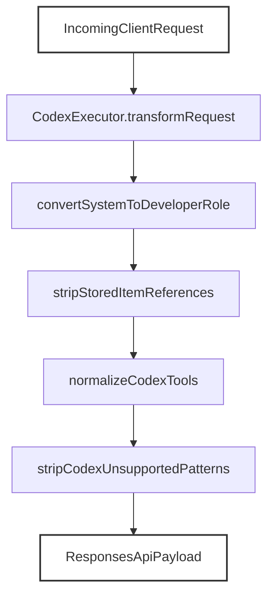
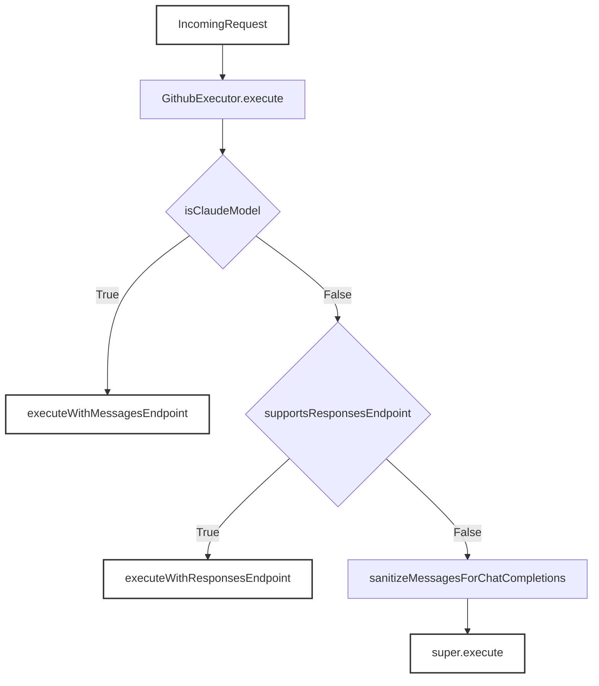

<!-- source: DeepWiki mcp.deepwiki.com · repo decolua/9router · extra page Codex, GitHub Copilot & Cursor Executors · fetched 2026-10-30 -->

# Codex, GitHub Copilot & Cursor Executors

Relevant source files

The following files were used as context for generating this wiki page:

- [gitbook/content/en/providers/subscription.md](gitbook/content/en/providers/subscription.md)
- [images/9router.png](images/9router.png)
- [open-sse/AGENTS.md](open-sse/AGENTS.md)
- [open-sse/executors/codex.js](open-sse/executors/codex.js)
- [open-sse/executors/cursor.js](open-sse/executors/cursor.js)
- [open-sse/executors/github.js](open-sse/executors/github.js)
- [open-sse/handlers/imageProviders/codex.js](open-sse/handlers/imageProviders/codex.js)
- [open-sse/providers/pricing.js](open-sse/providers/pricing.js)
- [open-sse/providers/registry/codex.js](open-sse/providers/registry/codex.js)
- [open-sse/rtk/index.js](open-sse/rtk/index.js)
- [open-sse/services/cursorModels.js](open-sse/services/cursorModels.js)
- [open-sse/transformer/responsesTransformer.js](open-sse/transformer/responsesTransformer.js)
- [open-sse/translator/request/openai-to-claude.js](open-sse/translator/request/openai-to-claude.js)
- [open-sse/translator/request/openai-to-cursor.js](open-sse/translator/request/openai-to-cursor.js)
- [open-sse/utils/cursorChecksum.js](open-sse/utils/cursorChecksum.js)
- [open-sse/utils/cursorProtobuf.js](open-sse/utils/cursorProtobuf.js)
- [tests/translator/__snapshots__/golden-response-stream.test.js.snap](tests/translator/__snapshots__/golden-response-stream.test.js.snap)
- [tests/translator/golden-response-stream.test.js](tests/translator/golden-response-stream.test.js)
- [tests/unit/claude-thinking-stream-boundaries.test.js](tests/unit/claude-thinking-stream-boundaries.test.js)
- [tests/unit/codex-fast-capacity.test.js](tests/unit/codex-fast-capacity.test.js)
- [tests/unit/codex-gpt6-lite.test.js](tests/unit/codex-gpt6-lite.test.js)
- [tests/unit/codex-image-models.test.js](tests/unit/codex-image-models.test.js)
- [tests/unit/codex-registry-model-routing.test.js](tests/unit/codex-registry-model-routing.test.js)
- [tests/unit/codex-tool-normalization.test.js](tests/unit/codex-tool-normalization.test.js)
- [tests/unit/cursor-agent-exec-request.test.js](tests/unit/cursor-agent-exec-request.test.js)
- [tests/unit/cursor-agent-proto.test.js](tests/unit/cursor-agent-proto.test.js)
- [tests/unit/cursor-agent-strict-proxy.test.js](tests/unit/cursor-agent-strict-proxy.test.js)
- [tests/unit/cursor-auto-model.test.js](tests/unit/cursor-auto-model.test.js)
- [tests/unit/github-responses-routing.test.js](tests/unit/github-responses-routing.test.js)
- [tests/unit/image-generation.test.js](tests/unit/image-generation.test.js)
- [tests/unit/openai-to-claude-tools-no-type.test.js](tests/unit/openai-to-claude-tools-no-type.test.js)
- [tests/unit/openai-to-claude.test.js](tests/unit/openai-to-claude.test.js)
- [tests/unit/rtk-cursor-pretranslate.test.js](tests/unit/rtk-cursor-pretranslate.test.js)
- [tests/unit/rtkKiro.test.js](tests/unit/rtkKiro.test.js)
- [tests/unit/thinking-levels-gpt56-sol.test.js](tests/unit/thinking-levels-gpt56-sol.test.js)

This page details the implementation of specialized executors for Codex (Responses API), GitHub Copilot, and Cursor within the 9Router codebase. It covers how each executor handles request/response translation, tool normalization, authentication, session management, and routing logic.

## Codex (Responses API) Executor

The `CodexExecutor` class is responsible for communicating with the OpenAI Responses API (`open-sse/executors/codex.js:1-16`). It handles schema adjustments, tool normalization, and specific error patterns.

### Request Normalization Pipeline

The Responses API imposes strict requirements on request payloads. `CodexExecutor.transformRequest` executes several steps:
1. **System to Developer Role Conversion**: `convertSystemToDeveloperRole` transforms `role: "system"` messages into `role: "developer"` to maintain cacheable prefixes [open-sse/executors/codex.js:54-61]().
2. **Stored Item Reference Stripping**: `stripStoredItemReferences` removes server-generated ID prefixes (`rs_`, `fc_`, `resp_`, `msg_`) when `store=false` to prevent upstream 404 errors [open-sse/executors/codex.js:33-75]().
3. **Tool Normalization**: `normalizeCodexTools` flattens OpenAI Chat Completions tool structures into the Responses API flat format [open-sse/executors/codex.js:78-132](). Hosted tool types (e.g., `web_search`, `image_generation`, `code_interpreter`) are preserved [open-sse/executors/codex.js:37-41](), while unsupported Unicode property escapes in tool schemas are stripped via `stripCodexUnsupportedPatterns` [open-sse/executors/codex.js:92-94]().
4. **Allowlist Filtering**: Only fields present in `RESPONSES_API_ALLOWLIST` are retained in the outgoing payload [open-sse/executors/codex.js:47-51]().

### Diagram: Codex Request Normalization (Code Entity Mapping)

Sources:
* [open-sse/executors/codex.js:1-139]()
* [open-sse/utils/codexToolSchema.js:1-80]()

## GitHub Copilot Executor

The `GithubExecutor` routes requests across multiple underlying vendor models accessed through GitHub Copilot credentials [open-sse/executors/github.js:16-20]().

### Routing Logic

The `execute` method inspects the model and selects the correct transport endpoint [open-sse/executors/github.js:123-150]():
- **Claude Models**: Identified via `isClaudeModel(model)` [open-sse/executors/github.js:28-30](), requests are dispatched to Copilot's Anthropic-native `/v1/messages` shim (`executeWithMessagesEndpoint`) [open-sse/executors/github.js:130-133]().
- **Codex / Responses Models**: Identified via `knownCodexModels` and `supportsResponsesEndpoint(model)` [open-sse/executors/github.js:118-121](), requests go to Copilot's `/responses` endpoint (`executeWithResponsesEndpoint`) [open-sse/executors/github.js:137-140](). Gemini and Claude models are explicitly excluded from `/responses` [open-sse/executors/github.js:118-121]().
- **Chat Completions Models**: GPT, Gemini, and Grok models utilize Copilot's `/chat/completions` endpoint. Messages undergo sanitization via `sanitizeMessagesForChatCompletions` to ensure content part compatibility [open-sse/executors/github.js:56-91]().

### Diagram: GitHub Copilot Routing (Code Entity Mapping)

Sources:
* [open-sse/executors/github.js:16-150]()

## Cursor Executor

The `CursorExecutor` handles communication with Cursor's proprietary ConnectRPC protobuf API [open-sse/executors/cursor.js:1-50]().

### Protobuf & Agent Service

- **Request Encoding**: `generateCursorBody` and `buildAgentRunFrame` construct nested protobuf byte structures representing conversational state, model parameters, and MCP tool declarations [open-sse/executors/cursor.js:114-176]().
- **Frame Wrapping**: Outgoing messages are wrapped using `wrapConnectRPCFrame` with length prefixes and compression headers [open-sse/executors/cursor.js:7-7]().
- **Checksum Authentication**: Headers are generated using `buildCursorHeaders`, which injects dynamic cryptographic checksums (`x-cursor-checksum`) required by Cursor's gateway [open-sse/utils/cursorChecksum.js:1-142]().

Sources:
* [open-sse/executors/cursor.js:1-177]()
* [open-sse/utils/cursorChecksum.js:1-142]()

---

