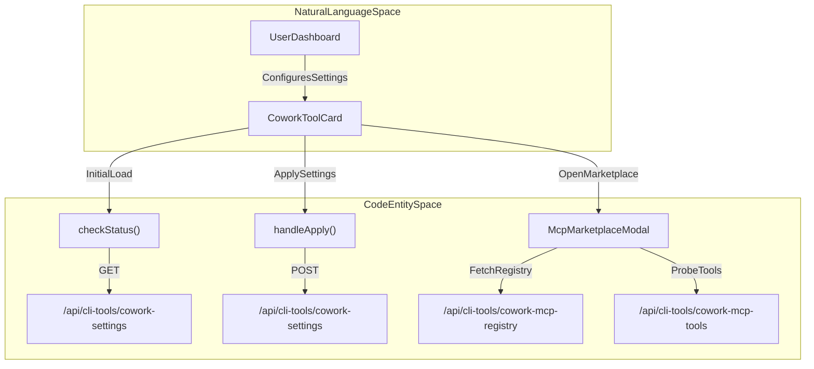
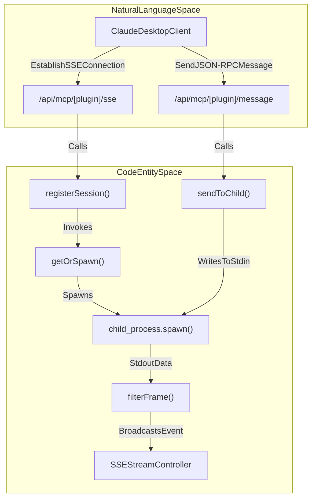

<!-- source: DeepWiki mcp.deepwiki.com · repo decolua/9router · extra page Cowork & MCP Bridge · fetched 2026-10-30 -->

# Cowork & MCP Bridge

Relevant source files

The following files were used as context for generating this wiki page:

- [src/app/(dashboard)/dashboard/cli-tools/components/CoworkToolCard.js](src/app/(dashboard)/dashboard/cli-tools/components/CoworkToolCard.js)
- [src/app/api/cli-tools/cowork-settings/route.js](src/app/api/cli-tools/cowork-settings/route.js)
- [src/app/api/mcp/[plugin]/message/route.js](src/app/api/mcp/[plugin]/message/route.js)
- [src/app/api/mcp/[plugin]/sse/route.js](src/app/api/mcp/[plugin]/sse/route.js)
- [src/lib/mcp/stdioSseBridge.js](src/lib/mcp/stdioSseBridge.js)
- [src/shared/constants/coworkPlugins.js](src/shared/constants/coworkPlugins.js)

## Purpose and Scope
This page documents the integration of Cowork (managed via the `CoworkToolCard` component [src/app/(dashboard)/dashboard/cli-tools/components/CoworkToolCard.js:19-34]()), its backend settings route (`/api/cli-tools/cowork-settings`), the Model Control Protocol (MCP) plugin marketplace, and the internal `stdio` ↔ SSE bridge (`stdioSseBridge.js`) powering local MCP plugins like Browser MCP [src/shared/constants/coworkPlugins.js:24-34]().

Sources:
* [src/app/(dashboard)/dashboard/cli-tools/components/CoworkToolCard.js:19-34]()
* [src/shared/constants/coworkPlugins.js:24-34]()

---

## Cowork Tool Card

The `CoworkToolCard` component [src/app/(dashboard)/dashboard/cli-tools/components/CoworkToolCard.js:19-34]() provides a user interface within the 9Router dashboard for configuring Cowork, a tool that integrates with AI models. This card allows users to manage settings related to Cowork's operation, including its base URL, API keys, selected models, and plugins.

The card's state management handles:
* `status`: Current configuration and installation status of Cowork [src/app/(dashboard)/dashboard/cli-tools/components/CoworkToolCard.js:35]().
* `selectedApiKey`: The API key chosen for Cowork [src/app/(dashboard)/dashboard/cli-tools/components/CoworkToolCard.js:40]().
* `selectedModels`: A list of models Cowork should use [src/app/(dashboard)/dashboard/cli-tools/components/CoworkToolCard.js:41]().
* `plugins`, `localPlugins`, `customPlugins`: Lists of MCP plugins configured for Cowork [src/app/(dashboard)/dashboard/cli-tools/components/CoworkToolCard.js:44-46]().
* `customBaseUrl`: A user-defined base URL for Cowork [src/app/(dashboard)/dashboard/cli-tools/components/CoworkToolCard.js:43]().

Key functionalities include:
* **Status Checking**: The `checkStatus` function [src/app/(dashboard)/dashboard/cli-tools/components/CoworkToolCard.js:99-110]() fetches current configuration from the backend via `/api/cli-tools/cowork-settings`.
* **Applying Settings**: The `handleApply` function [src/app/(dashboard)/dashboard/cli-tools/components/CoworkToolCard.js:125-166]() sends user-configured settings to the backend via a POST request to the same endpoint and remembers the endpoint [src/app/(dashboard)/dashboard/cli-tools/components/CoworkToolCard.js:155]().
* **Model Management**: Users can select models, create model combos via `handleCreateCombo` [src/app/(dashboard)/dashboard/cli-tools/components/CoworkToolCard.js:168-188](), and add/remove models [src/app/(dashboard)/dashboard/cli-tools/components/CoworkToolCard.js:190-199]().

### Cowork Tool Card Data Flow

Title: CoworkToolCard Component Interactions

Sources:
* [src/app/(dashboard)/dashboard/cli-tools/components/CoworkToolCard.js:19-110]()
* [src/app/(dashboard)/dashboard/cli-tools/components/CoworkToolCard.js:35]()
* [src/app/(dashboard)/dashboard/cli-tools/components/CoworkToolCard.js:40]()
* [src/app/(dashboard)/dashboard/cli-tools/components/CoworkToolCard.js:41]()
* [src/app/(dashboard)/dashboard/cli-tools/components/CoworkToolCard.js:43-46]()
* [src/app/(dashboard)/dashboard/cli-tools/components/CoworkToolCard.js:50]()
* [src/app/(dashboard)/dashboard/cli-tools/components/CoworkToolCard.js:99-110]()
* [src/app/(dashboard)/dashboard/cli-tools/components/CoworkToolCard.js:125-166]()
* [src/app/(dashboard)/dashboard/cli-tools/components/CoworkToolCard.js:155]()
* [src/app/(dashboard)/dashboard/cli-tools/components/CoworkToolCard.js:168-188]()
* [src/app/(dashboard)/dashboard/cli-tools/components/CoworkToolCard.js:190-199]()

---

## `cowork-settings` API Route

The `/api/cli-tools/cowork-settings` API route [src/app/api/cli-tools/cowork-settings/route.js:1-387]() is a server-side Next.js route responsible for reading and writing Cowork configuration files (`_meta.json` and `claude_desktop_config.json`).

### Configuration Files and Paths
* **`getCandidateRoots()`**: Returns potential root directories across OS platforms [src/app/api/cli-tools/cowork-settings/route.js:54-72]().
* **`resolveAppRootForRead()`**: Identifies the actual application root containing `configLibrary` [src/app/api/cli-tools/cowork-settings/route.js:90-99]().
* **`read1pConfig()` / `write1pConfig()`**: Handles reading/writing first-party Claude settings with JSONC tolerance [src/app/api/cli-tools/cowork-settings/route.js:118-133]().

### Core Functionality
* **`GET` Request**: Reads `_meta.json` and `claude_desktop_config.json`, extracts current parameters, and returns installation metrics [src/app/api/cli-tools/cowork-settings/route.js:200-220]().
* **`POST` Request**: Applies security relaxations (`SECURITY_RELAX` profile) [src/app/api/cli-tools/cowork-settings/route.js:37-48](), injects CLI auth headers (`x-9r-cli-token`) for local bridges [src/app/api/cli-tools/cowork-settings/route.js:23-32](), and writes updated configuration to disk [src/app/api/cli-tools/cowork-settings/route.js:241-369]().

Sources:
* [src/app/api/cli-tools/cowork-settings/route.js:1-387]()
* [src/app/api/cli-tools/cowork-settings/route.js:23-48]()
* [src/app/api/cli-tools/cowork-settings/route.js:54-72]()
* [src/app/api/cli-tools/cowork-settings/route.js:90-99]()
* [src/app/api/cli-tools/cowork-settings/route.js:118-133]()
* [src/app/api/cli-tools/cowork-settings/route.js:200-220]()
* [src/app/api/cli-tools/cowork-settings/route.js:241-369]()

---

## MCP Plugin Marketplace

The `McpMarketplaceModal` component enables users to browse and configure remote and managed MCP servers [src/shared/components/McpMarketplaceModal.js:9-10](). It relies on:
* `buildManagedMcpServers()`: Generates tool policies and server entries from a plugin list [src/shared/constants/coworkPlugins.js:36-70]().
* `DEFAULT_PLUGINS`: Remote HTTP/SSE plugins like Exa and Tavily [src/shared/constants/coworkPlugins.js:2-21]().

Sources:
* [src/shared/constants/coworkPlugins.js:2-70]()

---

## `stdio` ↔ SSE Bridge for MCP

9Router provides an internal bridge (`stdioSseBridge.js`) to allow local `stdio`-based MCP plugins to communicate with Cowork via Server-Sent Events (SSE).

### `stdioSseBridge.js` Implementation
The `src/lib/mcp/stdioSseBridge.js` module manages child processes for local stdio plugins:
* **`getOrSpawn(name)`**: Spawns a whitelisted local process using `spawn()` with piped stdio [src/lib/mcp/stdioSseBridge.js:109-117]().
* **`filterFrame(line)`**: Applies content sanitization (`smartFilterText` and `collapseRepeated`) to JSON-RPC frames [src/lib/mcp/stdioSseBridge.js:15-98]().
* **SSE Endpoints**:
  * `/api/mcp/[plugin]/sse`: Establishes the SSE stream, registering the session via `registerSession()` [src/app/api/mcp/[plugin]/sse/route.js:6-35]().
  * `/api/mcp/[plugin]/message`: Accepts incoming JSON-RPC POST requests and forwards them to the child process via `sendToChild()` [src/app/api/mcp/[plugin]/message/route.js:7-19]().

### Stdio-SSE Bridge Execution Flow

Title: Stdio-SSE Bridge Lifecycle

Sources:
* [src/lib/mcp/stdioSseBridge.js:15-98]()
* [src/lib/mcp/stdioSseBridge.js:109-183]()
* [src/app/api/mcp/[plugin]/sse/route.js:6-35]()
* [src/app/api/mcp/[plugin]/message/route.js:7-19]()

---

