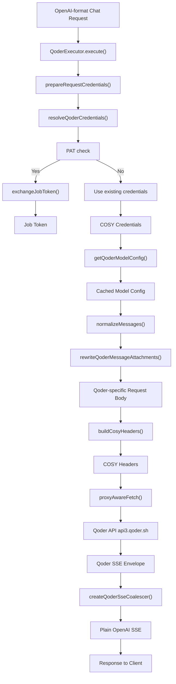
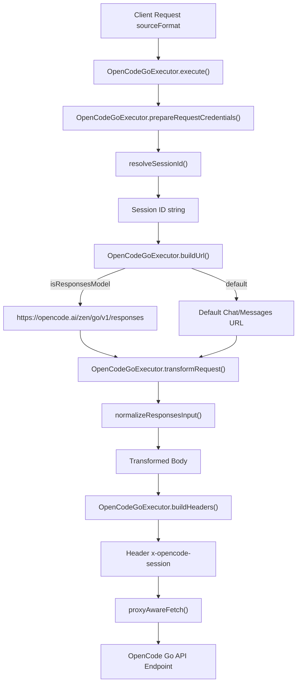
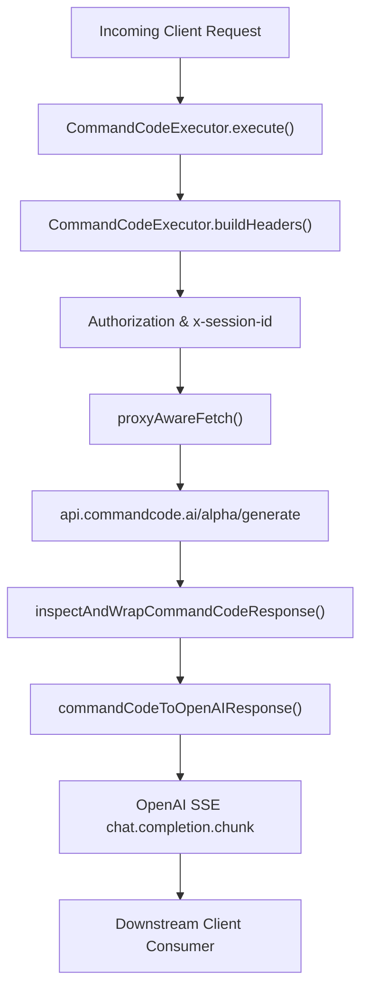

<!-- source: DeepWiki mcp.deepwiki.com · repo decolua/9router · extra page Other Specialized Executors · fetched 2026-10-30 -->

# Other Specialized Executors

Relevant source files

The following files were used as context for generating this wiki page:

- [open-sse/executors/codebuddy-cn.js](open-sse/executors/codebuddy-cn.js)
- [open-sse/executors/codebuddy-intl.js](open-sse/executors/codebuddy-intl.js)
- [open-sse/executors/commandcode.js](open-sse/executors/commandcode.js)
- [open-sse/executors/devin-cli.js](open-sse/executors/devin-cli.js)
- [open-sse/executors/grok-web.js](open-sse/executors/grok-web.js)
- [open-sse/executors/kimchi.js](open-sse/executors/kimchi.js)
- [open-sse/executors/mimo-free.js](open-sse/executors/mimo-free.js)
- [open-sse/executors/opencode-zen.js](open-sse/executors/opencode-zen.js)
- [open-sse/executors/opencode.js](open-sse/executors/opencode.js)
- [open-sse/executors/perplexity-web.js](open-sse/executors/perplexity-web.js)
- [open-sse/executors/qoder.js](open-sse/executors/qoder.js)
- [open-sse/handlers/responsesHandler.js](open-sse/handlers/responsesHandler.js)
- [open-sse/providers/models/helpers.js](open-sse/providers/models/helpers.js)
- [open-sse/providers/registry/devin-cli.js](open-sse/providers/registry/devin-cli.js)
- [open-sse/providers/registry/kimchi.js](open-sse/providers/registry/kimchi.js)
- [open-sse/providers/registry/opencode.js](open-sse/providers/registry/opencode.js)
- [open-sse/providers/registry/poolside.js](open-sse/providers/registry/poolside.js)
- [open-sse/providers/registry/qoder.js](open-sse/providers/registry/qoder.js)
- [open-sse/services/kimchiModels.js](open-sse/services/kimchiModels.js)
- [open-sse/services/qoderModels.js](open-sse/services/qoderModels.js)
- [open-sse/services/usage/codebuddy-cn.js](open-sse/services/usage/codebuddy-cn.js)
- [open-sse/shared/qoder/constants.js](open-sse/shared/qoder/constants.js)
- [open-sse/translator/request/openai-to-commandcode.js](open-sse/translator/request/openai-to-commandcode.js)
- [open-sse/translator/response/commandcode-to-openai.js](open-sse/translator/response/commandcode-to-openai.js)
- [open-sse/utils/opencodeFingerprint.js](open-sse/utils/opencodeFingerprint.js)
- [open-sse/utils/sessionManager.js](open-sse/utils/sessionManager.js)
- [open-sse/utils/sseConstants.js](open-sse/utils/sseConstants.js)
- [public/providers/kimchi.png](public/providers/kimchi.png)
- [public/providers/kimchi.svg](public/providers/kimchi.svg)
- [public/providers/mimo-free.png](public/providers/mimo-free.png)
- [public/providers/poolside.png](public/providers/poolside.png)
- [src/app/api/cli-tools/devin-settings/route.js](src/app/api/cli-tools/devin-settings/route.js)
- [src/lib/oauth/services/kimchi.js](src/lib/oauth/services/kimchi.js)
- [src/lib/qoder/constants.js](src/lib/qoder/constants.js)
- [tests/unit/codebuddy-parse-error.test.js](tests/unit/codebuddy-parse-error.test.js)
- [tests/unit/codebuddy-reasoning-optin.test.js](tests/unit/codebuddy-reasoning-optin.test.js)
- [tests/unit/commandcode-executor.test.js](tests/unit/commandcode-executor.test.js)
- [tests/unit/devin-cli-executor.test.js](tests/unit/devin-cli-executor.test.js)
- [tests/unit/executor-const-guard.test.js](tests/unit/executor-const-guard.test.js)
- [tests/unit/kimchi-strip-reasoning.test.js](tests/unit/kimchi-strip-reasoning.test.js)
- [tests/unit/kimchi.test.js](tests/unit/kimchi.test.js)
- [tests/unit/mimo-free.live.test.js](tests/unit/mimo-free.live.test.js)
- [tests/unit/mimo-free.test.js](tests/unit/mimo-free.test.js)
- [tests/unit/openai-to-commandcode.test.js](tests/unit/openai-to-commandcode.test.js)
- [tests/unit/opencode-fingerprint.test.js](tests/unit/opencode-fingerprint.test.js)
- [tests/unit/opencode-free-tool-choice.test.js](tests/unit/opencode-free-tool-choice.test.js)
- [tests/unit/opencode-muse-spark-thinking.test.js](tests/unit/opencode-muse-spark-thinking.test.js)
- [tests/unit/opencode-session.test.js](tests/unit/opencode-session.test.js)
- [tests/unit/opencode-zen-free-tier.test.js](tests/unit/opencode-zen-free-tier.test.js)
- [tests/unit/qoder-billing.test.js](tests/unit/qoder-billing.test.js)
- [tests/unit/qoder-proxy-replay.test.js](tests/unit/qoder-proxy-replay.test.js)
- [tests/unit/qoder-stream-errors.test.js](tests/unit/qoder-stream-errors.test.js)
- [tests/unit/qoder.test.js](tests/unit/qoder.test.js)
- [tests/unit/session-manager.test.js](tests/unit/session-manager.test.js)

This page details various specialized executors within the 9Router system, focusing on their unique implementations, data flows, and key functionalities. These executors handle specific AI providers or tools, often requiring custom request/response transformations, authentication mechanisms, or session management.

## Qoder Executor

The `QoderExecutor` [open-sse/executors/qoder.js:28-28]() is designed to interact with Qoder's COSY-signed inference endpoint. It translates OpenAI-format chat requests into Qoder's specific request shape and unwraps Qoder's `{statusCodeValue, body}` SSE envelope back into plain OpenAI SSE.

### Implementation Details

The Qoder executor handles several complexities:
*   **COSY Authentication**: Qoder uses a proprietary COSY (RSA + AES + MD5 + ~17 Cosy-\* headers) authentication scheme, not a static HMAC [open-sse/executors/qoder.js:10-11](). The `buildCosyHeaders` function [open-sse/shared/qoder/cosy.js:1-1]() is responsible for generating these headers.
*   **Request Shape**: Qoder expects a non-trivial request body, including `chat_context` with mirrored `modelConfig`, a `business` block with stable IDs, and `system` text hoisted out of the messages array [open-sse/executors/qoder.js:13-15](). The `normalizeMessages` function [open-sse/executors/qoder.js:50-68]() handles this transformation, extracting system messages and normalizing content.
*   **Model Configuration**: Per-model `model_config` is fetched live from `/algo/api/v2/model/list` and cached [open-sse/executors/qoder.js:18-19](). A missing entry is a hard error, as sending the wrong block silently downgrades to a different model upstream. The `getQoderModelConfig` function [open-sse/services/qoderModels.js:190-377]() manages this.
*   **Model Identifiers**: The executor strips the "qoder/" prefix from model identifiers [open-sse/executors/qoder.js:16-17]().
*   **Context Tiers**: Qoder supports context tiers (e.g., 200K/400K/1M). The executor can auto-escalate the context tier based on estimated prompt size and headroom [open-sse/shared/qoder/contextTier.js:1-1](). The `resolveQoderContextTier` and `applyQoderContextTier` functions [open-sse/executors/qoder.js:43-43]() manage this.
*   **Attachments**: The `rewriteQoderMessageAttachments` function [open-sse/shared/qoder/attachments.js:1-1]() handles image uploads. Instead of inlining base64, it uploads images to `/api/v2/image/upload` and then sends the OSS URL [open-sse/executors/qoder.js:76-78]().

### Data Flow

Diagram: Qoder Request and Response Data Flow

Sources: [open-sse/executors/qoder.js:1-758](), [open-sse/shared/qoder/encoding.js:1-1](), [open-sse/shared/qoder/cosy.js:1-1](), [open-sse/shared/qoder/constants.js:1-108](), [open-sse/services/qoderModels.js:1-377](), [open-sse/shared/qoder/attachments.js:1-1](), [open-sse/shared/qoder/sse.js:1-1](), [open-sse/shared/qoder/contextTier.js:1-1](), [open-sse/providers/registry/qoder.js:1-61](), [tests/unit/qoder.test.js:1-747]()

## OpenCode / OpenCode-Go Executors

The `OpenCodeExecutor` [open-sse/executors/opencode.js:68-116]() and `OpenCodeGoExecutor` [open-sse/executors/opencode-go.js:113-186]() handle requests for the OpenCode and OpenCode Go platforms, respectively. Both manage session IDs and adapt request formats.

### OpenCode Executor

The `OpenCodeExecutor` [open-sse/executors/opencode.js:68-116]() handles requests for the OpenCode platform.
*   **Session Management**: It resolves session IDs using `stableSessionId` and `generateSessionId` [open-sse/executors/opencode.js:54-161](), which maintain long-lived canonical sessions per downstream identity to avoid triggering 429 quota limits on rapid session churning.
*   **Request Transformation**: For models served by `/zen/v1/responses`, it formats responses input and handles clamping call IDs [open-sse/executors/opencode.js:12-16]().
*   **Headers**: It sets specific `x-opencode-*` headers, including `x-opencode-session` and `x-opencode-request` [open-sse/executors/opencode.js:21-25]().

### OpenCode-Go Executor

The `OpenCodeGoExecutor` [open-sse/executors/opencode-go.js:113-186]() is a specialized executor for OpenCode Go.
*   **Multi-Endpoint Support**: OpenCode Go supports multiple endpoints (`/v1/chat/completions`, `/v1/messages`, `/v1/responses`) depending on the model and `sourceFormat` [open-sse/providers/registry/opencode-go.js:28-35](). The `buildUrl` method [open-sse/executors/opencode-go.js:118-122]() dynamically selects the appropriate URL (such as `https://opencode.ai/zen/go/v1/responses` for Muse Spark models).
*   **Session Management**: It prepares request credentials by resolving session IDs from native headers or generating a translated session hash [open-sse/executors/opencode-go.js:124-138]().
*   **Responses API Adaptation**: For models like Muse Spark and Grok variants that use the Responses API, it transforms request tools via `normalizeResponsesTools` and sanitizes response items via `sanitizeResponsesItems` [open-sse/executors/opencode-go.js:52-111]().

### Data Flow & Code Entity Mapping (OpenCode-Go)

Diagram: OpenCode-Go Request Flow and Endpoint Routing

Sources: [open-sse/executors/opencode.js:1-184](), [open-sse/executors/opencode-go.js:1-186](), [open-sse/providers/registry/opencode.js:1-43](), [open-sse/providers/registry/opencode-go.js:1-92](), [tests/unit/opencode-go-models.test.js:1-149](), [tests/unit/opencode-session.test.js:1-328]()

## CommandCode Executor

The `CommandCodeExecutor` [open-sse/executors/commandcode.js:18-78]() interacts with `https://api.commandcode.ai/alpha/generate`.

### Implementation Details
*   **Authentication & Session**: Uses Bearer tokens (`apiKey` or `accessToken`) and supplies an `x-session-id` header generated via `randomUUID()` [open-sse/executors/commandcode.js:28-40]().
*   **NDJSON Streaming**: Upstream returns AI SDK v5 NDJSON (one JSON event per line without `data:` prefixes) [open-sse/executors/commandcode.js:13-17](). The `inspectAndWrapCommandCodeResponse` function [open-sse/executors/commandcode.js:140-320]() and `commandCodeToOpenAIResponse` translator [open-sse/translator/response/commandcode-to-openai.js:52-183]() consume raw line chunks, map events (`text-delta`, `reasoning-delta`, `tool-call`, `finish`), and convert them into OpenAI `chat.completion.chunk` SSE payloads.

### Data Flow & Code Entity Mapping (CommandCode)

Diagram: CommandCode NDJSON Stream Translation

Sources: [open-sse/executors/commandcode.js:1-320](), [open-sse/translator/response/commandcode-to-openai.js:1-183](), [tests/unit/commandcode-executor.test.js:1-1]()

## Kimchi Executor

The `KimchiExecutor` handles requests for the Kimchi platform.
*   **Authentication**: Supports both OAuth and API Key authentication [open-sse/providers/registry/kimchi.js:17-18]().
*   **Model Catalog**: Fetches live model metadata from `https://llm.kimchi.dev/v1/models/metadata` to keep supported models synchronized [open-sse/providers/registry/kimchi.js:45-45]().
*   **Reasoning Stripping**: Strips incompatible reasoning content blocks when targeting models lacking reasoning support [tests/unit/kimchi-strip-reasoning.test.js:1-1]().

Sources: [open-sse/executors/kimchi.js:1-1](), [open-sse/providers/registry/kimchi.js:1-49](), [tests/unit/kimchi-strip-reasoning.test.js:1-1]()

## Devin CLI Executor

The `DevinCLIExecutor` routes requests to local or remote Devin CLI instances.
*   **Endpoint**: Connects to `http://127.0.0.1:3000/v1/chat/completions` [open-sse/providers/registry/devin-cli.js:20-20]().
*   **Headers & Session**: Injects `User-Agent: Devin/1.0` and resolves persistent session IDs using `resolveSessionId` [open-sse/executors/devin-cli.js:1-30]().

Sources: [open-sse/executors/devin-cli.js:1-1](), [open-sse/providers/registry/devin-cli.js:1-30](), [tests/unit/devin-cli-executor.test.js:1-1]()

## Grok CLI/Web Executors

Grok models (such as `grok-4.6` and `grok-4.7`) are accessed via dedicated executors or multi-endpoint providers like OpenCode-Go [open-sse/providers/registry/opencode-go.js:76-78]() and through Grok CLI usage tracking services [open-sse/services/usage/grok-cli.js:1-1](). They handle specific OAuth flows, request signatures, and streaming transforms tailored to xAI/Grok infrastructure.

Sources: [open-sse/providers/registry/opencode-go.js:1-92](), [open-sse/services/usage/grok-cli.js:1-1](), [tests/unit/grok-cli-executor.test.js:1-1]()

## Xiaomi MiMo / MiMo-Free Executors

MiMo models (`mimo-v2.5`, `mimo-v2.6-pro`, etc.) are supported either natively via `mimo-free` executors or through OpenCode Go catalog mappings [open-sse/providers/registry/opencode-go.js:53-58](). They configure custom MiMo user agents and endpoint routing [open-sse/executors/mimo-free.js:1-1]().

Sources: [open-sse/executors/mimo-free.js:1-1](), [open-sse/providers/registry/opencode-go.js:1-92](), [tests/unit/mimo-free.test.js:1-1]()

## Zed Executor

The `ZedExecutor` handles integration with the Zed editor's AI endpoint (`https://api.zed.dev/v1/chat/completions`). It attaches Zed-specific headers (`Zed/1.0`), manages session persistence, and performs format adaptation.

Sources: [open-sse/executors/zed.js:1-1](), [open-sse/providers/registry/zed.js:1-30](), [open-sse/shared/zedAuth.js:1-1]()

## CodeBuddy Executors

CodeBuddy provides regional executors: `CodeBuddyIntlExecutor` and `CodeBuddyCNExecutor` [open-sse/executors/codebuddy-intl.js:1-1](), [open-sse/executors/codebuddy-cn.js:1-1]().
*   **Reasoning Opt-in**: Supports flexible client-controlled reasoning toggles [tests/unit/codebuddy-reasoning-optin.test.js:1-1]().
*   **Session Management**: Resolves conversation identifiers via `resolveSessionId` [open-sse/executors/codebuddy-intl.js:1-1]() to preserve context across multi-turn exchanges.

Sources: [open-sse/executors/codebuddy-cn.js:1-1](), [open-sse/executors/codebuddy-intl.js:1-1](), [open-sse/providers/registry/codebuddy-intl.js:1-30](), [tests/unit/codebuddy-reasoning-optin.test.js:1-1]()

## Vertex Executor

The `VertexExecutor` [open-sse/executors/vertex.js:61-64]() manages requests to Google Cloud Vertex AI for both native Gemini models (regional/global endpoints) and partner models (Llama, Mistral, GLM, DeepSeek, Qwen) via global OpenAI-compatible endpoints.

### Implementation Details
*   **Authentication**: Supports Service Account (SA) JSON and Application Default Credentials (ADC). SA JSON is parsed to mint JWT assertions, while ADC uses refresh tokens and client secrets [open-sse/executors/vertex.js:58-60, 122-152]().
*   **Project ID Resolution**: For partner models using raw API keys, it dynamically discovers the GCP `project_id` via probe error messages [open-sse/executors/vertex.js:32-49, 154-160]().
*   **Token Lifecycle**: Integrates with `refreshVertexToken` and `refreshGoogleToken` [open-sse/services/tokenRefresh.js:1-1]() for background token renewal.

Sources: [open-sse/executors/vertex.js:1-177](), [open-sse/providers/registry/vertex.js:1-1](), [open-sse/providers/registry/vertex-partner.js:1-1](), [open-sse/services/tokenRefresh.js:1-1]()

---

