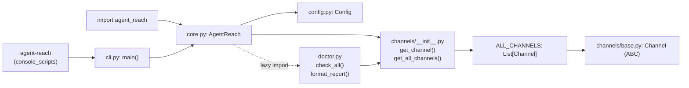
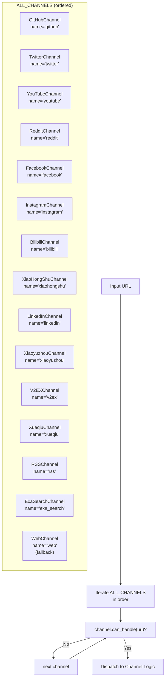
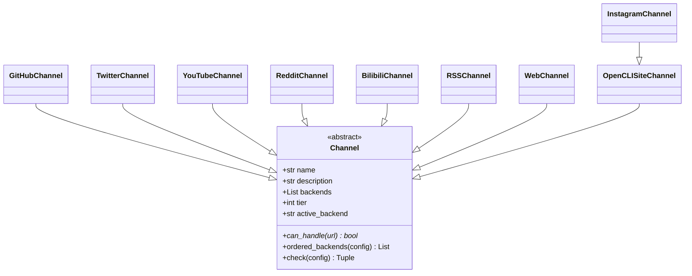

<!-- source: DeepWiki mcp.deepwiki.com · repo Panniantong/Agent-Reach · page 1.1 Architecture · fetched 2026-10-30 -->

# Architecture

Relevant source files

The following files were used as context for generating this wiki page:

- [CLAUDE.md](CLAUDE.md)
- [agent_reach/__init__.py](agent_reach/__init__.py)
- [agent_reach/channels/__init__.py](agent_reach/channels/__init__.py)
- [agent_reach/channels/base.py](agent_reach/channels/base.py)
- [agent_reach/channels/instagram.py](agent_reach/channels/instagram.py)
- [agent_reach/channels/rss.py](agent_reach/channels/rss.py)
- [agent_reach/probe.py](agent_reach/probe.py)
- [docs/wechat-group-qr.jpg](docs/wechat-group-qr.jpg)
- [pyproject.toml](pyproject.toml)
- [tests/test_channel_contracts.py](tests/test_channel_contracts.py)
- [tests/test_probe.py](tests/test_probe.py)

This page describes Agent Reach's internal architecture: how the `AgentReach` class, channel registry, URL dispatch, tier classification, and result types fit together as a system. For installation and first-use, see [Getting Started](#1.2). For per-channel details, see [Channels](#3).

---

## Overview

Agent Reach is a thin routing layer. Its job is to accept a URL or search query, dispatch it to the correct platform-specific channel, and return a normalized result. No channel knows about any other channel. The core has no platform logic of its own.

**Key design properties:**

- Each platform is one Python file (`agent_reach/channels/*.py`) implementing a shared abstract interface [agent_reach/channels/base.py:29-70]().
- URL dispatch is done by iterating an ordered list (`ALL_CHANNELS`) until a `can_handle()` match is found [agent_reach/channels/__init__.py:26-42]().
- The backend tool used by any channel can be changed or reordered via configuration without touching any other part of the system [agent_reach/channels/base.py:45-59]().

---

## Package Structure

**Diagram: Module Dependencies**

Sources: [agent_reach/core.py:7](), [agent_reach/channels/__init__.py:26-63](), [agent_reach/channels/base.py:29-70](), [pyproject.toml:52-53]()

---

## The `AgentReach` Class

`AgentReach` in [agent_reach/core.py:7]() is the primary health-check and configuration entry point. It holds a `Config` instance and provides methods to audit the system's readiness.

| Method | Delegates to | Notes |
|---|---|---|
| `__init__(config)` | `Config()` | Initializes configuration. |
| `doctor()` | `check_all(self.config)` | Returns `Dict[str, dict]` of channel statuses. |
| `doctor_report()` | `format_report(...)` | Human-readable string for the agent. |

For reading and searching, Agent Reach encourages agents to use the upstream tools directly as defined in the system's `SKILL.md`.

Sources: [agent_reach/core.py:7](), [CLAUDE.md:16-28]()

---

## Channel Registry and URL Routing

**Diagram: ALL_CHANNELS dispatch (class names to channel names)**

The registry is defined in [agent_reach/channels/__init__.py:26-42](). The list is strictly ordered: **first match wins**. `WebChannel` is positioned last because it acts as the universal fallback.

### Registry Access Functions

| Function | Purpose |
|---|---|
| `get_channel(name)` | Looks up a channel by its `name` attribute [agent_reach/channels/__init__.py:45-50]() |
| `get_all_channels()` | Returns the full `ALL_CHANNELS` list [agent_reach/channels/__init__.py:53-55]() |

Sources: [agent_reach/channels/__init__.py:26-63](), [tests/test_channel_contracts.py:15-26]()

---

## The `Channel` Abstract Base Class

Every channel inherits from `Channel` in [agent_reach/channels/base.py:29-70](). The class defines the contract for platform detection and health auditing.

**Diagram: Channel ABC and its implementors**

### Core Interface

- `can_handle(url) → bool` — Returns `True` if this channel owns this URL pattern. Must be implemented by subclasses [agent_reach/channels/base.py:40-43]().
- `check(config) → (status, message)` — Probes upstream tools and sets `self.active_backend`. Subclasses should use `probe_command` for accurate health reporting [agent_reach/channels/base.py:61-70]().
- `ordered_backends(config) → List[str]` — Returns candidate backends, moving user-configured overrides to the front [agent_reach/channels/base.py:45-59]().

### Attributes

| Attribute | Type | Purpose |
|---|---|---|
| `name` | `str` | Unique identifier (e.g., `"github"`) [agent_reach/channels/base.py:32]() |
| `description` | `str` | Human-readable platform description [agent_reach/channels/base.py:33]() |
| `backends` | `List[str]` | Names of external tools used (e.g., `["gh"]`) [agent_reach/channels/base.py:34]() |
| `tier` | `int` | Setup complexity (0=zero-config, 1=needs key, 2=needs setup) [agent_reach/channels/base.py:35]() |
| `active_backend`| `Optional[str]` | The specific tool currently serving the channel [agent_reach/channels/base.py:38]() |

Sources: [agent_reach/channels/base.py:29-70](), [tests/test_channel_contracts.py:39-46]()

---

## Tier Classification

The `tier` integer on each `Channel` subclass categorizes how much setup is required [agent_reach/channels/base.py:35]().

| Tier | Meaning | Example channels |
|---|---|---|
| `0` | Zero-config — works after `pip install` | `RSSChannel` [agent_reach/channels/rss.py:11](), `V2EXChannel` |
| `1` | Needs a free key or minor setup | `GitHubChannel`, `YouTubeChannel` |
| `2` | Needs accounts, cookies, or Docker | `TwitterChannel`, `XiaoHongShuChannel`, `InstagramChannel` |

Sources: [agent_reach/channels/base.py:35](), [agent_reach/channels/rss.py:11](), [tests/test_channel_contracts.py:21-25]()

---

## Health Reporting and Probing

Agent Reach uses `probe_command` to distinguish between different failure modes, ensuring `doctor` reports reflect actual usability rather than just file existence [agent_reach/probe.py:1-14]().

**`probe_command` Failure Modes** ([agent_reach/probe.py:28-31]()):
- `missing`: Command not on PATH.
- `broken`: Command exists (e.g., a stale venv shim) but cannot execute.
- `timeout`: Command runs but exceeds the time limit.
- `error`: Command returns a non-zero exit code.

**`check()` Statuses** ([agent_reach/channels/base.py:64]()):
- `ok`: Backend tool is installed and reachable.
- `warn`: Tool is installed but needs configuration (e.g., cookies/proxy).
- `off`: Tool is missing or dependencies are not met.
- `error`: Unexpected failure during check.

Sources: [agent_reach/probe.py:1-120](), [agent_reach/channels/base.py:61-70](), [agent_reach/channels/rss.py:16-27]()

---

## Configuration and Backend Overrides

`AgentReach` uses the `Config` class to manage settings. Channels can honor user overrides for backend selection. The config key `<channel>_backend` (or environment variable `<CHANNEL>_BACKEND`) promotes a specific tool to the front of the candidate list [agent_reach/channels/base.py:45-59]().

For example, if `TwitterChannel` supports both `bird` and `jina`, a user can force `bird` by setting `twitter_backend: bird` in `config.yaml` [tests/test_channel_contracts.py:86-93]().

Sources: [agent_reach/channels/base.py:45-59](), [tests/test_channel_contracts.py:72-98]()

---

