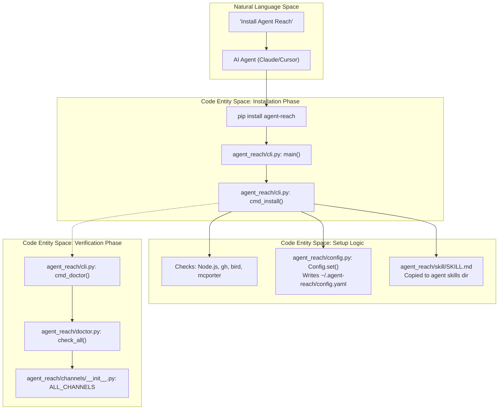
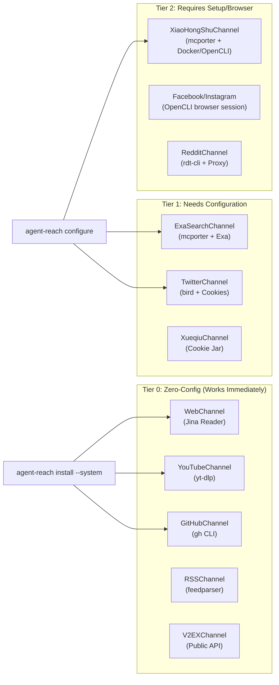

<!-- source: DeepWiki mcp.deepwiki.com · repo Panniantong/Agent-Reach · page 1.2 Getting Started · fetched 2026-10-30 -->

# Getting Started

<details>
<summary>Relevant source files</summary>

The following files were used as context for generating this wiki page:

- [docs/README_en.md](docs/README_en.md)
- [docs/install.md](docs/install.md)

</details>


This page covers the three-step process to get Agent Reach installed and operational: installing the Python package, running the automated setup command, and verifying channel status with the built-in diagnostic tool.

For a conceptual overview of what Agent Reach is and why it exists, see [1. Overview](). For full CLI reference including all flags, see [2. CLI Reference](). For configuring individual credentials (cookies, proxies, tokens), see [4. Configuration]().

---

## Prerequisites

| Requirement | Minimum | Notes |
|---|---|---|
| Python | 3.10+ | Required by `pyproject.toml` |
| pip / pipx | Recent version | `pipx` is recommended for CLI isolation |
| Internet access | Required | Several backends make outbound HTTP calls |

Some channels install additional system dependencies automatically during `agent-reach install`. These include Node.js (for `bird`), the `gh` CLI, `mcporter`, and `instaloader`. If you prefer not to have these installed automatically, use the default check-only mode or `--safe`.

Sources: [pyproject.toml:21-21](), [docs/install.md:53-81]()

---

## Step 1: Install the Package

The recommended way to install Agent Reach is via `pipx` to ensure the CLI and its dependencies are isolated from your global Python environment.

```bash
# Recommended: pipx
pipx install https://github.com/Panniantong/agent-reach/archive/main.zip

# Alternative: Standard pip (inside a venv)
python3 -m venv ~/.agent-reach-venv
source ~/.agent-reach-venv/bin/activate
pip install https://github.com/Panniantong/agent-reach/archive/main.zip
```

This installs the `agent_reach` Python package and registers the `agent-reach` console script entrypoint, which maps to the `main()` function in `agent_reach/cli.py`.

Sources: [docs/install.md:52-66](), [pyproject.toml:35-36]()

---

## Step 2: Run Automated Setup

Once the package is installed, you must run the installation command to set up the necessary system-level dependencies and configuration files. By default, `agent-reach install` performs a read-only check. To actually modify the system, the `--system` flag is required.

```bash
# Read-only check (default)
agent-reach install --env=auto

# Perform system-level installation (after user approval)
agent-reach install --env=auto --system
```

**What `agent-reach install --env=auto --system` does:**

| Action | Details |
|---|---|
| **Detects environment** | Checks whether running locally or on a server to adjust proxy/dependency logic. |
| **Installs system deps** | Automatically installs Node.js, `gh` CLI, `bird` (via npm), and `mcporter`. |
| **Configures Exa search** | Sets up the `mcporter` connection to `mcp.exa.ai` for semantic search. |
| **Registers SKILL.md** | Copies `agent_reach/skill/SKILL.md` into the agent's skills directory (e.g., `~/.openclaw/skills/`). |
| **Channel Selection** | Allows specific activation via `--channels=all` or comma-separated names. |

**Installation mode variants:**

| Command | Behavior |
|---|---|
| `agent-reach install --env=auto` | **Safe Default**: Checks and reports missing dependencies but does not install system packages. |
| `agent-reach install --env=auto --system` | **System Install**: Explicitly allows external/system installs and configuration writes. |
| `agent-reach install --env=auto --dry-run` | **Dry Run**: Previews all actions (file writes, installs) without making changes. |

Sources: [docs/install.md:81-95](), [docs/install.md:120-126]()

---

## Step 3: Verify with Doctor

After installation, verify the status of all integrations using the `doctor` command.

```bash
agent-reach doctor
```

This command iterates over every channel in `ALL_CHANNELS` to determine operational status, reporting whether backends are missing, unconfigured, or ready.

**Example output:**

```text
👁️  Agent Reach Status
========================================

✅ Ready to use:
  ✅ GitHub repos and code — gh CLI
  ✅ YouTube video subtitles — yt-dlp
  ✅ RSS/Atom feeds — feedparser
  ✅ Web pages (any URL) — Jina Reader API

🔍 Search (configure to unlock):
  ⬜ Web semantic search — configure Exa MCP

🔧 Configurable:
  ⬜ Twitter/X — needs cookie
  ⬜ XiaoHongShu notes — needs mcporter/cookie
```

**Status indicators:**

| Symbol | Meaning |
|---|---|
| ✅ | **OK**: Channel is operational and all dependencies are found. |
| ⚠️ | **Warning**: Channel works partially or status is unverified (e.g., OpenCLI channels). |
| ⬜ / ❌ | **Off/Error**: Channel is unconfigured or a required dependency/cookie is missing. |

Sources: [docs/install.md:130-132](), [docs/README_en.md:97-97]()

---

## Setup Flow Diagram

**Diagram: Installation steps mapped to code entities**



Sources: [docs/install.md:49-96](), [docs/install.md:130-132]()

---

## Channel Availability After Install

After running `agent-reach install`, channels are categorized into three tiers based on their configuration requirements.

**Diagram: Channel tiers and their backend dependencies**



| Tier | Channels | What's needed |
|---|---|---|
| **0 — Zero-config** | `Web`, `YouTube`, `GitHub`, `RSS`, `V2EX` | Nothing — works immediately after `--system` installation. |
| **1 — Needs config** | `Exa`, `Twitter`, `Xueqiu`, `Bilibili` | `agent-reach configure` for cookies, proxies, or API keys. |
| **2 — External setup** | `XiaoHongShu`, `Reddit`, `Facebook`, `Instagram` | Requires `mcporter` for MCP servers or `OpenCLI` for browser sessions. |

Sources: [docs/README_en.md:101-115](), [docs/install.md:101-116]()

---

## Quick Reference: What to Run

```bash
# 1. Install the package
pipx install https://github.com/Panniantong/agent-reach/archive/main.zip

# 2. Auto-setup (installs deps, registers skill, configures basic channels)
agent-reach install --env=auto --system

# 3. Check which channels are working
agent-reach doctor

# 4. (Optional) Test reading a URL
agent-reach read https://github.com/Panniantong/agent-reach

# 5. (Optional) Test search
agent-reach search "LLM framework comparison"
```

---

## Next Steps

After the initial setup, you can:

- **Unlock additional channels**: Follow the prompts from `agent-reach doctor` to configure cookies or proxies. See [4.1 Cookie Export Guide]() and [4.2 Proxy Configuration]().
- **Configure MCP services**: Needed for XiaoHongShu and Exa. See [4.3 mcporter Setup]().
- **Integrate with AI agents**: Ensure your agent has access to the registered `SKILL.md`. See [5. AI Agent Integration]().

Sources: [docs/install.md:97-151](), [docs/README_en.md:89-98]()

---

