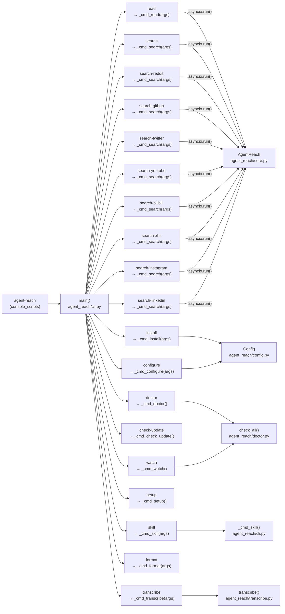
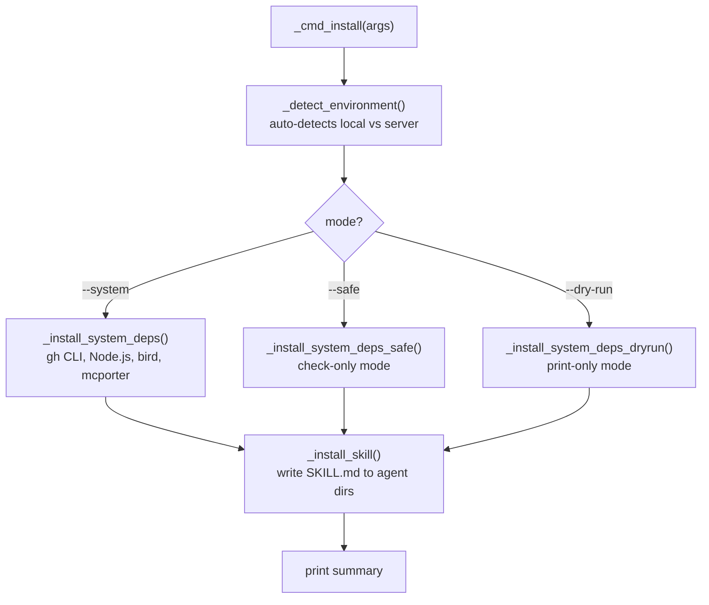

<!-- source: DeepWiki mcp.deepwiki.com · repo Panniantong/Agent-Reach · page 2 CLI Reference · fetched 2026-10-30 -->

# CLI Reference

<details>
<summary>Relevant source files</summary>

The following files were used as context for generating this wiki page:

- [agent_reach/cli.py](agent_reach/cli.py)
- [docs/update.md](docs/update.md)
- [tests/test_cli.py](tests/test_cli.py)

</details>


This page documents the `agent-reach` command-line interface: the `main()` entrypoint in `agent_reach/cli.py`, how subcommands are parsed and dispatched, global flags, and the complete set of subcommands with their arguments.

For details on what each channel does when called by these commands, see [Channels](#3). For the configuration file and credential storage, see [Configuration](#4). For a guided first-run walkthrough, see [Getting Started](#1.2).

---

## Entrypoint

The package registers a single console script called `agent-reach`, which maps to `agent_reach.cli:main` as declared in `pyproject.toml`. The `main()` function [agent_reach/cli.py:59-163]() builds an `argparse.ArgumentParser` with one subparser per command, parses `sys.argv`, then dispatches to a `_cmd_*` handler function.

On Windows, `main()` also patches `sys.stdout` and `sys.stderr` to UTF-8 before anything else [agent_reach/cli.py:33-49](), so emoji and CJK characters do not crash on narrow system encodings.

Loguru logging is suppressed by default; passing `-v` / `--verbose` re-enables it at `INFO` level via `_configure_logging()` [agent_reach/cli.py:51-57]().

---

## Command Dispatch

**Diagram: `main()` → handler function dispatch**



Sources: [agent_reach/cli.py:59-163](), [tests/test_cli.py:12-13]()

---

## Global Flags

These flags apply to the top-level `agent-reach` parser and must be placed before the subcommand name.

| Flag | Type | Default | Description |
|------|------|---------|-------------|
| `-v`, `--verbose` | bool flag | off | Enable loguru INFO logs on stderr |
| `--version` | action | — | Print `Agent Reach vX.Y.Z` and exit |

Sources: [agent_reach/cli.py:66-67](), [tests/test_cli.py:18-24]()

---

## Command Summary

| Command | Handler | Description |
|---------|---------|-------------|
| `read <url>` | `_cmd_read()` | Read content from any URL |
| `search <query>` | `_cmd_search()` | Web search via Exa |
| `search-twitter <query>` | `_cmd_search()` | Search Twitter/X |
| `search-reddit <query>` | `_cmd_search()` | Search Reddit |
| `search-github <query>` | `_cmd_search()` | Search GitHub |
| `search-youtube <query>` | `_cmd_search()` | Search YouTube |
| `search-bilibili <query>` | `_cmd_search()` | Search Bilibili |
| `search-xhs <query>` | `_cmd_search()` | Search XiaoHongShu |
| `search-instagram <query>` | `_cmd_search()` | Search Instagram |
| `search-linkedin <query>` | `_cmd_search()` | Search LinkedIn |
| `install` | `_cmd_install()` | One-shot installer with dependency detection |
| `configure` | `_cmd_configure()` | Set config values or auto-extract from browser |
| `setup` | `_cmd_setup()` | Interactive configuration wizard |
| `doctor` | `_cmd_doctor()` | Check platform availability and health |
| `skill` | `_cmd_skill()` | Install or uninstall SKILL.md for AI agents |
| `format` | `_cmd_format()` | Clean and format platform API output (e.g., XHS) |
| `watch` | `_cmd_watch()` | Quick health + update check for scheduled tasks |
| `check-update` | `_cmd_check_update()` | Check for new versions and changes |
| `transcribe` | `_cmd_transcribe()` | Transcribe audio/video via Whisper (Groq/OpenAI) |
| `uninstall` | `_cmd_uninstall()` | Remove config, tokens, and skill files |

Sources: [agent_reach/cli.py:68-163]()

---

## `read`

```
agent-reach read <url> [--json]
```

Dispatches to `_cmd_read(args)`, which calls `AgentReach.read(url)`. The correct channel is selected by `get_channel_for_url()` based on the URL. Output defaults to a human-readable multiline format; `--json` switches to a `json.dumps` of the raw result dict.

| Argument | Required | Description |
|----------|----------|-------------|
| `url` | yes | Any URL; channel selection is automatic |
| `--json` | no | Output as a JSON object instead of formatted text |

Sources: [agent_reach/cli.py:904-927] (approx)

---

## `install`

```
agent-reach install [--env {local,server,auto}] [--proxy URL] [--system] [--safe] [--dry-run]
```

**Diagram: `_cmd_install()` execution flow**



| Flag | Default | Description |
|------|---------|-------------|
| `--env` | `auto` | `local`, `server`, or `auto` (auto-detects cloud/desktop) |
| `--proxy` | `""` | Network proxy saved for agents |
| `--system` | off | Explicitly allow system dependency installation |
| `--safe` | off | Safe check-only mode |
| `--dry-run` | off | Show changes without applying them |

Sources: [agent_reach/cli.py:73-97](), [docs/update.md:78-79]()

---

## `configure`

```
agent-reach configure <key> <value>
agent-reach configure --from-browser <BROWSER> --platform <PLATFORM>
```

Handled by `_cmd_configure(args)`. Supports manual entry or automatic extraction from browser profiles.

**Configurable keys:**

| Key | Config field(s) set | Notes |
|-----|---------------------|-------|
| `proxy` | `proxy` | Restricted network bypass |
| `twitter-cookies` | `twitter_auth_token`, `twitter_ct0` | Supports raw tokens or cookie headers |
| `github-token` | `github-token` | Personal access token |
| `groq-key` | `groq-key` | Groq API for Whisper |
| `xhs-cookies` | `xhs-cookies` | XiaoHongShu session |

Sources: [agent_reach/cli.py:99-128](), [tests/test_cli.py:148-186]()

---

## `transcribe`

```
agent-reach transcribe <source> [--provider {auto,groq,openai}] [--o output.txt]
```

Transcribes a local file or URL using Whisper.

| Flag | Default | Description |
|------|---------|-------------|
| `--provider` | `auto` | Choose backend (Groq preferred) |
| `--allow-provider-fallback` | off | Allow switching if primary fails |
| `-o`, `--output` | stdout | Save result to a file |

Sources: [agent_reach/cli.py:156-163](), [tests/test_cli.py:91-147]()

---

## `doctor` and `watch`

- **`doctor`**: Detailed health report of all channels, showing which backends are active (e.g., bird CLI vs Jina Reader) and their status (ok/warn/off) [agent_reach/cli.py:131-133](), [tests/test_cli.py:32-90]().
- **`watch`**: Optimized for automated monitoring; checks health and updates in one go [docs/update.md:90-93]().

---

## Update Workflow

Updates are managed via `check-update` and the instructions in `docs/update.md`.

1. Run `agent-reach check-update` to see if a new version exists [docs/update.md:31-35]().
2. Use `pip install --upgrade` or `pipx install --force` to pull the latest main branch [docs/update.md:39-46]().
3. Run `agent-reach doctor` to verify skill registration and channel health [docs/update.md:90-108]().

Sources: [docs/update.md:1-120]()

---

