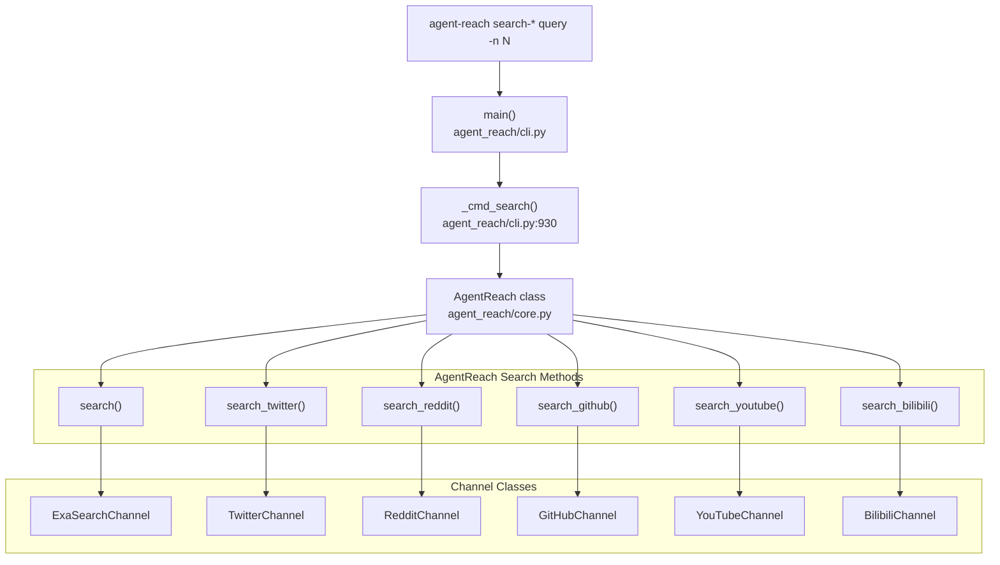
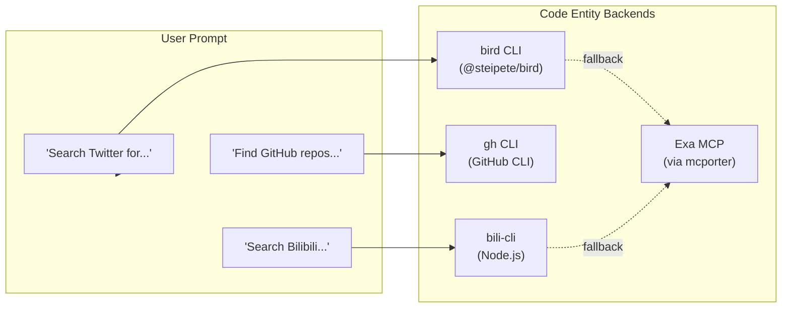

<!-- source: DeepWiki mcp.deepwiki.com · repo Panniantong/Agent-Reach · page 2.3 Search Commands · fetched 2026-10-30 -->

# Search Commands

<details>
<summary>Relevant source files</summary>

The following files were used as context for generating this wiki page:

- [agent_reach/cli.py](agent_reach/cli.py)
- [agent_reach/skill/references/career.md](agent_reach/skill/references/career.md)
- [agent_reach/skill/references/search.md](agent_reach/skill/references/search.md)
- [agent_reach/skill/references/web.md](agent_reach/skill/references/web.md)
- [tests/test_skill_command.py](tests/test_skill_command.py)

</details>


This page documents all `search-*` subcommands exposed by the `agent-reach` CLI: their syntax, flags, default behaviors, and which backend channel each one invokes. For information about reading a specific URL (rather than issuing a search query), see [2.2](). For details on how individual channels work internally, see [3]().

---

## Overview

Every search command follows the same pattern:

```bash
agent-reach <search-subcommand> "<query>" [flags]
```

All commands accept a free-text query and a common `-n` flag to control result count. The CLI entrypoint `main()` in `agent_reach/cli.py` parses these arguments and dispatches them to the `_cmd_search` helper function.

The dispatching logic in `_cmd_search()` instantiates the core `AgentReach` class, calls the platform-specific search method (e.g., `search_twitter`), and iterates through the returned list of results to print them to the console.

**Output format per result (all commands):**

```text
1. <title>
   🔗 <url>
   <snippet, up to 200 chars>
   ⭐ <stars>  🍴 <forks>  📝 <language>   ← GitHub only
```

Sources: [agent_reach/cli.py:62-105](), [agent_reach/cli.py:930-995]()

---

## Command Reference

### Subcommand Summary

| Subcommand | Default `-n` | Platform-specific flags | Primary Backend |
|---|---|---|---|
| `search` | 5 | — | `ExaSearchChannel` (mcporter → exa-mcp) |
| `search-twitter` | 10 | — | `TwitterChannel` → `bird` CLI |
| `search-reddit` | 10 | `--sub <subreddit>` | `RedditChannel` → `rdt-cli` / `OpenCLI` |
| `search-github` | 5 | `--lang <language>` | `GitHubChannel` → `gh` CLI |
| `search-youtube` | 5 | — | `YouTubeChannel` → `yt-dlp` |
| `search-bilibili` | 5 | — | `BilibiliChannel` → `bili-cli` |
| `search-xhs` | 10 | — | `XiaoHongShuChannel` → `mcporter` / `OpenCLI` |
| `search-instagram` | 10 | — | `InstagramChannel` → `OpenCLI` |
| `search-linkedin` | 10 | — | `LinkedInChannel` → `mcporter` |
| `search-bosszhipin` | 10 | — | `BossZhipinChannel` → `mcporter` |

Sources: [agent_reach/cli.py:68-105](), [agent_reach/channels/__init__.py:31-50]()

---

### Common Flag: `-n / --num`

All search subcommands accept `-n` (or `--num`) to control the number of results returned. This is defined in the `argparse` setup for each search parser.

```bash
agent-reach search "rust async runtime" -n 10
agent-reach search-reddit "homelab" -n 20
```

The value is passed as the `limit` or `num_results` argument to the underlying `AgentReach` methods.

Sources: [agent_reach/cli.py:177-224]()

---

### `search` — General Web Search

```bash
agent-reach search "<query>" [-n N]
```

Routes to `AgentReach.search()`, which delegates to `ExaSearchChannel`. It uses `mcporter` to call the Exa MCP server. This is the recommended tool for technical documentation and code examples.

Sources: [agent_reach/cli.py:177-180](), [agent_reach/skill/references/search.md:5-13]()

---

### `search-twitter` — Twitter/X Search

```bash
agent-reach search-twitter "<query>" [-n N]
```

Routes to `AgentReach.search_twitter()`. The primary backend is the `bird` CLI. It requires `twitter-cookies` to be configured via `agent-reach configure`.

Sources: [agent_reach/cli.py:194-197](), [agent_reach/cli.py:948]()

---

### `search-reddit` — Reddit Search

```bash
agent-reach search-reddit "<query>" [--sub <subreddit>] [-n N]
```

Routes to `AgentReach.search_reddit()`. The optional `--sub` flag restricts search to a specific subreddit. Note that `RedditChannel` typically requires a proxy on server environments due to IP blocking.

Sources: [agent_reach/cli.py:182-186](), [agent_reach/cli.py:944]()

---

### `search-github` — GitHub Repository Search

```bash
agent-reach search-github "<query>" [--lang <language>] [-n N]
```

Routes to `AgentReach.search_github()`. The optional `--lang` flag filters results by programming language. It uses the `gh` CLI as the backend.

Sources: [agent_reach/cli.py:188-192](), [agent_reach/cli.py:946]()

---

### `search-linkedin` — LinkedIn Search

```bash
mcporter call linkedin.search_people keywords="AI engineer" location="Shanghai"
mcporter call linkedin.search_jobs keywords="software engineer" location="Remote"
```

LinkedIn search is primarily handled via the `mcporter` bridge to `mcp-server-linkedin`. It supports searching for people, companies, and jobs.

Sources: [agent_reach/skill/references/career.md:7-19](), [tests/test_skill_command.py:57-85]()

---

## Internal Dispatch Flow

**Diagram: Search Command Dispatch — from CLI to Code Entities**



Sources: [agent_reach/cli.py:60-224](), [agent_reach/cli.py:930-963]()

---

## Backend and Fallback Map

**Diagram: Natural Language Search to Backend Tools**



Sources: [agent_reach/cli.py:930-963](), [agent_reach/skill/references/search.md:30-36]()

---

## Setup Requirements by Command

| Subcommand | Tier | Required Setup / Backend |
|---|---|---|
| `search` | 0 | `mcporter` + `exa-mcp` (Auto-installed) |
| `search-github` | 0 | `gh` CLI |
| `search-youtube` | 0 | `yt-dlp` |
| `search-reddit` | 1 | `rdt-cli` + Proxy (recommended) |
| `search-twitter` | 1 | `bird` CLI + `twitter-cookies` |
| `search-xhs` | 2 | `mcporter` + `xiaohongshu-mcp` (Docker) |
| `search-linkedin` | 2 | `mcporter` + `mcp-server-linkedin` |

For credential configuration, see [2.4](). For mcporter setup, see [4.3]().

Sources: [agent_reach/cli.py:98-128](), [tests/test_skill_command.py:88-111]()

---

