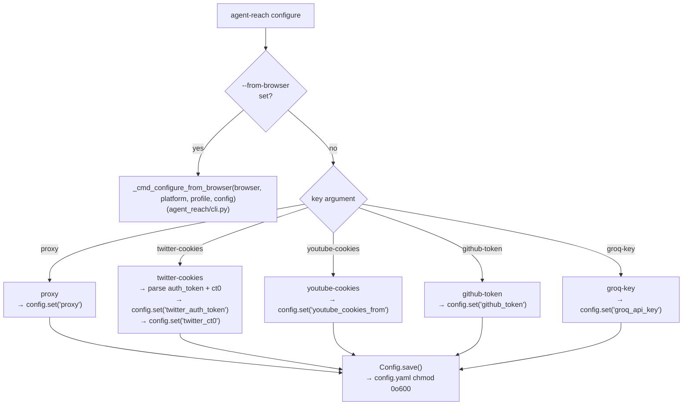
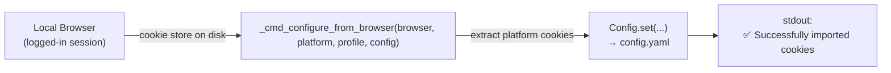
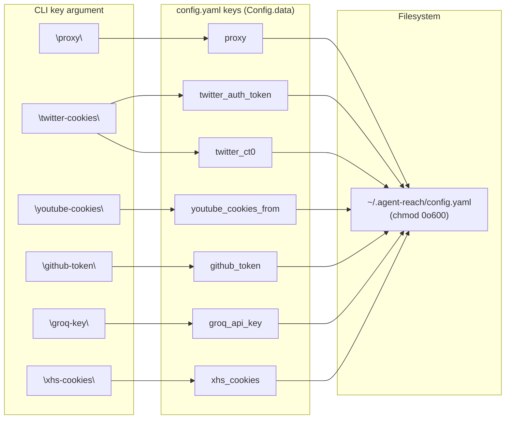

<!-- source: DeepWiki mcp.deepwiki.com · repo Panniantong/Agent-Reach · page 2.4 Configure Command · fetched 2026-10-30 -->

# Configure Command

<details>
<summary>Relevant source files</summary>

The following files were used as context for generating this wiki page:

- [agent_reach/cli.py](agent_reach/cli.py)
- [agent_reach/config.py](agent_reach/config.py)
- [tests/test_config.py](tests/test_config.py)

</details>


The `configure` command stores credentials and settings that channels need to access specific platforms. It writes values to `~/.agent-reach/config.yaml` with restricted file permissions. This page documents all configurable keys, their accepted formats, and the automatic browser extraction option.

For details on the underlying storage mechanism, see [Configuration](#4). For a guide on exporting cookies from a browser, see [Cookie Export Guide](#4.1). For proxy-specific details (why it's needed and per-channel behavior), see [Proxy Configuration](#4.2).

---

## Command Syntax

```bash
agent-reach configure <key> <value>
agent-reach configure --from-browser <browser> --platform <platform>
```

The `key` argument is constrained to a fixed set of accepted names defined in the `argparse` configuration [agent_reach/cli.py:100-104](). The `value` argument accepts one or more space-separated tokens which are processed by the command handler [agent_reach/cli.py:105]().

**Key Mapping: CLI name → Internal config key(s)**

| CLI `key` | Internal config key(s) stored | Storage location |
|---|---|---|
| `proxy` | `proxy` | `config.yaml` |
| `github-token` | `github_token` | `config.yaml` |
| `groq-key` | `groq_api_key` | `config.yaml` |
| `openai-key` | `openai_api_key` | `config.yaml` |
| `twitter-cookies` | `twitter_auth_token`, `twitter_ct0` | `config.yaml` |
| `youtube-cookies` | `youtube_cookies_from` | `config.yaml` |
| `xhs-cookies` | `xhs_cookies` | `config.yaml` |

Sources: [agent_reach/cli.py:100-104](), [agent_reach/cli.py:23-30](), [agent_reach/config.py:106-112]()

---

## How Values Are Stored

Values are written via the `Config.set()` method [agent_reach/config.py:170-184](), which serializes to YAML and immediately sets the file to `0o600` (owner read/write only) via `_atomic_write_yaml` [agent_reach/config.py:46-96](). On subsequent reads, `Config.get()` checks the YAML data first, then falls back to an uppercase environment variable of the same name [agent_reach/config.py:159-168]().

**Configure command: code flow**



Sources: [agent_reach/cli.py:99-128](), [agent_reach/config.py:152-158](), [agent_reach/config.py:78-79](), [agent_reach/config.py:159-168]()

---

## Configurable Keys

### `proxy`

Sets a global proxy used by multiple channels (e.g., Reddit, Bilibili) to bypass server-side IP blocking or access restricted networks.

```bash
agent-reach configure proxy http://user:pass@ip:port
```

The value is stored as `proxy` in `config.yaml`. Note that `_SENSITIVE_CONFIG_KEYS` includes `proxy` to ensure it is redacted in diagnostic outputs [agent_reach/cli.py:23-30]().

Sources: [agent_reach/cli.py:24](), [agent_reach/cli.py:101]()

---

### `twitter-cookies`

Provides Twitter session credentials. The CLI accepts either a full cookie string or space-separated tokens. The internal logic parses these into `twitter_auth_token` and `twitter_ct0` [agent_reach/config.py:108]().

| Format | Example |
|---|---|
| Full cookie header string | `"auth_token=abc123; ct0=xyz789; ..."` |
| Two space-separated tokens | `AUTH_TOKEN_VALUE CT0_VALUE` |

Sources: [agent_reach/cli.py:102](), [agent_reach/config.py:108]()

---

### `youtube-cookies`

Configures a browser name for `yt-dlp`'s cookie extraction. This enables downloading age-restricted or member-only content.

```bash
agent-reach configure youtube-cookies chrome
```

The value is stored as `youtube_cookies_from` in `config.yaml`.

Sources: [agent_reach/cli.py:102]()

---

### `github-token`

Stores a GitHub personal access token as `github_token` [agent_reach/config.py:111](). This raises the GitHub API rate limit for the `GitHubChannel`.

```bash
agent-reach configure github-token ghp_xxxxxxxxxxxx
```

Sources: [agent_reach/cli.py:101](), [agent_reach/config.py:111]()

---

### `groq-key`

Stores a Groq API key as `groq_api_key` [agent_reach/config.py:109](). This key is used for Whisper transcription services.

```bash
agent-reach configure groq-key gsk_xxxxxxxxxxxx
```

Sources: [agent_reach/cli.py:101](), [agent_reach/config.py:109]()

---

## `--from-browser` Option

Automatically extracts cookies from a locally installed browser for a specific platform [agent_reach/cli.py:112-119]().

```bash
agent-reach configure --from-browser chrome --platform twitter
```

**Required Flags:**
*   `--from-browser`: Choices include `chrome`, `firefox`, `edge`, `brave`, `opera` [agent_reach/cli.py:113]().
*   `--platform`: Choices include `twitter`, `xiaohongshu`, `bilibili`, `xueqiu` [agent_reach/cli.py:117]().
*   `--profile` (Optional): Specifies an exact browser profile [agent_reach/cli.py:121]().

**`--from-browser` data flow**



Sources: [agent_reach/cli.py:112-123]()

---

## Internal Configuration Keys Reference

The `Config` class uses its own internal key names. This table maps CLI arguments to `config.yaml` keys.



Sources: [agent_reach/cli.py:100-104](), [agent_reach/config.py:106-112]()

---

## Environment Variable Fallback

`Config.get()` checks the config file first, then falls back to an environment variable with the same name uppercased [agent_reach/config.py:159-168]().

| Internal key | Environment variable |
|---|---|
| `proxy` | `PROXY` |
| `twitter_auth_token` | `TWITTER_AUTH_TOKEN` |
| `twitter_ct0` | `TWITTER_CT0` |
| `github_token` | `GITHUB_TOKEN` |
| `groq_api_key` | `GROQ_API_KEY` |
| `openai_api_key` | `OPENAI_API_KEY` |

Sources: [agent_reach/config.py:165-167]()

---

## Post-Configure Verification

After running `configure`, use `agent-reach doctor` to confirm the channel status has changed. The `Config.is_configured()` method checks whether all required keys for a feature are present [agent_reach/config.py:199-202]().

| Feature name | Required keys |
|---|---|
| `exa_search` | `exa_api_key` |
| `twitter_xreach` | `twitter_auth_token`, `twitter_ct0` |
| `github_token` | `github_token` |
| `groq_whisper` | `groq_api_key` |

Sources: [agent_reach/config.py:106-112](), [agent_reach/config.py:199-202]()

---

