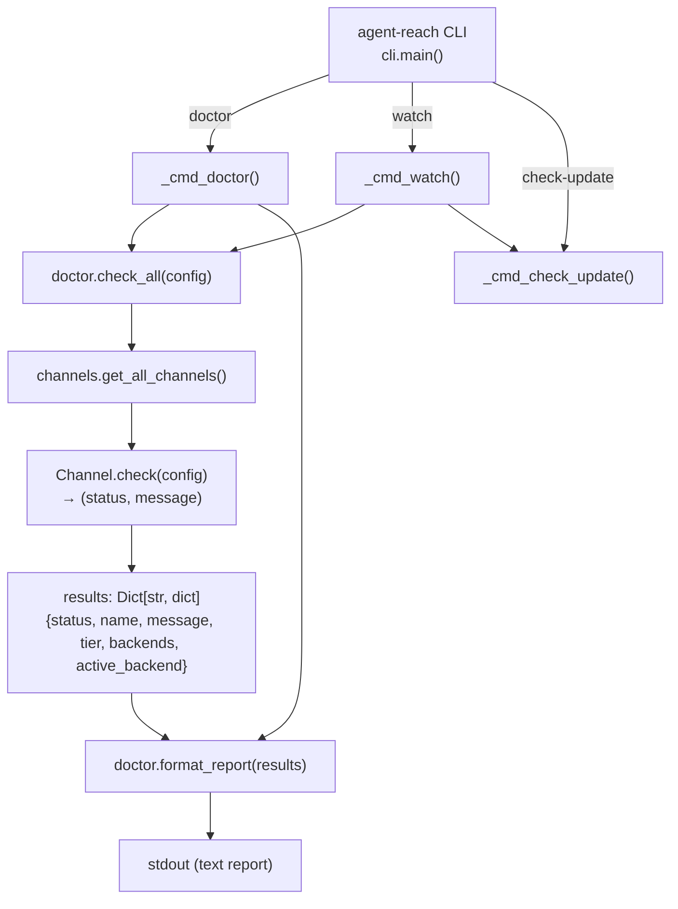
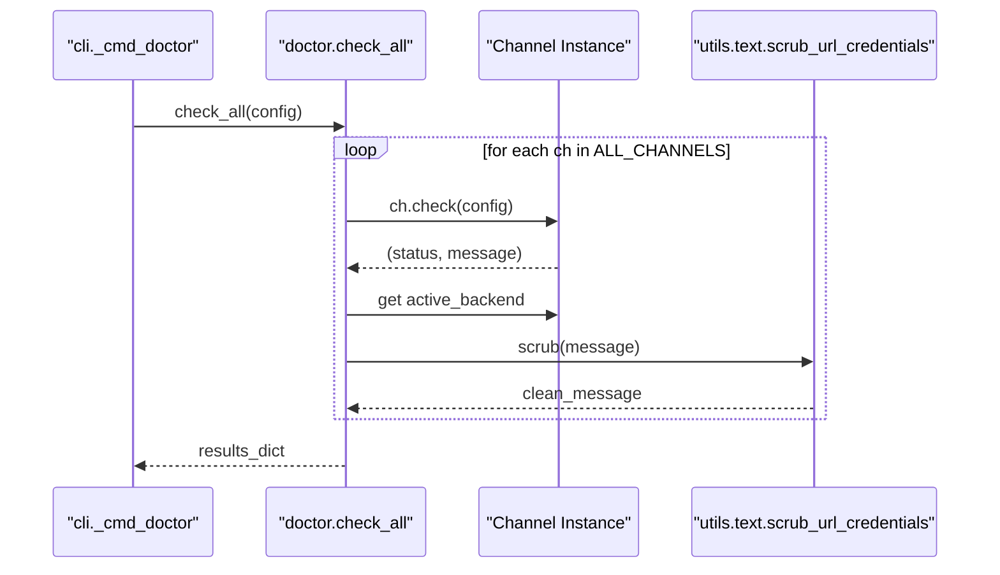

<!-- source: DeepWiki mcp.deepwiki.com · repo Panniantong/Agent-Reach · page 2.5 Diagnostics and Monitoring · fetched 2026-10-30 -->

# Diagnostics and Monitoring

Relevant source files

The following files were used as context for generating this wiki page:

- [agent_reach/doctor.py](agent_reach/doctor.py)
- [docs/troubleshooting.md](docs/troubleshooting.md)
- [docs/update.md](docs/update.md)
- [tests/test_cli.py](tests/test_cli.py)
- [tests/test_doctor.py](tests/test_doctor.py)

This page covers the three commands used to inspect and monitor the health of an Agent Reach installation: `agent-reach doctor`, `agent-reach watch`, and `agent-reach check-update`. These commands let you identify which channels are functional, detect configuration problems, and check for package updates.

For information on configuring credentials and proxies to resolve issues flagged by `doctor`, see [Configure Command](#2.4). For background on the channel tier system referenced in `doctor` output, see [Channel Architecture](#3.1).

---

## Overview

**Diagnostics flow diagram**

Sources: [agent_reach/doctor.py:1-24](), [agent_reach/doctor.py:57-131](), [agent_reach/cli.py:12-25]()

---

## `agent-reach doctor`

### Purpose

`doctor` runs a health check across every registered channel and prints a tiered status report. It is the primary tool for diagnosing installation problems and verifying that channels are correctly configured.

### Implementation

The command handler is `_cmd_doctor()`. It:

1. Instantiates `Config()` to load `~/.agent-reach/config.yaml`.
2. Calls `check_all(config)` from `agent_reach/doctor.py` [agent_reach/doctor.py:16-45]().
3. Passes the result to `format_report(results)` and prints it [agent_reach/doctor.py:57-131]().

`check_all()` is the core diagnostic engine. It iterates over every channel returned by `get_all_channels()`, calls `ch.check(config)` on each, and assembles a results dict [agent_reach/doctor.py:23-25](). A critical design feature is the **isolation of channel failures**: if one channel raises an exception, it is caught and reported as an "error" status, preventing the entire diagnostic report from crashing [agent_reach/doctor.py:27-32]().

`doctor` also serves as a **security boundary**. Before rendering, it calls `scrub_url_credentials()` on all channel messages to ensure that any URLs containing passwords or tokens (leaked from backend error messages) are masked [agent_reach/doctor.py:33-36]().

### Status Indicators

| Status value | Display symbol | Meaning |
|---|---|---|
| `ok` | ✅ | Channel is fully functional [agent_reach/doctor.py:62]() |
| `warn` | [!] (Yellow) | Channel is partially available or requires config/login [agent_reach/doctor.py:62]() |
| `off` | [X] (Red) | Channel backend is not installed [agent_reach/doctor.py:62]() |
| `error` | [X] (Red) | Unexpected exception during health check [agent_reach/doctor.py:30]() |

### Multi-Backend Reporting

For platforms that support multiple backends (e.g., Twitter, Bilibili, Reddit), `doctor` identifies which specific backend is currently active [agent_reach/doctor.py:51-54](). This is retrieved via the `active_backend` attribute on the channel instance [agent_reach/doctor.py:26]().

### Security Check

`format_report()` performs a Unix-specific check on `config.yaml` permissions [agent_reach/doctor.py:114-129](). If the file is readable by group or others (violating the recommended `0o600`), a red alert is appended to the report with the specific fix: `chmod 600 ~/.agent-reach/config.yaml` [agent_reach/doctor.py:125-127]().

---

## `agent-reach watch`

### Purpose

`watch` is a combined health and update check designed for automation (e.g., cron jobs or AI agent status polling). It prints the standard `doctor` report followed by a version check [docs/update.md:90-108]().

### Automated Maintenance

AI agents are instructed to use `watch` to determine if maintenance is required [docs/update.md:19-27](). If `watch` reports a new version or a channel regression, the agent can initiate the update workflow.

---

## `agent-reach check-update`

### Purpose

`check-update` compares the local package version against the latest release on GitHub [docs/update.md:29-35](). It is used to trigger the `pip install --upgrade` workflow.

### Update Workflow

The standardized update process is documented in `docs/update.md`:
1. **Check**: `agent-reach check-update` [docs/update.md:31-33]().
2. **Upgrade**: `pip install --upgrade https://github.com/Panniantong/agent-reach/archive/main.zip` [docs/update.md:40]().
3. **Refresh Tools**: Update upstream CLIs like `twitter-cli`, `bilibili-cli`, and `mcporter` [docs/update.md:48-67]().
4. **Verify**: Run `agent-reach doctor` to confirm the environment is healthy [docs/update.md:92]().

---

## Troubleshooting Guide

The codebase includes a troubleshooting guide for common failures [docs/troubleshooting.md:1-67]():

### bird/twitter-cli Failures
**Symptom**: Twitter search returns errors or `doctor` shows `[!]`.
**Resolution**:
- **Authentication**: Ensure `TWITTER_AUTH_TOKEN` and `TWITTER_CT0` are exported in the environment [docs/troubleshooting.md:32-34]().
- **Proxy**: If X.com is blocked, set `HTTP_PROXY` or use a global proxy tool like `proxychains` [docs/troubleshooting.md:35-48]().
- **Alternative**: Switch to the Exa-based Twitter search fallback via `mcporter` [docs/troubleshooting.md:50-57]().

### Xueqiu 400 Errors
**Symptom**: `doctor` reports `HTTP Error 400` for Xueqiu.
**Cause**: The API requires valid session cookies.
**Fix**: Use `agent-reach configure --from-browser chrome --platform xueqiu` to refresh the session [docs/troubleshooting.md:9-15]().

---

## Implementation Details

**Doctor Logic flow**

Sources: [agent_reach/doctor.py:16-45](), [tests/test_doctor.py:18-31]()

### Tests

Diagnostic logic is verified in `tests/test_doctor.py`:
- **Isolation**: `test_stale_active_backend_does_not_leak_into_errored_result` ensures that if a channel check fails, it doesn't report the backend from a previous successful run [tests/test_doctor.py:117-135]().
- **Security**: `test_channel_exception_credentials_are_scrubbed` verifies that secrets in exception messages are redacted [tests/test_doctor.py:137-162]().
- **Formatting**: `test_format_report` checks the `rich` output structure [tests/test_doctor.py:80-115]().

Sources: [tests/test_doctor.py:1-212]()

---

