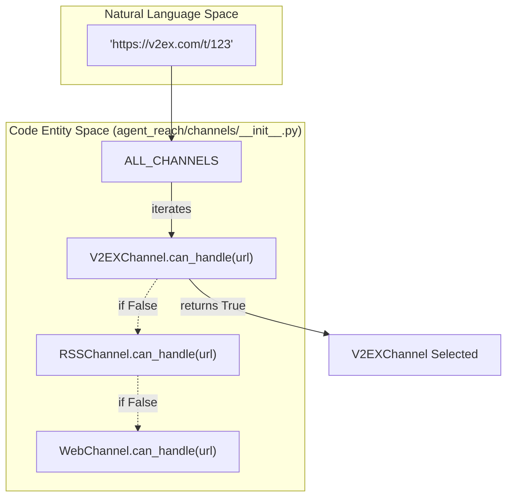
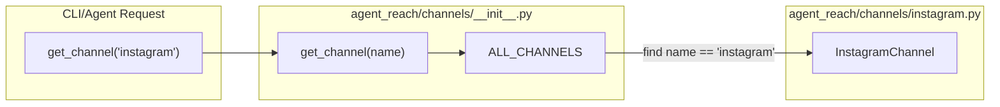

<!-- source: DeepWiki mcp.deepwiki.com · repo Panniantong/Agent-Reach · page 3 Channels · fetched 2026-10-30 -->

# Channels

<details>
<summary>Relevant source files</summary>

The following files were used as context for generating this wiki page:

- [agent_reach/channels/__init__.py](agent_reach/channels/__init__.py)
- [agent_reach/channels/base.py](agent_reach/channels/base.py)
- [agent_reach/channels/instagram.py](agent_reach/channels/instagram.py)
- [agent_reach/channels/rss.py](agent_reach/channels/rss.py)
- [tests/test_channel_contracts.py](tests/test_channel_contracts.py)

</details>


This page describes what channels are, how they are registered and selected at runtime, and the full list of supported platforms with their tier requirements. For the abstract `Channel` base class interface and the `active_backend` logic, see [Channel Architecture](#3.1).

---

## What Is a Channel?

A **channel** is a Python module in `agent_reach/channels/` that wraps an external tool, CLI, or API to expose standardized operations. Every channel implements the `Channel` abstract base class.

- **`can_handle(url)`** — returns `True` if the channel can process the given URL based on domain or pattern matching.
- **`check(config)`** — performs a health check to see if dependencies (CLIs, APIs, cookies) are available and sets `active_backend`.
- **`ordered_backends(config)`** — returns the list of supported backends, prioritizing user overrides from `config.yaml`.

The design philosophy emphasizes **pluggable backends**: the platform (e.g., Twitter) is decoupled from the tool (e.g., `bird` CLI or Jina Reader).

Sources: [agent_reach/channels/base.py:1-23](), [agent_reach/channels/base.py:29-60]()

---

## Channel Registry

All channels are registered in `agent_reach/channels/__init__.py`. The order in the `ALL_CHANNELS` list determines the priority for URL routing. For instance, the `WebChannel` is placed last to act as a catch-all fallback.

**`ALL_CHANNELS`** — the ordered routing list:

```python
ALL_CHANNELS: List[Channel] = [
    GitHubChannel(),
    TwitterChannel(),
    YouTubeChannel(),
    RedditChannel(),
    FacebookChannel(),
    InstagramChannel(),
    BilibiliChannel(),
    XiaoHongShuChannel(),
    LinkedInChannel(),
    XiaoyuzhouChannel(),
    V2EXChannel(),
    XueqiuChannel(),
    RSSChannel(),
    ExaSearchChannel(),
    WebChannel(),
]
```

Sources: [agent_reach/channels/__init__.py:26-42](), [agent_reach/channels/base.py:13-16]()

---

## URL Routing and Lookup

When the system needs to process a URL, it iterates through the registry to find the appropriate handler.

**Figure 1: URL dispatch path from Natural Language Space to Code Entity Space**



**Figure 2: Named channel lookup for platform-specific search**



Sources: [agent_reach/channels/__init__.py:45-50](), [tests/test_channel_contracts.py:166-176]()

---

## Tier Classification

Channels are classified into tiers (`Channel.tier`) based on their configuration complexity.

| Tier | Label | Meaning | Examples |
|------|-------|---------|---------|
| 0 | Zero-config | Works immediately via public APIs or standard tools | `GitHubChannel`, `V2EXChannel`, `RSSChannel`, `WebChannel` |
| 1 | Needs Key/Setup | Requires an API key (Exa) or a specific CLI setup | `ExaSearchChannel`, `RedditChannel`, `XiaoyuzhouChannel` |
| 2 | Needs Account | Requires authenticated cookies or session tokens | `XiaoHongShuChannel`, `InstagramChannel`, `LinkedInChannel` |

Sources: [agent_reach/channels/base.py:35](), [agent_reach/channels/rss.py:11](), [agent_reach/channels/instagram.py:7-13](), [tests/test_channel_contracts.py:25]()

---

## Supported Platforms

| Platform | Channel Class | Channel Name | Tier | Primary Backend(s) |
|----------|--------------|--------------|------|-----------------|
| 📦 GitHub | `GitHubChannel` | `github` | 0 | `gh` CLI |
| 🐦 Twitter/X | `TwitterChannel` | `twitter` | 0 | `bird` CLI, Jina |
| 📺 YouTube | `YouTubeChannel` | `youtube` | 0 | `yt-dlp` |
| 📖 Reddit | `RedditChannel` | `reddit` | 1 | `rdt-cli`, OpenCLI |
| 👥 Facebook | `FacebookChannel` | `facebook` | 2 | OpenCLI |
| 📸 Instagram | `InstagramChannel` | `instagram` | 2 | OpenCLI |
| 📺 Bilibili | `BilibiliChannel` | `bilibili` | 1 | `bili-cli`, OpenCLI |
| 📕 XiaoHongShu | `XiaoHongShuChannel` | `xiaohongshu` | 2 | `mcporter` (XHS MCP) |
| 💼 LinkedIn | `LinkedInChannel` | `linkedin` | 2 | `mcporter` (LinkedIn MCP) |
| 🎙️ 小宇宙 | `XiaoyuzhouChannel` | `xiaoyuzhou` | 1 | Groq Whisper |
| 🟢 V2EX | `V2EXChannel` | `v2ex` | 0 | Public API |
| 📈 雪球 | `XueqiuChannel` | `xueqiu` | 0 | Public API |
| 📰 RSS | `RSSChannel` | `rss` | 0 | `feedparser` |
| 🔍 Exa Search | `ExaSearchChannel` | `exa_search` | 1 | `mcporter` (Exa MCP) |
| 🌐 Web | `WebChannel` | `web` | 0 | Jina Reader |

Sources: [agent_reach/channels/__init__.py:26-42](), [agent_reach/channels/instagram.py:7-13](), [agent_reach/channels/rss.py:7-11]()

---

## Detailed Channel Documentation

- [Channel Architecture](#3.1) — The `Channel` base class, `active_backend` logic, and `probe_command` utility.
- [Twitter Channel](#3.2) — Twitter-specific logic using the `bird` CLI and Jina fallbacks.
- [YouTube and Bilibili Channels](#3.3) — Video platforms using `yt-dlp` and `bili-cli`.
- [GitHub Channel](#3.4) — Repository and issue reading via `gh` CLI.
- [Reddit Channel](#3.5) — Community reading via `rdt-cli` and proxy handling.
- [Web and RSS Channels](#3.6) — Fallback web reading and feed parsing via `feedparser`.
- [XiaoHongShu Channel](#3.7) — MCP-based integration for notes and search.
- [Exa Search Channel](#3.8) — Semantic web search integration via MCP.
- [Facebook, Instagram, and LinkedIn Channels](#3.9) — Browser-bridge channels using `OpenCLISiteChannel`.
- [Xiaoyuzhou, V2EX, and Xueqiu Channels](#3.10) — Podcast transcription and public financial/community APIs.

---

