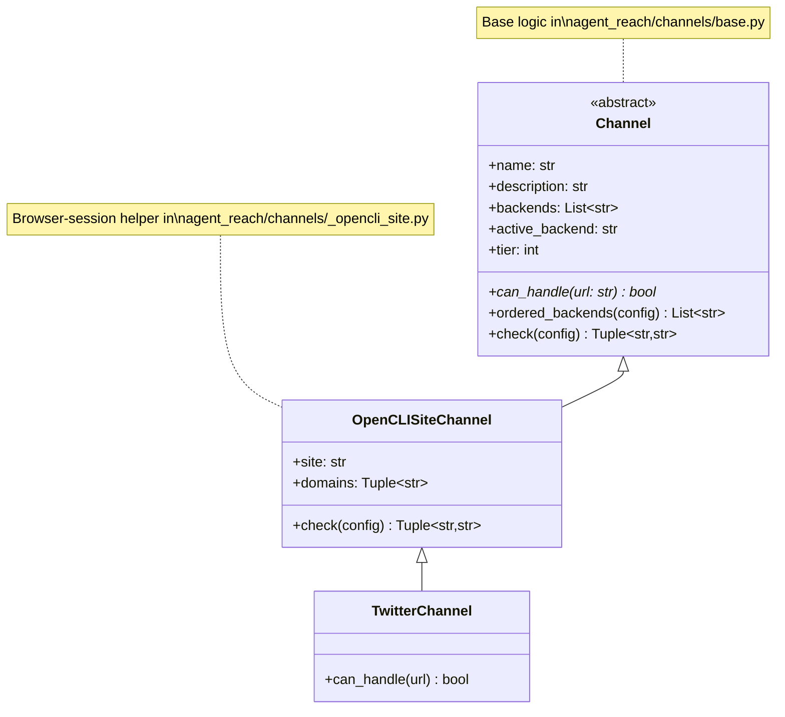
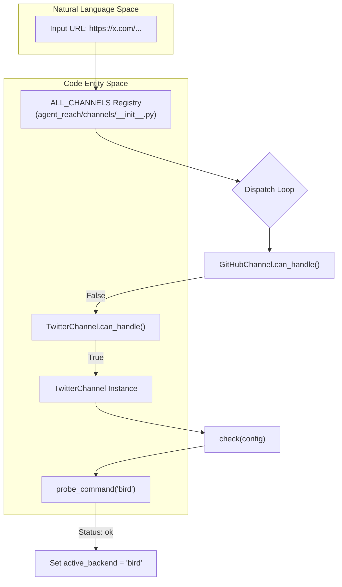

<!-- source: DeepWiki mcp.deepwiki.com · repo Panniantong/Agent-Reach · page 3.1 Channel Architecture · fetched 2026-10-30 -->

# Channel Architecture

Relevant source files

The following files were used as context for generating this wiki page:

- [agent_reach/channels/__init__.py](agent_reach/channels/__init__.py)
- [agent_reach/channels/base.py](agent_reach/channels/base.py)
- [agent_reach/channels/instagram.py](agent_reach/channels/instagram.py)
- [agent_reach/channels/rss.py](agent_reach/channels/rss.py)
- [agent_reach/probe.py](agent_reach/probe.py)
- [tests/test_channel_contracts.py](tests/test_channel_contracts.py)
- [tests/test_probe.py](tests/test_probe.py)

This page documents the internal architecture of the channels subsystem: the `Channel` abstract base class, the `OpenCLISiteChannel` helper, the routing logic in `ALL_CHANNELS`, and the `probe_command` utility for robust health diagnostics.

---

## Overview

Every platform integration in Agent Reach is a `Channel` — a class that implements a common interface and wraps specific external backend tools or APIs. The channel system has four primary responsibilities:

1.  **URL Routing**: Determining which channel handles a given URL via `can_handle()`.
2.  **Health Reporting**: Reporting whether the channel's dependencies (tools, APIs, or configs) are satisfied via `check()`.
3.  **Backend Prioritization**: Managing multiple candidate backends (e.g., CLI vs. HTTP API) via `ordered_backends()`.
4.  **Data Fetching**: Providing structured access to platform-specific data.

All channels live under `agent_reach/channels/`. The abstract contract is defined in `agent_reach/channels/base.py`, and the registry that connects everything is in `agent_reach/channels/__init__.py`.

Sources: [agent_reach/channels/base.py:1-23](), [agent_reach/channels/__init__.py:1-9]()

---

## The `Channel` Abstract Base Class

**File:** [agent_reach/channels/base.py:29-70]()

Every channel subclasses `Channel` and must implement the `can_handle` abstract method.

### Class-Level Attributes

| Attribute | Type | Purpose |
| :--- | :--- | :--- |
| `name` | `str` | Unique identifier (e.g. `"youtube"`, `"twitter"`) [agent_reach/channels/base.py:32]() |
| `description` | `str` | Human-readable summary of the platform [agent_reach/channels/base.py:33]() |
| `backends` | `List[str]` | **Ordered** list of candidate tools; `backends[0]` is the preferred primary. [agent_reach/channels/base.py:34]() |
| `tier` | `int` | Setup complexity: `0`=zero-config, `1`=needs key/CLI, `2`=needs browser/MCP [agent_reach/channels/base.py:35]() |
| `active_backend` | `Optional[str]` | The backend currently serving the channel; set during `check()`. [agent_reach/channels/base.py:38]() |

### Core Methods

**`can_handle(url: str) -> bool`**  
Abstract method to determine if a URL belongs to this platform. [agent_reach/channels/base.py:41-43]()

**`ordered_backends(config=None) -> List[str]`**  
Returns backends in probe order. It honors user overrides via config keys like `<channel>_backend` (e.g., `twitter_backend: "bird"`), which moves the requested backend to the front of the list. [agent_reach/channels/base.py:45-60]()

**`check(config=None) -> Tuple[str, str]`**  
Performs health diagnostics. Subclasses are expected to use `probe_command` to verify that backends are not just present on the `PATH`, but are actually executable. [agent_reach/channels/base.py:61-70]()

---

**Diagram: Channel Class Interface and Backend Selection**

Sources: [agent_reach/channels/base.py:29-70](), [agent_reach/channels/twitter.py:1-20](), [tests/test_channel_contracts.py:86-98]()

---

## Health Probing with `probe_command`

Agent Reach distinguishes between a tool being "missing" and "broken" (e.g., a stale venv after a Python upgrade). The `probe_command` utility in `agent_reach/probe.py` is used by channels to verify backend health.

### Probe Failure Modes
*   **`missing`**: Command not found on `PATH`. [agent_reach/probe.py:68-69]()
*   **`broken`**: Command exists but `exec` fails (e.g., stale shebang) or returns exit code 126/127. [agent_reach/probe.py:106-115]()
*   **`timeout`**: Command runs but does not respond within the timeout (default 10s). [agent_reach/probe.py:111-112]()
*   **`error`**: Command runs but returns a non-zero exit code. [agent_reach/probe.py:118-119]()
*   **`ok`**: Command returns exit code 0. [agent_reach/probe.py:120]()

Sources: [agent_reach/probe.py:27-36](), [agent_reach/probe.py:47-66]()

---

## OpenCLISiteChannel Helper

For platforms that rely on a logged-in browser session (Facebook, Instagram, etc.), the `OpenCLISiteChannel` provides a shared implementation. It uses the `opencli` tool to bridge the browser session to the CLI.

*   **Shared Check**: It probes `opencli` and checks the specific site status. [agent_reach/channels/instagram.py:7-13]()
*   **Usage Guidance**: Provides specific `login_hint` and `usage` strings to help users configure the browser session. [agent_reach/channels/instagram.py:12-13]()

---

## Channel Registry and Routing

`ALL_CHANNELS` is an ordered list in `agent_reach/channels/__init__.py`. The system iterates this list; the first channel whose `can_handle(url)` returns `True` is selected.

**Registry Order (Routing Priority):**
1.  `GitHubChannel`
2.  `TwitterChannel`
3.  `YouTubeChannel`
4.  `RedditChannel`
5.  `FacebookChannel`
6.  `InstagramChannel`
7.  `BilibiliChannel`
8.  `XiaoHongShuChannel`
9.  `LinkedInChannel`
10. `XiaoyuzhouChannel`
11. `V2EXChannel`
12. `XueqiuChannel`
13. `RSSChannel`
14. `ExaSearchChannel`
15. `WebChannel` (Catch-all Fallback)

Sources: [agent_reach/channels/__init__.py:26-42]()

---

**Diagram: URL Routing to Code Entities**

Sources: [agent_reach/channels/__init__.py:26-50](), [agent_reach/probe.py:47-55](), [agent_reach/channels/base.py:61-70]()

---

## Tier Classification

The `tier` attribute defines the expected environment complexity for the channel.

| Tier | Classification | Requirements | Examples |
| :--- | :--- | :--- | :--- |
| **0** | **Zero-Config** | No external tools or keys needed. | `RSSChannel` [rss.py:11](), `V2EXChannel` [v2ex.py:19]() |
| **1** | **Needs Setup** | Requires standalone CLI tools or free keys. | `GitHubChannel`, `YouTubeChannel` |
| **2** | **Complex** | Requires browser sessions, MCP, or Docker. | `XiaoHongShuChannel`, `InstagramChannel` |

Sources: [agent_reach/channels/base.py:35](), [agent_reach/channels/rss.py:11](), [tests/test_channel_contracts.py:25]()

---

