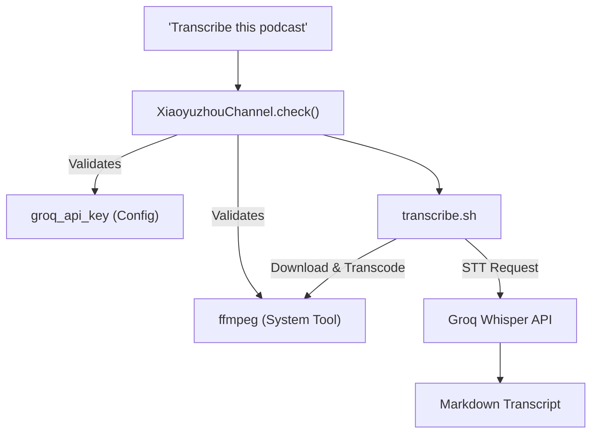
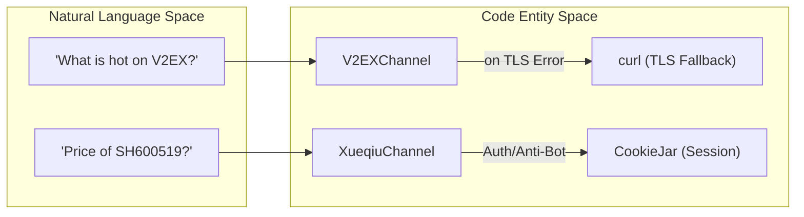

<!-- source: DeepWiki mcp.deepwiki.com · repo Panniantong/Agent-Reach · page 3.10 Xiaoyuzhou, V2EX, and Xueqiu Channels · fetched 2026-10-30 -->

# Xiaoyuzhou, V2EX, and Xueqiu Channels

Relevant source files

The following files were used as context for generating this wiki page:

- [agent_reach/channels/_opencli_site.py](agent_reach/channels/_opencli_site.py)
- [agent_reach/channels/v2ex.py](agent_reach/channels/v2ex.py)
- [agent_reach/channels/xiaoyuzhou.py](agent_reach/channels/xiaoyuzhou.py)
- [agent_reach/channels/xueqiu.py](agent_reach/channels/xueqiu.py)
- [agent_reach/scripts/transcribe_xiaoyuzhou.sh](agent_reach/scripts/transcribe_xiaoyuzhou.sh)
- [tests/test_channels.py](tests/test_channels.py)
- [tests/test_v2ex_channel.py](tests/test_v2ex_channel.py)
- [tests/test_xueqiu_channel.py](tests/test_xueqiu_channel.py)

This page documents the specialized platform channels for Xiaoyuzhou (podcast transcription), V2EX (developer community), and Xueqiu (financial data). These channels represent a mix of Tier 0 (zero-config public APIs) and Tier 1 (external dependencies and API keys) implementations within the Agent Reach ecosystem.

### XiaoyuzhouChannel

The `XiaoyuzhouChannel` provides a sophisticated transcription pipeline for the Xiaoyuzhou (小宇宙) podcast platform. Unlike standard text-based channels, it manages a multi-step workflow involving audio extraction, transcoding, and AI-driven speech-to-text.

*   **Implementation:** The channel class `XiaoyuzhouChannel` acts as a wrapper and health-checker for the underlying `transcribe.sh` bash script [agent_reach/channels/xiaoyuzhou.py:12-15]().
*   **Dependencies:**
    *   **ffmpeg:** Required for audio transcoding and segmenting [agent_reach/channels/xiaoyuzhou.py:28-38]().
    *   **Groq API Key:** Used to access the `whisper-large-v3` model for high-speed transcription [agent_reach/channels/xiaoyuzhou.py:49-62]().
*   **Transcription Pipeline (`transcribe_xiaoyuzhou.sh`):**
    1.  **Extraction:** Parses the show page to find direct media URLs (`.m4a` or `.mp3`) [agent_reach/scripts/transcribe_xiaoyuzhou.sh:110-123]().
    2.  **Transcoding:** Uses `ffmpeg` to convert audio to single-channel (mono) 64k MP3 to minimize upload size [agent_reach/scripts/transcribe_xiaoyuzhou.sh:177-182]().
    3.  **Chunking:** Splits the audio into 20MB segments to stay within Groq's 25MB file limit [agent_reach/scripts/transcribe_xiaoyuzhou.sh:184-204]().
    4.  **AI Transcription:** dispatches chunks to the Groq Whisper API [agent_reach/scripts/transcribe_xiaoyuzhou.sh:206-220]().
    5.  **Polishing (Optional):** If the `--polish` flag is used, it calls Llama 3.3 70B to correct Chinese punctuation and formatting [agent_reach/scripts/transcribe_xiaoyuzhou.sh:6-8]().

**Sources:** [agent_reach/channels/xiaoyuzhou.py:1-65](), [agent_reach/scripts/transcribe_xiaoyuzhou.sh:1-220]()

---

### V2EXChannel

`V2EXChannel` is a Tier 0 channel that interacts with the V2EX developer community. It is designed to be highly resilient to TLS issues common in specific network environments.

*   **Public API Integration:** Uses the standard V2EX JSON API for fetching hot topics and node-specific content [agent_reach/channels/v2ex.py:140-144]().
*   **TLS Fallback Mechanism:** If the standard Python `urllib` stack encounters an `UNEXPECTED_EOF_WHILE_READING` error (common with certain proxies or MTU settings), the channel automatically falls back to using the system's `curl` binary to complete the request [agent_reach/channels/v2ex.py:57-82](), [agent_reach/channels/v2ex.py:128-137]().
*   **Safety Constraints:**
    *   **Domain Validation:** Only permits requests to `v2ex.com` or `www.v2ex.com` over HTTPS [agent_reach/channels/v2ex.py:28-44]().
    *   **Size Limits:** Enforces a 1 MiB limit on API responses to prevent memory exhaustion [agent_reach/channels/v2ex.py:19](), [agent_reach/channels/v2ex.py:52-54]().
*   **Key Capabilities:**
    *   `get_hot_topics()`: Retrieves the top trending discussions [agent_reach/channels/v2ex.py:177-200]().
    *   `get_node_topics()`: Browses topics within a specific node (e.g., "python") [tests/test_v2ex_channel.py:182-188]().

**Sources:** [agent_reach/channels/v2ex.py:1-201](), [tests/test_v2ex_channel.py:1-202]()

---

### XueqiuChannel

`XueqiuChannel` provides financial data and community posts from the Xueqiu (雪球) platform. It requires careful session management to navigate the platform's anti-crawling measures.

*   **Cookie-Aware Session Management:**
    *   Uses `http.cookiejar.CookieJar` to persist session state [agent_reach/channels/xueqiu.py:24-27]().
    *   `_ensure_cookies()`: Prioritizes cookies from `config.yaml` (set via `agent-reach configure --from-browser`). If missing, it performs a fallback visit to the Xueqiu homepage to obtain basic session cookies (e.g., `acw_tc`) [agent_reach/channels/xueqiu.py:74-94]().
*   **Data Shaping:**
    *   **Stock Quotes:** Normalizes stock data for SH/SZ/HK/US markets into a standard dictionary [agent_reach/channels/xueqiu.py:161-195]().
    *   **Community Posts:** Extracts "Hot Posts" by unwrapping JSON-in-JSON payloads and stripping HTML tags [tests/test_xueqiu_channel.py:173-192]().
*   **Health Check:** The `check()` method attempts to fetch a quote for a stable stock (e.g., `SH601138`) to verify API connectivity [agent_reach/channels/xueqiu.py:133-144]().

**Sources:** [agent_reach/channels/xueqiu.py:1-195](), [tests/test_xueqiu_channel.py:1-200]()

---

### Natural Language to Code Entity Mapping

The following diagrams illustrate how user intents are mapped to specific backend implementations for these three platforms.

**Diagram 1: Xiaoyuzhou Transcription Pipeline**
This diagram shows how a natural language request to "transcribe a podcast" triggers a chain of specialized system tools.

**Sources:** [agent_reach/channels/xiaoyuzhou.py:23-65](), [agent_reach/scripts/transcribe_xiaoyuzhou.sh:177-220]()

**Diagram 2: V2EX and Xueqiu API Dispatch**
This diagram maps URL-based intents to the specific public API handlers and their internal recovery/session logic.

**Sources:** [agent_reach/channels/v2ex.py:128-137](), [agent_reach/channels/xueqiu.py:24-27](), [agent_reach/channels/xueqiu.py:74-94]()

### Platform Comparison Table

| Feature | Xiaoyuzhou | V2EX | Xueqiu |
| :--- | :--- | :--- | :--- |
| **Tier** | 1 (Needs Key/Tool) | 0 (Zero-Config) | 0 (Zero-Config) |
| **Primary Backend** | Groq Whisper | Public JSON API | Public JSON API |
| **Key Dependency** | `ffmpeg` | `curl` (optional fallback) | `http.cookiejar` |
| **Authentication** | API Key (`groq-key`) | None (Public) | Cookies (Optional/Auto) |
| **Routing Domain** | `xiaoyuzhoufm.com` | `v2ex.com` | `xueqiu.com` |
| **Primary Method** | `transcribe.sh` | `get_hot_topics` | `get_stock_quote` |

**Sources:** [agent_reach/channels/xiaoyuzhou.py:13-21](), [agent_reach/channels/v2ex.py:140-153](), [agent_reach/channels/xueqiu.py:114-128]()

---

