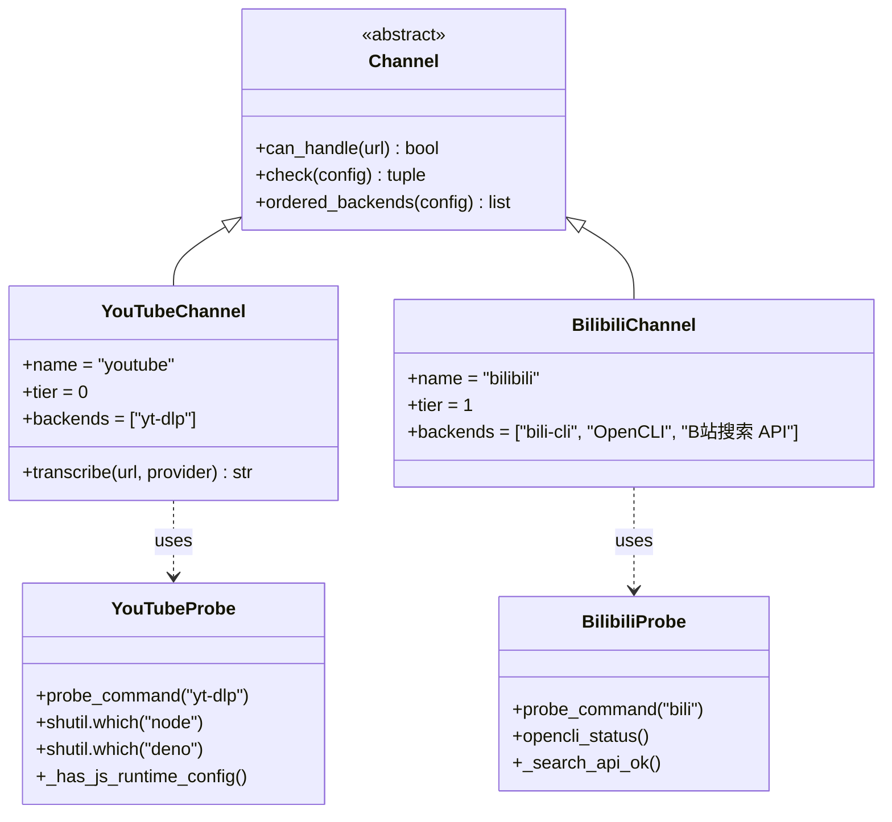
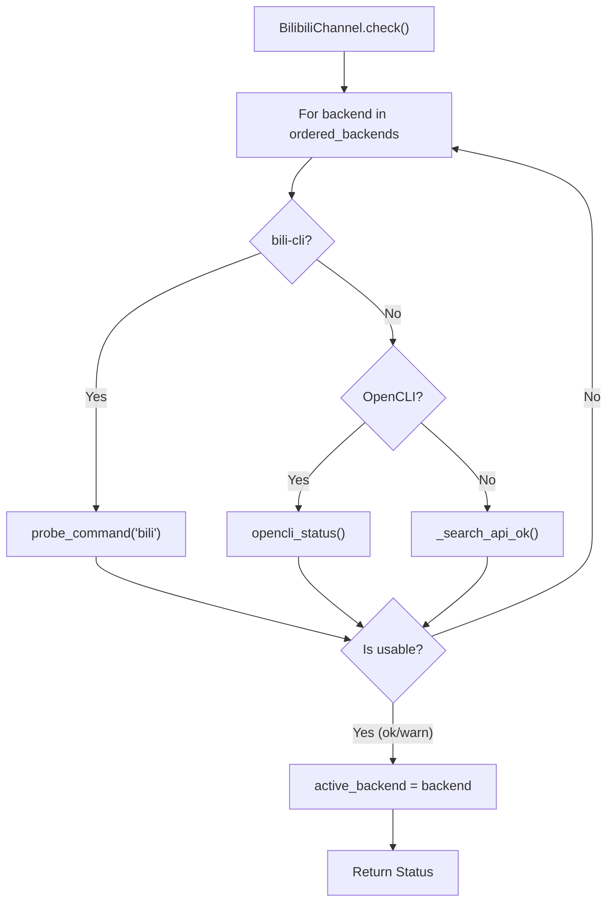

<!-- source: DeepWiki mcp.deepwiki.com · repo Panniantong/Agent-Reach · page 3.3 YouTube and Bilibili Channels · fetched 2026-10-30 -->

# YouTube and Bilibili Channels

Relevant source files

The following files were used as context for generating this wiki page:

- [agent_reach/channels/bilibili.py](agent_reach/channels/bilibili.py)
- [agent_reach/channels/reddit.py](agent_reach/channels/reddit.py)
- [agent_reach/channels/youtube.py](agent_reach/channels/youtube.py)
- [agent_reach/utils/text.py](agent_reach/utils/text.py)
- [tests/test_paths.py](tests/test_paths.py)
- [tests/test_youtube_channel.py](tests/test_youtube_channel.py)

This page documents `YouTubeChannel` and `BilibiliChannel`: the two primary video platform channels in Agent Reach. While `YouTubeChannel` leverages `yt-dlp` as its core backend, `BilibiliChannel` utilizes a multi-backend strategy involving `bili-cli`, `OpenCLI`, and raw API fallbacks to navigate aggressive platform risk controls.

---

## Overview

| Property | `YouTubeChannel` | `BilibiliChannel` |
|---|---|---|
| File | [agent_reach/channels/youtube.py:39-118]() | [agent_reach/channels/bilibili.py:35-119]() |
| Class | `YouTubeChannel` | `BilibiliChannel` |
| `name` | `"youtube"` | `"bilibili"` |
| `tier` | `0` (Zero-config) | `1` (Needs Setup) |
| Backends | `yt-dlp` | `bili-cli`, `OpenCLI`, `B站搜索 API` |
| `can_handle` domains | `youtube.com`, `youtu.be` | `bilibili.com`, `b23.tv` |
| Key Requirement | JS Runtime (Node/Deno) | `bili-cli` or browser bridge |

Sources: [agent_reach/channels/youtube.py:39-48](), [agent_reach/channels/bilibili.py:35-44]()

---

## Architecture

The following diagrams map the natural language requirements for video processing to the specific code entities and data flows that implement them.

**Diagram: Video Channel Code Entities**

Sources: [agent_reach/channels/youtube.py:39-52](), [agent_reach/channels/bilibili.py:35-84](), [agent_reach/channels/base.py:15-22]()

---

## YouTube Channel

The `YouTubeChannel` focuses on extracting video information and subtitles using `yt-dlp`. A critical requirement for YouTube is the presence of a JavaScript runtime, as `yt-dlp` requires it to solve signature challenges [agent_reach/channels/youtube.py:2-3]().

### Runtime Requirements
The `check()` method [agent_reach/channels/youtube.py:50-118]() performs a multi-step validation:
1. **Binary Check**: Uses `probe_command` to verify `yt-dlp` is executable [agent_reach/channels/youtube.py:52-65]().
2. **JS Runtime Check**: Looks for `deno` (works out of the box) or `node` [agent_reach/channels/youtube.py:69-77]().
3. **Configuration Check**: If using Node.js, it checks `yt-dlp`'s config file for the `--js-runtimes node` flag [agent_reach/channels/youtube.py:78-80]().
4. **Version Check**: Ensures `yt-dlp` is newer than version `2025.11.12` to support JS runtimes [agent_reach/channels/youtube.py:17-18](), [agent_reach/channels/youtube.py:88-92]().

### Transcription Pipeline
YouTube supports audio transcription via external providers (Groq/OpenAI). The `transcribe()` method [agent_reach/channels/youtube.py:120-141]() delegates to the core transcription utility. `doctor` reports readiness if `ffmpeg`/`ffprobe` are present and a provider is configured [agent_reach/channels/youtube.py:98-117]().

Sources: [agent_reach/channels/youtube.py:50-96](), [agent_reach/channels/youtube.py:120-141](), [tests/test_youtube_channel.py:4-11]()

---

## Bilibili Channel

The `BilibiliChannel` handles video content and search. Notably, `yt-dlp` was **removed** as a Bilibili backend because platform risk control (412 errors) consistently blocks its requests [agent_reach/channels/bilibili.py:4-9]().

### Multi-Backend Strategy
The channel probes backends in order of capability [agent_reach/channels/bilibili.py:51-60]():
1. **bili-cli**: Primary backend for search, hot topics, and video details without login [agent_reach/channels/bilibili.py:82-94]().
2. **OpenCLI**: Fallback for subtitles, leveraging a logged-in browser session [agent_reach/channels/bilibili.py:96-110]().
3. **B站搜索 API**: Final fallback for basic search using direct `urllib` requests [agent_reach/channels/bilibili.py:112-119]().

**Diagram: Bilibili Backend Resolution**

### Connectivity Detection
- **_search_api_ok()**: Attempts a direct request to the Bilibili search API [agent_reach/channels/bilibili.py:24-32]().
- **OpenCLI Ready**: Checks if the OpenCLI bridge is connected, though it does not verify Bilibili login state during `doctor` to avoid side effects [agent_reach/channels/bilibili.py:105-109]().

Sources: [agent_reach/channels/bilibili.py:46-80](), [agent_reach/channels/bilibili.py:82-119]()

---

## Configuration and Remediation

### yt-dlp Fixes
If `yt-dlp` lacks a JS runtime on YouTube, the system provides a remediation command [agent_reach/channels/youtube.py:94](). The helper `render_ytdlp_fix_command()` generates a shell command to append `--js-runtimes node` to the user's config file [agent_reach/utils/paths.py:12-13](), [tests/test_paths.py:13-31]().

### Proxy and Secrets
For Bilibili, network issues may require proxies. The system also includes text helpers to scrub sensitive information (tokens, credentials) from URLs before logging or processing [agent_reach/utils/text.py:24-28]().

| Feature | YouTube Detail | Bilibili Detail |
|---|---|---|
| **Subtitles** | Handled by `yt-dlp` | Handled by `OpenCLI` |
| **Search** | via `yt-dlp` | via `bili-cli` or API |
| **Remediation** | `agent-reach install --system` | `pipx install bilibili-cli` |

Sources: [agent_reach/channels/youtube.py:73-74](), [agent_reach/channels/bilibili.py:78-79](), [agent_reach/utils/text.py:1-28]()

---

