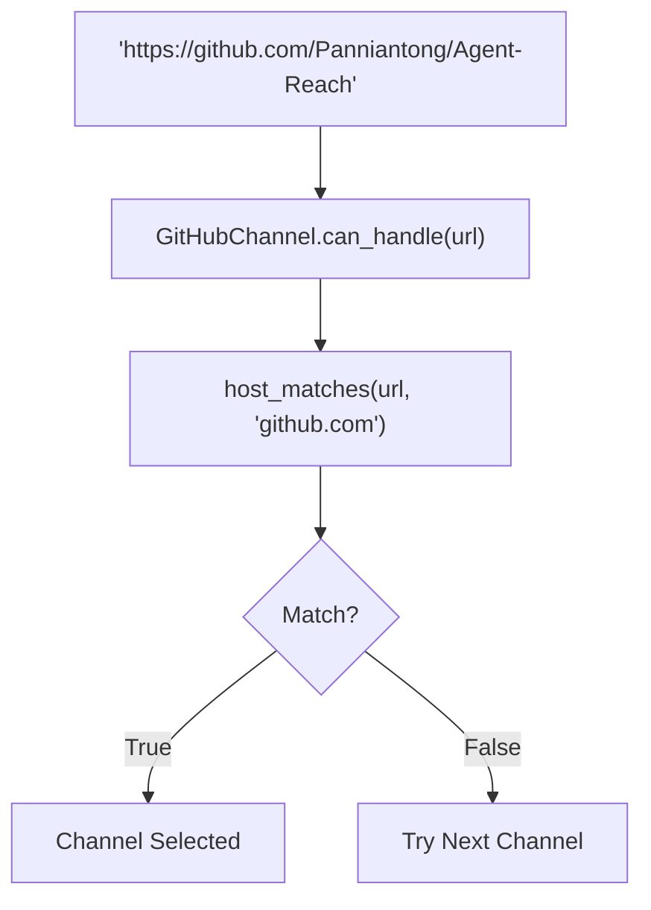
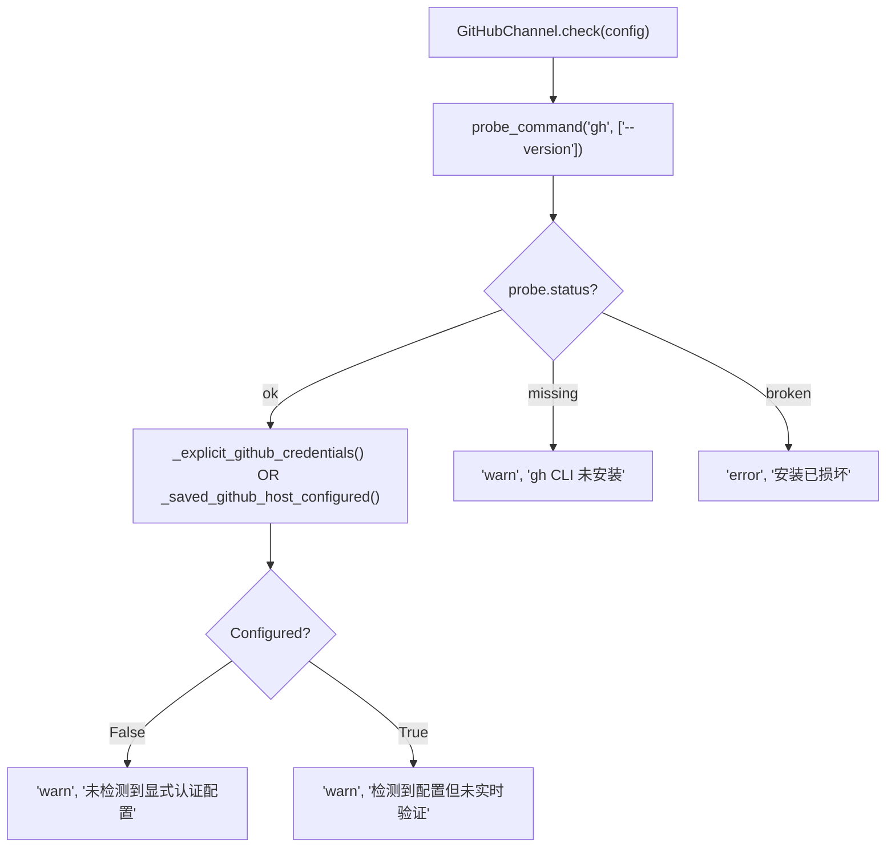

<!-- source: DeepWiki mcp.deepwiki.com · repo Panniantong/Agent-Reach · page 3.4 GitHub Channel · fetched 2026-10-30 -->

# GitHub Channel

Relevant source files

The following files were used as context for generating this wiki page:

- [agent_reach/channels/github.py](agent_reach/channels/github.py)
- [agent_reach/guides/setup-exa.md](agent_reach/guides/setup-exa.md)
- [agent_reach/guides/setup-reddit.md](agent_reach/guides/setup-reddit.md)

This page documents the `GitHubChannel` class: its backend tool (`gh CLI`), URL routing logic, read and search behavior, authentication states, and the `WebChannel` fallback path. For general channel architecture concepts (base class, `ReadResult`, `SearchResult`, registration), see [Channel Architecture](3.1).

---

## Overview

`GitHubChannel` handles all URLs on `github.com` [agent_reach/channels/github.py:101-104](). It is a **tier-0** channel [agent_reach/channels/github.py:99](): public repository reading and search work immediately after `gh CLI` is installed. 

The backend is the official [`gh CLI`](https://cli.github.com) [agent_reach/channels/github.py:98](). To ensure privacy and prevent unwanted side effects during diagnostics, the channel uses a "read-only" environment configuration that disables telemetry and update notifiers [agent_reach/channels/github.py:20-27]().

---

## Implementation Location

| Item | Value |
|---|---|
| Source file | `agent_reach/channels/github.py` |
| Class | `GitHubChannel` |
| `name` | `"github"` |
| `tier` | `0` |
| `backends` | `["gh CLI"]` |
| Primary CLI | `gh` |

Sources: [agent_reach/channels/github.py:95-99]()

---

## URL Routing

The `can_handle` method matches any URL whose host contains `github.com`. It utilizes the `host_matches` utility to validate the domain [agent_reach/channels/github.py:101-104]().

**Natural Language to Code Entity Space: URL Dispatch**

Sources: [agent_reach/channels/github.py:101-104]()

---

## Authentication and Health Check

The `check()` method determines channel health by probing the `gh` binary and inspecting local configuration files without executing commands that write to the disk (like `gh auth status`, which creates a `device-id` file) [agent_reach/channels/github.py:106-145]().

**System State to Code Entity Space: Health Check**

### Diagnostic Logic
1.  **CLI Availability**: Uses `probe_command` to check if `gh` is installed and functional [agent_reach/channels/github.py:108-114](). If missing, it suggests installation via the official site [agent_reach/channels/github.py:116]().
2.  **Configuration Inspection**:
    *   **Environment/Config**: `_explicit_github_credentials` checks for `GH_TOKEN` or `GITHUB_TOKEN` in environment variables or the Agent Reach `config.yaml` [agent_reach/channels/github.py:84-93]().
    *   **Filesystem**: `_saved_github_host_configured` reads the `hosts.yml` file used by `gh CLI` [agent_reach/channels/github.py:51-82](). It searches for the file in standard locations (XDG config, AppData, or `GH_CONFIG_DIR`) [agent_reach/channels/github.py:34-49]().
3.  **Auth Boundary**: To maintain a "read-only" diagnostic state, the channel does not run `gh auth status` because that command triggers telemetry and writes local state files [agent_reach/channels/github.py:133-145]().

Sources: [agent_reach/channels/github.py:34-145]()

---

## Read and Search Capabilities

The `GitHubChannel` leverages the `gh` CLI to provide structured data.

### Repository and Code Reading
The channel utilizes `gh repo view` to fetch repository metadata and README contents. It also supports deep links to issues and pull requests by wrapping `gh issue view` and `gh pr view`.

### Search Functionality
Search is implemented via `gh search repos`. It supports:
*   **Query**: Semantic or keyword search.
*   **Language Filter**: Restricting results to specific programming languages (e.g., `--lang python`).
*   **Result Limit**: Controlled via the `-n` flag in the CLI.

---

## WebChannel Fallback

If `gh CLI` is missing or the user is unauthenticated and attempting to access a public repository that `gh` fails to fetch, the system falls back to `WebChannel`. The `WebChannel` uses Jina Reader (`r.jina.ai`) to scrape the public GitHub web interface. This ensures that the agent can still "see" code and READMEs even without a local GitHub setup.

Sources: [agent_reach/channels/github.py:116](), [agent_reach/channels/github.py:142-145]() (Warning logic implying limited functionality without CLI).

---

## Comparison with Similar Channels

Unlike `RedditChannel` or `TwitterChannel`, which often require specific proxies or cookie exports to bypass anti-scraping, `GitHubChannel` relies on a standard developer tool (`gh`) that handles authentication via OAuth tokens.

| Feature | GitHub | Reddit | Twitter |
|---|---|---|---|
| **Primary Backend** | `gh CLI` | `rdt-cli` | `bird CLI` |
| **Auth Requirement** | OAuth Token / CLI Login | Browser Cookie | Browser Cookie |
| **Proxy Needed** | Rarely | Highly Recommended | Recommended |
| **Tier** | 0 | 1 | 1 |

Sources: [agent_reach/channels/github.py:98-99](), [agent_reach/guides/setup-reddit.md:7-11](), [agent_reach/guides/setup-exa.md:4-7]()

---

