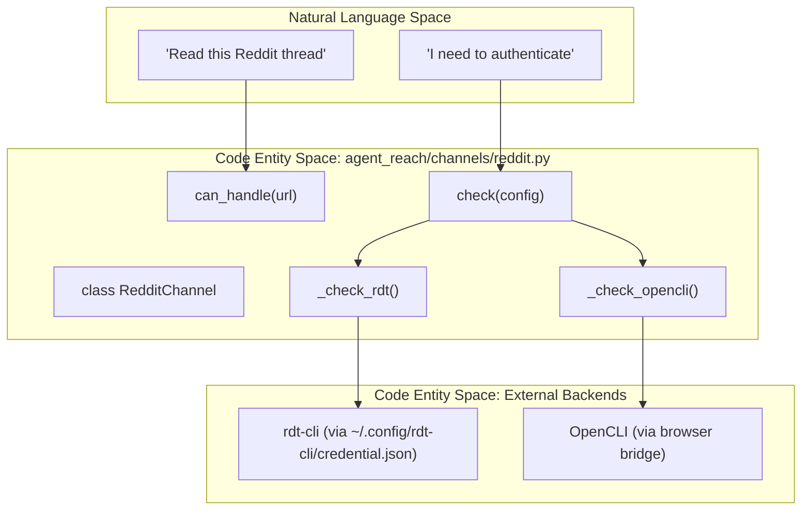
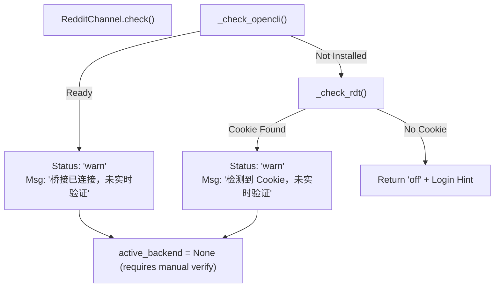

<!-- source: DeepWiki mcp.deepwiki.com · repo Panniantong/Agent-Reach · page 3.5 Reddit Channel · fetched 2026-10-30 -->

# Reddit Channel

Relevant source files

The following files were used as context for generating this wiki page:

- [agent_reach/channels/bilibili.py](agent_reach/channels/bilibili.py)
- [agent_reach/channels/reddit.py](agent_reach/channels/reddit.py)
- [agent_reach/guides/setup-exa.md](agent_reach/guides/setup-exa.md)
- [agent_reach/guides/setup-reddit.md](agent_reach/guides/setup-reddit.md)
- [tests/test_reddit_channel.py](tests/test_reddit_channel.py)

This page documents `RedditChannel`: how it routes Reddit URLs, how it manages its multi-backend architecture (`OpenCLI` and `rdt-cli`), its mandatory login requirement, and how it handles recursive content extraction while navigating aggressive IP blocking.

---

## Overview

`RedditChannel` is a **Tier 1** channel providing access to Reddit posts and comments. Unlike other channels, it has **no zero-config path** [agent_reach/channels/reddit.py:4-10](). Reddit has blocked anonymous `.json` endpoints for data centers and restricted official API access; therefore, every backend used by this channel requires a logged-in session [agent_reach/channels/reddit.py:34]().

| Property | Value |
|---|---|
| Class | `RedditChannel` |
| File | `agent_reach/channels/reddit.py` |
| Tier | 1 (Login mandatory — no anonymous access) |
| Backends | `OpenCLI`, `rdt-cli` |
| URL patterns | `reddit.com`, `redd.it` |

Sources: [agent_reach/channels/reddit.py:30-34](), [agent_reach/guides/setup-reddit.md:5-11]()

---

## Architecture and Data Flow

The following diagram illustrates how `RedditChannel` bridges the Natural Language Space to the Code Entity Space, specifically focusing on the multi-backend selection logic.

**Diagram: Reddit Backend Selection and Validation**

Sources: [agent_reach/channels/reddit.py:30-53](), [agent_reach/channels/reddit.py:90-95]()

---

## URL Handling

### URL Matching
The `can_handle()` method identifies Reddit URLs by checking if the host matches `reddit.com` or `redd.it` using the `host_matches` utility [agent_reach/channels/reddit.py:36-39]().

### Backend Dispatch
The channel probes backends in order of preference. The first backend that returns an `ok` or `warn` status is selected as the `active_backend` [agent_reach/channels/reddit.py:43-60]().

Sources: [agent_reach/channels/reddit.py:36-60](), [tests/test_reddit_channel.py:11-20]()

---

## Backend Implementations

### 1. OpenCLI Backend
This is the recommended backend for desktop environments. It reuses the user's active Chrome/browser session. If the user is logged into Reddit in their browser, OpenCLI can bridge that session to the CLI [agent_reach/channels/reddit.py:66-68]().
- **Health Check**: `_check_opencli()` calls `opencli_status()` to verify the bridge is installed and connected [agent_reach/channels/reddit.py:74-88]().

### 2. rdt-cli Backend
Recommended for server environments. It is a specialized CLI for Reddit that imports session cookies [agent_reach/channels/reddit.py:69-70]().
- **Credential Safety**: The channel reads `~/.config/rdt-cli/credential.json` using `read_small_text_no_follow` to prevent symlink attacks [agent_reach/channels/reddit.py:95-101]().
- **Validation**: It checks for the existence of `reddit_session` in the cookie dictionary and verifies if the credentials are older than 7 days (`_CREDENTIAL_TTL_SECONDS`) [agent_reach/channels/reddit.py:121-128]().

Sources: [agent_reach/channels/reddit.py:74-136](), [tests/test_reddit_channel.py:66-87]()

---

## Health Check and Diagnostics

The `check()` method avoids executing live platform commands to prevent unwanted side effects, such as triggering automatic cookie refreshes that might invalidate sessions [agent_reach/channels/reddit.py:134-136]().

**Diagram: Health Check Decision Tree**

Sources: [agent_reach/channels/reddit.py:41-72](), [tests/test_reddit_channel.py:156-176]()

---

## Proxy and Error Handling

Reddit aggressively blocks data center IP ranges with `403 Forbidden` and `429 Too Many Requests` errors. 

- **Proxy Configuration**: Users must configure `reddit_proxy` via `agent-reach configure` to bypass these blocks in server environments [agent_reach/channels/reddit.py:71]().
- **Recursive Extraction**: When reading a post, the backends are responsible for parsing the JSON response to extract the full post body and recursive comment threads [agent_reach/guides/setup-reddit.md:9]().
- **Fallback**: If both primary backends fail, the system suggests using **Exa Search** as a fallback for Reddit content discovery [agent_reach/guides/setup-reddit.md:47-55]().

Sources: [agent_reach/channels/reddit.py:5-9](), [agent_reach/guides/setup-reddit.md:5-9](), [agent_reach/guides/setup-reddit.md:47-55]()

---

