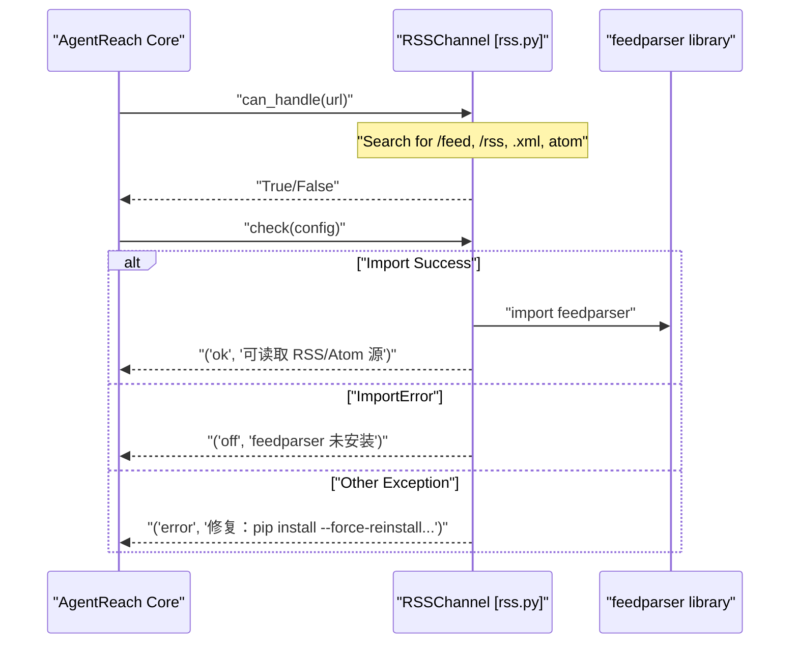

<!-- source: DeepWiki mcp.deepwiki.com · repo Panniantong/Agent-Reach · page 3.6 Web and RSS Channels · fetched 2026-10-30 -->

# Web and RSS Channels

<details>
<summary>Relevant source files</summary>

The following files were used as context for generating this wiki page:

- [agent_reach/channels/base.py](agent_reach/channels/base.py)
- [agent_reach/channels/rss.py](agent_reach/channels/rss.py)
- [agent_reach/channels/web.py](agent_reach/channels/web.py)
- [agent_reach/utils/url.py](agent_reach/utils/url.py)
- [tests/test_web_channel.py](tests/test_web_channel.py)

</details>


This page documents two zero-configuration channels: `WebChannel` ([agent_reach/channels/web.py:34]()) and `RSSChannel` ([agent_reach/channels/rss.py:7]()). Both are classified as **Tier 0** (zero-config) [agent_reach/channels/web.py:38](), [agent_reach/channels/rss.py:11]() and work immediately after installation without API keys or complex environment setup.

`WebChannel` is the system's catch-all fallback — it handles any URL that no other channel claims. `RSSChannel` handles RSS and Atom feed URLs specifically using pattern detection and the `feedparser` backend.

---

## WebChannel

`WebChannel` uses the [Jina Reader](https://r.jina.ai) HTTP service as its backend [agent_reach/channels/web.py:37](). It acts as a proxy that transforms complex HTML into clean, LLM-friendly Markdown.

### Role as Catch-All Fallback
In the channel registry, `WebChannel` acts as the final safety net. Its `can_handle` method [agent_reach/channels/web.py:40-41]() returns `True` for any input, ensuring that if no specialized channel (like `TwitterChannel` or `GitHubChannel`) matches the URL, the system still attempts to read it via Jina Reader.

### Implementation Details
- **Backend**: `Jina Reader` [agent_reach/channels/web.py:37]().
- **URL Normalization**: Before sending to Jina, the URL is passed through `normalize_public_http_url` [agent_reach/utils/url.py:47](). This function rejects non-public targets (e.g., `localhost`, `127.0.0.1`, `internal` domains) to prevent SSRF (Server-Side Request Forgery) [agent_reach/utils/url.py:71-82]().
- **Anti-Bot Detection**: The channel includes a `_is_antibot_page` helper [agent_reach/channels/web.py:15]() that scans the first 4KB of the response for markers indicating Cloudflare challenges or Jina captcha requirements [agent_reach/channels/web.py:17-31](). If detected, it raises a `RuntimeError` suggesting the user switch to a browser-based tool [agent_reach/channels/web.py:62-66]().
- **Constraints**: It enforces a strict 5MB response limit (`_MAX_RESPONSE_BYTES`) to prevent memory exhaustion [agent_reach/channels/web.py:11](), [agent_reach/channels/web.py:58-61]().

### Diagnostics
The `check()` method [agent_reach/channels/web.py:43-46]() is designed to be zero-overhead. It does not perform network probes during a `doctor` check, ensuring that diagnostics remain fast and do not trigger rate limits on the Jina API unnecessarily.

**Diagram 1: WebChannel Request Pipeline**

```mermaid
graph TD
    "Input[URL]" --> "Normalize[normalize_public_http_url]"
    "Normalize[normalize_public_http_url]" -->|"SSRF/Private Check"| "Jina_Req[urllib.request.Request]"
    "Jina_Req[urllib.request.Request]" -->|"Prepend https://r.jina.ai/"| "HTTP_Fetch[urlopen]"
    "HTTP_Fetch[urlopen]" --> "Size_Check[Length > 5MB?]"
    "Size_Check[Length > 5MB?]" -->|"No"| "Bot_Check[_is_antibot_page]"
    "Bot_Check[_is_antibot_page]" -->|"Clean"| "Output[Markdown Body]"
    
    subgraph "Safety Filters (agent_reach/utils/url.py)"
    "Normalize[normalize_public_http_url]"
    end
    
    subgraph "Response Validation (agent_reach/channels/web.py)"
    "Size_Check[Length > 5MB?]"
    "Bot_Check[_is_antibot_page]"
    end
```
Sources: [agent_reach/channels/web.py:11-67](), [agent_reach/utils/url.py:47-84]()

---

## RSSChannel

`RSSChannel` provides structured access to syndicated content. It wraps the `feedparser` library to process XML-based feeds into a standardized format.

### URL Detection Logic
The `can_handle` method [agent_reach/channels/rss.py:13-14]() performs string-based pattern matching on the URL to identify potential feeds. It looks for case-insensitive matches of:
- Path segments: `/feed`, `/rss`, `atom`
- File extensions: `.xml`

### Backend Requirements and Health
The channel depends on the `feedparser` Python package [agent_reach/channels/rss.py:10](). The `check()` method [agent_reach/channels/rss.py:16-27]() verifies the installation state:
- **Status `ok`**: `feedparser` is successfully imported.
- **Status `off`**: `feedparser` is missing, providing a `pip install` command to the user [agent_reach/channels/rss.py:21]().
- **Status `error`**: `feedparser` is installed but fails during import (e.g., version conflict), providing a `--force-reinstall` remedy [agent_reach/channels/rss.py:25]().

**Diagram 2: RSSChannel Code Entity Interaction**


Sources: [agent_reach/channels/rss.py:7-27]()

---

## Comparison of Generic Channels

| Feature | WebChannel | RSSChannel |
| :--- | :--- | :--- |
| **Class Name** | `WebChannel` [agent_reach/channels/web.py:34]() | `RSSChannel` [agent_reach/channels/rss.py:7]() |
| **Tier** | 0 (Zero Config) [agent_reach/channels/web.py:38]() | 0 (Zero Config) [agent_reach/channels/rss.py:11]() |
| **Primary Backend** | Jina Reader (HTTP) [agent_reach/channels/web.py:37]() | `feedparser` (Python Lib) [agent_reach/channels/rss.py:10]() |
| **Trigger Pattern** | `True` (Catch-all) [agent_reach/channels/web.py:41]() | `.xml`, `/feed`, `/rss`, `atom` [agent_reach/channels/rss.py:14]() |
| **Security** | SSRF protection via `url.py` [agent_reach/channels/web.py:50]() | Standard library parsing |
| **Diagnostics** | Zero-overhead (no network) [agent_reach/channels/web.py:44]() | Import-based check [agent_reach/channels/rss.py:17]() |

Sources: [agent_reach/channels/web.py:1-67](), [agent_reach/channels/rss.py:1-27](), [agent_reach/utils/url.py:47-84]()

---

