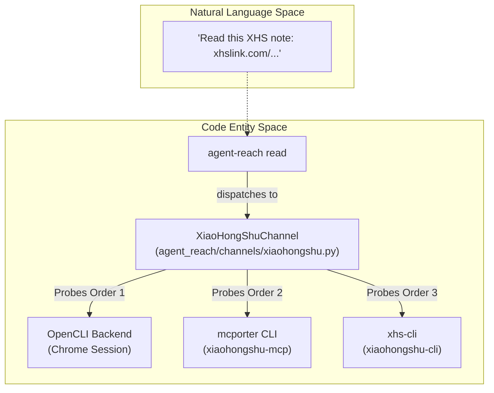
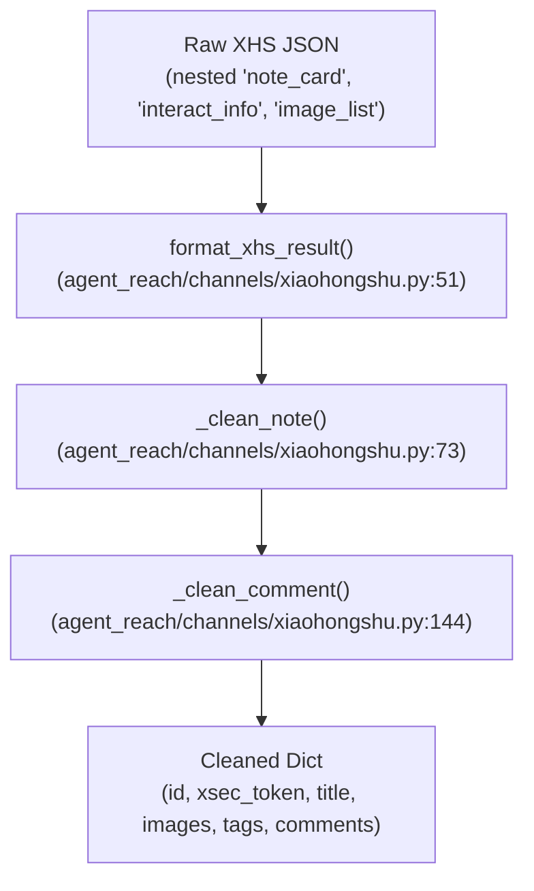
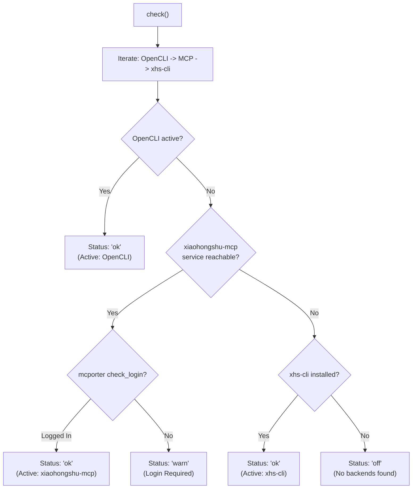

<!-- source: DeepWiki mcp.deepwiki.com · repo Panniantong/Agent-Reach · page 3.7 XiaoHongShu Channel · fetched 2026-10-30 -->

# XiaoHongShu Channel

<details>
<summary>Relevant source files</summary>

The following files were used as context for generating this wiki page:

- [agent_reach/channels/exa_search.py](agent_reach/channels/exa_search.py)
- [agent_reach/channels/xiaohongshu.py](agent_reach/channels/xiaohongshu.py)
- [agent_reach/guides/setup-xiaohongshu.md](agent_reach/guides/setup-xiaohongshu.md)
- [docs/cookie-export.md](docs/cookie-export.md)

</details>


This page documents `XiaoHongShuChannel`: its multi-backend stack (OpenCLI, xiaohongshu-mcp, and xhs-cli), authentication boundaries, data cleaning logic, and Docker-based setup. For the general channel interface that all channels implement, see [Channel Architecture](). For mcporter configuration, see [mcporter Setup]().

---

## Overview

`XiaoHongShuChannel` supports reading and searching XiaoHongShu (小红书) notes. It implements a multi-backend strategy: **OpenCLI** is prioritized for desktop environments with active browser sessions, while **xiaohongshu-mcp** (running via Docker) serves as the primary backend for server environments requiring explicit cookie imports.

| Property | Value |
|---|---|
| Class | `XiaoHongShuChannel` [agent_reach/channels/xiaohongshu.py:160]() |
| `name` | `"xiaohongshu"` [agent_reach/channels/xiaohongshu.py:161]() |
| `description` | `"小红书笔记"` [agent_reach/channels/xiaohongshu.py:162]() |
| `backends` | `["OpenCLI", "xiaohongshu-mcp", "xhs-cli (xiaohongshu-cli)"]` [agent_reach/channels/xiaohongshu.py:163]() |
| `tier` | `1` [agent_reach/channels/xiaohongshu.py:164]() |
| Supported Domains | `xiaohongshu.com`, `xhslink.com` [agent_reach/channels/xiaohongshu.py:169]() |

Sources: [agent_reach/channels/xiaohongshu.py:160-170]()

---

## Backend Architecture

The channel probes backends in a specific order to automatically adapt to the environment. **OpenCLI** is checked first; if a desktop Chrome session is not detected, it falls back to **xiaohongshu-mcp** (a Model Context Protocol server). **xhs-cli** remains as a legacy fallback for existing installations [agent_reach/channels/xiaohongshu.py:2-10]().

**System Entity Mapping:**



Sources: [agent_reach/channels/xiaohongshu.py:2-10](), [agent_reach/channels/xiaohongshu.py:181-190](), [agent_reach/guides/setup-xiaohongshu.md:4-6]()

---

## Authentication and Cookies

Agent Reach maintains a strict **Authentication Boundary**: it does not perform login or read browser cookies directly [agent_reach/guides/setup-xiaohongshu.md:14-15]().

1.  **OpenCLI**: Uses existing, user-controlled Chrome sessions. No cookie injection occurs [agent_reach/guides/setup-xiaohongshu.md:16-17]().
2.  **xiaohongshu-mcp**: Requires manual cookie export via the **Cookie-Editor** extension (Header String format) [agent_reach/guides/setup-xiaohongshu.md:21-23]().
3.  **Configuration**: The command `agent-reach configure xhs-cookies` saves the provided string to an owner-only local file or imports it directly into the `xiaohongshu-mcp` container if running [agent_reach/guides/setup-xiaohongshu.md:27-35]().

Sources: [agent_reach/guides/setup-xiaohongshu.md:12-36](), [docs/cookie-export.md:34-38]()

---

## Data Flow and Formatting

The `format_xhs_result` function cleans raw API responses to reduce token usage by stripping structural redundancy [agent_reach/channels/xiaohongshu.py:51-56]().

**Data Transformation Flow:**



### Key Formatting Rules
- **Fields Kept**: `id`, `note_id`, `xsec_token`, `title`, `desc`, `type`, `time` [agent_reach/channels/xiaohongshu.py:84-86]().
- **Author Info**: Extracts only `nickname` and `user_id` [agent_reach/channels/xiaohongshu.py:95-97]().
- **Image Handling**: Extracts raw URLs from `image_list` or `images_list` [agent_reach/channels/xiaohongshu.py:111-122]().
- **Engagement**: Flattens `interact_info` (likes, collections, comments, shares) into the top-level dictionary [agent_reach/channels/xiaohongshu.py:100-108]().

Sources: [agent_reach/channels/xiaohongshu.py:51-157]()

---

## Health Check and Diagnostics

The `check()` method probes candidates in order and returns the first fully usable backend or an actionable prescription for the best candidate [agent_reach/channels/xiaohongshu.py:171-177]().

**Diagnostic Logic:**



### MCP Service Detection
The helper `_mcp_service_reachable` verifies if the service is up on `localhost:18060` by explicitly bypassing proxies, as `localhost` must not be routed through `HTTP_PROXY` [agent_reach/channels/xiaohongshu.py:33-48]().

Sources: [agent_reach/channels/xiaohongshu.py:33-48](), [agent_reach/channels/xiaohongshu.py:171-191]()

---

## Server Setup: Docker MCP

For server-side usage, the Docker-based `xiaohongshu-mcp` is recommended.

1.  **Run Container**:
    ```bash
    docker run -d --name xiaohongshu-mcp -p 18060:18060 xpzouying/xiaohongshu-mcp
    ```
    [agent_reach/guides/setup-xiaohongshu.md:73-76]()
2.  **Register with mcporter**:
    ```bash
    mcporter config add xiaohongshu http://localhost:18060/mcp --scope home
    ```
    [agent_reach/guides/setup-xiaohongshu.md:78]()
3.  **Risk Mitigation**: If encountering "IP Risk" blocks, use a residential proxy by exporting `HTTP_PROXY` [agent_reach/guides/setup-xiaohongshu.md:62-63]().

Sources: [agent_reach/guides/setup-xiaohongshu.md:68-81]()

---

