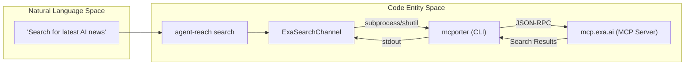
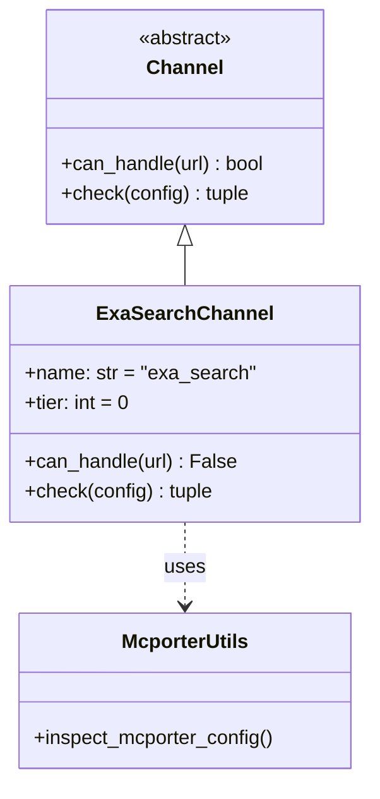

<!-- source: DeepWiki mcp.deepwiki.com · repo Panniantong/Agent-Reach · page 3.8 Exa Search Channel · fetched 2026-10-30 -->

# Exa Search Channel

<details>
<summary>Relevant source files</summary>

The following files were used as context for generating this wiki page:

- [agent_reach/channels/exa_search.py](agent_reach/channels/exa_search.py)
- [agent_reach/channels/xiaohongshu.py](agent_reach/channels/xiaohongshu.py)
- [agent_reach/guides/setup-exa.md](agent_reach/guides/setup-exa.md)
- [agent_reach/guides/setup-reddit.md](agent_reach/guides/setup-reddit.md)

</details>


This page documents `ExaSearchChannel`, the semantic web search channel implemented in `agent_reach/channels/exa_search.py`. It covers the channel's role as both a first-class search channel and a cross-channel search fallback, its `mcporter` + Exa MCP backend, and its zero-configuration setup.

For the abstract channel interface that `ExaSearchChannel` conforms to, see **3.1 Channel Architecture**. For `mcporter` configuration details, see **4.3 mcporter Setup**.

---

## Overview

`ExaSearchChannel` provides semantic web search by bridging to the Exa MCP server (`mcp.exa.ai`) via the `mcporter` CLI. It is a **search-only** channel: `can_handle()` always returns `False` [agent_reach/channels/exa_search.py:16-17](), ensuring it never intercepts URL reads. It is classified as **Tier 0** (zero-config) because it requires no API keys or complex local setup beyond the `mcporter` bridge [agent_reach/channels/exa_search.py:14]().

| Property | Value |
|---|---|
| `name` | `exa_search` [agent_reach/channels/exa_search.py:11]() |
| `description` | 全网语义搜索 [agent_reach/channels/exa_search.py:12]() |
| `backends` | `["Exa via mcporter"]` [agent_reach/channels/exa_search.py:13]() |
| `tier` | `0` [agent_reach/channels/exa_search.py:14]() |
| `can_handle()` | Always `False` [agent_reach/channels/exa_search.py:17]() |
| API key required | No [agent_reach/guides/setup-exa.md:32]() |

Sources: [agent_reach/channels/exa_search.py:10-17](), [agent_reach/guides/setup-exa.md:4-32]()

---

## Role in the System

`ExaSearchChannel` serves two primary functions:

1.  **Primary Search Provider**: Invoked directly via `agent-reach search` for general web queries.
2.  **Cross-Channel Fallback**: Used by other channels (Twitter, Reddit, LinkedIn) when their native search mechanisms fail or are blocked [agent_reach/guides/setup-reddit.md:47-53]().

**Search Capabilities via Exa:**
-   **General Web**: AI-powered semantic search.
-   **Reddit**: Targeted via `site:reddit.com` [agent_reach/guides/setup-exa.md:6]().
-   **Twitter/X**: Targeted via `site:x.com` [agent_reach/guides/setup-exa.md:7]().

Sources: [agent_reach/guides/setup-exa.md:3-8](), [agent_reach/guides/setup-reddit.md:47-55]()

---

## Architecture and Data Flow

The channel communicates with Exa through the `mcporter` CLI process, which connects to the official Exa MCP endpoint at `https://mcp.exa.ai/mcp` [agent_reach/guides/setup-exa.md:21]().

### Search Execution Flow



Sources: [agent_reach/channels/exa_search.py:19-44](), [agent_reach/guides/setup-exa.md:14-22]()

### Class Structure and Interface



Sources: [agent_reach/channels/exa_search.py:10-28]()

---

## Health Check and Diagnostics

The `check()` method is used by `agent-reach doctor` to verify the environment. Unlike simple CLI checks, it uses `inspect_mcporter_config()` to analyze the `mcporter` configuration file without necessarily spawning the full bridge process [agent_reach/channels/exa_search.py:28]().

| Condition | Status | Message / Action |
|---|---|---|
| `mcporter` missing | `"off"` | Prompts installation of `mcporter` [agent_reach/channels/exa_search.py:21-26]() |
| `exa` in config | `"warn"` | "Exa 已写入 mcporter 配置，但 Doctor 未启动远端服务做连通验证" [agent_reach/channels/exa_search.py:32-35]() |
| `exa` missing in config | `"off"` | Prompts `mcporter config add exa https://mcp.exa.ai/mcp` [agent_reach/channels/exa_search.py:41-44]() |
| Config read error | `"error"` | Reports `McporterConfigError` [agent_reach/channels/exa_search.py:29-30]() |

Sources: [agent_reach/channels/exa_search.py:19-44](), [agent_reach/channels/mcporter.py:1-25]()

---

## Setup and Configuration

Setup is typically handled automatically by `agent-reach install --env=auto --system` [agent_reach/guides/setup-exa.md:11-12]().

### Manual Configuration
If manual intervention is required, the following steps register the Exa MCP server:

1.  **Install Bridge**: `npm install -g mcporter` [agent_reach/guides/setup-exa.md:16]()
2.  **Register Server**: `mcporter config add exa https://mcp.exa.ai/mcp --scope home` [agent_reach/guides/setup-exa.md:21]()
3.  **Verify**: `agent-reach doctor` [agent_reach/guides/setup-exa.md:26]()

### Implementation Detail: `check()`
The implementation utilizes `shutil.which` to locate the binary and the `inspect_mcporter_config` utility to parse the local JSON configuration [agent_reach/channels/exa_search.py:21-28]().

```python
# [agent_reach/channels/exa_search.py:21-31]
if not shutil.which("mcporter"):
    return "off", (
        "需要 mcporter + Exa MCP。安装：\n"
        "  npm install -g mcporter\n"
        "  mcporter config add exa https://mcp.exa.ai/mcp --scope home"
    )
try:
    inspection = inspect_mcporter_config()
except McporterConfigError as exc:
    return "error", f"mcporter 配置检查失败：{exc}"
```

Sources: [agent_reach/channels/exa_search.py:19-31](), [agent_reach/guides/setup-exa.md:14-22]()

---

## Limitations and Behavior

-   **Search-Only**: `ExaSearchChannel` does not implement `read()`. It is designed to find content, which is then typically read by `WebChannel` or specific platform channels [agent_reach/channels/exa_search.py:17]().
-   **No API Key**: The official MCP endpoint provided by Exa (`mcp.exa.ai`) currently operates without requiring an API key for the bridge [agent_reach/guides/setup-exa.md:32]().
-   **Dependency**: Relies on Node.js being installed to run `mcporter` [agent_reach/guides/setup-exa.md:16]().
-   **Doctor Verification**: The `check()` method reports `warn` even if configured, as it avoids making a network request during a simple status check to prevent unnecessary credential/network usage [agent_reach/channels/exa_search.py:32-35]().

Sources: [agent_reach/channels/exa_search.py:16-44](), [agent_reach/guides/setup-exa.md:29-42]()

---

