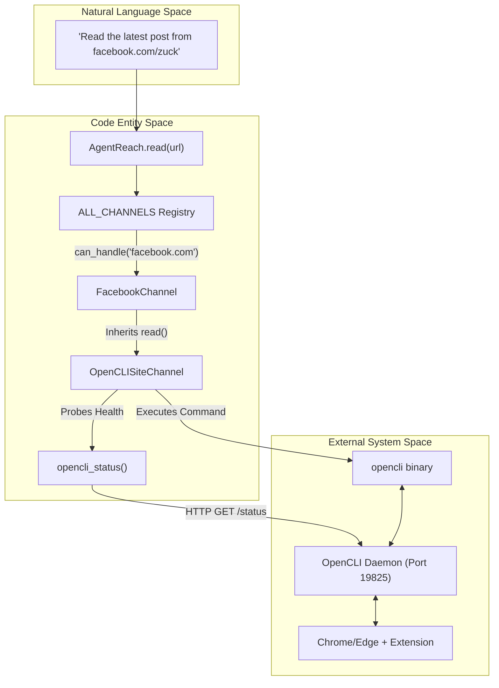
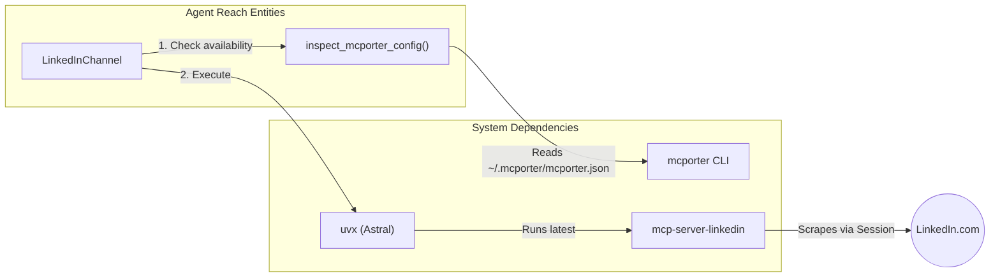

<!-- source: DeepWiki mcp.deepwiki.com · repo Panniantong/Agent-Reach · page 3.9 Facebook, Instagram, and LinkedIn Channels · fetched 2026-10-30 -->

# Facebook, Instagram, and LinkedIn Channels

Relevant source files

The following files were used as context for generating this wiki page:

- [agent_reach/backends/opencli.py](agent_reach/backends/opencli.py)
- [agent_reach/channels/__init__.py](agent_reach/channels/__init__.py)
- [agent_reach/channels/instagram.py](agent_reach/channels/instagram.py)
- [agent_reach/channels/linkedin.py](agent_reach/channels/linkedin.py)
- [agent_reach/channels/mcporter.py](agent_reach/channels/mcporter.py)
- [tests/test_channel_contracts.py](tests/test_channel_contracts.py)
- [tests/test_opencli_backend.py](tests/test_opencli_backend.py)

This page documents the implementation of the Facebook, Instagram, and LinkedIn channels. These channels are categorized as **Tier 2** (needs setup) because they rely on external browser-bridge tools or specialized MCP servers to bypass modern web scrap-protection and session requirements.

## Overview

Facebook and Instagram share a common architecture based on the `OpenCLISiteChannel` base class, which utilizes a local browser-bridge to reuse the user's active Chrome/Edge session. LinkedIn utilizes the Model Context Protocol (MCP) via `mcporter`.

| Channel | Class | File | Primary Backend | Tier |
|:---|:---|:---|:---|:---|
| **Facebook** | `FacebookChannel` | [agent_reach/channels/facebook.py:7-13]() | OpenCLI | 2 |
| **Instagram** | `InstagramChannel` | [agent_reach/channels/instagram.py:7-13]() | OpenCLI | 2 |
| **LinkedIn** | `LinkedInChannel` | [agent_reach/channels/linkedin.py:23-28]() | `mcp-server-linkedin` | 2 |

Sources: [agent_reach/channels/__init__.py:26-42](), [agent_reach/channels/facebook.py:7-13](), [agent_reach/channels/instagram.py:7-13](), [agent_reach/channels/linkedin.py:23-28]()

---

## OpenCLISiteChannel Base Class

The `FacebookChannel` and `InstagramChannel` are subclasses of `OpenCLISiteChannel` [agent_reach/channels/_opencli_site.py:10-14](). This shared base class implements the logic for interacting with **OpenCLI**, a tool that drives the user's real browser via a bridge extension.

### Data Flow: Natural Language to Code Entity

**Diagram: OpenCLI Browser-Bridge Interaction**

Sources: [agent_reach/channels/_opencli_site.py:10-40](), [agent_reach/backends/opencli.py:128-157](), [agent_reach/channels/facebook.py:7-13]()

### Implementation Details
- **Zero Configuration:** No API keys or manual cookie exports are needed; it reuses the browser's `Cookie` header automatically.
- **Desktop Only:** Since it requires a GUI browser, it is not suitable for headless server environments.
- **Health Probing:** The `opencli_status()` function performs a side-effect-free probe by checking the CLI version and querying the local daemon's `/status` endpoint [agent_reach/backends/opencli.py:128-157]().
- **Warning State:** These channels report `warn` rather than `ok` in `agent-reach doctor` because while the bridge might be active, the code cannot verify if the user is actually logged into the specific site without performing a heavy page load [agent_reach/backends/opencli.py:158-179]().

---

## Instagram Channel

**File:** [agent_reach/channels/instagram.py]()

The `InstagramChannel` handles URLs for `instagram.com` and `instagr.am` [agent_reach/channels/instagram.py:11-11](). It provides specific OpenCLI commands for searching, profile extraction, and exploring posts [agent_reach/channels/instagram.py:12-12]().

### Key Commands
- **Search:** `agent-reach search-instagram <query>`
- **Read:** `agent-reach read https://www.instagram.com/openai/`

Sources: [agent_reach/channels/instagram.py:7-13]()

---

## Facebook Channel

**File:** [agent_reach/channels/facebook.py]()

The `FacebookChannel` handles `facebook.com` and `fb.com` [agent_reach/channels/facebook.py:11-11](). Like Instagram, it leverages the OpenCLI bridge to bypass Facebook's aggressive login walls.

### Key Commands
- **Search:** `agent-reach search-facebook <query>`
- **Read:** `agent-reach read https://www.facebook.com/zuck`

Sources: [agent_reach/channels/facebook.py:7-13]()

---

## LinkedIn Channel

**File:** [agent_reach/channels/linkedin.py]()

Unlike the OpenCLI-based channels, `LinkedInChannel` is built around the **Model Context Protocol (MCP)**. It primarily uses `mcp-server-linkedin` via the `mcporter` bridge [agent_reach/channels/linkedin.py:26-26]().

### Backend Strategy
1. **Primary:** `mcp-server-linkedin` (Full profile, company, and job data).
2. **Fallback:** `Jina Reader` (Basic public content extraction).

### Data Flow: MCP Routing

**Diagram: LinkedIn MCP Routing**

Sources: [agent_reach/channels/linkedin.py:34-69](), [agent_reach/channels/mcporter.py:32-47]()

### Status Checking (`check`)
The `check()` method performs a multi-stage validation:
- **Missing mcporter:** Returns `off` with installation instructions for `uv` and `mcporter` [agent_reach/channels/linkedin.py:36-43]().
- **Config Validation:** Uses `inspect_mcporter_config()` to see if any known LinkedIn server names (e.g., `linkedin-scraper`, `mcp-server-linkedin`) are registered in the `mcporter` configuration [agent_reach/channels/linkedin.py:45-48]().
- **Missing uvx:** If configured but `uvx` is missing from the system path, it issues a `warn` [agent_reach/channels/linkedin.py:49-54]().
- **Verification Warning:** Even if everything looks correct, it reports `warn` because `doctor` does not start the local service to verify live connectivity, to avoid side effects [agent_reach/channels/linkedin.py:55-58]().

Sources: [agent_reach/channels/linkedin.py:34-69](), [agent_reach/channels/mcporter.py:49-82]()

---

