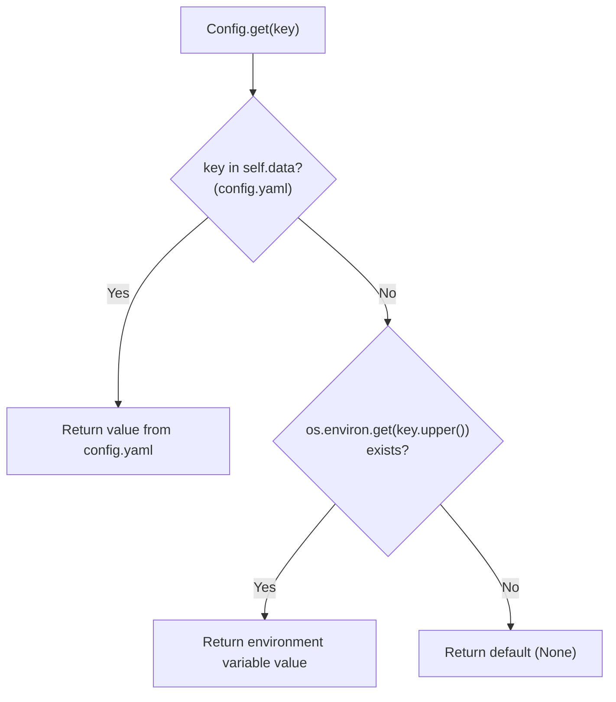
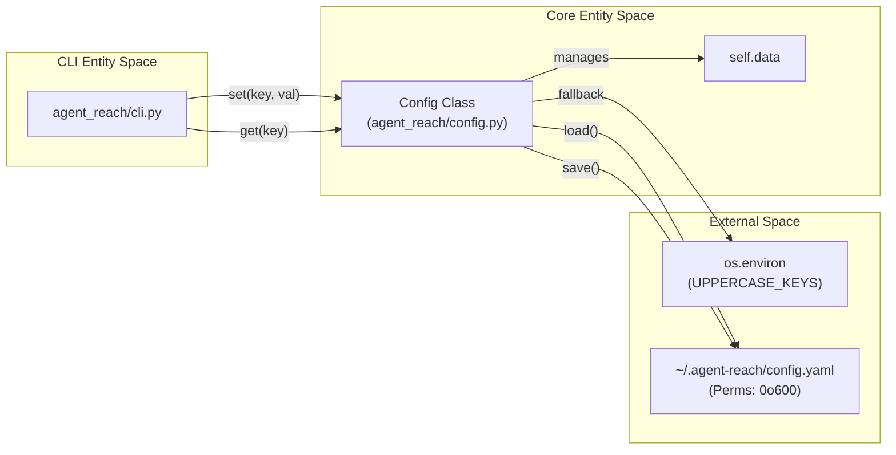

<!-- source: DeepWiki mcp.deepwiki.com · repo Panniantong/Agent-Reach · page 4 Configuration · fetched 2026-10-30 -->

# Configuration

<details>
<summary>Relevant source files</summary>

The following files were used as context for generating this wiki page:

- [agent_reach/cli.py](agent_reach/cli.py)
- [agent_reach/config.py](agent_reach/config.py)
- [tests/test_config.py](tests/test_config.py)

</details>


This page documents Agent Reach's configuration system: where settings are stored, how the `Config` class manages them, and how values are resolved at runtime. For step-by-step instructions on specific configuration tasks, see the following sub-pages:

- [Cookie Export Guide](#4.1) — Instructions for Twitter, Instagram, XiaoHongShu, and Bilibili session management.
- [Proxy Configuration](#4.2) — Setting up network proxies for Reddit, Bilibili, and other restricted platforms.
- [mcporter Setup](#4.3) — Configuring the MCP bridge for XiaoHongShu, LinkedIn, and Exa semantic search.

---

## Storage Location

All configuration is stored in a single YAML file at:

```
~/.agent-reach/config.yaml
```

The directory and file are managed by the `Config` class. The private directory is created only on the first write via `_ensure_dir()` [agent_reach/config.py:126-130](). To protect sensitive credentials, the file is written with **mode `0o600`** (owner read/write only) using an atomic write process [agent_reach/config.py:46-80]().

**Sources:** [agent_reach/config.py:102-103](), [agent_reach/config.py:126-130]()

---

## The `Config` Class

The `Config` class in [agent_reach/config.py:99-233]() is the central authority for configuration. It handles loading, saving, and validating requirements for specific features.

**Diagram: Config class structure**

```mermaid
classDiagram
    class "Config" {
        +CONFIG_DIR: Path
        +CONFIG_FILE: Path
        +FEATURE_REQUIREMENTS: dict
        +config_path: Path
        +data: dict
        +load()
        +save()
        +get(key, default) Any
        +set(key, value)
        +delete(key)
        +is_configured(feature) bool
        +get_configured_features() dict
        -_ensure_dir()
    }
```

**Sources:** [agent_reach/config.py:99-233]()

### Core Methods

| Method | Description |
|---|---|
| `load()` | Reads `config.yaml` using `yaml.safe_load`. Rejects symlinks for security [agent_reach/config.py:132-150](). |
| `save()` | Atomically writes `self.data` to disk. On non-Windows systems, it enforces `0o600` permissions [agent_reach/config.py:152-157](). |
| `get(key, default)` | Retrieves a value from the data dict, falling back to the uppercase environment variable [agent_reach/config.py:159-168](). |
| `set(key, value)` | Updates a key and persists changes to disk immediately [agent_reach/config.py:170-184](). |
| `delete(key)` | Removes a key and persists changes to disk [agent_reach/config.py:186-197](). |
| `is_configured(feature)` | Validates if all keys required by a feature in `FEATURE_REQUIREMENTS` are present [agent_reach/config.py:199-202](). |

**Sources:** [agent_reach/config.py:132-202]()

---

## Value Resolution Order

When `get(key)` is called, the system checks the configuration file first, followed by environment variables.

**Diagram: Value resolution in `Config.get()`**



**Sources:** [agent_reach/config.py:159-168]()

---

## Feature Requirements Map

The `FEATURE_REQUIREMENTS` map [agent_reach/config.py:106-112]() defines the minimum necessary keys for Agent Reach features to function. This map is used by the `doctor` command to report channel health.

| Feature name | Required config keys |
|---|---|
| `exa_search` | `exa_api_key` |
| `twitter_xreach` | `twitter_auth_token`, `twitter_ct0` |
| `groq_whisper` | `groq_api_key` |
| `openai_whisper` | `openai_api_key` |
| `github_token` | `github_token` |

**Sources:** [agent_reach/config.py:106-112]()

---

## Security and Permissions

Agent Reach employs several layers of security for its configuration:

1.  **Symlink Rejection**: `_reject_symlink` [agent_reach/config.py:39-44]() prevents "file hijacking" by refusing to read or write through symbolic links.
2.  **Atomic Writes**: `_atomic_write_yaml` [agent_reach/config.py:46-96]() writes to a temporary file before replacing the target, ensuring the config isn't corrupted during a crash.
3.  **Restricted Permissions**: The system uses `os.fchmod` (where available) to set `stat.S_IRUSR | stat.S_IWUSR` (0o600) so only the current user can read the credentials [agent_reach/config.py:61-62]().
4.  **Credential Masking**: The `to_dict()` method (tested in [tests/test_config.py:75-137]()) ensures that sensitive keys like `twitter_auth_token` or `proxy` are redacted when converted to a dictionary for logging.

**Sources:** [agent_reach/config.py:46-96](), [tests/test_config.py:139-182]()

---

## Config Lifecycle Diagram

**Diagram: Config interaction across Code Entities**



**Sources:** [agent_reach/config.py:99-233](), [agent_reach/cli.py:98-128]()

---

