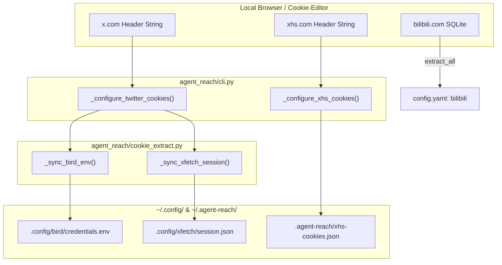
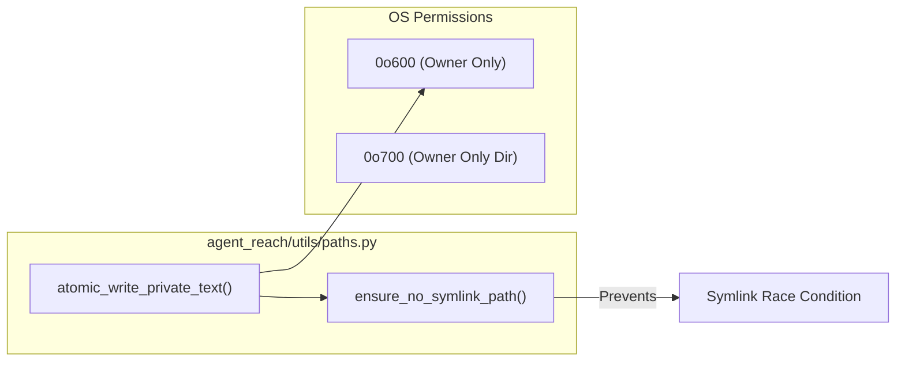

<!-- source: DeepWiki mcp.deepwiki.com · repo Panniantong/Agent-Reach · page 4.1 Cookie Export Guide · fetched 2026-10-30 -->

# Cookie Export Guide

<details>
<summary>Relevant source files</summary>

The following files were used as context for generating this wiki page:

- [agent_reach/cookie_extract.py](agent_reach/cookie_extract.py)
- [agent_reach/guides/setup-xiaohongshu.md](agent_reach/guides/setup-xiaohongshu.md)
- [agent_reach/utils/paths.py](agent_reach/utils/paths.py)
- [docs/cookie-export.md](docs/cookie-export.md)
- [tests/test_cookie_extract_perms.py](tests/test_cookie_extract_perms.py)
- [tests/test_private_file_writes.py](tests/test_private_file_writes.py)

</details>


This page explains how to export browser session cookies from your local machine and supply them to Agent Reach. This is necessary when Agent Reach is running on a server without direct browser access, or when you want to automate authentication for specific channels using your existing browser session.

Agent Reach provides a built-in automated extraction tool (`--from-browser`) for local environments and manual methods for server environments.

---

## When Cookies Are Required

Not all channels need cookies. The following table maps platforms to their required config keys and the channels that consume them:

| Platform | Config Key | Channel Class | What it unlocks |
|---|---|---|---|
| Twitter / X | `twitter-cookies` | `TwitterChannel` | Search, timeline, authenticated reads |
| XiaoHongShu | `xhs-cookies` | `XiaoHongShuChannel` | Note fetching, search, comments |
| Instagram | `instagram-cookies` | `InstagramChannel` | Private content, profile reads |
| Bilibili | `bilibili` | `BilibiliChannel` | Age-restricted and member-only content |

Sources: [agent_reach/cookie_extract.py:32-57](), [agent_reach/guides/setup-xiaohongshu.md:14-29]()

---

## Method 1: Cookie-Editor Extension (Recommended — 30 seconds per site)

This method is the most reliable for both local and server environments, especially for platforms where automatic extraction is disabled due to project policy (e.g., Twitter and XiaoHongShu).

**Steps:**
1. Install **Cookie-Editor** for Chrome, Firefox, or Edge: [Chrome Web Store](https://chromewebstore.google.com/detail/cookie-editor/hlkenndednhfkekhgcdicdfddnkalmdm).
2. Go to the website (e.g., `https://x.com`) and make sure you're logged in.
3. Click the Cookie-Editor icon in your toolbar.
4. Click **Export** → **Header String**.
5. Provide the result to Agent Reach:
   ```bash
   agent-reach configure twitter-cookies
   # Paste the exported string into the hidden prompt
   ```

Sources: [docs/cookie-export.md:6-27](), [agent_reach/guides/setup-xiaohongshu.md:21-29]()

---

## Method 2: Browser DevTools (Manual)

1. Open the site (e.g., `https://www.bilibili.com`) and log in.
2. Press **F12** (or right-click → Inspect) and click the **Network** tab.
3. Refresh the page (F5).
4. Click any request in the list.
5. In the right panel, scroll to **Request Headers**.
6. Find the line starting with `Cookie:`.
7. Copy the entire value after `Cookie: ` and provide it to `agent-reach configure`.

Sources: [docs/cookie-export.md:48-58]()

---

## Method 3: Auto-Extraction (Local Chromium Only)

For platforms like Bilibili and Xueqiu, Agent Reach can extract cookies directly from local Chromium-based browsers if you are running the CLI on the same machine.

**Command:**
```bash
agent-reach configure --from-browser chrome --platform bilibili
```
*Supported browsers: chrome, edge, brave.*

### Implementation Details
The extraction logic in `agent_reach/cookie_extract.py` targets specific browser profiles and cookie databases.

**Data Flow (Auto-Extraction):**
1. `list_browser_profiles(browser)` [agent_reach/cookie_extract.py:122-154]() locates the `Cookies` or `Network/Cookies` SQLite database in the user data directory [agent_reach/cookie_extract.py:136-139]().
2. `_platform_spec(platform)` [agent_reach/cookie_extract.py:181-196]() retrieves the target domains and required cookie names (e.g., `SESSDATA` for Bilibili).
3. `_require_browser_extractable(spec)` [agent_reach/cookie_extract.py:198-207]() enforces a project policy where high-risk platforms like Twitter and XHS *must* use manual export via Cookie-Editor [agent_reach/cookie_extract.py:65-68]().

Sources: [agent_reach/cookie_extract.py:70-86](), [agent_reach/cookie_extract.py:122-207]()

---

## Technical Mapping: Browser to Code Entities

The following diagrams illustrate how extracted browser data is mapped to internal configuration keys and eventually used by specific Channel classes.

**Diagram: Cookie Data Flow to Channel Entities**



**Diagram: Credential Protection Mechanism**



Sources: [agent_reach/cookie_extract.py:115-156](), [agent_reach/utils/paths.py:71-136](), [tests/test_cookie_extract_perms.py:44-92]()

---

## Platform-Specific Details

### Twitter / X
Twitter authentication requires `auth_token` and `ct0`. When configured, Agent Reach automatically syncs these to:
- `~/.config/bird/credentials.env`: Used by the `bird` Node.js CLI [agent_reach/cookie_extract.py:141-156]().
- `~/.config/xfetch/session.json`: Used by the `bird-x` / `xfetch` backend [agent_reach/cookie_extract.py:115-135]().

### XiaoHongShu (XHS)
XHS requires a complete cookie set. 
- `agent-reach configure xhs-cookies` parses the Header String into a JSON array of cookies [agent_reach/guides/setup-xiaohongshu.md:31-35]().
- If a `xiaohongshu-mcp` Docker container is running, the CLI attempts to import cookies into the container [agent_reach/guides/setup-xiaohongshu.md:34-36]().
- Otherwise, it writes to `~/.agent-reach/xhs-cookies.json` with `0o600` permissions [tests/test_private_file_writes.py:119-123]().

### Bilibili and Xueqiu
- **Bilibili:** Targets `SESSDATA` and `bili_jct` [agent_reach/cookie_extract.py:48-48]().
- **Xueqiu:** Targets `xq_a_token` [agent_reach/cookie_extract.py:54-54]().

---

## Security and Permissions
Agent Reach follows a strict security model for credentials:
- **Atomic Writes:** Uses `atomic_write_private_text` to prevent partial writes or corruption [agent_reach/utils/paths.py:71-136]().
- **Symlink Protection:** The `ensure_no_symlink_path` helper rejects paths that contain symlinks to prevent credential redirection attacks [agent_reach/utils/paths.py:34-47]().
- **POSIX Permissions:** Files like `credentials.env` and `session.json` are strictly set to `0o600` [tests/test_cookie_extract_perms.py:44-50]().
- **Shell Injection Guard:** When writing `bird/credentials.env`, values are shell-quoted to prevent arbitrary command execution during `source` operations [tests/test_cookie_extract_perms.py:94-133]().

Sources: [agent_reach/utils/paths.py:71-136](), [tests/test_private_file_writes.py:19-26](), [tests/test_cookie_extract_perms.py:94-133]()

---

